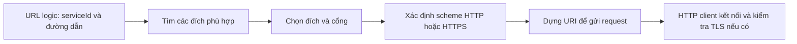
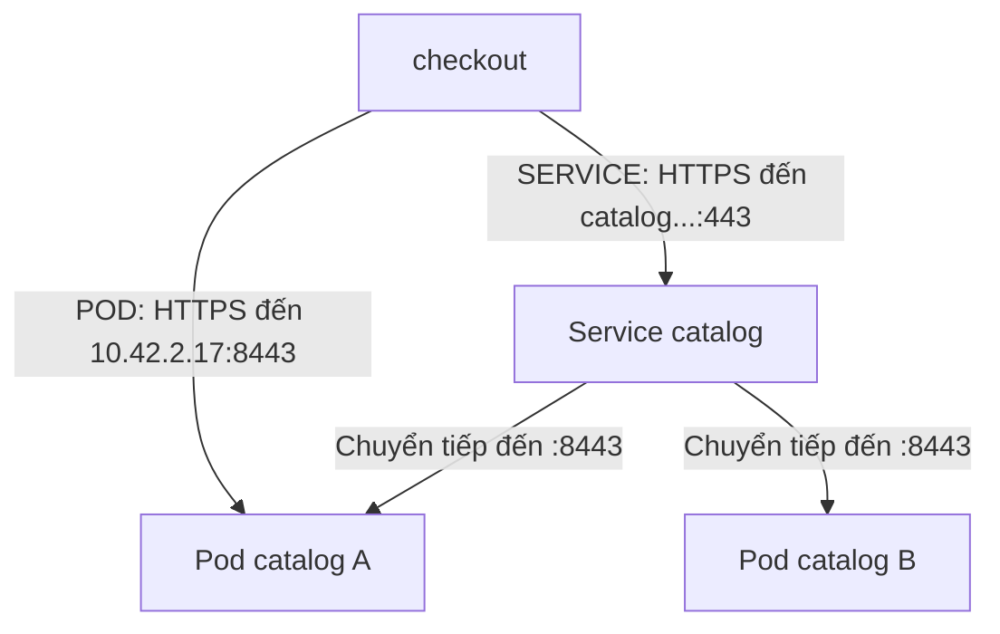

# Chọn cổng và giao thức cho yêu cầu cân bằng tải

## Mục tiêu trong chương Cân bằng tải

Trong module **SPRING_CLOUD_KUBERNETES**, Spring Cloud LoadBalancer giúp ứng dụng chọn đích gọi từ thông tin dịch vụ Kubernetes. Chọn đúng dịch vụ và đúng instance vẫn chưa đủ: request còn phải dùng đúng cổng, đúng HTTP hoặc HTTPS và đúng địa chỉ để xác minh chứng thư khi có TLS.

Bài này tập trung vào cách các quyết định đó phối hợp với nhau. Sau bài học, bạn có thể:

- Phân biệt cổng Service, cổng backend và cổng quản trị.
- Chọn đúng cấu hình cổng cho chế độ `POD` và `SERVICE`.
- Hiểu mối liên hệ giữa tên cổng, `isSecure()`, scheme và URI request sau resolve.
- Kiểm chứng đích thực tế thay vì chỉ đọc URL logic trong mã nguồn.
- Chẩn đoán lỗi do chọn sai cổng hoặc sai giao thức trước khi thay đổi thuật toán cân bằng tải.

Các ví dụ dùng ứng dụng gọi `checkout`, Service đích `catalog`, namespace `learning` và cluster domain giả định `cluster.local`. Phạm vi chính là Service `ClusterIP` thông thường có selector và backend HTTP/HTTPS. Headless Service, `ExternalName`, gRPC hay giao thức khác cần xem xét riêng theo implementation.

## 1. Bốn thông tin phải khớp trước khi gửi request

Một request được cân bằng tải đi qua chuỗi quyết định:



Cần đối chiếu bốn thông tin:

| Thông tin | Câu hỏi cần trả lời |
|---|---|
| Định danh dịch vụ | Có đang gọi đúng Service và namespace không? |
| Host | Gọi trực tiếp Pod IP hay DNS của Service? |
| Port | Dùng cổng ở phía Service hay cổng endpoint của Pod? |
| Scheme | Listener đích nhận HTTP hay HTTPS? |

Ví dụ URL logic:

```text
https://catalog/api/identity
```

Trong một HTTP client có tích hợp LoadBalancer, `catalog` được dùng làm định danh dịch vụ. Đích vật lý sẽ được xác định sau đó. Với HTTP client thông thường không tích hợp LoadBalancer, `catalog` chỉ là hostname được đưa cho cơ chế DNS của môi trường chạy. Hai đường gọi này có thể trông giống nhau trong mã nhưng vận hành khác nhau.

Không dùng việc “request đã vào một Pod nào đó” làm tiêu chí duy nhất. Request vào nhầm cổng quản trị cũng có thể nhận phản hồi HTTP, trong khi endpoint nghiệp vụ cần gọi vẫn chưa được sử dụng.

## 2. Đọc hợp đồng cổng của Service trước

Giả sử ứng dụng `catalog` đã có ba listener độc lập:

- HTTP nghiệp vụ trên `8080`.
- HTTPS nghiệp vụ trên `8443` với TLS thực sự được cấu hình.
- HTTP quản trị trên `9090` với chính sách truy cập riêng.

Service minh họa:

```yaml
apiVersion: v1
kind: Service
metadata:
  name: catalog
  namespace: learning
  labels:
    app: catalog
    primary-port-name: https
spec:
  type: ClusterIP
  selector:
    app: catalog
  ports:
    - name: http
      protocol: TCP
      port: 80
      targetPort: 8080
    - name: https
      protocol: TCP
      port: 443
      targetPort: 8443
    - name: management
      protocol: TCP
      port: 9090
      targetPort: 9090
```

Đây là một ví dụ tài nguyên, không tự tạo các listener trong ứng dụng. Nếu backend chỉ có HTTPS `8443`, không công bố thêm cổng HTTP chỉ vì muốn dùng nguyên ví dụ.

| Tên cổng Service | Cổng qua Service | Cổng backend minh họa | Mục đích |
|---|---:|---:|---|
| `http` | 80 | 8080 | API nghiệp vụ HTTP |
| `https` | 443 | 8443 | API nghiệp vụ HTTPS |
| `management` | 9090 | 9090 | Health/metrics hoặc API quản trị được cho phép |

`port` là cổng Service công bố, còn `targetPort` là cổng backend được chuyển tới. Kubernetes cũng cho phép `targetPort` tham chiếu tên cổng của container; khi đó phải kiểm tra giá trị đã được phân giải trong endpoint. Xem [Service và ánh xạ cổng trong Kubernetes](https://kubernetes.io/docs/concepts/services-networking/service/).

`protocol: TCP` mô tả giao thức vận chuyển. Nó không quyết định request phải là HTTP hay HTTPS. Tên cổng và `appProtocol`, nếu được sử dụng, cũng không tự tạo chứng thư hoặc bật TLS listener cho Spring Boot; các thành phần tích hợp diễn giải tín hiệu đó theo cơ chế của chúng.

## 3. Xác định đang dùng POD hay SERVICE

Spring Cloud Kubernetes LoadBalancer có hai chế độ chính. Với mô hình Service của bài:

| Chế độ | Đích phía ứng dụng lựa chọn | Cổng cần thấy trong đích minh họa | Đường đi |
|---|---|---:|---|
| `POD` | Instance do DiscoveryClient cung cấp, thường là endpoint Pod | 8443 khi chọn HTTPS | `checkout → PodIP:8443` |
| `SERVICE` | Địa chỉ Service | 443 khi chọn HTTPS | `checkout → ServiceDNS:443 → Pod:8443` |

Quy tắc chế độ và chọn cổng Service được mô tả trong [LoadBalancer for Kubernetes](https://docs.spring.io/spring-cloud-kubernetes/reference/load-balancer.html). Phải kiểm tra starter/auto-configuration thực tế để biết cấu hình này đang tác động đến đường gọi nào.



Đừng lấy cổng Service `443` ghép với Pod IP rồi mặc định có listener tại đó. Cũng đừng lấy DNS Service ghép với `8443` nếu Service chỉ công bố HTTPS trên `443`.

Trong chế độ `SERVICE`, ứng dụng lựa chọn đích ở mức Service; việc đưa kết nối tới Pod còn phụ thuộc cơ chế mạng Kubernetes và hạ tầng liên quan. Kết nối HTTP được tái sử dụng có thể tiếp tục tới cùng một backend. Không kỳ vọng cứ mỗi request qua cùng một kết nối là một Pod khác phải được chọn.

## 4. Chọn cổng khi dùng POD

### 4.1. Cấu hình hướng đến DiscoveryClient

Chế độ `POD` lấy instance qua DiscoveryClient. Với dịch vụ nhiều cổng, hãy khai báo ý định chọn cổng ở lớp discovery:

```yaml
spring:
  cloud:
    kubernetes:
      discovery:
        namespaces:
          - learning
        primary-port-name: https
      loadbalancer:
        mode: POD
```

Trong Service minh họa, label sau cũng đã diễn đạt cổng chính:

```yaml
metadata:
  labels:
    primary-port-name: https
```

Khi có nhiều cổng, giá trị label `primary-port-name` của từng Service được ưu tiên so với thuộc tính chung `spring.cloud.kubernetes.discovery.primary-port-name`. Vì vậy, đổi thuộc tính client sang `http` nhưng để label của `catalog` là `https` không nhất thiết đổi được cổng của `catalog`.

Tóm tắt lựa chọn đối với danh sách cổng endpoint trong implementation được tham chiếu:

1. Một cổng: dùng cổng duy nhất.
2. Nhiều cổng: thử tên chính từ label Service, hoặc thuộc tính chung nếu không có label.
3. Nếu chưa chọn được: thử tên `https`, rồi `http`.
4. Cuối cùng có thể rơi về một cổng đầu tiên trong tập cổng; không nên dựa vào lựa chọn dự phòng này.

Trường hợp không có cổng usable phải được xem là dữ liệu không đủ để gọi nghiệp vụ. Chi tiết lựa chọn và thứ tự fallback có trong [DiscoveryClientUtils](https://github.com/spring-cloud/spring-cloud-kubernetes/blob/main/spring-cloud-kubernetes-commons/src/main/java/org/springframework/cloud/kubernetes/commons/discovery/DiscoveryClientUtils.java); đối chiếu tag đúng phiên bản khi triển khai.

### 4.2. Kết quả mong đợi của ví dụ

Nếu endpoint đã phân giải đúng `https → 8443`, một instance có thể được mô tả:

```text
serviceId = catalog
host      = 10.42.2.17
port      = 8443
scheme    = https
secure    = true
```

Đó là dữ liệu minh họa, không phải kết quả đọc từ cluster. Điểm cần kiểm chứng là tổ hợp **Pod IP + cổng endpoint + scheme**, thay vì sao chép cổng `443` từ Service.

Chỉ đặt `spring.cloud.kubernetes.loadbalancer.port-name: https` rồi giữ đường `POD` không thay thế cho việc cấu hình cổng của DiscoveryClient. Hai thuộc tính nằm ở hai cơ chế lựa chọn khác nhau.

Nếu dùng HTTP DiscoveryClient qua Discovery Server, phần suy ra cổng từ tài nguyên Kubernetes diễn ra phía server. Cần đặt cấu hình discovery phù hợp ở thành phần tạo instance; đổi một thuộc tính chỉ ở ứng dụng tiêu thụ kết quả có thể không thay đổi dữ liệu server trả về.

## 5. Chọn cổng khi dùng SERVICE

### 5.1. Cấu hình tên cổng Service

Ví dụ client chọn HTTPS qua Service:

```yaml
spring:
  cloud:
    kubernetes:
      discovery:
        namespaces:
          - learning
      loadbalancer:
        mode: SERVICE
        port-name: https
        cluster-domain: cluster.local
```

`port-name` là tên cổng, không phải số cổng. Giá trị `https` cần khớp `spec.ports[].name` trong Service.

Đối với chế độ này: Service không có cổng bị bỏ qua; Service một cổng dùng cổng đó; Service nhiều cổng được chọn theo `port-name` và có thể rơi về cổng đầu tiên nếu không tìm thấy tên. Tên mặc định là `http`. Đừng coi sai tên là tình huống chắc chắn làm ứng dụng dừng ngay; cần kiểm tra đích đã chọn.

Ví dụ kỳ vọng:

```text
serviceId = catalog
host      = catalog.learning.svc.cluster.local
port      = 443
scheme    = https
```

Các key `mode`, `port-name` và `cluster-domain` được liệt kê trong [phụ lục cấu hình Spring Cloud Kubernetes](https://docs.spring.io/spring-cloud-kubernetes/reference/appendix.html). Dạng `portName` trong một số ví dụ tài liệu là cách viết tương ứng qua cơ chế binding; bài này dùng `port-name` trong YAML.

### 5.2. Các trường hợp dễ chọn nhầm

| Cấu hình hoặc tài nguyên | Điều cần kiểm tra |
|---|---|
| Service có cả `http` và `https`, client để mặc định tên cổng | Client có thể chọn `http` thay vì HTTPS mong muốn |
| Client đặt `port-name: https`, Service đặt tên `https-api` | Tên không khớp; kiểm tra có bị chọn cổng dự phòng không |
| Service chỉ có cổng `management` | Cơ chế một cổng có thể chọn chính cổng đó |
| Service có label `primary-port-name: https`, client `SERVICE` chọn `http` | Label discovery không thay thế quy tắc `port-name` của chế độ Service |
| Chuyển `POD` sang `SERVICE` nhưng giữ kỳ vọng cổng 8443 | Kiểm tra lại cổng Service; ví dụ này cần 443 |

Nếu nhiều dịch vụ dùng những tên cổng nghiệp vụ khác nhau, một giá trị tên cổng chung có thể không phù hợp với tất cả. Nên thống nhất hợp đồng đặt tên, tách Service theo mục đích, hoặc cấu hình lựa chọn riêng bằng cơ chế được phiên bản hỗ trợ. Không đoán một prefix cấu hình theo từng service rồi mặc định thư viện sẽ đọc nó.

Một Service nghiệp vụ tách riêng khỏi Service quản trị thường giúp ý định rõ hơn. Tuy nhiên, phân tách cổng hoặc Service chưa phải cơ chế phân quyền; vẫn phải thiết kế chính sách mạng và xác thực cho API quản trị.

## 6. Chọn giao thức sau khi đã xác định cổng

### 6.1. Tín hiệu HTTPS

Cơ chế mặc định được tài liệu discovery mô tả xét label Service `secured`, annotation cùng tên khi không có label, danh sách `spring.cloud.kubernetes.discovery.known-secure-ports` mặc định `[443, 8443]`, rồi tên cổng `https`. Những giá trị bật gồm `true`, `on`, `yes`, `1`. Xem [nhận diện secure trong DiscoveryClient](https://docs.spring.io/spring-cloud-kubernetes/reference/discovery-client.html).

Điều quan trọng là tín hiệu phải áp dụng đúng **cổng đã chọn**. Một tên cổng riêng như `tls-api` không nên được mặc định có cùng ý nghĩa với tên chính xác `https` đối với mọi implementation.

Nếu toàn bộ đường gọi của một Service được thiết kế là HTTPS và cần khai báo rõ, có thể dùng label:

```yaml
metadata:
  labels:
    secured: "true"
```

Đừng gắn cờ này thiếu cân nhắc lên Service công bố cả HTTP, HTTPS và management. Nếu một client chọn listener HTTP nhưng vẫn nhận cờ secure ở mức Service, request có thể cố bắt tay TLS với listener không hỗ trợ TLS. Service đa cổng trong ví dụ đầu bài chủ ý không dùng cờ HTTPS chung.

Với HTTPS trên cổng riêng, danh sách nhận diện có thể cần mở rộng ở thành phần xác định secure. Phải xét số cổng tương ứng với đường `POD` hoặc `SERVICE`, đồng thời giữ các giá trị vẫn cần sử dụng. Thêm một số vào danh sách nhận diện không tự bật TLS trên số cổng đó.

### 6.2. URI logic không phải cơ chế chọn cổng

Trong đường dựng lại URI dùng công cụ của Spring Cloud Commons, host và cổng được lấy từ instance đã chọn; scheme có thể đến từ `ServiceInstance.getScheme()` hoặc được suy ra khi implementation không cung cấp scheme. Xem [LoadBalancerUriTools](https://github.com/spring-cloud/spring-cloud-commons/blob/main/spring-cloud-commons/src/main/java/org/springframework/cloud/client/loadbalancer/LoadBalancerUriTools.java).

Vì vậy, đoạn sau không phải cách đáng tin cậy để ép thuật toán chọn cổng HTTPS:

```text
https://catalog:8443/api/identity
```

Nếu instance được chọn có cổng khác, cổng trong URI logic có thể bị thay trong bước reconstruction. Muốn chọn `https`, hãy cấu hình cổng tại đúng nguồn instance hoặc bộ chọn Service.

Tương tự, chữ `https` trong URI ban đầu không tự làm listener được chọn hỗ trợ TLS. Với implementation trả scheme rõ ràng, scheme đó còn có thể được ưu tiên khi dựng URI. Không dùng riêng chuỗi URL trong mã làm bằng chứng cho một chính sách bắt buộc HTTPS.

`DefaultKubernetesServiceInstance` biểu diễn scheme và URI dựa trên trạng thái secure trong implementation được tham chiếu. Chi tiết nằm tại [DefaultKubernetesServiceInstance](https://github.com/spring-cloud/spring-cloud-kubernetes/blob/main/spring-cloud-kubernetes-commons/src/main/java/org/springframework/cloud/kubernetes/commons/discovery/DefaultKubernetesServiceInstance.java). Cần kiểm chứng implementation đang dùng nếu có wrapper, DiscoveryServer, HTTP interface client hoặc integration khác.

Nếu nghiệp vụ bắt buộc HTTPS, hãy có kiểm tra cấu hình/đích và quan sát ở đường gửi request thực tế. Không để một cổng dự phòng hoặc metadata cũ âm thầm làm request đi sai chính sách.

## 7. Ví dụ HTTP client có cân bằng tải

Ứng dụng cần một implementation LoadBalancer và tích hợp Kubernetes phù hợp với bộ phiên bản Spring Cloud đang dùng. Hai starter Kubernetes được tài liệu mô tả là bản dựa trên Fabric8 và bản dựa trên Kubernetes Java Client. Chọn một hướng phù hợp; không thêm nhiều Kubernetes client chỉ để thử xem hướng nào hoạt động.

Ví dụ cấu hình một `RestTemplate` có tích hợp LoadBalancer trong ứng dụng servlet đã có các dependency cần thiết:

```java
package example.checkout;

import org.springframework.cloud.client.loadbalancer.LoadBalanced;
import org.springframework.context.annotation.Bean;
import org.springframework.context.annotation.Configuration;
import org.springframework.web.client.RestTemplate;

@Configuration(proxyBeanMethods = false)
public class CatalogHttpConfiguration {

    @Bean("catalogRestTemplate")
    @LoadBalanced
    RestTemplate catalogRestTemplate() {
        return new RestTemplate();
    }
}
```

Đoạn sử dụng:

```java
package example.checkout;

import org.springframework.beans.factory.annotation.Qualifier;
import org.springframework.stereotype.Service;
import org.springframework.web.client.RestTemplate;

@Service
public class CatalogClient {

    private final RestTemplate restTemplate;

    public CatalogClient(
            @Qualifier("catalogRestTemplate") RestTemplate restTemplate) {
        this.restTemplate = restTemplate;
    }

    public String identity() {
        return restTemplate.getForObject(
                "https://catalog/api/identity", String.class);
    }
}
```

Giả định `catalog` có endpoint `/api/identity` để thực hành. Chuỗi URL thể hiện ý định gọi HTTPS; các cấu hình ở phần trước vẫn phải làm cho instance được chọn thực sự có cổng và scheme tương ứng.

Đây là ví dụ tích hợp tối thiểu. HTTP transport cần được cấu hình thêm timeout, trust material, xác thực và quan sát phù hợp với ứng dụng. `new RestTemplate()` không tự cài CA nội bộ từ một Secret vào JVM.

Cách dùng service name trong URI và `@LoadBalanced` được mô tả trong [Spring Cloud Commons: LoadBalancer client](https://docs.spring.io/spring-cloud-commons/reference/spring-cloud-commons/common-abstractions.html). Nếu dùng WebClient, RestClient hay Feign, cấu hình đúng integration của loại client đó; không mặc định một annotation trên bean khác sẽ tác động đến mọi lời gọi HTTP.

## 8. Quan sát đích đã chọn

Chỉ xem log đầu vào `https://catalog/...` chưa cho biết cổng vật lý. Với đường RestTemplate và integration hỗ trợ `LoadBalancerRequestTransformer`, có thể thêm quan sát instance trong profile thực hành:

```java
package example.checkout;

import org.slf4j.Logger;
import org.slf4j.LoggerFactory;
import org.springframework.cloud.client.loadbalancer.LoadBalancerRequestTransformer;
import org.springframework.context.annotation.Bean;
import org.springframework.context.annotation.Configuration;
import org.springframework.context.annotation.Profile;

@Configuration(proxyBeanMethods = false)
@Profile("lb-debug")
public class LoadBalancerDebugConfiguration {

    private static final Logger log =
            LoggerFactory.getLogger(LoadBalancerDebugConfiguration.class);

    @Bean
    LoadBalancerRequestTransformer logCatalogTarget() {
        return (request, instance) -> {
            if (instance != null
                    && "catalog".equals(instance.getServiceId())) {
                log.info(
                        "Chosen service={} host={} port={} secure={} scheme={}",
                        instance.getServiceId(),
                        instance.getHost(),
                        instance.getPort(),
                        instance.isSecure(),
                        instance.getScheme());
            }
            return request;
        };
    }
}
```

Hook này quan sát instance được lựa chọn, giữ nguyên request và không chọn lại một instance khác. Hợp đồng hook nằm tại [LoadBalancerRequestTransformer](https://github.com/spring-cloud/spring-cloud-commons/blob/main/spring-cloud-commons/src/main/java/org/springframework/cloud/client/loadbalancer/LoadBalancerRequestTransformer.java).

Kết quả minh họa ở hai lần chạy với hai chế độ khác nhau:

```text
POD:
Chosen service=catalog host=10.42.2.17 port=8443 secure=true scheme=https

SERVICE:
Chosen service=catalog host=catalog.learning.svc.cluster.local port=443 secure=true scheme=https
```

Log trên không chứng minh bắt tay TLS đã thành công. Kết hợp với log/trace của HTTP transport hoặc phản hồi backend để xác nhận URI cuối cùng và kết quả gửi request. Tránh in token, toàn bộ header hoặc query chứa dữ liệu nhạy cảm khi chẩn đoán.

Việc gọi `DiscoveryClient.getInstances("catalog")` riêng rất hữu ích trong `POD`, nhưng không luôn phản ánh đúng bộ chọn Service của đường `SERVICE`. Quan sát ngay đường LoadBalancer đang gửi request giúp tránh so sánh hai nguồn địa chỉ khác nhau.

## 9. HTTPS phải đúng với chặng kết nối thực tế

### 9.1. Khi ứng dụng trong Pod kết thúc TLS

Nếu `catalog` nhận HTTPS tại `8443`, đường `POD` yêu cầu HTTP client xác minh chứng thư theo host thực tế của endpoint. Chứng thư chỉ chứa DNS SAN `catalog.learning.svc.cluster.local` có thể không khớp Pod IP `10.42.2.17`.

Đường `SERVICE` trong ví dụ dùng DNS Service và cổng `443`; tên đó có thể phù hợp với một chứng thư được cấp cho DNS Service. Tuy nhiên vẫn cần CA được tin cậy và listener backend thực sự nói TLS. Không tắt hostname verification để che việc đổi đường gọi làm tên đích không còn khớp chứng thư.

### 9.2. Khi Ingress kết thúc TLS

Ví dụ URL công khai `https://catalog.example.test` đi qua Ingress, còn backend Service chuyển đến HTTP `8080`. Client nội bộ gọi thẳng Service hoặc Pod đang đi một chặng khác, không đi qua listener TLS của Ingress.

Không gắn `secured: "true"` lên backend HTTP chỉ vì URL công khai là HTTPS. Nếu yêu cầu bảo vệ chặng nội bộ, cần triển khai TLS hoặc cơ chế mã hóa phù hợp cho chính chặng đó rồi cập nhật cổng và tín hiệu discovery.

### 9.3. Khi service mesh đảm nhiệm mTLS

Nếu ứng dụng nói HTTP với proxy và các proxy nói mTLS với nhau, scheme ứng dụng cần gửi vẫn phụ thuộc vào listener mà client sử dụng. Việc hạ tầng có mTLS không tự có nghĩa mọi `ServiceInstance` phải khai báo HTTPS.

Cổng đúng, giao thức đúng, chứng thư đúng và quyền nghiệp vụ hợp lệ là những điều kiện cần kiểm tra riêng. Cờ secure là thông tin định tuyến/giao thức; nó không phải kết quả xác minh TLS hoặc bằng chứng đã được cấp quyền gọi API.

## 10. Quy trình thực hành chọn cổng và giao thức

### Bước 1: Ghi rõ đường đi mong muốn

Ví dụ một mục tiêu kiểm chứng:

```text
Caller: checkout
Đích logic: catalog
Namespace: learning
Mục đích: HTTPS cho API nghiệp vụ
POD: kỳ vọng endpoint Pod :8443
SERVICE: kỳ vọng Service DNS :443
Quản trị :9090: không dùng cho request nghiệp vụ này
```

Hai chế độ là hai lần cấu hình/thực hành riêng. Không đồng thời kỳ vọng cả hai đường đi xuất hiện từ một giá trị `mode`.

### Bước 2: Đối chiếu tài nguyên và cấu hình có hiệu lực

Các lệnh chỉ đọc dành cho người thực hành có quyền truy cập:

```bash
kubectl get service catalog -n learning -o yaml
kubectl get endpointslices -n learning -l kubernetes.io/service-name=catalog -o yaml
kubectl get pods -n learning -l app=catalog -o wide
```

Đọc tên cổng, ánh xạ endpoint, địa chỉ backend và readiness. Nếu implementation dùng Endpoints hoặc nguồn discovery khác, kiểm tra tài nguyên tương ứng. EndpointSlice thể hiện trạng thái tài nguyên hữu ích nhưng không tự chứng minh LoadBalancer đã làm mới cache theo cùng thời điểm.

Xác nhận profile, mode, tên cổng cấu hình và label Service không mâu thuẫn. Nếu log lỗi đọc Kubernetes API do RBAC, giải quyết quyền đọc đúng tài nguyên trước; đổi tên cổng không sửa được lỗi quyền.

### Bước 3: Gọi qua chính HTTP client đã tích hợp

Kích hoạt quan sát phù hợp, gọi `CatalogClient.identity()` và ghi nhận:

- Service ID, host, cổng và scheme đã chọn.
- URI được HTTP transport gửi đi.
- Kết quả TLS nếu dùng HTTPS.
- Instance backend thực sự xử lý request khi endpoint thực hành cho biết danh tính.

Một lệnh `curl https://catalog...` thông thường không đi qua interceptor của Spring. Nó có thể xác nhận DNS, Service và TLS trên đường trực tiếp, nhưng chưa chứng minh `@LoadBalanced` đã chọn đúng đích.

### Bước 4: Kiểm tra toàn bộ backend liên quan

Nếu nhiều Pod cùng phục vụ, bảo đảm chúng có listener đúng và chứng thư hợp lệ. Một lần gọi thành công có thể chỉ đi vào Pod đã cập nhật, trong khi Pod cũ còn gây lỗi ngắt quãng.

Trong quá trình đổi cổng, cần đồng bộ thứ tự triển khai listener, Service, metadata và cấu hình client để tránh một khoảng thời gian các bên diễn giải khác nhau. Readiness nên kiểm tra khả năng phục vụ phù hợp; một probe TCP hoặc health HTTP ở cổng khác chưa xác minh đường HTTPS nghiệp vụ.

## 11. Chẩn đoán lỗi thường gặp

| Hiện tượng | Giả thuyết cần kiểm tra | Hành động có ích |
|---|---|---|
| Gọi Pod IP nhưng dùng cổng 443 và bị refused | Lấy nhầm cổng Service thay cho cổng endpoint | So `mode`, instance và `targetPort` |
| Gọi DNS Service với cổng 8443 và lỗi | Service không công bố cổng 8443 | Kiểm tra `spec.ports[].port` |
| Request rơi vào cổng management | Sai tên cổng hoặc rơi về lựa chọn dự phòng | Chọn tên cổng nghiệp vụ rõ ràng, xem log instance |
| Đặt `port-name: https` nhưng `POD` vẫn chọn cổng khác | Đang sửa bộ chọn Service trong khi instance đến từ discovery | Kiểm tra `primary-port-name` và label của Service |
| Đổi discovery primary-port-name nhưng `SERVICE` không đổi | Chế độ Service dùng quy tắc chọn tên riêng | Kiểm tra `loadbalancer.port-name` |
| Lỗi bắt tay TLS hoặc thông báo kiểu wrong version | HTTPS được gửi vào listener HTTP | Kiểm tra cổng và cờ secure trước khi sửa CA |
| Client gửi HTTP vào listener HTTPS | Scheme hoặc metadata secure sai | Đối chiếu instance và URI cuối cùng |
| `PKIX` hoặc lỗi SAN/hostname | Sai trust material hoặc tên đích không khớp chứng thư | Kiểm tra CA và host thực tế theo từng mode |
| Truy cập cổng đúng nhưng nhận `404` | Sai path hoặc trúng listener khác với kỳ vọng | Kiểm tra ứng dụng phục vụ và đường dẫn API |
| Nhận `401`/`403` từ API nghiệp vụ | Có thể đã kết nối được nhưng bị từ chối quyền | Kiểm tra xác thực/ủy quyền của đúng API |
| Một số request thành công, số khác lỗi | Backend hoặc cache chưa đồng nhất khi rollout | So từng instance, listener và thời điểm cập nhật |

Không tăng retry để sửa một cặp cổng/giao thức cố định đang sai. Lần thử lại có thể tiếp tục gọi cùng loại đích sai và làm tăng tải. Trước hết chứng minh một request đã dùng đúng tổ hợp service, host, port và scheme.

## 12. Giữ cấu hình nhất quán khi vận hành

Cấu hình chọn cổng có thể đến từ file ứng dụng, biến môi trường hoặc ConfigMap. Khi một giá trị từ ConfigMap được đưa vào container bằng biến môi trường, cập nhật ConfigMap không đổi biến của tiến trình đang chạy. Cần cơ chế rollout hoặc nạp lại client đã được xác định.

Secret có thể cung cấp khóa/chứng thư cho TLS. Việc Secret thay đổi không bảo đảm mọi HTTP transport và connection pool đã nạp dữ liệu mới. Configuration Watcher hoặc cơ chế refresh cũng chỉ có hiệu quả khi thành phần cần cập nhật thực sự hỗ trợ vòng đời đó.

Phân quyền RBAC cho discovery, quyền mạng tới cổng backend và quyền nghiệp vụ của API là những phạm vi riêng. Không mở quyền quản trị cluster để xử lý một lỗi chọn `https` thay cho `http`; cũng không mở cổng quản trị chỉ vì LoadBalancer đang vô tình chọn nó.

Trước khi coi cấu hình đã đúng, cần có bằng chứng về mode đang chạy, tên cổng đã khớp, cổng vật lý sau resolve, scheme của request thật và kết quả tại đúng listener nghiệp vụ. Nếu chỉ cần DNS Service cùng một hợp đồng cổng ổn định, hãy cân nhắc mức độ cần thiết của cân bằng tải phía ứng dụng; sử dụng Spring Cloud Kubernetes cho những tính năng thực sự phục vụ yêu cầu triển khai.
