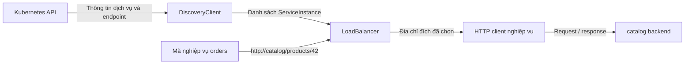
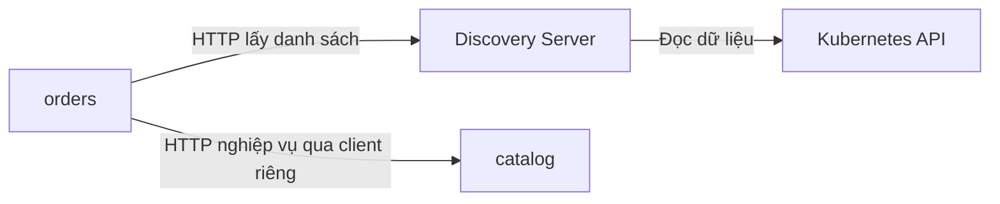

# Tách cấu hình HTTP client khỏi cấu hình khám phá Kubernetes

> Chương: Cân bằng tải  
> Module: SPRING_CLOUD_KUBERNETES

Trong ứng dụng Spring chạy trên Kubernetes, việc tìm địa chỉ dịch vụ và việc gửi HTTP đến địa chỉ đó là hai trách nhiệm khác nhau. Discovery xác định các instance có thể sử dụng; LoadBalancer chọn một đích; HTTP client quản lý kết nối và trao đổi request/response với đích được chọn.

Khi các cấu hình này bị trộn lẫn, một thay đổi như tăng timeout đọc Kubernetes API dễ bị hiểu nhầm thành tăng thời gian chờ API nghiệp vụ. Việc dùng chung builder hoặc credential quá rộng cũng có thể khiến các lời gọi có mục đích khác nhau nhận cùng một cấu hình ngoài ý muốn.

Bài học trình bày cách tách các trách nhiệm trên bằng ví dụ `orders` gọi `catalog` trong namespace `shop`. Mã Java minh họa dùng Java 17 trở lên, Spring Boot 3.x, WebFlux, Reactor Netty và bộ Spring Cloud Kubernetes tương thích do BOM quản lý. Các cấu hình và kết quả kỳ vọng chưa phải báo cáo một lần triển khai hoặc chạy thử thực tế.

## 1. Mục tiêu và ranh giới của bài học

Sau bài học, bạn có thể:

- Phân loại một property theo thành phần thực sự sử dụng nó.
- Tách các bean HTTP gọi backend khỏi cấu hình Kubernetes discovery.
- Tạo WebClient có LoadBalancer và WebClient dùng địa chỉ trực tiếp một cách rõ ràng.
- Phân biệt timeout kết nối, chờ pool, nhận response và ngân sách của toàn thao tác.
- Chẩn đoán riêng lỗi không có instance và lỗi HTTP đến instance đã được chọn.
- Đánh giá việc cập nhật ConfigMap, Secret hoặc thay đổi discovery ảnh hưởng tới thành phần nào.

Ví dụ chính sử dụng đường khám phá trực tiếp qua Fabric8 và chế độ `POD` của Spring Cloud Kubernetes LoadBalancer. Các phần về Discovery Server và chế độ `SERVICE` giúp xác định phạm vi áp dụng của cùng nguyên tắc.

## 2. Ba trách nhiệm trong một lời gọi



Có thể chia quá trình thành ba câu hỏi:

| Thành phần | Câu hỏi cần trả lời | Ví dụ cấu hình |
| --- | --- | --- |
| Discovery | Có những instance nào trong phạm vi cần tìm? | Namespace, label filter, cổng ưu tiên, điều kiện readiness |
| LoadBalancer | Lần gọi này chọn đích nào từ dữ liệu được cung cấp? | Supplier, thuật toán, cache, chính sách thử lại |
| HTTP client nghiệp vụ | Kết nối và trao đổi dữ liệu với đích đó ra sao? | Connect timeout, pool, response timeout, TLS, header, codec |

DiscoveryClient cung cấp abstraction để tìm dịch vụ và instance. Spring Cloud Kubernetes có các lựa chọn Fabric8, Kubernetes Java Client và HTTP DiscoveryClient; xem [DiscoveryClient cho Kubernetes](https://docs.spring.io/spring-cloud-kubernetes/reference/discovery-client.html).

Việc phân chia trên là mô hình để thiết kế và chẩn đoán. Nó không đòi hỏi mọi lời gọi HTTP đều truy vấn trực tiếp Kubernetes API: dữ liệu discovery và danh sách instance có thể được lưu trong các lớp cache tương ứng.

### 2.1. Hai đường kết nối trong mô hình trực tiếp

Đường thứ nhất phục vụ dữ liệu discovery:

```text
orders → Kubernetes API
```

Đường thứ hai phục vụ API sản phẩm:

```text
orders → catalog instance
```

Hai đường này có thể dùng thư viện HTTP khác nhau, CA khác nhau, credential khác nhau và timeout khác nhau. Mục đích của việc tách cấu hình là làm rõ chủ sở hữu của từng quyết định đó.

Ví dụ, một lỗi 403 từ Kubernetes API cần được đối chiếu với ServiceAccount và quyền đọc tài nguyên. Một lỗi 403 từ API `catalog` cần được đối chiếu với danh tính nghiệp vụ và chính sách của backend.

## 3. Phân loại cấu hình theo nơi sử dụng

| Nhóm cấu hình | Thành phần cần xét | Điều không thể suy ra chỉ từ việc đổi nhóm đó |
| --- | --- | --- |
| `spring.cloud.kubernetes.discovery.*` | Nguồn dữ liệu discovery | HTTP backend đã đổi pool hoặc response timeout |
| Cấu hình Kubernetes client của triển khai đang dùng | Kết nối tới Kubernetes API | Mọi WebClient nghiệp vụ đã đổi timeout |
| `spring.cloud.kubernetes.loadbalancer.*` | Tích hợp LoadBalancer của Kubernetes | Backend đã bật TLS hay mở socket theo tên cổng |
| `spring.cloud.loadbalancer.*` | Chức năng Spring Cloud LoadBalancer tương ứng | Cấu hình transport của mọi HTTP client đã thay đổi |
| `app.http.business.*` trong bài | Bean HTTP nghiệp vụ do ứng dụng tạo | Kubernetes client tự động sử dụng các giá trị này |
| Cấu hình servlet/server của orders | Cổng và hành vi nhận request vào orders | Thời gian chờ request HTTP đi ra catalog |

Các tên dưới `app.http.business` là property tự định nghĩa. Chúng chỉ có tác dụng sau khi được bind và dùng để xây dựng bean trong ví dụ.

Với Kubernetes client, phải xác định đang dùng Fabric8, Kubernetes Java Client hay HTTP DiscoveryClient trước khi chọn property. Một property tồn tại trong phụ lục chưa chứng minh mọi triển khai đều tiêu thụ nó theo cùng cách. Tham khảo [danh sách cấu hình Spring Cloud Kubernetes](https://docs.spring.io/spring-cloud-kubernetes/reference/appendix.html) của đúng phiên bản dự án.

### 3.1. Ví dụ thay đổi đúng và sai phạm vi

Giả sử danh sách `catalog` có hai instance hợp lệ nhưng mỗi lần gọi sản phẩm đều mất hai giây:

- Đổi namespace discovery chưa giải quyết được tốc độ phản hồi của backend.
- Đổi cổng ưu tiên chỉ hữu ích nếu danh sách đang chọn sai cổng.
- Đặt response timeout tại HTTP client có thể giới hạn thời gian chờ theo cơ chế transport.
- Đặt ngân sách cho thao tác nghiệp vụ có thể giới hạn chuỗi xử lý theo vị trí áp dụng.
- Việc backend thực hiện chậm vẫn cần được phân tích tại chính API đó.

Ngược lại, nếu discovery không có dữ liệu do caller thiếu quyền đọc endpoint, tăng response timeout của WebClient nghiệp vụ chưa sửa được quyền Kubernetes.

## 4. Chọn đường định tuyến trước khi cấu hình transport

### 4.1. Chế độ POD của Spring Cloud Kubernetes LoadBalancer

Ở chế độ `POD`, tích hợp LoadBalancer sử dụng DiscoveryClient để tìm instance theo tên dịch vụ. Ở chế độ `SERVICE`, tích hợp tạo đích dựa trên Kubernetes Service và các cấu hình tương ứng. Xem [LoadBalancer cho Kubernetes](https://docs.spring.io/spring-cloud-kubernetes/reference/load-balancer.html).

Ví dụ của bài chọn `POD`, vì vậy chuỗi minh họa là:

```text
Tên catalog
    → danh sách ServiceInstance
    → một địa chỉ backend
    → HTTP client kết nối tới địa chỉ đó
```

Cấu hình client bên dưới vẫn là cấu hình của transport nghiệp vụ dù tập đích được cung cấp bằng cách nào.

### 4.2. Gọi bằng tên logic qua LoadBalancer

Một WebClient đã tích hợp Spring Cloud LoadBalancer có thể sử dụng:

```text
http://catalog/products/42
```

Ở đây, `catalog` là tên dịch vụ logic để cơ chế LoadBalancer tìm đích. Cần có tích hợp LoadBalancer thực sự trên client; việc một URL có tên ngắn không tự chứng minh nó đang đi qua cơ chế đó.

### 4.3. Gọi trực tiếp qua Kubernetes Service DNS

Một WebClient thông thường có thể gọi:

```text
http://catalog.shop.svc.cluster.local/products/42
```

Đây là địa chỉ DNS trực tiếp của Service trong giả định domain của lab. Đường này dùng phân giải DNS và cơ chế Service của Kubernetes; xem [Kubernetes Service](https://kubernetes.io/docs/concepts/services-networking/service/).

Không gắn bộ lọc LoadBalancer vào mọi HTTP client một cách mặc định. Khi một client nhận tên logic, cơ chế discovery cần tìm theo tên logic; khi một client nhận host DNS đầy đủ, transport cần được dùng theo thiết kế gọi trực tiếp.

Cả hai cách đều cần connect timeout, chính sách pool và các thiết lập HTTP thích hợp. Sự khác nhau về cách tìm đích không thay thế cấu hình transport.

## 5. Cấu hình đầu vào cho ví dụ

Các dependency chính của dự án đã quản lý phiên bản tương thích:

```xml
<dependency>
    <groupId>org.springframework.boot</groupId>
    <artifactId>spring-boot-starter-webflux</artifactId>
</dependency>

<dependency>
    <groupId>org.springframework.cloud</groupId>
    <artifactId>spring-cloud-starter-kubernetes-fabric8-loadbalancer</artifactId>
</dependency>
```

Ví dụ chọn một nhánh tích hợp Fabric8 cho discovery và load balancing. Khi dùng dự án sẵn có, cần xác định các starter và bean hiện hữu để tránh đưa nhiều triển khai discovery vào mà không có chủ đích.

Cấu hình minh họa:

```yaml
spring:
  application:
    name: orders
  cloud:
    kubernetes:
      discovery:
        all-namespaces: false
        namespaces:
          - shop
        primary-port-name: http
      loadbalancer:
        mode: POD
    loadbalancer:
      retry:
        enabled: false

app:
  http:
    business:
      connect-timeout: 300ms
      response-timeout: 800ms
      pending-acquire-timeout: 200ms
      request-budget: 1500ms
      max-connections: 20
      max-pending-acquires: 40
```

Phần Kubernetes quy định phạm vi và cách lấy đích. Phần `app.http.business` được dùng riêng cho transport và ngân sách thao tác trong mã phía sau.

Các con số chỉ phục vụ lab. Cần lựa chọn lại theo đặc điểm backend, độ trễ mạng, tải đồng thời và yêu cầu phản hồi của ứng dụng. Việc tắt retry của LoadBalancer giúp ví dụ dễ quan sát; nó không phải tuyên bố rằng mọi lớp trong hệ thống đều đã tắt retry.

Để ví dụ chạy trong cluster, ServiceAccount của orders phải có quyền đọc tài nguyên discovery theo phiên bản và chế độ endpoint đang sử dụng. Backend catalog cần có Service, endpoint, cổng và readiness phù hợp. Bài không giả định việc cấu hình HTTP có thể thay thế các điều kiện đó.

## 6. Bind property nghiệp vụ thành đối tượng riêng

```java
package example.orders.http;

import java.time.Duration;

import org.springframework.boot.context.properties.ConfigurationProperties;

@ConfigurationProperties(prefix = "app.http.business")
public record BusinessHttpProperties(
        Duration connectTimeout,
        Duration responseTimeout,
        Duration pendingAcquireTimeout,
        Duration requestBudget,
        int maxConnections,
        int maxPendingAcquires) {

    public BusinessHttpProperties {
        requirePositive(connectTimeout, "connect-timeout");
        requirePositive(responseTimeout, "response-timeout");
        requirePositive(pendingAcquireTimeout, "pending-acquire-timeout");
        requirePositive(requestBudget, "request-budget");

        long connectMillis = connectTimeout.toMillis();
        if (connectMillis < 1 || connectMillis > Integer.MAX_VALUE) {
            throw new IllegalArgumentException(
                    "connect-timeout must fit a positive millisecond int");
        }
        if (maxConnections < 1 || maxPendingAcquires < 1) {
            throw new IllegalArgumentException(
                    "connection limits must be positive");
        }
    }

    private static void requirePositive(Duration value, String name) {
        if (value == null || value.isZero() || value.isNegative()) {
            throw new IllegalArgumentException(name + " must be positive");
        }
    }
}
```

Các giá trị được kiểm tra ngay khi đối tượng cấu hình được tạo. Trong ví dụ, giới hạn kết nối dùng số nguyên dương; thời gian kết nối cũng được kiểm tra trước khi chuyển sang đơn vị millisecond của transport.

`@ConfigurationProperties` là cơ chế bind cấu hình có cấu trúc của Spring Boot. Xem [Externalized Configuration](https://docs.spring.io/spring-boot/reference/features/external-config.html).

Việc khai báo một nhóm property riêng tạo được hợp đồng rõ ràng:

- Nhóm property này mô tả HTTP nghiệp vụ.
- Mã tạo client nghiệp vụ chịu trách nhiệm tiêu thụ nó.
- Thay đổi giá trị cần được đánh giá theo vòng đời của các client được tạo từ nó.

## 7. Tạo pool và các client nghiệp vụ

```java
package example.orders.http;

import io.netty.channel.ChannelOption;
import reactor.netty.http.client.HttpClient;
import reactor.netty.resources.ConnectionProvider;

import org.springframework.beans.factory.annotation.Qualifier;
import org.springframework.boot.context.properties.EnableConfigurationProperties;
import org.springframework.cloud.client.loadbalancer.LoadBalanced;
import org.springframework.context.annotation.Bean;
import org.springframework.context.annotation.Configuration;
import org.springframework.http.client.reactive.ReactorClientHttpConnector;
import org.springframework.web.reactive.function.client.WebClient;

@Configuration(proxyBeanMethods = false)
@EnableConfigurationProperties(BusinessHttpProperties.class)
public class BusinessHttpConfiguration {

    @Bean(name = "businessConnectionProvider", destroyMethod = "dispose")
    ConnectionProvider businessConnectionProvider(BusinessHttpProperties p) {
        return ConnectionProvider.builder("business-http")
                .maxConnections(p.maxConnections())
                .pendingAcquireMaxCount(p.maxPendingAcquires())
                .pendingAcquireTimeout(p.pendingAcquireTimeout())
                .build();
    }

    @Bean("balancedBusinessWebClientBuilder")
    @LoadBalanced
    WebClient.Builder balancedBusinessWebClientBuilder(
            @Qualifier("businessConnectionProvider")
            ConnectionProvider provider,
            BusinessHttpProperties p) {

        return businessBuilder(provider, p);
    }

    @Bean("catalogWebClient")
    WebClient catalogWebClient(
            @Qualifier("balancedBusinessWebClientBuilder")
            WebClient.Builder builder) {

        return builder.clone()
                .baseUrl("http://catalog")
                .build();
    }

    @Bean("directBusinessWebClient")
    WebClient directBusinessWebClient(
            @Qualifier("businessConnectionProvider")
            ConnectionProvider provider,
            BusinessHttpProperties p) {

        return businessBuilder(provider, p).build();
    }

    private WebClient.Builder businessBuilder(
            ConnectionProvider provider,
            BusinessHttpProperties p) {

        HttpClient transport = HttpClient.create(provider)
                .option(ChannelOption.CONNECT_TIMEOUT_MILLIS,
                        Math.toIntExact(p.connectTimeout().toMillis()))
                .responseTimeout(p.responseTimeout());

        return WebClient.builder()
                .clientConnector(new ReactorClientHttpConnector(transport));
    }
}
```

Đặt các lớp trong phạm vi component scan của ứng dụng. Đoạn cấu hình không cần inject Kubernetes client hoặc `DiscoveryClient` để tạo timeout của transport nghiệp vụ.

Spring Cloud hỗ trợ tích hợp LoadBalancer bằng bean `WebClient.Builder` được đánh dấu `@LoadBalanced`; tên host logic được chuyển thành địa chỉ cụ thể khi thực hiện lời gọi. Xem [WebClient với Spring Cloud LoadBalancer](https://docs.spring.io/spring-cloud-commons/reference/spring-cloud-commons/common-abstractions.html#webclinet-loadbalancer-client).

### 7.1. Những thành phần được dùng chung có chủ đích

Hai client nghiệp vụ trong ví dụ dùng chung `businessConnectionProvider` và nhóm timeout. Chúng khác nhau ở việc có tích hợp LoadBalancer hay dùng địa chỉ trực tiếp.

`maxConnections` là giới hạn của pool theo đích do Reactor Netty quản lý, không nên diễn giải thành một trần đồng thời duy nhất cho mọi host trong toàn ứng dụng. Khi nhiều Pod đích xuất hiện, cần tính tác động tổng của nhiều pool.

Pool được tạo một lần và được Spring gọi phương thức dispose khi bean bị hủy. Không tạo một ConnectionProvider mới cho mỗi request. Các tùy chọn pool được mô tả trong [Reactor Netty HTTP Client](https://projectreactor.io/docs/netty/release/reference/http-client.html#_connection_pool).

Pool riêng cũng không đồng nghĩa mọi tài nguyên thực thi đã tách riêng: các client có thể vẫn dùng chung event loop theo cơ chế mặc định. Nếu cần cô lập thêm, phải thiết kế tài nguyên thực thi và vòng đời của chúng một cách cụ thể.

### 7.2. Builder, bean name và phạm vi cấu hình

Các điểm cần chú ý trong mẫu:

- `catalogWebClient` dùng builder có LoadBalancer và base URL tên logic.
- `directBusinessWebClient` được tạo từ builder dành cho transport trực tiếp.
- Mỗi vị trí inject client dùng `@Qualifier` để nêu rõ lựa chọn.
- `clone()` giúp tạo cấu hình client cụ thể mà không sửa trực tiếp builder dùng làm mẫu.
- Connector được gắn trực tiếp khi tạo builder nghiệp vụ, không cần công bố một bean connector tổng quát để mọi thành phần tự tìm.

WebClient sau khi build là đối tượng bất biến về cấu hình của nó; các tùy chọn builder và connector được mô tả trong [cấu hình WebClient](https://docs.spring.io/spring-framework/reference/web/webflux-webclient/client-builder.html).

Mẫu tạo builder bằng `WebClient.builder()`, nên các tùy biến của Spring Boot như observability không mặc nhiên được áp dụng như khi dùng builder do Boot chuẩn bị. Khi bổ sung metrics, tracing hoặc WebClientCustomizer, cần áp dụng rõ cho nhóm client phù hợp và xem xét các customizer toàn cục hiện hữu.

Một customizer tự thêm Authorization header cho mọi builder có thể mở rộng phạm vi credential vượt dự định. Tương tự, một filter LoadBalancer thêm vào builder dùng cho host bên ngoài có thể thay cách diễn giải host đó.

## 8. Mã nghiệp vụ chỉ nhận client cần dùng

```java
package example.orders.catalog;

import example.orders.http.BusinessHttpProperties;
import reactor.core.publisher.Mono;

import org.springframework.beans.factory.annotation.Qualifier;
import org.springframework.stereotype.Service;
import org.springframework.web.reactive.function.client.WebClient;

@Service
public class CatalogClient {

    private final WebClient client;
    private final BusinessHttpProperties properties;

    public CatalogClient(
            @Qualifier("catalogWebClient") WebClient client,
            BusinessHttpProperties properties) {
        this.client = client;
        this.properties = properties;
    }

    public Mono<ProductView> findProduct(String id) {
        return client.get()
                .uri("/products/{id}", id)
                .retrieve()
                .bodyToMono(ProductView.class)
                .timeout(properties.requestBudget());
    }

    public record ProductView(String id, String name) {
    }
}
```

`CatalogClient` không cần biết namespace hoặc cách gọi Kubernetes API. Nó phụ thuộc vào client đã cấu hình và ngân sách của thao tác gọi sản phẩm.

Trong mẫu, ngân sách được đọc khi tạo chuỗi xử lý. Đối tượng properties và WebClient được tạo theo vòng đời bean; các phần sau sẽ làm rõ việc thay đổi cấu hình không tự bảo đảm client hiện hữu đã đổi.

Nếu cần gọi một URL DNS trực tiếp, inject `directBusinessWebClient` và sử dụng URI đầy đủ được kiểm soát theo hợp đồng của chức năng đó. Không nhận một host tùy ý từ người dùng rồi đưa thẳng vào đường gọi nội bộ.

## 9. Hiểu đúng các loại timeout

| Cấu hình trong ví dụ | Điều được giới hạn | Điều cần phân biệt |
| --- | --- | --- |
| connect-timeout | Giai đoạn thiết lập kết nối theo cơ chế transport | Không phải thời gian xử lý API catalog |
| pending-acquire-timeout | Chờ lấy kết nối từ pool | Có thể hết hạn trước khi request được gửi |
| response-timeout | Thời gian chờ đọc response theo cơ chế Reactor Netty | Không phải deadline tuyệt đối của mọi giai đoạn |
| request-budget | Thời gian chờ toàn chuỗi Mono tại vị trí áp dụng | Phụ thuộc vị trí đặt toán tử và thành phần nằm trong chuỗi |
| Timeout Kubernetes client | Các thao tác tới Kubernetes API theo triển khai | Không điều khiển trực tiếp socket nghiệp vụ |

Response timeout của Reactor Netty gắn với hoạt động đọc response; khi đọc nhiều phần dữ liệu, không nên xem giá trị đó là thời gian tối đa cho toàn bộ body trong mọi tình huống. Một backend tiếp tục gửi dữ liệu đều có thể tránh hết thời gian chờ đọc nhưng vẫn kéo dài tổng thao tác.

Toán tử `timeout` đặt sau `bodyToMono` trong mẫu chờ kết quả của chuỗi được subscribe: chọn đích, lấy kết nối, trao đổi HTTP và đọc/giải mã body khi những bước đó nằm trong chuỗi bất đồng bộ. Nó bổ sung ngân sách tổng cho lời gọi. Nó không thay thế timeout chuyên biệt của DNS, TLS, TCP hoặc pool và không bảo đảm ngắt tức thì một đoạn mã blocking.

Tài liệu [timeout của Reactor Netty](https://projectreactor.io/docs/netty/release/reference/http-client.html#_timeout_configuration) phân biệt timeout transport với timeout của toàn thao tác.

### 9.1. Lập ngân sách bằng các giai đoạn

Một cách phân tích thời gian là:

```text
T thao tác
    = T lấy/chọn đích
    + T chờ pool
    + T phân giải/kết nối nếu cần
    + T trao đổi HTTP
    + T đọc và giải mã kết quả
    + T các lần thử bổ sung nếu có
```

Đây là mô hình phân tích, không phải công thức cộng cứng mọi timeout. Kết nối được tái sử dụng có thể bỏ qua việc tạo kết nối mới; cache discovery có thể làm thời gian chọn đích khác giữa lần gọi đầu và những lần sau.

Với ngân sách 1500 ms của ví dụ, cần đo độ trễ trong cả trạng thái đã có kết nối và trạng thái phải khởi tạo kết nối. Không thể đảm bảo đạt yêu cầu chỉ bằng việc nhìn thấy các timeout nhỏ hơn 1500 ms.

### 9.2. Retry có thể xuất hiện ở nhiều lớp

Các vị trí cần kiểm tra gồm:

- Chính sách retry của LoadBalancer.
- Toán tử retry trong mã Reactor.
- Retry bên trong thư viện transport cho một số lỗi kết nối.
- Retry của caller phía trên hoặc một proxy trung gian.

Ví dụ không thêm retry trong `CatalogClient` và tắt retry của LoadBalancer. Khi cần chứng minh tổng số lần gửi request, vẫn phải kiểm tra các lớp còn lại.

Nếu đặt retry vào chuỗi, vị trí của ngân sách sẽ ảnh hưởng việc nó bao trùm mọi lần thử hay được tính lại cho từng lần. Với thao tác tạo đơn hoặc thanh toán, phải xét tính idempotent trước khi cho phép thử lại.

## 10. TLS, credential và proxy phải theo đúng đích gọi

Một ứng dụng có thể giữ nhiều quan hệ tin cậy cùng lúc:

| Đường kết nối | Đích | Credential hoặc trust cần xét |
| --- | --- | --- |
| Discovery trực tiếp | Kubernetes API | ServiceAccount hoặc cơ chế Kubernetes client đang dùng, CA của API server |
| Discovery qua HTTP | Discovery Server | Cơ chế xác thực và TLS của giao diện discovery |
| HTTP nghiệp vụ nội bộ | catalog | Credential và CA theo hợp đồng API catalog |
| HTTP ra đối tác | Hệ thống bên ngoài | Credential, CA và proxy theo hợp đồng đối tác |

Credential dùng để đọc Kubernetes API không nên được đưa vào header mặc định của client gọi backend. Đặt Authorization header trên một builder dùng cho nhiều mục đích có thể khiến request gửi credential đến đích không phù hợp.

Tương tự, cấu hình tin CA của Kubernetes API không tự chứng minh HTTP client nghiệp vụ tin CA của `catalog`. Với HTTPS, cần xét tên host sau lựa chọn đích, chuỗi chứng thư và cách xác minh peer của transport.

Đặc biệt ở chế độ gọi trực tiếp địa chỉ Pod, chứng thư dành cho một tên DNS Service chưa chắc phù hợp với địa chỉ thực được chọn. Cần thiết kế đúng định danh TLS cho cách định tuyến đang dùng, thay vì tắt kiểm tra hostname để làm lỗi biến mất.

### 10.1. Quy tắc cho cấu hình dùng chung

Tách nhóm property không tạo ra sự cô lập tuyệt đối nếu vẫn có cấu hình ở phạm vi rộng hơn:

- Một customizer toàn cục có thể sửa nhiều builder.
- Một thiết lập trust hoặc proxy ở cấp JVM có thể được nhiều thư viện sử dụng.
- Một biến môi trường proxy có thể được một số client hỗ trợ, với cách diễn giải riêng.
- Một cấu hình service mesh có thể tác động ngoài phạm vi bean HTTP.

Vì vậy, khi hành vi thực tế khác với nhóm property cục bộ, hãy kiểm tra cả nguồn cấu hình và cơ chế transport đang tiêu thụ nó. Không giả định tất cả thư viện Java đọc cùng một tập biến môi trường proxy.

Trong ví dụ Fabric8 trực tiếp, WebClient nghiệp vụ và Kubernetes client được tạo bởi các luồng cấu hình khác nhau. Nếu dự án tùy biến factory hoặc chia sẻ transport giữa chúng, cần ghi rõ mối liên hệ mới đó.

## 11. Trường hợp sử dụng HTTP DiscoveryClient

Khi chuyển discovery sang HTTP DiscoveryClient, hệ thống có thêm một đường HTTP:



Trong mô hình này có ba nhóm kết nối cần quản lý:

1. HTTP từ caller tới Discovery Server.
2. Kết nối từ server tới Kubernetes API.
3. HTTP từ caller tới backend nghiệp vụ.

Dù nhóm thứ nhất và thứ ba đều dùng HTTP, chúng có thể cần token, timeout, pool và chính sách lỗi khác nhau. Tăng thời gian chờ API sản phẩm không phải lý do mặc định để tăng thời gian chờ giao diện discovery.

Đối với HTTP discovery, phạm vi namespace được đặt tại Discovery Server. Địa chỉ server phía caller và chính sách transport phía caller cần được cấu hình theo cơ chế được phiên bản đó hỗ trợ. Tài liệu [các triển khai DiscoveryClient](https://docs.spring.io/spring-cloud-kubernetes/reference/discovery-client.html) mô tả phạm vi cấu hình của mô hình HTTP.

Một thay đổi builder nghiệp vụ chưa chứng minh HTTP DiscoveryClient đã nhận cùng connector. Ngược lại, việc tùy biến client dùng cho Discovery Server cần được giới hạn để không làm đổi các client nghiệp vụ ngoài dự kiến.

## 12. Cache và readiness ảnh hưởng danh sách đích

Có thể tồn tại các lớp dữ liệu hoặc trạng thái khác nhau:

| Trạng thái | Ý nghĩa | Điểm cần quan sát |
| --- | --- | --- |
| Cache dữ liệu discovery | Những dịch vụ và endpoint đang được discovery biết tới | Đồng bộ với Kubernetes và bộ lọc |
| Cache danh sách của LoadBalancer nếu được dùng | Tập instance được cung cấp cho lựa chọn | TTL và chuỗi supplier |
| Pool kết nối HTTP | Kết nối có thể tái sử dụng tới các đích | Số kết nối, chờ pool, idle/lifetime |
| Trạng thái readiness | Điều kiện sẵn sàng theo kiểm tra Kubernetes | Probe và dữ liệu endpoint liên quan |

Spring Cloud LoadBalancer có cơ chế cache danh sách instance; cần xét việc discovery đã có cache hay chưa trước khi thêm lớp cache khác. Xem [cache của Spring Cloud LoadBalancer](https://docs.spring.io/spring-cloud-commons/reference/spring-cloud-commons/loadbalancer.html#_spring_cloud_loadbalancer_caching).

Giảm TTL danh sách không đồng nghĩa pool HTTP tự nhận một response nhanh hơn. Tăng số kết nối HTTP không làm discovery quan sát được một namespace chưa được cấp quyền.

Readiness phục vụ quyết định sẵn sàng nhận traffic theo kiểm tra đã cấu hình. Liveness và startup probe có mục đích khác; xem [probe Kubernetes](https://kubernetes.io/docs/concepts/workloads/pods/probes/).

Khi một Pod rời tập sẵn sàng, cần xem dữ liệu endpoint, thời gian đồng bộ, cache và request đã thực hiện. Không suy ra rằng một sự kiện readiness sẽ lập tức hủy mọi request đang chạy hoặc mọi kết nối đã tồn tại.

## 13. Quan sát và kiểm tra khả năng tách cấu hình

Các bước dưới đây mô tả kế hoạch thực hành cho môi trường lab đã chuẩn bị. Chưa có lệnh nào trong bài được xác nhận đã chạy thành công trên cluster.

### 13.1. Ghi nhận dữ liệu discovery trước

Xác nhận Service và backend trong namespace của ví dụ:

```powershell
kubectl -n shop get service catalog -o yaml
kubectl -n shop get pods -l app=catalog -o wide
kubectl -n shop get endpointslices -l kubernetes.io/service-name=catalog -o yaml
```

Nếu triển khai discovery đọc tài nguyên `Endpoints`, đối chiếu thêm tài nguyên đó:

```powershell
kubectl -n shop get endpoints catalog -o yaml
```

Tiếp theo, quan sát danh sách `DiscoveryClient.getInstances("catalog")` tại caller thông qua công cụ chẩn đoán được chuẩn bị cho lab. Cần biết service ID, host, port và scheme mà caller đang nhận, cùng cấu hình discovery hiệu lực.

Không chỉ nhìn vào số Pod. Một Pod tồn tại chưa chứng minh Service selector chọn nó, cổng đã được phân giải đúng hoặc discovery đang đưa nó vào danh sách.

### 13.2. Thay từng nhóm cấu hình

| Thử nghiệm có kiểm soát | Điều giữ ổn định | Kết quả cần quan sát |
| --- | --- | --- |
| Backend lab trả chậm hơn response timeout | Namespace và danh sách instance | Lỗi ở đường HTTP dù danh sách đích vẫn hợp lệ |
| Thu hẹp namespace để không còn catalog | Cấu hình HTTP nghiệp vụ | Lỗi hoặc thiếu dữ liệu ở discovery, tùy cách khởi tạo và xử lý |
| Làm đầy pool bằng tải đồng thời | Discovery và tốc độ backend đã biết | Số request chờ pool và lỗi lấy kết nối |
| Đổi cổng ưu tiên đúng với Service nhiều cổng | Nhóm timeout HTTP | Cặp host/port được chọn thay đổi đúng hợp đồng |
| Làm TLS backend không khớp trust | Dữ liệu discovery | Lỗi TLS tại đường nghiệp vụ |
| Đổi cấu hình Kubernetes client trong lab | Bean HTTP nghiệp vụ | Chỉ tác động dự kiến tới đường Kubernetes API nếu không có cấu hình dùng chung |

Ví dụ, có thể dùng một backend thử nghiệm trả kết quả sau 500 ms, rồi đặt response timeout nghiệp vụ xuống 100 ms. Cần giữ các điều kiện khác ổn định và ghi nhận lỗi gốc: timeout tổng đặt ngắn hơn vẫn có thể kết thúc chuỗi trước timeout transport.

Thử nghiệm mất quyền hoặc mất kết nối Kubernetes cần xét cả trạng thái khởi động và trạng thái đã có cache. Caller đã có dữ liệu có thể khác hành vi với caller mới; không gán một kết quả duy nhất cho mọi trường hợp.

### 13.3. Phân biệt triệu chứng giống nhau

| Triệu chứng | Câu hỏi chẩn đoán |
| --- | --- |
| Nhận 503 | Do không có instance, backend trả 503 hay proxy trả 503? |
| Timeout khi gọi sản phẩm | Hết thời gian chọn đích, chờ pool, kết nối, đọc response hay ngân sách tổng? |
| Lần gọi đầu chậm | Khởi tạo LoadBalancer, đồng bộ dữ liệu, DNS, TLS hoặc mở kết nối mới? |
| API sản phẩm trả 403 | Response tới từ backend nào và mang danh tính nào? |
| Kubernetes API trả 403 | ServiceAccount và quyền tài nguyên discovery có đúng không? |
| Thay timeout không thấy tác dụng | Property có được bind, client có được tạo lại, request có đi qua đúng bean không? |
| Host DNS ngoài hệ thống bị báo không có instance | Client dùng cho host đó có bị gắn LoadBalancer ngoài dự định không? |

Để quan sát rõ, gắn nhãn thành phần theo mục đích như `business-http` và `kubernetes-discovery` trong thiết kế metrics hoặc log. Đây là tên minh họa của ứng dụng, không phải tên metric được cam kết bởi thư viện.

Theo dõi riêng độ trễ discovery, đích được chọn, thời gian chờ pool, lỗi kết nối và HTTP status. Không đưa token vào log; với metrics, tránh tạo nhãn không giới hạn theo mọi URL, instance ID hoặc dữ liệu người dùng.

## 14. Cập nhật cấu hình từ ConfigMap và Secret

Cùng một nguồn cấu hình có thể chứa các nhóm property khác nhau, nhưng việc chúng nằm cạnh nhau không làm chúng có cùng cơ chế cập nhật.

Ví dụ:

```text
ConfigMap
  ├─ namespace discovery
  ├─ timeout business HTTP
  └─ ngân sách thao tác
```

Khi thay đổi dữ liệu, cần xác định lần lượt:

1. Giá trị mới đã tới nguồn cấu hình mà ứng dụng sử dụng chưa?
2. Property trong Spring Environment đã thay đổi chưa?
3. Bean properties hoặc thành phần sử dụng property có được tạo lại không?
4. Client, connector hoặc pool hiện hữu có áp dụng giá trị mới không?
5. Request mới có thực sự dùng bean mới không?

Trong ví dụ Java, HttpClient được xây dựng với timeout tại lúc tạo bean. Thay giá trị trong ConfigMap không tự chứng minh đối tượng đã được build sẽ đổi timeout. Nếu áp dụng refresh hoặc Configuration Watcher, cần kiểm tra cơ chế cụ thể có tạo lại đúng thành phần và quản lý pool cũ hay không.

Rollout có thể là lựa chọn phù hợp cho cấu hình transport cần vòng đời rõ ràng. Nếu tái cấu hình động, cần thiết kế cả việc ngừng tài nguyên cũ và xử lý request đang chạy.

Secret dành cho credential hoặc vật liệu nhạy cảm theo nhu cầu. Quyền đọc Secret, quyền đọc tài nguyên discovery và quyền gọi backend là các yêu cầu riêng; không cấp rộng quyền Kubernetes chỉ để cấu hình một WebClient nghiệp vụ.

## 15. Nguyên tắc tổ chức cấu hình có thể áp dụng lại

Một cách tổ chức dễ hiểu là:

```text
Cấu hình discovery Kubernetes
    → chọn phạm vi dữ liệu và cách cung cấp instance

Cấu hình LoadBalancer
    → chọn hoặc xử lý danh sách đích theo chính sách

BusinessHttpProperties + BusinessHttpConfiguration
    → tạo transport, pool và các client HTTP nghiệp vụ

CatalogClient
    → diễn đạt API cần gọi và ngân sách thao tác
```

Khi thêm một property mới, hãy xác định bean nào đọc nó, đường kết nối nào chịu tác động và phép quan sát nào chứng minh thay đổi đã có hiệu lực. Nếu một thay đổi cần ảnh hưởng nhiều đường kết nối, hãy ghi rõ sự chia sẻ đó trong thiết kế.

Tách cấu hình HTTP client khỏi khám phá Kubernetes giúp mỗi thay đổi có phạm vi dễ đánh giá: dữ liệu instance do discovery cung cấp, đích gọi do LoadBalancer lựa chọn và quá trình trao đổi HTTP do client nghiệp vụ quản lý.
