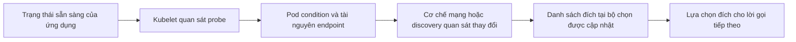

# Readiness, thay đổi endpoint và lời gọi đang thực hiện

## Mục tiêu trong chương Cân bằng tải

Trong module **SPRING_CLOUD_KUBERNETES**, DiscoveryClient và Spring Cloud LoadBalancer giúp ứng dụng tìm và chọn nơi xử lý request. Khi một Pod khởi động, không còn sẵn sàng hoặc chuẩn bị dừng, danh sách nơi nhận request cũng phải thay đổi. Tuy nhiên, thay đổi readiness, cập nhật endpoint và hoàn tất một lời gọi HTTP là những quá trình khác nhau.

Bài học giúp bạn hiểu khoảng chuyển tiếp đó và phối hợp ứng dụng Spring với Kubernetes để giảm lỗi khi triển khai hoặc thu hẹp số Pod. Sau bài học, bạn có thể:

- Phân biệt readiness, liveness, trạng thái endpoint và khả năng phục vụ thật của ứng dụng.
- Giải thích vì sao request vẫn có thể tới một Pod vừa mất readiness.
- Phân biệt lựa chọn backend mới với kết nối và request đang thực hiện.
- Phối hợp graceful shutdown, `preStop`, thời gian chờ kết thúc Pod và chính sách rollout.
- Quan sát thay đổi từ Kubernetes đến caller để xác định nơi còn dùng địa chỉ cũ.

Ví dụ dùng ứng dụng gọi `checkout`, dịch vụ `catalog` có hai Pod A và B trong namespace `learning`. Phạm vi chính là HTTP request thông thường qua Service có selector hoặc qua DiscoveryClient. Các giá trị thời gian là số minh họa, cần điều chỉnh theo phiên bản, web server, hạ tầng mạng và độ dài request thực tế.

## 1. Readiness điều khiển điều gì?

Readiness diễn tả việc một Pod có sẵn sàng được chọn nhận traffic theo cơ chế tương ứng hay không. Nó không phải một lệnh gửi đến tất cả HTTP client để đóng ngay kết nối đang mở.

| Tín hiệu hoặc trạng thái | Ý nghĩa cần hiểu | Không thể suy ra chỉ từ tín hiệu đó |
|---|---|---|
| Container `Running` | Tiến trình container đang chạy | API nghiệp vụ đã dùng được |
| Pod `Ready` | Các điều kiện readiness của Pod đã đạt | Mọi đường gọi nghiệp vụ đều thành công |
| Readiness probe thất bại | Điều kiện kiểm tra sẵn sàng chưa đạt | JVM đã chết hoặc request đang chạy phải bị hủy |
| Liveness probe thất bại đủ ngưỡng | Có thể dẫn tới restart container | Một phụ thuộc bên ngoài sẽ được sửa nhờ restart |
| Endpoint bị đánh dấu không sẵn sàng | Bộ chọn đích cần xét lại khả năng sử dụng endpoint | Mọi caller đã đồng thời cập nhật danh sách |
| Graceful shutdown đang chạy | Ứng dụng đang đóng theo cơ chế cho phép công việc phù hợp hoàn tất | Có thể chờ vô hạn cho mọi kết nối dài |

Ví dụ, `catalog` có thể đang chạy nhưng chưa nạp xong dữ liệu cần thiết để phục vụ. Nếu readiness chỉ kiểm tra TCP mở được, Pod có thể nhận request sớm hơn khả năng phục vụ thật. Ngược lại, một health check quá phụ thuộc vào hệ thống dùng chung có thể làm toàn bộ Pod cùng mất readiness khi chỉ một chức năng bị ảnh hưởng.

Spring Boot cung cấp các nhóm health cho liveness và readiness. Việc đưa phụ thuộc nào vào readiness cần gắn với khả năng phục vụ; liveness nên tránh phụ thuộc vào sức khỏe một hệ thống bên ngoài dùng chung. Xem [Kubernetes probes trong Spring Boot](https://docs.spring.io/spring-boot/reference/actuator/endpoints.html#actuator.endpoints.kubernetes-probes).

## 2. Từ readiness đến lựa chọn backend là một chuỗi cập nhật



Không có một thời điểm chung mà mọi lớp trong hình cùng đổi trạng thái. Chuỗi thực tế có thể bao gồm:

- Chu kỳ probe và ngưỡng thành công/thất bại.
- Việc cập nhật trạng thái Pod và tài nguyên endpoint.
- Độ trễ watch, informer hoặc lần đồng bộ lại.
- Cache trong Discovery Server, DiscoveryClient hoặc supplier của LoadBalancer.
- Cơ chế định tuyến Service và kết nối đang được HTTP client tái sử dụng.

Có thể dùng một mô hình ước lượng để đặt câu hỏi quan sát:

```text
Độ trễ ngừng chọn Pod cũ
  ≈ phát hiện readiness thay đổi
    + truyền/cập nhật trạng thái
    + làm mới danh sách ở đường caller đang dùng
```

Đây không phải công thức bảo đảm hoặc một tổng luôn cộng tuyến tính. Một số công việc diễn ra song song, một số lớp có cơ chế cập nhật riêng. Điều cần đo là thời điểm caller thực sự ngừng chọn Pod đó, không chỉ thời điểm `kubectl` hiển thị `Ready=False`.

Một endpoint bị loại khỏi tập ứng viên không làm request đã được chọn trước đó tự đổi sang một Pod khác. Khi đã gửi request, ứng dụng đang xử lý một kết nối và một ngữ cảnh nghiệp vụ cụ thể.

## 3. Đọc trạng thái EndpointSlice đúng cách

EndpointSlice chứa địa chỉ, cổng và các điều kiện endpoint. Ba điều kiện quan trọng là:

| Điều kiện | Cách đọc |
|---|---|
| `ready` | Tín hiệu thuận tiện để chọn endpoint sẵn sàng cho traffic thông thường |
| `serving` | Tín hiệu đang phục vụ, hữu ích khi xét riêng giai đoạn kết thúc |
| `terminating` | Endpoint đang trong quá trình kết thúc |

Thông thường `ready` tương ứng với `serving` và không `terminating`; Service có `publishNotReadyAddresses: true` là ngoại lệ cần kiểm tra. Proxy thường bỏ qua endpoint đang kết thúc, nhưng có thể dùng endpoint vừa `serving` vừa `terminating` khi tất cả endpoint khả dụng đều đang kết thúc. Xem [các condition của EndpointSlice](https://kubernetes.io/docs/concepts/services-networking/endpoint-slices/#conditions).

Ví dụ rút gọn một endpoint đang kết thúc nhưng còn phục vụ công việc phù hợp:

```yaml
endpoints:
  - addresses:
      - 10.42.2.17
    conditions:
      ready: false
      serving: true
      terminating: true
```

Đây là dữ liệu minh họa để đọc trạng thái, không phải yêu cầu tự chỉnh EndpointSlice do controller quản lý.

Ba điểm cần lưu ý khi chẩn đoán:

1. Endpoint chưa biến mất khỏi tài nguyên không đồng nghĩa nó vẫn nằm trong tập đích sẵn sàng.
2. Endpoint không sẵn sàng vì probe thất bại khác với endpoint đang kết thúc; cần đọc cả điều kiện và vòng đời Pod.
3. Consumer phải diễn giải condition theo implementation của nó; đừng mặc định mọi DiscoveryClient hoặc proxy đều có cùng hành vi ở mọi phiên bản.

Nếu một Service có nhiều EndpointSlice, cần xem toàn bộ các slice thuộc Service, không chỉ một tài nguyên có tên thuận mắt. Pod mới và Pod cũ có thể xuất hiện trong các slice khác nhau.

## 4. POD và SERVICE có những điểm cập nhật khác nhau

| Đường gọi | Ai lựa chọn đích liên quan đến Pod? | Nơi có thể còn thông tin cũ |
|---|---|---|
| LoadBalancer chế độ `POD` | Ứng dụng chọn instance từ discovery | Dữ liệu discovery, supplier, cache phía caller |
| LoadBalancer chế độ `SERVICE` | Ứng dụng chọn Service; hạ tầng mạng xử lý đường tới backend | Trạng thái Service/endpoint trong hạ tầng mạng, kết nối hiện có |

Ở `POD`, một instance đã cache có thể vẫn chứa IP của Pod A sau khi A mất readiness. Nếu caller chọn từ danh sách đó, nó vẫn có thể mở kết nối trực tiếp tới A trong khoảng chuyển tiếp.

Ở `SERVICE`, DNS Service thường ổn định khi backend thay đổi. Caller không nhất thiết cần đổi hostname, nhưng điều đó không có nghĩa readiness đã đồng bộ ngay trong mọi thành phần định tuyến. Một kết nối đang tồn tại tới backend cũ cũng có vòng đời riêng.

### 4.1. Không vô tình đưa endpoint chưa sẵn sàng vào traffic nghiệp vụ

Với Spring Cloud Kubernetes DiscoveryClient, cần hiểu cấu hình:

```yaml
spring:
  cloud:
    kubernetes:
      discovery:
        include-not-ready-addresses: false
```

Thuộc tính này mặc định là `false` theo tài liệu; bật `true` có thể hữu ích cho nhu cầu quan sát instance chưa sẵn sàng, nhưng không nên dùng như một cách chữa danh sách nghiệp vụ rỗng. Nếu dùng HTTP DiscoveryClient, đặt cấu hình phù hợp ở phía tạo dữ liệu discovery. Xem [DiscoveryClient for Kubernetes](https://docs.spring.io/spring-cloud-kubernetes/reference/discovery-client.html).

Cũng kiểm tra `publishNotReadyAddresses` của Service và nguồn endpoint thực tế mà implementation sử dụng. Một cờ ở client không thay thế việc hiểu dữ liệu Kubernetes đang công bố.

### 4.2. Cache và health check phía client

Spring Cloud LoadBalancer có cơ chế cache danh sách instance và có thể được cấu hình thêm supplier kiểm tra sức khỏe. Chúng là các lớp riêng; một sự kiện endpoint thay đổi không tự chứng minh mọi cache đều bị vô hiệu hóa cùng lúc. Xem [cache và instance health check của Spring Cloud LoadBalancer](https://docs.spring.io/spring-cloud-commons/reference/spring-cloud-commons/loadbalancer.html).

Khi đánh giá một đường gọi, hãy xác định:

- Có những cache nào và dữ liệu hết hạn/làm mới theo cách nào?
- Health check của client có thật sự được bật bằng supplier phù hợp không?
- Nó kiểm tra path, cổng và giao thức nào?
- Endpoint trả health có phản ánh readiness nghiệp vụ cần thiết không?

Một health check TCP hoặc `/actuator/health` chung có thể cho kết quả khác với `/actuator/health/readiness`. Nếu thêm health check phía client, cân nhắc chi phí với số caller và số instance; không bật thêm chỉ vì muốn có thêm một lớp kiểm tra.

Giảm TTL có thể giảm tuổi danh sách cũ nhưng tăng số lần tra cứu và tải liên quan. TTL nhỏ không bảo đảm không có race giữa thời điểm chọn instance và thời điểm gửi request.

## 5. Điều gì xảy ra với lời gọi đang thực hiện?

Cần tách các giai đoạn của một request:

| Giai đoạn tại thời điểm Pod A mất readiness | Điều có thể xảy ra |
|---|---|
| Chưa chọn backend | Có thể chọn B nếu danh sách đã cập nhật; vẫn có thể chọn A nếu thông tin còn cũ |
| Đã chọn A, chưa thiết lập kết nối | Kết nối có thể thành công, bị từ chối hoặc timeout tùy trạng thái listener/mạng |
| Request đã được A tiếp nhận | Có thể tiếp tục xử lý nếu tiến trình và tài nguyên cần thiết còn hoạt động |
| Đã ghi dữ liệu nhưng chưa trả response | Caller có thể không nhận được kết quả dù tác động nghiệp vụ đã xảy ra |
| Kết nối keep-alive hoặc HTTP/2 còn mở | Hành vi với request/stream tiếp theo phụ thuộc client, web server và cơ chế drain |
| Kết nối streaming kéo dài | Cần chính sách kết thúc, reconnect hoặc tiếp tục phiên theo giao thức |

Readiness không chuyển một transaction đang chạy ở A sang B. LoadBalancer có thể lựa chọn một instance cho một lần thử mới, nhưng đó là một lần thực hiện mới, không phải di chuyển bộ nhớ, transaction hoặc response đang tạo dở.

Nếu A vẫn hoạt động và được cấu hình dừng có trật tự, request đã nhận có cơ hội hoàn tất. Nếu A bị kill, crash hoặc node mất kết nối, cơ chế graceful của ứng dụng có thể không được thực hiện đầy đủ. Các tình huống này cần được kiểm chứng riêng với rollout chủ động.

Một request dài hơn thời gian drain hoặc deadline của caller vẫn có thể bị cắt. Không đặt mục tiêu “không mất bất kỳ lời gọi nào” chỉ bằng cách bật readiness probe.

## 6. Timeline minh họa khoảng chuyển tiếp

Giả sử R1 đang được Pod A xử lý khi ứng dụng thông báo không sẵn sàng. Caller vẫn còn danh sách cũ trong một khoảng ngắn:

| Mốc minh họa | Sự kiện | Ý nghĩa |
|---|---|---|
| `t0` | A tiếp nhận R1 | R1 đã có nơi xử lý |
| `t1` | Readiness của A chuyển sang không sẵn sàng | Chưa chứng minh mọi caller đã nhận thay đổi |
| `t2` | Caller còn danh sách cũ chọn A cho R2 | R2 có thể tới A hoặc lỗi tùy trạng thái listener |
| `t3` | Đường chọn đích đã loại A; R3 tới B | Chỉ nói về lựa chọn mới trên đường đã quan sát |
| `t4` | R1 hoàn tất ở A trong thời gian drain | Không có việc chuyển R1 sang B |
| `t5` | A kết thúc sau khi hoàn tất công việc cho phép | Request mới cần một backend khác |

Đây là một kịch bản có thể xảy ra, không phải thứ tự đồng bộ bắt buộc giữa mọi lớp. Khi Pod bị xóa, cập nhật endpoint và tiến trình dừng container còn diễn ra qua các thành phần khác nhau.

Để phân tích đúng R2, cần biết lúc caller chọn backend, lúc kết nối mở, lúc server nhận request và lúc graceful shutdown bắt đầu. Chỉ có timestamp bắt đầu request ở caller và một dòng “Pod terminating” thường chưa đủ xác định nguyên nhân.

## 7. Phối hợp graceful shutdown với vòng đời Kubernetes

### 7.1. Hai mục tiêu cần đồng thời đạt

Một quá trình drain hữu ích cần:

1. Giảm/ngừng việc đưa công việc mới tới Pod đang rời hệ thống.
2. Giữ đủ thời gian và tài nguyên để công việc đã được nhận hoàn tất trong giới hạn cho phép.

Nếu dừng tiến trình ngay trước khi đường chọn đích kịp cập nhật, request mới có thể gặp connection refused hoặc reset. Nếu chỉ báo không sẵn sàng nhưng không có kế hoạch kết thúc, Pod có thể tiếp tục giữ kết nối và tài nguyên rất lâu.

### 7.2. preStop và thời gian chờ kết thúc

Trong quá trình kết thúc bình thường, `preStop`, nếu có, phải hoàn tất trước khi tín hiệu TERM được gửi tới container. Bộ đếm `terminationGracePeriodSeconds` đã bắt đầu trước khi hook chạy, nên thời gian hook tiêu vào cùng ngân sách với thời gian dừng ứng dụng. Xem [Container Lifecycle Hooks](https://kubernetes.io/docs/concepts/containers/container-lifecycle-hooks/).

Việc cập nhật trạng thái endpoint và việc kubelet dừng container không phải một giao dịch tuần tự mà ứng dụng được bảo đảm đã đồng bộ xong trước TERM. Cần xem [quá trình kết thúc Pod](https://kubernetes.io/docs/concepts/workloads/pods/pod-termination/) và đo trên hạ tầng thực tế.

Một khoảng chờ ngắn trong `preStop` đôi khi được dùng để dành thời gian cho thay đổi định tuyến lan truyền. Nó không kiểm tra được rằng tất cả caller đã cập nhật. Không lấy một lệnh `sleep 5` làm bằng chứng đã drain xong.

Ứng dụng cũng phải nhận được tín hiệu dừng đúng. Kiểm tra entrypoint của container và cơ chế chuyển tiếp tín hiệu tới JVM; không giả định một lần nhấn Stop trong IDE có cùng hành vi với quá trình kết thúc Pod.

### 7.3. Cấu hình Spring Boot minh họa

Ví dụ cho một ứng dụng HTTP có Spring Boot Actuator và web server hỗ trợ:

```yaml
server:
  shutdown: graceful
spring:
  lifecycle:
    timeout-per-shutdown-phase: 20s
management:
  endpoint:
    health:
      probes:
        enabled: true
```

Graceful shutdown cho phép các request hiện có hoàn tất trong khoảng chờ và ngăn tiếp nhận request mới theo cơ chế của web server. Cách từ chối request mới, nhất là với persistent connection, phụ thuộc implementation. Thuộc tính timeout ở trên áp dụng cho **mỗi phase shutdown**, không tự là giới hạn tổng của mọi hoạt động dừng ứng dụng. Xem [Graceful Shutdown của Spring Boot](https://docs.spring.io/spring-boot/reference/web/graceful-shutdown.html).

Các tác vụ chạy nền tách khỏi vòng đời request HTTP, consumer, scheduler hoặc xử lý bất đồng bộ riêng cần cơ chế dừng phù hợp. Không suy rằng mọi công việc đều được web server chờ chỉ vì HTTP graceful shutdown đã bật.

### 7.4. Phân bổ ngân sách dừng

Một điều kiện thiết kế cần kiểm tra là:

```text
Thời gian preStop
  + thời gian shutdown thực tế của ứng dụng
  + phần dự phòng
  ≤ terminationGracePeriodSeconds
```

Ví dụ Pod có ngân sách 45 giây. Nhóm phát triển có thể dự kiến 5 giây cho hook, tối đa 20 giây cho drain HTTP, 10 giây cho các công việc dừng khác và 10 giây dự phòng. Đây là phân bổ để đo kiểm, không phải bảo đảm tự sinh ra từ cấu hình `20s`.

Nếu có nhiều phase lần lượt chờ, thời gian dừng thực tế có thể vượt dự kiến. Khi hết thời gian cho phép, tiến trình chưa dừng có thể bị kết thúc cưỡng bức. Không dựa vào phần gia hạn nhỏ hoặc hành vi ngoại lệ như một ngân sách vận hành bình thường.

Timeout của caller cũng phải phù hợp: server chờ 20 giây không giúp một request dài 8 giây trả thành công cho caller đã timeout sau 2 giây. Trong trường hợp đó, nghiệp vụ có thể hoàn tất nhưng response không còn tới được người gọi.

## 8. Cấu hình rollout và probe minh họa

Đoạn dưới minh họa các field bên trong một Deployment đã có image, selector, nhãn và tài nguyên phù hợp. Ứng dụng giả định phục vụ HTTP và Actuator trên cùng cổng `8080`:

```yaml
spec:
  replicas: 2
  minReadySeconds: 5
  strategy:
    type: RollingUpdate
    rollingUpdate:
      maxUnavailable: 0
      maxSurge: 1
  template:
    spec:
      terminationGracePeriodSeconds: 45
      containers:
        - name: catalog
          ports:
            - name: http
              containerPort: 8080
          startupProbe:
            httpGet:
              path: /actuator/health/liveness
              port: http
            periodSeconds: 2
            failureThreshold: 30
          readinessProbe:
            httpGet:
              path: /actuator/health/readiness
              port: http
            periodSeconds: 2
            timeoutSeconds: 1
            failureThreshold: 2
          livenessProbe:
            httpGet:
              path: /actuator/health/liveness
              port: http
            periodSeconds: 10
            timeoutSeconds: 1
            failureThreshold: 3
          lifecycle:
            preStop:
              exec:
                command: ["/bin/sh", "-c", "sleep 5"]
```

Hook `exec` này chỉ dùng được khi image có `/bin/sh` và `sleep`. Với image không có những chương trình đó, phải chọn hook hoặc cơ chế drain phù hợp khác. Nó là ví dụ chờ trong giai đoạn Pod đang được kết thúc, không tự đổi trạng thái readiness của một Pod vẫn đang hoạt động bình thường.

Ý nghĩa của chính sách rollout trong ví dụ: có thể tạo thêm một Pod và không chủ động giảm số Pod available của Deployment dưới mức yêu cầu trong tiến trình rolling update; `minReadySeconds` yêu cầu Pod duy trì sẵn sàng trước khi được tính available theo chính sách đó. Xem [RollingUpdate Deployment](https://kubernetes.io/docs/concepts/workloads/controllers/deployment/#rolling-update-deployment).

`minReadySeconds` không phải thời gian chặn Service gửi traffic đến một Pod đã Ready. Nó phục vụ quyết định tiến độ rollout của Deployment. Cũng không có bảo đảm hai replica luôn đủ năng lực xử lý khi một Pod lỗi bất ngờ hoặc khi cluster không còn tài nguyên tạo Pod mới.

Chu kỳ và ngưỡng probe ảnh hưởng thời gian phát hiện, nhưng không tạo một giới hạn hội tụ tuyệt đối cho mọi caller. Đặt chúng dựa trên độ trễ và khả năng phục hồi của ứng dụng, tránh probe quá nhạy làm Pod liên tục vào/ra tập endpoint.

Nếu Actuator chạy cổng quản trị riêng, một probe xanh ở cổng đó có thể chưa phản ánh khả năng tiếp nhận request trên cổng nghiệp vụ. Kiểm chứng đường probe và đường traffic thật, cùng cơ chế xác thực để kubelet đọc được endpoint cần thiết.

## 9. Thay đổi readiness trong ứng dụng Spring

Có thể phát sự kiện availability khi ứng dụng chủ động chuẩn bị rời tập nhận traffic. Ví dụ một component chỉ bật trong profile thực hành:

```java
package example.catalog;

import org.springframework.boot.availability.AvailabilityChangeEvent;
import org.springframework.boot.availability.ReadinessState;
import org.springframework.context.ApplicationEventPublisher;
import org.springframework.context.annotation.Profile;
import org.springframework.stereotype.Component;

@Component
@Profile("drain-lab")
public class ReadinessLabControl {

    private final ApplicationEventPublisher eventPublisher;

    public ReadinessLabControl(ApplicationEventPublisher eventPublisher) {
        this.eventPublisher = eventPublisher;
    }

    public void markNotReady() {
        AvailabilityChangeEvent.publish(
                eventPublisher, this, ReadinessState.REFUSING_TRAFFIC);
    }
}
```

Method cần được gọi từ cơ chế thực hành hoặc quản trị nội bộ đã xác định; khai báo component không tự gọi method. Cơ chế sự kiện availability được mô tả trong [Spring Boot Application Availability](https://docs.spring.io/spring-boot/reference/features/spring-application.html#features.spring-application.application-availability).

Sự kiện cập nhật trạng thái readiness của ứng dụng, để health indicator/probe tương ứng có thể phản ánh trạng thái đó. Nó không tự gọi Kubernetes API, không tự xóa endpoint và không tự đóng tất cả kết nối HTTP. Nếu cần từ chối ngay công việc mới tại lớp ứng dụng, phải có chính sách tiếp nhận và cơ chế drain phù hợp ngoài việc công bố trạng thái.

Tương tự, `Ready=False` do probe thất bại không tự phát SIGTERM để bắt đầu graceful shutdown. Thử nghiệm chỉ thay readiness và thử nghiệm dừng Pod là hai kịch bản khác nhau.

Không công bố một endpoint thay đổi trạng thái này ra ngoài chỉ để thao tác cho tiện. Nếu cần API quản trị thật, thiết kế quyền truy cập và vòng đời vận hành rõ ràng; mã trên chỉ minh họa điểm cập nhật state bên trong ứng dụng.

## 10. Lỗi, retry và tính đúng đắn nghiệp vụ

Trong khoảng chuyển tiếp, caller có thể gặp connection reset, refused, timeout hoặc một phản hồi từ chối phục vụ. Trước khi retry, cần biết request đã đi tới đâu và thao tác có thể thực hiện lại an toàn hay không.

Ví dụ `checkout` gửi lệnh tạo đơn hàng tới A. A đã ghi đơn vào cơ sở dữ liệu nhưng bị dừng trước khi gửi response. Caller thấy lỗi kết nối và gửi lại sang B. Nếu không có cơ chế chống trùng, hệ thống có thể tạo hai đơn dù cả hai bên đều có readiness và graceful shutdown.

Chính sách retry nên làm rõ:

- Những lỗi nào được thử lại và có chọn lại backend cho lần thử mới hay không.
- Giới hạn số lần thử, backoff và deadline tổng.
- Idempotency key hoặc cơ chế nghiệp vụ ngăn tác động lặp đối với thao tác ghi.
- Việc giữ nguyên định danh thao tác khi chuyển sang instance khác.

Không giả định retry sẽ chọn B: nếu danh sách chưa cập nhật hoặc cơ chế retry giữ instance cũ, lần thử mới vẫn có thể tới A. Retry cũng không thể khôi phục một stream đã truyền dở mà không có cơ chế tiếp tục ở tầng giao thức/nghiệp vụ.

Nếu không còn endpoint dùng được, cần trả lỗi phụ thuộc hoặc dùng kết quả dự phòng được thiết kế đúng ý nghĩa. Không biến “chưa chọn được backend” thành dữ liệu nghiệp vụ rỗng, sản phẩm không tồn tại hay thao tác đã thành công.

Readiness và graceful shutdown giảm rủi ro vận hành. Tính đúng đắn của các thao tác ghi vẫn cần transaction, idempotency và khả năng đối soát phù hợp.

## 11. Thực hành quan sát thay đổi endpoint và request

Các bước dưới đây dành cho môi trường thử nghiệm có sẵn nhiều replica, một caller có tích hợp Spring Cloud LoadBalancer và endpoint thực hành trả được danh tính Pod xử lý. Không coi những kết quả minh họa là log từ một cluster đã được kiểm thử.

### Bước 1: Ghi nhận trạng thái ban đầu

Các lệnh chỉ đọc, chạy ở các terminal quan sát riêng khi cần:

```bash
kubectl get pods -n learning -l app=catalog -o wide --watch

kubectl get endpointslices -n learning \
  -l kubernetes.io/service-name=catalog -o yaml --watch

kubectl get service catalog -n learning -o yaml
```

Nếu implementation đang dùng Endpoints hoặc nguồn dữ liệu khác, quan sát thêm đúng tài nguyên đó. Đối với discovery đọc Kubernetes API, kiểm tra quyền `get`, `list`, `watch` trên tài nguyên và namespace cần thiết; với HTTP DiscoveryClient, kiểm tra phía Discovery Server thực hiện việc đọc.

Ghi Pod UID, tên, địa chỉ IP và trạng thái để không nhầm Pod mới với Pod cũ. IP có thể được dùng lại theo thời gian; tên hoặc địa chỉ đơn lẻ chưa luôn đủ định danh một lần sống của Pod.

### Bước 2: Tạo hai loại request quan sát được

Chuẩn bị trong ứng dụng thử:

- Một request ngắn, trả danh tính backend và request ID.
- Một request có thời gian xử lý hữu hạn, ví dụ khoảng 8 giây, để theo dõi công việc đang chạy.

Gửi qua chính HTTP client có tích hợp cân bằng tải. Log ở caller cần có thời điểm chọn backend, instance được chọn, số lần thử và kết quả. Log ở backend cần có thời điểm bắt đầu/kết thúc, request ID và danh tính Pod.

Nếu chỉ dùng `curl` thẳng vào DNS Service, bạn đang thử đường cân bằng tải của Service; phép thử đó chưa chứng minh danh sách instance của Spring Cloud LoadBalancer chế độ `POD` đã thay đổi.

### Bước 3: Thử riêng readiness và dừng Pod

Trong lab, dùng cơ chế đã chuẩn bị để thay readiness của A mà chưa dừng tiến trình. Quan sát endpoint thay đổi, thời điểm caller ngừng chọn A và R1 đang chạy có hoàn tất hay không.

Sau đó thử một rollout có kiểm soát để quan sát vòng đời dừng thật. Đối chiếu thời điểm Pod nhận yêu cầu kết thúc, hook bắt đầu/kết thúc, graceful shutdown bắt đầu, số request còn chạy và thời điểm tiến trình thoát.

Với request 8 giây, xác nhận deadline caller và ngân sách drain còn lại đủ cho phép thử. Nếu thử thêm một request dài hơn thời gian drain, phải ghi nhận cách nó bị kết thúc và phản ứng của caller thay vì mặc định nó sẽ hoàn tất.

### Bước 4: Đối chiếu theo cùng một timeline

| Bằng chứng | Thời điểm cần ghi |
|---|---|
| Ứng dụng đổi readiness | Lúc công bố state hoặc probe bắt đầu không đạt |
| Kubernetes quan sát thay đổi | Pod condition và EndpointSlice condition thay đổi |
| Caller cập nhật | Lần cuối chọn A, lần đầu dùng danh sách đã loại A |
| Request đang chạy | Lúc A tiếp nhận và lúc kết thúc request |
| Quá trình dừng | Hook, tín hiệu dừng, drain bắt đầu/kết thúc, tiến trình thoát |
| Kết quả ngoài cùng | Status/exception và latency mà người gọi thực sự nhận |

Đồng bộ đồng hồ của các thành phần ở mức phù hợp, dùng trace/request ID để liên kết và tránh suy ra thứ tự chỉ từ log được thu thập đến chậm. Tách “lúc sự kiện xảy ra” với “lúc người vận hành nhìn thấy nó”.

### Bước 5: Thử các biến thể có ý nghĩa

So sánh cache còn hiệu lực với cache đã làm mới, kết nối tái sử dụng với kết nối mới, request ngắn với request dài và một Pod rời hệ thống với trường hợp tất cả backend không sẵn sàng. Khi có mesh, Ingress hoặc proxy, bổ sung quan sát cơ chế drain của các thành phần đó.

Đích nghiệm thu là hiểu được cửa sổ chuyển tiếp và giữ hành vi trong mức lỗi/thời gian đã chấp nhận. Không đặt tiêu chí chỉ là “không còn IP cũ trong một ảnh chụp EndpointSlice”.

## 12. Chẩn đoán và lựa chọn biện pháp phù hợp

| Hiện tượng | Giả thuyết cần kiểm tra | Hướng xử lý |
|---|---|---|
| Pod `Ready=False` nhưng vẫn có request mới | Probe/endpoint chưa hội tụ, cache cũ, kết nối hiện có hoặc cơ chế proxy đặc thù | Đối chiếu timeline tại đúng bộ chọn và transport |
| Endpoint đã thay đổi nhưng POD mode vẫn gọi IP cũ | Discovery/supplier/cache chưa cập nhật hoặc chọn trước thời điểm thay đổi | Quan sát nguồn instance và thời điểm chọn |
| SERVICE mode còn traffic ở Pod cũ | Kết nối cũ, độ trễ cập nhật hoặc chính sách xử lý terminating endpoint | Kiểm tra đường mạng và vòng đời kết nối |
| Request đang chạy bị reset khi rollout | Thiếu graceful, tín hiệu không tới JVM, ngân sách dừng thiếu hoặc proxy dừng sớm | Kiểm tra toàn bộ chuỗi shutdown |
| Đã có preStop nhưng vẫn bị kill | Hook chiếm ngân sách, shutdown nhiều phase hoặc công việc quá dài | Đo thời gian thực tế và phân bổ lại |
| Pod mới nhận traffic trước khi dùng được | Readiness kiểm tra quá nông hoặc không phản ánh chuẩn bị nghiệp vụ | Thiết kế lại điều kiện sẵn sàng |
| Readiness liên tục dao động | Probe quá nhạy, quá tải hoặc phụ thuộc dùng chung không ổn định | Điều chỉnh dựa trên nguyên nhân và số đo |
| Caller thấy lỗi nhưng dữ liệu đã được ghi | Response bị mất sau khi nghiệp vụ đã thực hiện | Đối soát theo operation ID và bảo đảm idempotency |
| Mọi Pod cùng mất readiness | Cùng phụ thuộc một tài nguyên hoặc cấu hình health chưa phù hợp | Xét phạm vi chức năng, năng lực còn lại và chính sách lỗi |

ConfigMap có thể cung cấp cấu hình probe hoặc client; Secret có thể cung cấp vật liệu TLS; Configuration Watcher có thể tham gia cơ chế cập nhật cấu hình đã được thiết kế. Chúng không thay thế watch của endpoint, quá trình drain hay việc quản lý kết nối đang mở.

Khi thay cấu hình, phải biết thành phần nào cần rollout, thành phần nào nạp lại được và cache nào còn giữ giá trị cũ. Chỉ dùng thêm health check, cache hoặc watcher khi chúng giải quyết một nhu cầu đã xác định; nhiều lớp hơn cũng có thể tạo thêm độ trễ và điểm khó quan sát.

Một quá trình rời tập phục vụ được thiết kế đầy đủ phải làm rõ thời điểm ngừng chọn đích cho công việc mới, thời gian chờ công việc hiện có và kết quả khi hết giới hạn. Readiness cung cấp tín hiệu; hệ thống mạng, discovery, HTTP client và ứng dụng cùng quyết định hành vi mà người gọi thực sự thấy.
