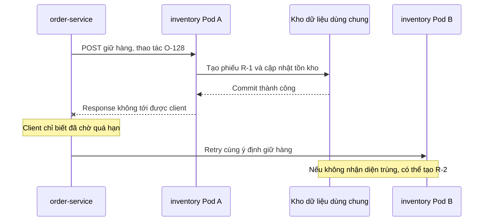
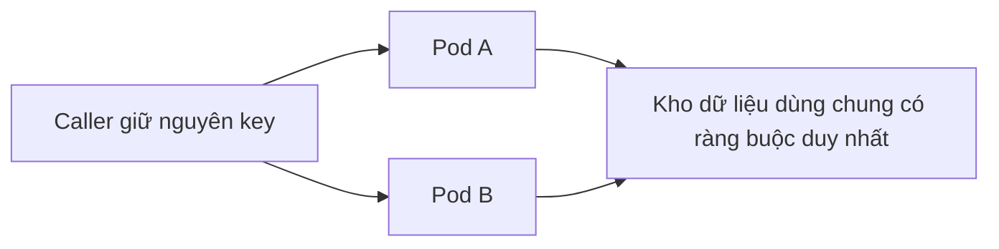

# Retry sang bản sao khác và tính lũy đẳng của yêu cầu

> Chương: Cân bằng tải — Module: SPRING_CLOUD_KUBERNETES.

Khi một request tới Pod A thất bại, thử lại qua Pod B có thể giúp ứng dụng vượt qua lỗi cục bộ. Tuy nhiên, client không nhận được response chưa có nghĩa Pod A chưa xử lý request. Nếu A đã tạo một phiếu giữ hàng rồi kết nối bị đứt, việc gửi lại sang B có thể tạo thêm một phiếu và trừ tồn kho lần nữa.

Vì vậy, retry cần trả lời đồng thời hai câu hỏi: lần tiếp theo được gửi tới đâu, và lặp lại thao tác có làm phát sinh tác dụng nghiệp vụ ngoài ý muốn không. Spring Cloud LoadBalancer hỗ trợ lựa chọn instance và retry theo chính sách; ứng dụng vẫn phải thiết kế tính lũy đẳng cho nghiệp vụ.

Bài học dùng `order-service` gọi `inventory` trong namespace `shop`. Phần cấu hình retry minh họa một đường **GET chỉ đọc**. Phần giữ hàng dùng POST để phân tích thiết kế chống trùng, không mặc định POST đã an toàn khi bật cùng cấu hình.

## 1. Phân biệt một thao tác với nhiều lần thử

Một thao tác logic là điều caller muốn thực hiện, chẳng hạn “giữ hai sản phẩm cho đơn hàng O-128”. Một lần thử là một lần truyền request để thực hiện thao tác đó.

```text
Thao tác logic: giữ hàng cho O-128
    attempt 1 → Pod A → client gặp timeout
    attempt 2 → Pod B → client nhận kết quả
```

Hai attempt không nên được hiểu là hai ý định giữ hàng độc lập. Nếu server không nhận ra chúng thuộc cùng thao tác, nó có thể xử lý hai lần một cách hoàn toàn hợp lệ theo logic hiện có.

Cần phân biệt thêm:

| Cơ chế | Việc nó làm |
| --- | --- |
| Retry | Thực hiện thêm một lần thử sau điều kiện lỗi đã chọn |
| Load balancing | Chọn đích từ tập instance ứng viên |
| Tránh instance vừa lỗi | Ưu tiên ứng viên khác trong ngữ cảnh retry nếu có |
| Circuit breaker | Kiểm soát việc tiếp tục gọi dựa trên trạng thái lỗi theo chính sách |
| Idempotency | Giữ tác dụng nghiệp vụ của thao tác lặp trong giới hạn đã định nghĩa |

Retry không tự đánh dấu Pod là hỏng vĩnh viễn, không thay Kubernetes readiness và không tự cung cấp bảo đảm “chỉ xử lý đúng một lần”.

## 2. Tình huống nguy hiểm: đã commit nhưng mất response



Client có ít nhất ba khả năng cần xét khi timeout:

1. Server chưa nhận request.
2. Server đang xử lý.
3. Server đã hoàn tất nhưng response không tới được client.

Đổi Pod không giúp client phân biệt ba trạng thái đó. Hủy chờ ở phía client cũng không tự rollback giao dịch đã commit hoặc bảo đảm server dừng xử lý.

Đây là lý do thao tác ghi cần một giao thức phục hồi kết quả hoặc chống trùng. Tăng số replica chỉ tăng số nơi có thể nhận request, không giải quyết tính duy nhất của tác dụng nghiệp vụ.

## 3. “Instance khác” có ý nghĩa gì trong Kubernetes?

Theo [LoadBalancer for Kubernetes](https://docs.spring.io/spring-cloud-kubernetes/reference/load-balancer.html), hai chế độ POD và SERVICE có tập đích khác nhau.

### 3.1. POD

Ở đường POD, DiscoveryClient cung cấp các instance endpoint. Với backend thông thường, client có thể chọn lần đầu `10.244.1.10:8080`, rồi lần sau chọn `10.244.2.11:8080`.

Trong ngữ cảnh này, việc đổi `ServiceInstance` có thể tương ứng với đổi Pod thực sự. Cần quan sát địa chỉ endpoint và danh tính Pod để xác nhận.

Nếu tập ứng viên chỉ có một instance, không có bản sao khác để chuyển tới. Nếu cache discovery còn dữ liệu cũ, lần retry cũng có thể chọn một đích đã lỗi hoặc đang kết thúc.

### 3.2. SERVICE

Ở đường SERVICE, instance mà phía Spring chọn có thể là địa chỉ DNS của Kubernetes Service:

```text
inventory.shop.svc.cluster.local:80
```

Đằng sau địa chỉ đó, cơ chế mạng Kubernetes mới chọn backend cho kết nối. Chọn lại một ServiceInstance không phải bảo đảm chọn được một Pod khác.

Khi chỉ có một Service ứng viên, phía Spring không có danh sách Pod để loại trực tiếp Pod vừa xử lý lỗi. Connection reuse, session affinity và cách vận hành dataplane cũng có thể khiến các lần gọi tiếp tục tới cùng backend.

| Điều cần chứng minh | POD | SERVICE |
| --- | --- | --- |
| Phía Spring chọn đích khác | So sánh endpoint/instance được chọn | So sánh Service được chọn |
| Backend cuối khác Pod | Có thể đối chiếu với endpoint | Cần quan sát backend thực tế |
| Không lặp nghiệp vụ | Cần cơ chế lũy đẳng | Vẫn cần cơ chế lũy đẳng |

Không coi việc chuyển từ POD sang SERVICE là biện pháp chống thực thi trùng.

## 4. Retry cùng instance và retry sang instance mới

Spring Cloud LoadBalancer phân biệt hai giới hạn:

- `max-retries-on-same-service-instance`: số retry trên instance đã chọn.
- `max-retries-on-next-service-instance`: số retry đi qua lần lựa chọn instance tiếp theo.

Các số này đếm retry, không đếm request đầu tiên. Với chính sách không retry cùng instance và chỉ một lần lựa chọn tiếp theo:

```text
Request đầu tiên: 1
Retry cùng instance: 0
Retry qua lần chọn tiếp theo: tối đa 1

→ tối đa 2 attempt ở tầng retry LoadBalancer này
```

Giới hạn trên không bao gồm retry của gateway, service mesh, HTTP transport, SDK hoặc caller bên ngoài. Nếu có những lớp đó, phải tính và quan sát riêng.

Tài liệu [Retrying Failed Requests](https://docs.spring.io/spring-cloud-commons/reference/spring-cloud-commons/common-abstractions.html#retrying-failed-requests) mô tả `RetryAwareServiceInstanceListSupplier` để tránh instance vừa được chọn khi có ứng viên khác. Thuộc tính liên quan là:

```yaml
spring:
  cloud:
    loadbalancer:
      retry:
        avoid-previous-instance: true
```

Đây là hành vi trong ngữ cảnh retry, không phải danh sách cấm dùng chung cho mọi request. Nó cũng không bảo đảm mọi attempt trong chuỗi dài đều tới một Pod chưa từng được thử: sau A rồi B, một lần chọn tiếp có thể lại là A tùy chính sách và tập ứng viên.

Nếu dùng supplier tùy chỉnh, cần kiểm tra chuỗi supplier có tiếp nhận ngữ cảnh request và còn thực hiện hành vi tránh instance cũ hay không.

## 5. Cấu hình mẫu cho đường GET chỉ đọc

Ví dụ sử dụng WebClient reactive và starter Fabric8 trong dự án Spring Boot có Spring Cloud BOM tương thích:

```xml
<dependency>
    <groupId>org.springframework.cloud</groupId>
    <artifactId>spring-cloud-starter-kubernetes-fabric8-loadbalancer</artifactId>
</dependency>
<dependency>
    <groupId>org.springframework.boot</groupId>
    <artifactId>spring-boot-starter-webflux</artifactId>
</dependency>
```

Ứng dụng minh họa chỉ sử dụng chính sách này để đọc dữ liệu `inventory`. Đối chiếu thuộc tính với nhánh tài liệu đúng bộ phiên bản dự án trước khi triển khai:

```yaml
spring:
  application:
    name: order-service
  cloud:
    kubernetes:
      discovery:
        enabled: true
        all-namespaces: false
        namespaces:
          - shop
        use-endpoint-slices: true
        primary-port-name: http
        include-not-ready-addresses: false
      loadbalancer:
        mode: POD
    loadbalancer:
      retry:
        enabled: true
        max-retries-on-same-service-instance: 0
        max-retries-on-next-service-instance: 1
        avoid-previous-instance: true
        retry-on-all-operations: false
        retry-on-all-exceptions: false
        retryable-status-codes:
          - 503
        backoff:
          enabled: true
          min-backoff: 50ms
          max-backoff: 200ms
          jitter: 0.5
```

Các giá trị là lựa chọn của bài thực hành, không phải khuyến nghị áp dụng giống nhau cho mọi hệ thống.

### Ý nghĩa các quyết định

| Cấu hình | Mục đích trong ví dụ |
| --- | --- |
| `mode: POD` | Có góc nhìn endpoint khi thử đổi bản sao |
| Retry cùng instance bằng 0 | Không chủ động dành lượt retry cho cùng đích |
| Retry lần chọn tiếp theo bằng 1 | Giữ số attempt ở tầng LoadBalancer nhỏ |
| `avoid-previous-instance: true` | Tránh đích vừa chọn nếu có ứng viên khác |
| `retryable-status-codes: [503]` | Minh họa một mã lỗi tạm thời đã được chọn có chủ ý |
| Backoff có giới hạn và jitter | Giãn thời điểm thử lại, giảm việc nhiều caller cùng dồn request |
| Không retry mọi exception | Tránh biến mọi lỗi cấu hình, lập trình hoặc nghiệp vụ thành lý do thử lại |

HTTP 503 không bảo đảm thao tác ghi chưa xảy ra. Trong ví dụ GET đúng ngữ nghĩa chỉ đọc, việc lặp request dễ kiểm soát hơn; với POST phải xét hợp đồng riêng.

### Phạm vi và implementation có ảnh hưởng

Ví dụ dùng cấu hình toàn cục cho ứng dụng thực hành. Trong ứng dụng có nhiều service ID, cần đánh giá và thu hẹp theo client, chẳng hạn tiền tố `spring.cloud.loadbalancer.clients.<serviceId>.retry` ở phiên bản hỗ trợ.

Cơ chế bật retry khác nhau giữa reactive WebClient và blocking RestTemplate. Với WebClient, bài chủ động bật thuộc tính retry; không thêm Spring Retry rồi mặc định nó điều khiển cùng một đường reactive. Cũng không suy ra mọi HTTP client đều dùng chính sách này.

`retry-on-all-operations: false` thể hiện việc không mở rộng retry theo method một cách đại trà. Không dùng thuộc tính này như bảo đảm chống lặp POST trong mọi nhánh lỗi. Chẳng hạn, [implementation reactive ở Spring Cloud Commons 5.1.0](https://github.com/spring-cloud/spring-cloud-commons/blob/v5.1.0/spring-cloud-commons/src/main/java/org/springframework/cloud/client/loadbalancer/reactive/RetryableLoadBalancerExchangeFilterFunction.java) kiểm tra method ở nhánh mã trạng thái và lọc exception ở nhánh khác.

Vì vậy, với thao tác ghi chưa có hợp đồng chống trùng, dùng một đường client được kiểm soát để không tự retry thao tác đó; xác nhận cả nhánh status code và nhánh exception bằng implementation thực tế. Không chỉ kiểm tra một boolean rồi kết luận POST đã được bảo vệ.

Giá trị bật backoff trong ví dụ là `true`; cấu trúc thuộc tính và việc áp dụng backoff được thể hiện trong [LoadBalancerProperties của Commons 5.1.0](https://github.com/spring-cloud/spring-cloud-commons/blob/v5.1.0/spring-cloud-commons/src/main/java/org/springframework/cloud/client/loadbalancer/LoadBalancerProperties.java).

## 6. WebClient chỉ cung cấp thao tác đọc

Khai báo builder được tích hợp LoadBalancer và cấu hình timeout kết nối, response:

```java
package example.retry;

import java.time.Duration;

import io.netty.channel.ChannelOption;
import org.springframework.cloud.client.loadbalancer.LoadBalanced;
import org.springframework.context.annotation.Bean;
import org.springframework.context.annotation.Configuration;
import org.springframework.http.client.reactive.ReactorClientHttpConnector;
import org.springframework.web.reactive.function.client.WebClient;
import reactor.netty.http.client.HttpClient;

@Configuration(proxyBeanMethods = false)
public class InventoryReadConfiguration {

    @Bean
    @LoadBalanced
    WebClient.Builder inventoryReadWebClientBuilder() {
        HttpClient transport = HttpClient.create()
                .option(ChannelOption.CONNECT_TIMEOUT_MILLIS, 200)
                .responseTimeout(Duration.ofMillis(500));

        return WebClient.builder()
                .clientConnector(new ReactorClientHttpConnector(transport));
    }
}
```

Client chỉ có phương thức GET:

```java
package example.retry;

import java.time.Duration;

import org.springframework.cloud.client.loadbalancer.LoadBalanced;
import org.springframework.stereotype.Component;
import org.springframework.web.reactive.function.client.WebClient;
import reactor.core.publisher.Mono;

@Component
public class InventoryReadClient {

    private final WebClient client;

    public InventoryReadClient(
            @LoadBalanced WebClient.Builder inventoryReadWebClientBuilder) {
        this.client = inventoryReadWebClientBuilder
                .baseUrl("http://inventory")
                .build();
    }

    public Mono<String> stock(String sku) {
        return client.get()
                .uri("/stocks/{sku}", sku)
                .retrieve()
                .bodyToMono(String.class)
                .timeout(Duration.ofMillis(1500));
    }
}
```

Các lớp nằm trong phạm vi component scan của ứng dụng Spring Boot đã cấu hình discovery. Backend phải có API `GET /stocks/{sku}`, Service và endpoint hợp lệ, cùng quyền đọc discovery và đường mạng phù hợp.

Địa chỉ `http://inventory` là service ID cho builder đã tích hợp. Nếu thay bằng Pod IP đã được chọn và giữ cố định URL đó, một cơ chế retry HTTP bên ngoài không tự có đủ thông tin để đổi bản sao.

Không thêm `.retry()` hoặc `.retryWhen(...)` bao ngoài ví dụ chỉ để “chắc chắn retry”. Việc đó có thể tạo thêm vòng retry độc lập, làm số attempt lớn hơn giới hạn đã cấu hình tại LoadBalancer.

Theo [Reactor Netty HTTP Client](https://projectreactor.io/docs/netty/release/reference/http-client.html#_timeout_configuration), timeout kết nối, timeout response và timeout trên toàn chuỗi có phạm vi khác nhau. `responseTimeout` không nên được coi là giới hạn toàn bộ một attempt gồm cả chờ pool, phân giải DNS và các giai đoạn khác.

`.timeout(1500ms)` ở cuối ví dụ giới hạn thời gian chờ của chuỗi trả kết quả này, bao gồm những lần retry nằm bên trong nó. Nó không bảo đảm mỗi timeout sẽ kích hoạt retry ở filter LoadBalancer, và không bảo đảm server ngừng xử lý khi client hủy chờ.

Một lỗi phát sinh khi đọc body sau khi filter đã nhận response có thể nằm ngoài phạm vi retry của filter. Vì vậy, cần xác nhận vị trí exception và loại exception thực tế trước khi mở rộng chính sách.

## 7. Chọn lỗi nào đáng thử lại?

| Tình huống | Cách cân nhắc |
| --- | --- |
| Kết nối tới một endpoint không thiết lập được | Có thể là lỗi cục bộ; xét retry giới hạn nếu còn đích và còn thời gian |
| 503 tạm thời trên một replica | Có thể thử lại theo hợp đồng endpoint; vẫn xét tính lũy đẳng |
| Response timeout | Kết quả xử lý có thể chưa rõ; thao tác ghi cần chống trùng hoặc truy vấn trạng thái |
| 400 do dữ liệu không hợp lệ | Sửa request; lặp nguyên request thường không giúp |
| 401/403 do credential hoặc quyền | Sửa quan hệ xác thực/phân quyền; không thử hàng loạt Pod |
| 404/409 theo quy tắc nghiệp vụ | Xử lý theo hợp đồng API, không mặc định là lỗi hạ tầng |
| 429 hoặc lỗi phụ thuộc dùng chung | Xét giới hạn tải, chỉ dẫn của server và ngân sách retry |
| Lỗi decode hoặc sai schema response | Kiểm tra tương thích; đổi Pod có thể chỉ che lỗi triển khai |

Không retry mọi 5xx một cách đồng nhất. Nếu cả A và B đều phụ thuộc cùng một database đang quá tải, đổi Pod không loại bỏ nguyên nhân mà còn làm database nhận thêm yêu cầu.

Nếu API cung cấp `Retry-After`, chính sách cần hiểu ý nghĩa chỉ dẫn đó và deadline còn lại. Chỉ thêm 429 hoặc 503 vào danh sách mã retry không chứng minh client đã tự chờ theo `Retry-After`.

Exception cũng cần được phân loại theo client thực tế: lỗi transport có thể được bọc trong exception khác. Khi hết lượt retry, lỗi trả về còn có thể là lỗi bao ngoài. Không biến mọi exception thành dữ liệu thành công mặc định vì như vậy caller mất thông tin về kết quả chưa xác định.

## 8. Lũy đẳng là tính chất của tác dụng được yêu cầu

Theo [HTTP Semantics, RFC 9110 mục 9.2.2](https://www.rfc-editor.org/rfc/rfc9110.html#section-9.2.2), lũy đẳng nghĩa là nhiều request giống nhau có cùng tác dụng được yêu cầu trên server như một request. Điều đó không bắt buộc các response giống nhau từng byte.

Ví dụ:

| Thao tác | Phân tích tính lũy đẳng |
| --- | --- |
| GET đọc tồn kho | Có ngữ nghĩa lũy đẳng khi API thực sự chỉ đọc theo hợp đồng |
| PUT đặt trạng thái tài nguyên thành một giá trị xác định | Có thể lặp cùng ý định mà không cộng dồn tác dụng |
| DELETE cùng một tài nguyên | Có ngữ nghĩa lũy đẳng dù lần sau có thể trả kết quả khác |
| POST tạo một phiếu giữ hàng mới | Mặc định có khả năng tạo thêm phiếu mỗi lần gọi |
| PATCH “tăng số lượng thêm 1” | Lặp có thể cộng thêm nhiều lần; không tự lũy đẳng |

Một GET được lập trình để “đọc rồi trừ kho” vẫn nguy hiểm khi lặp dù tên method là GET. Ngược lại, một POST có thể được thiết kế chống trùng bằng giao thức của ứng dụng; chỉ đổi tên method không tạo ra giao thức đó.

Đối với PUT hoặc DELETE trong hệ thống có cập nhật đồng thời, còn cần xác định request cũ có được áp dụng sau một cập nhật mới hay không. Version hoặc điều kiện như `If-Match` có thể phục vụ kiểm soát đồng thời; đây là vấn đề cần xét thêm ngoài việc cùng request bị gửi lại.

### Lũy đẳng không đồng nghĩa cùng response

Lần DELETE đầu có thể trả 204, lần sau trả 404, trong khi trạng thái mong muốn cuối cùng vẫn là tài nguyên đã được xóa.

Đối với API tạo phiếu giữ hàng có cơ chế trả kết quả cũ, hợp đồng có thể quy định phát lại cùng mã phiếu và nội dung nghiệp vụ. Những header như thời điểm xử lý hoặc thông tin trace có thể khác. Phải công bố điều gì được giữ ổn định thay vì yêu cầu “hai HTTP response giống tuyệt đối”.

## 9. Thiết kế POST với khóa lũy đẳng dùng chung

Ví dụ quy ước API của ứng dụng:

```http
POST /reservations HTTP/1.1
Content-Type: application/json
Idempotency-Key: op-6ef56488-42f4-4f40-a664-b0ac85645233

{
  "orderId": "O-128",
  "sku": "SKU-42",
  "quantity": 2
}
```

`Idempotency-Key` ở đây là một hợp đồng do API thiết kế. Spring Cloud Kubernetes không tự lưu khóa hoặc ngăn tạo bản ghi trùng khi thấy header này.

### 9.1. Sinh khóa một lần cho thao tác logic

Caller tạo khóa khi bắt đầu ý định giữ hàng và giữ nguyên khóa đó cho các attempt, kể cả lần gửi lại sau khi tiến trình caller được phục hồi nếu thao tác còn đang được theo dõi.

```text
Bắt đầu thao tác O-128
    key = tạo một lần
    payload = cố định cho thao tác

attempt 1 → key cũ, payload cũ
attempt 2 → key cũ, payload cũ
truy vấn phục hồi → tham chiếu cùng thao tác
```

Nếu tạo một UUID mới trong mỗi vòng retry, server sẽ thấy các thao tác khác nhau. Nếu người dùng thực sự yêu cầu thêm một lần giữ hàng độc lập, caller cần khóa mới cho ý định mới.

Key không thay quyền truy cập. Server vẫn xác thực caller và kiểm tra caller có quyền thao tác hoặc đọc kết quả tương ứng.

### 9.2. Xác định phạm vi khóa

Một bản ghi chống trùng có thể được định danh bởi:

```text
(tenant hoặc chủ thể hợp lệ, loại thao tác, idempotency key)
```

Ví dụ loại thao tác là `CREATE_RESERVATION_V1`. Không dùng khóa toàn cục theo cách khiến tenant khác có thể vô tình nhận hoặc đoán kết quả của nhau.

Server lưu fingerprint của dữ liệu có ý nghĩa: order ID, SKU, quantity và các trường ảnh hưởng nghiệp vụ. Cách chuẩn hóa dữ liệu và phiên bản fingerprint phải rõ ràng; không băm JSON theo một thứ tự tùy ý rồi coi mọi cách biểu diễn tương đương đều khác nhau.

Cùng key nhưng payload có ý nghĩa khác phải bị từ chối hoặc xử lý theo hợp đồng xung đột đã công bố. Không trả kết quả cũ như thể request mới đã được thực hiện.

### 9.3. Mọi Pod cần cùng nhìn thấy trạng thái chống trùng



Một `ConcurrentHashMap` trong Pod A không giúp Pod B nhận ra request trước đó. Cache trong bộ nhớ còn mất khi Pod restart hoặc khi scale replica.

Cần một cơ chế lưu trữ và phối hợp phù hợp với ranh giới nghiệp vụ. Với ví dụ giữ hàng nằm trong một database giao dịch, có thể đặt bản ghi chống trùng và thay đổi tồn kho trong cùng database để kiểm soát tính nguyên tử.

ConfigMap không phải nơi lưu khóa chống trùng theo request. Secret cũng không phải kho giao dịch cho kết quả thao tác. Configuration Watcher phục vụ cập nhật cấu hình, không giải quyết việc hai Pod cùng xử lý một ý định.

## 10. Ví dụ giao dịch chống trùng ở phía server

Schema PostgreSQL minh họa:

```sql
CREATE TABLE reservation_idempotency (
    tenant_id       varchar(100) NOT NULL,
    operation       varchar(80) NOT NULL,
    idempotency_key  varchar(160) NOT NULL,
    request_hash    varchar(64) NOT NULL,
    state           varchar(20) NOT NULL,
    reservation_id  uuid,
    response_status integer,
    response_body   jsonb,
    created_at      timestamptz NOT NULL DEFAULT now(),
    expires_at      timestamptz NOT NULL,
    PRIMARY KEY (tenant_id, operation, idempotency_key),
    CHECK (state IN ('IN_PROGRESS', 'COMPLETED'))
);
```

Schema chỉ minh họa phần chống trùng, không bao gồm bảng tồn kho, bảng phiếu và toàn bộ ràng buộc nghiệp vụ.

Đặt unique key trong database để xử lý cạnh tranh. Kiểu “SELECT chưa thấy, rồi INSERT” ở code ứng dụng không đủ: A và B có thể cùng đọc thấy chưa có bản ghi.

Một thao tác giữ chỗ khóa có thể dùng:

```sql
INSERT INTO reservation_idempotency (
    tenant_id, operation, idempotency_key, request_hash,
    state, expires_at
)
VALUES (
    :tenant_id, 'CREATE_RESERVATION_V1', :idempotency_key,
    :request_hash, 'IN_PROGRESS', :expires_at
)
ON CONFLICT (tenant_id, operation, idempotency_key)
DO NOTHING
RETURNING idempotency_key;
```

Các giá trị bắt đầu bằng `:` là tham số bind của tầng truy cập dữ liệu, không phải chuỗi để nội suy vào SQL. [PostgreSQL INSERT](https://www.postgresql.org/docs/current/sql-insert.html) mô tả hành vi unique conflict và `ON CONFLICT`; cơ chế đó chỉ là một phần của giao dịch nghiệp vụ.

### 10.1. Luồng đơn giản khi toàn bộ thay đổi ở cùng database

```text
Xác thực caller, xác định tenant và chuẩn hóa payload
Bắt đầu transaction

Thử chèn bản ghi chống trùng bằng unique key

Nếu chèn được:
    Thực hiện kiểm tra và cập nhật tồn kho
    Tạo phiếu giữ hàng R-1
    Lưu reservation_id, response và state = COMPLETED
    Commit cùng transaction
    Trả kết quả đã commit

Nếu key đã tồn tại:
    Đọc kết quả đã được commit của key đó
    Kiểm tra request_hash
    Nếu cùng ý định và COMPLETED:
        Trả kết quả tương ứng R-1
    Nếu payload khác:
        Trả lỗi xung đột theo hợp đồng
    Nếu chưa thể xác định kết quả:
        Chờ có giới hạn hoặc trả trạng thái xử lý theo hợp đồng
```

Với mô hình này, không commit riêng bản ghi `IN_PROGRESS` rồi mới bắt đầu cập nhật tồn kho trong transaction khác. Mục tiêu là thay đổi nghiệp vụ và kết quả chống trùng cùng được commit hoặc cùng rollback.

Khi A và B cạnh tranh cùng key, cơ chế unique/locking có thể làm một transaction phải chờ. Phải chọn isolation, thời hạn chờ và cách đọc lại phù hợp. Nếu transaction bị hủy bởi lỗi cạnh tranh, cần thực hiện bước đọc/phục hồi trong ngữ cảnh transaction hợp lệ; không tiếp tục dùng một transaction đã lỗi.

Nếu không đọc được bản ghi sau xung đột trong điều kiện hiện tại, không được mặc định mình có quyền thực hiện nghiệp vụ lần nữa. Phải giải quyết trạng thái quan sát hoặc báo kết quả chưa xác định theo hợp đồng.

### 10.2. Những cửa sổ lỗi cần đóng

| Điểm xảy ra lỗi | Hành vi mong muốn trong mô hình một transaction |
| --- | --- |
| Trước khi commit | Thay đổi nghiệp vụ và bản ghi chưa hoàn tất cùng rollback |
| Sau commit nhưng trước response | Retry đọc kết quả đã lưu và trả cùng phiếu |
| Hai Pod nhận cùng key đồng thời | Chỉ một bên sở hữu lần thực hiện nghiệp vụ; bên kia đi theo luồng trùng |
| Cùng key, payload khác | Không chạy thao tác mới bằng kết quả của payload cũ |
| Pod xử lý chết sau commit | Pod khác phục hồi từ kho dữ liệu dùng chung |

Đặc biệt tránh chuỗi sau:

```text
Commit trừ kho
    → Pod chết
    → chưa ghi kết quả chống trùng
    → Pod khác thấy thiếu kết quả và trừ tiếp
```

Đây là khoảng hở mà việc chỉ lưu “đã làm” sau thao tác nghiệp vụ có thể tạo ra.

### 10.3. Khi có hệ thống ngoài transaction

Nếu thao tác còn gửi sự kiện, gọi một dịch vụ khác hoặc thực hiện tác dụng ngoài database, transaction nội bộ không tự bao trùm tất cả.

Có thể cần outbox, mã thao tác dùng chung ở hệ thống nhận và cơ chế xử lý trùng tại consumer. Nếu commit `IN_PROGRESS` để xử lý dài hoặc bất đồng bộ, phải thiết kế quyền sở hữu, phục hồi sau lỗi và cách ngăn worker cũ tiếp tục ghi sau khi mất quyền xử lý.

Không khẳng định “exactly once” cho toàn bộ luồng chỉ vì bảng chống trùng có unique key. Bảo đảm thực tế phải được mô tả theo từng ranh giới lưu trữ và hệ thống tham gia.

## 11. Thời hạn lưu kết quả và cách phục hồi

Khóa chống trùng có một khoảng thời gian được hỗ trợ. Nếu server xóa bản ghi quá sớm, một retry đến muộn có thể lại được hiểu là thao tác mới.

Cần thống nhất:

- Caller có thể gửi lại trong bao lâu, kể cả sau restart hoặc mất kết nối dài.
- Server giữ key và kết quả trong bao lâu.
- Kết quả nào được lưu, chẳng hạn thành công hoặc một số lỗi nghiệp vụ đã hoàn tất.
- Cách truy vấn trạng thái khi hết deadline nhưng kết quả chưa rõ.
- Hành vi khi key đã hết hạn hoặc cùng key được dùng lại.

Chỉ lưu TTL dài hơn một lần timeout HTTP là chưa đủ. Khoảng phục hồi có thể còn gồm tác vụ nền, queue hoặc lần gửi lại của người dùng.

Với thao tác tạo phiếu, có thể cung cấp API tra cứu theo mã thao tác đã được xác thực. Khi caller không biết POST trước đã thành công chưa, truy vấn kết quả có thể hợp lý hơn tiếp tục gửi thao tác tạo mới bằng key khác.

Nếu hết mọi lượt retry, caller nên nhận lỗi phù hợp hoặc trạng thái “kết quả chưa xác định” theo hợp đồng. Không trả “không tạo phiếu” nếu hệ thống chưa chứng minh được điều đó.

## 12. Ngân sách thời gian và khuếch đại tải

Retry chỉ có ích khi còn thời gian và hệ thống còn khả năng phục vụ.

Một mô hình ngân sách đơn giản:

```text
Tổng thời gian chờ
    = thời gian các attempt
    + thời gian backoff
    + chi phí discovery, pool và xử lý liên quan
```

Ví dụ thiết kế một thao tác đọc có deadline 1500 ms. Có thể dành tối đa 500 ms cho mỗi attempt theo giới hạn thực sự áp dụng, khoảng chờ retry và phần dự phòng cho các giai đoạn còn lại. Đây là phân bổ thiết kế; không suy ra chỉ đặt response timeout 500 ms đã chặn được mọi giai đoạn trong 500 ms.

Không bắt đầu retry mới nếu ngân sách còn lại không đủ cho một lần thử có ý nghĩa. Khi deadline tổng kết thúc, việc tiếp tục dồn request nền có thể chỉ tăng tải mà caller không còn dùng được kết quả.

### Nhiều tầng retry nhân số lần gọi

Giả sử một request được gateway thử tối đa hai lượt. Mỗi lượt qua ứng dụng lại được LoadBalancer thử tối đa hai lượt, và SDK phía dưới còn có hai lượt nữa:

```text
Số lần gọi ở tầng sâu có thể lên tới:
    2 × 2 × 2 = 8
```

Ví dụ minh họa các vòng retry lồng nhau và đều được kích hoạt; không phải công thức mặc định cho mọi thư viện. Cần biết tầng nào thực sự sở hữu retry, các tầng còn lại làm gì và tổng tải cho phép là bao nhiêu.

Backoff và jitter giúp giảm đồng bộ thời điểm, nhưng không tạo thêm năng lực database. Kết hợp giới hạn attempt, timeout, giới hạn đồng thời và cơ chế ngừng gọi phù hợp với sự cố.

## 13. Quan sát attempt và tác dụng nghiệp vụ riêng

Để chứng minh retry sang bản sao khác hoạt động, cần nhiều hơn response cuối 200.

| Dữ liệu cần quan sát | Mục đích |
| --- | --- |
| Mã thao tác logic ổn định | Nối các attempt thuộc cùng ý định |
| Số attempt hoặc span của từng lượt | Biết thực tế đã gọi bao nhiêu lần |
| Service ID, instance được chọn | Biết phía LoadBalancer đã chọn đích nào |
| Pod thực sự nhận request | Xác nhận thay backend trong đường triển khai |
| Loại exception, mã trạng thái và thời gian | Xác định điều kiện kích hoạt retry |
| Kết quả chống trùng và mã phiếu | Biết xử lý mới hay trả lại kết quả đã có |
| Thay đổi tồn kho thực tế | Kiểm chứng tác dụng nghiệp vụ chỉ xảy ra theo hợp đồng |

Tách metric “tỷ lệ thành công của thao tác” khỏi “tỷ lệ lỗi của từng attempt”. Nếu chỉ nhìn response cuối, nhiều retry có thể đang che việc một replica hỏng hoặc cache discovery chậm cập nhật.

Không đưa từng idempotency key vào label metric vì số lượng giá trị sẽ tăng theo request. Log hoặc trace cần kiểm soát dữ liệu nhạy cảm và có thể dùng tham chiếu phù hợp thay vì ghi toàn bộ key, token hoặc payload.

Trace ID giúp liên kết thông tin quan sát; nó không tự trở thành ràng buộc duy nhất trong database. Tương tự, một header request ID không tự có ngữ nghĩa chống trùng nếu server chưa triển khai hợp đồng đó.

## 14. Kịch bản thực hành theo từng loại lỗi

Các kịch bản dưới dành cho môi trường thử nghiệm có ít nhất hai backend. Dùng công cụ gây lỗi hoặc cơ chế thử nghiệm được kiểm soát, không mở một endpoint gây lỗi công khai trong triển khai thật.

### 14.1. GET lỗi tạm thời trước khi trả dữ liệu

Chuẩn bị một endpoint đọc để Pod A trả 503 theo điều kiện thử nghiệm, còn Pod B có thể trả 200. Giữ nguyên service ID và ghi lại lựa chọn của LoadBalancer.

Quan sát xem có attempt đầu tới A và lần chọn tiếp tới B hay không. Không phụ thuộc vào việc round-robin chắc chắn chọn A trước; điều kiện thử nghiệm phải xác định được đích đầu hoặc ghi nhận đủ dữ liệu để diễn giải.

Đối chiếu số attempt ở tầng LoadBalancer với cấu hình. Nếu server nhận nhiều request hơn dự kiến, kiểm tra retry tại transport, proxy và các lớp khác.

### 14.2. Chỉ còn một instance

Giữ một backend ứng viên. Kích hoạt lỗi phù hợp và quan sát kết quả.

Mục tiêu là xác nhận hệ thống xử lý được trường hợp không có bản sao thay thế. `avoid-previous-instance` không sinh ra một Pod mới và không thay quy trình scale hoặc cập nhật readiness.

### 14.3. POST commit thành công rồi mất response

Dùng API giữ hàng đã có chống trùng. Sau khi transaction commit, mô phỏng response không tới caller. Gửi lại cùng key và cùng payload tới một Pod khác theo đường thử nghiệm được phép.

Điều cần chứng minh:

```text
Có nhiều attempt
Có thể có nhiều Pod tiếp nhận
Chỉ có một phiếu giữ hàng cho thao tác
Tồn kho chỉ thay đổi một lần theo hợp đồng
Caller nhận lại cùng mã phiếu đã tạo
```

Nếu chỉ kiểm tra hai response đều có cùng JSON nhưng tồn kho đã giảm hai lần, cơ chế chưa đạt yêu cầu.

### 14.4. Hai request đồng thời cùng key

Gửi hai request cùng thao tác vào hai Pod trong thời điểm gần nhau. Xác nhận unique constraint và giao dịch xử lý được cạnh tranh, không chỉ trường hợp request thứ hai đến sau khi request đầu đã hoàn tất.

Sau đó thử cùng key nhưng quantity khác. Kết quả phải đi theo hợp đồng xung đột, không tạo thêm phiếu hoặc trả nhầm kết quả như thể payload mới đã được chấp nhận.

### 14.5. Hết deadline và phục hồi kết quả

Tạo tình huống caller hết deadline trong khi server có thể đã hoàn thành. Dùng cơ chế tra cứu thao tác thay vì tạo ngay một key mới.

Ghi rõ caller có thể kết luận điều gì. “Client hết thời gian chờ” và “server không tạo phiếu” phải được biểu diễn là hai thông tin khác nhau.

### 14.6. Phụ thuộc dùng chung bị lỗi

Cho các replica cùng gặp một lỗi phụ thuộc trong môi trường thử nghiệm. Quan sát retry count, lưu lượng và độ trễ.

Nếu đổi Pod không cải thiện kết quả nhưng tăng số request, giảm hoặc ngừng retry theo chính sách thích hợp. Không xem tỷ lệ đổi Pod cao là một chỉ số thành công riêng của hệ thống.

## 15. Giữ ranh giới trách nhiệm khi triển khai

Retry request nghiệp vụ nằm ở HTTP client và chính sách chịu lỗi của ứng dụng. Retry của Kubernetes client khi đọc API, cập nhật ConfigMap/Secret hoặc hoạt động Configuration Watcher là những đường khác; không thay đổi chúng với kỳ vọng request giữ hàng sẽ tự an toàn hơn.

Một chính sách retry đủ cụ thể cần ghi lại:

| Quyết định | Ví dụ trong bài |
| --- | --- |
| Thao tác nào được tự retry | GET đọc tồn kho; POST chỉ sau khi có hợp đồng riêng |
| Lỗi nào kích hoạt | Mã trạng thái và exception đã được chọn, kiểm chứng theo client |
| Đổi đích ở tầng nào | ServiceInstance endpoint trong POD mode |
| Giới hạn attempt | Một request đầu và tối đa một retry ở tầng LoadBalancer của ví dụ |
| Ngân sách thời gian | Deadline tổng, timeout từng giai đoạn và backoff có giới hạn |
| Cách chống trùng thao tác ghi | Key ổn định, dữ liệu dùng chung và giao dịch phù hợp |
| Khi kết quả chưa rõ | Truy vấn trạng thái hoặc trả trạng thái theo hợp đồng |
| Bằng chứng vận hành | Attempt, instance, Pod nhận và tác dụng nghiệp vụ thực tế |

Chỉ bật thêm một lượt retry khi đã biết lần lặp đó có ích cho loại lỗi đang xét, còn trong ngân sách và không làm thay đổi ý định nghiệp vụ của caller.
