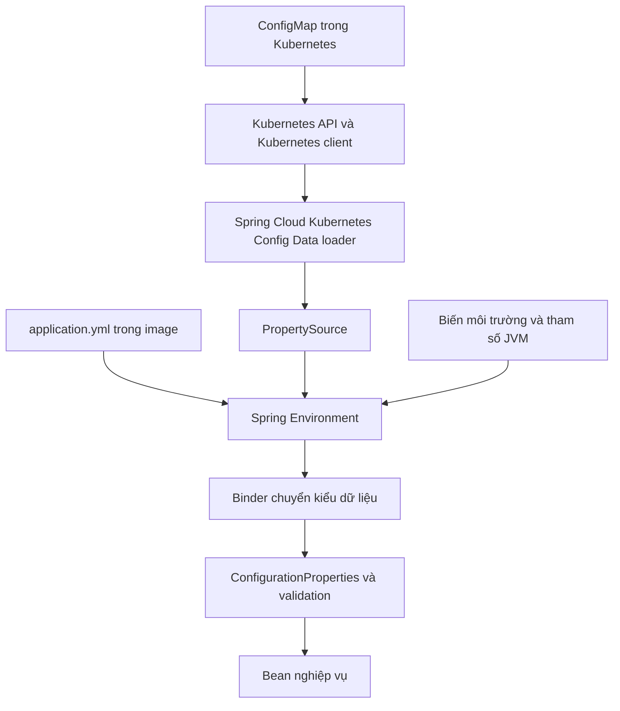

# Tích hợp cấu hình Kubernetes với Spring Boot Environment

Trong module **SPRING_CLOUD_KUBERNETES**, ứng dụng Spring được tích hợp với Kubernetes qua DiscoveryClient, ConfigMap, Secret, Spring Cloud LoadBalancer và Configuration Watcher. Bài thuộc chương **Nạp Config Data**, tập trung vào đường đi của cấu hình từ Kubernetes đến đối tượng Java: chọn nguồn dữ liệu, nạp đúng thời điểm, xác định giá trị có hiệu lực và phát hiện cấu hình không hợp lệ trước khi phục vụ request.

Tình huống xuyên suốt là `order-service`: cùng một image chạy ở nhiều namespace, nhưng mỗi môi trường có lời chào, giới hạn số sản phẩm và mã đối tác riêng. Các giá trị này nằm ngoài image. Code nghiệp vụ nhận một đối tượng cấu hình đã kiểm tra hợp lệ thay vì tự gọi Kubernetes API.

Sau bài học, bạn có thể:

- Giải thích quan hệ giữa Config Data, `PropertySource`, `Environment` và `@ConfigurationProperties`.
- Nạp ConfigMap qua Spring Cloud Kubernetes với ServiceAccount và RBAC phù hợp.
- Phân biệt nạp qua API, biến môi trường, file YAML và `configtree:`.
- Xác định nguồn đang ghi đè một property và tách lỗi nạp dữ liệu khỏi lỗi binding, validation.
- Phân biệt cấu hình lúc khởi động, sức khỏe Pod và cơ chế cập nhật cấu hình khi đang chạy.

## 1. Environment là nơi ứng dụng tra cứu cấu hình

`Environment` là lớp trừu tượng Spring dùng để tra cứu property và xác định các profile đang hoạt động. Nó tổng hợp nhiều `PropertySource`; mỗi nguồn cung cấp các cặp khóa–giá trị. Một khóa có thể xuất hiện ở nhiều nguồn, nhưng Spring trả về giá trị theo thứ tự ưu tiên của các nguồn đó.

Kubernetes ConfigMap là nơi lưu dữ liệu. Để dữ liệu trở thành cấu hình Spring, cần một cầu nối đưa nó vào `Environment`:



Trong ví dụ, chuỗi `order.max-items: "40"` được binder chuyển thành số nguyên `40`. Nếu dữ liệu là `"forty"`, bước chuyển kiểu thất bại. Nếu dữ liệu là `"0"`, chuyển kiểu có thể thành công nhưng validation nghiệp vụ sẽ từ chối.

| Thành phần | Trách nhiệm |
| --- | --- |
| ConfigMap hoặc Secret | Lưu cấu hình trong Kubernetes |
| Config Data | Cơ chế Spring Boot tìm và nạp dữ liệu cấu hình ở giai đoạn chuẩn bị ứng dụng |
| `PropertySource` | Đại diện một nguồn property trong Spring |
| `Environment` | Tra cứu giá trị hiệu lực từ tập hợp nguồn có thứ tự |
| Binder | Ánh xạ khóa cấu hình sang thuộc tính Java và chuyển kiểu |
| Validation | Kiểm tra điều kiện mà cấu hình phải thỏa mãn |

Đặt một file vào container chưa đủ để Spring đọc file đó. Tương tự, tạo ConfigMap chưa có nghĩa dữ liệu của nó tự xuất hiện trong `Environment`.

## 2. Chọn đường nạp dữ liệu trước khi chọn dependency

| Cách đưa cấu hình vào Pod | Spring đọc bằng gì? | Java cần quyền đọc Kubernetes API cho việc này? |
| --- | --- | --- |
| ConfigMap hoặc Secret thành biến môi trường qua `env`/`envFrom` | Nguồn biến môi trường của Spring Boot | Không |
| ConfigMap hoặc Secret được mount thành file | Import `file:` hoặc `configtree:` của Spring Boot | Không |
| Ứng dụng tự đọc ConfigMap hoặc Secret | Config Data loader của Spring Cloud Kubernetes với `kubernetes:` | Có |

Ở hai dòng đầu, Kubernetes cấp dữ liệu cho container; tiến trình Java không cần tự truy vấn API để đọc nguồn đó. Ở dòng cuối, Java sử dụng danh tính ServiceAccount để kết nối Kubernetes API.

Nếu yêu cầu chỉ là truyền vài giá trị lúc khởi động và triển khai lại khi thay đổi, biến môi trường hoặc file mount có thể đáp ứng. Dùng Spring Cloud Kubernetes khi cần cách tích hợp qua API và khả năng của thư viện phù hợp với thiết kế triển khai. Nạp cấu hình không bắt buộc kéo theo DiscoveryClient, Spring Cloud LoadBalancer hay Configuration Watcher.

Các cách tiêu thụ ConfigMap qua biến môi trường, file và API được mô tả trong [tài liệu ConfigMap của Kubernetes](https://kubernetes.io/docs/concepts/configuration/configmap/).

## 3. Phạm vi phiên bản và starter

Ví dụ Java dùng Java 17 trở lên, annotation `jakarta.validation` và cơ chế Config Data. Tên property Spring Cloud Kubernetes trong bài được đối chiếu với nhánh **3.3**; một cặp nền tảng phù hợp cho ví dụ là Spring Boot **3.5.x**, Spring Cloud **2025.0.x** và Spring Cloud Kubernetes **3.3.x**. Chọn phiên bản cụ thể và BOM `spring-cloud-dependencies` tương thích với Spring Boot theo [bảng release train của Spring Cloud](https://spring.io/projects/spring-cloud/).

Giả sử project đã có Spring Boot parent hoặc BOM và Spring Cloud BOM phù hợp, các dependency cần cho ví dụ là:

```xml
<dependencies>
    <dependency>
        <groupId>org.springframework.boot</groupId>
        <artifactId>spring-boot-starter-web</artifactId>
    </dependency>
    <dependency>
        <groupId>org.springframework.boot</groupId>
        <artifactId>spring-boot-starter-validation</artifactId>
    </dependency>
    <dependency>
        <groupId>org.springframework.boot</groupId>
        <artifactId>spring-boot-starter-actuator</artifactId>
    </dependency>
    <dependency>
        <groupId>org.springframework.cloud</groupId>
        <artifactId>spring-cloud-starter-kubernetes-client-config</artifactId>
    </dependency>
</dependencies>
```

Ví dụ chọn Kubernetes Java Client. Nếu project dùng Fabric8, thay starter cấu hình bằng `spring-cloud-starter-kubernetes-fabric8-config` và giữ nhất quán họ client. Không ghép hai họ starter. Starter `-config` đủ cho phần nạp cấu hình; không cần starter `-all`. Xem [danh sách starter chính thức](https://docs.spring.io/spring-cloud-kubernetes/reference/3.3/getting-started.html).

Bài sử dụng `spring.config.import`. Không đồng thời bật bootstrap cũ bằng `spring-cloud-starter-bootstrap` hoặc `spring.cloud.bootstrap.enabled=true`. Hai đường nạp này phải được lựa chọn riêng, theo [hướng dẫn Kubernetes PropertySource](https://docs.spring.io/spring-cloud-kubernetes/reference/3.3/property-source-config.html).

## 4. Chuẩn bị ứng dụng nhận cấu hình có kiểu

### 4.1. Đăng ký lớp cấu hình

Trong `OrderApplication.java`:

```java
package com.example.orders;

import org.springframework.boot.SpringApplication;
import org.springframework.boot.autoconfigure.SpringBootApplication;
import org.springframework.boot.context.properties.EnableConfigurationProperties;

@SpringBootApplication
@EnableConfigurationProperties(OrderProperties.class)
public class OrderApplication {

    public static void main(String[] args) {
        SpringApplication.run(OrderApplication.class, args);
    }
}
```

Trong `OrderProperties.java`:

```java
package com.example.orders;

import jakarta.validation.constraints.Max;
import jakarta.validation.constraints.Min;
import jakarta.validation.constraints.NotBlank;
import org.springframework.boot.context.properties.ConfigurationProperties;
import org.springframework.validation.annotation.Validated;

@ConfigurationProperties(prefix = "order")
@Validated
public record OrderProperties(
        @NotBlank String message,
        @Min(1) @Max(500) int maxItems,
        @NotBlank String partner
) {
}
```

Đối tượng này biểu diễn một hợp đồng cấu hình: lời chào và mã đối tác phải có nội dung; giới hạn sản phẩm nằm trong khoảng 1 đến 500. `@EnableConfigurationProperties` đăng ký bean để Spring thực hiện binding và validation. Chỉ khai báo record mà không đăng ký nó thì chưa tạo được hợp đồng có hiệu lực trong ứng dụng.

### 4.2. Quan sát kết quả qua một endpoint thực hành

Trong `ConfigDemoController.java`:

```java
package com.example.orders;

import org.springframework.core.env.Environment;
import org.springframework.web.bind.annotation.GetMapping;
import org.springframework.web.bind.annotation.RestController;

@RestController
public class ConfigDemoController {

    private final OrderProperties properties;
    private final Environment environment;

    public ConfigDemoController(OrderProperties properties,
                                Environment environment) {
        this.properties = properties;
        this.environment = environment;
    }

    @GetMapping("/demo/config")
    public ConfigView configuration() {
        return new ConfigView(
                properties.message(),
                properties.maxItems(),
                properties.partner(),
                environment.getProperty("order.message")
        );
    }

    public record ConfigView(String message, int maxItems,
                             String partner, String environmentMessage) {
    }
}
```

`message` lấy từ bean đã bind; `environmentMessage` là lần tra cứu `Environment` khi xử lý request. Khi ứng dụng vừa khởi động với cấu hình ổn định, hai giá trị trùng nhau. Điều đó không cam kết bean sẽ tự được bind lại nếu một nguồn dữ liệu thay đổi sau đó.

Endpoint chỉ phục vụ các giá trị không nhạy cảm của bài thực hành. Không bổ sung token hoặc mật khẩu vào kiểu trả về này.

## 5. Cung cấp thông tin cần biết trước khi đọc ConfigMap

Trong `src/main/resources/application.yml`:

```yaml
spring:
  application:
    name: order-service

order:
  message: "Lời chào mặc định trong image"
  max-items: 10

management:
  endpoints:
    web:
      exposure:
        include: health
  endpoint:
    health:
      probes:
        enabled: true
```

Cố ý không đặt mặc định cho `order.partner`: mỗi môi trường phải cung cấp mã đối tác. Nếu không có nguồn nào cấp giá trị này, `@NotBlank` làm khởi động thất bại.

Tách cấu hình dành cho Kubernetes sang `src/main/resources/application-kubernetes.yml`:

```yaml
spring:
  config:
    import: "kubernetes:"
  cloud:
    kubernetes:
      config:
        enabled: true
        name: order-service
        namespace: ${POD_NAMESPACE}
        include-profile-specific-sources: false
        fail-fast: true
      secrets:
        enabled: false
```

Ý nghĩa các lựa chọn:

- Profile `kubernetes` kích hoạt file chứa import khi ứng dụng chạy trong Pod.
- `"kubernetes:"` chọn loader; dấu nháy giữ đây là chuỗi YAML hợp lệ.
- `name` và `namespace` chỉ rõ ConfigMap cần đọc.
- `include-profile-specific-sources: false` giúp ví dụ chỉ dùng nguồn đã chọn, không tìm thêm ConfigMap theo tên profile.
- `fail-fast: true` yêu cầu làm khởi động thất bại khi loader gặp lỗi đọc cấu hình theo cơ chế của thư viện.
- `secrets.enabled: false` giới hạn đường API của ví dụ vào ConfigMap. Phần Secret phía sau dùng file mount.

Thông tin dùng để tìm nguồn phải có sẵn trước lần đọc nguồn đó. Không đặt duy nhất `spring.config.import`, namespace cần tra cứu hoặc profile cần kích hoạt trong chính ConfigMap mà ứng dụng chưa biết cách tìm. Danh tính ServiceAccount và khả năng kết nối API cũng phải sẵn sàng khi nạp Config Data.

Đây là khác biệt giữa **cấu hình đường đi đến nguồn** và **cấu hình nghiệp vụ nằm trong nguồn**. Trong ví dụ, Deployment cấp profile và namespace; ConfigMap cấp `order.*`.

## 6. Tạo ConfigMap và cấp quyền đọc trong namespace

Manifest sau dùng namespace `config-lab`. Thay trường `image` bằng image ứng dụng đã build và đẩy lên registry mà cluster truy cập được.

```yaml
apiVersion: v1
kind: Namespace
metadata:
  name: config-lab
---
apiVersion: v1
kind: ConfigMap
metadata:
  name: order-service
  namespace: config-lab
data:
  order.message: "Xin chào từ ConfigMap"
  order.max-items: "40"
  order.partner: "shipping-sandbox"
---
apiVersion: v1
kind: ServiceAccount
metadata:
  name: order-config-reader
  namespace: config-lab
---
apiVersion: rbac.authorization.k8s.io/v1
kind: Role
metadata:
  name: order-config-reader
  namespace: config-lab
rules:
  - apiGroups: [""]
    resources: ["configmaps"]
    verbs: ["get", "list"]
---
apiVersion: rbac.authorization.k8s.io/v1
kind: RoleBinding
metadata:
  name: order-config-reader
  namespace: config-lab
subjects:
  - kind: ServiceAccount
    name: order-config-reader
    namespace: config-lab
roleRef:
  apiGroup: rbac.authorization.k8s.io
  kind: Role
  name: order-config-reader
---
apiVersion: apps/v1
kind: Deployment
metadata:
  name: order-service
  namespace: config-lab
spec:
  replicas: 2
  selector:
    matchLabels:
      app: order-service
  template:
    metadata:
      labels:
        app: order-service
    spec:
      serviceAccountName: order-config-reader
      containers:
        - name: application
          image: registry.example.com/training/order-service:1.0.0
          ports:
            - name: http
              containerPort: 8080
          env:
            - name: SPRING_PROFILES_ACTIVE
              value: kubernetes
            - name: POD_NAMESPACE
              valueFrom:
                fieldRef:
                  fieldPath: metadata.namespace
          startupProbe:
            httpGet:
              path: /actuator/health/liveness
              port: http
            periodSeconds: 2
            failureThreshold: 30
          readinessProbe:
            httpGet:
              path: /actuator/health/readiness
              port: http
            periodSeconds: 5
          livenessProbe:
            httpGet:
              path: /actuator/health/liveness
              port: http
            periodSeconds: 10
```

`data` của ConfigMap chứa chuỗi, nên `"40"` được ghi có nháy. `metadata.name` xác định tài nguyên Kubernetes; các khóa `order.*` là tên cấu hình ứng dụng sử dụng.

RBAC này cho phép `get` và `list` ConfigMap trong `config-lab`. Một client có thể liệt kê tài nguyên rồi lọc tên, nên chọn một ConfigMap không có nghĩa mọi client luôn chỉ cần quyền `get`. Role có phạm vi toàn bộ ConfigMap của namespace, không phải chính sách chỉ đọc đúng một tên. Nó không cấp quyền sửa tài nguyên, đọc Secret hoặc đọc namespace khác.

Không cần thêm `watch` chỉ để nạp dữ liệu lúc khởi động. Nếu triển khai cơ chế theo dõi sau này, xác định riêng quyền mà thành phần đó dùng. `RoleBinding` gắn Role với đúng ServiceAccount; `serviceAccountName` chọn danh tính cho Pod. Xem [tài liệu RBAC của Kubernetes](https://kubernetes.io/docs/reference/access-authn-authz/rbac/).

## 7. Kiểm tra toàn bộ đường nạp

Lưu manifest thành file thực hành của bạn, ví dụ `config-lab.yaml`, thay image rồi triển khai:

```shell
kubectl apply -f config-lab.yaml
kubectl -n config-lab rollout status deployment/order-service
kubectl -n config-lab get pods -l app=order-service
kubectl -n config-lab port-forward deployment/order-service 8080:8080
```

Giữ terminal port-forward hoạt động. Từ terminal khác:

```shell
curl http://localhost:8080/demo/config
```

Kết quả mong đợi trên một Pod vừa khởi động:

```json
{
  "message": "Xin chào từ ConfigMap",
  "maxItems": 40,
  "partner": "shipping-sandbox",
  "environmentMessage": "Xin chào từ ConfigMap"
}
```

| Dấu hiệu | Ý nghĩa |
| --- | --- |
| `message` khác mặc định trong image | Giá trị bên ngoài đã có hiệu lực |
| `maxItems` là số `40` | Binding và chuyển kiểu thành công |
| `partner` có giá trị từ môi trường | Thuộc tính bắt buộc đã được cung cấp |
| Pod đạt readiness | Ứng dụng sẵn sàng theo health group đang dùng |

Port-forward tới Deployment chọn một Pod; nó không kiểm chứng mọi replica. Khi so sánh nhiều Pod, chọn từng tên Pod và port-forward riêng để biết instance nào đang trả lời.

Để chạy local mà không kích hoạt import Kubernetes, cung cấp thuộc tính bắt buộc qua tham số:

```shell
java -jar order-service.jar --order.partner=local-partner
```

Trong lần chạy này, không bật profile `kubernetes`; `maxItems` nhận mặc định `10`. Quên `order.partner` sẽ gây lỗi validation như hợp đồng cấu hình yêu cầu.

## 8. Thứ tự ưu tiên quyết định giá trị hiệu lực

Một ConfigMap đọc thành công có thể không phải nguồn quyết định giá trị cuối cùng. Với Config Data, dữ liệu import có ưu tiên hơn tài liệu khai báo import; biến môi trường, system property và đối số dòng lệnh có thể tiếp tục ghi đè. Xem [quy tắc cấu hình bên ngoài của Spring Boot](https://docs.spring.io/spring-boot/3.5/reference/features/external-config.html).

Xét riêng các nguồn sau, dùng thứ tự mặc định và không có nguồn ưu tiên khác:

| Mức từ thấp đến cao | Nguồn minh họa | `order.max-items` |
| --- | --- | --- |
| 1 | `application.yml` trong image | `10` |
| 2 | ConfigMap được import trong ví dụ | `40` |
| 3 | Biến môi trường `ORDER_MAXITEMS` | `25` |
| 4 | Java system property `-Dorder.max-items=30` | `30` |
| 5 | Đối số `--order.max-items=35` | `35` |

Nếu có đủ năm nguồn, giá trị hiệu lực trong tình huống này là `35`. Đây là bảng minh họa cho các nguồn đang xét, không thay thế toàn bộ quy tắc của Spring Boot, profile hay tài liệu cấu hình bổ sung.

Tên chuẩn trong YAML là `order.max-items`; thuộc tính Java tương ứng là `maxItems`. Theo quy tắc biến môi trường của Spring Boot, dấu chấm thành gạch dưới, dấu gạch nối bị bỏ và chữ viết hoa: `ORDER_MAXITEMS`.

Quan sát một trường hợp ghi đè:

```shell
kubectl -n config-lab set env deployment/order-service ORDER_MAXITEMS=25
kubectl -n config-lab rollout status deployment/order-service
```

Sau rollout, mở lại port-forward nếu Pod cũ bị thay thế. Endpoint trả `maxItems: 25` dù ConfigMap vẫn ghi `"40"`. Sửa ConfigMap tiếp sẽ không thắng biến môi trường này. Gỡ giá trị ghi đè khi kết thúc phép thử:

```shell
kubectl -n config-lab set env deployment/order-service ORDER_MAXITEMS-
kubectl -n config-lab rollout status deployment/order-service
```

Các lệnh `set env` thay đổi Pod template và kích hoạt rollout. Giá trị thay đổi sau đó không phải bằng chứng về hot reload.

## 9. Tên tài nguyên, namespace và profile là ba trục riêng

### 9.1. Tên ConfigMap không phải tên property

Tên nguồn mặc định được xác định từ `spring.cloud.kubernetes.config.name`, sau đó từ `spring.application.name`, rồi tên dự phòng `application`. Bài đặt `config.name` tường minh là `order-service` để dễ theo dõi.

Nếu đổi tên ứng dụng nhưng muốn đọc ConfigMap cũ, xem lại `config.name`. Đổi `metadata.name` của ConfigMap không tự đổi các khóa bên trong.

Ngoài khóa phẳng, có thể đặt tài liệu YAML trong một khóa dữ liệu phù hợp. Ví dụ ConfigMap chỉ có một khóa YAML:

```yaml
apiVersion: v1
kind: ConfigMap
metadata:
  name: order-service
  namespace: config-lab
data:
  application.yaml: |-
    order:
      message: "Cấu hình từ YAML nhúng"
      max-items: 40
      partner: "shipping-sandbox"
```

Đây là cách biểu diễn thay thế cho ConfigMap trước đó, không phải tạo thêm một tài nguyên trùng tên. Với nhiều khóa hoặc tài liệu theo profile, tuân thủ [quy tắc ConfigMap PropertySource](https://docs.spring.io/spring-cloud-kubernetes/reference/3.3/property-source-config/configmap-propertysource.html); không giả định mọi khóa chứa YAML bất kỳ đều được parse như tài liệu cấu hình.

### 9.2. Namespace quyết định nơi tìm tài nguyên

Cùng tên `order-service` trong `config-lab` và `production` là hai tài nguyên độc lập. Tên đúng nhưng namespace sai vẫn không tìm được nguồn mong muốn.

Bài lấy namespace bằng Downward API rồi truyền vào `spring.cloud.kubernetes.config.namespace`. Nếu không khai báo tường minh, thư viện tìm namespace từ cấu hình client, đường dẫn namespace của ServiceAccount và khả năng của client theo thứ tự quy định. Xem [namespace resolution](https://docs.spring.io/spring-cloud-kubernetes/reference/3.3/property-source-config/namespace-resolution.html).

Đọc sang namespace khác còn cần quyền trong namespace đích. Đổi namespace trong cấu hình không tự mở rộng RBAC.

### 9.3. Profile chọn một nhánh cấu hình Spring

Profile `kubernetes` kích hoạt `application-kubernetes.yml`; nó không tự chuyển namespace và không cấp quyền API.

Spring Cloud Kubernetes còn hỗ trợ nguồn theo profile. Bài tắt việc tìm thêm nguồn đó bằng `include-profile-specific-sources: false` để giữ luồng một nguồn rõ ràng. Nếu bật lại, cần tính cả các tên ConfigMap phát sinh theo profile và quyền truy cập tương ứng.

## 10. Nạp file mount bằng Spring Boot

Khi Kubernetes đã mount cấu hình thành file, Spring Boot có thể đọc file mà không truy vấn lại cùng nguồn qua API.

### 10.1. Một file chứa tài liệu YAML hoàn chỉnh

Giả sử ConfigMap có khóa `application.yaml`, được mount tại `/etc/order-config`. File trong container là `/etc/order-config/application.yaml`. Import bằng:

```yaml
spring:
  config:
    import: "file:/etc/order-config/application.yaml"
```

Nếu chọn hoàn toàn đường mount này, thay import `kubernetes:` bằng import file cho nguồn đó. Chỉ giữ starter Spring Cloud Kubernetes khi ứng dụng còn cần tính năng của nó.

### 10.2. Một file ứng với một property

Giả sử volume chứa:

```text
/etc/order-config/
  order.message
  order.max-items
  order.partner
```

Mỗi file chứa trực tiếp giá trị property tương ứng. Dùng:

```yaml
spring:
  config:
    import: "configtree:/etc/order-config/"
```

`configtree:` dùng tên file và thư mục để tạo tên property. Nó không parse nội dung file YAML thành toàn bộ property nghiệp vụ như `file:`. Mount một file `application.yaml` rồi import cả thư mục bằng `configtree:` không tương đương import chính file đó như YAML.

Nếu vị trí thực sự được phép vắng mặt, có thể dùng `optional:file:...` hoặc `optional:configtree:...`. Thuộc tính bắt buộc vẫn cần validation dù vị trí import là optional. Xem [hướng dẫn import file và cây cấu hình](https://docs.spring.io/spring-boot/reference/features/external-config.html).

## 11. Kết hợp ConfigMap qua API với Secret được mount

Một thiết kế có thể đọc ConfigMap bằng `kubernetes:` nhưng nhận Secret từ volume. Khi đó vẫn giữ `spring.cloud.kubernetes.secrets.enabled: false`: loader Secret qua API và loader `configtree:` là hai cơ chế riêng.

Secret thực hành dùng dữ liệu giả:

```yaml
apiVersion: v1
kind: Secret
metadata:
  name: order-partner-credentials
  namespace: config-lab
type: Opaque
stringData:
  partner.api-token: "demo-token-for-training"
```

`stringData` nhận chuỗi trực tiếp; trường `data` biểu diễn dữ liệu bằng base64. Base64 không phải mã hóa bảo mật. Xem [khái niệm Secret của Kubernetes](https://kubernetes.io/docs/concepts/configuration/secret/).

Bổ sung các phần sau vào đúng Pod template của Deployment hiện có:

```yaml
# Trong spec.template.spec.containers[0]:
volumeMounts:
  - name: partner-credentials
    mountPath: /etc/order-secrets
    readOnly: true

# Trong spec.template.spec, cùng cấp với containers:
volumes:
  - name: partner-credentials
    secret:
      secretName: order-partner-credentials
```

Thay giá trị import của `application-kubernetes.yml` bằng danh sách:

```yaml
spring:
  config:
    import:
      - "kubernetes:"
      - "configtree:/etc/order-secrets/"
```

Giữ các cấu hình `spring.cloud.kubernetes` đã có trong cùng file; không tạo hai khóa `spring` trùng nhau khi ghép ví dụ. `partner.api-token` đến từ cây cấu hình; `order.*` vẫn đến từ ConfigMap. Các nhóm khóa riêng giúp tránh ghi đè ngoài ý muốn.

Nếu token là bắt buộc, thêm lớp cấu hình:

```java
package com.example.orders;

import jakarta.validation.constraints.NotBlank;
import org.springframework.boot.context.properties.ConfigurationProperties;
import org.springframework.validation.annotation.Validated;

@ConfigurationProperties(prefix = "partner")
@Validated
public record PartnerCredentials(@NotBlank String apiToken) {
}
```

Đổi annotation đăng ký trên ứng dụng thành:

```java
@EnableConfigurationProperties({OrderProperties.class, PartnerCredentials.class})
```

Inject `PartnerCredentials` vào client gọi đối tác; không trả object này qua endpoint và không log toàn bộ record. Không cần bổ sung quyền đọc Secret cho ServiceAccount của Java chỉ vì Pod dùng Secret volume: Kubernetes thực hiện việc mount.

Nếu chọn đọc Secret trực tiếp qua API thay cho volume, phải bật tính năng API tương ứng, chọn nguồn và cấp RBAC riêng. Spring Cloud Kubernetes không bật đọc Secret qua API theo mặc định. Xem [Secrets PropertySource](https://docs.spring.io/spring-cloud-kubernetes/reference/3.3/property-source-config/secrets-propertysource.html).

## 12. Xác định chính sách khi thiếu hoặc sai cấu hình

Có ít nhất ba tầng lỗi; xử lý một tầng không thay thế các tầng còn lại:

| Tầng | Ví dụ | Biện pháp |
| --- | --- | --- |
| Truy cập nguồn | API không kết nối được, token không hợp lệ, thiếu quyền | Kết nối, danh tính, RBAC và chính sách fail-fast |
| Tìm và đọc dữ liệu | Sai namespace, sai tên, file mount không có | Định vị nguồn và quy định nguồn bắt buộc/tùy chọn |
| Cấu hình nghiệp vụ | Thiếu `order.partner`, giới hạn vượt phạm vi | Binding có kiểu và validation |

`fail-fast` thuộc đường nạp Spring Cloud Kubernetes. `optional:` thuộc khai báo vị trí Config Data. `@NotBlank`, `@Min` và `@Max` thuộc hợp đồng cấu hình nghiệp vụ. Chúng không phải những tên khác nhau của một cơ chế.

Không suy luận rằng `fail-fast: true` kiểm tra mọi khóa nghiệp vụ, hoặc một tài nguyên không tìm thấy luôn được mọi phiên bản/client xử lý giống lỗi truy cập. Kiểm tra các giá trị bắt buộc bằng hợp đồng cấu hình của chính ứng dụng.

Trong ví dụ, kể cả khi loader không tạo được nguồn mong muốn nhưng vẫn cho đi tiếp, `order.partner` vắng mặt sẽ bị validation từ chối. Ngược lại, nếu một nguồn khác cung cấp giá trị hợp lệ, validation có thể thành công: nó kiểm tra dữ liệu hiệu lực, không chứng minh dữ liệu đến từ ConfigMap cụ thể.

Nếu cần retry khi API tạm thời lỗi, dùng khả năng của đúng phiên bản Spring Cloud Kubernetes và dependency hỗ trợ retry. Giới hạn tổng thời gian khởi động cần phù hợp với startup probe và chính sách rollout. Retry không sửa được lỗi RBAC.

## 13. Nạp lúc khởi động và cập nhật lúc chạy

Import thành công chứng minh đường nạp hoạt động trong lần khởi động đó. Nó không tự tạo cơ chế phát hiện thay đổi hay cam kết tái tạo object đang dùng cấu hình.

| Đường nạp ban đầu | Khi nguồn Kubernetes được sửa |
| --- | --- |
| Biến môi trường | Biến của tiến trình đang chạy không tự thay đổi |
| File mount | Kubernetes có thể cập nhật volume sau một khoảng trễ; ứng dụng còn phải đọc lại |
| API qua Config Data | Cần refresh/reload phù hợp hoặc khởi động lại để dùng dữ liệu mới |

Trong bài này, kiểm chứng cập nhật bằng cách sửa ConfigMap rồi chủ động rollout:

```shell
kubectl -n config-lab edit configmap order-service
kubectl -n config-lab rollout restart deployment/order-service
kubectl -n config-lab rollout status deployment/order-service
```

Tạo lại port-forward sau khi Pod được thay thế. Sửa ConfigMap đơn thuần không làm Deployment tự rollout. Gỡ biến môi trường ghi đè ở phần trước nếu muốn quan sát giá trị mới từ ConfigMap.

Nếu cần cập nhật lúc chạy, thiết kế Configuration Watcher riêng với phạm vi theo dõi, quyền, đường gửi thông báo và cơ chế refresh của ứng dụng. Không phải mọi bean, đặc biệt object bất biến hoặc tài nguyên được khởi tạo từ cấu hình, đều tự thay đổi khi nguồn bên ngoài cập nhật. Xem [Configuration Watcher](https://docs.spring.io/spring-cloud-kubernetes/reference/3.3/spring-cloud-kubernetes-configuration-watcher.html).

## 14. Sức khỏe Pod không chứng minh nguồn cấu hình mới nhất

Ví dụ bật các health group cho startup, liveness và readiness. Chúng giúp Kubernetes đánh giá khởi động và khả năng phục vụ theo trạng thái ứng dụng. Xem [tài liệu Actuator](https://docs.spring.io/spring-boot/3.5/reference/actuator/endpoints.html).

Một Pod có thể `Ready` với bản cấu hình đã nạp từ trước dù ConfigMap vừa thay đổi. Với luồng chỉ nạp lúc khởi động, API Kubernetes tạm thời mất kết nối sau đó cũng không đồng nghĩa ứng dụng mất khả năng xử lý nghiệp vụ.

Cần kiểm tra đúng điều muốn biết:

- Muốn biết Pod có sẵn sàng phục vụ: xem readiness.
- Muốn biết giá trị đang được sử dụng: xem chỉ dấu không nhạy cảm hoặc hành vi nghiệp vụ tương ứng.
- Muốn biết bản cấu hình nào được triển khai: ghi nhận phiên bản cấu hình trong quy trình phát hành và đối chiếu từng replica.

Không nên để API cấu hình tạm thời mất kết nối làm liveness khởi động lại liên tục khi nghiệp vụ vẫn hoạt động bằng cấu hình đã nạp.

## 15. Chẩn đoán theo từng chặng của đường dữ liệu

Khi giá trị không như dự kiến, đi theo thứ tự: profile và import → vị trí nguồn → danh tính/quyền → dữ liệu → thứ tự ưu tiên → binding và vòng đời bean.

| Hiện tượng | Kiểm tra đầu tiên |
| --- | --- |
| Ứng dụng không nhận `kubernetes:` | Starter loader có trên classpath và phiên bản tương thích BOM không? |
| Import không được kích hoạt | Profile `kubernetes` đã hoạt động và file profile có trong image chưa? |
| Lỗi unresolved placeholder cho `POD_NAMESPACE` | Deployment đã cấp biến bằng Downward API chưa? |
| `401 Unauthorized` | Token, cấu hình client và cách nhận danh tính có hợp lệ không? |
| `403 Forbidden` | ServiceAccount thực tế và RoleBinding trong namespace đích có đúng không? |
| Không có giá trị từ ConfigMap | Tên nguồn, namespace, dữ liệu và log loader có khớp không? |
| ConfigMap ghi `40`, ứng dụng dùng `25` | Có biến môi trường, system property hoặc đối số ghi đè không? |
| Không chuyển được sang số nguyên | Chuỗi có đúng định dạng và có ký tự thừa không? |
| Chuyển kiểu thành công nhưng ứng dụng không khởi động | Giá trị vi phạm ràng buộc validation nào? |
| Sửa ConfigMap nhưng response không đổi | Đã refresh/rollout chưa và đang đọc đúng Pod không? |

Một số lệnh kiểm tra cho môi trường thực hành:

```shell
kubectl -n config-lab get configmap order-service -o yaml
kubectl -n config-lab get deployment order-service -o yaml
kubectl -n config-lab get pods -l app=order-service
kubectl -n config-lab logs deployment/order-service
kubectl auth can-i get configmaps -n config-lab --as=system:serviceaccount:config-lab:order-config-reader
kubectl auth can-i list configmaps -n config-lab --as=system:serviceaccount:config-lab:order-config-reader
```

Các lệnh `--as` cần người chạy có quyền impersonation; lỗi thiếu quyền đó không tự chứng minh ServiceAccount ứng dụng thiếu quyền đọc ConfigMap. Với nhiều replica, xem log theo từng tên Pod khi cần đối chiếu chính xác.

Khi cần xem sâu hơn thứ tự nguồn, endpoint `env` và `configprops` của Actuator hỗ trợ chẩn đoán. Chỉ mở trong phạm vi truy cập đã kiểm soát và giữ cơ chế che dữ liệu nhạy cảm. Không dump toàn bộ `Environment` vào log để tìm một khóa; bắt đầu từ property không nhạy cảm đang gặp vấn đề và nguồn dự kiến cấp nó.
