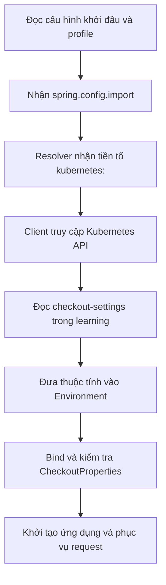

# Khai báo spring.config.import theo cơ chế được hỗ trợ

## Mục tiêu và phạm vi

Trong chương **Nạp Config Data** của module **SPRING_CLOUD_KUBERNETES**, bài này hướng dẫn đưa cấu hình Kubernetes vào ứng dụng Spring bằng `spring.config.import`. Sau bài học, bạn có thể khai báo đúng loại nguồn, chọn ConfigMap bằng thuộc tính được hỗ trợ và kiểm tra cấu hình đã vào ứng dụng hay chưa.

Tình huống xuyên suốt là ứng dụng `checkout-service`: giá trị `checkout.message` và giới hạn `checkout.max-items` được quản lý trong ConfigMap `checkout-settings`, thuộc namespace `learning`. Ứng dụng chỉ cần đọc cấu hình; DiscoveryClient, Spring Cloud LoadBalancer và Configuration Watcher chỉ được bổ sung khi có nhu cầu tương ứng.

Ví dụ dùng cơ chế Config Data được tài liệu Spring Cloud Kubernetes nhánh 3.3 mô tả. Khi áp dụng, chọn Spring Boot và Spring Cloud release train tương thích qua BOM của dự án; không suy ra rằng mọi phiên bản lịch sử đều hỗ trợ cùng một cơ chế. Tài liệu nhánh này chỉ dẫn dùng `spring.config.import` với `kubernetes:` và không hỗ trợ đồng thời nạp Kubernetes PropertySource qua legacy bootstrap. [Tài liệu cơ chế nạp Kubernetes](https://docs.spring.io/spring-cloud-kubernetes/reference/3.3/property-source-config.html).

## 1. Chuỗi import khai báo điều gì?

`spring.config.import` được xử lý khi Spring Boot chuẩn bị môi trường cấu hình, trước khi khởi tạo phần lớn bean ứng dụng. Có thể hình dung luồng của ví dụ như sau:



Trong luồng này, chuỗi import chọn cơ chế nạp. Các thuộc tính `spring.cloud.kubernetes.config.*` cung cấp thông tin chọn nguồn. ServiceAccount và RBAC quyết định quyền đọc thực tế. Một dòng import đúng cú pháp chưa chứng minh các bước phía sau đều thành công.

Các thông tin để tìm cấu hình, chẳng hạn tên ứng dụng, profile, namespace và tên ConfigMap, phải có sẵn trước lần đọc nguồn đó. Không đặt duy nhất `spring.config.import` bên trong chính ConfigMap đang chờ được import: ứng dụng cần biết cách tìm nguồn trước khi có thể đọc nội dung nguồn.

## 2. Chuẩn bị dependency đúng tính năng

Giả sử đã có ứng dụng Spring Boot web, Actuator và Bean Validation. Phần tích hợp cấu hình có thể bổ sung một starter Fabric8:

```xml
<dependency>
    <groupId>org.springframework.cloud</groupId>
    <artifactId>spring-cloud-starter-kubernetes-fabric8-config</artifactId>
</dependency>
```

Các dependency phục vụ đoạn Java và health probe trong bài:

```xml
<dependency>
    <groupId>org.springframework.boot</groupId>
    <artifactId>spring-boot-starter-web</artifactId>
</dependency>
<dependency>
    <groupId>org.springframework.boot</groupId>
    <artifactId>spring-boot-starter-actuator</artifactId>
</dependency>
<dependency>
    <groupId>org.springframework.boot</groupId>
    <artifactId>spring-boot-starter-validation</artifactId>
</dependency>
```

Các đoạn trên là phần dependency để ghép vào POM đã quản lý phiên bản, không phải một POM hoàn chỉnh. Không gắn các version rời rạc để cố khắc phục lỗi resolver.

Nếu dự án chọn Kubernetes Java Client chính thức, dùng `spring-cloud-starter-kubernetes-client-config` thay starter Fabric8. Hai họ client không được trộn trong cùng ứng dụng. Starter `*-config` phục vụ ConfigMap/Secret; không cần starter `*-all` chỉ để đọc cấu hình. [Danh sách starter và giới hạn kết hợp client](https://docs.spring.io/spring-cloud-kubernetes/reference/getting-started.html).

## 3. Khai báo cú pháp tối thiểu

Trong YAML:

```yaml
spring:
  config:
    import: "kubernetes:"
```

Trong file properties, cấu hình tương đương là:

```properties
spring.config.import=kubernetes:
```

Dấu nháy trong ví dụ YAML bao quanh một chuỗi chứa dấu hai chấm. Trong properties, không thêm dấu nháy như một phần giá trị. Nếu truyền bằng biến môi trường, tên thuộc tính tương ứng là `SPRING_CONFIG_IMPORT`; giá trị phải được tiến trình nhận là `kubernetes:`.

Tránh khai báo hai khóa `spring:` ngang hàng trong cùng một YAML document. Hãy ghép phần `config` vào cây `spring` hiện có. Nếu cần phân chia theo profile, dùng document riêng với `---` như ví dụ tiếp theo.

### Không tự sáng tạo ngữ pháp chọn tài nguyên

Không xem các chuỗi sau là cách chọn ConfigMap đã được tài liệu hóa:

```text
kubernetes:configmap:checkout-settings
kubernetes:secret:checkout-credentials
kubernetes:learning/checkout-settings
kubernetes:?namespace=learning&name=checkout-settings
```

Việc một implementation có thể nhận diện tiền tố hoặc bỏ qua phần hậu tố không chứng minh hậu tố đó thực hiện việc chọn tài nguyên. Hợp đồng dùng trong bài là `kubernetes:` để kích hoạt cơ chế, rồi khai báo tên và namespace qua thuộc tính cấu hình.

## 4. Cấu hình hoàn chỉnh theo profile k8s

Ví dụ nội dung `application.yaml` của ứng dụng:

```yaml
spring:
  application:
    name: checkout-service

checkout:
  max-items: 5

management:
  endpoints:
    web:
      exposure:
        include: health
  endpoint:
    health:
      probes:
        enabled: true

---
spring:
  config:
    activate:
      on-profile: k8s
    import: "kubernetes:"
  cloud:
    kubernetes:
      config:
        enabled: true
        enable-api: true
        name: checkout-settings
        namespace: ${POD_NAMESPACE}
        fail-fast: true
      secrets:
        enabled: false
      discovery:
        enabled: false
```

Document đầu cung cấp tên ứng dụng và giá trị mặc định không nhạy cảm. Document sau chỉ tham gia khi profile `k8s` được bật. Pod sẽ nhận `POD_NAMESPACE` bằng Downward API và `SPRING_PROFILES_ACTIVE=k8s` trong manifest phía dưới.

Ví dụ cố ý không đặt giá trị mặc định cho `checkout.message`: đây là thuộc tính bắt buộc sẽ được kiểm tra bằng Bean Validation. Khi chạy local không bật `k8s`, có thể cung cấp `CHECKOUT_MESSAGE` qua môi trường; document chứa import không được kích hoạt.

Việc tách profile giúp biểu đạt rõ môi trường nào cần Kubernetes API. Không dùng một import được gắn `optional:` như cách mặc định để che việc chạy nhầm môi trường.

### Chọn một hoặc nhiều ConfigMap

Theo cách chọn tên của Spring Cloud Kubernetes, `config.name` có thể ghi đè tên suy ra từ `spring.application.name`; nếu không có cả hai thì tên mặc định là `application`. Khi cần nhiều nguồn, dùng `config.sources`, mỗi phần tử có thể chỉ rõ tên và namespace. [Quy tắc chọn ConfigMap](https://docs.spring.io/spring-cloud-kubernetes/reference/3.3/property-source-config/configmap-propertysource.html).

Chẳng hạn, thay phần `config` trong document `k8s` bằng:

```yaml
config:
  enabled: true
  enable-api: true
  fail-fast: true
  sources:
    - name: shared-checkout-settings
      namespace: learning
    - name: checkout-settings
      namespace: learning
```

Đây là phần nằm dưới `spring.cloud.kubernetes`, không phải khóa gốc mới. Với nhiều nguồn, nên tránh trùng khóa ngoài chủ đích và kiểm tra thứ tự ưu tiên bằng một thuộc tính thử nghiệm. Tên Secret được cấu hình qua nhóm `secrets`, không bằng cách nối `secret:` vào chuỗi import.

## 5. Chuẩn bị ConfigMap và quyền đọc trong Pod

Manifest minh họa dưới đây dành cho môi trường học tập có namespace `learning`. Nếu namespace chưa tồn tại, người học cần tạo namespace trước. Thay `YOUR_REGISTRY/checkout-service:demo` bằng image đã chứa ứng dụng và cấu hình ở trên.

```yaml
apiVersion: v1
kind: ConfigMap
metadata:
  name: checkout-settings
  namespace: learning
data:
  checkout.message: "Thanh toán trong môi trường học tập"
  checkout.max-items: "25"
---
apiVersion: v1
kind: ServiceAccount
metadata:
  name: checkout-config-reader
  namespace: learning
---
apiVersion: rbac.authorization.k8s.io/v1
kind: Role
metadata:
  name: checkout-config-reader
  namespace: learning
rules:
  - apiGroups: [""]
    resources: ["configmaps"]
    verbs: ["get", "list"]
---
apiVersion: rbac.authorization.k8s.io/v1
kind: RoleBinding
metadata:
  name: checkout-config-reader
  namespace: learning
subjects:
  - kind: ServiceAccount
    name: checkout-config-reader
    namespace: learning
roleRef:
  apiGroup: rbac.authorization.k8s.io
  kind: Role
  name: checkout-config-reader
---
apiVersion: apps/v1
kind: Deployment
metadata:
  name: checkout-service
  namespace: learning
spec:
  replicas: 1
  selector:
    matchLabels:
      app: checkout-service
  template:
    metadata:
      labels:
        app: checkout-service
    spec:
      serviceAccountName: checkout-config-reader
      containers:
        - name: app
          image: YOUR_REGISTRY/checkout-service:demo
          ports:
            - name: http
              containerPort: 8080
          env:
            - name: SPRING_PROFILES_ACTIVE
              value: k8s
            - name: POD_NAMESPACE
              valueFrom:
                fieldRef:
                  fieldPath: metadata.namespace
          startupProbe:
            httpGet:
              path: /actuator/health/liveness
              port: http
            periodSeconds: 5
            failureThreshold: 30
          readinessProbe:
            httpGet:
              path: /actuator/health/readiness
              port: http
            periodSeconds: 5
          livenessProbe:
            httpGet:
              path: /actuator/health/liveness
              port: http
            periodSeconds: 10
```

Dữ liệu ConfigMap dùng chuỗi, kể cả giá trị `"25"`. Spring sẽ chuyển đổi kiểu khi bind thuộc tính.

Role của bài chỉ cấp đọc ConfigMap trong namespace học tập, bao gồm `list` để phù hợp với đường đọc có thể liệt kê của client. Đây không phải chính sách giới hạn riêng một tên ConfigMap. Chưa có watcher nên ví dụ không cấp `watch`; nếu bổ sung cơ chế cần quyền đó, phải đánh giá quyền tương ứng. Hướng dẫn bảo mật của Spring Cloud Kubernetes cũng yêu cầu chọn quyền theo tính năng được dùng. [ServiceAccount và quyền Kubernetes API](https://docs.spring.io/spring-cloud-kubernetes/reference/security-service-accounts.html).

Ví dụ không đọc Secret nên Role không có tài nguyên `secrets`. Việc có `kubernetes:` không tự cấp quyền, cũng không tự bật đọc mọi Secret. Với ứng dụng thực tế cần Secret, phải xác định cách đưa dữ liệu vào ứng dụng, thiết lập tính năng tương ứng và giới hạn quyền. Đọc Secret qua API mặc định bị tắt; tài liệu khuyến nghị cân nhắc volume mount. [Secrets PropertySource](https://docs.spring.io/spring-cloud-kubernetes/reference/property-source-config/secrets-propertysource.html).

Health probe dùng các health group của Spring Boot. Pod Ready cho biết ứng dụng đáp ứng điều kiện readiness đã cấu hình; cần kiểm tra riêng giá trị nghiệp vụ để biết nguồn cấu hình mong muốn đã được sử dụng.

## 6. Bind cấu hình và kiểm tra giá trị thực tế

Một ứng dụng minh họa trên Java 17 trở lên có thể đặt trong package `com.example.checkout`:

```java
package com.example.checkout;

import java.util.Map;

import jakarta.validation.constraints.Min;
import jakarta.validation.constraints.NotBlank;

import org.springframework.boot.SpringApplication;
import org.springframework.boot.autoconfigure.SpringBootApplication;
import org.springframework.boot.context.properties.ConfigurationProperties;
import org.springframework.boot.context.properties.EnableConfigurationProperties;
import org.springframework.validation.annotation.Validated;
import org.springframework.web.bind.annotation.GetMapping;
import org.springframework.web.bind.annotation.RestController;

@SpringBootApplication
@RestController
@EnableConfigurationProperties(CheckoutApplication.CheckoutProperties.class)
public class CheckoutApplication {

    private final CheckoutProperties properties;

    public CheckoutApplication(CheckoutProperties properties) {
        this.properties = properties;
    }

    public static void main(String[] args) {
        SpringApplication.run(CheckoutApplication.class, args);
    }

    @GetMapping("/config-demo")
    public Map<String, Object> configDemo() {
        return Map.of(
                "message", properties.message(),
                "maxItems", properties.maxItems());
    }

    @Validated
    @ConfigurationProperties(prefix = "checkout")
    public record CheckoutProperties(
            @NotBlank String message,
            @Min(1) int maxItems) {
    }
}
```

Endpoint chỉ trả hai giá trị không nhạy cảm của bài tập. Không áp dụng cách trả toàn bộ cấu hình này cho thông tin kết nối, token hay mật khẩu.

Khi ConfigMap được nạp và không có nguồn ưu tiên cao hơn ghi đè, phản hồi mong đợi là:

```json
{
  "message": "Thanh toán trong môi trường học tập",
  "maxItems": 25
}
```

Hai kết quả có ý nghĩa khác nhau: `message` chứng minh giá trị bắt buộc đã có, còn `maxItems=25` cho thấy giá trị từ ConfigMap được dùng thay mặc định `5` trong document khai báo import. Biến môi trường hay tham số dòng lệnh có thể tiếp tục ghi đè nguồn được import theo thứ tự ưu tiên của Spring Boot. Khi chẩn đoán, kiểm tra cả các nguồn đó. [Thứ tự ưu tiên với Kubernetes Config Data](https://docs.spring.io/spring-cloud-kubernetes/reference/property-source-config.html).

Validation giúp phát hiện giá trị thiếu hoặc sai miền hợp lệ. Nó kiểm tra cấu hình cuối cùng được bind, không chứng thực nguồn gốc: nếu một biến môi trường cũng cung cấp `checkout.message`, ứng dụng vẫn có thể vượt qua validation mà không dùng giá trị mong muốn từ ConfigMap.

## 7. Phân biệt optional, fail-fast và cấu hình bắt buộc

Ba khái niệm này tác động ở những điểm khác nhau:

| Cơ chế | Điều cần hiểu |
| --- | --- |
| Tiền tố `optional:` | Thuộc cơ chế Config Data, cho phép bỏ qua trường hợp location không tìm thấy theo hợp đồng loader; không phải cam kết bỏ qua mọi lỗi. |
| `spring.cloud.kubernetes.config.fail-fast` | Điều khiển việc dừng khi xảy ra lỗi trong quá trình nạp ConfigMap của Spring Cloud Kubernetes. |
| Validation cho thuộc tính | Kiểm tra dữ liệu mà ứng dụng cần sau khi các nguồn đã được hợp nhất. |

Spring Boot mô tả `optional:` cho tình huống location có thể vắng mặt; không nên suy diễn nó sẽ sửa lỗi thiếu resolver, YAML sai hay lỗi phân quyền. Ví dụ dễ quan sát với một file phụ trợ không bắt buộc là `spring.config.import=optional:file:./local-overrides.yaml`. [Optional locations của Spring Boot](https://docs.spring.io/spring-boot/reference/features/external-config.html).

Trong bài tập, sử dụng `"kubernetes:"` và `config.fail-fast: true` để thể hiện chủ đích đọc cấu hình từ API và dừng khi việc nạp phát sinh lỗi. Tuy nhiên, không đồng nhất việc bỏ `optional:` với bảo đảm rằng mọi ConfigMap không tồn tại đều làm ứng dụng dừng. Cách loader xử lý nguồn không có dữ liệu phải được kiểm tra theo phiên bản; thuộc tính nghiệp vụ bắt buộc vẫn cần validation.

Ví dụ phân loại kết quả để người vận hành chủ động kiểm tra:

| Tình huống | Điểm kiểm tra đầu tiên |
| --- | --- |
| `403 Forbidden` | ServiceAccount thực sự của Pod, RoleBinding và quyền trong namespace đích. |
| Lỗi TLS, timeout hoặc kết nối API | Đường mạng, chứng chỉ và cấu hình Kubernetes client. |
| Không tìm thấy ConfigMap | Tên, namespace, profile và log của lần nạp. |
| Nguồn tồn tại nhưng thiếu `checkout.message` | Lỗi bind/validation; không chỉ nhìn trạng thái Deployment. |
| Có giá trị nhưng không đúng mong đợi | Các biến môi trường, tham số chạy và những nguồn cùng khai báo khóa đó. |

Không bật tùy chọn bỏ qua tất cả lỗi thiếu location trên toàn ứng dụng chỉ để làm Pod khởi động. Quyết định tiếp tục hay dừng phải gắn với mức độ thiết yếu của từng nhóm cấu hình.

## 8. Quy trình kiểm chứng trong cluster

Các lệnh sau là thao tác dành cho người học sau khi đã build image và áp dụng manifest trong cluster của mình.

Kiểm tra tài nguyên và danh tính đọc cấu hình:

```powershell
kubectl get configmap checkout-settings -n learning
kubectl get deployment checkout-service -n learning -o jsonpath='{.spec.template.spec.serviceAccountName}'
kubectl auth can-i get configmaps -n learning --as=system:serviceaccount:learning:checkout-config-reader
kubectl auth can-i list configmaps -n learning --as=system:serviceaccount:learning:checkout-config-reader
```

Lệnh `auth can-i --as` cần tài khoản đang dùng có quyền impersonation phù hợp. Nếu bị từ chối impersonation, chưa thể kết luận ServiceAccount của Pod thiếu quyền; cần nhờ người quản trị kiểm tra đúng danh tính.

Quan sát lần triển khai và log:

```powershell
kubectl rollout status deployment/checkout-service -n learning
kubectl logs deployment/checkout-service -n learning
kubectl get pods -n learning -l app=checkout-service
```

Đảm bảo log cho thấy profile `k8s` đang hoạt động. Tìm lỗi nạp cấu hình trước khi tìm lỗi tạo bean phụ thuộc cấu hình. Khi Pod khởi động lại liên tục, xem thêm log lần trước và sự kiện Pod để phân biệt lỗi ứng dụng với lỗi probe.

Mở cổng trong một terminal, giữ lệnh chạy:

```powershell
kubectl port-forward deployment/checkout-service -n learning 8080:8080
```

Trong terminal khác:

```powershell
Invoke-RestMethod -Uri 'http://localhost:8080/config-demo'
Invoke-RestMethod -Uri 'http://localhost:8080/actuator/health/readiness'
```

Đối chiếu phản hồi nghiệp vụ với JSON mong đợi ở mục 6. Một lần khởi động thành công mà không kiểm tra giá trị chưa đủ để kết luận import đã lấy đúng nguồn.

## 9. Chọn đường import khi cấu hình được mount thành file

Ứng dụng không nhất thiết phải gọi Kubernetes API để nhận ConfigMap hoặc Secret. Nếu hệ thống đã mount cấu hình thành file, chọn cơ chế đọc file của Spring Boot dựa trên hình dạng dữ liệu:

| Dữ liệu được cung cấp | Import phù hợp |
| --- | --- |
| Một file YAML chứa nhiều thuộc tính tại `/etc/checkout/application.yaml` | `file:/etc/checkout/application.yaml` |
| Thư mục `/etc/checkout/` có file `checkout.message` và `checkout.max-items`, mỗi file chứa một giá trị | `configtree:/etc/checkout/` |
| ConfigMap được đọc trực tiếp qua Kubernetes client | `kubernetes:` cùng `spring.cloud.kubernetes.config.*` |

Các dòng trong bảng là phương án lựa chọn, không phải danh sách phải bật đồng thời. Khi chỉ đọc file hoặc cây cấu hình, ứng dụng không cần starter Kubernetes config chỉ vì file đó được Kubernetes mount. `configtree:` dùng tên file để tạo tên thuộc tính; nó không phân tích một file `application.yaml` thành cây YAML. [Configuration trees của Spring Boot](https://docs.spring.io/spring-boot/3.3/reference/features/external-config.html).

Nhờ vậy, lựa chọn tính năng bám vào nhu cầu triển khai: dùng API khi cần cơ chế nguồn Kubernetes; dùng file khi nền tảng đã cung cấp file phù hợp. Không thêm DiscoveryClient hoặc Spring Cloud LoadBalancer để giải quyết một bài toán chỉ là đọc dữ liệu cấu hình.

## 10. Import lúc khởi động và cập nhật khi đang chạy

Khai báo import giải quyết việc nạp dữ liệu để chuẩn bị ứng dụng. Nó không tự định nghĩa cách đồng bộ mọi bean sau khi ConfigMap đổi. Với record cấu hình và controller trong ví dụ, cách kiểm tra cập nhật đơn giản là đổi ConfigMap, rollout restart Deployment, rồi gọi lại endpoint.

Nếu cần cập nhật không restart, phải thiết kế thêm cơ chế refresh và xác định bean nào thực sự cập nhật được. Spring Cloud Kubernetes Configuration Watcher là một thành phần riêng, có thể phát thông báo qua HTTP tới endpoint refresh hoặc qua Spring Cloud Bus; nó cần quyền, điều kiện chọn nguồn và hạ tầng phù hợp. Mount được cập nhật cũng không tự làm mọi giá trị đã bind trong Java thay đổi. [Cơ chế Configuration Watcher](https://docs.spring.io/spring-cloud-kubernetes/reference/3.3/spring-cloud-kubernetes-configuration-watcher.html).

Không suy ra rằng record bất biến đang được controller giữ sẽ tự thay thế sau một sự kiện refresh. Mở rộng ví dụ sang cập nhật động đòi hỏi chọn cách bind và vòng đời bean tương thích, rồi kiểm chứng bằng request trước và sau cập nhật.

## 11. Các lỗi khai báo cần nhận diện

| Biểu hiện | Nguyên nhân có thể gặp | Hướng xử lý |
| --- | --- | --- |
| Không có resolver nhận `kubernetes:` | Thiếu starter config hoặc bộ dependency không tương thích | Kiểm tra starter, BOM và dependency runtime. |
| Tên ConfigMap trong hậu tố import không có tác dụng | Dùng chuỗi tự chế thay cơ chế chọn nguồn | Giữ import `kubernetes:`, chuyển tên/namespace sang thuộc tính. |
| Giá trị import chứa cả dấu nháy | Sao chép cú pháp YAML sang properties hoặc biến môi trường không đúng cách | Kiểm tra giá trị thực được truyền vào tiến trình. |
| Đặt import trong document `k8s` nhưng nguồn không được đọc | Profile chưa bật | Kiểm tra `SPRING_PROFILES_ACTIVE` và log khởi động. |
| Log đọc nguồn hai lần qua hai cơ chế | Vừa bật legacy bootstrap vừa dùng Config Data | Chọn một cơ chế, rà dependency và cấu hình bootstrap. |
| Pod Ready nhưng `maxItems` vẫn là `5` | Nguồn không tham gia hoặc có cấu hình khác tác động | Kiểm tra nguồn, danh tính đọc và thứ tự ưu tiên. |
| Sửa ConfigMap nhưng response không đổi | Mới cấu hình nạp lúc khởi động | Restart để kiểm chứng, hoặc thiết kế refresh có chủ đích. |

Trước khi coi khai báo hoàn tất, cần xác nhận bốn điều: resolver nhận đúng loại nguồn; client tìm đúng tên và namespace; Pod có quyền đọc; giá trị bind trong ứng dụng đúng mong đợi. Với dữ liệu bắt buộc, bổ sung validation và kiểm tra đường lỗi ngay trong môi trường thử nghiệm.