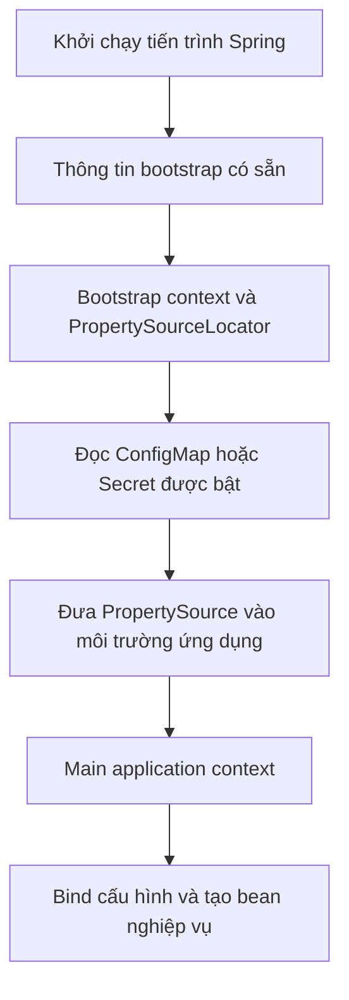
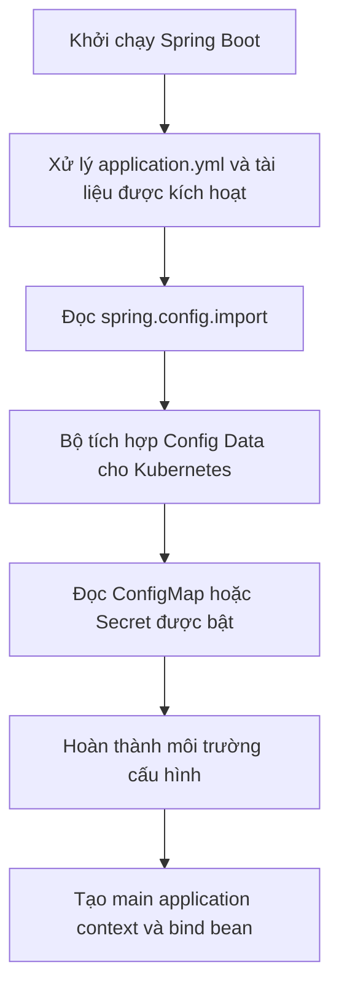

# Config Data và cơ chế bootstrap của các phiên bản cũ

## 1. Vị trí của bài trong chương Nạp Config Data

Trong module `SPRING_CLOUD_KUBERNETES`, ứng dụng Spring có thể dùng cấu hình từ ConfigMap và Secret, khám phá dịch vụ qua DiscoveryClient, chọn đích gọi qua Spring Cloud LoadBalancer và cập nhật cấu hình với Configuration Watcher. Bài này tập trung vào thời điểm cấu hình bên ngoài đi vào ứng dụng: trước khi bean nghiệp vụ được tạo, ai tìm nguồn cấu hình và dựa vào thông tin nào?

Giả sử `orders-service` cần nhận giới hạn xử lý đơn hàng từ ConfigMap trong namespace `config-lab`. Một hướng dẫn cũ yêu cầu tạo `bootstrap.yml`; một hướng dẫn khác dùng `spring.config.import` trong `application.yml`. Nếu ghép cả hai mà chưa hiểu cơ chế, nhóm triển khai có thể gặp lỗi khởi động hoặc đọc giá trị từ nguồn ngoài dự kiến.

Sau bài học, bạn có thể:

- Phân biệt bootstrap context của Spring Cloud với giai đoạn xử lý Config Data của Spring Boot.
- Nhận ra cấu hình nào phải có trước khi ứng dụng tìm ConfigMap hoặc Secret.
- Chuyển một ví dụ dùng bootstrap sang Config Data và kiểm tra kết quả quan sát được.
- Phân tách lỗi nạp cấu hình lúc khởi động với yêu cầu cập nhật cấu hình khi Pod đang chạy.

Ví dụ Config Data dưới đây lấy Spring Boot 3.2 và Spring Cloud Kubernetes 3.1 làm phạm vi minh họa. Khi áp dụng vào dự án, dùng Spring Cloud release train/BOM tương thích với Spring Boot đang chạy; đây không phải đề xuất nâng hoặc hạ phiên bản dự án. Phần bootstrap mô tả cơ chế cũ và cách bật chế độ tương thích ở nhánh thư viện có hỗ trợ.

## 2. Hai mốc phiên bản cần phân biệt

Spring Boot 2.4 đưa vào cơ chế xử lý Config Data và thuộc tính `spring.config.import`. Đây là thay đổi của Spring Boot, không đồng nghĩa mọi thư viện Spring Cloud trên classpath đều lập tức hiểu mọi tiền tố import. Bài giới thiệu chính thức mô tả các điểm mở rộng `ConfigDataLocationResolver` và `ConfigDataLoader` để thư viện tích hợp nguồn mới. Xem [thay đổi xử lý cấu hình trong Spring Boot 2.4](https://spring.io/blog/2020/08/14/config-file-processing-in-spring-boot-2-4/).

Đối với Spring Cloud Kubernetes, tài liệu nhánh 3.1 hướng dẫn dùng `spring.config.import: "kubernetes:"`; đồng thời mô tả bootstrap là cách nạp được dùng trước nhánh 3.0.x và có thể bật lại trong chế độ tương thích. Hai đường nạp này không được dùng đồng thời. Xem [Kubernetes PropertySource, nhánh 3.1](https://docs.spring.io/spring-cloud-kubernetes/reference/3.1/property-source-config.html).

| Lớp cần kiểm tra | Câu hỏi khi đọc một hướng dẫn cũ |
| --- | --- |
| Spring Boot | Phiên bản này có Config Data và quy tắc xử lý import nào? |
| Spring Cloud | Release train có tương thích với Spring Boot không? Có dependency hoặc cờ bật bootstrap không? |
| Spring Cloud Kubernetes | Nhánh này nạp Kubernetes PropertySource bằng cơ chế nào? Starter nào cung cấp tích hợp? |
| Môi trường chạy | Pod dùng ServiceAccount nào, namespace nào và có đường tới Kubernetes API không? |

Một bản nâng cấp có thể làm lộ vấn đề vốn đã tồn tại: tên ứng dụng không được cung cấp sớm, hai nguồn định nghĩa cùng khóa, hoặc Pod chưa có quyền đọc ConfigMap. Vì vậy, đánh giá phiên bản và đánh giá dữ liệu cấu hình là hai công việc liên quan nhưng khác nhau.

## 3. Mô hình chung: nguồn cấu hình, Environment và bean

`Environment` là nơi ứng dụng tra cứu thuộc tính từ các `PropertySource`. ConfigMap chỉ trở thành cấu hình Spring sau khi một thành phần tích hợp đọc dữ liệu của nó và đưa các thuộc tính vào quá trình chuẩn bị môi trường.

Để lần nạp đầu tiên thực hiện được, ứng dụng cần biết trước một số thông tin:

- Tên ứng dụng hoặc tên nguồn cần đọc.
- Namespace của nguồn.
- Cách truy cập Kubernetes API, thông thường qua định danh của Pod khi chạy trong cluster.
- Cờ bật/tắt nguồn ConfigMap, Secret và chính sách xử lý lỗi phù hợp.

Ví dụ, nếu phải tìm ConfigMap `orders-service` trong `config-lab`, không thể chỉ đặt namespace cần tìm bên trong chính ConfigMap chưa đọc được. Trong bài này, tên và namespace được đặt trong cấu hình đóng gói cùng ứng dụng để loại bỏ sự phụ thuộc vòng đó.

Quá trình cần quan sát là:

```text
Thông tin tìm nguồn có sẵn
        -> đọc nguồn cấu hình bên ngoài
        -> hình thành Environment hiệu lực
        -> bind thuộc tính
        -> tạo và chạy bean nghiệp vụ
```

Hai cơ chế bên dưới khác nhau ở cách tổ chức phần đầu của chuỗi này. Chúng cùng hướng đến việc cung cấp giá trị cho ứng dụng trước khi logic nghiệp vụ cần dùng giá trị đó.

## 4. Bootstrap của Spring Cloud hoạt động như thế nào?

### 4.1. Một context chuẩn bị cấu hình cho ứng dụng chính

Trong mô hình bootstrap truyền thống của Spring Cloud, một bootstrap context được tạo để chuẩn bị cấu hình cho main application context. Các thành phần `PropertySourceLocator` tham gia tìm nguồn bên ngoài; `bootstrap.yml` cung cấp thông tin phục vụ giai đoạn này. Sơ đồ sau mô tả ý tưởng kiến trúc, không mô phỏng chính xác mọi callback của từng release train.



Cần phân biệt hai thứ: giá trị viết trực tiếp trong `bootstrap.yml` và giá trị do locator lấy từ nguồn ngoài. Chúng không có cùng vị trí trong thứ tự ưu tiên; không thể kết luận tất cả nội dung liên quan đến bootstrap đều thắng `application.yml`. Chi tiết thứ tự nguồn và thời điểm chạy locator có khác biệt theo release train. Xem [bootstrap context và hệ phân cấp context của Spring Cloud](https://docs.spring.io/spring-cloud-commons/reference/spring-cloud-commons/application-context-services.html).

### 4.2. Ví dụ cấu hình bootstrap tương thích

Ở nhánh hỗ trợ cơ chế tương thích như Spring Cloud Kubernetes 3.1, có thể thêm dependency sau để bật bootstrap. Phiên bản dependency do BOM tương thích của dự án quản lý:

```xml
<dependency>
    <groupId>org.springframework.cloud</groupId>
    <artifactId>spring-cloud-starter-bootstrap</artifactId>
</dependency>
```

Một lựa chọn khác được tài liệu hỗ trợ là truyền `SPRING_CLOUD_BOOTSTRAP_ENABLED=true` qua môi trường khởi chạy. Chọn cách bật có chủ đích; riêng việc tạo tệp `bootstrap.yml` không chứng minh bootstrap đã được kích hoạt.

Ví dụ `bootstrap.yml`:

```yaml
spring:
  application:
    name: orders-service
  cloud:
    kubernetes:
      config:
        enabled: true
        name: orders-service
        namespace: config-lab
        fail-fast: true
      secrets:
        enabled: false
```

Ví dụ `application.yml` đi cùng chế độ bootstrap này:

```yaml
checkout:
  limit: 20
```

Trong phương án này, không thêm `spring.config.import: "kubernetes:"`. Giá trị `checkout.limit` lấy từ nguồn nào phải được kiểm chứng theo quy tắc của đúng bộ thư viện đang dùng, thay vì suy từ thứ tự hai tệp trong thư mục.

## 5. Config Data thay đổi điểm khai báo nguồn cấu hình

Config Data là cơ chế chuẩn bị dữ liệu cấu hình của Spring Boot. Với tích hợp Kubernetes tương ứng trên classpath, `spring.config.import` yêu cầu cơ chế đó nạp thêm nguồn Kubernetes. Nó không phải lời gọi Kubernetes API trong một controller hoặc bean nghiệp vụ sau khi ứng dụng đã sẵn sàng.



Đây cũng là sơ đồ khái niệm: quá trình xử lý có thể có nhiều lượt để xét profile và các nguồn liên quan. Không dùng số dòng log hoặc số lượt truy cập API để suy ra rằng chắc chắn có hai cơ chế hoạt động cùng lúc.

### 5.1. Chọn đúng starter

Ví dụ trong bài chọn Kubernetes Java Client:

```xml
<dependency>
    <groupId>org.springframework.cloud</groupId>
    <artifactId>spring-cloud-starter-kubernetes-client-config</artifactId>
</dependency>
```

Nếu dự án dùng Fabric8, chọn `spring-cloud-starter-kubernetes-fabric8-config` thay thế. Không ghép hai họ client trong một ứng dụng. Starter cấu hình phù hợp cho nhu cầu đọc ConfigMap/Secret; không cần chọn starter `-all` chỉ để thực hiện bài này. Danh mục chính thức phân biệt starter DiscoveryClient, cấu hình và gói toàn bộ tính năng tại [Spring Cloud Kubernetes starters, nhánh 3.1](https://docs.spring.io/spring-cloud-kubernetes/reference/3.1/getting-started.html).

### 5.2. Cấu hình ứng dụng theo Config Data

Thay cho cặp cấu hình bootstrap ở phần trước, dùng `application.yml` sau:

```yaml
spring:
  application:
    name: orders-service
  config:
    import: "kubernetes:"
  cloud:
    kubernetes:
      config:
        enabled: true
        name: orders-service
        namespace: config-lab
        fail-fast: true
      secrets:
        enabled: false

checkout:
  limit: 20
```

Tại thời điểm này, dependency bật bootstrap đã được gỡ và môi trường khởi chạy không còn cờ bật bootstrap. Những thuộc tính còn cần trong `bootstrap.yml` phải được chuyển sang nguồn cấu hình được đọc bởi phương án mới.

Trong YAML, giữ dấu ngoặc kép quanh `"kubernetes:"` để dấu hai chấm cuối chuỗi được biểu diễn rõ ràng. Với phạm vi Spring Cloud Kubernetes 3.1 của bài, chọn ConfigMap bằng các thuộc tính `spring.cloud.kubernetes.config.*`; không tự tạo cú pháp như `kubernetes:orders-service` để biểu diễn tên ConfigMap.

## 6. Một ConfigMap dùng để so sánh hai cơ chế

Manifest sau được dùng trong namespace thực hành `config-lab` đã tồn tại:

```yaml
apiVersion: v1
kind: ConfigMap
metadata:
  name: orders-service
  namespace: config-lab
data:
  application.yaml: |-
    checkout:
      limit: 80
      config-origin: configmap-lab-v1
```

`application.yaml` ở đây là một khóa bên trong `data` của ConfigMap. Nó khác với tệp `application.yml` đóng gói trong JAR. Ví dụ giữ toàn bộ dữ liệu trong một khóa YAML để việc truy vết dễ hơn, thay vì đồng thời định nghĩa `checkout.limit` ở nhiều vị trí trong cùng ConfigMap.

Spring Cloud Kubernetes hỗ trợ ánh xạ dữ liệu ConfigMap thành thuộc tính và cho phép cấu hình tên, namespace hoặc danh sách nguồn. Tài liệu cũng mô tả `fail-fast` khi có lỗi nạp nguồn. Không dùng cờ này làm bằng chứng duy nhất rằng mọi khóa nghiệp vụ bắt buộc đều có mặt; kiểm tra giá trị sau binding vẫn cần thiết. Xem [ConfigMap PropertySource, nhánh 3.1](https://docs.spring.io/spring-cloud-kubernetes/reference/3.1/property-source-config/configmap-propertysource.html).

### 6.1. Kết quả mong đợi trong phương án Config Data

Với đúng `application.yml` và ConfigMap trên, không có profile hay nguồn ghi đè bổ sung, ứng dụng nhận:

```text
checkout.limit=80
checkout.config-origin=configmap-lab-v1
```

Đó là dự đoán cho bộ dữ liệu của ví dụ, cần được xác nhận bằng tiến trình đang chạy. Nếu giá trị vẫn là `20`, phải tìm xem import có thực hiện được không và nguồn hiệu lực thực tế là gì.

### 6.2. Không suy độ ưu tiên từ vị trí dòng YAML

Đối với Config Data, dữ liệu import có ưu tiên cao hơn tài liệu khai báo import. Trong thứ tự nguồn thông thường của Spring Boot, biến môi trường và tham số dòng lệnh có thể ghi đè Config Data. Di chuyển dòng `checkout.limit` xuống dưới `spring.config.import` trong cùng tài liệu không làm thay đổi quan hệ đó. Xem [Spring Boot: nguồn cấu hình và import](https://docs.spring.io/spring-boot/reference/features/external-config.html).

Bảng dưới đây là ba lần khởi động riêng, áp dụng cho ví dụ Config Data với xử lý tham số mặc định của Spring Boot:

| Dữ liệu lúc khởi động | Giá trị `checkout.limit` mong đợi |
| --- | --- |
| Local là `20`, ConfigMap là `80`, không thêm override | `80` |
| Như trên, thêm biến môi trường `CHECKOUT_LIMIT=120` | `120` |
| Như trên, đồng thời truyền `--checkout.limit=160` | `160` |

Không áp nguyên bảng này cho mọi cấu hình bootstrap cũ. Khi chuyển đổi, các khóa trùng nhau là nơi cần so sánh cả giá trị lẫn nguồn gốc trước và sau thay đổi.

## 7. Kiểm chứng bằng ứng dụng và định danh của Pod

### 7.1. Bind và kiểm tra một thuộc tính bắt buộc

Đoạn ứng dụng minh họa dùng Java 17 trở lên, Spring Boot 3.x, starter Kubernetes config đã chọn, `spring-boot-starter-web` và `spring-boot-starter-validation`. Web starter giữ tiến trình phục vụ HTTP trong Deployment; bài không cần tạo endpoint nghiệp vụ.

```java
package example.orders;

import jakarta.validation.constraints.Min;
import jakarta.validation.constraints.NotBlank;
import org.springframework.boot.ApplicationRunner;
import org.springframework.boot.SpringApplication;
import org.springframework.boot.autoconfigure.SpringBootApplication;
import org.springframework.boot.context.properties.ConfigurationProperties;
import org.springframework.boot.context.properties.EnableConfigurationProperties;
import org.springframework.context.annotation.Bean;
import org.springframework.validation.annotation.Validated;

@SpringBootApplication
@EnableConfigurationProperties(OrdersApplication.CheckoutProperties.class)
public class OrdersApplication {

    public static void main(String[] args) {
        SpringApplication.run(OrdersApplication.class, args);
    }

    @Bean
    ApplicationRunner reportConfiguration(CheckoutProperties properties) {
        return args -> System.out.printf(
            "checkout.limit=%d; config-origin=%s%n",
            properties.limit(), properties.configOrigin()
        );
    }

    @Validated
    @ConfigurationProperties(prefix = "checkout")
    public record CheckoutProperties(
        @Min(1) int limit,
        @NotBlank String configOrigin
    ) {
    }
}
```

Trong ví dụ, local có giá trị dự phòng cho `checkout.limit`, nhưng không có `checkout.config-origin`. Thiếu khóa đánh dấu này sẽ làm binding/validation thất bại, thay vì để lần thử âm thầm chạy bằng toàn bộ cấu hình local. Đây là cách thiết kế phép thử, không chứng minh mọi thuộc tính trong ConfigMap đều đúng.

Spring Boot hỗ trợ binding cấu hình có kiểu và validation với `@Validated`; tham khảo [ConfigurationProperties validation trong Spring Boot 3.2](https://docs.spring.io/spring-boot/docs/3.2.12/reference/html/features.html#features.external-config.typesafe-configuration-properties.validation). Khi kiểm tra Secret, thay đầu ra bằng kết quả đạt/không đạt phù hợp, không in giá trị bí mật.

### 7.2. Quyền đọc ConfigMap cho lần nạp ban đầu

ServiceAccount chạy ứng dụng cần được gắn với quyền đọc thích hợp. Manifest thực hành sau cấp quyền đọc ConfigMap trong một namespace và không cấp quyền Secret:

```yaml
apiVersion: v1
kind: ServiceAccount
metadata:
  name: orders-config-reader
  namespace: config-lab
---
apiVersion: rbac.authorization.k8s.io/v1
kind: Role
metadata:
  name: orders-config-reader
  namespace: config-lab
rules:
  - apiGroups: [""]
    resources: ["configmaps"]
    verbs: ["get", "list"]
---
apiVersion: rbac.authorization.k8s.io/v1
kind: RoleBinding
metadata:
  name: orders-config-reader
  namespace: config-lab
subjects:
  - kind: ServiceAccount
    name: orders-config-reader
    namespace: config-lab
roleRef:
  apiGroup: rbac.authorization.k8s.io
  kind: Role
  name: orders-config-reader
```

Quyền ở ví dụ phục vụ đọc ban đầu, không phải cấu hình đầy đủ cho watcher. Khi triển khai thực tế, thu hẹp quyền theo hành vi API mà client và các tính năng đã bật sử dụng.

Deployment minh họa:

```yaml
apiVersion: apps/v1
kind: Deployment
metadata:
  name: orders-service
  namespace: config-lab
spec:
  replicas: 1
  selector:
    matchLabels:
      app: orders-service
  template:
    metadata:
      labels:
        app: orders-service
    spec:
      serviceAccountName: orders-config-reader
      containers:
        - name: orders-service
          image: registry.example.com/training/orders-service:config-data-lab
          ports:
            - containerPort: 8080
```

Địa chỉ image là chỗ giữ chỗ: thay bằng image đã chứa ứng dụng và cấu hình của phương án đang thử. Ví dụ không cần mount ConfigMap vì Spring Cloud Kubernetes đang đọc qua Kubernetes API.

### 7.3. Bằng chứng cần thu thập khi thực hành

Sau khi triển khai các manifest bằng quy trình của môi trường thực hành, có thể quan sát:

```shell
kubectl -n config-lab get configmap orders-service
kubectl -n config-lab get deployment orders-service -o jsonpath='{.spec.template.spec.serviceAccountName}'
kubectl -n config-lab get pods -l app=orders-service
kubectl -n config-lab logs deployment/orders-service --tail=100
```

Dòng kiểm tra mong đợi ở lần khởi động cơ sở:

```text
checkout.limit=80; config-origin=configmap-lab-v1
```

ConfigMap tồn tại chỉ chứng minh đối tượng có mặt. Pod ở trạng thái `Running` chỉ phản ánh một phần tình trạng thực thi. Kết quả binding, log lỗi khởi động và nguồn thuộc tính đang có hiệu lực mới giúp xác định ứng dụng đã dùng đúng cấu hình hay chưa. Nếu sử dụng Actuator để xem nguồn gốc thuộc tính, giữ endpoint chẩn đoán trong phạm vi truy cập được kiểm soát.

## 8. Chuyển từ bootstrap sang Config Data theo một thay đổi có thể đối chiếu

Một lần chuyển đổi nên có dữ liệu đầu vào cố định và kết quả kỳ vọng rõ ràng. Với `orders-service`, có thể tổ chức như sau:

1. **Ghi nhận trạng thái trước chuyển đổi.** Xác định phiên bản Boot, release train, thư viện Kubernetes và họ client. Ghi nhận cơ chế đang bật, profile, tên nguồn, namespace và ServiceAccount thực sự được dùng.
2. **Lập danh sách thông tin nạp sớm.** Tách tên ứng dụng, tên ConfigMap, namespace và cờ nguồn khỏi các giá trị nghiệp vụ như `checkout.limit`.
3. **Chuẩn bị đường Config Data.** Dùng starter phù hợp và chuyển thông tin nạp sớm sang `application.yml` hoặc nguồn môi trường có sẵn khi khởi chạy. Khai báo `spring.config.import: "kubernetes:"`.
4. **Loại bỏ đường bootstrap trong cùng thay đổi.** Gỡ starter bật bootstrap, bỏ cờ bật bootstrap trong môi trường/JVM nếu có, và chuyển phần còn cần của tệp bootstrap sang cấu hình được dùng. Kiểm tra cả dependency được kéo vào gián tiếp.
5. **Giữ nguyên các yếu tố đối chiếu.** Không đồng thời đổi tên ConfigMap, namespace, ServiceAccount hoặc giá trị nghiệp vụ. Nhờ vậy, nếu kết quả khác, phạm vi điều tra hẹp hơn.
6. **Khởi động và đối chiếu.** Thử nguồn cơ sở, thêm override có chủ đích và thử tình huống thiếu thuộc tính bắt buộc. So sánh giá trị thực tế cùng nguồn gốc với kỳ vọng đã ghi nhận.
7. **Giữ phương án quay lại nhất quán.** Nếu cần quay lại, khôi phục trọn bộ image và cấu hình bootstrap đã biết hoạt động. Không chỉ thêm lại một cờ bootstrap trong khi vẫn giữ import Kubernetes.

Một nhánh nâng cấp từ Spring Boot cũ còn có thể phải chuyển cú pháp profile trong YAML. Hướng dẫn migration chính thức nêu việc thay `spring.profiles` dùng để chọn tài liệu bằng `spring.config.activate.on-profile`, cùng các thay đổi về thứ tự cấu hình. Xem [Spring Boot Config Data Migration Guide](https://github.com/spring-projects/spring-boot/wiki/Spring-Boot-Config-Data-Migration-Guide).

Ví dụ chỉ import Kubernetes khi profile `k8s` được kích hoạt:

```yaml
spring:
  application:
    name: orders-service

---
spring:
  config:
    activate:
      on-profile: k8s
    import: "kubernetes:"
  cloud:
    kubernetes:
      config:
        name: orders-service
        namespace: config-lab
      secrets:
        enabled: false
```

Profile `k8s` cần được kích hoạt từ cấu hình khởi chạy phù hợp, ví dụ `SPRING_PROFILES_ACTIVE=k8s`. Đoạn này chỉ minh họa vị trí điều kiện import; khi ghép với chương trình ở trên, môi trường chạy local cũng phải cung cấp các thuộc tính mà chương trình yêu cầu. Nếu profile không kích hoạt, tài liệu chứa import không tham gia cấu hình.

## 9. Phân loại lỗi theo thời điểm và bằng chứng

| Hiện tượng | Điểm kiểm tra đầu tiên | Hành động có cơ sở |
| --- | --- | --- |
| Có `bootstrap.yml` nhưng cấu hình không được đọc | Cơ chế bootstrap có được bật trong bộ thư viện này không? | Kiểm tra dependency và cờ khởi chạy; chọn một phương án nạp rõ ràng |
| Có `spring.config.import` nhưng tiến trình báo lỗi xử lý location | Starter cung cấp tích hợp và bộ phiên bản có tương thích không? | Xem lỗi gốc của resolver/loader; đối chiếu dependency của image thực chạy |
| Log có `403 Forbidden` khi đọc ConfigMap | ServiceAccount của Pod, RoleBinding và namespace nguồn | Sửa quyền hoặc đích đọc theo bằng chứng; không sửa thuật toán bind thuộc tính |
| Không thấy nguồn hoặc không có khóa đánh dấu | Tên ConfigMap, namespace và dữ liệu trong `data` | So sánh với cấu hình nạp sớm; kiểm tra lỗi và kết quả validation |
| Giá trị là `120` thay vì `80` | Biến môi trường, đối số tiến trình và nguồn hiệu lực | Tìm override của khóa đó trước khi kết luận import hỏng |
| Sau migration, chỉ một vài giá trị đổi | Các khóa trùng, profile và thứ tự nguồn | Đối chiếu từng khóa cùng nguồn gốc trước/sau |
| Lần khởi động đầu đúng nhưng sửa ConfigMap không đổi bean | Chính sách cập nhật sau khởi động | Chọn restart/rollout hoặc thiết kế refresh riêng |

`fail-fast` và validation giải quyết hai câu hỏi khác nhau: lỗi khi truy cập/nạp nguồn được xử lý ra sao, và dữ liệu cuối cùng có đáp ứng điều kiện của ứng dụng không. Với một thuộc tính quan trọng, hãy thử cả lỗi truy cập lẫn dữ liệu thiếu hoặc không hợp lệ; không suy kết quả trường hợp này từ trường hợp kia.

Đối với tiền tố `optional:` của Spring Boot, ý nghĩa chung là cho phép bỏ qua location không tồn tại trong những trường hợp được hỗ trợ. Nó không thay thế RBAC, không làm một giá trị nghiệp vụ bắt buộc trở nên hợp lệ và không nên được thêm chỉ để che lỗi khởi động. Khi áp dụng cho nguồn cụ thể, đối chiếu hành vi resolver/loader của đúng phiên bản.

## 10. Nạp ban đầu, Secret và cập nhật khi chạy

### 10.1. Config Data không tự tạo chính sách refresh

Khi `orders-service` đã bind giá trị `80`, thay ConfigMap sang `90` là một sự kiện xảy ra sau lần nạp đầu tiên. Cần quyết định ứng dụng sẽ nhận thay đổi bằng lần khởi động mới hay bằng một cơ chế refresh phù hợp.

Configuration Watcher là thành phần triển khai riêng để phát thông báo thay đổi, chẳng hạn qua HTTP refresh hoặc Spring Cloud Bus. Nhãn tài nguyên, quyền truy cập, kết nối và khả năng refresh của ứng dụng đều tham gia vào luồng này. Chỉ khai báo `spring.config.import` chưa hoàn thành toàn bộ luồng cập nhật. Xem [Spring Cloud Kubernetes Configuration Watcher, nhánh 3.1](https://docs.spring.io/spring-cloud-kubernetes/reference/3.1/spring-cloud-kubernetes-configuration-watcher.html).

Đối với lần thực hành trong bài, dùng khởi động Pod mới để kiểm tra giá trị mới là một lựa chọn dễ đối chiếu. Nếu về sau thiết kế refresh, cần đánh giá riêng loại bean, trạng thái đang giữ và cách ứng dụng sử dụng cấu hình.

### 10.2. Secret cần có quyết định truy cập riêng

Bài chủ động tắt nguồn Secret để phép thử chỉ có ConfigMap. Trong nhánh 3.1, việc cho phép nguồn Secret và việc cho phép đọc Secret qua API là các thiết lập khác nhau; truy cập API không được bật mặc định. Khi cần API, cấu hình tương ứng và RBAC phải cùng phù hợp. Xem [Secrets PropertySource, nhánh 3.1](https://docs.spring.io/spring-cloud-kubernetes/reference/3.1/property-source-config/secrets-propertysource.html).

Nếu chỉ cần đọc các tệp Secret đã mount vào container, có thể cân nhắc import file hoặc `configtree:` của Spring Boot. Khi đó ứng dụng đọc hệ thống tệp của container, khác với client truy cập Kubernetes API. Cần mô tả rõ tuyến dữ liệu đã chọn để phân quyền và vận hành đúng.

Ví dụ một thư mục mount mà mỗi tệp biểu diễn một thuộc tính:

```yaml
spring:
  config:
    import: "configtree:/etc/orders-secrets/"
```

Đây là phương án nguồn tệp minh họa, không phải cú pháp thay tên ConfigMap trong `kubernetes:`. Một ứng dụng chỉ cần nguồn tệp chưa chắc cần toàn bộ tích hợp Kubernetes; ngược lại, nhu cầu DiscoveryClient hoặc Spring Cloud LoadBalancer phải được quyết định theo luồng gọi dịch vụ của ứng dụng.

## 11. Bài thực hành đối chiếu trước và sau

Giữ một bảng ghi kết quả khi thực hiện các lượt thử sau. Các thao tác triển khai thuộc môi trường thực hành; bài không giả định chúng đã được chạy sẵn.

| Lượt thử | Thay đổi có chủ đích | Bằng chứng cần ghi |
| --- | --- | --- |
| A | Config Data, ConfigMap có `limit: 80` | Phiên bản image, dòng log binding và trạng thái tiến trình |
| B | Thêm `CHECKOUT_LIMIT=120`, tạo Pod mới | Giá trị `120`, cùng thông tin biến môi trường đã thêm |
| C | Bỏ override; bỏ `config-origin` khỏi nguồn duy nhất cung cấp nó | Lỗi validation của thuộc tính bắt buộc |
| D | Khôi phục dữ liệu; dùng ServiceAccount không có quyền đọc | Lỗi truy cập quan sát được và kết quả khởi động với chính sách lỗi đang đặt |
| E | Khôi phục quyền; sửa ConfigMap sang `limit: 90`, khởi động Pod mới | Giá trị mới là `90` trong lần bind mới |

Ở từng lượt, chỉ thay một yếu tố và khôi phục đầu vào trước khi chuyển sang tình huống kế tiếp. Nếu gặp kết quả khác dự đoán, lưu lỗi gốc và danh sách nguồn liên quan thay vì thêm đồng thời bootstrap, import và cơ chế refresh để thử vận may.

Kết quả cần giải thích được sau bài học là một đường nạp hoàn chỉnh: thông tin tìm nguồn có sẵn ở đâu, cơ chế nào đọc nguồn, danh tính nào được dùng, giá trị nào thắng sau khi hợp nhất và bean nghiệp vụ nhận giá trị vào thời điểm nào. Đó là cơ sở để lựa chọn đúng phần Spring Cloud Kubernetes cần dùng trong một triển khai cụ thể.
