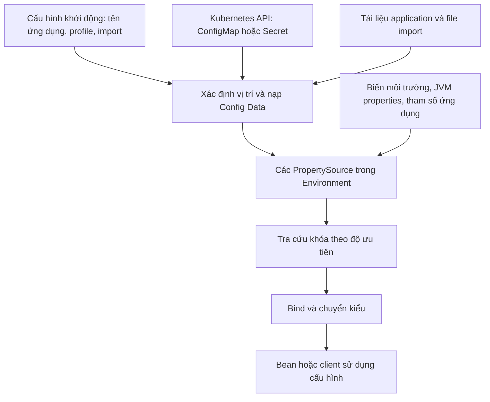

# Vai trò của PropertySource và thứ tự nạp

Trong chương **Nạp Config Data** của module **SPRING_CLOUD_KUBERNETES**, hiểu một giá trị được lấy từ đâu là nền tảng để dùng ConfigMap và Secret đúng cách. Một Pod khởi động thành công chưa chứng minh rằng ứng dụng đang dùng giá trị vừa cập nhật trên Kubernetes.

Bài này tập trung vào cách Spring biểu diễn nguồn cấu hình, quyết định giá trị thắng khi trùng khóa và đưa giá trị đó vào ứng dụng. Những kiến thức này cũng giúp giải thích cấu hình của DiscoveryClient, Spring Cloud LoadBalancer, health indicator và Configuration Watcher khi triển khai thực tế.

## 1. Tình huống: sửa ConfigMap nhưng timeout không đổi

Một dịch vụ `orders-service` gọi hệ thống thanh toán. Khóa `orders.client.timeout` xuất hiện ở nhiều nơi:

| Nơi khai báo | Giá trị |
| --- | --- |
| `application.yaml` đóng gói trong JAR | `1s` |
| ConfigMap được nạp qua `spring.config.import` | `2s` |
| Biến môi trường `ORDERS_CLIENT_TIMEOUT` của container | `3s` |
| Tham số ứng dụng `--orders.client.timeout=4s` | `4s` |

Giả sử sử dụng Config Data, Spring Boot giữ cơ chế ưu tiên mặc định và cả bốn nguồn đều được nạp, timeout hiệu lực là **4 giây**. Khi bỏ tham số ứng dụng, giá trị trở thành **3 giây**. ConfigMap vẫn tồn tại nhưng không phải nguồn quyết định khóa này.

Mục tiêu khi điều tra là trả lời được bốn câu:

1. Nguồn nào thực sự được đưa vào `Environment`?
2. Nguồn nào có quyền ưu tiên cao hơn cho khóa đang xét?
3. Giá trị đã được chuyển sang kiểu dữ liệu nào?
4. Thành phần sử dụng giá trị được tạo hoặc cập nhật vào lúc nào?

## 2. PropertySource là gì?

`PropertySource` là trừu tượng của Spring cho một nguồn khóa–giá trị. Nguồn có thể là biến môi trường, JVM system properties, tài liệu cấu hình hoặc dữ liệu đọc từ Kubernetes. `Environment` cung cấp cách tra cứu thống nhất trên các nguồn đã đăng ký.

Với một khóa đơn, Spring tìm theo thứ tự ưu tiên và dùng giá trị đầu tiên tìm được; các nguồn phía sau chỉ còn là phương án bổ sung cho những khóa chưa có. Giá trị của cùng khóa không được nối với nhau. Cơ chế tìm kiếm này được mô tả trong [Environment Abstraction của Spring Framework](https://docs.spring.io/spring-framework/reference/core/beans/environment.html).

Ví dụ, hai nguồn có dữ liệu:

```text
Nguồn ưu tiên cao:
orders.client.timeout = 2s

Nguồn ưu tiên thấp:
orders.client.timeout = 1s
orders.client.base-url = https://payments.example.invalid
```

Kết quả mong đợi:

```text
orders.client.timeout  -> 2s
orders.client.base-url -> https://payments.example.invalid
```

Nguồn cao chỉ che khóa `timeout`; nó không loại bỏ toàn bộ nhóm `orders.client` của nguồn thấp. Đây là minh họa với các khóa vô hướng, không phải quy tắc gộp tổng quát cho mọi collection khi binding.

Cần phân biệt ba khái niệm:

| Khái niệm | Trách nhiệm |
| --- | --- |
| `PropertySource` | Cung cấp dữ liệu và nhận diện nguồn |
| `Environment` | Tra cứu giá trị trên hệ thống nguồn cấu hình |
| `@ConfigurationProperties` | Bind nhóm cấu hình sang đối tượng Java có kiểu dữ liệu |

Đổi từ `@Value` sang `@ConfigurationProperties` không tạo thêm một nguồn có độ ưu tiên cao hơn. Việc chọn giá trị và việc chuyển `2s` thành `Duration` là hai bước khác nhau.

## 3. Config Data đưa PropertySource vào ứng dụng như thế nào?

Config Data là cơ chế nạp cấu hình của Spring Boot, không phải tên của một ConfigMap hoặc một file duy nhất. `ConfigDataEnvironmentPostProcessor` nạp và áp dụng Config Data vào `Environment` trong giai đoạn chuẩn bị môi trường. Xem [API của ConfigDataEnvironmentPostProcessor](https://docs.spring.io/spring-boot/api/java/org/springframework/boot/context/config/ConfigDataEnvironmentPostProcessor.html).

Có thể hình dung luồng xử lý như sau:



Sơ đồ mô tả quan hệ xử lý, không thể hiện nguồn nào đứng trên nguồn nào.

Ví dụ khai báo import trong `application.yaml`:

```yaml
spring:
  application:
    name: orders-service
  config:
    import: "kubernetes:"
```

Ứng dụng cần thư viện Spring Cloud Kubernetes Config phù hợp với Kubernetes client và bộ phiên bản Spring Boot/Spring Cloud đang dùng. Chỉ viết `kubernetes:` không tự bổ sung loader nếu dependency chưa có.

Tên ứng dụng, namespace và lựa chọn nguồn phải có sẵn khi loader cần dùng chúng. Đừng đặt duy nhất tên ConfigMap cần tìm bên trong chính ConfigMap đó rồi kỳ vọng loader đọc được nó trước khi biết phải tìm ở đâu.

Có hai thứ tự cần tách riêng:

- **Thứ tự nạp:** trình tự phát hiện tài liệu, xử lý import và tạo nguồn.
- **Thứ tự ưu tiên:** vị trí dùng để phân giải một khóa khi nhiều nguồn cùng cung cấp giá trị.

Quy tắc “nguồn đọc sau luôn thắng” chỉ đúng trong những phạm vi mà cơ chế nạp quy định như vậy. Nó không có nghĩa ConfigMap đọc qua mạng sau cùng sẽ vượt mọi biến môi trường.

## 4. Thứ tự ưu tiên thường gặp trong Spring Boot

Bảng dưới đi từ **cao xuống thấp**, giới hạn ở các nguồn thường gặp của ứng dụng JAR/container:

| Ưu tiên tương đối | Nguồn |
| --- | --- |
| Cao nhất trong bảng | Tham số ứng dụng `--key=value` |
| ↓ | `SPRING_APPLICATION_JSON` |
| ↓ | JVM system properties, ví dụ `-Dkey=value` |
| ↓ | Biến môi trường của tiến trình |
| ↓ | `RandomValuePropertySource`, chỉ cho nhóm `random.*` |
| ↓ | Config Data, gồm tài liệu application và các import |
| ↓ | Nguồn từ `@PropertySource` |
| Thấp nhất trong bảng | Default properties của `SpringApplication` |

Đây không phải toàn bộ danh sách cho servlet container, kiểm thử hoặc DevTools. Bảng giả định chưa có mã tùy biến thay đổi vị trí nguồn. `@PropertySource` được thêm lúc refresh context nên không phù hợp để điều khiển những thiết lập cần đọc từ rất sớm. Thứ tự đầy đủ nằm trong [Externalized Configuration của Spring Boot](https://docs.spring.io/spring-boot/reference/features/external-config.html).

### Phân biệt tham số JVM với tham số ứng dụng

```bash
java -Dorders.client.timeout=5s -jar orders-service.jar --orders.client.timeout=4s
```

Trong lệnh này:

- `-Dorders.client.timeout=5s` là JVM system property vì đứng trước `-jar`.
- `--orders.client.timeout=4s` được truyền cho ứng dụng Spring Boot.
- Với command-line properties được bật như mặc định, giá trị cuối là `4s`.

Nếu bỏ tham số `--orders.client.timeout`, JVM property `5s` có thể thắng biến môi trường `3s`. Việc cả hai cùng xuất hiện trong một dòng lệnh không khiến chúng thuộc cùng một loại nguồn.

## 5. Độ ưu tiên bên trong Config Data

### 5.1. Import và tài liệu khai báo import

Với Spring Cloud Kubernetes sử dụng Config Data, cấu hình import có ưu tiên cao hơn tài liệu đã khai báo import. Nếu một danh sách có nhiều import, import phía sau ưu tiên hơn import phía trước. Biến môi trường, JVM properties và tham số ứng dụng vẫn có thể che các giá trị đó. Đây là quy tắc của [Kubernetes PropertySource implementations](https://docs.spring.io/spring-cloud-kubernetes/reference/property-source-config.html).

Ví dụ:

```yaml
spring:
  config:
    import:
      - "file:/etc/orders/shared.yaml"
      - "file:/etc/orders/service.yaml"

orders:
  client:
    timeout: 1s
```

Giả sử cả hai file đều tồn tại, `shared.yaml` đặt timeout `1500ms` và `service.yaml` đặt timeout `2s`. Nếu không có nguồn cao hơn, kết quả là `2s`.

Đổi thứ tự hai mục import sẽ làm thay đổi kết quả. Di chuyển khóa `orders` lên trước hay xuống sau khóa `spring` trong cùng tài liệu không tạo ra một chính sách ưu tiên khác.

Khi đọc cấu hình phức tạp, hãy vẽ quan hệ “tài liệu nào import tài liệu nào”. Một danh sách phẳng gồm mọi file không thể hiện được đầy đủ quan hệ đó.

### 5.2. Tài liệu theo profile và vị trí file

Trong các vị trí mặc định, Spring Boot phân biệt cấu hình đóng gói trong JAR, cấu hình bên ngoài JAR và biến thể theo profile. Trong cùng phạm vi vị trí tương ứng, tài liệu cho profile có thể ghi đè tài liệu cơ sở. Thay `spring.config.location`, thêm location group hoặc nhiều import có thể làm sơ đồ nạp phức tạp hơn; cần đối chiếu [quy tắc cấu hình ngoài ứng dụng](https://docs.spring.io/spring-boot/how-to/properties-and-configuration.html).

Ví dụ phạm vi hẹp, chỉ có hai file trong classpath:

```yaml
# application.yaml
orders:
  client:
    timeout: 1s
```

```yaml
# application-prod.yaml
orders:
  client:
    timeout: 1500ms
```

Nếu `prod` đang active và không có nguồn nào khác đặt khóa này, timeout là `1500ms`. Không được suy rộng thành “profile luôn thắng tất cả”: một biến môi trường phù hợp vẫn có thể thắng cả hai file.

## 6. Kubernetes không tạo ra một thứ tự ưu tiên duy nhất

Cùng một ConfigMap có thể đến với ứng dụng bằng các đường khác nhau:

| Cách đưa dữ liệu vào container/ứng dụng | Cách Spring nhìn nhận dữ liệu |
| --- | --- |
| `env`, `envFrom`, `configMapKeyRef` | Biến môi trường của tiến trình |
| Volume chứa file YAML rồi import bằng `file:` | Config Data từ file |
| Volume chứa mỗi khóa là một file rồi import bằng `configtree:` | Config Data từ cây thư mục |
| Spring Cloud Kubernetes đọc qua `kubernetes:` | Nguồn cấu hình Kubernetes trong Config Data |

Vì vậy, câu hỏi “ConfigMap hay biến môi trường ưu tiên hơn?” cần nói rõ đường nạp ConfigMap. Kubernetes hỗ trợ cung cấp ConfigMap qua biến môi trường, volume hoặc API; các đường này có đặc tính cập nhật khác nhau. Xem [ConfigMaps của Kubernetes](https://kubernetes.io/docs/concepts/configuration/configmap/).

Trong ví dụ đầu bài, ConfigMap được đọc qua `kubernetes:`, còn `ORDERS_CLIENT_TIMEOUT` là biến môi trường. Hai nguồn thuộc hai tầng ưu tiên khác nhau.

Một lỗi thiết kế dễ gặp là đưa cùng khóa từ cùng ConfigMap vào ứng dụng bằng cả `envFrom` và Kubernetes Config Data. Sau đó nhóm vận hành chỉ theo dõi nguồn Kubernetes và quên rằng bản sao trong môi trường container vẫn đang thắng.

### Thứ tự nội bộ của dữ liệu ConfigMap

Spring Cloud Kubernetes có thể xử lý khóa thường, nội dung YAML/properties và biến thể profile. Trong quy tắc được tài liệu mô tả, khóa thường có ưu tiên hơn nội dung file profile, rồi đến nội dung file cơ sở; các ConfigMap trong danh sách sources cũng có thứ tự riêng. Xem [Using a ConfigMap PropertySource](https://docs.spring.io/spring-cloud-kubernetes/reference/property-source-config/configmap-propertysource.html).

Ví dụ với `spring.application.name=orders-service`, profile `prod`:

```yaml
apiVersion: v1
kind: ConfigMap
metadata:
  name: orders-service
  namespace: learning
data:
  orders-service.yaml: |-
    orders:
      client:
        timeout: 2s
  orders-service-prod.yaml: |-
    orders:
      client:
        timeout: 2500ms
  orders.client.timeout: "3s"
```

Khi nguồn này được chọn và xử lý theo quy tắc trên:

1. Nội dung cơ sở cung cấp `2s`.
2. Nội dung profile cung cấp `2500ms`.
3. Khóa thường `orders.client.timeout` làm giá trị của ConfigMap trở thành `3s`.

Con số `3s` mới là ứng viên của nguồn Kubernetes; sau đó nó còn phải cạnh tranh với các tầng cao hơn trong `Environment`.

Nên chọn một cách biểu diễn chính cho một nhóm khóa. Tránh để cùng khóa vừa trong YAML nhúng vừa ở mức `data`, vì người sửa YAML có thể không nhận ra lớp ghi đè còn lại.

### Secret không tự có ưu tiên cao nhất

Tính nhạy cảm không quyết định độ ưu tiên. Theo [Order of ConfigMaps and Secrets](https://docs.spring.io/spring-cloud-kubernetes/reference/property-source-config/order_of_configMaps_and_secrets.html), khi cả hai nguồn được bật trong cơ chế tích hợp được mô tả và trùng khóa, ConfigMap có ưu tiên hơn Secret.

Không áp dụng quy tắc đó một cách máy móc cho Secret đã đưa vào biến môi trường hoặc file mount: lúc này cần xét đường nạp tương ứng.

Hãy tránh dùng ConfigMap để đặt giá trị thay thế cho khóa mật khẩu có thật trong Secret. Với Secret đọc qua API, cần cấu hình tính năng và quyền phù hợp; quyền đọc ConfigMap không đồng nghĩa có quyền đọc Secret. Tài liệu [Secrets PropertySource](https://docs.spring.io/spring-cloud-kubernetes/reference/property-source-config/secrets-propertysource.html) trình bày các lựa chọn đọc và giới hạn quyền truy cập.

## 7. Ví dụ xuyên suốt: xác định timeout hiệu lực

Ví dụ này là các đoạn cấu hình để đưa vào ứng dụng demo hiện có, không phải một bộ triển khai hoàn chỉnh. Chuẩn bị:

- Ứng dụng Spring Boot với dependency Spring Cloud Kubernetes Config tương thích, chẳng hạn starter Fabric8 Config khi dùng Fabric8.
- Namespace `learning`, ConfigMap bên dưới và ServiceAccount có quyền đọc ConfigMap theo cơ chế client đang dùng.
- Ảnh ứng dụng được đóng gói với `application.yaml` minh họa.
- Không bật legacy bootstrap trong ví dụ Config Data này.

### 7.1. Cấu hình đóng gói trong ứng dụng

```yaml
spring:
  application:
    name: orders-service
  config:
    import: "kubernetes:"
  cloud:
    kubernetes:
      config:
        namespace: learning
        name: orders-service
      secrets:
        enabled: false

orders:
  client:
    timeout: 1s
    base-url: https://payments.example.invalid
```

`example.invalid` là địa chỉ minh họa; ví dụ chỉ quan sát cấu hình, không thực hiện yêu cầu đến hệ thống thanh toán.

### 7.2. ConfigMap

```yaml
apiVersion: v1
kind: ConfigMap
metadata:
  name: orders-service
  namespace: learning
data:
  orders.client.timeout: "2s"
```

### 7.3. Bean dùng để quan sát giá trị

Đoạn Java dưới dành cho dự án dùng Java hỗ trợ record:

```java
package example.orders;

import java.net.URI;
import java.time.Duration;

import org.springframework.boot.ApplicationRunner;
import org.springframework.boot.SpringApplication;
import org.springframework.boot.autoconfigure.SpringBootApplication;
import org.springframework.boot.context.properties.ConfigurationProperties;
import org.springframework.boot.context.properties.EnableConfigurationProperties;
import org.springframework.context.annotation.Bean;
import org.springframework.core.env.ConfigurableEnvironment;

@SpringBootApplication
@EnableConfigurationProperties(OrdersApplication.ClientProperties.class)
public class OrdersApplication {

    public static void main(String[] args) {
        SpringApplication.run(OrdersApplication.class, args);
    }

    @ConfigurationProperties(prefix = "orders.client")
    public record ClientProperties(Duration timeout, URI baseUrl) {
    }

    @Bean
    ApplicationRunner showTimeout(
            ConfigurableEnvironment environment,
            ClientProperties properties) {
        return args -> {
            System.out.println("environment timeout = "
                    + environment.getProperty("orders.client.timeout"));
            System.out.println("bound timeout = " + properties.timeout());
        };
    }
}
```

Trong tình huống ban đầu không có nguồn cao hơn, dự kiến:

```text
environment timeout = 2s
bound timeout = PT2S
```

`PT2S` là biểu diễn của `Duration` tương ứng hai giây. Khác biệt cách in không có nghĩa hai API đã chọn hai nguồn khác nhau.

### 7.4. Thêm biến môi trường

Đoạn sau thuộc container trong Pod template:

```yaml
env:
  - name: ORDERS_CLIENT_TIMEOUT
    value: "3s"
```

Với khóa đang dùng, biến môi trường này cung cấp giá trị cho `orders.client.timeout`. Khi Pod mới chạy với cấu hình đó, dự kiến:

```text
environment timeout = 3s
bound timeout = PT3S
```

Việc xóa khóa khỏi ConfigMap sẽ không loại bỏ biến môi trường đã khai báo trong Pod template.

### 7.5. Thêm tham số ứng dụng

Nếu ảnh dùng entrypoint chạy `java -jar ...` và chuyển tiếp container arguments cho Spring Boot, có thể thêm:

```yaml
args:
  - "--orders.client.timeout=4s"
```

Khi đó timeout dự kiến là `4s`, được bind thành `PT4S`. Nếu entrypoint là script không chuyển tiếp arguments, khai báo `args` này chưa chứng minh rằng Spring Boot đã nhận tham số. Cần quan sát lệnh khởi động thực tế.

Bảng suy luận cho các lần khởi động độc lập:

| Nguồn còn đặt timeout | Giá trị dự kiến |
| --- | --- |
| File cơ sở | `1s` |
| File cơ sở + import ConfigMap | `2s` |
| Hai nguồn trên + biến môi trường | `3s` |
| Ba nguồn trên + JVM property `5s` | `5s` |
| Bốn nguồn trên + tham số ứng dụng `4s` | `4s` |

Mỗi dòng giả định không có thêm nguồn tùy biến hay cấu hình kiểm thử. Các kết quả này là dự đoán theo mô hình ưu tiên, không phải log của một lần chạy đã thực hiện.

## 8. Quan sát nguồn thắng thay vì đoán

### 8.1. Đọc danh sách PropertySource

Có thể bổ sung tạm vào runner:

```java
int position = 0;
for (var source : environment.getPropertySources()) {
    System.out.printf("%02d | %s | %s%n",
            position++,
            source.getName(),
            source.getClass().getSimpleName());
}
```

Đoạn mã chỉ in tên và lớp của nguồn, không dump toàn bộ giá trị. Nó giúp xác nhận nguồn Kubernetes có xuất hiện hay không.

Danh sách có thể chứa adapter hoặc composite source. Đặc biệt, một nguồn tổng hợp như `configurationProperties` không đồng nghĩa dữ liệu gốc đến từ một file có tên như vậy. Không nên lấy tên đầu tiên có vẻ quen thuộc rồi kết luận nguồn vật lý đã thắng.

### 8.2. Dùng Actuator khi đã cấu hình truy cập phù hợp

Endpoint `env` giúp xem môi trường cấu hình; `configprops` cho biết các đối tượng configuration properties đã bind. Chúng trả lời hai câu hỏi khác nhau: “môi trường đang phân giải gì?” và “bean cấu hình đang giữ gì?”.

Các endpoint phải được cho phép và expose phù hợp, đồng thời có kiểm soát truy cập. Giá trị có thể bị che; không cần bật hiển thị toàn bộ Secret để điều tra tên nguồn. Xem [Actuator Endpoints và cơ chế che dữ liệu](https://docs.spring.io/spring-boot/reference/actuator/endpoints.html).

Với một thuộc tính không nhạy cảm như timeout, hãy đối chiếu:

1. Giá trị hiệu lực của khóa.
2. Tên nguồn và thông tin vị trí gốc nếu endpoint cung cấp.
3. Profile đang active.
4. Giá trị đã bind vào bean.
5. Giá trị client thực sự dùng nếu client sao chép cấu hình khi khởi tạo.

Nếu trường thứ nhất đã đổi nhưng client vẫn dùng giá trị cũ, vấn đề không còn chỉ là độ ưu tiên nguồn.

## 9. Nạp đúng nguồn chưa đồng nghĩa cập nhật động

Có ít nhất ba trạng thái cần quan sát độc lập:

```text
Dữ liệu trên Kubernetes
    -> Dữ liệu đã được ứng dụng nạp
        -> Trạng thái của bean/client đang chạy
```

Configuration Watcher có thể tham gia kích hoạt refresh cho ứng dụng Spring Cloud, nhưng bản thân việc file mount được cập nhật không tự làm mọi bean Spring Boot thay đổi. Cơ chế này được giải thích trong [Spring Cloud Kubernetes Configuration Watcher](https://docs.spring.io/spring-cloud-kubernetes/reference/spring-cloud-kubernetes-configuration-watcher.html).

Giả sử:

- ConfigMap ban đầu đặt `orders.client.timeout=2s`.
- Container đang có `ORDERS_CLIENT_TIMEOUT=3s`.
- Người vận hành sửa ConfigMap thành `5s`.

Ngay cả khi phần đọc ConfigMap và refresh đều hoạt động, timeout hiệu lực vẫn có thể là `3s`, vì nguồn môi trường còn ưu tiên cao hơn. Watcher không có nhiệm vụ đảo lại chính sách ưu tiên.

Một tình huống khác: `Environment` đã trả về `5s`, nhưng HTTP client được xây dựng một lần từ giá trị cũ. Cần cơ chế cập nhật hoặc tạo lại client phù hợp; thay đổi nguồn cấu hình không tự sửa trạng thái đã sao chép vào mọi đối tượng.

Đừng dùng restart như bằng chứng duy nhất rằng thứ tự nguồn đúng. Restart chỉ giúp đọc lại cấu hình khởi động; nếu Pod template vẫn đặt biến môi trường `3s`, giá trị đó tiếp tục thắng.

## 10. Phân biệt Config Data với legacy bootstrap

Một ứng dụng cũ có thể dùng bootstrap context để nạp nguồn từ xa. Khi đọc tài liệu hoặc log, cần xác định cơ chế đang hoạt động trước khi áp dụng bảng ưu tiên của bài.

Trong phạm vi Spring Cloud Kubernetes, không kết hợp cách nạp Kubernetes properties bằng legacy bootstrap với cách nạp bằng `spring.config.import` trong cùng cấu hình. Tài liệu [Kubernetes PropertySource implementations](https://docs.spring.io/spring-cloud-kubernetes/reference/property-source-config.html) yêu cầu chọn một trong hai.

Đối với bài này:

- `spring.config.import: "kubernetes:"` là điểm vào được sử dụng.
- Không thêm starter bootstrap để “tăng ưu tiên”.
- Không coi thứ tự các khóa trong `bootstrap.yaml` là cách sửa thứ tự nguồn Config Data.
- Khi cần chuyển cơ chế, phải ghi lại các nguồn hiện có và kiểm tra lại khóa trùng sau thay đổi.

Các ví dụ không giả định một release train cụ thể. Khi áp dụng, cần dùng bộ phiên bản Spring Boot và Spring Cloud Kubernetes tương thích; chi tiết loader, tên lớp nguồn hoặc tính năng hỗ trợ có thể khác giữa các dòng phiên bản.

## 11. Quy trình xử lý khi giá trị không như mong đợi

Đi theo một khóa cụ thể, chẳng hạn `orders.client.timeout`, thay vì kiểm tra cả hệ thống cấu hình cùng lúc:

| Bước | Điều cần xác nhận | Ý nghĩa |
| --- | --- | --- |
| 1 | Tên khóa và giá trị mong đợi | Tránh điều tra nhầm thuộc tính |
| 2 | ConfigMap/Secret được đưa vào bằng env, file hay API | Xác định tầng ưu tiên |
| 3 | Tên resource, namespace, profile và quyền đọc | Xác định nguồn có được nạp |
| 4 | Tham số ứng dụng, JVM properties, biến môi trường | Tìm nguồn cao đang che giá trị |
| 5 | Import, file profile, khóa thường và YAML nhúng | Tìm ghi đè trong Config Data |
| 6 | Giá trị trong Environment và bean đã bind | Phân biệt phân giải với binding |
| 7 | Trạng thái thực tế của client sau cập nhật | Phân biệt cấu hình với hành vi chạy |

Một số dấu hiệu thường gặp:

- **Không thấy nguồn Kubernetes:** kiểm tra dependency, import, chọn resource, namespace, kết nối và RBAC trước khi phân tích ưu tiên.
- **Thấy nguồn và khóa nhưng giá trị khác:** tìm cùng khóa trong các nguồn ưu tiên cao hơn.
- **Giá trị Environment đúng nhưng chuyển kiểu lỗi:** kiểm tra đơn vị, định dạng và kiểu Java; không tiếp tục đổi thứ tự nguồn để chữa lỗi dữ liệu.
- **Bean có giá trị cũ sau refresh:** xem vòng đời bean và cách client giữ cấu hình.
- **Các replica dùng giá trị khác nhau:** đối chiếu revision triển khai, arguments, biến môi trường và thời điểm nạp cấu hình của từng Pod.

Sau khi tìm được nguyên nhân, nên loại bỏ khai báo trùng không còn cần thiết hoặc ghi rõ quyền sở hữu khóa. Ví dụ: timeout do nhóm vận hành điều chỉnh qua ConfigMap thì tránh giữ một override cố định trong Pod template mà không có mục đích cụ thể.

## 12. Liên hệ với lựa chọn tính năng Spring Cloud Kubernetes

Cùng một cách suy luận có thể dùng cho khóa cấu hình discovery, load balancing, theo dõi sức khỏe hoặc watcher: trước hết xác nhận nguồn cung cấp khóa, sau đó mới điều tra hành vi của tính năng.

Không phải ứng dụng chạy trên Kubernetes đều cần đọc cấu hình qua API. Nếu yêu cầu chỉ là nạp file khi khởi động, volume và cơ chế Config Data tương ứng có thể đã đáp ứng. Nếu chọn Spring Cloud Kubernetes để đọc API hoặc theo dõi thay đổi, cần xác định rõ lợi ích, quyền truy cập và cách đưa cấu hình mới vào thành phần đang chạy.

Thiết kế dễ vận hành là thiết kế mà mỗi giá trị quan trọng có đường đi rõ ràng: **nguồn gốc → PropertySource → Environment → bean → hành vi ứng dụng**. Với khóa bị ghi đè, phải giải thích được nguồn nào thắng và vì sao.
