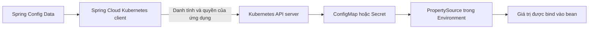
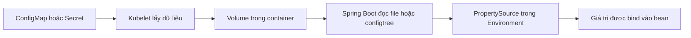

# Phân biệt nạp qua API với đọc file được gắn vào Pod

## Mục tiêu và tình huống

Trong chương **Nạp Config Data** của module **SPRING_CLOUD_KUBERNETES**, cùng một ConfigMap hoặc Secret có thể đến ứng dụng Spring qua những đường khác nhau. Cần xác định thành phần đọc dữ liệu, quyền nó sử dụng và thời điểm dữ liệu trở thành cấu hình của ứng dụng.

Bài này dùng dịch vụ `shipping-demo`, có thông báo `shipping.banner` và giới hạn `shipping.max-packages`. Ta triển khai hai biến thể: `shipping-api` đọc ConfigMap bằng Kubernetes client; `shipping-volume` đọc một file YAML do Kubernetes gắn vào container. Kết quả nghiệp vụ mong đợi giống nhau, nhưng dependency, quyền và cách chẩn đoán khác nhau.

Mục tiêu là chọn đúng phần tích hợp Spring cần dùng. DiscoveryClient, Spring Cloud LoadBalancer và Configuration Watcher giải quyết các nhu cầu riêng; việc nhận cấu hình từ Kubernetes không tự tạo ra nhu cầu bật cả ba.

## 1. Hai đường đi của dữ liệu

### Đường A: ứng dụng nạp qua Kubernetes API



Tiến trình Java tham gia truy cập API. Nó cần client, thông tin kết nối, danh tính được chấp nhận và quyền đối với tài nguyên đích. Trong Pod, danh tính thường được cung cấp bằng ServiceAccount.

### Đường B: ứng dụng đọc file được gắn vào Pod



Kubernetes chuẩn bị volume; Java đọc đường dẫn trong filesystem của container. Việc dữ liệu ban đầu nằm trong một Kubernetes object không có nghĩa tiến trình Java đã gọi API để lấy dữ liệu đó.

Tài liệu Kubernetes phân biệt việc dùng ConfigMap qua volume với việc ứng dụng truy cập API trực tiếp. Volume tham chiếu ConfigMap trong namespace của Pod; truy cập API có thể đọc namespace khác khi cấu hình và quyền cho phép. [Các cách Pod sử dụng ConfigMap](https://kubernetes.io/docs/concepts/configuration/configmap/).

| Tiêu chí | Nạp qua API | Đọc file được gắn vào Pod |
| --- | --- | --- |
| Thành phần đọc cho ứng dụng | Kubernetes client trong tiến trình Java | Bộ đọc file của Spring Boot |
| Đầu vào ứng dụng biết | Tên tài nguyên, namespace, cấu hình client | Đường dẫn file hoặc thư mục |
| Import điển hình | `kubernetes:` | `file:` hoặc `configtree:` |
| Tích hợp Kubernetes trong Java | Cần cho đường đọc này | Không cần chỉ để đọc file |
| Quyền cần đánh giá | Xác thực và RBAC của client | Quyền đọc file; quyền của hạ tầng cung cấp volume |
| Điểm tìm lỗi ban đầu | Log truy cập API và nạp PropertySource | Sự kiện mount, đường dẫn và quyền filesystem |
| Khi nguồn thay đổi | Cần thiết kế lần đọc lại và cập nhật bean | Cần phân biệt file được cập nhật với bean được cập nhật |

Cả hai đường đều còn phụ thuộc Kubernetes ở tầng cung cấp dữ liệu. Đường file giúp Java không phải trực tiếp gọi API cho việc đọc cấu hình; nó không biến việc chuẩn bị và cập nhật volume thành hoạt động độc lập với cluster.

## 2. Chuẩn bị một nguồn dữ liệu chung

Giả sử namespace `learning` đã tồn tại. ConfigMap dùng chung cho hai biến thể:

```yaml
apiVersion: v1
kind: ConfigMap
metadata:
  name: shipping-config
  namespace: learning
data:
  application.yaml: |-
    shipping:
      banner: "Sẵn sàng giao hàng"
      max-packages: 12
```

Có hai lớp YAML: lớp ngoài mô tả Kubernetes object; phần chuỗi dưới `data.application.yaml` là cấu hình ứng dụng. Với đường API, Spring Cloud Kubernetes diễn giải nội dung cấu hình theo cơ chế PropertySource. Với đường volume, Kubernetes tạo file chứa phần chuỗi đó, rồi Spring Boot phân tích file.

Ví dụ chọn một khóa duy nhất mang nội dung YAML để tránh lẫn giữa kiểu đóng gói một file và kiểu mỗi khóa một giá trị. Sau khi được đọc đúng, môi trường ứng dụng cần có:

```properties
shipping.banner=Sẵn sàng giao hàng
shipping.max-packages=12
```

Để quan sát giá trị, dùng một ứng dụng Spring Boot web với Actuator và Bean Validation. Ví dụ Java trên Java 17 trở lên:

```java
package com.example.shipping;

import jakarta.validation.constraints.NotBlank;
import jakarta.validation.constraints.Positive;

import org.springframework.boot.SpringApplication;
import org.springframework.boot.autoconfigure.SpringBootApplication;
import org.springframework.boot.context.properties.ConfigurationProperties;
import org.springframework.boot.context.properties.EnableConfigurationProperties;
import org.springframework.validation.annotation.Validated;
import org.springframework.web.bind.annotation.GetMapping;
import org.springframework.web.bind.annotation.RestController;

@SpringBootApplication
@RestController
@EnableConfigurationProperties(ShippingApplication.ShippingSettings.class)
public class ShippingApplication {

    private final ShippingSettings settings;

    public ShippingApplication(ShippingSettings settings) {
        this.settings = settings;
    }

    public static void main(String[] args) {
        SpringApplication.run(ShippingApplication.class, args);
    }

    @GetMapping("/shipping-settings")
    public ShippingSettings shippingSettings() {
        return settings;
    }

    @Validated
    @ConfigurationProperties(prefix = "shipping")
    public record ShippingSettings(
            @NotBlank String banner,
            @Positive int maxPackages) {
    }
}
```

Các dependency chung là `spring-boot-starter-web`, `spring-boot-starter-actuator` và `spring-boot-starter-validation`. Record giữ cấu hình đã bind khi tạo bean; ví dụ chưa có cơ chế refresh.

Nội dung cơ sở của `application.yaml` đóng gói cùng ứng dụng:

```yaml
spring:
  application:
    name: shipping-demo

management:
  endpoints:
    web:
      exposure:
        include: health
  endpoint:
    health:
      probes:
        enabled: true
```

Không đặt giá trị mặc định cho hai thuộc tính nghiệp vụ trong ví dụ. Validation giúp phát hiện trường hợp cấu hình cần thiết chưa đến ứng dụng. Endpoint chỉ trả dữ liệu không nhạy cảm của bài tập; không dùng cách này để hiển thị Secret.

## 3. Biến thể API: Java chủ động lấy ConfigMap

### Dependency và khai báo import

Bổ sung starter sau vào POM đã quản lý version bằng bộ Spring Boot, Spring Cloud release train tương thích:

```xml
<dependency>
    <groupId>org.springframework.cloud</groupId>
    <artifactId>spring-cloud-starter-kubernetes-fabric8-config</artifactId>
</dependency>
```

Nếu dự án chọn Kubernetes Java Client chính thức, thay bằng `spring-cloud-starter-kubernetes-client-config`. Chọn một họ client; không kết hợp hai họ. Starter `*-config` phục vụ việc đọc cấu hình, khác với starter discovery hoặc `*-all`. [Các starter Spring Cloud Kubernetes](https://docs.spring.io/spring-cloud-kubernetes/reference/3.3/getting-started.html).

Nối document sau vào `application.yaml` cơ sở:

```yaml
---
spring:
  config:
    activate:
      on-profile: api
    import: "kubernetes:"
  cloud:
    kubernetes:
      config:
        enabled: true
        enable-api: true
        name: shipping-config
        namespace: ${POD_NAMESPACE}
        fail-fast: true
      secrets:
        enabled: false
      discovery:
        enabled: false
```

`kubernetes:` chọn cơ chế import của Spring Cloud Kubernetes. Không cần mount `shipping-config` vào container cho đường đọc này. Tên và namespace được truyền riêng; không biến chuỗi import thành đường dẫn filesystem hoặc tự nối tên ConfigMap vào nó.

Đây là cơ chế Config Data được tài liệu Spring Cloud Kubernetes nhánh 3.3 mô tả; cần đối chiếu tài liệu theo bộ version đang dùng. Không kết hợp nó với việc nạp Kubernetes PropertySource bằng legacy bootstrap. [Kubernetes PropertySource và Config Data](https://docs.spring.io/spring-cloud-kubernetes/reference/3.3/property-source-config.html).

### ServiceAccount và quyền đọc

Manifest cho đường API, dùng image đã chứa starter config và Java ở trên:

```yaml
apiVersion: v1
kind: ServiceAccount
metadata:
  name: shipping-api
  namespace: learning
---
apiVersion: rbac.authorization.k8s.io/v1
kind: Role
metadata:
  name: shipping-api-config-reader
  namespace: learning
rules:
  - apiGroups: [""]
    resources: ["configmaps"]
    verbs: ["get", "list"]
---
apiVersion: rbac.authorization.k8s.io/v1
kind: RoleBinding
metadata:
  name: shipping-api-config-reader
  namespace: learning
subjects:
  - kind: ServiceAccount
    name: shipping-api
    namespace: learning
roleRef:
  apiGroup: rbac.authorization.k8s.io
  kind: Role
  name: shipping-api-config-reader
---
apiVersion: apps/v1
kind: Deployment
metadata:
  name: shipping-api
  namespace: learning
spec:
  replicas: 1
  selector:
    matchLabels:
      app: shipping-api
  template:
    metadata:
      labels:
        app: shipping-api
    spec:
      serviceAccountName: shipping-api
      containers:
        - name: app
          image: YOUR_REGISTRY/shipping-api:demo
          ports:
            - name: http
              containerPort: 8080
          env:
            - name: SPRING_PROFILES_ACTIVE
              value: api
            - name: POD_NAMESPACE
              valueFrom:
                fieldRef:
                  fieldPath: metadata.namespace
          readinessProbe:
            httpGet:
              path: /actuator/health/readiness
              port: http
```

Thay image mẫu bằng image thực tế. Role giới hạn trong namespace `learning`, nhưng `list` cho phép liệt kê ConfigMap của namespace đó; đây không phải chính sách chỉ đọc duy nhất một tên. Quyền thực tế phải phù hợp đường gọi mà client sử dụng. Ví dụ chưa theo dõi thay đổi nên không cấp `watch` và không cấp quyền đọc Secret.

`config.fail-fast: true` phục vụ xử lý lỗi nạp ConfigMap. Nó không thay thế validation cho thuộc tính bắt buộc; việc nguồn thiếu dữ liệu được xử lý thế nào còn phụ thuộc loader và phiên bản. [Cấu hình nguồn và xử lý lỗi nạp ConfigMap](https://docs.spring.io/spring-cloud-kubernetes/reference/3.3/property-source-config/configmap-propertysource.html).

Khi chỉ nạp lúc khởi động, không có cơ sở để nói mỗi request nghiệp vụ đều gọi lại Kubernetes API. Sau khi bean đã nhận cấu hình, nó có thể tiếp tục dùng giá trị đó; các tính năng khác có thể có vòng gọi API riêng.

## 4. Biến thể volume: Java chỉ đọc file

### Chọn đúng bộ đọc file

Biến thể này có cùng Java và dependency chung, nhưng không cần starter Kubernetes config cho việc đọc file. Nối document sau vào `application.yaml` cơ sở, hoặc đóng gói nó trong image riêng của biến thể volume:

```yaml
---
spring:
  config:
    activate:
      on-profile: volume
    import: "file:/etc/shipping/application.yaml"
```

Khi dùng một file YAML chứa nhiều thuộc tính, `file:` là lựa chọn tương ứng. Đường dẫn phải là đường dẫn mà tiến trình trong container nhìn thấy, không phải đường dẫn trên máy lập trình hay trên node.

Manifest cho Deployment thứ hai:

```yaml
apiVersion: apps/v1
kind: Deployment
metadata:
  name: shipping-volume
  namespace: learning
spec:
  replicas: 1
  selector:
    matchLabels:
      app: shipping-volume
  template:
    metadata:
      labels:
        app: shipping-volume
    spec:
      automountServiceAccountToken: false
      containers:
        - name: app
          image: YOUR_REGISTRY/shipping-volume:demo
          ports:
            - name: http
              containerPort: 8080
          env:
            - name: SPRING_PROFILES_ACTIVE
              value: volume
          volumeMounts:
            - name: shipping-settings
              mountPath: /etc/shipping
              readOnly: true
          readinessProbe:
            httpGet:
              path: /actuator/health/readiness
              port: http
      volumes:
        - name: shipping-settings
          configMap:
            name: shipping-config
            optional: false
            items:
              - key: application.yaml
                path: application.yaml
```

Kết quả mong đợi trong container:

```text
/etc/shipping/
└── application.yaml
```

File có nội dung:

```yaml
shipping:
  banner: "Sẵn sàng giao hàng"
  max-packages: 12
```

Đường volume trong ví dụ không có import `kubernetes:` đang hoạt động và không dùng Kubernetes client. Nếu giữ cả document `api` lẫn `volume` trong cùng artifact, chỉ bật profile tương ứng; không bật đồng thời để rồi khó xác định nguồn nào cung cấp giá trị.

### Vì sao không cần Role đọc ConfigMap cho Java?

Kubelet cung cấp dữ liệu theo khai báo Pod; việc lấy dữ liệu này không phải request đọc ConfigMap do tiến trình Java gửi dưới ServiceAccount của nó. Vì vậy, không cấp Role `get/list configmaps` cho ứng dụng chỉ để sửa lỗi đọc một file đã được mount.

`automountServiceAccountToken: false` ngăn tự động đưa thông tin xác thực ServiceAccount vào Pod. Đây là lựa chọn phù hợp khi workload của ví dụ không cần dùng danh tính đó để gọi API. Nó không ngăn volume ConfigMap trong manifest được cung cấp. Tuy nhiên, không áp dụng máy móc nếu workload còn dùng DiscoveryClient hoặc thành phần khác cần token. [Danh tính ServiceAccount trong Pod](https://kubernetes.io/docs/concepts/security/service-accounts/).

Bảo vệ quyền tạo và sửa workload vẫn cần thiết: một người có khả năng sửa Pod template có thể thay đổi tài nguyên được tham chiếu và cách chúng được gắn. Không có Role đọc API cho Java không đồng nghĩa dữ liệu mount nằm ngoài mô hình phân quyền và quản trị cluster.

## 5. File YAML và configtree là hai hình dạng khác nhau

`file:` và `configtree:` đều có thể phục vụ đường đọc filesystem, nhưng chúng không diễn giải cùng một dữ liệu đầu vào.

| Hình dạng trong container | Giá trị cần đưa vào Environment | Import |
| --- | --- | --- |
| File `/etc/shipping/application.yaml` chứa cây YAML `shipping: ...` | Các khóa được phân tích từ YAML | `file:/etc/shipping/application.yaml` |
| File `/etc/shipping-values/shipping.banner` chứa một thông báo; file `shipping.max-packages` chứa `12` | Tên file tạo tên thuộc tính, nội dung tạo giá trị | `configtree:/etc/shipping-values/` |

Ví dụ cấu trúc thứ hai:

```text
/etc/shipping-values/
├── shipping.banner          # nội dung: Sẵn sàng giao hàng
└── shipping.max-packages    # nội dung: 12
```

Cấu hình tương ứng:

```yaml
spring:
  config:
    import: "configtree:/etc/shipping-values/"
```

Không dùng `configtree:` trỏ đến thư mục chỉ có file `application.yaml` rồi kỳ vọng nội dung YAML tự được phân tích thành các khóa `shipping.*`. Tương tự, `file:` không biến cả thư mục gồm các giá trị riêng lẻ thành cây thuộc tính theo tên file. [Hai kiểu volume và Configuration Trees của Spring Boot](https://docs.spring.io/spring-boot/3.3/reference/features/external-config.html#features.external-config.files.configtrees).

### Áp dụng với Secret

Giả sử Secret `shipping-credentials` đã được quản lý riêng trong namespace `learning`, có khóa `partner.token`. Có thể gắn dữ liệu đó thành file thay vì bật đọc Secret qua API trong Java:

```yaml
# Phần bổ sung trong spec.template.spec của Deployment
volumes:
  - name: partner-credentials
    secret:
      secretName: shipping-credentials
      optional: false
      items:
        - key: partner.token
          path: partner.token
```

Container cần mount volume này vào thư mục riêng:

```yaml
volumeMounts:
  - name: partner-credentials
    mountPath: /etc/shipping-secrets
    readOnly: true
```

Phần cấu hình ứng dụng có thể khai báo:

```yaml
spring:
  config:
    import:
      - "file:/etc/shipping/application.yaml"
      - "configtree:/etc/shipping-secrets/"
```

Trong trường hợp này, `partner.token` trở thành thuộc tính từ nội dung file. Dữ liệu Secret trong volume đã được Kubernetes đưa về dạng nội dung sử dụng; ứng dụng không tự giải mã Base64 thêm lần nữa chỉ vì nguồn là Secret.

Volume Secret giới hạn được container nào nhận mount, nhưng container nhận mount vẫn đọc được dữ liệu theo quyền filesystem. Cần xét user/group thực tế, quyền file và phạm vi mount; không in token để kiểm chứng đường đọc. Secret cũng không trở thành dữ liệu được mã hóa chỉ vì trường `data` có biểu diễn Base64. [Secret và cách cung cấp qua volume](https://kubernetes.io/docs/concepts/configuration/secret/).

## 6. Khi cấu hình thay đổi, dữ liệu nào thực sự thay đổi?

Có ít nhất ba trạng thái cần quan sát:

1. Giá trị trong ConfigMap hoặc Secret trên API server.
2. Giá trị trong nguồn mà ứng dụng đọc: phản hồi client hoặc file được mount.
3. Giá trị hiện được bean nghiệp vụ sử dụng.

Đường API không tự có cơ chế cập nhật bean chỉ vì đã khai báo import. Đường volume cũng không tự cập nhật record `ShippingSettings` đang được controller giữ.

| Cách cung cấp | Sau khi sửa nguồn Kubernetes | Điều chưa được bảo đảm |
| --- | --- | --- |
| API, chỉ cấu hình import ban đầu | Object trên cluster đã đổi | Ứng dụng đã đọc lại và bind lại bean |
| Volume thư mục của ConfigMap/Secret | Nội dung được chiếu có thể cập nhật sau độ trễ | Mọi bean Spring đã nhận giá trị mới |
| Mount một file bằng `subPath` | Object trên cluster đã đổi | File mount nhận cập nhật tự động |
| Biến môi trường lấy từ ConfigMap | Object trên cluster đã đổi | Môi trường của container đang chạy đổi theo |

Kubernetes mô tả việc cập nhật volume ConfigMap theo cơ chế có độ trễ; ConfigMap dùng qua biến môi trường cần restart Pod để nhận thay đổi. Mount bằng `subPath` không nhận cập nhật ConfigMap tự động. [Cập nhật dữ liệu ConfigMap trong Pod](https://kubernetes.io/docs/concepts/configuration/configmap/#mounted-configmaps-are-updated-automatically).

Secret volume cũng có cơ chế cập nhật eventual consistency và ngoại lệ với `subPath`. Với một lần thay đổi thông tin nhạy cảm, phải xét thêm ứng dụng hoặc connection pool nào đã giữ bản cũ trong bộ nhớ. [Cập nhật Secret volume](https://kubernetes.io/docs/concepts/configuration/secret/#using-secrets-as-files-from-a-pod).

Với ví dụ hiện tại, cách nhận cấu hình mới là rollout restart Deployment. Khi cần cập nhật động, phải thiết kế thêm cơ chế đọc lại nguồn và vòng đời bean phù hợp. Configuration Watcher có thể gửi thông báo refresh qua HTTP hoặc Spring Cloud Bus; nó là thành phần riêng với quyền và điều kiện chọn nguồn riêng. Thông báo cần đến sau khi dữ liệu mà ứng dụng sẽ đọc đã sẵn sàng, đặc biệt với volume có độ trễ cập nhật. [Spring Cloud Kubernetes Configuration Watcher](https://docs.spring.io/spring-cloud-kubernetes/reference/3.3/spring-cloud-kubernetes-configuration-watcher.html).

Không dùng việc health endpoint trả `UP` để thay cho việc kiểm tra cấu hình nghiệp vụ. Readiness giúp điều phối lưu lượng theo các health group đã thiết lập; nó không mặc định chứng minh bean đang dùng phiên bản cấu hình mới nhất.

## 7. Thiếu dữ liệu: xác định lỗi nằm ở tầng nào

Một lỗi mount có thể xảy ra trước khi tiến trình Java chạy. Ngược lại, file đã mount thành công vẫn có thể sai tên, sai nội dung hoặc không đọc được bởi user chạy Java.

| Biểu hiện | Tầng cần xem trước | Hướng kiểm tra |
| --- | --- | --- |
| Java báo `403 Forbidden` khi nạp cấu hình | Kubernetes API client | ServiceAccount, RoleBinding, namespace và quyền thực tế |
| Client timeout hoặc lỗi TLS | Kết nối API của ứng dụng | Mạng, chứng chỉ và cấu hình client |
| Container chờ, Pod có sự kiện `FailedMount` | Kubelet và volume | Tên nguồn, namespace, khóa trong `items` và sự kiện Pod |
| Boot báo không tìm thấy location dạng `file:` | Spring Config Data và filesystem | `mountPath`, `items.path`, tên file và giá trị import |
| File tồn tại nhưng báo không đủ quyền đọc | Filesystem trong container | UID/GID, mode, volume mount và security context |
| YAML đọc được nhưng validation thất bại | Bind cấu hình nghiệp vụ | Tên thuộc tính, kiểu dữ liệu và ràng buộc |
| Giá trị khác mong đợi dù nguồn đúng | Hợp nhất PropertySource | Biến môi trường, dòng lệnh, profile và nguồn khác cùng khóa |

### Hai loại optional không thay thế nhau

Trong manifest volume:

```yaml
configMap:
  name: shipping-config
  optional: false
```

Đây là yêu cầu Kubernetes phải cung cấp nguồn được tham chiếu. Với Secret không optional, Kubernetes không khởi động container cho đến khi nguồn cần thiết sẵn có; thiếu khóa được yêu cầu cũng có thể làm việc chuẩn bị thất bại. [Nguồn Secret bắt buộc và optional](https://kubernetes.io/docs/concepts/configuration/secret/#optional-secrets).

Trong cấu hình Spring Boot:

```yaml
spring:
  config:
    import: "optional:file:/etc/shipping/local-overrides.yaml"
```

Tiền tố này cho phép Spring tiếp tục khi location file phụ trợ không tồn tại. Nó không giúp container vượt qua lỗi Kubernetes chưa mount được một nguồn bắt buộc, vì Spring có thể chưa được chạy. Nó cũng không thay thế kiểm tra dữ liệu nghiệp vụ. [Optional Config Data locations](https://docs.spring.io/spring-boot/reference/features/external-config.html#features.external-config.files.optional-locations).

Với dữ liệu bắt buộc của bài tập, giữ volume không optional, import file không optional và validation cho thuộc tính. Đây là ba kiểm tra ở ba điểm khác nhau của luồng cung cấp cấu hình.

## 8. Thực hành quan sát hai đường đọc

Các lệnh bên dưới dành cho người học thực hiện trong cluster thử nghiệm sau khi chuẩn bị image và áp dụng những manifest tương ứng. Chúng không yêu cầu ứng dụng in toàn bộ Environment hay nội dung Secret.

### Bước 1: kiểm tra trạng thái triển khai

```powershell
kubectl get configmap shipping-config -n learning
kubectl rollout status deployment/shipping-api -n learning
kubectl rollout status deployment/shipping-volume -n learning
kubectl get pods -n learning
```

Hai Deployment phải dùng hai profile khác nhau. Kiểm tra log cho đường API:

```powershell
kubectl logs deployment/shipping-api -n learning
kubectl get deployment shipping-api -n learning -o jsonpath='{.spec.template.spec.serviceAccountName}'
kubectl auth can-i get configmaps -n learning --as=system:serviceaccount:learning:shipping-api
kubectl auth can-i list configmaps -n learning --as=system:serviceaccount:learning:shipping-api
```

`auth can-i --as` cần danh tính người chạy lệnh có quyền impersonation tương ứng. Nếu việc impersonation bị từ chối, chưa thể suy ra quyền của ServiceAccount ứng dụng.

Với đường volume, kiểm tra khai báo và sự kiện thay vì lập tức thêm Role đọc API:

```powershell
kubectl get deployment shipping-volume -n learning -o yaml
kubectl describe pod -n learning -l app=shipping-volume
kubectl logs deployment/shipping-volume -n learning
```

Có thể kiểm tra file cấu hình không nhạy cảm nếu image có công cụ `cat`:

```powershell
kubectl exec -n learning deployment/shipping-volume -- cat /etc/shipping/application.yaml
```

Image tối giản có thể không có công cụ này; lỗi thiếu `cat` không chứng minh volume thất bại. Khi đó, dùng công cụ debug được môi trường cho phép hoặc khả năng quan sát có kiểm soát trong ứng dụng.

### Bước 2: đối chiếu giá trị được bind

Mở hai terminal và giữ mỗi lệnh port-forward chạy:

```powershell
kubectl port-forward -n learning deployment/shipping-api 8081:8080
```

```powershell
kubectl port-forward -n learning deployment/shipping-volume 8082:8080
```

Trong terminal khác:

```powershell
Invoke-RestMethod -Uri 'http://localhost:8081/shipping-settings'
Invoke-RestMethod -Uri 'http://localhost:8082/shipping-settings'
```

Cả hai cần trả dữ liệu tương ứng:

```json
{
  "banner": "Sẵn sàng giao hàng",
  "maxPackages": 12
}
```

Kết quả giống nhau cho thấy ứng dụng có thể nhận cùng cấu hình qua hai đường. Để chứng minh đường đọc, còn phải đối chiếu profile, dependency, import và manifest; chỉ nhìn JSON không phân biệt được cơ chế đã dùng.

### Bước 3: quan sát thay đổi có chủ đích

Trong nguồn cấu hình của môi trường học tập, thay `max-packages` từ `12` thành `20` rồi áp dụng ConfigMap. Theo dõi lần lượt object trên cluster, nội dung file của `shipping-volume` sau độ trễ, và phản hồi endpoint của cả hai ứng dụng.

Vì ví dụ chỉ bind lúc khởi động, endpoint chưa có nghĩa vụ đổi ngay khi object hoặc file đổi. Để nạp lại theo cách đã thiết kế trong bài:

```powershell
kubectl rollout restart deployment/shipping-api -n learning
kubectl rollout restart deployment/shipping-volume -n learning
kubectl rollout status deployment/shipping-api -n learning
kubectl rollout status deployment/shipping-volume -n learning
```

Sau khi Pod mới Ready, thiết lập lại port-forward nếu phiên cũ đã kết thúc rồi đối chiếu `maxPackages=20`. Thao tác này kiểm tra việc đọc cấu hình khi khởi động; nó không chứng minh đã triển khai refresh động.

## 9. Chọn cơ chế theo nhu cầu triển khai

| Nhu cầu thực tế | Lựa chọn có thể phù hợp | Điều phải xác nhận |
| --- | --- | --- |
| Đã có nền tảng cung cấp cấu hình thành file | Spring Boot `file:` hoặc `configtree:` | Hình dạng dữ liệu, đường dẫn, quyền file và vòng đời cập nhật |
| Cần chọn nguồn bằng tên/namespace qua Kubernetes client | Spring Cloud Kubernetes Config Data qua API | Bộ dependency, danh tính, quyền và xử lý lỗi |
| Ứng dụng không cần gọi Kubernetes API | Volume và bộ đọc file | Không vô tình bật importer hoặc thành phần client khác |
| Cần nhận cấu hình mới không restart | Thiết kế thêm refresh phù hợp với đường đọc đã chọn | Nguồn đã sẵn sàng, thông báo đến đúng đích và bean thực sự cập nhật |
| Cần tìm instance dịch vụ hoặc cân bằng tải phía ứng dụng | Đánh giá DiscoveryClient/LoadBalancer riêng | Nhu cầu đó có tồn tại ngoài việc nạp cấu hình hay không |

Nếu chuyển từ API sang volume, không chỉ thay một dòng import: phải thêm mount, kiểm tra cách đặt tên file, điều chỉnh dependency và đánh giá lại quyền. Nếu chuyển ngược lại, file có sẵn trong container không cung cấp danh tính hay RBAC cho client.

Khi gặp cấu hình cũ dùng `spring.cloud.kubernetes.config.paths`, cần nhận diện đó là cách Spring Cloud Kubernetes đọc đường dẫn đã được đánh dấu deprecated trong tài liệu nhánh 3.3. Ví dụ của bài dùng `spring.config.import` cho file để diễn đạt rõ bộ đọc tương ứng. [Ghi chú về cơ chế paths cũ](https://docs.spring.io/spring-cloud-kubernetes/reference/3.3/property-source-config/configmap-propertysource.html).

Để xác định cơ chế đang vận hành, lần theo chuỗi: nguồn Kubernetes nào, thành phần nào lấy dữ liệu, danh tính nào được dùng, Spring đọc location nào và bean nào giữ giá trị cuối cùng. Chuỗi này giúp lựa chọn đúng tính năng Spring Cloud Kubernetes và tìm lỗi ở đúng tầng.