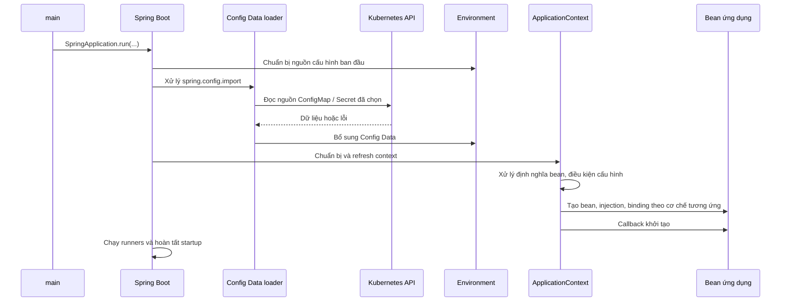

# Thời điểm nạp cấu hình so với khởi tạo bean

Trong chương **Nạp Config Data** của **SPRING_CLOUD_KUBERNETES**, câu hỏi quan trọng không chỉ là “đọc ConfigMap hay Secret nào” mà còn là “Spring đã đọc xong nguồn đó trước khi thành phần nào sử dụng cấu hình?”.

Thông thường, với cơ chế Config Data được cấu hình đúng, Spring Boot nạp các nguồn được import vào Environment **trước khi ApplicationContext khởi tạo các bean ứng dụng thông thường**. Nhờ vậy, cấu hình từ Kubernetes có thể tham gia binding thuộc tính, đánh giá điều kiện auto-configuration và tạo các đối tượng như HTTP client hoặc connection pool.

Tuy nhiên, việc ConfigMap đổi sau đó không tự làm mọi bean được khởi tạo lại. Hiểu ranh giới giữa **nạp dữ liệu**, **binding thuộc tính** và **tạo đối tượng sử dụng thuộc tính** giúp bạn chọn đúng cơ chế cập nhật, phân quyền API hợp lý và giải thích chính xác tình trạng sức khỏe Pod.

## 1. Ba thời điểm cần phân biệt

| Thời điểm | Việc xảy ra | Kết quả |
| --- | --- | --- |
| Nạp Config Data | Đọc nguồn cấu hình và đưa dữ liệu vào Environment | Có các giá trị và thứ tự ưu tiên để tra cứu |
| Binding hoặc injection | Chuyển giá trị thành kiểu Java hoặc đưa vào điểm tiêm phụ thuộc | Có đối tượng thuộc tính, tham số constructor hoặc trường đã được gán |
| Khởi tạo thành phần sử dụng cấu hình | Tạo client, pool kết nối hoặc bean nghiệp vụ từ các giá trị đã nhận | Có đối tượng hoạt động với cấu hình được chọn tại thời điểm tạo |

Ví dụ, một ConfigMap cung cấp:

```text
checkout.payment-base-url=http://payment-service
checkout.request-timeout=2s
```

Spring có thể đã đọc được hai chuỗi này vào Environment, nhưng đối tượng `CheckoutProperties` còn cần binding để nhận `URI` và `Duration`. Sau đó, một bean HTTP client mới dùng các giá trị đã bind để cấu hình kết nối.

Ba bước có liên hệ nhưng không phải cùng một thao tác. Một lỗi có thể xảy ra ở bất kỳ bước nào:

- Kubernetes API không cho đọc ConfigMap.
- Chuỗi timeout không chuyển được thành `Duration`.
- Thuộc tính hợp lệ về kiểu nhưng máy chủ đích không kết nối được.

## 2. Dòng thời gian khởi động điển hình

Sơ đồ dưới đây mô tả đường đi thông thường của một ứng dụng Spring Boot dùng Config Data. Đây là thứ tự theo giai đoạn, không phải cam kết về thứ tự giữa mọi bean.



Nếu dùng volume và `configtree:`, bước gọi Kubernetes API trong tiến trình Java được thay bằng việc đọc các tệp mà Kubernetes đã mount. Ranh giới quan trọng vẫn là: **Config Data được xử lý trước khi các bean ứng dụng thông thường cần dùng nó được tạo**.

### Những gì xảy ra trước Config Data

Một số công việc đã chạy trước khi Config Data hoàn tất:

- Mã Java trong `main` trước lời gọi `SpringApplication.run`.
- Static initializer được kích hoạt khi lớp được nạp.
- Các bước khởi động và mở rộng sớm của Spring Boot.
- Việc xác định thông tin đủ để tìm và đọc các nguồn cấu hình.

Vì thế, không áp dụng quy tắc “cấu hình đã có trước bean” cho mọi đoạn mã Java trong tiến trình. Thành phần mở rộng ở giai đoạn sớm cũng không nên giả định có thể lấy các bean ứng dụng như khi context đã hoạt động.

## 3. Chuẩn bị nguồn trước khi ứng dụng cần đọc

Một ví dụ nguồn cấu hình:

```yaml
apiVersion: v1
kind: ConfigMap
metadata:
  name: checkout-settings
  namespace: shop
data:
  checkout.payment-base-url: "http://payment-service"
  checkout.request-timeout: "2s"
```

Ví dụ cấu hình khởi động cho đường nạp qua Spring Cloud Kubernetes:

```yaml
spring:
  application:
    name: checkout-service
  config:
    import: "kubernetes:"
  cloud:
    kubernetes:
      config:
        enabled: true
        namespace: shop
        sources:
          - name: checkout-settings
      secrets:
        enabled: false
```

Ví dụ chủ đích chỉ đọc ConfigMap. Nếu ứng dụng cần Secret, cấu hình thêm nguồn Secret và cơ chế truy cập phù hợp; dữ liệu bí mật cũng phải có mặt trước khi bean phụ thuộc nó được tạo.

Mẫu này giả định dự án đã dùng bộ phiên bản Spring Boot, Spring Cloud và starter Spring Cloud Kubernetes tương thích, có hỗ trợ Config Data với `kubernetes:`. Cấu hình bootstrap của các thế hệ thư viện cũ là cơ chế khác; không ghép hai cách chỉ vì đều nhằm nạp nguồn cấu hình sớm.

### Thông tin để tìm nguồn phải có trước

Tên nguồn, namespace, lựa chọn client, thông tin truy cập cluster và các thiết lập cần cho quá trình nạp phải được cung cấp đủ sớm từ môi trường khởi động hoặc cấu hình cục bộ phù hợp.

Không thể trông chờ một nguồn Kubernetes cung cấp chính thông tin duy nhất cần có để tìm ra nguồn đó. Tương tự, bật API đọc Secret trong một bean `@PostConstruct` không quay ngược thời gian để thay đổi lần import Config Data đã xảy ra.

Với đường API, ServiceAccount và RBAC cần sẵn sàng khi bộ nạp gọi Kubernetes. Việc context chưa tạo bean ứng dụng không miễn yêu cầu phân quyền.

Với đường volume, Kubernetes chuẩn bị volume trước khi container sử dụng nó. Nếu ConfigMap hoặc Secret bắt buộc chưa tồn tại, container có thể chưa chạy được; đó là lỗi ở khâu chuẩn bị Pod, khác với lỗi binding trong Spring.

## 4. Environment có dữ liệu chưa có nghĩa mọi đối tượng đã được bind

Environment là nơi Spring tra cứu các thuộc tính từ nhiều nguồn theo thứ tự ưu tiên. Nó không phải một đối tượng nghiệp vụ tự động cập nhật tất cả các trường Java.

Giả sử có ba cách dùng cùng một thuộc tính:

| Cách sử dụng | Thời điểm đọc điển hình | Hệ quả |
| --- | --- | --- |
| `@Value` trên tham số constructor | Khi Spring giải quyết tham số để tạo bean | Constructor nhận giá trị tại lần tạo đó |
| `@Value` trên trường | Sau khi constructor đã chạy, trong giai đoạn injection | Constructor không được dựa vào trường này |
| `@ConfigurationProperties` | Khi Spring tạo và bind đối tượng thuộc tính | Có kiểu dữ liệu, cấu trúc và validation theo khai báo |

Với `@ConfigurationProperties`, chi tiết binding phụ thuộc hình thức constructor binding hay JavaBean binding. Không nên suy ra rằng mọi đối tượng thuộc tính đều được tạo xong constructor rồi mới nhận giá trị theo cùng một cách.

Điều cần bảo đảm ở cấp ứng dụng là bean sử dụng nhận một đối tượng cấu hình đã được Spring quản lý và xử lý, thay vì tự tạo nó bằng `new` hoặc truy cập quá sớm.

## 5. Lỗi thường gặp: đọc trường `@Value` ngay trong constructor

Đoạn mã sau có vấn đề về thời điểm injection:

```java
import java.time.Duration;
import org.springframework.beans.factory.annotation.Value;
import org.springframework.stereotype.Component;

@Component
public class PaymentService {

    @Value("${checkout.request-timeout}")
    private Duration configuredTimeout;

    private final Duration effectiveTimeout;

    public PaymentService() {
        this.effectiveTimeout = configuredTimeout;
    }
}
```

Khi constructor chạy, `configuredTimeout` vẫn là `null` vì đây là injection trên trường. Sau đó Spring có thể gán `configuredTimeout`, nhưng không tự gán lại `effectiveTimeout`.

Lỗi này không chứng minh ConfigMap được nạp quá muộn. Config Data có thể đã nằm trong Environment đầy đủ; chính điểm đọc trường trong vòng đời đối tượng mới là vấn đề.

Một cách sửa là dùng constructor injection:

```java
import java.time.Duration;
import org.springframework.beans.factory.annotation.Value;
import org.springframework.stereotype.Component;

@Component
public class PaymentService {

    private final Duration timeout;

    public PaymentService(
            @Value("${checkout.request-timeout}") Duration timeout) {
        this.timeout = timeout;
    }
}
```

Lúc này, Spring giải quyết giá trị trước khi gọi constructor. Không cần thêm một lệnh gọi Kubernetes API trong constructor hoặc trì hoãn bằng thời gian chờ cố định.

Các trường `static` và đối tượng do bạn tự tạo bằng `new PaymentService(...)` cũng không tự tham gia đầy đủ cơ chế injection chỉ vì lớp có annotation Spring.

## 6. Đưa quan hệ phụ thuộc cấu hình vào chữ ký bean

Với một nhóm thuộc tính liên quan, `@ConfigurationProperties` giúp biểu diễn quan hệ rõ hơn. Ví dụ dưới đây dùng Java 17 và mô hình cấu hình của Spring Boot 3, cùng Bean Validation. Dự án cần có thư viện validation phù hợp, thường qua starter validation của Spring Boot.

Các lớp ví dụ được đặt trong cùng package `com.example.checkout`.

### Đăng ký quét đối tượng thuộc tính

```java
package com.example.checkout;

import org.springframework.boot.SpringApplication;
import org.springframework.boot.autoconfigure.SpringBootApplication;
import org.springframework.boot.context.properties.ConfigurationPropertiesScan;

@SpringBootApplication
@ConfigurationPropertiesScan
public class CheckoutApplication {

    public static void main(String[] args) {
        SpringApplication.run(CheckoutApplication.class, args);
    }
}
```

### Khai báo cấu hình có kiểu

```java
package com.example.checkout;

import jakarta.validation.constraints.NotNull;
import java.net.URI;
import java.time.Duration;
import org.springframework.boot.context.properties.ConfigurationProperties;
import org.springframework.validation.annotation.Validated;

@Validated
@ConfigurationProperties(prefix = "checkout")
public record CheckoutProperties(
        @NotNull URI paymentBaseUrl,
        @NotNull Duration requestTimeout) {
}
```

Các tên `checkout.payment-base-url` và `checkout.request-timeout` từ ConfigMap được bind vào các thành phần tương ứng. Nếu giá trị bắt buộc bị thiếu hoặc không chuyển đổi được sang kiểu yêu cầu, quá trình tạo đối tượng cấu hình có thể thất bại.

Không gọi `new CheckoutProperties(null, null)` trong mã nghiệp vụ rồi kỳ vọng Spring tự điền giá trị sau đó. Đối tượng thuộc tính cần được lấy từ cơ chế đăng ký và binding của Spring.

### Tạo thành phần phụ thuộc sau khi có cấu hình

```java
package com.example.checkout;

import java.net.URI;
import java.time.Duration;

public record PaymentClient(URI baseUrl, Duration requestTimeout) {
}
```

`PaymentClient` ở đây chỉ là đối tượng minh họa lưu cấu hình, chưa thực hiện HTTP request.

```java
package com.example.checkout;

import java.time.Duration;
import org.springframework.context.annotation.Bean;
import org.springframework.context.annotation.Configuration;

@Configuration(proxyBeanMethods = false)
public class PaymentClientConfiguration {

    @Bean
    PaymentClient paymentClient(CheckoutProperties properties) {
        Duration timeout = properties.requestTimeout();

        if (timeout.isZero() || timeout.isNegative()) {
            throw new IllegalArgumentException(
                    "checkout.request-timeout must be positive");
        }

        return new PaymentClient(
                properties.paymentBaseUrl(),
                timeout);
    }
}
```

Tham số `CheckoutProperties` thể hiện quan hệ phụ thuộc: Spring phải cung cấp bean thuộc tính đã được bind và xử lý validation trước khi phương thức tạo `PaymentClient` dùng nó.

Trình tự có thể hiểu là:

```text
ConfigMap
  -> Config Data
  -> Environment
  -> CheckoutProperties
  -> PaymentClient
```

Không cần dựa vào tên lớp, thứ tự file hoặc thứ tự khai báo các phương thức `@Bean`. Nếu cấu hình không hợp lệ, nên để việc tạo thành phần phụ thuộc thất bại rõ ràng thay vì âm thầm thay bằng một URL hay timeout khác.

Ví dụ chỉ dùng thuộc tính không bí mật. Nếu đối tượng cấu hình chứa Secret, tránh ghi cả đối tượng ra log; đặc biệt lưu ý phương thức `toString()` tự sinh của record có thể chứa toàn bộ thành phần của record.

## 7. Các callback khởi tạo nằm ở đâu?

| Điểm mở rộng | Vị trí tương đối | Phù hợp để làm gì? |
| --- | --- | --- |
| Constructor hoặc phương thức `@Bean` | Khi tạo đối tượng | Nhận phụ thuộc và tạo trạng thái cần thiết |
| `@PostConstruct` | Sau injection của chính bean đó, trong quá trình khởi tạo bean | Kiểm tra hoặc chuẩn bị trạng thái nội bộ dựa trên phụ thuộc đã có |
| `SmartInitializingSingleton` | Sau khi các singleton thông thường được khởi tạo sớm đã tạo xong | Xử lý cần nhìn thấy nhóm singleton đã khởi tạo |
| `ApplicationRunner`, `CommandLineRunner` | Sau khi context đã refresh, trong tiến trình hoàn tất startup | Công việc khởi động ở cấp ứng dụng |
| Lắng nghe `ApplicationReadyEvent` | Ở giai đoạn cuối của startup thành công thông thường | Phản ứng với việc ứng dụng đã đi qua các bước khởi động tương ứng |

`@PostConstruct` của bean A không có nghĩa mọi bean khác trong hệ thống đều đã khởi tạo. Nếu A cần B, thể hiện quan hệ đó bằng injection. Đừng trông chờ “Spring chắc tạo B trước vì file của B đứng trước”.

Không nên chuyển việc nạp cấu hình bắt buộc sang `ApplicationRunner` chỉ để “đảm bảo có đủ bean”. Lúc runner chạy, nhiều singleton, connection pool và client có thể đã được tạo với giá trị cũ hoặc đã thất bại từ trước.

Tương tự, việc gọi một API từ `ApplicationReadyEvent` để lấy mật khẩu không thể sửa ngược lần khởi tạo DataSource đã diễn ra. Nếu thành phần có giao thức nạp muộn riêng, đó phải là thiết kế rõ ràng của thành phần, không phải giả định về Config Data.

### Ảnh hưởng của lazy initialization

Bean lazy có thể chỉ được tạo khi có yêu cầu sử dụng. Vì vậy:

- Config Data vẫn đã được xử lý trong giai đoạn khởi động.
- Một số lỗi binding hoặc tạo thành phần có thể xuất hiện muộn nếu đối tượng liên quan chưa được tạo.
- Sự kiện ứng dụng sẵn sàng không chứng minh tất cả bean lazy đã được tạo và kiểm tra.

Nếu một bộ thuộc tính hoặc tài nguyên là điều kiện bắt buộc trước khi nhận lưu lượng, cần có đường khởi tạo hoặc kiểm tra sớm phù hợp. Không bật lazy initialization rồi mặc định mọi lỗi cấu hình sẽ bị phát hiện trước readiness.

### `@DependsOn` và `@Order` không thay thế Config Data

`@DependsOn` mô tả phụ thuộc khởi tạo giữa các bean đã được quản lý. Nó không biến bộ nạp Config Data thành một bean để bạn điều khiển bằng tên và không làm lại giai đoạn chuẩn bị Environment.

`@Order` có ý nghĩa trong những cơ chế có hỗ trợ sắp thứ tự, chẳng hạn các runner. Nó không phải công tắc chung để buộc mọi bean khởi tạo theo thứ tự bạn gán.

## 8. Cấu hình có thể quyết định bean nào được tạo

Config Data không chỉ cấp giá trị cho trường Java. Các thuộc tính đã nạp còn có thể được dùng khi Spring xử lý cấu hình và các điều kiện như `@ConditionalOnProperty`.

Ví dụ, thuộc tính `checkout.client-mode=real` có thể quyết định đăng ký client thật, còn `checkout.client-mode=stub` quyết định đăng ký client giả lập trong môi trường học tập.

Điều này tạo ra hai hệ quả:

1. Nếu đọc thuộc tính bằng một bean chạy quá muộn, điều kiện tạo bean có thể đã được đánh giá trước đó.
2. Nếu ConfigMap đổi sau startup, các điều kiện tạo bean không tự được đánh giá lại để xây lại toàn bộ đồ thị bean.

Chuyển từ client giả lập sang client thật thường cần một thiết kế chuyển đổi động có chủ đích hoặc một lần tạo lại context/rollout phù hợp. Chỉ thay giá trị trong Environment không tự thay thế mọi bean đã chọn.

Các tính năng Spring Cloud Kubernetes cũng chịu nguyên tắc tương tự. Nếu cờ bật DiscoveryClient hoặc một tích hợp LoadBalancer tham gia điều kiện cấu hình lúc khởi động, đừng mặc định đổi cờ trong ConfigMap là đủ để tạo hoặc gỡ các bean tương ứng khi ứng dụng đang chạy.

## 9. Phân loại lỗi theo giai đoạn thay vì thêm thời gian chờ

Một cách chẩn đoán hữu ích là tìm **giai đoạn đầu tiên thất bại**.

| Giai đoạn | Dấu hiệu có thể gặp | Hướng kiểm tra |
| --- | --- | --- |
| Chuẩn bị Pod hoặc volume | Container chưa chạy vì nguồn volume bắt buộc không có | Sự tồn tại của ConfigMap/Secret, namespace, sự kiện Pod |
| Tìm hoặc đọc nguồn qua API | Sai tên nguồn, lỗi xác thực, bị từ chối quyền, kết nối API thất bại | Tên nguồn, namespace, ServiceAccount, RBAC, mạng |
| Binding | Không chuyển được chuỗi sang kiểu đích | Tên khóa, định dạng giá trị, kiểu Java |
| Validation | Giá trị thiếu hoặc vi phạm ràng buộc | Thuộc tính bắt buộc, miền giá trị, cấu hình validation |
| Tạo thành phần sử dụng | Client hoặc pool không thể được tạo theo cấu hình | Các giả định của factory, phạm vi giá trị, phụ thuộc cần có |
| Sử dụng tài nguyên | Cấu hình có hình thức hợp lệ nhưng gọi đích thất bại | Thông tin xác thực, DNS, kết nối, trạng thái dịch vụ đích |

Nếu timeout là `two-seconds` nhưng thuộc tính đích là `Duration`, thêm retry gọi Kubernetes API không sửa được lỗi chuyển kiểu.

Nếu API trả lỗi bị cấm truy cập, thêm `@DependsOn` cho client cũng không cấp được quyền.

Nếu Secret đã tồn tại nhưng mật khẩu không đúng, binding chuỗi có thể vẫn thành công. Tùy cách DataSource hoặc client khởi tạo, lỗi có thể xuất hiện khi bean được tạo hoặc khi tài nguyên lần đầu được sử dụng. Không khẳng định mọi mật khẩu sai đều làm ứng dụng dừng ngay tại cùng một thời điểm.

### Nguồn tùy chọn khác với thuộc tính tùy chọn

Cho phép nguồn vắng mặt chỉ xử lý một lớp của bài toán. Bean vẫn có thể yêu cầu một thuộc tính bắt buộc từ nguồn đó.

Ví dụ, với đường nạp tệp:

```yaml
spring:
  config:
    import: "optional:configtree:/etc/checkout/"
```

Nếu thư mục không tồn tại, import tùy chọn có thể được bỏ qua. Nhưng nếu `CheckoutProperties` vẫn yêu cầu `paymentBaseUrl` và `requestTimeout`, binding/validation vẫn có thể làm startup thất bại khi không có nguồn khác cung cấp các giá trị này.

Với Kubernetes API import, hành vi khi thiếu ConfigMap/Secret hoặc gặp lỗi truy cập còn phụ thuộc tùy chọn và phiên bản Spring Cloud Kubernetes. Không suy ra rằng chỉ viết `kubernetes:` là mọi lỗi thiếu nguồn đều được xử lý theo cùng một chính sách.

Cần quyết định rõ:

- Nguồn nào bắt buộc?
- Khóa nào bắt buộc?
- Giá trị nào có mặc định được chấp thuận?
- Có được chạy với chức năng bị tắt khi thiếu cấu hình không?
- Lỗi nào đáng thử lại, và lỗi nào cần sửa cấu hình hoặc phân quyền?

Một khoảng `sleep` cố định trong constructor không phải cơ chế đồng bộ tốt. Nó làm startup chậm hơn nhưng không bảo đảm ConfigMap đã đúng, quyền đã được cấp hay thông tin xác thực đã hợp lệ.

## 10. Sau startup: giá trị mới đi qua những lớp nào?

Cần phân biệt việc nạp cấu hình lúc khởi động với việc cập nhật một ứng dụng đang chạy.

Giả sử client được tạo lúc 10:00 với timeout `2s`. Đến 10:05, ConfigMap đổi thành `5s`. Những sự kiện sau không đồng nghĩa với nhau:

```text
ConfigMap đã đổi
  -> thay đổi được phát hiện
  -> nguồn cấu hình trong ứng dụng được nạp lại
  -> đối tượng thuộc tính được cập nhật hoặc tạo lại
  -> client đang xử lý yêu cầu dùng timeout mới
```

Mỗi mũi tên cần một cơ chế thực sự. Có bước không được cấu hình thì chuỗi cập nhật dừng ở bước đó.

| Thành phần | Khi nguồn Kubernetes đổi | Điều không được mặc định |
| --- | --- | --- |
| Kubernetes ConfigMap/Secret | Đối tượng API có dữ liệu mới | Tiến trình Java đã đọc dữ liệu mới |
| Tệp được mount thông thường | Kubernetes có thể cập nhật tệp sau một khoảng trễ | Spring Boot tự import lại Config Data |
| Environment | Có thể đổi nếu cơ chế nạp lại thực sự cập nhật nguồn | Mọi trường `@Value` đã được gán lại |
| Đối tượng thuộc tính | Có thể được bind lại hoặc tạo lại nếu có cơ chế hỗ trợ | Mọi dạng binding, nhất là đối tượng bất biến, đều refresh giống nhau |
| Client hoặc pool kết nối | Có thể vẫn giữ cấu hình cũ đã chụp khi tạo | Nó tự cấu hình lại vì đối tượng thuộc tính khác đã đổi |

Trong ví dụ của bài, `PaymentClient` là một record lưu `URI` và `Duration` khi được tạo. Việc tạo một `CheckoutProperties` mới không tự thay thế hai giá trị đã lưu trong `PaymentClient` cũ.

Tương tự, `@Value` trên constructor là injection tại lần tạo bean. Nó không phải một liên kết trực tiếp luôn đọc lại ConfigMap.

### Vai trò của Configuration Watcher

Configuration Watcher có thể tham gia phát hiện thay đổi và kích hoạt hành động cập nhật khi được triển khai, phân quyền và cấu hình phù hợp. Nhưng việc có Watcher không tự chứng minh rằng client đích đã được tạo lại hoặc hỗ trợ thay đổi cấu hình tại chỗ.

Khi thiết kế cập nhật nóng, cần trả lời riêng:

1. Ai theo dõi tài nguyên Kubernetes và bằng danh tính nào?
2. Cơ chế nào đưa dữ liệu mới vào ứng dụng?
3. Bean nào được bind lại, làm mới hoặc tạo lại?
4. Bean phụ thuộc nhận đối tượng mới qua cách nào?
5. Tài nguyên cũ được đóng và các yêu cầu đang xử lý được bảo vệ ra sao?

Nếu dùng cơ chế refresh của Spring Cloud, phải kiểm tra khả năng hỗ trợ của loại bean và phiên bản đang dùng. Không coi mọi `@ConfigurationProperties`, record, client bên thứ ba hoặc DataSource là có thể refresh theo cùng một cách.

Nếu yêu cầu vận hành cho phép, rollout để tạo Pod mới thường đem lại ranh giới rõ: lần startup mới đọc bộ cấu hình mới rồi tạo đồ thị bean mới. Vẫn cần quản lý readiness và khả năng tương thích trong giai đoạn các Pod cũ, mới cùng tồn tại.

## 11. Sức khỏe Pod không thể suy ra chỉ từ việc nạp xong Config Data

Nạp Config Data thành công mới chứng minh nguồn đã được xử lý theo chính sách cấu hình. Nó không chứng minh mọi dịch vụ đích đều dùng được.

| Tín hiệu | Ý nghĩa cần hiểu đúng |
| --- | --- |
| Container hoặc Pod có trạng thái Running | Tiến trình/container đang chạy theo trạng thái Kubernetes; không tương đương ứng dụng sẵn sàng |
| Context refresh thành công | Spring đã vượt qua giai đoạn tương ứng; không bảo đảm mọi bean lazy và mọi kết nối ngoài đã được sử dụng |
| Runners hoàn tất, ứng dụng đi tới giai đoạn ready | Startup thông thường đã hoàn tất; readiness thực tế còn phụ thuộc cơ chế health và probe được cấu hình |
| Readiness probe thành công | Pod đáp ứng tiêu chí sẵn sàng mà bạn đã triển khai |
| Liveness probe thành công | Tiến trình đáp ứng tiêu chí sống; không nhất thiết mọi phụ thuộc bên ngoài đang hoạt động |

Startup probe giúp Kubernetes dành thời gian cho khởi động trước khi các probe còn lại hoạt động theo cơ chế của chúng. Nó không sửa được cấu hình sai và cũng không thay thế validation.

Một kiểm tra readiness có thể phản ánh phụ thuộc bắt buộc để phục vụ lưu lượng, tùy chính sách ứng dụng. Với phụ thuộc tùy chọn, có thể cần cho phép ứng dụng hoạt động ở trạng thái giảm chức năng thay vì chặn toàn bộ.

Không gắn mọi lỗi truy cập cơ sở dữ liệu hoặc API ngoài vào liveness. Một phụ thuộc ngoài đang lỗi mà khiến tất cả Pod bị restart liên tục có thể làm tình hình khó phục hồi hơn.

## 12. Bài thực hành quan sát đúng thứ tự

Thực hiện trong môi trường học tập, dùng ConfigMap và các lớp minh họa ở trên. Những hoạt động dưới đây là hướng dẫn thực hành, không yêu cầu in nội dung Secret hoặc toàn bộ Environment.

### Lần 1: cấu hình hợp lệ

Đặt `checkout.request-timeout=2s`, khởi động ứng dụng và quan sát:

1. Config Data được nạp.
2. `CheckoutProperties` được bind.
3. Factory của `PaymentClient` nhận được `Duration` hợp lệ.
4. Ứng dụng hoàn tất startup nếu các thành phần khác cũng thành công.

Có thể thêm log học tập vào factory hoặc callback của bean để ghi timeout không bí mật và tên giai đoạn. Không dùng vị trí các dòng log như một hợp đồng thứ tự cho mọi bean không có quan hệ phụ thuộc.

### Lần 2: sai định dạng

Đổi timeout thành `two-seconds`, rồi tạo lần startup mới.

Kỳ vọng lỗi xuất hiện ở bước binding sang `Duration`, trước khi factory có thể tạo client thành công từ đối tượng thuộc tính đó. Điều cần sửa là giá trị cấu hình, không phải thứ tự file Java.

### Lần 3: giá trị sai về ý nghĩa

Đổi timeout thành `0s`.

Giá trị này có thể chuyển thành `Duration` hợp lệ về kiểu, nhưng bị kiểm tra trong factory từ chối vì bài học yêu cầu timeout dương. Tình huống này phân biệt lỗi chuyển kiểu với lỗi ràng buộc nghiệp vụ.

### Lần 4: sửa nguồn khi bean đã tồn tại

Khởi động với `2s`, sau đó đổi ConfigMap thành `5s` mà chưa rollout và chưa thiết kế cơ chế refresh.

Không mặc định client đang chạy đã dùng `5s`. Kiểm tra riêng nguồn Kubernetes, nguồn cấu hình trong ứng dụng và giá trị mà client đang dùng. Sau một rollout thành công, các instance mới phải được kiểm tra lại với giá trị mới.

### Lần 5: chứng minh lỗi field injection

Dùng ví dụ `PaymentService` đọc trường `@Value` trong constructor. Quan sát giá trị chụp trong constructor và giá trị trường sau injection bằng log không bí mật hoặc debugger.

Sau đó chuyển sang constructor injection. Bài học rút ra là xác định đúng giai đoạn vòng đời, thay vì kết luận rằng Kubernetes nạp cấu hình chậm.

## 13. Checklist khi thiết kế một bean phụ thuộc cấu hình Kubernetes

- Thông tin import và quyền đọc nguồn đã có trước khi tạo bean ứng dụng chưa?
- Bean nhận cấu hình qua constructor hoặc đối tượng thuộc tính được Spring quản lý chưa?
- Có đọc trường injection trong constructor hoặc static initializer không?
- Thuộc tính bắt buộc có được kiểm tra cả kiểu dữ liệu lẫn ràng buộc giá trị không?
- Có nhầm runner hoặc callback muộn với giai đoạn nạp Config Data không?
- Có kỳ vọng `@Order`, `@DependsOn` hoặc một khoảng chờ sửa được lỗi import không?
- Nếu dùng lazy initialization, lỗi nào có thể bị đẩy sang lần sử dụng đầu tiên?
- Khi ConfigMap hoặc Secret đổi, thành phần nào thực sự nhận giá trị mới và bằng cơ chế nào?
- Có cần Configuration Watcher hay chỉ cần rollout theo quy trình triển khai?
- Readiness đã phản ánh đúng khả năng phục vụ mà ứng dụng cần bảo đảm chưa?

Thiết kế tốt đặt việc đọc nguồn vào giai đoạn chuẩn bị cấu hình, việc chuyển kiểu và kiểm tra vào bước binding/khởi tạo phù hợp, rồi tạo các thành phần từ cấu hình đã hợp lệ. Khi cần thay đổi lúc chạy, hãy thiết kế đường cập nhật đó riêng và xác nhận đến tận đối tượng thực sự sử dụng giá trị.
