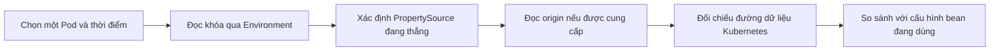

# Xác minh nguồn gốc thuộc tính đã có trong Environment

## 1. Vì sao cần xác minh sau khi nạp Config Data?

Trong module `SPRING_CLOUD_KUBERNETES`, ConfigMap và Secret cung cấp cấu hình cho ứng dụng Spring chạy trên Kubernetes. Sau khi cấu hình đã đi vào `Environment`, câu hỏi thực tế không chỉ là thuộc tính có tồn tại hay không, mà còn là giá trị nào đang có hiệu lực và nguồn nào cung cấp giá trị đó.

Ví dụ, nhóm vận hành đặt `payment.retries=4` trong ConfigMap, nhưng ứng dụng lại dùng `7`. Điều này chưa đủ để kết luận Spring Cloud Kubernetes đọc sai ConfigMap. Một biến môi trường, đối số khởi chạy hoặc nguồn cấu hình khác có thể đang ghi đè khóa đó.

Bài thuộc chương **Nạp Config Data**, tập trung vào việc thu thập bằng chứng cho một khóa cụ thể. Cách kiểm tra này cũng giúp phân biệt vấn đề cấu hình với vấn đề DiscoveryClient, Spring Cloud LoadBalancer, quyền RBAC, sức khỏe Pod hoặc luồng cập nhật của Configuration Watcher.

Sau bài học, bạn có thể:

- Xác định giá trị hiệu lực mà `Environment` trả về cho một thuộc tính.
- Tìm các `PropertySource` cùng cung cấp thuộc tính và nhận ra nguồn đang thắng.
- Đọc metadata `origin` khi có, đồng thời hiểu giới hạn khi nguồn không cung cấp metadata này.
- Đối chiếu bằng chứng trong tiến trình Java với Pod, ConfigMap, Secret và thời điểm quan sát.
- Kiểm tra một thuộc tính mà không xuất toàn bộ cấu hình hoặc giá trị bí mật.

Ví dụ dùng Java 17, Spring Boot 3.2 và Spring Cloud Kubernetes 3.1 làm phạm vi minh họa. Dùng release train/BOM tương thích với bộ phiên bản của dự án; tên nguồn và hình dạng chi tiết của đầu ra có thể khác giữa các phiên bản hoặc Kubernetes client.

## 2. Bốn loại thông tin thường bị nhầm lẫn

| Thông tin | Câu hỏi được trả lời | Giới hạn |
| --- | --- | --- |
| Giá trị hiệu lực | Lần đọc thuộc tính này hiện trả về gì? | Một con số đúng chưa chứng minh nó đến từ nguồn mong muốn |
| Tên `PropertySource` | Nguồn Spring nào cung cấp ứng viên hoặc giá trị đang thắng? | Có thể chỉ là nguồn tổng hợp hay biến môi trường |
| Metadata `origin` | Thư viện có lưu vị trí ban đầu của giá trị không? | Có thể không tồn tại; không phải nguồn nào cũng có dòng/cột |
| Nguồn Kubernetes phía trước | ConfigMap/Secret nào, namespace nào và Pod nào tham gia? | Phải đối chiếu thêm manifest, định danh và thời điểm nạp |

`Environment` tập hợp các nguồn để tra cứu thuộc tính. Nó không phải bản sao của một ConfigMap duy nhất. Với một khóa đơn giản, cần xem cả kết quả tra cứu và thứ tự các nguồn liên quan, thay vì chỉ mở tệp `application.yml` trong mã nguồn.

Một chuỗi đối chiếu hữu ích là:



Đặc biệt, một marker như `diagnostics.config-revision=cm-r1` chỉ giúp nhận diện dữ liệu liên quan đến marker đó. Nó không chứng minh mọi khóa nghiệp vụ khác đều lấy từ cùng nguồn: `payment.retries` vẫn có thể bị ghi đè riêng.

## 3. Chuẩn bị một tình huống có kết quả đối chiếu rõ ràng

### 3.1. Giả định của môi trường thực hành

Có một ứng dụng Spring Boot web tên `payment-service`, namespace thực hành `config-lab` và ServiceAccount được phép đọc ConfigMap cần dùng. Ứng dụng dùng starter Kubernetes config đúng với họ client đã chọn. Phần Actuator cần thêm `spring-boot-starter-actuator`.

Ví dụ dependency dùng Kubernetes Java Client:

```xml
<dependency>
    <groupId>org.springframework.cloud</groupId>
    <artifactId>spring-cloud-starter-kubernetes-client-config</artifactId>
</dependency>
<dependency>
    <groupId>org.springframework.boot</groupId>
    <artifactId>spring-boot-starter-actuator</artifactId>
</dependency>
```

Các dependency trên bổ sung cho ứng dụng web đã có, không phải toàn bộ tệp build. Phiên bản do cấu hình quản lý dependency tương thích của dự án quyết định.

### 3.2. Cấu hình local và import

Đặt các thông tin sau trong cấu hình ứng dụng:

```yaml
spring:
  application:
    name: payment-service
  config:
    import: "kubernetes:"
  cloud:
    kubernetes:
      config:
        enabled: true
        name: payment-runtime
        namespace: config-lab
        include-profile-specific-sources: false
        fail-fast: true
      secrets:
        enabled: false

payment:
  retries: 2
```

Trong phạm vi Spring Cloud Kubernetes 3.1, `"kubernetes:"` yêu cầu nạp nguồn Kubernetes; tên ConfigMap được chọn bằng thuộc tính cấu hình tương ứng. Ví dụ này chỉ dùng đường Config Data, không đồng thời bật đường bootstrap. Xem [Kubernetes PropertySource, nhánh 3.1](https://docs.spring.io/spring-cloud-kubernetes/reference/3.1/property-source-config.html).

Việc tắt nguồn theo profile trong ví dụ giúp phép thử chỉ tập trung vào ConfigMap được chỉ định, kể cả khi bật thêm profile chẩn đoán ở phần sau.

### 3.3. ConfigMap phía Kubernetes

```yaml
apiVersion: v1
kind: ConfigMap
metadata:
  name: payment-runtime
  namespace: config-lab
data:
  application.yaml: |-
    payment:
      retries: 4
    diagnostics:
      config-revision: cm-r1
```

Giữ một khóa YAML chứa cấu hình nghiệp vụ để phép thử dễ đọc. Trong ConfigMap phức tạp, dữ liệu trực tiếp, tài liệu theo profile và nhiều nguồn có thể cùng định nghĩa một khóa. Spring Cloud Kubernetes mô tả các cách ánh xạ và thứ tự nội bộ đó tại [ConfigMap PropertySource](https://docs.spring.io/spring-cloud-kubernetes/reference/3.1/property-source-config/configmap-propertysource.html).

Với đúng dữ liệu trên, không có override bổ sung, dự đoán cho lần khởi động cơ sở là `payment.retries=4`. Đây là kỳ vọng cần kiểm chứng trong tiến trình, không phải kết quả đã thực thi sẵn.

### 3.4. Tạo một override dễ nhận biết

Ở lượt thử tiếp theo, thêm biến môi trường vào container ứng dụng và tạo Pod mới theo quy trình triển khai:

```yaml
# Trích đoạn trong spec.template.spec.containers của Deployment
- name: payment-service
  env:
    - name: PAYMENT_RETRIES
      value: "7"
```

Lượt này dự đoán `payment.retries=7`. Trong thứ tự cấu hình thông thường của Spring Boot, biến môi trường có ưu tiên cao hơn Config Data; dữ liệu import cũng có quan hệ ưu tiên với tài liệu khai báo import. Xem [externalized configuration của Spring Boot 3.2](https://docs.spring.io/spring-boot/docs/3.2.12/reference/html/features.html#features.external-config).

Hai số khác nhau, `4` và `7`, giúp phát hiện nguồn ghi đè. Nếu mọi nguồn đều đặt cùng số `4`, kiểm tra giá trị cuối cùng sẽ không phân biệt được chúng.

## 4. Cố định đúng Pod trước khi xem cấu hình

Khi Deployment có nhiều replica, các Pod có thể thuộc những lần rollout khác nhau. Gửi nhiều yêu cầu qua Service có thể tạo ra kết quả khó so sánh nếu mỗi lần trúng một Pod khác.

Trong PowerShell, chọn một tên Pod thực tế rồi dùng nhất quán:

```powershell
kubectl -n config-lab get pods -l app=payment-service -o wide

$podName = 'payment-service-THAY-BANG-TEN-POD-THUC'
kubectl -n config-lab get pod $podName -o 'custom-columns=NAME:.metadata.name,UID:.metadata.uid,START:.status.startTime,SA:.spec.serviceAccountName'
kubectl -n config-lab logs $podName -c payment-service --tail=100
```

Lệnh đầu giả định Deployment dùng nhãn `app=payment-service`; thay selector theo nhãn thực tế nếu khác. Ghi lại namespace, tên Pod, UID, container, image đang chạy và thời điểm thu thập bằng chứng. Tên Pod là điểm bắt đầu thuận tiện, còn UID giúp tránh nhầm định danh khi đối tượng được tạo lại.

Không lấy việc `kubectl get configmap` chạy thành công bằng tài khoản vận hành làm bằng chứng rằng ServiceAccount của ứng dụng cũng có quyền đọc. Đó là hai danh tính khác nhau. Tương tự, trạng thái `Running` hoặc một health check thành công không mô tả nguồn gốc từng thuộc tính.

## 5. Cách thứ nhất: dùng Actuator để hỏi một khóa

### 5.1. Chuẩn bị endpoint trong phạm vi chẩn đoán

Cấu hình bổ sung dưới đây dành cho môi trường thực hành. Cổng quản trị khác cổng web ứng dụng và chỉ lắng nghe loopback trong Pod:

```yaml
management:
  server:
    port: 9091
    address: 127.0.0.1
  endpoints:
    web:
      exposure:
        include: "health,env"
  endpoint:
    env:
      show-values: never
```

Cấu hình này có thể đặt trong `application-config-diagnostics.yml` và bật bằng profile `config-diagnostics`. Nếu đặt trong tệp cấu hình đang tồn tại, ghép đúng cây thuộc tính thay vì tạo hai khóa `management` trùng nhau.

Trong phạm vi Spring Boot 3.2, `show-values: never` giữ giá trị ở dạng đã che. Exposure qua HTTP, quyền truy cập endpoint và chính sách hiển thị giá trị là các thiết lập cần phân biệt. Địa chỉ quản trị riêng chỉ áp dụng khi dùng cổng quản trị khác cổng chính. Xem [Actuator: sanitization và cổng quản trị](https://docs.spring.io/spring-boot/docs/3.2.12/reference/html/actuator.html).

Nếu ứng dụng có Spring Security hoặc chuỗi bảo mật riêng, request còn phải đáp ứng cơ chế xác thực/phân quyền của ứng dụng. Giữ cổng này ngoài Service/Ingress công khai; người thực hành kết nối tới Pod đã chọn bằng port-forward theo quyền Kubernetes của mình.

### 5.2. Truy vấn đúng một thuộc tính

Ở terminal thứ nhất, giữ tiến trình port-forward đang chạy:

```powershell
kubectl -n config-lab port-forward pod/$podName 19091:9091
```

Ở terminal thứ hai:

```powershell
curl.exe --silent --show-error http://127.0.0.1:19091/actuator/env/payment.retries
```

Endpoint `GET /actuator/env/{property.name}` tập trung vào một thuộc tính. Trong phạm vi API đang minh họa, `property.source` cho biết tên nguồn của giá trị được chọn; `propertySources` liệt kê các nguồn theo độ ưu tiên, kèm thông tin thuộc tính ở từng nguồn nếu có. `origin` là thông tin tùy nguồn. Xem [Actuator Environment API](https://docs.spring.io/spring-boot/docs/3.2.12/actuator-api/htmlsingle/#env.retrieving-single-property).

Đầu ra sau là JSON rút gọn minh họa cho lượt có override `PAYMENT_RETRIES=7`. Hai tên nguồn trong dấu `<...>` là nhãn giải thích, không phải chuỗi tên cố định của thư viện:

```json
{
  "property": {
    "source": "systemEnvironment",
    "value": "******"
  },
  "activeProfiles": ["config-diagnostics"],
  "propertySources": [
    {
      "name": "systemEnvironment",
      "property": {
        "value": "******",
        "origin": "System Environment Property \"PAYMENT_RETRIES\""
      }
    },
    {
      "name": "<nguon ConfigMap payment-runtime cua client dang dung>",
      "property": {
        "value": "******"
      }
    },
    {
      "name": "<nguon application.yml dong goi trong ung dung>",
      "property": {
        "value": "******"
      }
    }
  ]
}
```

Từ đầu ra này có thể kết luận nguồn Spring đang thắng là `systemEnvironment`. Không thể đọc số `7` từ chuỗi `******`; số hiệu lực cần được xác minh qua cách quan sát được cho phép, chẳng hạn đoạn chẩn đoán giới hạn ở khóa không nhạy cảm bên dưới.

Nguồn ConfigMap có mặt nhưng đứng sau nguồn biến môi trường không có nghĩa ConfigMap chưa nạp. Ngược lại, `propertySources` có tên nguồn ConfigMap nhưng không có khóa đang tìm cũng chưa chứng minh khóa đó đã được ánh xạ thành công.

### 5.3. Đọc `origin` đúng mức độ chắc chắn

Với cấu hình tệp, `origin` có thể mô tả tài nguyên cùng vị trí dòng/cột. Với nguồn khác, nó có thể chỉ ra biến môi trường hoặc không được cung cấp. Không tự gán một số dòng trong ConfigMap chỉ vì nguồn đó bắt đầu từ YAML.

Ba câu kết luận cần phân biệt:

- “Khóa có ứng viên ở nguồn ConfigMap” dựa vào kết quả tra cứu khóa tại nguồn.
- “Giá trị hiệu lực do nguồn ConfigMap cung cấp” cần thêm bằng chứng nguồn đang thắng.
- “Ứng viên đó đến từ vị trí cụ thể trong tài nguyên” cần metadata chi tiết hoặc đối chiếu bổ sung phù hợp.

Nếu thiếu `origin`, ghi nhận giới hạn đó. Không coi thiếu metadata là đồng nghĩa thiếu giá trị.

## 6. Cách thứ hai: kiểm tra bằng Java mà không xuất toàn bộ Environment

### 6.1. Chỉ chọn một khóa không nhạy cảm

Đoạn cấu hình dưới đây dành cho `payment.retries` trong môi trường thực hành. Đặt lớp trong package được ứng dụng quét hoặc đăng ký bằng `@Import`. Bật profile `config-diagnostics` khi cần chạy chẩn đoán.

```java
package example.payment;

import java.time.Instant;
import java.util.ArrayList;
import java.util.Arrays;
import java.util.List;

import org.slf4j.Logger;
import org.slf4j.LoggerFactory;
import org.springframework.boot.ApplicationRunner;
import org.springframework.boot.context.properties.source.ConfigurationPropertySources;
import org.springframework.boot.origin.Origin;
import org.springframework.boot.origin.OriginLookup;
import org.springframework.context.annotation.Bean;
import org.springframework.context.annotation.Configuration;
import org.springframework.context.annotation.Profile;
import org.springframework.core.env.CompositePropertySource;
import org.springframework.core.env.ConfigurableEnvironment;
import org.springframework.core.env.PropertySource;

@Configuration(proxyBeanMethods = false)
@Profile("config-diagnostics")
public class PropertyOriginDiagnostics {

    private static final Logger log =
        LoggerFactory.getLogger(PropertyOriginDiagnostics.class);

    private static final String KEY = "payment.retries";

    @Bean
    ApplicationRunner inspectPaymentRetries(ConfigurableEnvironment environment) {
        return args -> {
            Integer effective = environment.getProperty(KEY, Integer.class);
            log.info("time={} key={} effective={} profiles={}",
                Instant.now(), KEY, effective,
                Arrays.toString(environment.getActiveProfiles()));

            List<PropertySource<?>> sources = new ArrayList<>();
            for (PropertySource<?> source : environment.getPropertySources()) {
                collectSources(source, sources);
            }

            int rank = 0;
            for (PropertySource<?> source : sources) {
                Object raw = source.getProperty(KEY);
                if (raw == null) {
                    continue;
                }
                Origin origin = OriginLookup.getOrigin(source, KEY);
                log.info("candidate={} source={} raw={} origin={}",
                    ++rank, source.getName(), raw,
                    origin == null ? "<not-provided>" : origin.toString());
            }
        };
    }

    private static void collectSources(
            PropertySource<?> source, List<PropertySource<?>> target) {
        if (ConfigurationPropertySources
                .isAttachedConfigurationPropertySource(source)) {
            return;
        }
        if (source instanceof CompositePropertySource composite) {
            for (PropertySource<?> nested : composite.getPropertySources()) {
                collectSources(nested, target);
            }
        } else {
            target.add(source);
        }
    }
}
```

Phép đọc `getProperty(KEY, Integer.class)` không truyền giá trị mặc định. Nhờ vậy, nếu không có khóa, ví dụ không tự biến một giá trị dự phòng thành “cấu hình đã được nạp”. Nếu dữ liệu không thể chuyển thành số nguyên, cần điều tra lỗi chuyển kiểu thay vì kết luận đó là một số hợp lệ.

Các dòng `candidate` giữ thứ tự duyệt của những nguồn cùng trả về giá trị cho khóa đang xét. Trường `raw` biểu diễn giá trị tại nguồn; giá trị `effective` là kết quả tra cứu/chuyển kiểu qua `Environment`. Mã chỉ đọc dữ liệu, không sắp xếp lại hay bổ sung `PropertySource`.

`ConfigurableEnvironment.getPropertySources()` cho phép truy cập tập nguồn của môi trường. Tham khảo [API ConfigurableEnvironment](https://docs.spring.io/spring-framework/docs/6.1.15/javadoc-api/org/springframework/core/env/ConfigurableEnvironment.html).

### 6.2. Vì sao xử lý nguồn tổng hợp và nguồn hỗ trợ binding?

`CompositePropertySource` chứa các nguồn con. Nếu chỉ in tên nguồn ngoài cùng, kết quả có thể dừng ở tên nhóm thay vì chỉ ra nguồn con chứa thuộc tính. Hàm `collectSources` đi xuống các nguồn con và giữ thứ tự duyệt; xem [CompositePropertySource API](https://docs.spring.io/spring-framework/docs/6.1.15/javadoc-api/org/springframework/core/env/CompositePropertySource.html).

Spring Boot còn gắn nguồn hỗ trợ configuration property vào `Environment`. Nó là lớp thích nghi phục vụ tra cứu và binding, không phải một ConfigMap mới. Mã dùng `isAttachedConfigurationPropertySource` để tránh báo lớp thích nghi này như một nguồn dữ liệu độc lập; xem [ConfigurationPropertySources API](https://docs.spring.io/spring-boot/docs/3.2.12/api/org/springframework/boot/context/properties/source/ConfigurationPropertySources.html).

Không dùng tên chuỗi của lớp thích nghi để kết luận nguồn gốc nghiệp vụ. Khi gặp wrapper hoặc nguồn tùy biến khác, cần hiểu cách nó ủy quyền tra cứu; đoạn mã này không phải bộ phân tích mọi triển khai `PropertySource` có thể tồn tại.

### 6.3. Vì sao `OriginLookup` có thể trả về `null`?

`OriginLookup` là khả năng bổ sung của nguồn. Lời gọi tĩnh `OriginLookup.getOrigin(source, key)` có thể trả `null` khi nguồn không hỗ trợ hoặc không xác định được origin; nó không cam kết mọi nguồn đều giữ thông tin vị trí. Xem [OriginLookup API](https://docs.spring.io/spring-boot/docs/3.2.12/api/org/springframework/boot/origin/OriginLookup.html).

Vì vậy, `raw=4` đi cùng `origin=<not-provided>` là một quan sát hợp lệ. Vẫn có thể dùng tên nguồn, khóa và dữ liệu quan sát được để đối chiếu, nhưng không ghi thêm dòng/cột hoặc phiên bản tài nguyên mà chương trình chưa cung cấp.

### 6.4. Diễn giải kết quả của lượt có override

Log minh họa, đã lược timestamp và dùng nhãn giải thích cho tên nguồn phụ thuộc client:

```text
key=payment.retries effective=7 profiles=[config-diagnostics]
candidate=1 source=systemEnvironment raw=7 origin=System Environment Property "PAYMENT_RETRIES"
candidate=2 source=<nguon ConfigMap> raw=4 origin=<not-provided>
candidate=3 source=<nguon application.yml> raw=2 origin=<vi tri tep neu co>
```

Kết luận cho dữ liệu thực hành này:

1. Khóa đã có trong môi trường vì lần đọc không dùng fallback trả về số `7`.
2. ConfigMap có cung cấp một ứng viên `4`, nên không nên chữa bằng cách thêm lại import.
3. Biến môi trường cung cấp ứng viên ưu tiên cao hơn; Actuator xác nhận `systemEnvironment` đang thắng.
4. Giá trị local `2` vẫn tồn tại trong một nguồn nhưng không phải giá trị đang được chọn.

Đoạn mã là chẩn đoán ở thời điểm `ApplicationRunner` chạy. Nó không tự chạy lại mỗi khi Configuration Watcher phát sự kiện, và sẽ không chạy nếu ứng dụng thất bại trước giai đoạn runner. Trong trường hợp lỗi khởi động sớm, dùng lỗi gốc và thông tin binding đã có trong log để điều tra.

## 7. Khóa chuẩn, biến môi trường và giá trị có placeholder

### 7.1. Hỏi cùng một khóa ở mọi bước

Trong ví dụ, khóa chuẩn dùng trong Spring là `payment.retries`, còn biến môi trường là `PAYMENT_RETRIES`. `System.getenv("payment.retries")` không phải phép thay thế cho `environment.getProperty("payment.retries")`: nó chỉ hỏi môi trường hệ điều hành theo tên được truyền vào.

Spring hỗ trợ ánh xạ tên biến môi trường qua `SystemEnvironmentPropertySource`, bao gồm các biến thể chữ hoa và dấu gạch dưới. Vì thế một nguồn có thể trả về ứng viên cho `payment.retries` dù tên biến thật là `PAYMENT_RETRIES`. Xem [SystemEnvironmentPropertySource API](https://docs.spring.io/spring-framework/docs/6.1.15/javadoc-api/org/springframework/core/env/SystemEnvironmentPropertySource.html).

Đừng yêu cầu tên thô ở mọi nguồn phải giống hệt nhau rồi kết luận một nguồn “không có khóa”. Khi kiểm tra đối tượng cấu hình có binding phức tạp, cần xét thêm quy tắc tên và cơ chế binding của Spring Boot.

### 7.2. Giá trị thô khác với giá trị đã resolve

Xét một cấu hình local thay thế cho phép thử:

```yaml
payment:
  retries: ${PAYMENT_RETRY_OVERRIDE:2}
```

Nếu nguồn này thắng, giá trị thô có thể là biểu thức placeholder, trong khi lần đọc qua `Environment` trả về số sau khi giải placeholder và chuyển kiểu. Lúc này cần lần theo cả khóa `payment.retries` và đầu vào `PAYMENT_RETRY_OVERRIDE`.

Origin của biểu thức không tự mô tả toàn bộ chuỗi đầu vào được sử dụng để tính giá trị sau cùng. Chỉ mở rộng việc tra cứu tới những đầu vào đã được cho phép kiểm tra; không biến chẩn đoán một khóa thành việc in toàn bộ môi trường.

Một bẫy khác là gọi:

```java
Integer retries = environment.getProperty("payment.retries", Integer.class, 2);
```

Số `2` có thể là fallback của lời gọi. Nó không chứng minh có `payment.retries=2` trong một nguồn. Tương tự, mặc định trong biểu thức `@Value` hoặc trong đối tượng cấu hình cần được phân biệt với dữ liệu thật sự có trong `Environment`.

## 8. Truy ngược từ nguồn Spring về đường dữ liệu Kubernetes

### 8.1. Đọc qua Spring Cloud Kubernetes API integration

Với đường nạp ở phần 3, ứng dụng biết trước tên `payment-runtime` và namespace `config-lab`, rồi client đọc ConfigMap và tạo nguồn thuộc tính. Bằng chứng nên bao gồm tên nguồn đang thấy trong Spring, khóa, dữ liệu ConfigMap và thời điểm ứng dụng nạp.

Có thể xem metadata của đối tượng để ghi nhận quan sát hiện tại:

```powershell
kubectl -n config-lab get configmap payment-runtime -o 'custom-columns=NAME:.metadata.name,UID:.metadata.uid,RV:.metadata.resourceVersion'
```

`resourceVersion` ở đây là metadata của đối tượng đang được đọc lúc chạy lệnh. Nó không tự chứng minh tiến trình Java đã nạp chính phiên bản đó. Nếu thư viện không đưa thông tin này vào nguồn hoặc log, ghi rõ chưa có bằng chứng liên kết phiên bản; có thể thiết kế thêm marker phiên bản không nhạy cảm cho quy trình triển khai.

Nếu nguồn dự kiến không xuất hiện, mới quay lại kiểm tra starter, import, cờ bật nguồn, tên, namespace, ServiceAccount và lỗi API. Nếu nguồn có mặt và có khóa nhưng bị ghi đè, tập trung điều tra nguồn có ưu tiên cao hơn.

### 8.2. ConfigMap được đưa vào biến môi trường

Một đường khác dùng Kubernetes để đưa giá trị vào môi trường container. Ví dụ ConfigMap riêng:

```yaml
apiVersion: v1
kind: ConfigMap
metadata:
  name: payment-overrides
  namespace: config-lab
data:
  retries: "7"
```

Trích đoạn container tương ứng, thay cho biến môi trường literal ở lượt thử trước:

```yaml
- name: payment-service
  env:
    - name: PAYMENT_RETRIES
      valueFrom:
        configMapKeyRef:
          name: payment-overrides
          key: retries
```

Từ phía Spring, nguồn trực tiếp vẫn là `systemEnvironment`. Muốn biết ConfigMap phía trước, phải đối chiếu `env[].valueFrom.configMapKeyRef` của đúng container trong đúng Pod. Nếu dùng `envFrom`, kiểm tra danh sách nguồn được tham chiếu và cách đặt tên biến tương ứng. Kubernetes mô tả các cách đưa ConfigMap vào container tại [Configure a Pod to Use a ConfigMap](https://kubernetes.io/docs/tasks/configure-pod-container/configure-pod-configmap/).

Đường `configMapKeyRef` không đòi ứng dụng Java tự gọi Kubernetes API để lấy giá trị đó. Do vậy, việc không có `PropertySource` mang tên ConfigMap không chứng minh dữ liệu không xuất phát từ ConfigMap ở tầng Kubernetes.

Cũng không coi một giá trị `application.yaml` bên trong ConfigMap được đưa qua `envFrom` là tương đương với việc Spring Cloud Kubernetes phân tích tài liệu YAML đó. Hai tuyến nạp có hợp đồng dữ liệu khác nhau.

### 8.3. Secret và tệp mount

Nếu Secret đi qua `secretKeyRef`, nguồn trực tiếp mà Spring nhìn thấy có thể vẫn là biến môi trường. Nếu Secret được mount thành tệp và nạp qua file hoặc `configtree:`, bằng chứng trực tiếp liên quan tới nguồn tệp. Nếu Spring Cloud Kubernetes đọc Secret qua API, đó là một tuyến khác với các thiết lập và RBAC riêng.

Trong nhánh Spring Cloud Kubernetes 3.1, bật nguồn Secret và bật đọc Secret qua API là hai quyết định cần phân biệt; API không được bật mặc định. Xem [Secrets PropertySource](https://docs.spring.io/spring-cloud-kubernetes/reference/3.1/property-source-config/secrets-propertysource.html).

Với khóa bí mật, ưu tiên kiểm tra tồn tại, tên nguồn, đường truy cập và kết quả validation được phép công bố. Không sao chép giá trị Secret, bản giải mã hoặc fingerprint của bí mật vào báo cáo chỉ để chứng minh nguồn gốc. Fingerprint cũng không phải bằng chứng đầy đủ về tài nguyên đã cấp giá trị.

## 9. Giá trị trong Environment chưa chắc là giá trị bean đang sử dụng

Một thuộc tính có thể được đọc nhiều thời điểm và qua nhiều cách:

| Cách sử dụng | Điều cần đối chiếu |
| --- | --- |
| Đọc trực tiếp `environment.getProperty(...)` | Kết quả của lần đọc ở thời điểm quan sát |
| Inject bằng `@Value` | Giá trị đã inject vào bean và vòng đời bean đó |
| Bind bằng `@ConfigurationProperties` | Đầu vào binding, kiểu dữ liệu và đối tượng đã bind |
| Sao chép sang trường hoặc cache riêng | Thời điểm sao chép và cơ chế cập nhật của ứng dụng |

Nếu đã cho phép endpoint `configprops` phục vụ chẩn đoán, có thể hỏi prefix liên quan, chẳng hạn `GET /actuator/configprops/payment`. Đầu ra mô tả các bean `@ConfigurationProperties`; phần `inputs` có thể hỗ trợ đối chiếu giá trị và origin được dùng khi binding. Nó không phải danh sách mọi bean có `@Value`. Giữ chính sách che dữ liệu và quyền truy cập tương ứng.

Ví dụ phát hiện Environment đang trả về `7` nhưng một đối tượng nghiệp vụ vẫn giữ `4` cần dẫn tới câu hỏi về thời điểm bind, refresh hoặc cache. Đổi thứ tự `PropertySource` lúc này chưa chắc giải quyết đúng nguyên nhân và có thể tạo sai khác mới.

Với đối tượng chứa list/map hoặc nhiều thuộc tính, không dùng một khóa đơn lẻ để khẳng định nguồn của toàn bộ đối tượng. Phạm vi chẩn đoán trong bài là một thuộc tính số nguyên cụ thể.

## 10. Đặt bằng chứng vào đúng thời điểm cập nhật

Xét ba quan sát:

```text
T0: Pod khởi động và nạp payment.retries=4
T1: ConfigMap trong cluster được sửa thành payment.retries=5
T2: Người vận hành đọc Environment của Pod cũ
```

Nếu tại T2 Pod vẫn trả về `4`, chưa thể kết luận việc chọn nguồn đã sai. Cần kiểm tra dữ liệu mới đã đi vào tiến trình hay chưa và có nguồn ghi đè nào đang thắng không.

Configuration Watcher có thể thông báo thay đổi qua HTTP refresh hoặc Spring Cloud Bus theo cấu hình triển khai. Sự thay đổi của đối tượng Kubernetes, thông báo refresh, cập nhật nguồn trong tiến trình và khả năng bean nhận cấu hình mới là những mắt xích cần đối chiếu riêng. Xem [Spring Cloud Kubernetes Configuration Watcher](https://docs.spring.io/spring-cloud-kubernetes/reference/3.1/spring-cloud-kubernetes-configuration-watcher.html).

Trong phép thử chỉ xét lần nạp ban đầu, tạo Pod mới là cách đối chiếu dễ kiểm soát. Khi kiểm tra refresh, phải giữ nguyên Pod cần theo dõi, ghi thời điểm và so sánh nguồn/giá trị trước sau. Nếu `PAYMENT_RETRIES=7` vẫn còn, ConfigMap có thể được cập nhật thành công nhưng giá trị hiệu lực của khóa vẫn là `7`.

## 11. Quy trình điều tra theo kết quả quan sát

| Bằng chứng quan sát | Nhận định phù hợp | Bước tiếp theo |
| --- | --- | --- |
| Environment không trả giá trị, lời gọi không có fallback | Chưa thấy khóa theo phép tra cứu đó | Kiểm tra tên chuẩn, profile, ánh xạ và các nguồn dự kiến |
| Có khóa trong nguồn ConfigMap, nguồn khác đang thắng | Nạp được ứng viên nhưng có override | Điều tra biến môi trường, đối số hoặc nguồn ưu tiên cao hơn |
| Có giá trị và tên nguồn, không có `origin` | Metadata chi tiết chưa được cung cấp | Dùng bằng chứng nguồn hiện có; không tự thêm dòng/cột |
| Origin là `PAYMENT_RETRIES`, Pod dùng `configMapKeyRef` | Spring nhận qua môi trường, Kubernetes có nguồn phía trước | Đối chiếu tham chiếu của đúng container/Pod |
| ConfigMap hiện tại là `5`, tiến trình còn `4` | Hai quan sát có thể thuộc thời điểm nạp khác nhau | Xác minh lần khởi động hoặc toàn bộ luồng refresh |
| Environment mới, bean còn giá trị cũ | Nguồn đọc và đối tượng sử dụng chưa đồng bộ | Điều tra binding, vòng đời và cache |
| Endpoint trả `401` hoặc `403` | Đường quan sát chưa được cấp quyền phù hợp | Kiểm tra xác thực/phân quyền; chưa kết luận về thuộc tính |
| Endpoint trả `404` | Cần kiểm tra đường dẫn, cổng và exposure endpoint | Xác nhận endpoint khả dụng trước khi diễn giải dữ liệu |
| Chỉ thấy giá trị `******` | Dữ liệu đang được che khi hiển thị | Dùng metadata và phép kiểm tra giới hạn được cho phép |

Không sửa RBAC chỉ vì giá trị không như kỳ vọng nếu ứng viên ConfigMap đã có trong môi trường. Không thêm DiscoveryClient hay Spring Cloud LoadBalancer để xử lý một xung đột cấu hình. Mỗi hành động nên gắn với bằng chứng về mắt xích thực sự bị lỗi.

## 12. Bài thực hành và mẫu kết luận có thể kiểm chứng

Thực hiện các lượt sau trên môi trường thực hành, giữ một thay đổi chính trong mỗi lượt:

| Lượt | Điều kiện | Điều cần chứng minh |
| --- | --- | --- |
| A | Local là `2`, ConfigMap là `4`, không override | Giá trị hiệu lực là `4` và nguồn đang thắng liên quan đến ConfigMap đã chọn |
| B | Thêm `PAYMENT_RETRIES=7`, tạo Pod mới | Giá trị hiệu lực là `7`, nguồn thắng là môi trường; ConfigMap vẫn có ứng viên `4` |
| C | Hai nguồn cùng đặt `4` | Giá trị cuối không đủ phân biệt; cần tên nguồn đang thắng |
| D | Bỏ override; sửa dữ liệu ConfigMap rồi so sánh Pod cũ và Pod mới | Bằng chứng gắn đúng Pod và thời điểm nạp |
| E | Đưa `7` qua `configMapKeyRef` thay cho literal | Nguồn trực tiếp là môi trường, nguồn phía Kubernetes phải truy thêm từ tham chiếu |

Khi kết thúc lượt B, một kết luận đủ rõ có thể viết như sau:

> Tại thời điểm quan sát, trong Pod và container đã ghi nhận, `payment.retries` đọc qua Environment trả về `7`. Actuator cho biết nguồn được chọn là `systemEnvironment`; origin chỉ ra biến `PAYMENT_RETRIES`. Nguồn ConfigMap vẫn có ứng viên `4` nhưng không thắng. Chưa có bằng chứng rằng bean đã bind trước đó cũng đang dùng `7` nếu chưa đối chiếu riêng.

Mẫu kết luận này mô tả điều đã quan sát và giới hạn của bằng chứng. Khi áp dụng cho hệ thống thật, bổ sung UID Pod, phiên bản image, thời điểm, tên nguồn thực tế và metadata tài nguyên có thể xác minh; giữ giá trị bí mật ngoài nội dung báo cáo.
