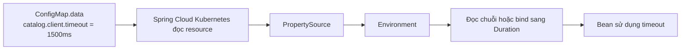

# Ánh xạ khóa đơn thành thuộc tính Spring

Trong chương **ConfigMap** của module **SPRING_CLOUD_KUBERNETES**, cách khai báo trực tiếp từng khóa cấu hình là điểm bắt đầu đơn giản để tích hợp ứng dụng Spring với Kubernetes. Ví dụ, một khóa `catalog.client.timeout` trong ConfigMap có thể trở thành giá trị mà Spring đọc qua `Environment`, inject qua `@Value` hoặc bind vào một đối tượng `@ConfigurationProperties`.

Bài này hướng dẫn đường đi đó bằng cấu hình không nhạy cảm của một dịch vụ danh mục sản phẩm. Kiến thức áp dụng được khi cấu hình thành phần nghiệp vụ cũng như các tính năng DiscoveryClient, Spring Cloud LoadBalancer hay theo dõi sức khỏe Pod; mỗi tính năng vẫn cần dependency và điều kiện kích hoạt tương ứng.

## 1. Một khóa trong ConfigMap đi vào Spring như thế nào?

Giả sử có dữ liệu:

```yaml
data:
  catalog.client.timeout: "1500ms"
```

Với cách đọc qua Kubernetes API của Spring Cloud Kubernetes, đường đi cần có là:



Trong cách ánh xạ trực tiếp đang xét, khóa được cung cấp cho Spring là `catalog.client.timeout`. Nó không trở thành `data.catalog.client.timeout` và không tự mang tên ConfigMap ở phía trước.

Kubernetes lưu dữ liệu; Spring Cloud Kubernetes đưa dữ liệu vào nguồn cấu hình; Spring thực hiện phân giải và chuyển kiểu. Chỉ tạo ConfigMap trong cluster chưa đủ để ứng dụng nhìn thấy thuộc tính. Cần một đường nạp đã được cấu hình.

Spring Cloud Kubernetes hỗ trợ các thuộc tính riêng lẻ bên cạnh nội dung file YAML/properties nhúng. Bài này sử dụng dạng thuộc tính riêng lẻ, như được trình bày trong [Using a ConfigMap PropertySource](https://docs.spring.io/spring-cloud-kubernetes/reference/property-source-config/configmap-propertysource.html).

## 2. Khai báo ConfigMap bằng các khóa phẳng

Ví dụ đầy đủ cho dữ liệu cấu hình:

```yaml
apiVersion: v1
kind: ConfigMap
metadata:
  name: catalog-settings
  namespace: learning
data:
  catalog.banner: "Danh mục sản phẩm"
  catalog.client.base-url: "https://inventory.example.invalid"
  catalog.client.timeout: "1500ms"
  catalog.client.max-attempts: "3"
  catalog.client.retry-enabled: "false"
```

Có ba loại tên khác nhau:

| Thành phần | Giá trị trong ví dụ | Vai trò |
| --- | --- | --- |
| Tên ConfigMap | `catalog-settings` | Chọn resource cần đọc |
| Namespace | `learning` | Xác định phạm vi chứa resource |
| Khóa thuộc tính | `catalog.client.timeout` | Tên mà ứng dụng dùng để tìm cấu hình |

`metadata.name` không phải prefix nghiệp vụ. Khi không bật cơ chế thêm prefix của nguồn, ứng dụng tìm `catalog.client.timeout`, không tìm `catalog-settings.catalog.client.timeout`.

### Giá trị trong data là chuỗi

Trường `data` của ConfigMap chứa chuỗi UTF-8. Khóa chấp nhận ký tự chữ/số, dấu chấm, dấu gạch nối và dấu gạch dưới; vì thế các tên như `catalog.client.max-attempts` phù hợp. Xem [cấu trúc ConfigMap của Kubernetes](https://kubernetes.io/docs/concepts/configuration/configmap/).

Nên đặt giá trị vô hướng trong dấu nháy để thể hiện rõ kiểu chuỗi:

```yaml
data:
  catalog.client.max-attempts: "3"
  catalog.client.retry-enabled: "false"
```

Sau khi YAML được đọc, hai giá trị là các chuỗi `3` và `false`, không bao gồm dấu nháy. Spring mới chuyển chúng sang số và boolean ở bước sử dụng hoặc binding.

Cách khai báo sau dễ sai kiểu ở mức manifest:

```yaml
# Không dùng dạng này cho data của ConfigMap.
data:
  catalog.client.max-attempts: 3
  catalog.client.retry-enabled: false
```

YAML có thể diễn giải chúng là số và boolean, trong khi API yêu cầu giá trị chuỗi. Tránh phụ thuộc vào một công cụ trung gian tự sửa kiểu.

### Khóa phẳng không phải object YAML lồng nhau

Cấu trúc sau không hợp lệ cho `data` vì giá trị `catalog` là một object:

```yaml
# Không hợp lệ: data yêu cầu các giá trị chuỗi.
data:
  catalog:
    client:
      timeout: "1500ms"
```

Để tiếp tục sử dụng khóa đơn, hãy đặt đầy đủ tên thuộc tính:

```yaml
data:
  catalog.client.timeout: "1500ms"
```

Nếu chọn lưu cả tài liệu YAML nhúng, đó là một cách biểu diễn khác. Không chỉ chuyển object thành chuỗi nhiều dòng rồi kỳ vọng mọi khóa con đều tự trở thành thuộc tính Spring:

```yaml
data:
  catalog.client: |-
    timeout: 1500ms
```

Trong dạng khóa thường này, `catalog.client` có giá trị là một chuỗi nhiều dòng. Nó không tương đương với khóa `catalog.client.timeout`.

## 3. Xác định hợp đồng ánh xạ trước khi viết Java

Với ConfigMap mẫu, hợp đồng mong muốn là:

| Khóa trong ConfigMap.data | Chuỗi đầu vào | Trường Java đích | Kiểu mong muốn |
| --- | --- | --- | --- |
| `catalog.banner` | `Danh mục sản phẩm` | Tham số banner | `String` |
| `catalog.client.base-url` | `https://inventory.example.invalid` | `baseUrl` | `URI` |
| `catalog.client.timeout` | `1500ms` | `timeout` | `Duration` |
| `catalog.client.max-attempts` | `3` | `maxAttempts` | `Integer` |
| `catalog.client.retry-enabled` | `false` | `retryEnabled` | `Boolean` |

Đây là hợp đồng do ứng dụng quy định. Kubernetes không biết `1500ms` là thời lượng hoặc `max-attempts` phải lớn hơn hay bằng một.

Việc dùng dấu chấm giúp nhóm cấu hình theo ngữ nghĩa; dùng kebab-case cho từng phần nhiều từ giúp thống nhất cách đặt tên. Prefix `catalog.client` phân biệt nhóm này với cấu hình của client khác.

Không đổi tên thuộc tính chỉ để giống tên resource. Một ConfigMap có thể chứa nhiều nhóm khóa, và tên resource có thể thay đổi giữa các môi trường mà hợp đồng thuộc tính của mã Java vẫn giữ nguyên.

## 4. Cấu hình để Spring đọc đúng ConfigMap

Ví dụ sử dụng cơ chế Config Data của Spring Boot và Spring Cloud Kubernetes Config. Ứng dụng cần starter phù hợp với Kubernetes client đã chọn, chẳng hạn `spring-cloud-starter-kubernetes-fabric8-config` khi dùng Fabric8. Chọn bộ phiên bản Spring Boot và Spring Cloud tương thích trong dự án.

Cấu hình khởi động trong `application.yaml` của ứng dụng:

```yaml
spring:
  application:
    name: catalog-service
  config:
    import: "kubernetes:"
  cloud:
    kubernetes:
      config:
        enabled: true
        name: catalog-settings
        namespace: learning
        use-name-as-prefix: false
      secrets:
        enabled: false
      discovery:
        enabled: false
```

Ở đây:

- `spring.application.name` định danh ứng dụng.
- `config.name` chọn ConfigMap `catalog-settings`, dù tên này khác tên ứng dụng.
- `config.namespace` chỉ rõ namespace của ConfigMap.
- `use-name-as-prefix: false` thể hiện cách ánh xạ trực tiếp đang sử dụng.
- Ví dụ chỉ thực hành đọc ConfigMap; Secret và discovery được tắt.

`spring.config.import: "kubernetes:"` cần được khai báo để dùng đường nạp này; chuỗi có dấu hai chấm nên được đặt trong dấu nháy khi viết YAML. Không đồng thời dùng legacy bootstrap để nạp cùng các Kubernetes properties. Xem [Kubernetes PropertySource implementations](https://docs.spring.io/spring-cloud-kubernetes/reference/property-source-config.html).

Những lựa chọn để tìm resource phải có sẵn trước lúc đọc ConfigMap. Không đặt duy nhất `config.name` hoặc namespace cần tìm bên trong chính resource chưa được xác định.

Ví dụ giả định không có cấu hình sources hay prefix khác ghi đè các lựa chọn trên. Khi tích hợp vào ứng dụng hiện có, cần xem các giá trị khởi động thực sự được cung cấp cho tiến trình.

## 5. Cấp quyền đọc cho ServiceAccount

Đọc qua API cần quyền của ServiceAccount mà Pod sử dụng. Ví dụ sau dành cho namespace `learning` đã tồn tại:

```yaml
apiVersion: v1
kind: ServiceAccount
metadata:
  name: catalog-reader
  namespace: learning
---
apiVersion: rbac.authorization.k8s.io/v1
kind: Role
metadata:
  name: catalog-config-reader
  namespace: learning
rules:
  - apiGroups: [""]
    resources: ["configmaps"]
    verbs: ["get", "list"]
---
apiVersion: rbac.authorization.k8s.io/v1
kind: RoleBinding
metadata:
  name: catalog-config-reader
  namespace: learning
subjects:
  - kind: ServiceAccount
    name: catalog-reader
    namespace: learning
roleRef:
  apiGroup: rbac.authorization.k8s.io
  kind: Role
  name: catalog-config-reader
```

Gắn ServiceAccount vào Pod template của Deployment:

```yaml
spec:
  template:
    spec:
      serviceAccountName: catalog-reader
```

Đoạn Pod template trên là phần bổ sung cho Deployment hiện có, không phải một Deployment hoàn chỉnh.

Role cho phép `get` và `list` ConfigMap trong namespace vì cơ chế đọc của client có thể cần liệt kê resource trước khi chọn nguồn. Đây không phải quyền chỉ đọc riêng `catalog-settings`: `list` có phạm vi các ConfigMap trong namespace.

Bài không cấu hình theo dõi sự kiện nên không thêm `watch`. Nếu bật cơ chế theo dõi sau này, phải xác định lại quyền cần thiết. Không cấp quyền Secret hoặc quyền ghi ConfigMap chỉ để thực hiện ví dụ đọc cấu hình này.

Vai trò của Role và RoleBinding được mô tả trong [Using RBAC Authorization](https://kubernetes.io/docs/reference/access-authn-authz/rbac/).

## 6. Đọc và bind các thuộc tính trong ứng dụng

Có thể chọn cách tiêu thụ theo nhu cầu:

| Cách đọc | Phù hợp khi |
| --- | --- |
| `Environment.getProperty(...)` | Cần tra cứu trực tiếp hoặc điều tra một khóa |
| `@Value` | Inject một vài giá trị riêng lẻ |
| `@ConfigurationProperties` | Nhóm nhiều thuộc tính có kiểu và validation |

Đọc được thuộc tính không tự làm một HTTP client sử dụng nó. Mã tạo client vẫn phải nhận các giá trị cấu hình và áp dụng chúng vào builder hoặc constructor tương ứng.

### Ví dụ Java tự chứa

Mẫu dưới dùng Java 17 trở lên, Spring Boot với Jakarta Validation, dependency validation và Kubernetes Config tương thích. Đặt lớp vào dự án ứng dụng demo đã có cấu hình khởi động ở trên:

```java
package example.catalog;

import java.net.URI;
import java.time.Duration;

import jakarta.validation.constraints.Min;
import jakarta.validation.constraints.NotNull;

import org.springframework.beans.factory.annotation.Value;
import org.springframework.boot.ApplicationRunner;
import org.springframework.boot.SpringApplication;
import org.springframework.boot.autoconfigure.SpringBootApplication;
import org.springframework.boot.context.properties.ConfigurationProperties;
import org.springframework.boot.context.properties.EnableConfigurationProperties;
import org.springframework.context.annotation.Bean;
import org.springframework.core.env.Environment;
import org.springframework.validation.annotation.Validated;

@SpringBootApplication
@EnableConfigurationProperties(
        CatalogApplication.CatalogClientProperties.class)
public class CatalogApplication {

    public static void main(String[] args) {
        SpringApplication.run(CatalogApplication.class, args);
    }

    @Validated
    @ConfigurationProperties(prefix = "catalog.client")
    public record CatalogClientProperties(
            @NotNull URI baseUrl,
            @NotNull Duration timeout,
            @NotNull @Min(1) Integer maxAttempts,
            @NotNull Boolean retryEnabled) {
    }

    @Bean
    ApplicationRunner showConfiguration(
            Environment environment,
            CatalogClientProperties client,
            @Value("${catalog.banner}") String banner) {
        return args -> {
            String rawTimeout = environment.getRequiredProperty(
                    "catalog.client.timeout");
            Integer attempts = environment.getProperty(
                    "catalog.client.max-attempts", Integer.class);

            System.out.println("banner = " + banner);
            System.out.println("environment timeout = " + rawTimeout);
            System.out.println("environment attempts = " + attempts);
            System.out.println("bound baseUrl = " + client.baseUrl());
            System.out.println("bound timeout = " + client.timeout());
            System.out.println("bound maxAttempts = " + client.maxAttempts());
            System.out.println("bound retryEnabled = " + client.retryEnabled());
        };
    }
}
```

`@EnableConfigurationProperties` đăng ký record cấu hình để Spring Boot bind dữ liệu. Chỉ tạo một record có các trường giống tên thuộc tính nhưng không đăng ký nó thì chưa đủ.

`@ConfigurationProperties(prefix = "catalog.client")` làm cho:

```text
catalog.client.base-url      -> baseUrl
catalog.client.timeout       -> timeout
catalog.client.max-attempts  -> maxAttempts
catalog.client.retry-enabled -> retryEnabled
```

Đây là binding theo tên thuộc tính, không phụ thuộc vào thứ tự các dòng trong ConfigMap hoặc thứ tự khóa mà Kubernetes API trả về. Vai trò của prefix được giải thích trong [API ConfigurationProperties](https://docs.spring.io/spring-boot/api/java/org/springframework/boot/context/properties/ConfigurationProperties.html).

Dự kiến khi không có nguồn nào khác ghi đè:

```text
banner = Danh mục sản phẩm
environment timeout = 1500ms
environment attempts = 3
bound baseUrl = https://inventory.example.invalid
bound timeout = PT1.5S
bound maxAttempts = 3
bound retryEnabled = false
```

Đây là kết quả dự kiến của ví dụ, không phải log của một lần chạy đã thực hiện.

`1500ms` và `PT1.5S` thể hiện cùng khoảng thời gian. Dòng đầu giữ chuỗi cấu hình; dòng sau in đối tượng `Duration` sau binding.

Địa chỉ thuộc miền `example.invalid` chỉ để minh họa. Chuyển thành `URI` không kiểm tra dịch vụ có tồn tại hay kết nối được.

### Đọc khóa đơn bằng @Value

Một thuộc tính riêng lẻ có thể được inject vào constructor:

```java
public BannerService(@Value("${catalog.banner}") String banner) {
    this.banner = banner;
}
```

Đoạn này là constructor minh họa bên trong một bean `BannerService` có trường `banner`. Nếu thuộc tính thực sự tùy chọn, placeholder có thể có mặc định:

```java
@Value("${catalog.banner:Danh mục}")
```

Không thêm mặc định cho mọi khóa chỉ để ứng dụng khởi động được, vì điều đó có thể che việc chưa đọc đúng ConfigMap. Cú pháp inject và giá trị mặc định được mô tả trong [Using @Value](https://docs.spring.io/spring-framework/reference/core/beans/annotation-config/value-annotations.html).

## 7. Đặt tên đúng: ConfigMap key, Java field và biến môi trường

Với dữ liệu khóa đơn, nên lưu tên thuộc tính dạng chữ thường, dùng dấu chấm phân nhóm và dấu gạch nối giữa các từ:

```text
catalog.client.max-attempts
```

Khi bind sang Java, `max-attempts` tương ứng với `maxAttempts`. Khi dùng placeholder, cũng nên tham chiếu tên canonical:

```java
@Value("${catalog.client.max-attempts}")
```

Biến môi trường là một đường cung cấp khác. Theo quy tắc đặt tên của Spring Boot, khi chuyển tên canonical sang biến môi trường, thay dấu chấm bằng gạch dưới, bỏ dấu gạch nối và chuyển thành chữ hoa:

| Tên thuộc tính canonical | Tên biến môi trường tương ứng |
| --- | --- |
| `catalog.client.timeout` | `CATALOG_CLIENT_TIMEOUT` |
| `catalog.client.base-url` | `CATALOG_CLIENT_BASEURL` |
| `catalog.client.max-attempts` | `CATALOG_CLIENT_MAXATTEMPTS` |

Quy tắc binding tùy loại nguồn được trình bày trong [Externalized Configuration của Spring Boot](https://docs.spring.io/spring-boot/reference/features/external-config.html).

Đừng đổi tất cả khóa trong ConfigMap API thành dạng `CATALOG_CLIENT_TIMEOUT` chỉ vì từng dùng dạng đó trong `env`. Nguồn Kubernetes đọc trực tiếp và nguồn môi trường không phải cùng một cách đưa dữ liệu vào Spring.

Nếu muốn đưa một khóa ConfigMap vào biến môi trường, có thể ánh xạ tên tường minh trong container:

```yaml
env:
  - name: CATALOG_CLIENT_TIMEOUT
    valueFrom:
      configMapKeyRef:
        name: catalog-settings
        key: catalog.client.timeout
```

Ở đây, Kubernetes lấy giá trị của khóa `catalog.client.timeout` và tạo biến môi trường `CATALOG_CLIENT_TIMEOUT`. Không phải Spring Cloud Kubernetes tự đổi tên khóa trong ConfigMap.

Với ứng dụng đang đọc ConfigMap qua `kubernetes:`, tránh đồng thời đưa cùng khóa vào môi trường nếu không có chủ đích rõ ràng. Hai đường này có thứ tự ưu tiên và đặc tính cập nhật khác nhau.

## 8. Chuyển kiểu và validation là hai bước riêng

Xét các thay đổi độc lập đối với ví dụ:

| Giá trị ConfigMap | Điều xảy ra với hợp đồng Java mẫu |
| --- | --- |
| `catalog.client.max-attempts: "3"` | Bind thành `Integer` có giá trị 3 |
| `catalog.client.max-attempts: "abc"` | Không chuyển được sang `Integer` |
| `catalog.client.max-attempts: "0"` | Chuyển kiểu được nhưng vi phạm `@Min(1)` |
| `catalog.client.timeout: "fast"` | Không phải định dạng thời lượng mà ví dụ mong đợi |
| Bỏ `catalog.client.retry-enabled` khỏi mọi nguồn | Thiếu giá trị cho trường có `@NotNull` |

Các constraint trong mẫu cần dependency validation, chẳng hạn `spring-boot-starter-validation`. Chỉ import annotation mà không có hạ tầng validation phù hợp không tạo được đầy đủ hành vi kiểm tra mong muốn.

Dùng `Integer` và `Boolean` thay cho kiểu nguyên thủy ở đây để biểu diễn được trạng thái thiếu bằng `null`; `@NotNull` giúp yêu cầu cung cấp giá trị. Nếu dùng `boolean` có giá trị mặc định `false`, có thể khó nhận ra khóa đã bị bỏ sót.

`@NotNull` chỉ kiểm tra hiện diện. Nó không yêu cầu timeout dương và không bảo đảm URI dùng HTTPS. Những ràng buộc nghiệp vụ đó cần được bổ sung riêng nếu ứng dụng yêu cầu.

### Không có khóa khác với chuỗi rỗng

Hai cấu hình dưới có ý nghĩa khác nhau:

```yaml
# Không khai báo catalog.banner.
data:
  catalog.client.timeout: "1500ms"
```

```yaml
# Có khai báo catalog.banner, giá trị là chuỗi rỗng.
data:
  catalog.banner: ""
  catalog.client.timeout: "1500ms"
```

Với thuộc tính chuỗi, đừng giả định giá trị mặc định cho khóa thiếu cũng tự thay thế chuỗi rỗng. Nếu banner bắt buộc phải có nội dung, cần kiểm tra điều kiện đó rõ ràng, ví dụ đưa nó vào nhóm cấu hình được validation với `@NotBlank`.

Các giá trị `"null"`, `"false"` và `"0"` cũng không đồng nghĩa với việc xóa khóa. Chúng là dữ liệu đầu vào và sẽ được xử lý theo kiểu đích.

## 9. Khóa đã ánh xạ nhưng giá trị vẫn không như mong đợi

Ánh xạ đúng tên không bảo đảm ConfigMap là nguồn thắng cuối cùng. Với Config Data, biến môi trường, JVM system properties và tham số ứng dụng có thể ưu tiên cao hơn cấu hình import. Đây là quy tắc được nêu trong [Kubernetes PropertySource implementations](https://docs.spring.io/spring-cloud-kubernetes/reference/property-source-config.html).

Ví dụ ConfigMap vẫn đặt:

```yaml
data:
  catalog.client.timeout: "1500ms"
```

Nhưng container có:

```yaml
env:
  - name: CATALOG_CLIENT_TIMEOUT
    value: "3s"
```

Khi giữ cơ chế ưu tiên mặc định và không có nguồn cao hơn nữa, ứng dụng có thể nhận `3s`. Trường `timeout` bind thành `PT3S`; đây là ghi đè nguồn, không phải lỗi đổi đơn vị.

Một lỗi khác là gõ nhầm khóa:

```yaml
data:
  catalog.client.max-attemps: "3"
```

Khóa này thiếu chữ `t` trong `attempts`, nên không đáp ứng hợp đồng `maxAttempts`. Nếu một nguồn khác đã cung cấp đúng khóa, ứng dụng vẫn có thể chạy và che mất lỗi chính tả. Nếu không có nguồn bổ sung, constraint bắt buộc trong mẫu giúp phát hiện thiếu giá trị.

Kubernetes kiểm tra cấu trúc resource, không kiểm tra khóa có đúng tên mà mã Java mong đợi. Cần phân biệt “manifest hợp lệ” với “hợp đồng cấu hình được đáp ứng”.

## 10. Giới hạn của cách khai báo từng khóa

Khóa đơn phù hợp với số lượng vừa phải các giá trị vô hướng, cần dễ tìm kiếm và thay đổi độc lập. Có một số giới hạn cần biết:

- Không dùng object hoặc array làm giá trị trực tiếp trong `data`.
- Không phải mọi tên thuộc tính Spring biểu diễn được bằng khóa ConfigMap. Chẳng hạn dấu ngoặc trong `catalog.endpoints[0]` không thuộc bộ ký tự cho phép của khóa.
- Đặt khóa không hợp lệ trong dấu nháy YAML không làm nó hợp lệ với Kubernetes API.
- Khóa chỉ gồm từ chung như `timeout` dễ xung đột khi một ứng dụng đọc nhiều nhóm cấu hình.
- Tên như `application.yaml` có thể được loader xử lý như nội dung file cấu hình; không nên dùng chúng làm tên khóa nghiệp vụ thông thường.

Giới hạn tên khóa được định nghĩa ở [ConfigMap API](https://kubernetes.io/docs/reference/kubernetes-api/core/config-map-v1/). Khi cần cấu trúc phức tạp, hãy chọn cách lưu tài liệu cấu hình nhúng hoặc cách cung cấp khác phù hợp; không ép cấu trúc đó thành các khóa Kubernetes không hợp lệ.

ConfigMap dành cho dữ liệu không nhạy cảm. Mật khẩu, token và khóa truy cập cần cách quản lý Secret cùng chính sách truy cập thích hợp, thay vì được đưa vào ví dụ ConfigMap này.

## 11. Quan sát và chẩn đoán theo từng tầng

Các lệnh dưới dành cho môi trường thực hành đã có resource tương ứng; tên file manifest là tên minh họa nếu người học lưu ví dụ thành file riêng.

### Tầng 1: resource có đúng dữ liệu không?

Kiểm tra cấu trúc với API server trước khi áp dụng:

```bash
kubectl apply --dry-run=server -f catalog-configmap.yaml
```

Đọc lại resource đúng namespace:

```bash
kubectl -n learning get configmap catalog-settings -o yaml
```

Để chỉ lấy một khóa có dấu chấm:

```bash
kubectl -n learning get configmap catalog-settings -o 'jsonpath={.data.catalog\.client\.timeout}'
```

Trong JSONPath này, dấu chấm thuộc tên khóa được escape. Giá trị mong đợi với manifest ban đầu là `1500ms`.

### Tầng 2: Pod có đúng danh tính và quyền không?

Xác nhận Pod sử dụng `catalog-reader` và RoleBinding trỏ đến đúng ServiceAccount, namespace. Nếu tài khoản thao tác được phép impersonate, có thể kiểm tra:

```bash
kubectl auth can-i get configmaps -n learning --as=system:serviceaccount:learning:catalog-reader
kubectl auth can-i list configmaps -n learning --as=system:serviceaccount:learning:catalog-reader
```

Quyền của tài khoản đang chạy `kubectl` không chứng minh ứng dụng có quyền tương tự. Khi lệnh impersonation bị từ chối, cần phân biệt lỗi đó với quyền đọc của ServiceAccount.

### Tầng 3: Spring có nạp và phân giải được khóa không?

Dùng runner trong ví dụ để đọc đúng `catalog.client.timeout`. Nếu không có giá trị, kiểm tra dependency Config, import, tên resource, namespace và prefix trước khi đổi kiểu Java.

Nếu giá trị tồn tại nhưng khác mong đợi, kiểm tra biến môi trường, arguments và những nguồn cấu hình khác có cùng khóa. Chỉ log các thuộc tính đã xác định là không nhạy cảm.

### Tầng 4: đối tượng sử dụng có nhận giá trị không?

So sánh chuỗi từ `Environment` với giá trị đã bind. Nếu cả hai đúng mà hành vi client vẫn khác, xem chỗ tạo client có thực sự dùng `CatalogClientProperties` hay vẫn giữ hằng số trong mã.

Bảng định hướng nhanh:

| Dấu hiệu | Tầng nên kiểm tra trước |
| --- | --- |
| API từ chối manifest vì sai kiểu | Cấu trúc `data` và cách quote giá trị |
| Lỗi Forbidden khi nạp | ServiceAccount, Role và RoleBinding |
| Không tìm thấy thuộc tính | Chọn nguồn, tên khóa, prefix và import |
| Giá trị lấy được là `3s` thay vì `1500ms` | Nguồn ghi đè |
| Lỗi chuyển `abc` sang số | Kiểu dữ liệu đầu vào |
| Giá trị 0 bị từ chối | Validation của hợp đồng cấu hình |
| Bean đúng nhưng client dùng timeout cũ | Cách tạo và vòng đời client |

## 12. Thay đổi ConfigMap sau khi ứng dụng đã chạy

Bài này thiết lập hợp đồng ánh xạ và đọc cấu hình khi khởi động. Record được bind và runner được gọi ở giai đoạn khởi động; chúng không phải một cơ chế tự theo dõi mọi thay đổi trong cluster.

Khi cập nhật ConfigMap, cần xác định ứng dụng sẽ nạp lại bằng cách nào: tạo Pod mới, cơ chế refresh được hỗ trợ hay Configuration Watcher đã cấu hình đầy đủ. Việc resource đã đổi không chứng minh rằng bean hoặc client đang chạy cũng đã cập nhật.

Configuration Watcher là một phần riêng của hệ thống, có yêu cầu về nhãn theo dõi, quyền truy cập và đường kích hoạt refresh. Xem [Spring Cloud Kubernetes Configuration Watcher](https://docs.spring.io/spring-cloud-kubernetes/reference/spring-cloud-kubernetes-configuration-watcher.html).

Với một ứng dụng chỉ cần cấu hình ở lúc khởi động, hãy xác định rõ quy trình triển khai để phiên bản Pod mới nhận cấu hình. Khi cần thay đổi động, phải quan sát cả nguồn hiệu lực lẫn đối tượng sử dụng; một override từ biến môi trường vẫn có thể tiếp tục thắng sau khi ConfigMap thay đổi.

Cách ánh xạ dễ kiểm soát bắt đầu từ một hợp đồng rõ ràng: **tên resource để tìm dữ liệu, tên khóa để Spring phân giải, kiểu Java để sử dụng và constraint để phát hiện dữ liệu không đáp ứng yêu cầu**.
