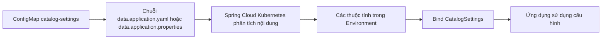

# Nạp nội dung application.yaml hoặc application.properties

## Mục tiêu và phạm vi

Trong chương **ConfigMap** của module **SPRING_CLOUD_KUBERNETES**, bài này hướng dẫn đặt toàn bộ nội dung cấu hình Spring vào một giá trị của ConfigMap rồi nạp thành các thuộc tính ứng dụng. Hai cách biểu diễn được thực hành là `application.yaml` và `application.properties`.

Tình huống là dịch vụ `catalog-service`, đọc ConfigMap `catalog-settings` trong namespace `learning`. Cấu hình gồm tiêu đề danh mục, kích thước trang, thời gian chờ và danh sách vùng phục vụ. Ta sẽ dùng hai định dạng thay thế cho cùng một nội dung, rồi quan sát giá trị được bind vào Java.

Ví dụ chính dùng Spring Cloud Kubernetes Config Data qua API, theo cơ chế được tài liệu nhánh 3.3 mô tả. Chọn bộ Spring Boot và Spring Cloud release train tương thích cho dự án. Chỉ cần tính năng ConfigMap; chưa cần đọc Secret, DiscoveryClient, Spring Cloud LoadBalancer hoặc Configuration Watcher để hoàn thành bài này.

## 1. Một ConfigMap có thể chứa nội dung của cả file

ConfigMap lưu dữ liệu cấu hình không nhạy cảm. Trong trường `data`, giá trị là chuỗi; chuỗi đó có thể có nhiều dòng và mang nội dung của một file cấu hình. Kubernetes không tự diễn giải các dòng bên trong thành thuộc tính Spring. [Cấu trúc và mục đích của ConfigMap](https://kubernetes.io/docs/concepts/configuration/configmap/).

Cần phân biệt ba tên:

| Tên trong ví dụ | Vai trò |
| --- | --- |
| `metadata.name: catalog-settings` | Tên Kubernetes object mà client tìm trong namespace đích |
| Khóa `data.application.yaml` | Tên một mục dữ liệu chứa chuỗi nhiều dòng |
| `spring.application.name: catalog-service` | Tên ứng dụng Spring, có thể tham gia quy tắc chọn nguồn và tên nội dung cấu hình |

Một khóa tên `application.yaml` trong `data` chưa phải file thật trong filesystem của container. Với đường API, client lấy chuỗi từ ConfigMap để phân tích. File chỉ xuất hiện trong container nếu có khai báo volume phù hợp.

Luồng nạp của bài:



## 2. Cách thứ nhất: nhúng application.yaml

Giả sử namespace `learning` đã tồn tại. Manifest ConfigMap:

```yaml
apiVersion: v1
kind: ConfigMap
metadata:
  name: catalog-settings
  namespace: learning
data:
  application.yaml: |-
    catalog:
      title: "Danh mục sản phẩm"
      page-size: 20
      timeout: 2s
      enabled-regions:
        - north
        - south
```

Đây là YAML có hai lớp:

- Lớp ngoài mô tả tài nguyên Kubernetes: `apiVersion`, `kind`, `metadata`, `data`.
- Lớp trong là chuỗi bắt đầu dưới `application.yaml: |-`, được bộ đọc cấu hình ứng dụng phân tích sau khi nhận ConfigMap.

Ký hiệu `|` giữ cấu trúc nhiều dòng. Dấu `-` trong `|-` loại bỏ newline ở cuối chuỗi; nó không loại bỏ các newline phân tách thuộc tính. Không thay bằng kiểu gấp dòng `>` khi cần giữ cấu trúc YAML hoặc từng dòng properties.

Tất cả các dòng của nội dung nhúng phải thụt vào sâu hơn khóa `application.yaml`. Khi đưa giá trị vào ứng dụng, phần thụt lề chung của block scalar được bỏ, còn cấu trúc tương đối như `catalog` và các trường con được giữ.

Sau khi phân tích, những khóa quan trọng tương ứng là:

```properties
catalog.title=Danh mục sản phẩm
catalog.page-size=20
catalog.timeout=2s
catalog.enabled-regions[0]=north
catalog.enabled-regions[1]=south
```

Đây là cách hình dung kết quả làm phẳng, không phải một ConfigMap bổ sung cần tạo. Con số `20` bên trong YAML nhúng không vi phạm yêu cầu giá trị `data` là chuỗi: toàn bộ nội dung dưới `|-` đã là một giá trị chuỗi ở lớp ngoài.

### Phân biệt lỗi của hai lớp YAML

Ví dụ dưới đây sai ở lớp Kubernetes, vì giá trị `data.application.yaml` trở thành một object thay vì chuỗi:

```yaml
data:
  application.yaml:
    catalog:
      page-size: 20
```

Trong khi đó, ví dụ này có thể hợp lệ ở lớp ngoài nhưng nội dung ứng dụng lại sai cú pháp:

```yaml
data:
  application.yaml: |-
    catalog:
      enabled-regions: [north, south
```

Kubernetes có thể lưu chuỗi không có dấu đóng `]`; lỗi chỉ lộ ra khi bộ đọc YAML của ứng dụng phân tích nội dung. Vì vậy, việc `kubectl apply` thành công không chứng minh cấu hình Spring bên trong đã hợp lệ.

## 3. Cách thứ hai: nhúng application.properties

Nếu nhóm phát triển dùng properties, thay manifest ở mục 2 bằng manifest sau. Hai ví dụ là hai lựa chọn cho cùng ConfigMap, không phải yêu cầu giữ đồng thời hai khóa.

```yaml
apiVersion: v1
kind: ConfigMap
metadata:
  name: catalog-settings
  namespace: learning
data:
  application.properties: |-
    catalog.title=Danh mục sản phẩm
    catalog.page-size=20
    catalog.timeout=2s
    catalog.enabled-regions[0]=north
    catalog.enabled-regions[1]=south
```

Lớp ngoài vẫn là YAML của Kubernetes. Phần trong giờ tuân theo cú pháp properties, mỗi dòng mô tả một thuộc tính. Không viết cấu trúc YAML `catalog:` vào block này rồi mong bộ đọc properties tự chuyển thành cây cấu hình.

Hai định dạng biểu diễn cùng ý định:

| Yêu cầu | YAML nhúng | Properties nhúng |
| --- | --- | --- |
| Nhóm thuộc tính | Thụt lề dưới `catalog` | Tiền tố `catalog.` |
| Số nguyên | `page-size: 20` | `catalog.page-size=20` |
| Thời gian chờ | `timeout: 2s` | `catalog.timeout=2s` |
| Danh sách | Các phần tử bắt đầu bằng `-` | Các khóa có chỉ số `[0]`, `[1]` |

Bộ bind của Spring chuyển giá trị phù hợp sang kiểu Java. Không tự tách danh sách bằng xử lý chuỗi trong code khi đã biểu diễn nó thành một cấu trúc cấu hình được hỗ trợ.

Khi đổi từ YAML sang properties, kiểm tra `data` sau cập nhật để bảo đảm khóa cũ không vô tình còn lại. Thay đổi từ một khóa thành nhiều khóa có thể làm thay đổi nhánh xử lý của Spring Cloud Kubernetes, như mục 6 giải thích.

## 4. Khai báo để ứng dụng nạp ConfigMap

### Dependency

Ví dụ chọn họ Fabric8. Thêm starter sau vào POM đã có dependency management phù hợp:

```xml
<dependency>
    <groupId>org.springframework.cloud</groupId>
    <artifactId>spring-cloud-starter-kubernetes-fabric8-config</artifactId>
</dependency>
```

Ứng dụng minh họa ở mục 5 còn dùng `spring-boot-starter-web`, `spring-boot-starter-validation` và `spring-boot-starter-actuator`. Nếu chọn Kubernetes Java Client chính thức thì thay starter config bằng `spring-cloud-starter-kubernetes-client-config`; không trộn hai họ client. [Các starter và phạm vi tính năng](https://docs.spring.io/spring-cloud-kubernetes/reference/3.3/getting-started.html).

### Cấu hình khởi đầu đóng gói cùng ứng dụng

Nội dung `application.yaml` local của ứng dụng:

```yaml
spring:
  application:
    name: catalog-service
  config:
    import: "kubernetes:"
  cloud:
    kubernetes:
      config:
        enabled: true
        enable-api: true
        name: catalog-settings
        namespace: ${POD_NAMESPACE}
        fail-fast: true
      secrets:
        enabled: false
      discovery:
        enabled: false

management:
  endpoints:
    web:
      exposure:
        include: health
  endpoint:
    health:
      probes:
        enabled: true
```

`spring.config.import` kích hoạt bộ đọc Kubernetes. Tên ConfigMap và namespace được khai báo riêng. Các thông tin này cần có trước lần tìm ConfigMap; không chỉ đặt chúng trong nội dung nguồn mà ứng dụng còn chưa biết cách đọc.

Tài liệu Spring Cloud Kubernetes hướng dẫn dùng `"kubernetes:"` trong YAML và không hỗ trợ đồng thời nạp Kubernetes PropertySource qua legacy bootstrap với cách import này. [Cơ chế Config Data của Spring Cloud Kubernetes](https://docs.spring.io/spring-cloud-kubernetes/reference/3.3/property-source-config.html).

Ví dụ này dành cho Pod có `POD_NAMESPACE`; khi chạy ngoài cluster, phải chủ động chuẩn bị cấu hình client và namespace phù hợp hoặc dùng một profile local riêng. Không coi việc đổi chuỗi import sang optional là cách tự động giải quyết thiếu thông tin kết nối.

### Quyền đọc và thông tin Pod

Ứng dụng cần ServiceAccount có quyền đọc ConfigMap trong namespace `learning`. Bộ manifest minh họa:

```yaml
apiVersion: v1
kind: ServiceAccount
metadata:
  name: catalog-config-reader
  namespace: learning
---
apiVersion: rbac.authorization.k8s.io/v1
kind: Role
metadata:
  name: catalog-config-reader
  namespace: learning
rules:
  - apiGroups: [""]
    resources: ["configmaps"]
    verbs: ["get", "list"]
---
apiVersion: rbac.authorization.k8s.io/v1
kind: RoleBinding
metadata:
  name: catalog-config-reader
  namespace: learning
subjects:
  - kind: ServiceAccount
    name: catalog-config-reader
    namespace: learning
roleRef:
  apiGroup: rbac.authorization.k8s.io
  kind: Role
  name: catalog-config-reader
---
apiVersion: apps/v1
kind: Deployment
metadata:
  name: catalog-service
  namespace: learning
spec:
  replicas: 1
  selector:
    matchLabels:
      app: catalog-service
  template:
    metadata:
      labels:
        app: catalog-service
    spec:
      serviceAccountName: catalog-config-reader
      containers:
        - name: app
          image: YOUR_REGISTRY/catalog-service:demo
          ports:
            - name: http
              containerPort: 8080
          env:
            - name: POD_NAMESPACE
              valueFrom:
                fieldRef:
                  fieldPath: metadata.namespace
          readinessProbe:
            httpGet:
              path: /actuator/health/readiness
              port: http
```

Thay image mẫu bằng image thực tế. Quyền `list` trong ví dụ có phạm vi ConfigMap của namespace, không giới hạn chỉ một tên. Ví dụ chưa quan sát thay đổi nên không cấp `watch`, cũng không cấp đọc Secret. Quyền cần điều chỉnh theo đường gọi API thực tế của tính năng được dùng. [ServiceAccount và quyền cho Spring Cloud Kubernetes](https://docs.spring.io/spring-cloud-kubernetes/reference/security-service-accounts.html).

## 5. Bind nội dung đã nạp vào kiểu Java

Ví dụ ứng dụng trên Java 17 trở lên:

```java
package com.example.catalog;

import java.time.Duration;
import java.util.List;
import java.util.Map;

import jakarta.validation.constraints.Max;
import jakarta.validation.constraints.Min;
import jakarta.validation.constraints.NotBlank;
import jakarta.validation.constraints.NotEmpty;
import jakarta.validation.constraints.NotNull;

import org.springframework.boot.SpringApplication;
import org.springframework.boot.autoconfigure.SpringBootApplication;
import org.springframework.boot.context.properties.ConfigurationProperties;
import org.springframework.boot.context.properties.EnableConfigurationProperties;
import org.springframework.validation.annotation.Validated;
import org.springframework.web.bind.annotation.GetMapping;
import org.springframework.web.bind.annotation.RestController;

@SpringBootApplication
@RestController
@EnableConfigurationProperties(CatalogApplication.CatalogSettings.class)
public class CatalogApplication {

    private final CatalogSettings settings;

    public CatalogApplication(CatalogSettings settings) {
        this.settings = settings;
    }

    public static void main(String[] args) {
        SpringApplication.run(CatalogApplication.class, args);
    }

    @GetMapping("/catalog-settings")
    public Map<String, Object> catalogSettings() {
        return Map.of(
                "title", settings.title(),
                "pageSize", settings.pageSize(),
                "timeout", settings.timeout().toString(),
                "enabledRegions", settings.enabledRegions());
    }

    @Validated
    @ConfigurationProperties(prefix = "catalog")
    public record CatalogSettings(
            @NotBlank String title,
            @Min(1) @Max(100) int pageSize,
            @NotNull Duration timeout,
            @NotEmpty List<String> enabledRegions) {
    }
}
```

`page-size` được bind vào `pageSize`; danh sách được bind vào `List<String>`. Giá trị `2s` được chuyển thành `Duration`. Endpoint chủ động chuyển duration sang chuỗi để phản hồi nhất quán, không phụ thuộc lựa chọn hiển thị duration của JSON serializer. [Binding cấu hình có kiểu và chuyển đổi duration](https://docs.spring.io/spring-boot/3.5/reference/features/external-config.html).

Cả hai lựa chọn ConfigMap cần tạo phản hồi tương ứng:

```json
{
  "title": "Danh mục sản phẩm",
  "pageSize": 20,
  "timeout": "PT2S",
  "enabledRegions": ["north", "south"]
}
```

Validation kiểm tra dữ liệu cuối cùng ứng dụng nhận được. Nó không xác thực nguồn gốc; nếu biến môi trường hoặc tham số dòng lệnh cũng cung cấp thuộc tính, dữ liệu có thể đến từ nguồn khác. Khi kiểm tra bài tập, tránh đặt các giá trị ghi đè ngoài chủ đích.

`@NotNull` trên duration chỉ kiểm tra sự hiện diện. Nếu nghiệp vụ đòi thời gian chờ dương hoặc có giới hạn cụ thể, cần thêm kiểm tra miền giá trị phù hợp thay vì cho rằng chuyển đổi kiểu đã bao gồm quy tắc nghiệp vụ.

## 6. Quy tắc nhận diện tên nội dung: chú ý trường hợp một khóa

Hai ConfigMap ở mục 2 và 3 đều cố ý chỉ có **một khóa**. Tài liệu Spring Cloud Kubernetes mô tả trường hợp đặc biệt: nếu ConfigMap có một khóa duy nhất biểu thị nội dung YAML hoặc properties, tên khóa không bắt buộc là `application.yaml` hay `application.properties`. [Quy tắc xử lý nội dung ConfigMap](https://docs.spring.io/spring-cloud-kubernetes/reference/3.3/property-source-config/configmap-propertysource.html).

Vì vậy, không được suy ra từ ví dụ một khóa rằng mọi khóa kết thúc bằng `.yaml` trong ConfigMap nhiều khóa đều sẽ được phân tích như file cấu hình của ứng dụng. Trong trường hợp nhiều khóa, phải xét quy tắc tên theo `spring.application.name`, các profile đang hoạt động và phiên bản sử dụng.

Ví dụ có chủ đích với `spring.application.name=catalog-service` và profile `prod`:

```yaml
apiVersion: v1
kind: ConfigMap
metadata:
  name: catalog-settings
  namespace: learning
data:
  catalog-service.yaml: |-
    catalog:
      page-size: 20
  catalog-service-prod.yaml: |-
    catalog:
      page-size: 40
  catalog.page-size: "60"
```

Theo thứ tự nội dung ConfigMap được tài liệu nhánh 3.3 mô tả, thuộc tính đơn lẻ có thể ghi đè cả nội dung cơ sở và nội dung theo profile. Trong ví dụ này, giá trị cuối cho `catalog.page-size` là `60`. Đây chỉ là ví dụ về xung đột một thuộc tính; nó không đủ các trường bắt buộc để thay trực tiếp ConfigMap của ứng dụng hoàn chỉnh.

Để giữ cấu hình dễ kiểm soát:

- Với nhu cầu hiện tại, chọn một khóa chứa một định dạng và đặt toàn bộ nhóm `catalog` vào đó.
- Khi cần nhiều khóa hoặc nhiều nội dung theo profile, thiết kế tên rõ ràng và kiểm tra giá trị cuối cùng.
- Tránh vừa đặt cùng thuộc tính trong nội dung file nhúng, vừa đặt nó thành khóa đơn lẻ ngoài file.

Không lấy quy tắc ưu tiên của hai file local cùng vị trí trong Spring Boot rồi áp dụng máy móc cho mọi nội dung nhúng trong ConfigMap. Ở đây còn có bước chọn và xử lý dữ liệu của Spring Cloud Kubernetes trước khi đưa vào Environment.

## 7. Kiểm tra từ dữ liệu được lưu đến giá trị sử dụng

Các lệnh dưới đây dành cho người học sau khi chuẩn bị cluster, image và manifest tương ứng.

### Xem đúng phần nội dung đang được lưu

Với lựa chọn YAML:

```powershell
kubectl get configmap catalog-settings -n learning -o yaml
kubectl get configmap catalog-settings -n learning -o jsonpath='{.data.application\.yaml}'
```

Với lựa chọn properties, dùng đường dẫn khóa tương ứng:

```powershell
kubectl get configmap catalog-settings -n learning -o jsonpath='{.data.application\.properties}'
```

Dấu chấm trong tên khóa được escape trong biểu thức JSONPath. Xem toàn bộ `data` để xác định có còn khóa của định dạng cũ, khóa đơn lẻ trùng nội dung hoặc một tên không mong đợi hay không.

Nếu đang có file cấu hình local cho bài tập, có thể xem trước manifest được tạo từ file:

```powershell
kubectl create configmap catalog-settings -n learning --from-file=application.yaml=.\application.yaml --dry-run=client -o yaml
```

Lệnh này chỉ in manifest xem trước. Nó không kiểm tra rằng nội dung YAML bên trong phù hợp với `CatalogSettings`. Nếu đã lưu manifest dưới tên `catalog-configmap.yaml`, kiểm tra tài nguyên ở phía Kubernetes bằng:

```powershell
kubectl apply --dry-run=server -f .\catalog-configmap.yaml
```

Server dry-run cũng không chạy bộ bind và validation của ứng dụng Java. Hai bước kiểm tra có mục đích khác nhau.

### Quan sát ứng dụng và Pod

```powershell
kubectl rollout status deployment/catalog-service -n learning
kubectl get pods -n learning -l app=catalog-service
kubectl logs deployment/catalog-service -n learning
```

Nếu Pod lỗi trước khi ứng dụng sẵn sàng, đọc log từ phần nạp cấu hình và bind thuộc tính. Pod Ready chỉ là một quan sát về health/readiness đã cấu hình, chưa thay thế việc đối chiếu bốn trường dữ liệu nghiệp vụ.

Mở port-forward và giữ terminal đó chạy:

```powershell
kubectl port-forward deployment/catalog-service -n learning 8080:8080
```

Trong terminal khác:

```powershell
Invoke-RestMethod -Uri 'http://localhost:8080/catalog-settings'
Invoke-RestMethod -Uri 'http://localhost:8080/actuator/health/readiness'
```

Đối chiếu kết quả với JSON ở mục 5. Nếu số, danh sách hoặc duration không đúng, kiểm tra lần lượt nội dung được lưu, tên nguồn, việc nhận diện nội dung nhúng và các PropertySource có thể ghi đè.

## 8. Những lỗi thường gặp khi nhúng nội dung file

| Biểu hiện | Điểm cần kiểm tra |
| --- | --- |
| Kubernetes từ chối ConfigMap vì kiểu dữ liệu | Có thiếu `|`/`|-` khiến giá trị `data` trở thành object hay số không? |
| ConfigMap được tạo nhưng ứng dụng báo lỗi parse YAML | Nội dung bên trong block scalar có sai thụt lề, dấu ngoặc hoặc cấu trúc không? |
| Properties không tạo ra các khóa `catalog.*` | Có đang viết YAML trong `application.properties` hay dùng nhầm bộ đọc không? |
| Thêm khóa mới rồi các giá trị cũ không còn được bind | Có chuyển từ trường hợp một khóa sang nhiều khóa và thay đổi quy tắc nhận diện không? |
| Một giá trị luôn khác nội dung file nhúng | Có khóa đơn lẻ, nội dung theo profile, biến môi trường hoặc dòng lệnh ghi đè không? |
| Lỗi `403 Forbidden` | ServiceAccount, RoleBinding và namespace có phù hợp với request của client không? |
| `catalog-settings` tồn tại nhưng ứng dụng không đọc | Kiểm tra namespace, `config.name`, import và dependency runtime. |
| Cập nhật ConfigMap nhưng endpoint vẫn trả giá trị cũ | Có mới nạp lúc khởi động mà chưa thực hiện restart hoặc refresh phù hợp không? |

`config.fail-fast` giúp quyết định xử lý lỗi nạp nguồn; validation giúp kiểm tra cấu hình nghiệp vụ sau khi bind. Không coi chúng là một cơ chế duy nhất hoặc giả định rằng mọi ConfigMap vắng mặt đều được báo lỗi giống nhau ở mọi phiên bản.

## 9. Cập nhật cấu hình và ranh giới của ví dụ

Java trong bài giữ một record cấu hình được tạo khi ứng dụng khởi động. Sau khi đổi nội dung ConfigMap trong môi trường học tập, cách nạp lại được dùng ở đây là:

```powershell
kubectl rollout restart deployment/catalog-service -n learning
kubectl rollout status deployment/catalog-service -n learning
```

Nếu port-forward kết thúc khi Pod cũ bị thay, mở lại rồi kiểm tra endpoint. Việc áp dụng ConfigMap không tự chứng minh bean đã dùng dữ liệu mới.

Khi cần cập nhật không restart, đánh giá Configuration Watcher và cách refresh bean riêng. Cơ chế đó có yêu cầu về quyền, nguồn được theo dõi, đường gửi thông báo và vòng đời bean; đổi từ YAML sang properties không tự giải quyết các yêu cầu này. [Configuration Watcher và thông báo refresh](https://docs.spring.io/spring-cloud-kubernetes/reference/3.3/spring-cloud-kubernetes-configuration-watcher.html).

Nếu triển khai chọn mount thay vì API, vẫn có thể dùng cùng nội dung nhúng nhưng phải khai báo volume tạo file và import qua `file:` tương ứng. `configtree:` dành cho trường hợp tên file là tên thuộc tính và nội dung file là giá trị; nó không tự phân tích `application.yaml` thành các trường bên trong. [Cấu hình từ file và configuration trees](https://docs.spring.io/spring-boot/3.3/reference/features/external-config.html#features.external-config.files.configtrees).

Kết quả cần đạt là một chuỗi rõ ràng: ConfigMap lưu đúng chuỗi, bộ đọc nhận diện đúng định dạng, Environment có đúng thuộc tính và bean nhận đúng kiểu cùng miền giá trị cần thiết. Chọn YAML hay properties dựa trên cách nhóm phát triển quản lý cấu hình, rồi duy trì một cách biểu diễn nhất quán cho cùng nguồn.