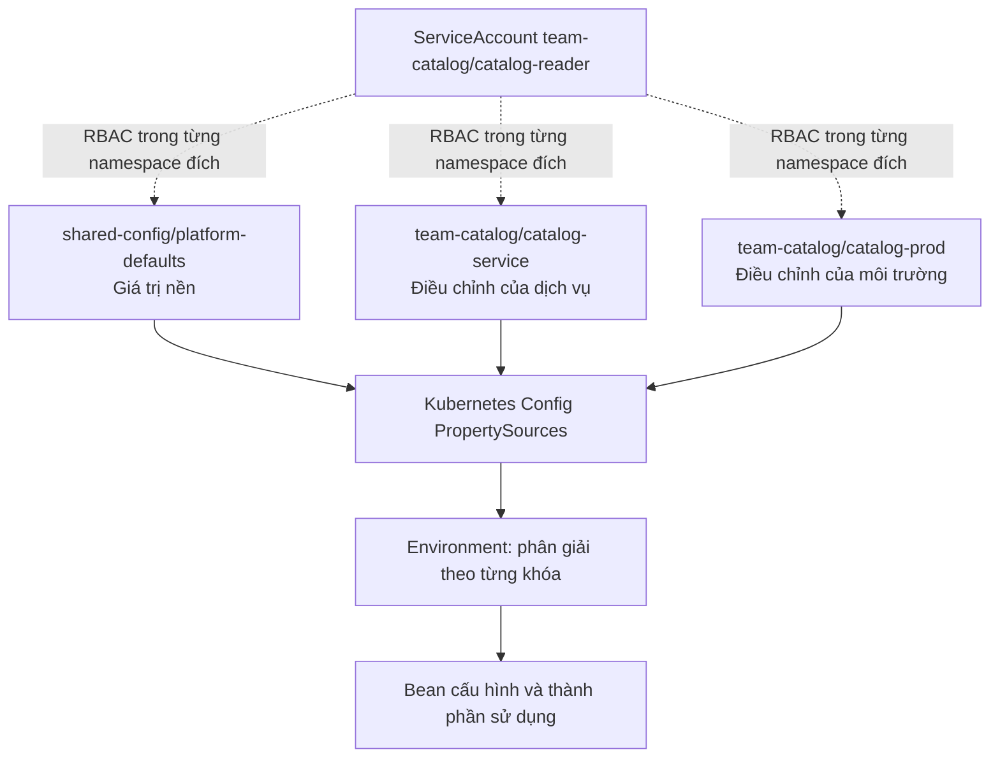

# Chỉ định nhiều ConfigMap theo tên và namespace

Trong chương **ConfigMap** của module **SPRING_CLOUD_KUBERNETES**, một ứng dụng có thể cần đọc cấu hình từ nhiều ConfigMap: cấu hình dùng chung, cấu hình riêng của dịch vụ và phần điều chỉnh cho môi trường triển khai. Những resource này có thể nằm cùng namespace hoặc ở các namespace khác nhau.

Spring Cloud Kubernetes cung cấp danh sách `spring.cloud.kubernetes.config.sources` để mô tả các nguồn đó. Để sử dụng đúng, cần xác định đầy đủ **resource nào được đọc, thứ tự nguồn, tên thuộc tính sau khi nạp và quyền truy cập của Pod**. Bài này thực hành đọc cấu hình qua Kubernetes API; không sử dụng `envFrom` hoặc volume làm đường nạp chính.

## 1. Mỗi nguồn được xác định bằng tên và namespace

Với ConfigMap, hai resource sau là hai nguồn riêng biệt:

```text
shared-config/settings
team-catalog/settings
```

Chúng trùng `metadata.name` nhưng khác namespace. Khi ghi một bản thiết kế hoặc điều tra lỗi, nên ghi cặp `namespace/name` thay vì chỉ ghi tên resource.

Có ba loại namespace cần phân biệt:

| Namespace | Vai trò |
| --- | --- |
| Namespace của Pod | Nơi ứng dụng chạy |
| Namespace của ServiceAccount | Một phần danh tính dùng để gọi Kubernetes API |
| Namespace của ConfigMap | Nơi resource cấu hình được đọc |

Pod trong `team-catalog` có thể dùng ServiceAccount `team-catalog/catalog-reader` để đọc ConfigMap trong `shared-config` nếu được cấp quyền phù hợp. Việc chỉ định namespace đích không di chuyển Pod hay thay đổi danh tính của tiến trình.

Kubernetes cho phép cấp quyền truy cập qua namespace bằng RBAC, như được mô tả trong [Service Accounts: cross-namespace access](https://kubernetes.io/docs/concepts/security/service-accounts/).

## 2. Mô hình thực hành: ba lớp cấu hình

Giả sử ứng dụng `catalog-service` chạy trong namespace `team-catalog` và cần các nguồn theo thứ tự:

| Thứ tự trong sources | Namespace | Tên ConfigMap | Mục đích |
| --- | --- | --- | --- |
| 1 | `shared-config` | `platform-defaults` | Giá trị nền dùng chung |
| 2 | `team-catalog` | `catalog-service` | Giá trị riêng của dịch vụ |
| 3 | `team-catalog` | `catalog-prod` | Điều chỉnh cho bản triển khai production |

Thiết kế này chủ động cho lớp sau ghi đè những khóa trùng với lớp trước. Namespace không quyết định độ ưu tiên; thứ tự trong danh sách mới thể hiện chính sách ghi đè giữa các nguồn này.



Sơ đồ biểu diễn nguồn và quyền truy cập. Nó không mô tả thứ tự hoàn thành các request mạng; không dùng thời gian phản hồi API làm căn cứ chọn giá trị thắng.

## 3. Khai báo danh sách sources rõ ràng

Ứng dụng cần dependency Spring Cloud Kubernetes Config tương thích với Spring Boot/Spring Cloud đang dùng. Ví dụ, khi chọn Fabric8, có thể sử dụng starter `spring-cloud-starter-kubernetes-fabric8-config` theo bộ phiên bản của dự án.

Cấu hình khởi động trong `application.yaml`:

```yaml
spring:
  application:
    name: catalog-service
  config:
    import: "kubernetes:"
  cloud:
    kubernetes:
      config:
        enabled: true
        use-name-as-prefix: false
        include-profile-specific-sources: false
        sources:
          - name: platform-defaults
            namespace: shared-config
          - name: catalog-service
            namespace: team-catalog
          - name: catalog-prod
            namespace: team-catalog
      secrets:
        enabled: false
      discovery:
        enabled: false
```

Mỗi phần tử trong `sources` là một mô tả nguồn. Không viết `name` thành một chuỗi ngăn cách bằng dấu phẩy và không viết `namespace` thành một mảng thay cho cấu trúc danh sách trên.

Trong ví dụ:

- Một `spring.config.import` kích hoạt đường nạp Kubernetes Config Data.
- `sources` mô tả ba ConfigMap cần chọn trong đường nạp đó.
- Tắt prefix để các lớp cấu hình cùng cung cấp những khóa nghiệp vụ như `app.client.timeout`.
- Tắt việc tự tìm thêm resource theo profile để tập trung vào ba nguồn đã nêu.
- Tắt Secret và discovery vì chúng không phục vụ ví dụ đọc ConfigMap này.

Cơ chế import và yêu cầu chọn một trong hai cách Config Data hoặc legacy bootstrap được nêu trong [Kubernetes PropertySource implementations](https://docs.spring.io/spring-cloud-kubernetes/reference/property-source-config.html). Bài này sử dụng Config Data; không thêm bootstrap context để nạp lại cùng nguồn.

Tên resource, namespace và danh sách sources phải có sẵn lúc loader lựa chọn nguồn. Đừng đặt duy nhất danh sách cần tìm bên trong một ConfigMap mà ứng dụng chưa biết cách đọc.

### Không tự bổ sung một nguồn ngoài danh sách

Khi đã cấu hình `sources`, hãy liệt kê mọi nguồn mong muốn một cách rõ ràng. Đừng kỳ vọng một ConfigMap có tên bằng `spring.application.name` hoặc `config.name` luôn được thêm thành nguồn thứ tư ngoài danh sách.

Nếu muốn dùng `catalog-service` như một lớp cấu hình, hãy ghi nó trong `sources`, như ví dụ trên. Cách này cũng giúp người đọc nhìn thấy ngay thứ tự ưu tiên dự định.

## 4. Khi bỏ name hoặc namespace, giá trị nào được dùng?

Có thể rút gọn cấu hình nhờ giá trị mặc định ở cấp `config`. Xét ví dụ độc lập sau:

```yaml
spring:
  application:
    name: catalog-service
  cloud:
    kubernetes:
      config:
        name: application-defaults
        namespace: team-catalog
        sources:
          - name: platform-defaults
          - namespace: shared-config
          - name: catalog-prod
            namespace: team-catalog
```

Kết quả xác định nguồn:

| Phần tử sources | Tên được dùng | Namespace được dùng | Cặp nguồn |
| --- | --- | --- | --- |
| Chỉ có `name: platform-defaults` | `platform-defaults` | `team-catalog` | `team-catalog/platform-defaults` |
| Chỉ có `namespace: shared-config` | `application-defaults` | `shared-config` | `shared-config/application-defaults` |
| Có cả name và namespace | `catalog-prod` | `team-catalog` | `team-catalog/catalog-prod` |

Ở đây, `config.name` và `config.namespace` là giá trị mặc định cho phần tử thiếu trường tương ứng, không phải một cặp nguồn được tự thêm vào trước danh sách. Các quy tắc và ví dụ nguồn theo tên được trình bày trong [Using a ConfigMap PropertySource](https://docs.spring.io/spring-cloud-kubernetes/reference/property-source-config/configmap-propertysource.html).

Ví dụ rút gọn trên không tương đương danh sách ba nguồn ở mục trước: nguồn đầu đổi sang namespace `team-catalog`, nguồn thứ hai đổi tên thành `application-defaults`. Không sao chép phần rút gọn mà bỏ qua những thay đổi này.

Nếu không đặt `config.name`, tên mặc định được xác định từ tên ứng dụng nếu có; khi không có tên ứng dụng thì dùng `application`. Nếu không có namespace ở phần tử hoặc cấp ConfigMap, framework tiếp tục phân giải namespace từ cấu hình client và môi trường chạy.

Quá trình phân giải có thể sử dụng `spring.cloud.kubernetes.client.namespace`, thông tin namespace của ServiceAccount và Kubernetes client. Không mặc định mọi trường hợp thiếu namespace đều có nghĩa là namespace tên `default`. Xem [Namespace resolution](https://docs.spring.io/spring-cloud-kubernetes/reference/property-source-config/namespace-resolution.html).

Với nguồn quan trọng nằm ngoài namespace của Pod, nên ghi cả tên lẫn namespace để tránh phụ thuộc ngầm vào môi trường.

## 5. Tạo dữ liệu cho ba ConfigMap

Các namespace `shared-config` và `team-catalog` được giả định đã tồn tại.

### 5.1. Giá trị nền

```yaml
apiVersion: v1
kind: ConfigMap
metadata:
  name: platform-defaults
  namespace: shared-config
data:
  app.region: "ap-southeast-1"
  app.client.timeout: "1s"
  app.client.max-attempts: "2"
```

### 5.2. Cấu hình dịch vụ

```yaml
apiVersion: v1
kind: ConfigMap
metadata:
  name: catalog-service
  namespace: team-catalog
data:
  app.client.timeout: "1500ms"
  app.client.base-url: "https://inventory.example.invalid"
```

### 5.3. Điều chỉnh cho môi trường

```yaml
apiVersion: v1
kind: ConfigMap
metadata:
  name: catalog-prod
  namespace: team-catalog
data:
  app.client.timeout: "2s"
  app.feature.recommendations-enabled: "true"
```

Các giá trị thuộc `data` được viết dưới dạng chuỗi. Địa chỉ trong miền `example.invalid` chỉ để minh họa cấu hình, không phải dịch vụ để gọi thử.

`catalog-prod` trong ví dụ là một tên đã được liệt kê tường minh. Nó được chọn vì có trong `sources`, không phải vì ứng dụng nhất thiết đang active profile `prod`. Nếu giữ nguyên danh sách khi triển khai development, ứng dụng vẫn có thể đọc nguồn đó. Danh sách nguồn phải phù hợp với bản triển khai thực tế.

## 6. Tính kết quả sau khi ghép các nguồn

Giả sử mọi nguồn đều được nạp, prefix vẫn tắt và không có nguồn ưu tiên cao hơn ghi đè:

| Khóa | platform-defaults | catalog-service | catalog-prod | Giá trị hiệu lực |
| --- | --- | --- | --- | --- |
| `app.region` | `ap-southeast-1` | — | — | `ap-southeast-1` |
| `app.client.timeout` | `1s` | `1500ms` | `2s` | `2s` |
| `app.client.max-attempts` | `2` | — | — | `2` |
| `app.client.base-url` | — | URL minh họa | — | URL minh họa |
| `app.feature.recommendations-enabled` | — | — | `true` | `true` |

Dấu “—” biểu thị nguồn không cung cấp khóa đó.

Chính sách “ConfigMap đứng sau thắng khi trùng khóa” của danh sách nguồn được tài liệu [ConfigMap PropertySource](https://docs.spring.io/spring-cloud-kubernetes/reference/property-source-config/configmap-propertysource.html) mô tả. Việc thay thế diễn ra theo từng khóa; một ConfigMap phía sau không tự xóa mọi thuộc tính của nguồn trước.

Nếu đổi hai mục cuối:

```yaml
sources:
  - name: platform-defaults
    namespace: shared-config
  - name: catalog-prod
    namespace: team-catalog
  - name: catalog-service
    namespace: team-catalog
```

Kết quả của `app.client.timeout` trở thành `1500ms`. Khóa recommendations vẫn tồn tại vì `catalog-service` không cung cấp giá trị khác cho nó.

Cần tách hai tầng ưu tiên:

1. **Giữa các ConfigMap đã chọn:** xét thứ tự nguồn và quy tắc xử lý bên trong chúng.
2. **Giữa nguồn Kubernetes với các nguồn Spring Boot khác:** xét chính sách của Environment.

Ví dụ, biến môi trường `APP_CLIENT_TIMEOUT=4s` có thể thắng giá trị `2s` từ Kubernetes Config Data. Đưa `catalog-prod` xuống cuối danh sách không làm ConfigMap vượt mọi biến môi trường hoặc tham số ứng dụng. Quy tắc này được nêu trong [Kubernetes PropertySource implementations](https://docs.spring.io/spring-cloud-kubernetes/reference/property-source-config.html).

## 7. RBAC khi đọc hai namespace

Danh sách `sources` chỉ mô tả nguồn muốn đọc. Nó không cấp quyền cho ServiceAccount.

Giả sử Pod chạy với ServiceAccount:

```yaml
apiVersion: v1
kind: ServiceAccount
metadata:
  name: catalog-reader
  namespace: team-catalog
```

Gắn danh tính này vào Pod template của Deployment hiện có:

```yaml
spec:
  template:
    spec:
      serviceAccountName: catalog-reader
```

Để đọc các ConfigMap trong namespace của dịch vụ:

```yaml
apiVersion: rbac.authorization.k8s.io/v1
kind: Role
metadata:
  name: config-reader
  namespace: team-catalog
rules:
  - apiGroups: [""]
    resources: ["configmaps"]
    verbs: ["get", "list"]
---
apiVersion: rbac.authorization.k8s.io/v1
kind: RoleBinding
metadata:
  name: catalog-config-reader
  namespace: team-catalog
subjects:
  - kind: ServiceAccount
    name: catalog-reader
    namespace: team-catalog
roleRef:
  apiGroup: rbac.authorization.k8s.io
  kind: Role
  name: config-reader
```

Để cùng ServiceAccount đó đọc cấu hình chung:

```yaml
apiVersion: rbac.authorization.k8s.io/v1
kind: Role
metadata:
  name: config-reader
  namespace: shared-config
rules:
  - apiGroups: [""]
    resources: ["configmaps"]
    verbs: ["get", "list"]
---
apiVersion: rbac.authorization.k8s.io/v1
kind: RoleBinding
metadata:
  name: catalog-config-reader
  namespace: shared-config
subjects:
  - kind: ServiceAccount
    name: catalog-reader
    namespace: team-catalog
roleRef:
  apiGroup: rbac.authorization.k8s.io
  kind: Role
  name: config-reader
```

Điểm cần đọc kỹ ở RoleBinding thứ hai:

- `metadata.namespace: shared-config` là nơi quyền được cấp.
- Subject vẫn là ServiceAccount `team-catalog/catalog-reader`.
- `roleRef` tham chiếu Role `config-reader` trong cùng namespace `shared-config`.

Không tạo một ServiceAccount mới cùng tên trong `shared-config` rồi kỳ vọng Pod đang dùng ServiceAccount ở `team-catalog` tự nhận quyền của nó. Hai danh tính đó khác nhau.

Quan hệ namespace của RoleBinding và Role được định nghĩa trong [RoleBinding API](https://kubernetes.io/docs/reference/kubernetes-api/rbac/role-binding-v1/).

### Phạm vi quyền thực tế

Các Role mẫu cho phép `get` và `list` ConfigMap trong từng namespace. Quyền `list` có thể cần khi client đọc danh sách rồi lọc theo nguồn cấu hình; phạm vi quyền này rộng hơn ba tên trong `sources`.

Không coi danh sách nguồn là hàng rào bảo mật. Nếu cần giới hạn đến từng resource, phải đối chiếu chế độ đọc mà phiên bản client/framework hỗ trợ và request API thực tế. Chỉ thêm `resourceNames` vào Role trong khi client vẫn list không có selector phù hợp có thể làm việc nạp bị từ chối.

Bài không bật theo dõi thay đổi nên không bổ sung `watch`. Không cấp quyền đọc Secret, ghi ConfigMap hoặc quyền toàn cluster để giải quyết một lỗi thiếu quyền đọc cấu hình. Các quy tắc về `resourceNames`, `list` và phạm vi Role được trình bày trong [Using RBAC Authorization](https://kubernetes.io/docs/reference/access-authn-authz/rbac/).

## 8. Namespace không tự tách tên thuộc tính

Giả sử hai nguồn khác namespace cùng chứa:

```text
app.client.timeout
```

Sau khi nạp không prefix, cả hai cùng cung cấp đúng khóa đó. Spring không tự tạo:

```text
shared-config.app.client.timeout
team-catalog.app.client.timeout
```

Có hai mục đích thiết kế khác nhau:

| Mục đích | Cách tổ chức |
| --- | --- |
| Các lớp cùng điều chỉnh một bộ thuộc tính | Giữ khóa chung, xác định thứ tự ghi đè |
| Cần sử dụng đồng thời hai giá trị độc lập | Đặt khóa nghiệp vụ khác nhau hoặc cấu hình prefix |

Ví dụ độc lập, hai namespace đều có ConfigMap tên `settings` và đều chứa `app.client.timeout`. Có thể chọn prefix tường minh ở cấp nguồn:

```yaml
spring:
  cloud:
    kubernetes:
      config:
        sources:
          - name: settings
            namespace: shared-config
            explicit-prefix: shared
          - name: settings
            namespace: team-catalog
            explicit-prefix: service
```

Các khóa để ứng dụng đọc trở thành:

```text
shared.app.client.timeout
service.app.client.timeout
```

Đây là ví dụ thay thế để tách giá trị, không phải phần ghép thêm vào cấu hình chính. Bean đang bind prefix `app.client` sẽ không tự chuyển sang đọc `service.app.client`; hợp đồng đọc cũng phải được điều chỉnh.

Nếu chỉ dùng tên resource làm prefix, hai ConfigMap cùng tên `settings` vẫn không được phân biệt bởi tên đó. Prefix tường minh giúp thể hiện rõ mục đích. Hỗ trợ `explicitPrefix` và `useNameAsPrefix` được mô tả trong [ConfigMap PropertySource](https://docs.spring.io/spring-cloud-kubernetes/reference/property-source-config/configmap-propertysource.html).

## 9. Profile có thể làm xuất hiện thêm nguồn

Khi bật tìm nguồn theo profile, khai báo một ConfigMap theo tên có thể khiến framework tìm thêm các biến thể tương ứng với active profile. Chẳng hạn nguồn `catalog-service` có thể dẫn đến việc tìm `catalog-service-prod` khi `prod` đang active.

Vì vậy, số phần tử trong `sources` không phải lúc nào cũng bằng số resource được thử đọc. Ví dụ chính đặt:

```yaml
spring:
  cloud:
    kubernetes:
      config:
        include-profile-specific-sources: false
```

Mục đích là tránh vô tình đưa biến thể profile vào sơ đồ ba lớp đã thiết kế. Nếu muốn sử dụng profile-aware sources, cần bổ sung chúng vào sơ đồ nguồn dự kiến và kiểm tra lại giá trị trùng.

Không nhầm hai trường hợp:

- Nêu tường minh `name: catalog-prod` thì đó là nguồn được chọn theo tên.
- Nêu `name: catalog-service` rồi bật tìm theo profile là cơ chế tự tìm biến thể.

Trước khi sử dụng tùy chọn này trong dự án có sẵn, đối chiếu tài liệu của phiên bản đang dùng, đặc biệt khi ứng dụng có thêm nguồn chọn bằng label. Bài này chỉ sử dụng nguồn theo tên.

## 10. Quan sát các giá trị sau khi nạp

Có thể thêm bean sau vào lớp cấu hình Spring của ứng dụng demo:

```java
import org.springframework.boot.ApplicationRunner;
import org.springframework.context.annotation.Bean;
import org.springframework.core.env.ConfigurableEnvironment;

@Bean
ApplicationRunner inspectConfiguration(
        ConfigurableEnvironment environment) {
    return args -> {
        String[] keys = {
                "app.region",
                "app.client.timeout",
                "app.client.max-attempts",
                "app.client.base-url",
                "app.feature.recommendations-enabled"
        };

        for (String key : keys) {
            System.out.println(key + " = "
                    + environment.getRequiredProperty(key));
        }

        environment.getPropertySources().forEach(source ->
                System.out.println("source: " + source.getName()));
    };
}
```

Đoạn khai báo `@Bean` cần nằm trong lớp `@Configuration` hoặc `@SpringBootApplication`; các dòng import đặt ở đầu file Java tương ứng.

Với dữ liệu và thứ tự ban đầu, dự kiến:

```text
app.region = ap-southeast-1
app.client.timeout = 2s
app.client.max-attempts = 2
app.client.base-url = https://inventory.example.invalid
app.feature.recommendations-enabled = true
```

Đây là kết quả suy luận theo ví dụ, không phải log của một lần chạy đã thực hiện. Tên các PropertySource thực tế có thể khác theo client và phiên bản; không viết logic nghiệp vụ phụ thuộc vào chuỗi tên nguồn trong log.

Một nguồn có thể được biểu diễn trong composite hoặc adapter. Khi cần biết nguồn vật lý của một khóa, hãy dùng thông tin nguồn/origin mà công cụ chẩn đoán của ứng dụng cung cấp, thay vì chỉ dựa vào tên đầu tiên nhìn thấy.

Đọc được đủ các khóa cũng chưa chứng minh mọi ConfigMap đều được nạp: một nguồn khác có thể đang cung cấp giá trị thay thế. Trong ví dụ, `app.client.timeout=2s` riêng lẻ không chứng minh `platform-defaults` đã được đọc; nên đối chiếu cả khóa riêng của từng lớp và dữ liệu nguồn.

## 11. Kiểm tra resource, danh tính và quyền theo từng namespace

Các lệnh dưới phục vụ môi trường thực hành khi đã có các resource ví dụ. Chúng là hướng dẫn cho người học, không phải kết quả đã được chạy.

### Xác nhận đúng ba resource

```bash
kubectl -n shared-config get configmap platform-defaults -o yaml
kubectl -n team-catalog get configmap catalog-service -o yaml
kubectl -n team-catalog get configmap catalog-prod -o yaml
```

Không dùng namespace mặc định của phiên `kubectl` để kết luận một resource không tồn tại ở namespace mà ứng dụng thực sự chọn.

### Xác nhận ServiceAccount của Pod

Thay `<pod-name>` bằng tên Pod của ứng dụng:

```bash
kubectl -n team-catalog get pod <pod-name> -o 'jsonpath={.spec.serviceAccountName}'
```

Giá trị mong đợi của ví dụ là `catalog-reader`. Quyền của tài khoản người vận hành đang dùng với `kubectl` không phải quyền của Pod.

### Kiểm tra quyền đích

Nếu tài khoản thao tác được phép impersonate ServiceAccount, có thể kiểm tra:

```bash
kubectl auth can-i get configmaps -n shared-config --as=system:serviceaccount:team-catalog:catalog-reader
kubectl auth can-i list configmaps -n shared-config --as=system:serviceaccount:team-catalog:catalog-reader
kubectl auth can-i get configmaps -n team-catalog --as=system:serviceaccount:team-catalog:catalog-reader
kubectl auth can-i list configmaps -n team-catalog --as=system:serviceaccount:team-catalog:catalog-reader
```

Nếu lệnh bị từ chối ở bước impersonation, cần phân biệt với kết quả kiểm tra quyền của ServiceAccount. Với Role mẫu đã áp dụng đúng, các quyền đọc được hỏi là quyền dự kiến có.

Sau khi xác nhận resource và quyền, mới điều tra nguồn Spring đã nạp, prefix, profile và nguồn ghi đè. Thứ tự này giúp tránh sửa mã Java trong khi lỗi thực tế là chọn sai namespace.

## 12. Nguồn thiếu, lỗi tải và cập nhật cấu hình

Một thiết kế nhiều nguồn có thể tạo ra trạng thái chỉ nạp được một phần:

| Hiện tượng | Nguyên nhân cần phân biệt |
| --- | --- |
| Không tìm thấy cấu hình nền | Sai tên, sai namespace hoặc resource chưa có |
| API trả Forbidden | Thiếu quyền ở namespace đích hoặc dùng sai ServiceAccount |
| Có khóa nhưng giá trị khác | Thứ tự nguồn, prefix, profile hoặc override ngoài Kubernetes |
| Ứng dụng chạy dù thiếu một lớp | Giá trị mặc định hoặc nguồn khác đã che sự thiếu hụt |
| Resource đổi nhưng bean vẫn giữ giá trị cũ | Chưa có đường nạp lại hoặc vòng đời bean chưa được cập nhật |

Không đánh đồng resource không tồn tại, lỗi kết nối, lỗi phân quyền và lỗi dữ liệu. Cách xử lý cần dựa trên log và chính sách lỗi của phiên bản đang dùng.

Nếu cần dừng khởi động khi xảy ra lỗi tải ConfigMap, xem tùy chọn `spring.cloud.kubernetes.config.fail-fast` của phiên bản tương ứng. Tuy nhiên, chính sách lỗi tải không thay thế việc validate hợp đồng cấu hình: đủ giá trị cuối cùng không tự chứng minh từng resource bắt buộc đã được đọc.

Đối với cấu hình nghiệp vụ quan trọng, nên xác định rõ:

1. Nguồn nào bắt buộc và nguồn nào được phép thiếu.
2. Khóa nào chỉ được phép do một lớp sở hữu.
3. Những khóa nào chủ động cho phép ghi đè.
4. Cách phát hiện một lớp bị bỏ sót hoặc đọc sai namespace.
5. Cách đưa cấu hình mới vào các Pod và thành phần đang chạy.

Danh sách `sources` phục vụ việc chọn nguồn, không tự bật Configuration Watcher. Nếu cần cập nhật động qua nhiều namespace, phần theo dõi và quyền của watcher cũng phải bao phủ các nguồn tương ứng, đồng thời có đường refresh phù hợp. Xem [Spring Cloud Kubernetes Configuration Watcher](https://docs.spring.io/spring-cloud-kubernetes/reference/spring-cloud-kubernetes-configuration-watcher.html).

Cấu hình discovery, load balancing và health indicator có phạm vi chức năng riêng. Không bật quét toàn bộ namespace cho discovery để giải quyết việc ConfigMap nằm ở namespace khác. Hãy cấu hình đúng nguồn ConfigMap và đúng quyền đọc cho nhu cầu cụ thể.

Một danh sách nguồn dễ vận hành phải giải thích được từng cặp **namespace/name**, lý do của vị trí trong danh sách và danh tính có quyền truy cập. Khi ba yếu tố đó rõ ràng, việc tìm nguồn thắng của một khóa và chẩn đoán lỗi triển khai sẽ có căn cứ.
