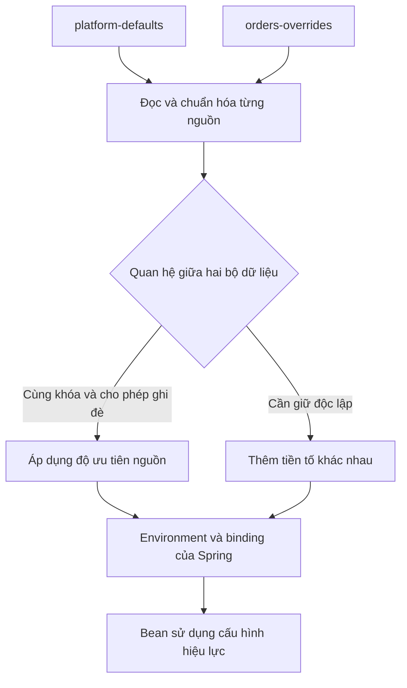

# Hợp nhất nhiều nguồn và xử lý khóa trùng

## 1. Khi một ứng dụng cần nhiều ConfigMap

Một ứng dụng Spring chạy trên Kubernetes thường dùng cấu hình do nhiều nhóm quản lý: giá trị mặc định của nền tảng, thông số riêng của dịch vụ và điều chỉnh theo môi trường triển khai. Nếu sao chép toàn bộ cấu hình chung vào từng ConfigMap của dịch vụ, các bản sao dễ lệch nhau. Nếu nạp tất cả nguồn mà không xác định thứ tự, một thay đổi nhỏ có thể làm khóa quan trọng nhận giá trị ngoài dự kiến.

Trong module `SPRING_CLOUD_KUBERNETES`, bài này thuộc chương **ConfigMap** và tập trung vào việc đưa nhiều nguồn vào cùng cấu hình Spring. Mục tiêu là xác định rõ khóa nào được kế thừa, khóa nào được ghi đè có chủ đích và khóa nào phải được tách bằng tiền tố.

Ví dụ xuyên suốt là `orders-service`, dùng hai ConfigMap:

- `platform-defaults`: cấu hình chung do nhóm nền tảng quản lý.
- `orders-overrides`: các điều chỉnh dành cho dịch vụ đặt hàng.

Ví dụ dùng Spring Boot 3.2 và Spring Cloud Kubernetes 3.1 để giới hạn phạm vi cú pháp và hành vi minh họa. Khi áp dụng, dùng release train/BOM tương thích với Spring Boot của dự án và đối chiếu tài liệu của đúng nhánh thư viện. Các kết quả trong bài là kỳ vọng của dữ liệu thực hành, cần được xác nhận trong ứng dụng chạy thật.

## 2. Hợp nhất ở tầng cấu hình ứng dụng

Hợp nhất nguồn không có nghĩa tạo một ConfigMap Kubernetes mới hoặc sửa dữ liệu của các đối tượng gốc. Ứng dụng đọc các nguồn, biểu diễn chúng thành thuộc tính và đưa vào cơ chế tra cứu của Spring.

Có hai trường hợp cần phân biệt:

| Ý định | Cách tổ chức phù hợp | Ví dụ |
| --- | --- | --- |
| Nguồn sau điều chỉnh nguồn trước | Cùng không gian tên thuộc tính, thứ tự được xác định | Dịch vụ ghi đè `checkout.retries` của cấu hình chung |
| Hai bộ cấu hình cần tồn tại độc lập | Tiền tố khác nhau | Giữ cả `shared.checkout.retries` và `service.checkout.retries` |

Ở trường hợp ghi đè, một khóa có thể xuất hiện trong nhiều nguồn nhưng lần tra cứu lấy giá trị của nguồn ưu tiên cao hơn. Các khóa không trùng vẫn có thể cùng đóng góp vào cấu hình hiệu lực.

Ở trường hợp độc lập, tiền tố làm thay đổi tên đầy đủ của thuộc tính. Sau khi tách bằng tiền tố, hai khóa không còn tranh nhau trong cùng một phép tra cứu.



Đừng đồng nhất cơ chế này với thứ tự áp dụng manifest vào cluster, thời gian tạo ConfigMap hoặc thứ tự tên được hiển thị bởi `kubectl get configmaps`.

## 3. Ví dụ cơ sở với hai ConfigMap có khóa trùng

### 3.1. Dữ liệu chung

Namespace thực hành `config-lab` đã tồn tại. ConfigMap thứ nhất:

```yaml
apiVersion: v1
kind: ConfigMap
metadata:
  name: platform-defaults
  namespace: config-lab
data:
  application.yaml: |-
    checkout:
      currency: VND
      retries: 2
      timeout: 2s
    feature:
      audit: true
```

ConfigMap thứ hai:

```yaml
apiVersion: v1
kind: ConfigMap
metadata:
  name: orders-overrides
  namespace: config-lab
data:
  application.yaml: |-
    checkout:
      retries: 5
      timeout: 3s
    feature:
      express: true
```

Hai khóa trùng là `checkout.retries` và `checkout.timeout`. Nguồn riêng không định nghĩa lại `checkout.currency`; đó là chủ ý kế thừa giá trị chung.

`application.yaml` trong mỗi đối tượng là khóa của trường `data`, chứa tài liệu cấu hình. Nó khác với tệp cấu hình đóng gói bên trong JAR.

### 3.2. Dependency và điều kiện truy cập

Ứng dụng cần starter cấu hình đúng với Kubernetes client đã chọn. Với Kubernetes Java Client:

```xml
<dependency>
    <groupId>org.springframework.cloud</groupId>
    <artifactId>spring-cloud-starter-kubernetes-client-config</artifactId>
</dependency>
```

Nếu dự án chọn Fabric8, dùng `spring-cloud-starter-kubernetes-fabric8-config` thay thế. Không ghép hai họ client; danh mục chính thức mô tả các starter và phạm vi tính năng tại [Spring Cloud Kubernetes starters](https://docs.spring.io/spring-cloud-kubernetes/reference/3.1/getting-started.html).

ServiceAccount của Pod phải có quyền đọc các nguồn thực sự được chọn trong namespace tương ứng, thông qua Role/RoleBinding hoặc cơ chế phân quyền phù hợp. Phạm vi đọc được cấu hình trong `sources` không tự tạo hoặc thu hẹp quyền RBAC của tài khoản đó.

### 3.3. Khai báo thứ tự nguồn

Cấu hình `application.yml` của ứng dụng:

```yaml
spring:
  application:
    name: orders-service
  config:
    import: "kubernetes:"
  cloud:
    kubernetes:
      config:
        enabled: true
        namespace: config-lab
        useNameAsPrefix: false
        includeProfileSpecificSources: false
        fail-fast: true
        sources:
          - name: platform-defaults
          - name: orders-overrides
      secrets:
        enabled: false

checkout:
  retries: 1
```

Đây là phương án Config Data; không đồng thời bật cơ chế bootstrap. Với nhánh 3.1, chọn các nguồn bằng `spring.cloud.kubernetes.config.sources`, thay vì tự ghép danh sách tên ConfigMap vào chuỗi `"kubernetes:"`. Xem [Kubernetes PropertySource](https://docs.spring.io/spring-cloud-kubernetes/reference/3.1/property-source-config.html).

Các thiết lập giúp phép thử rõ ràng:

- Hai nguồn được chỉ định bằng tên, trong cùng namespace.
- Không thêm tiền tố, để các khóa trùng có thể ghi đè nhau.
- Tắt tìm ConfigMap bổ sung theo profile trong lượt cơ sở.
- Tắt nguồn Secret để không có một nhóm nguồn khác tham gia phép thử.
- Giá trị local `checkout.retries=1` giúp phân biệt cấu hình đóng gói với cấu hình import.

## 4. Thứ tự trong sources quyết định gì?

### 4.1. Nguồn sau ưu tiên hơn với khóa trùng

Trong phạm vi các nguồn ConfigMap được khai báo như ví dụ, nguồn đứng sau có ưu tiên cao hơn nguồn đứng trước khi cùng cung cấp một khóa. Có thể đối chiếu cách xây dựng nguồn tổng hợp và thao tác thêm nguồn vào đầu chuỗi trong [ConfigMapPropertySourceLocator của nhánh 3.1.6](https://github.com/spring-cloud/spring-cloud-kubernetes/blob/v3.1.6/spring-cloud-kubernetes-commons/src/main/java/org/springframework/cloud/kubernetes/commons/config/ConfigMapPropertySourceLocator.java).

Với thứ tự `platform-defaults` rồi `orders-overrides`, kết quả kỳ vọng ở lượt cơ sở:

| Khóa | Nguồn chung | Nguồn riêng | Giá trị hiệu lực dự kiến |
| --- | --- | --- | --- |
| `checkout.currency` | `VND` | Không định nghĩa | `VND` |
| `checkout.retries` | `2` | `5` | `5` |
| `checkout.timeout` | `2s` | `3s` | `3s` |
| `feature.audit` | `true` | Không định nghĩa | `true` |
| `feature.express` | Không định nghĩa | `true` | `true` |

Điều chỉnh `checkout.retries` không làm mất toàn bộ nhóm `checkout` của nguồn chung. Với các khóa vô hướng trong ví dụ, những đường dẫn không bị nguồn ưu tiên cao hơn định nghĩa lại vẫn có thể được tra cứu từ nguồn thấp hơn.

### 4.2. Đảo thứ tự để chứng minh chính sách ghi đè

Chỉ đổi danh sách thành:

```yaml
sources:
  - name: orders-overrides
  - name: platform-defaults
```

Đoạn này thay thế đúng danh sách `spring.cloud.kubernetes.config.sources`, không phải một khóa `sources` mới ở cấp gốc.

Khi khởi động một Pod mới bằng cấu hình đã đổi, `checkout.retries` dự kiến thành `2`, `checkout.timeout` thành `2s`. Khóa `feature.express` vẫn có thể giữ `true` vì nguồn chung không định nghĩa khóa đó.

Phép thử này cho thấy “nguồn sau thắng” áp dụng theo khóa. Nó không có nghĩa bỏ toàn bộ dữ liệu của nguồn trước.

### 4.3. Xem thứ tự như một phần của hợp đồng cấu hình

Nếu quy ước là “dịch vụ có quyền điều chỉnh mặc định nền tảng”, thứ tự nguồn cần được xem xét trong thay đổi triển khai như một thay đổi hành vi. Sắp xếp tên nguồn theo bảng chữ cái chỉ để danh sách trông đẹp có thể làm đảo chính sách ghi đè.

Một cách ghi nhận hợp đồng:

| Nguồn | Vai trò | Khóa được phép điều chỉnh |
| --- | --- | --- |
| `platform-defaults` | Giá trị chung cho nhiều dịch vụ | Cấu hình mặc định đã thống nhất |
| `orders-overrides` | Điều chỉnh của dịch vụ đặt hàng | Chẳng hạn `checkout.retries`, `checkout.timeout` |
| Biến môi trường triển khai | Điều chỉnh có lý do ở lần triển khai cụ thể | Một danh sách khóa được nhóm vận hành quản lý |

Danh sách được phép ghi đè là quy ước của hệ thống, không phải chức năng tự kiểm soát do `sources` cung cấp.

## 5. Ba tầng ưu tiên cần kiểm tra riêng

### 5.1. Tầng dữ liệu bên trong một ConfigMap

Một ConfigMap có thể vừa chứa tài liệu YAML/properties, vừa chứa các cặp khóa riêng lẻ. Với cách xử lý được mô tả trong nhánh 3.1, các cặp khóa riêng lẻ có thể ghi đè giá trị từ tài liệu cùng nguồn; dữ liệu theo profile còn có quy tắc riêng. Xem [cách xử lý dữ liệu ConfigMap](https://docs.spring.io/spring-cloud-kubernetes/reference/3.1/property-source-config/configmap-propertysource.html).

Ví dụ thay ConfigMap chung bằng:

```yaml
apiVersion: v1
kind: ConfigMap
metadata:
  name: platform-defaults
  namespace: config-lab
data:
  application.yaml: |-
    checkout:
      currency: VND
      retries: 2
      timeout: 2s
    feature:
      audit: true
  checkout.retries: "6"
```

Ở bên trong nguồn chung, ứng viên cho `checkout.retries` lúc này là `6`. Nhưng nếu nguồn riêng vẫn đứng sau và cung cấp `5`, giá trị hiệu lực giữa hai nguồn vẫn dự kiến là `5`.

| Bước xét | Giá trị cần phân biệt |
| --- | --- |
| Xử lý nội bộ `platform-defaults` | `checkout.retries=6` |
| Xử lý `orders-overrides` | `checkout.retries=5` |
| Chọn giữa hai nguồn theo thứ tự cơ sở | `checkout.retries=5` |

Do đó, quy tắc của một nguồn không tự trở thành quy tắc của toàn bộ môi trường.

### 5.2. Tầng các nguồn ConfigMap

Đây là quan hệ đang được điều khiển bằng danh sách `sources`: nguồn chung trước, nguồn riêng sau. Để giải thích một kết quả, cần ghi nhận cả danh tính nguồn lẫn danh sách có thứ tự mà ứng dụng thực sự dùng.

Nếu source có namespace riêng, danh tính của nó bao gồm cả tên và namespace. Không chỉ ghi “đã đọc orders-overrides” khi cùng tên có thể tồn tại ở nhiều namespace.

### 5.3. Tầng toàn bộ Environment

Các nguồn ConfigMap chỉ là một phần của `Environment`. Trong cơ chế Config Data thông thường của Spring Boot, biến môi trường và đối số dòng lệnh có thể ghi đè giá trị từ Config Data. Xem [thứ tự nguồn cấu hình Spring Boot](https://docs.spring.io/spring-boot/docs/3.2.12/reference/html/features.html#features.external-config).

Ví dụ thêm biến môi trường vào container rồi tạo Pod mới:

```yaml
- name: CHECKOUT_RETRIES
  value: "9"
```

Với cấu hình cơ sở không tiền tố, `checkout.retries` lúc này dự kiến là `9`, dù thứ tự hai ConfigMap vẫn đúng. Không sửa thứ tự `sources` để xử lý một override thực sự đến từ môi trường container.

Cũng không mở rộng quy tắc “nguồn sau thắng” thành một bảng ưu tiên chung cho mọi đường bootstrap cũ, nguồn tùy biến hoặc nhóm dữ liệu khác.

## 6. Dùng tiền tố khi cần giữ nhiều bộ giá trị

### 6.1. Tiền tố theo tên ConfigMap

Thay nhánh `config` trong cấu hình ứng dụng bằng:

```yaml
config:
  enabled: true
  namespace: config-lab
  useNameAsPrefix: true
  includeProfileSpecificSources: false
  fail-fast: true
  sources:
    - name: platform-defaults
    - name: orders-overrides
```

Đoạn này nằm dưới `spring.cloud.kubernetes`; vẫn giữ import Kubernetes và thiết lập Secret của ví dụ. Sử dụng lại hai ConfigMap ban đầu, chưa thêm khóa trực tiếp `checkout.retries: "6"` ở phần 5.

Các khóa liên quan trở thành:

```text
platform-defaults.checkout.currency = VND
platform-defaults.checkout.retries = 2
platform-defaults.checkout.timeout = 2s
orders-overrides.checkout.retries = 5
orders-overrides.checkout.timeout = 3s
```

Hai giá trị retries cùng tồn tại vì tên đầy đủ đã khác nhau. Riêng `checkout.retries` không còn được hai ConfigMap này cung cấp dưới tên không tiền tố; nếu vẫn giữ local `checkout.retries=1`, lần tra cứu khóa không tiền tố có thể chỉ thấy giá trị local đó.

Đây là lý do bật tiền tố xong mà bean cũ nhận giá trị dự phòng chưa chắc là lỗi đọc ConfigMap. Bean có thể vẫn đang hỏi tên thuộc tính trước khi đổi tiền tố.

### 6.2. Tiền tố tường minh để ổn định tên thuộc tính

Nếu không muốn tên ConfigMap Kubernetes trở thành một phần của hợp đồng cấu hình ứng dụng, đặt tiền tố riêng cho từng source:

```yaml
config:
  enabled: true
  namespace: config-lab
  useNameAsPrefix: true
  includeProfileSpecificSources: false
  fail-fast: true
  sources:
    - name: platform-defaults
      explicitPrefix: shared
    - name: orders-overrides
      explicitPrefix: service
```

Kết quả kỳ vọng:

```text
shared.checkout.currency = VND
shared.checkout.retries = 2
shared.checkout.timeout = 2s
service.checkout.retries = 5
service.checkout.timeout = 3s
```

Trong nhánh 3.1, `explicitPrefix` được khai báo ở mức từng source và ưu tiên hơn `useNameAsPrefix`; thiết lập `useNameAsPrefix` tại source cũng có thể ghi đè mặc định chung. Cú pháp và các ví dụ chính thức được mô tả trong [ConfigMap PropertySource: tiền tố nguồn](https://docs.spring.io/spring-cloud-kubernetes/reference/3.1/property-source-config/configmap-propertysource.html).

Ví dụ đổi tên tài nguyên sang `orders-runtime-v2` nhưng vẫn dùng `explicitPrefix: service` cho phép giữ tên thuộc tính `service.checkout.retries`. Tuy vậy, việc đổi tên nguồn vẫn cần được triển khai và phân quyền đúng.

### 6.3. Tiền tố không tạo kế thừa giữa hai bộ cấu hình

Trong ví dụ tách tiền tố, không có `service.checkout.currency` vì nguồn riêng không định nghĩa currency. Spring không tự hiểu rằng thiếu khóa này thì phải tìm `shared.checkout.currency`.

Nếu nghiệp vụ cần một cấu hình checkout cuối cùng với giá trị mặc định và phần điều chỉnh, hãy dùng phương án cùng không gian tên có ghi đè. Nếu nghiệp vụ thật sự cần hai bộ cấu hình riêng, đăng ký các lớp binding hoặc phép đọc tương ứng với hai tiền tố.

Không bật tiền tố chỉ để “hết cảnh báo trùng khóa” rồi giữ nguyên mọi consumer. Thay đổi tên thuộc tính cần đi cùng thay đổi điểm sử dụng.

### 6.4. Kết hợp mặc định chung với ngoại lệ từng source

Ví dụ:

```yaml
config:
  namespace: config-lab
  useNameAsPrefix: true
  includeProfileSpecificSources: false
  sources:
    - name: platform-defaults
      useNameAsPrefix: false
    - name: orders-overrides
      explicitPrefix: service
```

Khi ghép đúng nhánh cấu hình, nguồn chung cung cấp khóa không tiền tố như `checkout.retries=2`; nguồn riêng cung cấp `service.checkout.retries=5`. Hai giá trị không còn ghi đè nhau.

Cũng cần tránh đặt cùng `explicitPrefix` cho hai bộ muốn độc lập. Nếu cả hai cùng dùng `explicitPrefix: service`, khóa `service.checkout.retries` vẫn trùng và lại cần quy tắc độ ưu tiên.

Nếu hai ConfigMap cùng tên nằm ở hai namespace khác nhau, tiền tố theo tên có thể vẫn giống nhau. Dùng tiền tố tường minh khác nhau nếu cần phân biệt cả hai bộ trong cùng ứng dụng.

## 7. Khóa vô hướng, Map và List không nên được hiểu giống nhau

Với các thuộc tính vô hướng như `checkout.retries`, bảng ở phần 4 cho thấy rõ giá trị theo từng khóa. Khi bind thành cấu trúc phức tạp, cần xem quy tắc của Spring Boot Binder, không chỉ hình dung hai tài liệu YAML được nối vào nhau.

Giả sử bổ sung dữ liệu dưới cùng nhánh `checkout` của hai ConfigMap ban đầu, vẫn dùng phương án không tiền tố.

Phần bổ sung trong nguồn chung:

```yaml
labels:
  region: apac
  owner: platform
methods:
  - CARD
  - BANK
```

Phần bổ sung trong nguồn riêng:

```yaml
labels:
  owner: orders
  tier: gold
methods:
  - COD
```

Các đoạn này nằm bên trong `checkout`; khi ghép vào tài liệu, giữ một mapping `checkout` duy nhất. Với binding phù hợp:

```java
package example.orders;

import java.time.Duration;
import java.util.List;
import java.util.Map;
import org.springframework.boot.context.properties.ConfigurationProperties;

@ConfigurationProperties(prefix = "checkout")
public record CheckoutProperties(
    String currency,
    int retries,
    Duration timeout,
    Map<String, String> labels,
    List<String> methods
) {
}
```

Đăng ký kiểu trên bằng `@ConfigurationPropertiesScan` hoặc `@EnableConfigurationProperties(CheckoutProperties.class)` trong ứng dụng. Trong các nguồn riêng biệt với độ ưu tiên như ví dụ, kỳ vọng đối tượng sau binding có:

```text
labels.region = apac
labels.owner = orders
labels.tier = gold
methods = [COD]
```

Đối với `Map`, các phần tử có thể được lấy từ nhiều nguồn và khóa trùng chịu độ ưu tiên. Đối với `List`, cấu hình ưu tiên cao thay thế danh sách, không tự nối `[COD]` vào `[CARD, BANK]`. Xem [Spring Boot: Merging Complex Types](https://docs.spring.io/spring-boot/docs/3.2.12/reference/html/features.html#features.external-config.typesafe-configuration-properties.merging-complex-types).

Khi xác minh danh sách, kiểm tra đối tượng đã bind. Việc lần lượt đọc các khóa phẳng có chỉ số không đủ để kết luận Binder đã ghép danh sách như thế nào. Cũng không áp quy tắc ghép map của ví dụ này cho mọi cấu trúc lồng nhau hoặc bộ tiền xử lý tùy biến.

Nếu cần danh sách cuối cùng gồm `CARD`, `BANK`, `COD`, khai báo đầy đủ danh sách mong muốn ở nguồn ghi đè hoặc thiết kế logic kết hợp rõ ràng trong ứng dụng.

## 8. Các nguồn bổ sung có thể làm thay đổi kết quả

### 8.1. Nguồn theo profile

Theo cấu hình nhánh 3.1, ứng dụng có thể tìm thêm ConfigMap theo profile, chẳng hạn nguồn `orders-overrides` đi kèm `orders-overrides-prod` khi profile `prod` hoạt động. Ví dụ cơ sở chủ động tắt cơ chế này bằng `includeProfileSpecificSources: false` để kiểm soát tập nguồn.

Khi bật lại trong hệ thống thực tế, ghi nhận đầy đủ profile và các nguồn được đọc. Đừng chỉ nhìn hai dòng trong danh sách `sources` rồi giả định ứng dụng chỉ có đúng hai bộ dữ liệu đầu vào.

Cần phân biệt ConfigMap theo profile với tài liệu hoặc tệp cấu hình theo profile nằm bên trong cùng một ConfigMap. Chúng là các vị trí dữ liệu khác nhau, cần được đối chiếu theo cấu hình đang dùng.

### 8.2. Nguồn ở namespace khác

Ví dụ danh sách:

```yaml
config:
  namespace: config-lab
  sources:
    - name: platform-defaults
    - name: orders-overrides
      namespace: orders-prod
```

Nguồn đầu dùng namespace chung `config-lab`; nguồn thứ hai chỉ định `orders-prod`. Namespace là một phần của danh tính nguồn. Cách xác định namespace và ghi đè từng nguồn được mô tả tại [Namespace resolution](https://docs.spring.io/spring-cloud-kubernetes/reference/3.1/property-source-config/namespace-resolution.html).

ServiceAccount của Pod phải được cấp quyền ở nơi chứa từng nguồn. Chỉ định namespace trong cấu hình không tự cho phép đọc chéo namespace.

Nếu cơ chế lựa chọn nguồn có thể trả về nhiều tài nguyên, không dùng thứ tự trả về của Kubernetes API như một hợp đồng ghi đè nghiệp vụ. Với các nguồn có vai trò khác nhau, ưu tiên biểu diễn rõ danh tính, thứ tự và tiền tố cần thiết.

### 8.3. Nguồn Secret

Ví dụ cơ sở tắt Secret. Nếu mở cả hai nhóm nguồn, không suy rằng “Secret chắc chắn ưu tiên hơn vì nhạy cảm hơn”. Tài liệu Spring Cloud Kubernetes 3.1 nêu ConfigMap có ưu tiên cao hơn Secret khi cùng cung cấp thuộc tính. Xem [Order of ConfigMaps and Secrets](https://docs.spring.io/spring-cloud-kubernetes/reference/3.1/property-source-config/order_of_configMaps_and_secrets.html).

Không cố xử lý quan hệ giữa hai nhóm này bằng cách đảo riêng danh sách ConfigMap. Thiết kế tên khóa và trách nhiệm dữ liệu rõ ràng để cấu hình không nhạy cảm không vô tình che mất thuộc tính dự kiến lấy từ Secret.

Một giá trị bí mật vẫn phải được kiểm tra theo cách tránh xuất nội dung ra log hoặc endpoint chẩn đoán.

## 9. Phân biệt xung đột hợp lệ với dữ liệu đầu vào sai

### 9.1. Trùng giữa nguồn khác nhau

`platform-defaults` và `orders-overrides` cùng định nghĩa `checkout.retries` là xung đột hợp lệ nếu chủ ý cho phép điều chỉnh. Cần có quy tắc nguồn nào thắng và cách kiểm chứng.

### 9.2. Lặp cùng khóa trong một mapping YAML

Đoạn sau là ví dụ không nên viết:

```yaml
checkout:
  retries: 2
  retries: 5
```

Đây là khóa mapping bị lặp trong cùng tài liệu, không phải hai nguồn có độ ưu tiên. YAML yêu cầu khóa mapping duy nhất; parser có thể báo lỗi thay vì thực hiện một chính sách override như mong muốn. Xem [đặc tả YAML 1.2.2](https://yaml.org/spec/1.2.2/).

### 9.3. Giá trị rỗng hoặc null để cố xóa cấu hình

Đừng coi một giá trị rỗng hoặc `null` trong nguồn sau là giao thức xóa phổ quát cho mọi dữ liệu ở nguồn trước. Việc phân tích, tra cứu, chuyển kiểu và binding có thể tạo kết quả khác với kỳ vọng xóa.

Nếu cần tắt tính năng, thiết kế một khóa bật/tắt có ý nghĩa rõ ràng. Nếu cần thay thế cấu trúc danh sách, cung cấp cấu trúc cuối cùng theo quy tắc binding đã chọn. Nếu một giá trị bắt buộc phải có, thêm validation phù hợp ở lớp cấu hình.

### 9.4. Nguồn thiếu hoặc lỗi truy cập

Khi nguồn riêng không đọc được, một số giá trị chung có thể vẫn tạo cảm giác ứng dụng hoạt động bình thường. Ngược lại, validation nghiệp vụ có thể vẫn đạt vì nguồn chung cung cấp giá trị hợp lệ nhưng không đúng cấu hình triển khai mong muốn.

Phân biệt lỗi truy cập nguồn, sự tồn tại của tài nguyên, tính hợp lệ của giá trị và việc nguồn bắt buộc đã tham gia đúng chính sách. Không dùng `fail-fast` như bằng chứng duy nhất cho cả bốn điều kiện.

## 10. Xác minh kết quả trong ứng dụng

### 10.1. Đọc một danh sách khóa đã biết

Đoạn chẩn đoán sau áp dụng cho phương án không tiền tố và các ConfigMap cơ sở. Đặt lớp trong package được ứng dụng quét, rồi bật profile `merge-lab` khi thực hành:

```java
package example.orders;

import java.util.List;
import org.springframework.boot.ApplicationRunner;
import org.springframework.context.annotation.Bean;
import org.springframework.context.annotation.Configuration;
import org.springframework.context.annotation.Profile;
import org.springframework.core.env.ConfigurableEnvironment;

@Configuration(proxyBeanMethods = false)
@Profile("merge-lab")
public class MergeDiagnostics {

    @Bean
    ApplicationRunner reportMergedValues(ConfigurableEnvironment environment) {
        return args -> {
            List<String> keys = List.of(
                "checkout.currency",
                "checkout.retries",
                "checkout.timeout",
                "feature.audit",
                "feature.express"
            );
            for (String key : keys) {
                System.out.printf("%s=%s%n", key,
                    environment.getRequiredProperty(key));
            }
        };
    }
}
```

Đoạn mã chỉ in các khóa không nhạy cảm đã được chọn trước. `getRequiredProperty` tránh dùng fallback để che mất việc thiếu khóa trong lượt thử. Nó không chứng minh giá trị đã đến từ đúng nguồn nếu nhiều nguồn cùng cung cấp giá trị đó.

Kỳ vọng với thứ tự cơ sở và không override từ bên ngoài:

```text
checkout.currency=VND
checkout.retries=5
checkout.timeout=3s
feature.audit=true
feature.express=true
```

Nếu thử tiền tố, đổi danh sách khóa chẩn đoán theo tên đầy đủ tương ứng. Không dùng kết quả của khóa không tiền tố để kết luận nguồn có tiền tố đã nạp hay chưa.

### 10.2. Đối chiếu nguồn đang thắng

Khi Actuator `env` đã được cho phép truy cập trong phạm vi quản trị, có thể hỏi một khóa, chẳng hạn `GET /actuator/env/checkout.retries`. Xem nguồn được chọn và những nguồn khác có ứng viên cho cùng khóa; metadata `origin` có thể có hoặc không tùy nguồn. Tham khảo [Actuator Environment API](https://docs.spring.io/spring-boot/docs/3.2.12/actuator-api/htmlsingle/#env.retrieving-single-property).

Giữ chính sách che dữ liệu và quyền truy cập endpoint của ứng dụng. Không cần xuất toàn bộ Environment để điều tra một khóa.

Khi có nhiều replica, cố định một Pod và ghi lại namespace, UID, image cùng thời điểm đọc. So sánh bằng chứng của cùng tiến trình để tránh nhầm dữ liệu giữa các lần rollout.

### 10.3. Giá trị hiệu lực khác với giá trị bean đang giữ

Sau khi thay đổi nguồn, kiểm tra riêng Environment và đối tượng đã bind. Bean có thể đã nhận giá trị ở thời điểm trước đó hoặc sao chép nó vào trạng thái riêng. Một nguồn mới xuất hiện không tự chứng minh mọi consumer đã nhận dữ liệu mới.

Với List/Map, quan sát đối tượng cấu hình đã bind như phần 7; với thuộc tính vô hướng, đối chiếu giá trị và nguồn đang thắng.

## 11. Cập nhật nhiều nguồn và giữ tính nhất quán

Nếu sửa `platform-defaults` rồi mới sửa `orders-overrides`, hai thay đổi là các cập nhật tài nguyên riêng. Không mặc định một lần nạp lại hoặc refresh sẽ nhìn thấy chúng như một giao dịch nguyên tử.

Ví dụ nguồn chung chuyển sang hợp đồng timeout mới nhưng nguồn riêng vẫn giữ giá trị theo hợp đồng cũ. Mỗi ConfigMap có thể hợp lệ khi xét riêng, trong khi tổ hợp nhất thời không đáp ứng giả định của ứng dụng.

Một quy trình triển khai có thể giảm rủi ro bằng cách:

- Giữ tương thích khi thay đổi mặc định dùng chung.
- Gắn phiên bản hoặc marker không nhạy cảm cho các bộ cấu hình liên quan.
- Kiểm tra tổ hợp trước khi triển khai và xác định cách quay lại cả tập nguồn.
- Khi cần, dùng các tài nguyên có tên theo phiên bản và cập nhật tham chiếu trong một lần rollout được kiểm soát.

Configuration Watcher có thể phát thông báo thay đổi qua HTTP refresh hoặc Spring Cloud Bus theo cấu hình. Cơ chế đó không thay thế việc xác định thứ tự ghi đè, hợp đồng dữ liệu hay khả năng bean cập nhật. Xem [Spring Cloud Kubernetes Configuration Watcher](https://docs.spring.io/spring-cloud-kubernetes/reference/3.1/spring-cloud-kubernetes-configuration-watcher.html).

Trong bài thực hành chỉ xét nạp ban đầu, dùng Pod mới sau mỗi thay đổi để giữ cách kiểm chứng nhất quán. Nếu kiểm tra refresh, theo dõi riêng sự kiện, dữ liệu trong tiến trình và giá trị consumer sử dụng.

## 12. Thực hành theo các thay đổi đơn lẻ

| Lượt | Thay đổi so với dữ liệu cơ sở | Kết quả cần kiểm chứng |
| --- | --- | --- |
| A | Nguồn chung trước, nguồn riêng sau | `checkout.retries=5`, currency vẫn là `VND` |
| B | Chỉ đảo thứ tự hai source | `checkout.retries=2`, `feature.express` vẫn được cung cấp |
| C | Khôi phục thứ tự; thêm `CHECKOUT_RETRIES=9` | Environment chọn `9` từ nguồn bên ngoài ConfigMap |
| D | Bỏ override; thêm khóa trực tiếp `6` trong nguồn chung | Ứng viên nguồn chung là `6`, giá trị cuối vẫn là `5` |
| E | Khôi phục dữ liệu; bật tiền tố theo tên cho cả hai | Hai khóa retries có tiền tố cùng tồn tại |
| F | Dùng `explicitPrefix: shared` và `explicitPrefix: service` | Tên thuộc tính ổn định theo tiền tố tường minh; không tự dự phòng chéo |
| G | Bổ sung Map/List, trở lại phương án không tiền tố | Map giữ phần tử không trùng; List bind theo quy tắc thay thế |

Trước mỗi lượt, khôi phục những điều kiện không thuộc phép thử đó. Ghi lại danh sách nguồn có thứ tự, cờ tiền tố, profile, các override bên ngoài, Pod được quan sát và kết quả thực tế.

Một thay đổi cấu hình nhiều nguồn chỉ dễ kiểm soát khi giải thích được ba điều: tại sao các nguồn cùng tham gia, tại sao một khóa được phép ghi đè và consumer đang hỏi đúng tên thuộc tính nào. Thứ tự nguồn và tiền tố cần phản ánh các quyết định đó một cách rõ ràng.
