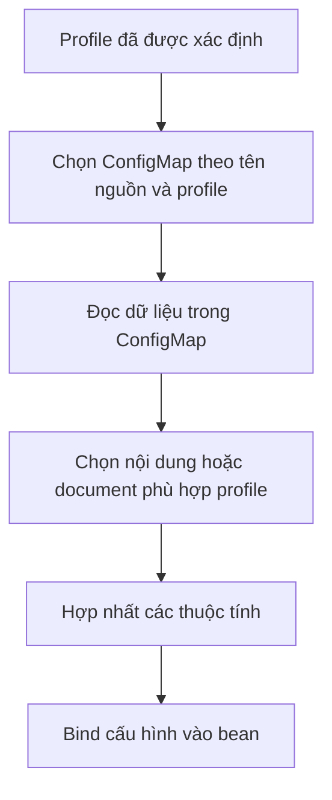

# Profile trong tên tài nguyên và nội dung cấu hình

## Mục tiêu và phạm vi

Trong chương **ConfigMap** của module **SPRING_CLOUD_KUBERNETES**, profile có thể tham gia cả bước chọn tài nguyên Kubernetes lẫn bước chọn nội dung cấu hình bên trong tài nguyên. Hai bước này khác nhau, dù cùng dùng những tên như `dev` hoặc `prod`.

Bài học dùng ứng dụng `billing-service`, đọc nguồn cơ sở `billing-settings` trong namespace `learning`. Ta xây dựng ba thiết kế thay thế: ConfigMap riêng theo profile, các nội dung mang tên profile trong một ConfigMap, và YAML nhiều document có điều kiện profile. Mỗi lần thực hành chỉ dùng một thiết kế để thấy rõ cơ chế tạo ra giá trị cuối cùng.

Ví dụ lấy Spring Cloud Kubernetes 3.3.3 làm mốc hành vi, dùng Config Data qua Kubernetes API. Chọn Spring Boot và Spring Cloud release train tương thích khi triển khai. Bài chỉ cần tính năng ConfigMap; không yêu cầu DiscoveryClient, Spring Cloud LoadBalancer, đọc Secret hay Configuration Watcher để chọn cấu hình theo profile lúc khởi động.

## 1. Phân biệt profile xuất hiện ở đâu

| Vị trí | Ví dụ | Tác động |
| --- | --- | --- |
| Profile của Spring Environment | `SPRING_PROFILES_ACTIVE=prod` | Xác định tập profile đang hoạt động |
| Tên Kubernetes resource | `metadata.name: billing-settings-prod` | Có thể được tìm như nguồn bổ sung cho nguồn cơ sở |
| Tên một khóa chứa nội dung file | `data.billing-service-prod.yaml` | Có thể được chọn khi phân tích dữ liệu trong ConfigMap |
| Điều kiện trong một YAML document | `spring.config.activate.on-profile: prod` | Chỉ lấy document khi biểu thức profile phù hợp |
| Namespace của Kubernetes | `metadata.namespace: learning` | Xác định phạm vi tài nguyên và quyền; không tự kích hoạt profile |

Tên `billing-settings-prod` không tự bật profile `prod`. Ngược lại, bật profile `prod` không tạo ConfigMap mới và không cấp quyền đọc cho ServiceAccount.

Cũng không coi `prod`, `production` và `prd` là ba cách viết tương đương. Tên profile được dùng phải thống nhất giữa cấu hình khởi động, hậu tố tài nguyên và điều kiện document.



Muốn chẩn đoán đúng, phải biết ứng dụng đã đọc resource nào, rồi mới xét các dòng nào trong resource đó tham gia cấu hình.

## 2. Kích hoạt profile trước khi chọn nguồn cấu hình

Cách rõ ràng trong Deployment là truyền profile qua môi trường:

```yaml
env:
  - name: SPRING_PROFILES_ACTIVE
    value: prod
  - name: POD_NAMESPACE
    valueFrom:
      fieldRef:
        fieldPath: metadata.namespace
```

Có thể truyền `--spring.profiles.active=prod` khi chạy ứng dụng. Các cách cung cấp thuộc tính vẫn tuân theo thứ tự ưu tiên của Spring Boot; cần kiểm tra giá trị thực tế thay vì chỉ nhìn một nguồn khai báo. Spring Boot cho phép dùng `spring.profiles.active` trong cấu hình không phụ thuộc profile, nhưng không cho đặt nó trong file hoặc document đã phụ thuộc profile. [Kích hoạt profile trong Spring Boot](https://docs.spring.io/spring-boot/3.5/reference/features/profiles.html).

Trong ví dụ, profile được cung cấp từ Deployment để thông tin chọn nguồn có sẵn lúc import. Không đặt duy nhất `spring.profiles.active=prod` trong ConfigMap `billing-settings-prod` rồi chờ ứng dụng tự tìm ra nguồn đó.

Điều kiện `spring.config.activate.on-profile` cũng không bật profile. Nó chỉ trả lời câu hỏi: document này có nên tham gia khi các profile hiện tại đang hoạt động hay không?

## 3. Cấu hình khởi đầu của ứng dụng

Ví dụ chọn starter Fabric8 cho cấu hình:

```xml
<dependency>
    <groupId>org.springframework.cloud</groupId>
    <artifactId>spring-cloud-starter-kubernetes-fabric8-config</artifactId>
</dependency>
```

Các đoạn Java và readiness bên dưới còn dùng `spring-boot-starter-web`, `spring-boot-starter-validation` và `spring-boot-starter-actuator`. Dependency cần được quản lý bằng bộ version tương thích. Nếu dùng họ Kubernetes Java Client chính thức, thay starter config bằng `spring-cloud-starter-kubernetes-client-config`; chọn một họ client cho ứng dụng. [Các starter Spring Cloud Kubernetes](https://docs.spring.io/spring-cloud-kubernetes/reference/3.3/getting-started.html).

Nội dung `application.yaml` đóng gói cùng ứng dụng:

```yaml
spring:
  application:
    name: billing-service
  config:
    import: "kubernetes:"
  cloud:
    kubernetes:
      config:
        enabled: true
        enable-api: true
        name: billing-settings
        namespace: ${POD_NAMESPACE}
        include-profile-specific-sources: true
        fail-fast: true
      secrets:
        enabled: false
      discovery:
        enabled: false

management:
  endpoints:
    web:
      exposure:
        include: health
  endpoint:
    health:
      probes:
        enabled: true
```

Tên nguồn cơ sở là `billing-settings`, còn tên ứng dụng là `billing-service`. Hai giá trị được tách có chủ đích để thấy resource name và tên nội dung không phải một khái niệm.

`kubernetes:` kích hoạt importer của Spring Cloud Kubernetes; không đưa profile hoặc tên resource vào chuỗi import bằng một ngữ pháp tự chế. Cách Config Data này không được kết hợp với việc nạp Kubernetes PropertySource qua legacy bootstrap. [Cơ chế import Kubernetes](https://docs.spring.io/spring-cloud-kubernetes/reference/3.3/property-source-config.html).

## 4. Thiết kế A: profile trong tên ConfigMap

Tạo nguồn cơ sở và hai biến thể trong namespace `learning`:

```yaml
apiVersion: v1
kind: ConfigMap
metadata:
  name: billing-settings
  namespace: learning
data:
  billing.variant: "resource-base"
  billing.retry-limit: "2"
---
apiVersion: v1
kind: ConfigMap
metadata:
  name: billing-settings-dev
  namespace: learning
data:
  billing.variant: "resource-dev"
  billing.retry-limit: "3"
---
apiVersion: v1
kind: ConfigMap
metadata:
  name: billing-settings-prod
  namespace: learning
data:
  billing.variant: "resource-prod"
  billing.retry-limit: "5"
```

Với nguồn cơ sở và `include-profile-specific-sources: true`, profile đang hoạt động tham gia tạo tên nguồn bổ sung. Tài liệu mô tả thứ tự đọc nguồn cơ sở trước nguồn có hậu tố profile, chẳng hạn `config-map-one` rồi `config-map-one-dev`. [Nguồn ConfigMap có hậu tố profile](https://docs.spring.io/spring-cloud-kubernetes/reference/3.3/property-source-config/configmap-propertysource.html).

Trong bài, không có nguồn ưu tiên cao hơn ghi đè và mỗi lượt chỉ bật một profile:

| Profile đang hoạt động | Các nguồn của thiết kế A | `billing.variant` | `billing.retry-limit` |
| --- | --- | --- | --- |
| `dev` | `billing-settings`, `billing-settings-dev` | `resource-dev` | `3` |
| `prod` | `billing-settings`, `billing-settings-prod` | `resource-prod` | `5` |

Việc hợp nhất diễn ra theo từng thuộc tính. Nguồn theo profile không phải yêu cầu thay toàn bộ nội dung nguồn cơ sở; một thuộc tính chỉ có ở nguồn cơ sở vẫn có thể được giữ.

Không đặt `config.name: billing-settings-prod` chỉ để bật production. Khi tên đã có hậu tố nhưng cơ chế tìm nguồn theo profile vẫn bật, ứng dụng còn có thể tìm thêm tên như `billing-settings-prod-prod`. Hãy cấu hình đúng tên cơ sở hoặc dùng nguồn tường minh với chủ đích rõ ràng.

### Tắt việc tìm thêm resource theo profile

Thuộc tính `spring.cloud.kubernetes.config.include-profile-specific-sources` có giá trị mặc định `true` trong nhánh minh họa. [Danh sách thuộc tính cấu hình](https://docs.spring.io/spring-cloud-kubernetes/reference/3.3/appendix.html).

Có thể thay phần `config` dưới `spring.cloud.kubernetes` bằng:

```yaml
config:
  enabled: true
  enable-api: true
  namespace: ${POD_NAMESPACE}
  fail-fast: true
  include-profile-specific-sources: false
  sources:
    - name: billing-settings
      include-profile-specific-sources: false
```

Khai báo ở từng phần tử `sources` có thể ghi đè lựa chọn chung. Với ví dụ trên, bật `prod` vẫn giữ profile `prod` trong Environment, nhưng không tự thêm `billing-settings-prod` vào các resource được tìm từ nguồn cơ sở.

Cờ này không phải bộ lọc bảo mật. Nếu chủ động liệt kê `billing-settings-prod` như một nguồn, tên resource đó không tự trở thành điều kiện chỉ đọc khi profile `prod` hoạt động.

## 5. Thiết kế B: profile trong tên nội dung nhúng

Đây là phương án thay thế thiết kế A. Đặt `include-profile-specific-sources: false` để ngăn các ConfigMap hậu tố từ lượt thực hành trước tham gia. Chỉ đọc một resource `billing-settings`, có dữ liệu:

```yaml
apiVersion: v1
kind: ConfigMap
metadata:
  name: billing-settings
  namespace: learning
data:
  billing-service.yaml: |-
    billing:
      variant: file-base
      retry-limit: 2
  billing-service-dev.yaml: |-
    billing:
      variant: file-dev
      retry-limit: 3
  billing-service-prod.properties: |-
    billing.variant=file-prod
    billing.retry-limit=5
```

Ở đây không có resource `billing-service-prod.properties`. Đó là một khóa trong `data`, mang chuỗi nội dung cấu hình. Kubernetes chỉ thấy một ConfigMap; Spring Cloud Kubernetes mới thực hiện bước chọn nội dung phù hợp.

Với `spring.application.name=billing-service`, các tên nội dung cơ sở và theo profile khớp tên ứng dụng. Bộ xử lý sắp xếp nội dung cơ sở trước nội dung theo các profile hoạt động; các thuộc tính đơn lẻ có thể được xử lý sau đó. Đây là hành vi thể hiện trong bộ xử lý dữ liệu của bản 3.3.3. [Bộ chọn các mục dữ liệu theo tên và profile](https://github.com/spring-cloud/spring-cloud-kubernetes/blob/v3.3.3/spring-cloud-kubernetes-commons/src/main/java/org/springframework/cloud/kubernetes/commons/config/SourceDataEntriesProcessor.java).

Kết quả dự kiến, khi chỉ bật một profile và không có ghi đè bên ngoài:

| Profile | Resource đọc | Nội dung được chọn | Kết quả variant/retry-limit |
| --- | --- | --- | --- |
| `dev` | `billing-settings` | `billing-service.yaml` và `billing-service-dev.yaml` | `file-dev` / `3` |
| `prod` | `billing-settings` | `billing-service.yaml` và `billing-service-prod.properties` | `file-prod` / `5` |

Việc đặt `include-profile-specific-sources: false` không vô hiệu hóa việc chọn nội dung theo profile bên trong resource đã đọc. Nó tác động đến bước tìm thêm ConfigMap ở thiết kế A.

### Không dùng trường hợp một khóa làm bằng chứng lọc profile

ConfigMap chỉ có một khóa mang tên file YAML/properties được xử lý theo một nhánh đặc biệt: bộ đọc có thể phân tích nội dung mà không quan tâm tên file. Vì thế, một khóa duy nhất tên `billing-service-prod.yaml` không phải cách đáng tin cậy để ngăn dữ liệu áp dụng khi profile khác hoạt động.

Nếu ý định là chọn theo tên nội dung, dùng cấu trúc nhiều mục được nhận diện rõ như ví dụ trên. Nếu ý định là đặt điều kiện ngay trong nội dung, dùng YAML document ở thiết kế C.

## 6. Thiết kế C: điều kiện profile trong YAML document

Tiếp tục chỉ đọc resource `billing-settings` và tắt tìm resource hậu tố. Thay toàn bộ `data` của thiết kế B bằng một nội dung YAML:

```yaml
apiVersion: v1
kind: ConfigMap
metadata:
  name: billing-settings
  namespace: learning
data:
  application.yaml: |-
    billing:
      variant: document-base
      retry-limit: 2
    ---
    spring:
      config:
        activate:
          on-profile: dev
    billing:
      variant: document-dev
      retry-limit: 3
    ---
    spring:
      config:
        activate:
          on-profile: prod
    billing:
      variant: document-prod
      retry-limit: 5
```

Các dấu `---` ở đây nằm **bên trong chuỗi** `data.application.yaml`, vì vậy chúng chia các document cấu hình ứng dụng. Chúng khác dấu `---` nằm ngang cấp `apiVersion` ở thiết kế A, vốn phân tách các Kubernetes resource trong một manifest.

Document đầu không có điều kiện profile nên cung cấp cấu hình chung. Document `dev` hoặc `prod` chỉ đóng góp khi điều kiện phù hợp. Trong mã nguồn 3.3.3, bộ phân tích YAML ưu tiên `spring.config.activate.on-profile` và kiểm tra biểu thức với profile của Environment. [Bộ xử lý điều kiện trong YAML nhúng](https://github.com/spring-cloud/spring-cloud-kubernetes/blob/v3.3.3/spring-cloud-kubernetes-commons/src/main/java/org/springframework/cloud/kubernetes/commons/config/PropertySourceUtils.java).

| Profile hoạt động | Document tham gia | Kết quả variant/retry-limit |
| --- | --- | --- |
| `dev` | Chung và `dev` | `document-dev` / `3` |
| `prod` | Chung và `prod` | `document-prod` / `5` |
| Không bật `dev` hay `prod` | Chung | `document-base` / `2` |

Một điều kiện có thể là biểu thức, chẳng hạn `"prod & observability"`; khi đó cả hai profile phải phù hợp. Không coi việc ứng dụng chạy trong Kubernetes là bằng chứng một profile tên `kubernetes` hoặc `k8s` đã tự được bật.

### Không đặt thuộc tính kích hoạt bên trong document có điều kiện

Ví dụ sau không phải cách tự bật thêm profile cho một document đã phụ thuộc profile:

```yaml
spring:
  config:
    activate:
      on-profile: prod
  profiles:
    active: observability
```

Đặt tập profile hoặc nhóm profile trong cấu hình khởi đầu không phụ thuộc profile, hay truyền từ môi trường triển khai. Điều này giữ quy trình chọn nguồn và chọn document có đầu vào rõ ràng.

Các ví dụ cũ có thể dùng `spring.profiles: prod` để chọn document. Spring Boot hướng dẫn chuyển điều kiện document sang `spring.config.activate.on-profile`; không thay nhầm nó thành `spring.profiles.active` vì hai thuộc tính có mục đích khác nhau. [Hướng dẫn chuyển đổi Config Data của Spring Boot](https://github.com/spring-projects/spring-boot/wiki/Spring-Boot-Config-Data-Migration-Guide).

### Giới hạn khi dùng properties nhúng

Không tự thay YAML nhiều document bằng một chuỗi `application.properties` có `#---` rồi cho rằng mọi loader đều tách document giống Spring Boot đọc file local. Với đường API ở bản minh họa, nội dung properties đi qua bộ đọc `Properties`; `#---` không tự trở thành cơ chế chọn document theo profile. Khi cần properties theo profile, dùng các khóa có tên riêng như thiết kế B, hoặc dùng các resource riêng như thiết kế A.

## 7. Khi có nhiều profile hoặc trộn nhiều cách tổ chức

Nếu cả `dev` và `prod` hoạt động, thiết kế C có cả hai document phù hợp. Với cùng một khóa, document phù hợp xuất hiện sau trong YAML có thể ghi đè document trước. Trong ví dụ đã viết, document `prod` ở cuối nên cung cấp `document-prod` và `5`.

Không dùng kết luận này để suy ra rằng profile đứng sau dấu phẩy luôn thắng trong mọi cơ chế. Thứ tự document, thứ tự nguồn và bước hợp nhất nội dung là các lớp khác nhau. Một tổ hợp `prod,observability` thường dễ quản lý hơn `dev,prod` nếu mỗi profile phụ trách nhóm cấu hình rõ ràng và tránh xung đột ngoài chủ đích.

Cũng có thể phối hợp hậu tố resource với document bên trong, nhưng dữ liệu chỉ có hiệu lực khi vượt qua cả hai bước chọn. Ví dụ:

```yaml
apiVersion: v1
kind: ConfigMap
metadata:
  name: billing-settings-prod
  namespace: learning
data:
  application.yaml: |-
    spring:
      config:
        activate:
          on-profile: dev
    billing:
      variant: conflicting-selection
      retry-limit: 9
```

Với profile `prod`, tên resource có thể được tìm thấy, nhưng document lại chỉ dành cho `dev`. Không được kết luận cứ đọc được resource `*-prod` thì mọi dữ liệu bên trong đều có hiệu lực cho production.

Ngoài ra, một khóa đơn lẻ như `billing.retry-limit: "8"` đặt cạnh các nội dung nhúng có thể tiếp tục thay đổi kết quả hợp nhất. Biến môi trường hoặc tham số dòng lệnh còn có thể ghi đè giá trị từ Config Data theo thứ tự ưu tiên của Spring Boot. Khi điều tra, cần xem giá trị cuối cùng và nguồn gốc, không chỉ mở một document. [Thứ tự các nguồn cấu hình Spring Boot](https://docs.spring.io/spring-boot/3.5/reference/features/external-config.html).

## 8. Chuẩn bị quyền và Deployment thử nghiệm

Namespace `learning` cần tồn tại trước. Ví dụ dưới đây dành cho cluster học tập; thay image mẫu bằng image đã chứa ứng dụng và các dependency tương ứng:

```yaml
apiVersion: v1
kind: ServiceAccount
metadata:
  name: billing-config-reader
  namespace: learning
---
apiVersion: rbac.authorization.k8s.io/v1
kind: Role
metadata:
  name: billing-config-reader
  namespace: learning
rules:
  - apiGroups: [""]
    resources: ["configmaps"]
    verbs: ["get", "list"]
---
apiVersion: rbac.authorization.k8s.io/v1
kind: RoleBinding
metadata:
  name: billing-config-reader
  namespace: learning
subjects:
  - kind: ServiceAccount
    name: billing-config-reader
    namespace: learning
roleRef:
  apiGroup: rbac.authorization.k8s.io
  kind: Role
  name: billing-config-reader
---
apiVersion: apps/v1
kind: Deployment
metadata:
  name: billing-service
  namespace: learning
spec:
  replicas: 1
  selector:
    matchLabels:
      app: billing-service
  template:
    metadata:
      labels:
        app: billing-service
    spec:
      serviceAccountName: billing-config-reader
      containers:
        - name: app
          image: YOUR_REGISTRY/billing-service:demo
          ports:
            - name: http
              containerPort: 8080
          env:
            - name: SPRING_PROFILES_ACTIVE
              value: prod
            - name: POD_NAMESPACE
              valueFrom:
                fieldRef:
                  fieldPath: metadata.namespace
          readinessProbe:
            httpGet:
              path: /actuator/health/readiness
              port: http
```

Role cho phép `get` và `list` ConfigMap trong namespace học tập; `list` không giới hạn riêng một tên. Nếu chính sách dùng danh sách `resourceNames`, cần xét đủ các tên cơ sở/hậu tố và hành vi request thực tế của client. Ví dụ chưa theo dõi thay đổi nên không cấp `watch` hoặc quyền đọc Secret. [Quyền Kubernetes API cho Spring Cloud Kubernetes](https://docs.spring.io/spring-cloud-kubernetes/reference/security-service-accounts.html).

Profile là cơ chế lựa chọn cấu hình, không phải ranh giới cách ly quyền. Tách namespace, ServiceAccount và chính sách truy cập là quyết định triển khai riêng khi cần cách ly các môi trường.

## 9. Quan sát profile và cấu hình mà ứng dụng đã bind

Ứng dụng minh họa trên Java 17 trở lên:

```java
package com.example.billing;

import java.util.Map;

import jakarta.validation.constraints.Min;
import jakarta.validation.constraints.NotBlank;

import org.springframework.boot.SpringApplication;
import org.springframework.boot.autoconfigure.SpringBootApplication;
import org.springframework.boot.context.properties.ConfigurationProperties;
import org.springframework.boot.context.properties.EnableConfigurationProperties;
import org.springframework.core.env.Environment;
import org.springframework.validation.annotation.Validated;
import org.springframework.web.bind.annotation.GetMapping;
import org.springframework.web.bind.annotation.RestController;

@SpringBootApplication
@RestController
@EnableConfigurationProperties(BillingApplication.BillingSettings.class)
public class BillingApplication {

    private final BillingSettings settings;
    private final Environment environment;

    public BillingApplication(BillingSettings settings, Environment environment) {
        this.settings = settings;
        this.environment = environment;
    }

    public static void main(String[] args) {
        SpringApplication.run(BillingApplication.class, args);
    }

    @GetMapping("/billing-settings")
    public Map<String, Object> billingSettings() {
        return Map.of(
                "activeProfiles", environment.getActiveProfiles(),
                "variant", settings.variant(),
                "retryLimit", settings.retryLimit());
    }

    @Validated
    @ConfigurationProperties(prefix = "billing")
    public record BillingSettings(
            @NotBlank String variant,
            @Min(1) int retryLimit) {
    }
}
```

Với thiết kế A và profile `prod`, phản hồi mong đợi khi không có ghi đè khác:

```json
{
  "activeProfiles": ["prod"],
  "variant": "resource-prod",
  "retryLimit": 5
}
```

Với thiết kế B, variant cần là `file-prod`; với thiết kế C, cần là `document-prod`. Trường `variant` chỉ là giá trị không nhạy cảm để quan sát bài tập, không phải phép chứng thực rằng một nguồn cụ thể đã được đọc.

Validation kiểm tra cấu hình cuối cùng sau hợp nhất. Nó không bảo đảm rằng mọi resource mong đợi đều tồn tại hoặc profile thực tế khớp chính sách triển khai. Nếu nguồn cơ sở vẫn cung cấp giá trị hợp lệ, ứng dụng có thể chạy với cấu hình cơ sở khi nguồn theo profile bị thiếu; cần đối chiếu kết quả mong đợi riêng.

## 10. Thực hành đối chiếu trong cluster

Các lệnh sau dành cho người học sau khi đã chuẩn bị image, áp dụng một thiết kế dữ liệu và triển khai ứng dụng.

Kiểm tra danh sách tài nguyên và log:

```powershell
kubectl get configmap -n learning
kubectl get configmap billing-settings -n learning -o yaml
kubectl logs deployment/billing-service -n learning
kubectl rollout status deployment/billing-service -n learning
```

Với thiết kế A, kiểm tra thêm resource theo profile:

```powershell
kubectl get configmap billing-settings-prod -n learning -o yaml
```

Với thiết kế B hoặc C, xác nhận `include-profile-specific-sources` đã tắt và không còn dữ liệu của thiết kế trước vô tình được giữ trong `billing-settings`. Việc đặt một khóa mới không có nghĩa toàn bộ các khóa cũ đã biến mất sau mọi kiểu cập nhật.

Đọc profile thực được truyền vào Deployment:

```powershell
kubectl get deployment billing-service -n learning -o jsonpath='{.spec.template.spec.containers[0].env}'
```

Mở cổng và giữ terminal chạy:

```powershell
kubectl port-forward deployment/billing-service -n learning 8080:8080
```

Trong terminal khác:

```powershell
Invoke-RestMethod -Uri 'http://localhost:8080/billing-settings'
Invoke-RestMethod -Uri 'http://localhost:8080/actuator/health/readiness'
```

Trong môi trường học tập, đổi profile sang `dev`:

```powershell
kubectl set env deployment/billing-service -n learning SPRING_PROFILES_ACTIVE=dev
kubectl rollout status deployment/billing-service -n learning
```

Thay đổi Pod template này tạo lượt triển khai mới. Sau khi Pod mới sẵn sàng, mở lại port-forward nếu cần và đối chiếu profile `dev`, variant tương ứng thiết kế và `retryLimit=3`.

Các kết quả cần kiểm chứng theo từng thiết kế:

| Thiết kế | Với `dev` | Với `prod` | Điểm phân biệt |
| --- | --- | --- | --- |
| A: resource hậu tố | `resource-dev`, `3` | `resource-prod`, `5` | Tập resource được đọc thay đổi |
| B: nội dung mang tên profile | `file-dev`, `3` | `file-prod`, `5` | Resource giữ nguyên, mục dữ liệu được chọn thay đổi |
| C: document có điều kiện | `document-dev`, `3` | `document-prod`, `5` | Resource và khóa giữ nguyên, document phù hợp thay đổi |

## 11. Chẩn đoán và giới hạn cập nhật

| Hiện tượng | Điểm kiểm tra |
| --- | --- |
| Có ConfigMap `*-prod` nhưng ứng dụng dùng cấu hình cơ sở | Profile thực tế, cờ tìm nguồn hậu tố, tên cơ sở, namespace và quyền |
| Tắt nguồn hậu tố nhưng giá trị theo profile vẫn xuất hiện | Nội dung mang tên profile hoặc document điều kiện trong resource cơ sở |
| Resource được đọc nhưng thiếu thuộc tính | Document có điều kiện không khớp hoặc tên nội dung không được nhận diện |
| Một file tên `*-prod.yaml` vẫn có tác dụng ngoài dự kiến | Kiểm tra nhánh xử lý khi ConfigMap chỉ có một khóa |
| Bật hai profile nhưng giá trị khác dự đoán | Xác định thứ tự nguồn, mục dữ liệu và document; kiểm tra các ghi đè khác |
| Lỗi `403 Forbidden` chỉ ở một tổ hợp cấu hình | Quyền và tên resource mà client thực sự yêu cầu |
| Sửa ConfigMap nhưng bean giữ giá trị cũ | Bài mới nạp lúc khởi động; chưa có đường refresh phù hợp |

Để nạp lại cấu hình sau khi sửa dữ liệu mà vẫn giữ profile hiện tại, bài dùng rollout restart:

```powershell
kubectl rollout restart deployment/billing-service -n learning
kubectl rollout status deployment/billing-service -n learning
```

Việc đổi profile là thay đổi đầu vào khởi động, khác với việc cập nhật giá trị của một nguồn đang dùng. Không kỳ vọng một sự kiện refresh tự chuyển toàn bộ ứng dụng sang một tập profile mới, tái chọn mọi bean và mọi nguồn như khởi động lại.

Nếu cần Configuration Watcher để cập nhật dữ liệu khi ứng dụng chạy, phải thiết kế quyền, nguồn được theo dõi, ánh xạ thông báo tới ứng dụng và vòng đời bean riêng. Readiness `UP` không mặc định xác nhận bean đang dùng cấu hình đúng profile hoặc phiên bản mới nhất. [Cơ chế Configuration Watcher](https://docs.spring.io/spring-cloud-kubernetes/reference/3.3/spring-cloud-kubernetes-configuration-watcher.html).

Khi tổ chức cấu hình theo profile, hãy ghi rõ ba thông tin cho mỗi môi trường: tập profile được bật, các resource có thể được đọc và vị trí quyết định giá trị cuối cùng. Chọn một cách tổ chức chính rồi chỉ kết hợp thêm cơ chế khi nhu cầu triển khai đòi hỏi.