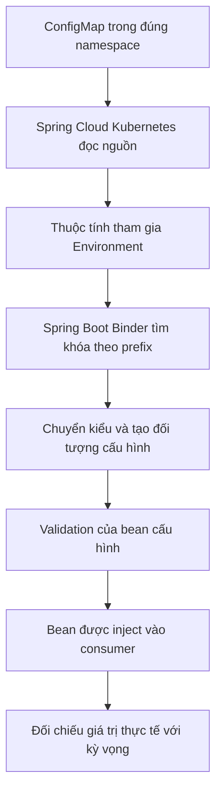

# Kiểm chứng giá trị nạp vào @ConfigurationProperties

## 1. Cần chứng minh điều gì sau khi đọc ConfigMap?

Trong module `SPRING_CLOUD_KUBERNETES`, ConfigMap giúp đưa cấu hình bên ngoài vào ứng dụng Spring chạy trên Kubernetes. Nhưng nhìn thấy ConfigMap trong cluster, thấy một dòng log nạp nguồn hoặc đọc được thuộc tính từ `Environment` vẫn chưa đủ để khẳng định đối tượng `@ConfigurationProperties` mà nghiệp vụ sử dụng đã nhận đúng dữ liệu.

Một phép kiểm chứng có ích cần trả lời được ba câu hỏi:

- Bean cấu hình có được Spring đăng ký và bind không?
- Giá trị sau chuyển kiểu, kể cả cấu trúc lồng nhau và danh sách, có đúng kỳ vọng không?
- Những giá trị đó có phù hợp với nguồn, Pod và thời điểm đang kiểm tra không?

Bài thuộc chương **ConfigMap**, tập trung vào lần nạp và binding khi ứng dụng khởi động. Ví dụ dùng Java 17, Spring Boot 3.2 và Spring Cloud Kubernetes 3.1 làm phạm vi minh họa; dự án cần release train/BOM tương thích. Các đầu ra dưới đây là kết quả kỳ vọng của bài thực hành, không phải bằng chứng rằng cluster của người học đã thực thi các phép thử.

Trong bối cảnh toàn module, việc kiểm chứng cấu hình cần được phân biệt với DiscoveryClient, Spring Cloud LoadBalancer, sức khỏe Pod và Configuration Watcher. Mỗi tính năng xử lý một phần khác nhau của quá trình triển khai; thêm một starter không liên quan không sửa được lỗi bind thuộc tính.

## 2. Từ ConfigMap đến đối tượng nghiệp vụ



Đây là sơ đồ khái niệm. Khi điều tra, xác định mắt xích nào đã có bằng chứng thay vì coi mọi biểu hiện là lỗi đọc ConfigMap.

| Quan sát | Chứng minh được | Chưa chứng minh được |
| --- | --- | --- |
| `kubectl get configmap` thấy đối tượng | Tài nguyên tồn tại đối với tài khoản đang chạy lệnh | ServiceAccount của Pod đã đọc được nó |
| `Environment` trả về `checkout.limit` | Có giá trị hiệu lực theo phép tra cứu đó | Bean nghiệp vụ đã được bind từ giá trị đó |
| Spring inject được bean cấu hình | Có bean phù hợp trong context | Mọi trường đều đúng, không phải mặc định hoặc nguồn ghi đè |
| Validation đạt | Các điều kiện đã khai báo đều đạt | Dữ liệu đúng chính xác với cấu hình triển khai mong muốn |
| Giá trị bean khớp kỳ vọng và đã đối chiếu nguồn | Có bằng chứng cho lần kiểm tra cụ thể | Bean sẽ tự nhận mọi thay đổi trong tương lai |

Spring Boot Binder thực hiện binding từ các nguồn cấu hình sang đối tượng có kiểu. Đây là một trách nhiệm khác với việc client Kubernetes lấy dữ liệu từ API; xem [Binder API](https://docs.spring.io/spring-boot/docs/3.2.12/api/org/springframework/boot/context/properties/bind/Binder.html).

## 3. Chuẩn bị dữ liệu có thể đối chiếu

### 3.1. Dependency cần cho ví dụ

Ví dụ là ứng dụng Spring Boot web đã có `spring-boot-starter-web`. Bổ sung các dependency sau, với phiên bản do cấu hình quản lý dependency tương thích của dự án quyết định:

```xml
<dependency>
    <groupId>org.springframework.cloud</groupId>
    <artifactId>spring-cloud-starter-kubernetes-client-config</artifactId>
</dependency>
<dependency>
    <groupId>org.springframework.boot</groupId>
    <artifactId>spring-boot-starter-validation</artifactId>
</dependency>
<dependency>
    <groupId>org.springframework.boot</groupId>
    <artifactId>spring-boot-starter-actuator</artifactId>
</dependency>
```

Starter validation cung cấp hạ tầng cần cho các constraint trong bài. Actuator phục vụ cách quan sát bổ sung, không thay thế việc đọc bean thực tế.

Ví dụ chọn Kubernetes Java Client. Nếu dự án chọn Fabric8, thay starter cấu hình bằng `spring-cloud-starter-kubernetes-fabric8-config`, không ghép hai họ client. Xem [danh mục Spring Cloud Kubernetes starters](https://docs.spring.io/spring-cloud-kubernetes/reference/3.1/getting-started.html).

### 3.2. ConfigMap của môi trường thực hành

Namespace `config-lab` đã tồn tại. Tạo hoặc triển khai ConfigMap sau bằng quy trình của môi trường thực hành:

```yaml
apiVersion: v1
kind: ConfigMap
metadata:
  name: checkout-runtime
  namespace: config-lab
data:
  application.yaml: |-
    checkout:
      revision: cm-checkout-v1
      currency: VND
      limit: 40
      timeout: 2500ms
      retry:
        enabled: false
        attempts: 3
      channels:
        - CARD
        - BANK
```

Các giá trị được chọn để dễ nhận ra:

- `limit: 40` khác với các giá trị dự phòng thường gặp như `0` hoặc `10`.
- `timeout: 2500ms` cho phép kiểm tra cả đơn vị và kết quả chuyển sang `Duration`.
- `enabled: false` là một giá trị hợp lệ, cần phân biệt với trường bị thiếu.
- Hai phần tử `channels` cho phép kiểm tra số lượng và thứ tự danh sách.
- `revision` là marker không nhạy cảm của bộ dữ liệu thực hành.

Marker không chứng minh nguồn gốc của tất cả trường khác. Một nguồn bên ngoài vẫn có thể chỉ ghi đè riêng `checkout.limit` trong khi giữ nguyên `checkout.revision`.

Spring Cloud Kubernetes hỗ trợ biểu diễn cấu hình từ ConfigMap, bao gồm tài liệu YAML bên trong `data`. Cách chọn tên, namespace và cách ánh xạ dữ liệu được mô tả tại [ConfigMap PropertySource](https://docs.spring.io/spring-cloud-kubernetes/reference/3.1/property-source-config/configmap-propertysource.html).

### 3.3. Chọn nguồn trước khi bind

Cấu hình `application.yml` đóng gói cùng ứng dụng:

```yaml
spring:
  application:
    name: checkout-service
  config:
    import: "kubernetes:"
  cloud:
    kubernetes:
      config:
        enabled: true
        name: checkout-runtime
        namespace: config-lab
        includeProfileSpecificSources: false
        fail-fast: true
      secrets:
        enabled: false
```

Trong lượt cơ sở, không sao chép các giá trị `checkout.*` vào cấu hình local và không cung cấp override từ môi trường hoặc đối số tiến trình. Điều này giúp phát hiện nguồn ngoài chưa nạp thay vì âm thầm dùng một bộ giá trị giống hệt nằm trong JAR.

Với phạm vi Spring Cloud Kubernetes 3.1, dùng `"kubernetes:"` để import nguồn và các thuộc tính tương ứng để chọn ConfigMap. Không đồng thời bật đường bootstrap. Xem [Kubernetes PropertySource implementations](https://docs.spring.io/spring-cloud-kubernetes/reference/3.1/property-source-config.html).

ServiceAccount của Pod cần quyền đọc ConfigMap trong `config-lab`. Quyền của tài khoản chạy `kubectl` và quyền của ứng dụng là hai điều kiện khác nhau.

## 4. Khai báo một kiểu cấu hình có thể kiểm tra được

Tạo kiểu `CheckoutProperties` trong ứng dụng minh họa:

```java
package example.checkout;

import java.time.Duration;
import java.util.List;

import jakarta.validation.Valid;
import jakarta.validation.constraints.Max;
import jakarta.validation.constraints.Min;
import jakarta.validation.constraints.NotBlank;
import jakarta.validation.constraints.NotEmpty;
import jakarta.validation.constraints.NotNull;

import org.springframework.boot.context.properties.ConfigurationProperties;
import org.springframework.validation.annotation.Validated;

@Validated
@ConfigurationProperties(prefix = "checkout", ignoreUnknownFields = false)
public record CheckoutProperties(
    @NotBlank String revision,
    @NotBlank String currency,
    @NotNull @Min(1) @Max(1000) Integer limit,
    @NotNull Duration timeout,
    @NotNull @Valid Retry retry,
    @NotEmpty List<@NotBlank String> channels
) {
    public record Retry(
        @NotNull Boolean enabled,
        @NotNull @Min(1) @Max(5) Integer attempts
    ) {
    }
}
```

### 4.1. Prefix xác định nhóm thuộc tính

`prefix = "checkout"` gắn kiểu cấu hình với nhóm `checkout.*`. Các thành phần record như `limit` và `retry` tương ứng với đường dẫn thuộc tính, không phụ thuộc tên tài nguyên `checkout-runtime`.

Nếu hệ thống thêm tiền tố nguồn khiến khóa trở thành `service.checkout.limit`, bean vẫn bind prefix `checkout` sẽ không tự tìm sang nhóm `service.checkout`. Khi chẩn đoán, so sánh tên khóa đầy đủ sau xử lý nguồn với prefix của bean.

### 4.2. Không để mặc định của kiểu che mất trường bị thiếu

`Integer` và `Boolean` được dùng cùng `@NotNull` để phát hiện trường không được cung cấp. Với kiểu nguyên thủy, `0` hoặc `false` có thể xuất hiện như mặc định của Java và làm phép quan sát mơ hồ.

`@Min` kiểm tra giới hạn số, còn `@NotNull` kiểm tra sự có mặt. Riêng constraint `@Min` xem `null` là hợp lệ, nên nó không thay thế yêu cầu bắt buộc có dữ liệu. Xem [Jakarta Validation: Min](https://jakarta.ee/specifications/bean-validation/3.0/apidocs/jakarta/validation/constraints/Min.html).

Trong ví dụ, `retry.enabled=false` được phép; điều bị từ chối là thiếu giá trị. Không biến mọi cờ boolean thành yêu cầu phải bằng `true` chỉ để kiểm tra nguồn đã nạp.

### 4.3. Kiểm tra cấu trúc lồng nhau và phần tử danh sách

`@NotNull` trên `retry` yêu cầu nhóm cấu hình tồn tại. `@Valid` yêu cầu đi tiếp vào đối tượng lồng để kiểm tra `enabled` và `attempts`; xem [Jakarta Validation: cascading với Valid](https://jakarta.ee/specifications/bean-validation/3.0/apidocs/jakarta/validation/Valid.html).

`@NotEmpty` yêu cầu `channels` không rỗng; constraint trên kiểu phần tử yêu cầu từng chuỗi không blank. Phép đối chiếu ở phần sau còn kiểm tra nội dung và thứ tự cụ thể, vì danh sách không rỗng chưa chắc chứa đúng những kênh mong muốn.

### 4.4. Kiểm soát khóa không biết và dữ liệu sai kiểu

Ví dụ đặt `ignoreUnknownFields = false` để khóa thừa hoặc lỗi gõ trong phạm vi cấu hình được phát hiện thay vì bị bỏ qua. Chính sách này phù hợp khi nhóm `checkout` thuộc trách nhiệm của riêng kiểu cấu hình trên; khi nhiều consumer dùng chung prefix, cần thiết kế phạm vi trước khi bật chặt chẽ.

Theo API, `ignoreUnknownFields` mặc định là `true`, còn `ignoreInvalidFields` mặc định là `false`. Khóa không biết và giá trị không chuyển được sang kiểu đích là hai loại lỗi khác nhau. Xem [ConfigurationProperties API](https://docs.spring.io/spring-boot/docs/3.2.12/api/org/springframework/boot/context/properties/ConfigurationProperties.html).

`@NotNull` trên `Duration` chỉ yêu cầu có giá trị. Nó không tự đặt điều kiện timeout phải dương hay nhỏ hơn một ngưỡng nghiệp vụ; thêm validator thích hợp nếu đó là hợp đồng của ứng dụng.

## 5. Đăng ký bean và inject đúng đối tượng

Ứng dụng minh họa đăng ký kiểu cấu hình bằng `@EnableConfigurationProperties`:

```java
package example.checkout;

import org.springframework.boot.SpringApplication;
import org.springframework.boot.autoconfigure.SpringBootApplication;
import org.springframework.boot.context.properties.EnableConfigurationProperties;

@SpringBootApplication
@EnableConfigurationProperties(CheckoutProperties.class)
public class CheckoutApplication {

    public static void main(String[] args) {
        SpringApplication.run(CheckoutApplication.class, args);
    }
}
```

Đây là cách đăng ký trực tiếp các kiểu cần được xử lý; xem [EnableConfigurationProperties API](https://docs.spring.io/spring-boot/docs/3.2.12/api/org/springframework/boot/context/properties/EnableConfigurationProperties.html).

Có thể chọn `@ConfigurationPropertiesScan` theo cấu trúc ứng dụng thay cho đăng ký trực tiếp. Trong ví dụ, dùng một cách nhất quán và inject bean do context quản lý.

Với record có constructor phù hợp trong Spring Boot 3.2, không cần thêm `@ConstructorBinding` chỉ để bật constructor binding. Tham khảo [constructor binding của Spring Boot](https://docs.spring.io/spring-boot/docs/3.2.12/reference/html/features.html#features.external-config.typesafe-configuration-properties.constructor-binding).

Các cách sau không chứng minh bean ứng dụng đã được bind:

- Tự gọi `new CheckoutProperties(...)` với các hằng số mong muốn.
- Chỉ kiểm tra giá trị trả về từ `System.getenv(...)`.
- Chỉ bind một đối tượng mới bằng API Binder rồi coi nó là bean mà consumer đang giữ.
- Chỉ xem gợi ý thuộc tính hoặc metadata trong IDE.

Nếu ứng dụng dùng JavaBean mutable thay cho record, cần kiểm tra cả đường đăng ký, constructor và các accessor phục vụ binding. Kiểu dữ liệu đúng trên giấy không thay thế việc quan sát bean đã được tạo.

## 6. Đối chiếu bean với kỳ vọng độc lập

### 6.1. Một phép kiểm tra chỉ bật trong profile thực hành

Đặt lớp sau cùng package được ứng dụng quét. Nó chỉ hoạt động khi profile `binding-lab` được bật:

```java
package example.checkout;

import java.time.Duration;
import java.util.List;
import java.util.Objects;

import org.slf4j.Logger;
import org.slf4j.LoggerFactory;
import org.springframework.boot.ApplicationRunner;
import org.springframework.context.annotation.Bean;
import org.springframework.context.annotation.Configuration;
import org.springframework.context.annotation.Profile;
import org.springframework.core.env.ConfigurableEnvironment;

@Configuration(proxyBeanMethods = false)
@Profile("binding-lab")
public class BindingLabVerification {

    private static final Logger log =
        LoggerFactory.getLogger(BindingLabVerification.class);

    @Bean
    ApplicationRunner verifyCheckoutBinding(
            CheckoutProperties properties,
            ConfigurableEnvironment environment) {
        return args -> {
            require("checkout.revision",
                Objects.equals(properties.revision(), "cm-checkout-v1"));
            require("checkout.currency",
                Objects.equals(properties.currency(), "VND"));
            require("checkout.limit",
                Objects.equals(properties.limit(), 40));
            require("checkout.timeout",
                Duration.ofMillis(2500).equals(properties.timeout()));
            require("checkout.retry.enabled",
                Boolean.FALSE.equals(properties.retry().enabled()));
            require("checkout.retry.attempts",
                Objects.equals(properties.retry().attempts(), 3));
            require("checkout.channels",
                Objects.equals(properties.channels(), List.of("CARD", "BANK")));

            require("checkout.limit between bean and Environment",
                Objects.equals(properties.limit(),
                    environment.getProperty("checkout.limit", Integer.class)));

            log.info(
                "BINDING_LAB_PASS revision={} currency={} limit={} "
                    + "timeout={} retryEnabled={} attempts={} channels={}",
                properties.revision(), properties.currency(), properties.limit(),
                properties.timeout(), properties.retry().enabled(),
                properties.retry().attempts(), properties.channels()
            );
        };
    }

    private static void require(String property, boolean matches) {
        if (!matches) {
            throw new IllegalStateException(
                "Binding lab mismatch: " + property
            );
        }
    }
}
```

Bật profile bằng cấu hình khởi chạy của môi trường thực hành, chẳng hạn biến môi trường container:

```yaml
env:
  - name: SPRING_PROFILES_ACTIVE
    value: binding-lab
```

Đây là trích đoạn của container, không phải manifest Deployment hoàn chỉnh. Ứng dụng vẫn cần image, ServiceAccount và các thiết lập triển khai phù hợp.

### 6.2. Tại sao so sánh theo hai hướng?

Đoạn kiểm tra dùng hai phép đối chiếu có mục đích khác nhau:

1. **Bean với kỳ vọng của lượt thử:** phát hiện giá trị sai dù nó vẫn hợp lệ về kiểu và constraint.
2. **Bean với Environment ở cùng lần kiểm tra:** phát hiện sai khác ở đường đọc cấu hình trong điều kiện lượt thử không có cập nhật đồng thời.

Nếu chỉ so bean với Environment, cả hai có thể cùng chứa giá trị sai do override. Nếu chỉ so số `40` mà không xem nguồn, ứng dụng có thể lấy đúng số từ một bản sao local. Vì vậy, cần kết hợp kết quả bean với bằng chứng nguồn khi mục tiêu là xác nhận ConfigMap cụ thể.

Kỳ vọng của phép thử được xác định độc lập với bean thực tế. Không tạo expected bằng cách đọc lại chính bean rồi so với nó.

### 6.3. Kết quả mong đợi

Với dữ liệu cơ sở, log minh họa:

```text
BINDING_LAB_PASS revision=cm-checkout-v1 currency=VND limit=40 timeout=PT2.5S retryEnabled=false attempts=3 channels=[CARD, BANK]
```

`2500ms` trong ConfigMap trở thành `Duration` tương đương `PT2.5S`. So sánh đối tượng `Duration` hoặc đơn vị đã chuẩn hóa, không yêu cầu chuỗi cấu hình gốc phải giống `toString()` của đối tượng.

Các hằng số trong phép kiểm tra dành cho bộ dữ liệu thực hành. Không giữ profile này trong production nếu chính sách cấu hình thực tế cho phép các giá trị khác. Validation nghiệp vụ và phép so khớp một fixture thực hành là hai trách nhiệm khác nhau.

Dòng PASS được in sau các kiểm tra của runner. Nó không chứng minh các hệ thống phụ thuộc đã sẵn sàng, mọi runner khác đã hoàn thành hoặc Pod đã đạt mọi tiêu chí readiness.

## 7. Dùng Actuator để đối chiếu bean và đầu vào binding

### 7.1. Cho phép quan sát trong phạm vi quản trị

Có thể bổ sung cấu hình sau vào `application-binding-lab.yml`. Cổng quản trị riêng chỉ nghe loopback trong Pod:

```yaml
management:
  server:
    port: 9091
    address: 127.0.0.1
  endpoints:
    web:
      exposure:
        include: "health,env,configprops"
  endpoint:
    env:
      show-values: never
    configprops:
      show-values: never
```

Giữ chính sách xác thực/phân quyền của ứng dụng nếu có; không đưa các endpoint chẩn đoán ra Service/Ingress công khai. Việc expose endpoint, được phép truy cập và được xem giá trị không che là các quyết định riêng. Tham khảo [Actuator: endpoint và sanitization](https://docs.spring.io/spring-boot/docs/3.2.12/reference/html/actuator.html).

Với `show-values: never`, chuỗi `******` biểu thị giá trị đã được che, không phải cấu hình thực sự được bind thành sáu dấu sao. Phép kiểm tra Java bên trên chỉ in danh sách trường không nhạy cảm của ví dụ.

### 7.2. Hỏi đúng prefix và đúng khóa

Sau khi chọn tên Pod thực tế, ở một terminal giữ port-forward:

```powershell
$podName = 'checkout-service-THAY-BANG-TEN-POD-THUC'
kubectl -n config-lab port-forward pod/$podName 19091:9091
```

Ở terminal khác:

```powershell
curl.exe --silent --show-error http://127.0.0.1:19091/actuator/configprops/checkout
curl.exe --silent --show-error http://127.0.0.1:19091/actuator/env/checkout.limit
```

Đối với `configprops`, chú ý bean có prefix `checkout`, phần `properties` của bean và phần `inputs` ghi thông tin giá trị/origin dùng khi binding nếu có. Đối với `env`, xem nguồn đang được chọn cho `checkout.limit`. API mô tả cấu trúc này tại [Spring Boot Actuator Web API](https://docs.spring.io/spring-boot/docs/3.2.12/actuator-api/htmlsingle/#configprops).

Không viết công cụ phụ thuộc một chuỗi bean ID tự đoán. Xác định context, prefix và kiểu bean thực tế; ứng dụng có thể có nhiều context hoặc nhiều bean liên quan.

### 7.3. Hiểu giới hạn của bằng chứng

Metadata `origin` có thể không tồn tại đối với một nguồn. Không tự bổ sung dòng/cột hoặc `resourceVersion` của ConfigMap nếu đầu ra không cung cấp chúng.

Endpoint `configprops` không phải danh sách mọi điểm dùng `@Value`, mọi cache nghiệp vụ hoặc mọi đối tượng do code tự tạo. Khi nghi consumer giữ bản sao cũ, cần quan sát thêm chính consumer đó.

Nếu ứng dụng lỗi binding trước khi khởi động hoàn chỉnh, endpoint có thể chưa khả dụng. Khi đó dùng log lỗi gốc và trạng thái container; không chờ một endpoint chưa thể hoạt động để chứng minh lỗi đã xảy ra.

## 8. Các phép thử âm để kiểm tra sức mạnh của phép kiểm chứng

Luôn khôi phục bộ dữ liệu cơ sở trước khi chuyển sang tình huống kế tiếp. Các lượt dưới đây xét một lần khởi động mới, không mặc định bean record sẽ được bind lại khi sửa ConfigMap.

| Thay đổi có chủ đích | Tầng cần phát hiện | Kết quả mong đợi |
| --- | --- | --- |
| Đổi `checkout.limit` từ `40` sang `many` | Chuyển kiểu | Không chuyển được sang `Integer`; ứng dụng không khởi động thành công |
| Đổi `checkout.limit` thành `0` | Validation | Vi phạm giới hạn nhỏ nhất |
| Xóa riêng `checkout.limit`, không nguồn dự phòng | Bắt buộc có dữ liệu | `@NotNull` phát hiện trường thiếu |
| Xóa `checkout.retry.enabled`, giữ `attempts` | Validation lồng nhau | Phát hiện giá trị Boolean bị thiếu, không coi đó là `false` hợp lệ |
| Đặt `checkout.retry.attempts=0` | Validation lồng nhau | Vi phạm `@Min(1)` của nhóm retry |
| Thay một phần tử `channels` bằng chuỗi blank | Validation phần tử | Constraint trên phần tử danh sách thất bại |
| Thêm `checkout.limti=40`, vẫn giữ khóa đúng | Khóa không được bind | Chính sách `ignoreUnknownFields=false` phát hiện khóa thừa |
| Đổi `checkout.limit` thành `60` | So sánh với fixture | Validation vẫn có thể đạt nhưng runner thực hành báo mismatch |
| Giữ dữ liệu cơ sở, thêm `CHECKOUT_LIMIT=60` vào container | Nguồn ghi đè | Bean và Environment có thể cùng nhận `60`; runner vẫn phát hiện lệch kỳ vọng |

Phân biệt thông báo lỗi theo khóa, giá trị và nguyên nhân gốc. Tên exception, cách trình bày đường dẫn và dòng log có thể khác theo phiên bản; không cần phụ thuộc nguyên văn toàn bộ stack trace.

Ví dụ dữ liệu `limit: many` và `limit: 0` đều bị từ chối nhưng ở hai tầng khác nhau. Trường hợp `60` lại hợp lệ theo constraint nhưng không đúng fixture. Ba kết quả này cho thấy “bind thành công”, “hợp lệ về nghiệp vụ” và “đúng dữ liệu của lần triển khai” là ba điều kiện cần xem riêng.

Nếu một phép thử lẽ ra phải thất bại nhưng ứng dụng vẫn chạy, kiểm tra nguồn ghi đè hoặc mặc định khác trước khi kết luận validation hỏng. Trường hợp xóa khỏi một ConfigMap chưa chắc làm thuộc tính biến mất khỏi toàn bộ Environment.

## 9. Những nguyên nhân tạo kết quả đúng giả

### 9.1. Giá trị dự phòng trùng với giá trị đang kiểm tra

Một trường có sẵn mặc định `40` có thể vẫn hiển thị `40` khi ConfigMap không nạp. Tương tự, `@DefaultValue`, giá trị khởi tạo trong JavaBean, profile local hoặc đối số tiến trình có thể cung cấp dữ liệu dự phòng.

Trong lượt kiểm chứng nguồn ngoài, dùng một giá trị khác biệt và thử bỏ thuộc tính bắt buộc. Trong hệ thống thực tế, vẫn có thể giữ mặc định có chủ đích, nhưng cần ghi rõ phép thử nào chứng minh nguồn ngoài đã tham gia.

### 9.2. Chỉ kiểm tra marker

`revision=cm-checkout-v1` cho biết marker được quan sát ở bean. Nó không đủ để kết luận `limit`, `timeout` và `channels` đều xuất phát từ cùng nguồn. Kiểm tra từng trường quan trọng, đặc biệt khi có nhiều ConfigMap hoặc biến môi trường.

### 9.3. Tự tạo một đối tượng thay cho bean được inject

Một bài kiểm tra khởi tạo record bằng constructor chỉ kiểm tra dữ liệu mà bài kiểm tra tự truyền. Nó không đi qua đường đọc Kubernetes, chọn nguồn và binding của ứng dụng.

Nếu dùng API Binder để khảo sát riêng, coi đó là một phép thử của Binder với tập đầu vào đã chọn. Không tự suy rằng mọi handler, validation và vòng đời bean quản lý đều giống đường bind tự động.

### 9.4. Kiểm tra một Pod rồi kết luận cho cả Deployment

Trong lúc rollout, các Pod có thể dùng image hoặc cấu hình khởi động khác nhau. Chọn một Pod, ghi UID và container, kiểm tra đủ bằng chứng rồi mới mở rộng sang các replica khác.

Nếu cần xác nhận cả Deployment, thu thập kết quả theo từng instance và phân biệt Pod mới với Pod của ReplicaSet cũ. Một request đi qua Service không tự cố định instance cần điều tra.

## 10. Đơn vị, cấu trúc và giá trị hợp lệ cần được đọc đúng

### 10.1. Kiểm tra đơn vị của Duration

Ví dụ dùng `2500ms` để đơn vị được ghi rõ. Spring Boot hỗ trợ Duration dạng có hậu tố và ISO-8601; số không có đơn vị mặc định được hiểu theo milliseconds trừ khi cấu hình `@DurationUnit` khác. Xem [Spring Boot: Converting Durations](https://docs.spring.io/spring-boot/docs/3.2.12/reference/html/features.html#features.external-config.typesafe-configuration-properties.conversion.durations).

Nếu ứng dụng nhận `Duration.ofMillis(2500)`, đó là 2,5 giây, không phải 2.500 giây. Khi kiểm tra, so sánh đơn vị và kiểu đích, không chỉ phần số xuất hiện trong YAML.

### 10.2. Kiểm tra đối tượng lồng nhau

Việc có `checkout.retry.attempts` trong Environment không chứng minh nhóm retry trong bean đã được tạo và validate đúng. Cần kiểm tra đối tượng `retry`, giá trị `enabled` và `attempts` qua bean được inject.

Trong ví dụ, `@NotNull` trên nhóm cha và `@Valid` phục vụ các điều kiện khác nhau. Khi chuyển sang một JavaBean có đối tượng lồng được khởi tạo sẵn, mặc định và đường binding cũng cần được đánh giá lại.

### 10.3. Kiểm tra danh sách sau binding

So sánh `channels` như một danh sách hoàn chỉnh giúp phát hiện thiếu, thừa hoặc sai thứ tự phần tử. Không dùng một khóa phẳng có chỉ số để suy ra toàn bộ đối tượng đã bind.

Khi nhiều nguồn cùng cấu hình danh sách, cần xét quy tắc binding của Spring Boot; danh sách không tự trở thành phép hợp của tất cả phần tử từ mọi nguồn. Bài thực hành giữ một nguồn nghiệp vụ để giảm biến số ở lượt cơ sở.

## 11. Kiểm chứng nạp ban đầu và kiểm chứng cập nhật là hai lượt khác nhau

Record trong ví dụ phù hợp cho việc kiểm tra cấu hình bất biến được tạo khi ứng dụng khởi động. Không mặc định rằng sửa ConfigMap rồi phát sự kiện refresh sẽ thay đổi record đang được inject.

Tài liệu Spring Cloud Commons 4.1 nêu record có `@ConfigurationProperties` không được refresh. Xem [Environment Changes và Refresh Scope](https://docs.spring.io/spring-cloud-commons/reference/4.1/spring-cloud-commons/application-context-services.html). Trong phạm vi ví dụ này, dùng tiến trình/Pod mới để kiểm chứng bộ giá trị mới.

Configuration Watcher có thể phát thông báo thay đổi qua HTTP refresh hoặc Spring Cloud Bus theo cấu hình triển khai. Thông báo đó không tự bảo đảm một kiểu bean hoặc consumer cụ thể cập nhật theo mong muốn; xem [Spring Cloud Kubernetes Configuration Watcher](https://docs.spring.io/spring-cloud-kubernetes/reference/3.1/spring-cloud-kubernetes-configuration-watcher.html).

Nếu hệ thống cần cập nhật tại chỗ, thiết kế kiểu cấu hình và vòng đời consumer phù hợp rồi kiểm tra riêng:

1. Dữ liệu Kubernetes đã thay đổi chưa?
2. Tiến trình đã đọc dữ liệu mới vào nguồn cấu hình chưa?
3. Bean cấu hình được cập nhật hoặc tạo lại bằng cơ chế nào?
4. Consumer đang sử dụng giá trị mới hay một bản sao đã giữ từ trước?
5. Dữ liệu không hợp lệ sau cập nhật được xử lý thế nào?

Không dùng dòng PASS ở lần khởi động đầu làm bằng chứng cho cả chuỗi cập nhật sau đó. Validation lúc khởi động cũng không tự thiết lập một cơ chế giao dịch giữ nguyên cấu hình tốt gần nhất cho mọi kịch bản refresh.

## 12. Thu thập bằng chứng và khoanh vùng lỗi

### 12.1. Ghi nhận instance đang kiểm tra

Các lệnh quan sát minh họa trong PowerShell:

```powershell
kubectl -n config-lab get configmap checkout-runtime
kubectl -n config-lab get pods -l app=checkout-service -o wide

$podName = 'checkout-service-THAY-BANG-TEN-POD-THUC'
kubectl -n config-lab get pod $podName -o 'custom-columns=NAME:.metadata.name,UID:.metadata.uid,SA:.spec.serviceAccountName,IMAGE:.spec.containers[*].image'
kubectl -n config-lab logs $podName -c checkout-service --tail=200
```

Selector `app=checkout-service` và tên container phải khớp Deployment thực hành. Nếu container đã restart, có thể cần xem log instance trước bằng `--previous` khi Kubernetes còn giữ log đó.

Ghi metadata của ConfigMap ở thời điểm quan sát có thể giúp điều tra, nhưng phiên bản tài nguyên hiện tại không tự chứng minh bean đã nạp đúng phiên bản ấy. Đối chiếu thêm thời điểm khởi động, marker và nguồn đầu vào của tiến trình.

### 12.2. Bảng điều tra nhanh

| Hiện tượng | Điểm kiểm tra có ích |
| --- | --- |
| Không inject được `CheckoutProperties` | Cách đăng ký kiểu, package scan và context đang dùng |
| Nguồn có khóa nhưng bean thiếu hoặc nhận mặc định | Prefix, tiền tố nguồn, cách tạo bean, cấu trúc thuộc tính |
| Báo không chuyển được kiểu | Dữ liệu gốc, kiểu Java và đơn vị chuyển đổi |
| Có bean nhưng dữ liệu vượt giới hạn | Validation provider, `@Validated`, constraint tương ứng |
| Lỗi chỉ nằm trong nhóm retry | `@Valid`, `@NotNull` ở nhóm cha và các trường con |
| Validation đạt nhưng runner mismatch | Kỳ vọng của fixture, nguồn ghi đè hoặc dữ liệu triển khai đã đổi |
| Endpoint chỉ hiển thị `******` | Chính sách sanitization; không kết luận đó là giá trị thực |
| ConfigMap đã đổi, record cũ vẫn giữ giá trị | Phân biệt nạp ban đầu với refresh; kiểm tra Pod và vòng đời bean |
| Pod Running nhưng chưa có bằng chứng binding | Log, kết quả probe và bean thực tế; trạng thái Pod chưa đủ |

### 12.3. Tiêu chí kết thúc lượt thực hành

Một lượt kiểm chứng cơ sở có đủ bằng chứng khi xác định được bean do Spring quản lý, giá trị từng trường quan trọng sau chuyển kiểu, kết quả validation và quan hệ với nguồn cấu hình đã chọn. Đồng thời, các phép thử âm cần thất bại ở đúng tầng dự kiến, còn giá trị hợp lệ nhưng lệch fixture phải bị phép đối chiếu phát hiện.

Báo cáo nên gắn với namespace, UID Pod, image và thời điểm, nêu rõ trường nào đã được kiểm tra và giới hạn của kết luận. Với Secret hoặc dữ liệu nhạy cảm trong bài toán thực tế, dùng bằng chứng tồn tại, metadata và kết quả kiểm tra được phép công bố; không xuất toàn bộ bean hay Environment chỉ để xác nhận binding.
