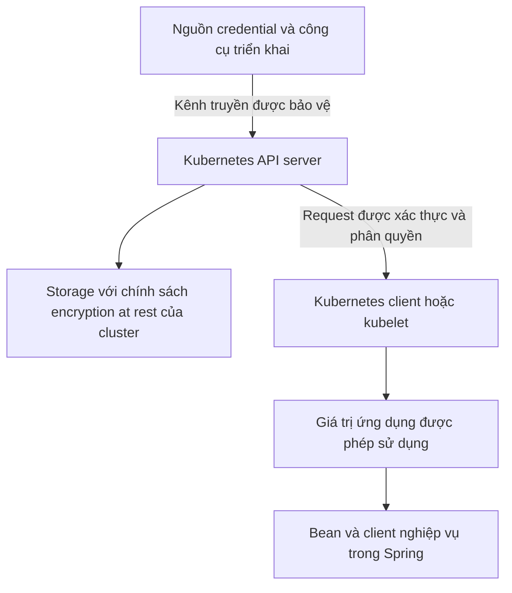

# Phân biệt mã hóa base64 với mã hóa bảo mật

## Mục tiêu và phạm vi

Trong chương **Secret** của module **SPRING_CLOUD_KUBERNETES**, điều đầu tiên cần hiểu là: **giá trị được biểu diễn bằng base64 chưa được bảo vệ bằng mã hóa mật mã**. Người có chuỗi base64 có thể khôi phục dữ liệu gốc mà không cần một khóa bí mật.

Bài học phân biệt encoding với encryption, giải thích ý nghĩa của `data` và `stringData`, rồi nối các khái niệm này với cách ứng dụng Spring nhận Secret. Tình huống xuyên suốt là ứng dụng `partner-demo` cần một API key lấy từ Secret `partner-credentials` trong namespace `learning`.

Mọi credential xuất hiện trong ví dụ đều là dữ liệu giả phục vụ học tập. Bài tập không cần đọc hay hiển thị giá trị Secret thực tế, cũng không cần bổ sung DiscoveryClient, Spring Cloud LoadBalancer hoặc Configuration Watcher để thực hiện phép biểu diễn base64.

## 1. Hai nghĩa khác nhau của từ “mã hóa”

Trong tiếng Việt, “mã hóa” thường được dùng cho cả hai khái niệm, dễ làm người đọc hiểu sai mức độ bảo vệ:

| Khái niệm | Mục đích | Cần khóa bí mật để đảo ngược? | Ví dụ |
| --- | --- | --- | --- |
| Encoding, ở đây là base64 | Biểu diễn một dãy byte bằng ký tự thuận tiện cho lưu trữ hoặc truyền tải | Không | Biểu diễn trường byte trong JSON/YAML |
| Encryption, mã hóa mật mã | Chuyển bản rõ thành bản mã để bảo vệ tính bí mật theo thiết kế mật mã | Cần vật liệu khóa giải mã phù hợp | Mã hóa dữ liệu lưu trữ hoặc mã hóa trong một kênh TLS |

Base64 làm thay đổi cách dữ liệu được viết ra, không quyết định ai được phép hiểu nội dung. RFC 4648 định nghĩa nó như một dạng biểu diễn dữ liệu bằng bảng ký tự; cơ chế này không có khóa giữ bí mật. [Đặc tả Base64 trong RFC 4648](https://www.rfc-editor.org/rfc/rfc4648.html).

Ngược lại, encryption sử dụng thuật toán mật mã và khóa để chuyển plaintext thành ciphertext. Hiệu quả bảo vệ còn phụ thuộc lựa chọn thuật toán, cách dùng, quản lý khóa và quyền truy cập. Không phải cứ gọi một hàm có tên “encrypt” là đã có một hệ thống quản lý Secret an toàn. [Định nghĩa encryption của NIST](https://csrc.nist.gov/glossary/term/encryption).

Hai luồng có thể hình dung như sau:

```text
Encoding:
byte gốc -> Base64Encode -> chuỗi base64 -> Base64Decode -> byte gốc

Encryption rồi biểu diễn bản mã:
plaintext -> Encrypt bằng khóa -> ciphertext dạng byte
          -> Base64Encode -> chuỗi bản mã có thể lưu trong văn bản
```

Trong luồng thứ hai, sau khi Base64Decode, kết quả vẫn là ciphertext. Phải có cơ chế giải mã mật mã phù hợp mới thu được plaintext. Nhìn hình dạng chuỗi base64 không thể kết luận nó chứa bản rõ được biểu diễn hay bản mã được biểu diễn.

### Những điều base64 không cung cấp

Base64 không cung cấp tính bí mật, không chứng minh nguồn gửi và không bảo đảm dữ liệu chưa bị sửa. Người có khả năng sửa chuỗi có thể thay nó bằng base64 của một dữ liệu khác. Việc kiểm tra chuỗi đúng cú pháp chỉ xác nhận định dạng có thể được giải mã.

Mã hóa mật mã cũng không tự giải quyết toàn bộ xác thực và toàn vẹn trong mọi chế độ sử dụng. Cần cơ chế được thiết kế phù hợp với thuộc tính bảo mật cần đạt; không thay một lớp phân quyền hoặc kiểm tra nguồn gốc bằng việc làm chuỗi khó đọc hơn.

## 2. Quan sát trực tiếp bằng dữ liệu giả

Chuỗi giả `demo-password` có biểu diễn base64 là:

```text
demo-password
      |
      v
ZGVtby1wYXNzd29yZA==
```

Trên PowerShell, có thể minh họa phép chuyển đổi ngay trong bộ nhớ:

```powershell
$demoPlaintext = 'demo-password'
$demoBytes = [System.Text.Encoding]::UTF8.GetBytes($demoPlaintext)
$demoBase64 = [Convert]::ToBase64String($demoBytes)

$demoDecodedBytes = [Convert]::FromBase64String($demoBase64)
$demoDecodedText = [System.Text.Encoding]::UTF8.GetString($demoDecodedBytes)

[pscustomobject]@{
    Base64 = $demoBase64
    Decoded = $demoDecodedText
    RoundTripMatches = ($demoDecodedText -ceq $demoPlaintext)
}
```

Kết quả tương ứng:

```text
Base64           : ZGVtby1wYXNzd29yZA==
Decoded          : demo-password
RoundTripMatches : True
```

Không có bước nhập khóa giải mã. Điều kiện duy nhất để khôi phục là có chuỗi base64 và bộ giải mã tuân theo định dạng.

Đoạn mã dùng UTF-8 để biến văn bản thành byte trước khi encode, rồi dùng cùng encoding khi dựng lại văn bản. Với dữ liệu nhị phân, kết quả giải mã là byte; không bắt buộc byte đó phải là chuỗi UTF-8 hợp lệ.

Khi tạo dữ liệu từ công cụ dòng lệnh, cần chú ý newline có thể là một phần của byte đầu vào. Base64 của `demo-password` và base64 của `demo-password` có thêm newline là hai chuỗi khác nhau. Nếu credential bị sai vì newline, đó là lỗi dữ liệu đầu vào, không phải một lớp bảo mật bổ sung.

Cũng không tăng độ mạnh của credential bằng cách encode hai lần. Ai có dữ liệu vẫn có thể decode hai lần; điều thay đổi chỉ là số bước chuyển đổi và khả năng ứng dụng dùng nhầm giá trị.

## 3. Ý nghĩa của data và stringData trong Kubernetes Secret

### Dùng data: chuẩn bị biểu diễn base64

Manifest dùng đúng chuỗi giả ở mục 2:

```yaml
apiVersion: v1
kind: Secret
metadata:
  name: partner-credentials
  namespace: learning
type: Opaque
data:
  partner.api-key: ZGVtby1wYXNzd29yZA==
```

`data` trong biểu diễn Secret JSON/YAML chứa các chuỗi base64 cho giá trị byte. Kiểu `Opaque` cho biết đây là Secret với dữ liệu do người dùng định nghĩa; tên kiểu này không có nghĩa dữ liệu đã qua một thuật toán encryption.

Tên khóa `partner.api-key` là tên mục dữ liệu, không phải khóa mật mã để giải mã giá trị bên phải.

### Dùng stringData: cung cấp chuỗi đầu vào trực tiếp

Manifest thay thế cho cùng dữ liệu:

```yaml
apiVersion: v1
kind: Secret
metadata:
  name: partner-credentials
  namespace: learning
type: Opaque
stringData:
  partner.api-key: "demo-password"
```

`stringData` thuận tiện khi tạo hoặc cập nhật Secret bằng văn bản. Kubernetes hợp nhất giá trị này vào `data`; nếu cùng một tên khóa xuất hiện trong cả hai trường, giá trị từ `stringData` được ưu tiên. Đổi từ `stringData` sang `data` không thêm bảo vệ mật mã. [Quy tắc dữ liệu của Kubernetes Secret](https://kubernetes.io/docs/concepts/configuration/secret/#constraints-on-secret-names-and-data).

Hai manifest trên là hai cách cung cấp cùng byte credential, không phải hai tầng cần áp dụng nối tiếp. Không encode trước rồi đưa chuỗi đã encode vào `stringData` nếu ứng dụng cần nhận credential gốc.

Khi đọc lại bằng API, dữ liệu thường xuất hiện trong trường `data` với biểu diễn base64. Điều đó không chứng minh ciphertext đang được lưu ở tầng storage. Ngược lại, việc API vẫn trả base64 cũng không chứng minh encryption at rest đang bị tắt: API là một giao diện logic, không phải bản sao nguyên trạng của byte lưu trong etcd.

### Secret có ích gì nếu base64 không bảo mật?

Secret là loại tài nguyên chuyên dụng cho dữ liệu nhạy cảm, có cách tham chiếu vào workload, phạm vi quyền và khả năng kết hợp với chính sách bảo vệ của cluster. Giá trị của Secret nằm ở cách hệ thống quản lý và cung cấp dữ liệu, không nằm ở việc người đọc phải thêm một thao tác decode.

Đưa thông tin nhạy cảm vào Secret thay vì ConfigMap là lựa chọn về ngữ nghĩa và quản trị. Nó vẫn cần đi cùng kiểm soát truy cập, bảo vệ storage, bảo vệ kênh truyền và cách sử dụng trong ứng dụng.

## 4. Base64 nằm ở đâu trong vòng đời Secret?



Biểu diễn base64 của `data` không thay thế các lớp bảo vệ trong sơ đồ. Cần xét từng vị trí mà dữ liệu xuất hiện:

| Vị trí | Base64 tự bảo vệ được không? | Lớp bảo vệ cần xét |
| --- | --- | --- |
| Manifest, kho Git, artifact CI/CD | Không | Quyền truy cập và phương án quản lý Secret trong quy trình triển khai |
| Đường truyền tới API server | Không | TLS, kiểm tra chứng chỉ và danh tính đầu cuối |
| Dữ liệu lưu trữ của control plane | Không | Encryption at rest, quản lý khóa và quyền truy cập storage |
| Request đọc Secret qua API | Không | Xác thực và RBAC |
| File hoặc biến môi trường trong container | Không | Phạm vi cung cấp dữ liệu và quyền truy cập tiến trình/container |
| Log, response, trace hoặc dump của ứng dụng | Không | Giới hạn dữ liệu ghi ra và quyền truy cập hệ thống quan sát |

TLS bảo vệ dữ liệu trong kênh truyền tương ứng; thành phần ở đầu cuối có quyền xử lý vẫn nhận dữ liệu dùng được. Encryption at rest bảo vệ ở tầng lưu trữ được cấu hình; nó không tước quyền đọc logic của một chủ thể được API cho phép.

### Encryption at rest cần được xác nhận riêng

Kubernetes mô tả Secret mặc định chưa được mã hóa ở storage nền etcd nếu chưa có bảo vệ tương ứng. Không lấy điều này để suy đoán mọi cluster cụ thể đều có cùng cấu hình: môi trường được quản lý có thể đã bật cơ chế riêng. [Đặc tính lưu trữ mặc định của Secret](https://kubernetes.io/docs/concepts/configuration/secret/).

Để xác nhận một cluster bảo vệ Secret khi lưu, người quản trị cần kiểm tra cấu hình mã hóa áp dụng cho tài nguyên, provider đang dùng để ghi, chính sách khóa và tình trạng chuyển đổi dữ liệu cũ. Provider `identity` không cung cấp mã hóa; chỉ thấy có tham số cấu hình encryption chưa đủ chứng minh các bản ghi cũ đều đã được chuyển đổi. [Encryption at rest trong Kubernetes](https://kubernetes.io/docs/tasks/administer-cluster/encrypt-data/).

Với KMS hoặc cơ chế envelope encryption, vẫn cần xác định ai được sử dụng khóa, khả năng khôi phục và quy trình luân chuyển khóa. Không đưa khóa giải mã cạnh ciphertext rồi coi việc dùng một thuật toán mạnh đã giải quyết vấn đề quản lý khóa.

Bài này không yêu cầu thay cấu hình control plane hay trực tiếp đọc dữ liệu etcd. Mục tiêu là biết loại bằng chứng nào liên quan đến encryption, thay vì nhìn vào một chuỗi base64 rồi kết luận.

## 5. Phân quyền quyết định ai có thể lấy dữ liệu dùng được

Một người hoặc ServiceAccount được phép đọc Secret qua API có thể nhận dữ liệu và khôi phục byte gốc. Việc storage đã mã hóa không ngăn request được cấp quyền này; API server xử lý phần lưu trữ trước khi phục vụ giao diện đọc.

Quyền `list` Secret cũng không chỉ cho biết danh sách tên. Nó có thể trả về nội dung các Secret trong phạm vi được phép, nên cần đánh giá tác động tương tự việc đọc dữ liệu. Khả năng tạo hoặc sửa workload để gắn Secret cũng tạo một đường tiếp cận gián tiếp. [Phân quyền và sử dụng Secret theo phạm vi cần thiết](https://kubernetes.io/docs/concepts/security/secrets-good-practices/).

Một số tình huống điển hình:

| Tình huống | Kết luận phù hợp |
| --- | --- |
| Một bản Secret YAML có `data` bị chia sẻ ra ngoài | Người nhận có thể decode; cần xử lý như dữ liệu nhạy cảm bị lộ |
| Một chủ thể có quyền API đọc Secret | Encryption at rest không thay thế việc giới hạn quyền này |
| Storage đã mã hóa nhưng khóa giải mã cũng bị lấy | Khả năng bảo vệ phải được đánh giá lại theo phạm vi khóa và dữ liệu bị lộ |
| Container bị kiểm soát và đọc được credential của chính nó | Base64 hoặc storage encryption không bảo vệ khỏi việc dữ liệu bị lấy ở thời điểm sử dụng |
| Log chỉ thay credential bằng chuỗi base64 | Log vẫn chứa dữ liệu có thể khôi phục dễ dàng |

Các lớp bảo vệ không loại trừ nhau. Storage encryption hữu ích với những đường truy cập liên quan đến storage; RBAC hữu ích với request API; kiểm soát ứng dụng hạn chế những gì dữ liệu có thể bị ghi ra sau khi đã được cấp cho ứng dụng.

## 6. Spring nhận giá trị nào từ Secret?

Ứng dụng Spring thường cần credential ở dạng sử dụng được để gửi tới hệ thống đối tác. Cần biết lớp nào đã chuyển biểu diễn `data` thành byte hoặc chuỗi, tránh tự decode thêm lần nữa.

| Đường cung cấp | Ứng dụng thường nhận | Có tự decode base64 của Secret thêm lần nữa không? |
| --- | --- | --- |
| Secret được gắn thành file | Nội dung byte của mục dữ liệu | Không, nếu credential gốc không được thiết kế là base64 |
| `secretKeyRef` cung cấp biến môi trường | Giá trị được Kubernetes cung cấp cho biến | Không chỉ vì nguồn là Secret |
| Spring Cloud Kubernetes Secrets PropertySource | Thuộc tính đã qua lớp xử lý dữ liệu Secret | Không chỉ vì API JSON/YAML biểu diễn `data` bằng base64 |
| Tự dùng HTTP lấy JSON Secret thô | Các chuỗi biểu diễn trong trường `data` | Cần xử lý lớp biểu diễn ở đúng ranh giới này |

Từ “thường” ở đây phân biệt credential gốc với định dạng do hệ thống đối tác quy định. Nếu đối tác yêu cầu một token có cấu trúc riêng, ứng dụng vẫn phải tuân theo cấu trúc đó; không tự cắt bớt một lớp chỉ vì chuỗi trông giống base64.

### Ví dụ chọn volume và configtree

Giả sử ứng dụng Spring Boot đã có bộ đọc cấu hình và Secret ở mục 3 đã tồn tại. Phần liên quan trong Pod template:

```yaml
spec:
  automountServiceAccountToken: false
  containers:
    - name: app
      image: YOUR_REGISTRY/partner-demo:demo
      env:
        - name: SPRING_CONFIG_IMPORT
          value: "configtree:/etc/partner-secrets/"
      volumeMounts:
        - name: partner-secrets
          mountPath: /etc/partner-secrets
          readOnly: true
  volumes:
    - name: partner-secrets
      secret:
        secretName: partner-credentials
        optional: false
        items:
          - key: partner.api-key
            path: partner.api-key
```

Đoạn trên là phần Pod spec để ghép vào Deployment cùng namespace `learning`, không phải một manifest hoàn chỉnh. Image cần được thay bằng ứng dụng thực tế. Nội dung file `/etc/partner-secrets/partner.api-key` trong bài là chuỗi giả `demo-password`, không phải chuỗi `ZGVtby1wYXNzd29yZA==`.

`configtree:` đưa tên file thành tên thuộc tính và nội dung thành giá trị. Java đọc thuộc tính `partner.api-key`; không cần starter Kubernetes config chỉ để đọc cây file này. [Configuration trees của Spring Boot](https://docs.spring.io/spring-boot/3.5/reference/features/external-config.html#features.external-config.files.configtrees).

Việc cung cấp volume do hạ tầng Kubernetes thực hiện, khác với request đọc Secret do Java gửi bằng Kubernetes client. Không cần cấp quyền API đọc Secret cho Java chỉ để đọc file đã được gắn. Trong ví dụ chỉ đọc file, không tự động gắn token ServiceAccount; nếu workload còn có nhu cầu gọi API khác, cần đánh giá danh tính và quyền theo nhu cầu đó.

### Một component giữ credential mà không đưa nó vào log

Ví dụ tối thiểu trong ứng dụng có component scanning:

```java
package com.example.partner;

import org.springframework.core.env.Environment;
import org.springframework.stereotype.Component;

@Component
public final class PartnerCredentials {

    private final String apiKey;

    public PartnerCredentials(Environment environment) {
        String configuredKey = environment.getRequiredProperty("partner.api-key");
        if (configuredKey.isBlank()) {
            throw new IllegalStateException("partner.api-key must not be blank");
        }
        this.apiKey = configuredKey;
    }

    public String apiKey() {
        return apiKey;
    }

    @Override
    public String toString() {
        return "PartnerCredentials{apiKey=[REDACTED]}";
    }
}
```

Client nghiệp vụ lấy `apiKey()` để thực hiện công việc được phép. Không trả object này qua endpoint, không ghi giá trị accessor vào log và không biến `toString()` thành cách hiển thị credential.

Việc override `toString()` chỉ giảm một đường lộ dữ liệu; nó không mã hóa trường trong bộ nhớ, không ngăn debugger đọc trường và không kiểm soát mọi serializer. Nếu dùng record hoặc công cụ tự sinh phương thức, cần kiểm tra những phương thức nào có thể đưa dữ liệu nhạy cảm ra ngoài.

### Khi chọn Spring Cloud Kubernetes Secrets PropertySource

Nếu ứng dụng thực sự cần đọc Secret qua API, phải có starter và cấu hình đúng phiên bản, bật tính năng đọc API một cách chủ động, rồi cấp quyền phù hợp. Tài liệu nhánh 3.3 mô tả `spring.cloud.kubernetes.secrets.enable-api` mặc định tắt và có tùy chọn sanitize dữ liệu Secret cho một số endpoint Actuator. Đây là kiểm soát cách truy cập/hiển thị, không phải thuật toán encryption cho credential. [Secrets PropertySource của Spring Cloud Kubernetes](https://docs.spring.io/spring-cloud-kubernetes/reference/3.3/property-source-config/secrets-propertysource.html).

Các endpoint `env` và `configprops` có cơ chế sanitization riêng của Actuator. Cần cấu hình exposure và truy cập phù hợp; việc một endpoint đã che dữ liệu không bảo đảm log tùy chỉnh hoặc endpoint tự viết cũng được che. [Endpoint và sanitization của Spring Boot](https://docs.spring.io/spring-boot/3.5/reference/actuator/endpoints.html).

## 7. Kiểm chứng mà không phơi bày credential thật

Với phép minh họa base64 ở mục 2, dùng dữ liệu giả và quan sát cả hai chiều là đủ để thấy encoding không đòi khóa.

Với Secret thực tế trong môi trường được phép quản trị, câu hỏi kiểm tra nên gắn với hành vi cần xác nhận:

| Cần xác nhận | Bằng chứng phù hợp | Điều không chứng minh được |
| --- | --- | --- |
| Resource tồn tại và đúng loại | Tên, namespace, type | Credential đúng hoặc đã được mã hóa khi lưu |
| Ứng dụng có thuộc tính bắt buộc | Kiểm tra sự hiện diện và validation không kèm giá trị | Credential được đối tác chấp nhận |
| Credential còn sử dụng được | Một thao tác xác thực được phép với đối tác | Mọi đường log và dump đều an toàn |
| Quyền API được giới hạn | Chính sách và kiểm tra quyền đúng danh tính/phạm vi | Storage đã có encryption |
| Dữ liệu storage được bảo vệ | Cấu hình provider, quản lý khóa và bằng chứng chuyển đổi dữ liệu | API không thể trả dữ liệu cho chủ thể được cấp quyền |

Ví dụ lệnh chỉ hiển thị tên và loại của Secret mẫu:

```powershell
kubectl get secret partner-credentials -n learning -o custom-columns=NAME:.metadata.name,TYPE:.type
```

Không cần dùng `kubectl get secret -o yaml` rồi copy giá trị vào công cụ giải mã trực tuyến để xác nhận một Secret đang tồn tại. Đối với dữ liệu thật, cả chuỗi base64 đầu vào của công cụ cũng là dữ liệu cần bảo vệ.

Tránh ghi credential, bản base64 hoặc hash không được thiết kế cho mục đích kiểm chứng vào log. Một fingerprint tùy tiện của credential có thể tạo thêm đường so sánh hoặc đoán giá trị; dấu hiệu kiểm tra nên phản ánh trạng thái sử dụng thay vì công bố một phép biến đổi của bí mật.

Health/readiness của Pod giúp điều phối vận hành theo health group đã thiết lập. Nó không mặc định chứng minh encryption at rest đã bật, Secret chưa bị lộ hoặc thông tin xác thực còn hợp lệ với hệ thống đối tác.

## 8. Những nhầm lẫn cần sửa ngay từ thiết kế

| Nhận định | Cách hiểu đúng |
| --- | --- |
| “Không nhìn thấy mật khẩu nên đã mã hóa an toàn” | Hình dạng chuỗi không chứng minh tính bí mật; base64 khôi phục được không cần khóa. |
| “Secret type Opaque tự chọn thuật toán mã hóa” | Opaque là loại dữ liệu do người dùng định nghĩa, không phải tên thuật toán. |
| “Đổi stringData thành data là đủ để commit” | Cả hai vẫn biểu diễn cùng thông tin; cần phương án quản lý Secret của quy trình triển khai. |
| “Bật encryption at rest thì cấp list Secret cũng không sao” | API phục vụ dữ liệu logic cho chủ thể được phép; quyền list vẫn có tác động đến nội dung. |
| “Đã dùng TLS thì bản lưu trong Git cũng được bảo vệ” | TLS bảo vệ kênh truyền tương ứng, không bảo vệ một bản sao nằm ngoài kênh đó. |
| “Ứng dụng cần decode thêm vì dữ liệu đến từ Secret” | Phải xác định ranh giới đã chuyển biểu diễn; volume và PropertySource thường đã cung cấp giá trị dùng được. |
| “Băm credential là một cách mã hóa để đọc lại sau” | Hash không phải encryption có thể giải mã; nó không thay thế credential cần dùng để xác thực ra ngoài. |
| “Xóa dòng trong commit mới nhất là thu hồi được bí mật” | Các bản sao hoặc lịch sử có thể còn tồn tại; cần xử lý việc credential đã bị lộ. |

Hash có ích trong những thiết kế xác minh một chiều phù hợp, nhưng ứng dụng cần gửi API key tới đối tác thường cần chính API key đó. Đổi credential thành một hash không được đối tác hỗ trợ sẽ làm thay đổi giao thức xác thực, không tự bảo vệ được quy trình hiện tại.

## 9. Cập nhật Secret và luân chuyển credential

Thay chuỗi base64 của cùng byte gốc không tạo credential mới. Tương tự, đổi khóa mã hóa storage không tự thay API key tại hệ thống đối tác. Cần phân biệt:

- Luân chuyển khóa encryption: thay vật liệu khóa bảo vệ dữ liệu được mã hóa theo cơ chế lưu trữ.
- Luân chuyển credential: cấp một credential mới tại hệ thống xác thực, chuyển ứng dụng sang dùng nó và thu hồi credential cũ theo quy trình.

Sau khi cập nhật Secret, file volume có thể được cập nhật sau độ trễ, nhưng component Java giữ `apiKey` từ lúc khởi tạo vẫn giữ giá trị cũ. Biến môi trường của container đang chạy cũng không tự thay theo Secret. Cần lựa chọn restart hoặc cơ chế cập nhật động có kiểm chứng; không coi việc cập nhật Kubernetes object là đã hoàn tất việc chuyển credential ở mọi client đang chạy. [Cách Secret được cung cấp và cập nhật trong Pod](https://kubernetes.io/docs/concepts/configuration/secret/#using-secrets-as-files-from-a-pod).

Nếu một bản credential đã bị chia sẻ dưới dạng base64, phạm vi xử lý phải tương đương việc bản rõ bị chia sẻ. Chuyển chuỗi sang một dạng biểu diễn khác không thu hồi quyền sử dụng credential cũ. Quy trình khắc phục cần xét nơi nhận bản sao, việc cấp lại/thu hồi và khả năng còn tiến trình dùng giá trị cũ.

Điều cần xác định khi làm việc với Secret là byte nào đang được biểu diễn, lớp nào thực hiện encryption, khóa được quản lý ở đâu và danh tính nào được nhận dữ liệu dùng được. Base64 trả lời câu hỏi về biểu diễn; những lớp bảo vệ còn lại quyết định dữ liệu nhạy cảm được bảo vệ trong triển khai Spring trên Kubernetes như thế nào.