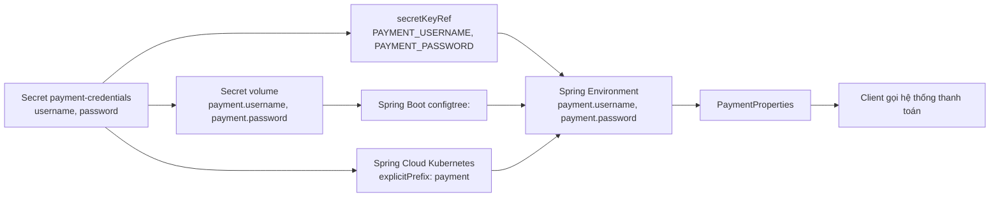

# Ánh xạ dữ liệu Secret sang thuộc tính ứng dụng

## Mục tiêu và tình huống thực tế

Trong module SPRING_CLOUD_KUBERNETES, ứng dụng Spring có thể tích hợp DiscoveryClient, ConfigMap, Secret, Spring Cloud LoadBalancer và Configuration Watcher. Bài này tập trung vào đường đi của dữ liệu Secret đến cấu hình mà mã Java sử dụng. Chọn đúng đường đi giúp ứng dụng nhận đủ thông tin xác thực và xác định có thực sự cần quyền gọi Kubernetes API hay không.

Giả sử `orders-service` cần tên đăng nhập và mật khẩu để gọi hệ thống thanh toán. Nhóm vận hành quản lý Secret `payment-credentials` trong namespace `training`. Hợp đồng cấu hình của ứng dụng gồm:

| Thuộc tính ứng dụng | Kiểu dữ liệu | Ý nghĩa |
| --- | --- | --- |
| `payment.username` | `String` | Tên đăng nhập vào hệ thống thanh toán |
| `payment.password` | `String` | Mật khẩu tương ứng |

Sau bài học, bạn có thể nối key của Secret với hai thuộc tính này qua biến môi trường, file được mount hoặc Secret PropertySource; giải thích quyền cần thiết và lý do cập nhật Secret chưa làm bean đang chạy nhận giá trị mới.

Các ví dụ dùng dữ liệu giả dành cho phòng thực hành. Phần đọc trực tiếp API sử dụng cú pháp **Spring Cloud Kubernetes 3.3.x**, cơ chế Config Data và một Spring Cloud BOM tương thích với Spring Boot của dự án. Khi dùng nhánh khác, đối chiếu tài liệu tương ứng vì tên thuộc tính và mặc định có thể thay đổi.

## 1. Ba tên độc lập trong một phép ánh xạ

Phân biệt:

- `payment-credentials`: tên tài nguyên Kubernetes.
- `username` và `password`: key bên trong tài nguyên đó.
- `payment.username` và `payment.password`: tên thuộc tính mà Spring phải cung cấp cho mã Java.

Tên Secret không tự động trở thành prefix của thuộc tính. Namespace Kubernetes `training` cũng không tương đương prefix `payment` của Spring.

Đọc key `password` từ Secret `payment-credentials` chưa đủ để suy ra `payment.password`. Phải có quy tắc chuyển tên: tên biến môi trường, đường dẫn file, placeholder hoặc cấu hình prefix.



Ba nhánh là ba phương án thay thế cho cùng hợp đồng cấu hình. Khi thực hành, chọn một phương án để dễ xác định nguồn cung cấp giá trị.

## 2. Chuẩn bị Secret dùng chung

Manifest phòng thực hành:

```yaml
apiVersion: v1
kind: Secret
metadata:
  name: payment-credentials
  namespace: training
type: Opaque
stringData:
  username: "orders-lab-user"
  password: "lab-only-change-me"
```

`stringData` cho phép khai báo chuỗi thông thường; Kubernetes chuyển chúng thành dữ liệu trong `data` có biểu diễn Base64. Base64 là cách biểu diễn dữ liệu, không phải mã hóa bảo mật. Khi dùng các cơ chế tích hợp trong bài, Java nhận giá trị đã được giải mã; không giải mã Base64 lần thứ hai. Xem quy tắc `data`/`stringData` trong [tài liệu Secret của Kubernetes](https://kubernetes.io/docs/concepts/configuration/secret/).

Namespace `training` phải tồn tại trước khi áp dụng manifest. `secretKeyRef` và Secret volume tham chiếu tài nguyên trong cùng namespace với Pod. Với phương án đọc API, namespace mà client tìm kiếm và quyền được cấp phải phù hợp.

Secret tồn tại chưa chứng minh phép ánh xạ đúng. Bạn còn phải xác minh key, tên thuộc tính đích và kiểu dữ liệu.

## 3. Ràng buộc hợp đồng cấu hình trong Java

Cả ba phương án đều đưa dữ liệu về cùng lớp cấu hình. Ví dụ dùng Java record và Jakarta Validation:

```java
package example.orders;

import jakarta.validation.constraints.NotBlank;

import org.springframework.boot.context.properties.ConfigurationProperties;
import org.springframework.validation.annotation.Validated;

@ConfigurationProperties(prefix = "payment")
@Validated
public record PaymentProperties(
        @NotBlank String username,
        @NotBlank String password) {

    @Override
    public String toString() {
        return "PaymentProperties[redacted]";
    }
}
```

Đăng ký lớp cấu hình tại ứng dụng:

```java
package example.orders;

import org.slf4j.Logger;
import org.slf4j.LoggerFactory;

import org.springframework.boot.ApplicationRunner;
import org.springframework.boot.SpringApplication;
import org.springframework.boot.autoconfigure.SpringBootApplication;
import org.springframework.boot.context.properties.EnableConfigurationProperties;
import org.springframework.context.annotation.Bean;

@SpringBootApplication
@EnableConfigurationProperties(PaymentProperties.class)
public class OrdersApplication {

    private static final Logger log =
            LoggerFactory.getLogger(OrdersApplication.class);

    public static void main(String[] args) {
        SpringApplication.run(OrdersApplication.class, args);
    }

    @Bean
    ApplicationRunner reportBinding(PaymentProperties properties) {
        return args -> log.info("PAYMENT_CONFIGURATION_BOUND");
    }
}
```

Dự án cần một triển khai Bean Validation, thường được cung cấp qua dependency:

```xml
<dependency>
    <groupId>org.springframework.boot</groupId>
    <artifactId>spring-boot-starter-validation</artifactId>
</dependency>
```

`@NotBlank` làm khởi động thất bại khi thuộc tính thiếu hoặc chỉ chứa khoảng trắng. Dòng log cố định xác nhận đối tượng cấu hình đã được tạo; nó không chứng minh hệ thống thanh toán chấp nhận credential. Record ghi đè `toString()` để tránh vô tình hiển thị hai giá trị khi log đối tượng.

Lớp nghiệp vụ nhận `PaymentProperties` qua constructor và sử dụng `username()`, `password()` để tạo client. Việc chọn nguồn Secret nằm ở cấu hình triển khai, không nằm trong logic gọi dịch vụ.

Spring Boot cung cấp binding và validation cho `@ConfigurationProperties`, cũng như quy tắc ánh xạ biến môi trường và cây file. Xem [Externalized Configuration của Spring Boot](https://docs.spring.io/spring-boot/reference/features/external-config.html).

## 4. Phương án A: ánh xạ qua biến môi trường

Kubernetes lấy từng key và đặt tên biến môi trường theo hợp đồng Spring:

```yaml
apiVersion: apps/v1
kind: Deployment
metadata:
  name: orders-service
  namespace: training
spec:
  replicas: 1
  selector:
    matchLabels:
      app: orders-service
  template:
    metadata:
      labels:
        app: orders-service
    spec:
      containers:
        - name: orders-service
          image: orders-service:secrets-lab
          env:
            - name: SPRING_APPLICATION_NAME
              value: orders-service
            - name: PAYMENT_USERNAME
              valueFrom:
                secretKeyRef:
                  name: payment-credentials
                  key: username
            - name: PAYMENT_PASSWORD
              valueFrom:
                secretKeyRef:
                  name: payment-credentials
                  key: password
```

Thay `orders-service:secrets-lab` bằng image của ứng dụng đã có trong registry hoặc được nạp vào cluster thực hành. Ở phương án này, ứng dụng không tự gọi Kubernetes API để lấy Secret. Phần binding cần Spring Boot; không cần thêm starter cấu hình Kubernetes chỉ để sử dụng `secretKeyRef`.

Chuỗi ánh xạ của mật khẩu:

```text
Secret training/payment-credentials
  key password
    -> biến môi trường PAYMENT_PASSWORD
      -> thuộc tính payment.password
        -> PaymentProperties.password()
```

`secretKeyRef.name` chọn tài nguyên; `secretKeyRef.key` chọn dữ liệu; `env.name` quyết định tên biến mà tiến trình nhận. Cú pháp được mô tả trong [hướng dẫn đưa Secret vào container](https://kubernetes.io/docs/tasks/inject-data-application/distribute-credentials-secure/).

### Tên biến hiện có không khớp hợp đồng

Nếu nền tảng đã chuẩn hóa hai biến `PAYMENT_LOGIN` và `PAYMENT_TOKEN`, giữ hợp đồng Java bằng placeholder trong `application.yaml`:

```yaml
payment:
  username: ${PAYMENT_LOGIN}
  password: ${PAYMENT_TOKEN}
```

Hai placeholder nối tên biến của nền tảng với thuộc tính của ứng dụng. Deployment phải khai báo `PAYMENT_LOGIN` và `PAYMENT_TOKEN` tương ứng.

Không đặt mật khẩu mặc định để ứng dụng tiếp tục chạy khi Secret bắt buộc bị thiếu. Validation giúp phát hiện ngay lỗi cung cấp cấu hình.

### Vì sao envFrom có thể không cho kết quả mong muốn?

```yaml
envFrom:
  - secretRef:
      name: payment-credentials
```

Đoạn này lấy tên key làm tên biến môi trường. Với Secret mẫu, container nhận `username` và `password`; chúng không tự trở thành `PAYMENT_USERNAME` và `PAYMENT_PASSWORD`.

Nếu muốn dùng `envFrom`, cần thiết kế key phù hợp hoặc thêm quy tắc chuyển tên. Khi chỉ có vài thuộc tính, `secretKeyRef` thể hiện rõ từng ánh xạ ngay trong Deployment.

## 5. Phương án B: mount Secret và nhập bằng configtree:

Mỗi giá trị được đưa vào một file. Spring Boot dùng tên file làm tên thuộc tính và nội dung file làm giá trị.

Thay phần `spec.template.spec` của Deployment phương án A bằng đoạn sau, giữ nguyên metadata, selector và label:

```yaml
containers:
  - name: orders-service
    image: orders-service:secrets-lab
    env:
      - name: SPRING_APPLICATION_NAME
        value: orders-service
      - name: SPRING_CONFIG_IMPORT
        value: "configtree:/etc/secrets/payment/"
    volumeMounts:
      - name: payment-credentials
        mountPath: /etc/secrets/payment
        readOnly: true
volumes:
  - name: payment-credentials
    secret:
      secretName: payment-credentials
      items:
        - key: username
          path: payment.username
        - key: password
          path: payment.password
```

Kết quả trong container:

```text
/etc/secrets/payment/
├── payment.username
└── payment.password
```

`items[].path` đổi key `username` thành file `payment.username`. Với root import `/etc/secrets/payment/`, tên thư mục `payment` không được cộng thêm vào thuộc tính; chính tên file cung cấp prefix.

| Key của Secret | File tương đối trong volume | Thuộc tính đích |
| --- | --- | --- |
| `username` | `payment.username` | `payment.username` |
| `password` | `payment.password` | `payment.password` |

Bỏ `PAYMENT_USERNAME` và `PAYMENT_PASSWORD` của phương án A khi muốn quan sát riêng nguồn file. Nếu chúng còn tồn tại, chúng có thể che giá trị được import.

Ví dụ dùng import bắt buộc, không thêm `optional:`. Validation vẫn cần thiết để phát hiện thiếu một thuộc tính cụ thể dù thư mục import tồn tại.

### Root import quyết định tên thuộc tính

Nếu giữ tên file `username` và `password` rồi import chính thư mục `/etc/secrets/payment/`, ứng dụng nhận `username` và `password`. Muốn tạo prefix từ tên thư mục, cần chọn root ở mức cha và bố trí cây tương ứng.

Hãy xác định rõ phép biến đổi:

```text
root import + đường dẫn tương đối -> tên thuộc tính Spring
```

Với mật khẩu, nội dung file là dữ liệu cần bảo toàn. Ký tự xuống dòng ngoài ý muốn có thể trở thành một phần giá trị. Không tự động `trim()` mọi Secret để che lỗi ở bước cung cấp dữ liệu.

## 6. Phương án C: Secret PropertySource của Spring Cloud Kubernetes

Khi ứng dụng cần tự lấy cấu hình từ Kubernetes API, Spring Cloud Kubernetes đưa dữ liệu Secret vào `Environment`. Phương án này cần xem xét quyền ServiceAccount và hành vi client.

Các đoạn dưới dùng **nhánh 3.3.x**. Trong nhánh này, bật Secret PropertySource và cho phép đọc qua API là hai thiết lập riêng: `enabled` và `enable-api`. Ví dụ viết tường minh cả hai. Xem [Secrets PropertySource 3.3](https://docs.spring.io/spring-cloud-kubernetes/reference/3.3/property-source-config/secrets-propertysource.html).

### Dependency và cấu hình nguồn

Ví dụ chọn Fabric8:

```xml
<dependency>
    <groupId>org.springframework.cloud</groupId>
    <artifactId>spring-cloud-starter-kubernetes-fabric8-config</artifactId>
</dependency>
```

Version của dependency do Spring Cloud BOM phù hợp quản lý. Nếu dự án đã chọn Kubernetes Java Client, dùng starter tương ứng của cùng họ client. Không ghép hai họ client hoặc thêm starter `all` chỉ để đọc cấu hình. Các nhóm starter được liệt kê trong [tài liệu Spring Cloud Kubernetes](https://docs.spring.io/spring-cloud-kubernetes/reference/getting-started.html).

Cấu hình `application.yaml` cho phòng thực hành:

```yaml
spring:
  application:
    name: orders-service
  config:
    import: "kubernetes:"
  cloud:
    kubernetes:
      config:
        enabled: false
      secrets:
        enabled: true
        enable-api: true
        fail-fast: true
        include-profile-specific-sources: false
        sources:
          - name: payment-credentials
            namespace: training
            explicit-prefix: payment
```

| Thiết lập | Vai trò trong ví dụ |
| --- | --- |
| `spring.config.import: "kubernetes:"` | Kích hoạt Config Data cho nguồn Kubernetes |
| `config.enabled: false` | Phòng thực hành chỉ lấy nguồn Secret |
| `secrets.enabled: true` | Cho phép tạo Secret PropertySource |
| `secrets.enable-api: true` | Cho phép đọc API ở nhánh 3.3.x |
| `sources[].name` và `namespace` | Chọn Secret đã chuẩn bị |
| `sources[].explicit-prefix: payment` | Đưa `username` về `payment.username` |
| `include-profile-specific-sources: false` | Không tìm thêm nguồn theo profile trong ví dụ |
| `fail-fast: true` | Dừng khởi động khi có lỗi tải nguồn Secret |

Kết quả:

```text
Secret payment-credentials, key username -> payment.username
Secret payment-credentials, key password -> payment.password
```

`explicit-prefix` là prefix do ứng dụng lựa chọn. `use-name-as-prefix` dùng tên tài nguyên và có thể tạo thuộc tính dạng `payment-credentials.username`. Không tự thêm `payment.` vào key rồi tiếp tục dùng `explicit-prefix: payment`, vì có thể tạo tên `payment.payment.username`. Quy tắc prefix cho Secret được giải thích cùng [cấu hình nhiều PropertySource](https://docs.spring.io/spring-cloud-kubernetes/reference/3.3/property-source-config/configmap-propertysource.html).

`fail-fast` xử lý lỗi tải nguồn; nó không thay thế validation hợp đồng. Nguồn tồn tại nhưng thiếu một key vẫn cần bị phát hiện ở lớp cấu hình.

### Phân quyền theo yêu cầu API thực tế

Ví dụ tạo ServiceAccount và cấp quyền `get` cho một Secret:

```yaml
apiVersion: v1
kind: ServiceAccount
metadata:
  name: orders-secret-reader
  namespace: training
---
apiVersion: rbac.authorization.k8s.io/v1
kind: Role
metadata:
  name: read-payment-credentials
  namespace: training
rules:
  - apiGroups: [""]
    resources: ["secrets"]
    resourceNames: ["payment-credentials"]
    verbs: ["get"]
---
apiVersion: rbac.authorization.k8s.io/v1
kind: RoleBinding
metadata:
  name: orders-read-payment-credentials
  namespace: training
subjects:
  - kind: ServiceAccount
    name: orders-secret-reader
    namespace: training
roleRef:
  apiGroup: rbac.authorization.k8s.io
  kind: Role
  name: read-payment-credentials
```

Gắn danh tính đó vào Pod template của Deployment:

```yaml
spec:
  template:
    spec:
      serviceAccountName: orders-secret-reader
```

Role này phục vụ yêu cầu đọc theo tên. Nếu phiên bản hoặc chế độ client dùng `list` hay `watch`, quyền trên chưa đủ. Kiểm tra loại yêu cầu bị từ chối trước khi đổi quyền. Chọn theo label thường cần truy vấn danh sách; label selector không phải ranh giới RBAC giới hạn Secret được đọc. Xem quy tắc `resourceNames` và giới hạn của `list`/`watch` trong [tài liệu RBAC Kubernetes](https://kubernetes.io/docs/reference/access-authn-authz/rbac/).

Khi chuyển từ phương án B sang C, bỏ biến `SPRING_CONFIG_IMPORT=configtree:...`, các biến credential và volume của ví dụ trước. Đưa cấu hình API vào image hoặc một nguồn có sẵn trước bước import. Không đặt tên Secret cần tìm bên trong chính Secret chưa được tải.

Config Data sử dụng `spring.config.import` không được ghép đồng thời với legacy bootstrap. Xem [Kubernetes PropertySource implementations](https://docs.spring.io/spring-cloud-kubernetes/reference/property-source-config.html).

## 7. Một file YAML chứa nhiều giá trị khác với configtree

Có thể chứa toàn bộ cấu hình dưới một key:

```yaml
apiVersion: v1
kind: Secret
metadata:
  name: payment-document
  namespace: training
type: Opaque
stringData:
  application.yaml: |-
    payment:
      username: "orders-lab-user"
      password: "lab-only-change-me"
```

Nếu mount Secret này tại `/etc/secrets/payment-document/`, kết quả là file `application.yaml`. Với cách đọc file của Spring Boot, import tài liệu đó:

```yaml
spring:
  config:
    import: "file:/etc/secrets/payment-document/application.yaml"
```

YAML được phân tích để tạo `payment.username` và `payment.password`. Nếu dùng `configtree:` cho thư mục chỉ chứa file ấy, bạn yêu cầu dùng tên file làm tên thuộc tính, không yêu cầu phân tích cấu trúc YAML bên trong.

| Dữ liệu được mount | Cách import phù hợp |
| --- | --- |
| Mỗi file chứa một giá trị | `configtree:/đường/dẫn/thư/mục/` |
| Một file chứa tài liệu YAML | `file:/đường/dẫn/application.yaml` |
| Một file chứa tài liệu properties | `file:/đường/dẫn/application.properties` |

Nếu đọc tài liệu nhúng qua Secret PropertySource, theo quy tắc xử lý tài liệu của phiên bản Spring Cloud Kubernetes đang dùng. Ví dụ API trong bài chọn các key đơn để phép chuyển prefix dễ theo dõi.

## 8. Trùng thuộc tính và thứ tự ưu tiên

Giả sử file Secret cung cấp `payment.password` mới nhưng Deployment còn biến `PAYMENT_PASSWORD` cũ. Theo cơ chế Config Data, biến môi trường có ưu tiên cao hơn dữ liệu import. Ứng dụng có thể tiếp tục sử dụng giá trị cũ dù file đúng.

Với `spring.config.import`, dữ liệu import có thể ghi đè tài liệu khai báo import; import đứng sau có ưu tiên cao hơn import đứng trước; biến môi trường, Java system properties và đối số dòng lệnh có thể tiếp tục ghi đè dữ liệu import. Xem [thứ tự PropertySource](https://docs.spring.io/spring-cloud-kubernetes/reference/property-source-config.html).

Khi chẩn đoán đúng thuộc tính `payment.password`, kiểm tra:

| Nguồn | Câu cần xác minh |
| --- | --- |
| Secret được chọn | Đúng namespace, tên và key chưa? |
| Biến môi trường của Pod template | Còn `PAYMENT_PASSWORD` hoặc placeholder trỏ đến biến khác không? |
| File import | Có file khác khai báo cùng key không? |
| Tham số khởi chạy | Script có thêm thuộc tính ghi đè không? |
| Profile active | Có làm thay đổi tập nguồn được tải không? |

Với nhiều Secret, dùng các prefix nghiệp vụ như `payment` và `messaging` thay vì đưa mọi key `username`, `password` vào cùng vùng tên. Cách tổ chức này làm rõ bên sở hữu thuộc tính và giảm phụ thuộc vào thứ tự nguồn.

## 9. Binding thành công chưa đồng nghĩa cập nhật động

Ba thời điểm cần phân biệt:

1. Kubernetes nhận phiên bản mới của Secret.
2. Nguồn dữ liệu mà tiến trình có thể đọc được cập nhật.
3. Bean hoặc client đang chạy sử dụng credential mới.

| Phương án | Khi Secret thay đổi | Việc ứng dụng cần tính đến |
| --- | --- | --- |
| Biến môi trường | Tiến trình giữ giá trị môi trường cũ | Tạo lại Pod hoặc restart container theo kế hoạch |
| Secret volume | File có thể cập nhật sau một khoảng trễ; `subPath` không nhận cập nhật tự động | Bean đã bind và client đang giữ mật khẩu cần cơ chế cập nhật hoặc khởi động lại |
| API PropertySource | Tải lúc khởi động không tự tạo luồng theo dõi | Cần thiết kế thêm phát hiện thay đổi, refresh và tạo lại đối tượng liên quan |

Kubernetes mô tả cập nhật volume và ngoại lệ `subPath` trong [tài liệu Secret volume](https://kubernetes.io/docs/concepts/configuration/secret/). Hành vi của biến môi trường được nêu trong [hướng dẫn phân phối credential](https://kubernetes.io/docs/tasks/inject-data-application/distribute-credentials-secure/).

Với `PaymentProperties` là record, coi giá trị đã bind là ảnh chụp khi tạo bean. Một HTTP client hoặc connection pool còn có thể giữ bản sao credential. Thấy file mới chưa đủ để khẳng định request tiếp theo dùng mật khẩu mới.

Configuration Watcher là tính năng khác trong module. Khi sử dụng, phải quyết định bean nào có thể refresh và client nào phải tạo lại. Bài thực hành này yêu cầu binding đúng khi khởi động; rolling restart là cách áp dụng thay đổi rõ ràng.

Health probe có ý nghĩa riêng. Pod `Running` hoặc liveness probe thành công chưa chứng minh credential gọi hệ thống ngoài là hợp lệ.

## 10. Chẩn đoán theo từng ranh giới

Kiểm tra lần lượt:

```text
Secret tồn tại
  -> key tồn tại
    -> container nhận đúng biến/file hoặc API đọc được
      -> tên thuộc tính đúng
        -> nguồn không bị ghi đè
          -> binding thành công
            -> hệ thống ngoài xác thực thành công
```

| Hiện tượng | Khả năng cần kiểm tra |
| --- | --- |
| `CreateContainerConfigError` | Secret hoặc key mà `secretKeyRef` yêu cầu không tồn tại |
| `FailedMount` | Tên Secret, key trong `items` hoặc điều kiện mount chưa đúng |
| Không bind được `payment.username` | Dữ liệu đang có tên `username` hoặc prefix khác |
| API trả `403 Forbidden` | ServiceAccount, namespace, RoleBinding hoặc verb không khớp |
| API đọc được nhưng property thiếu | Import chưa kích hoạt, sai nguồn hoặc prefix |
| Có file YAML nhưng thiếu thuộc tính con | Đã dùng `configtree:` trong khi cần import tài liệu YAML |
| Secret mới nhưng giá trị sử dụng chưa đổi | Biến môi trường cũ, bean chưa tạo lại hoặc nguồn ưu tiên cao hơn |
| Giá trị giống Base64 hoặc xác thực thất bại bất thường | Encode hai lần hoặc ký tự xuống dòng ngoài ý muốn |
| Binding thành công nhưng hệ thống đích trả `401` | Credential không hợp lệ ở hệ thống đích; kiểm tra vòng đời ở cả hai phía |

Các lệnh xem metadata và trạng thái triển khai:

```bash
kubectl get secret payment-credentials -n training
kubectl get deployment orders-service -n training
kubectl get pods -n training -l app=orders-service
kubectl describe pod POD_NAME -n training
kubectl logs deployment/orders-service -n training
```

Thay `POD_NAME` bằng Pod cần kiểm tra. Dòng `PAYMENT_CONFIGURATION_BOUND` là dấu hiệu của binding. Khi chia sẻ log, chỉ trích phần lỗi cần thiết và kiểm tra nội dung trước khi gửi.

Với phương án API, người có quyền impersonation có thể kiểm tra danh tính ServiceAccount:

```bash
kubectl auth can-i get secret/payment-credentials -n training --as=system:serviceaccount:training:orders-secret-reader
```

`yes` chỉ xác nhận phép kiểm tra quyền đó, không thay thế kiểm tra binding hoặc xác thực hệ thống thanh toán. Lệnh có thể bị từ chối nếu người chạy không có quyền impersonation.

## 11. Thực hành kiểm chứng hợp đồng ánh xạ

Thực hiện trong namespace thực hành với image ứng dụng đã chuẩn bị. Lưu các đoạn manifest thành file trong môi trường thực hành của bạn và áp dụng chúng bằng `kubectl apply -f`:

1. **Chạy phương án A.** Tạo namespace `training` nếu chưa có, áp dụng Secret và Deployment. Chờ rollout và tìm dấu hiệu binding thành công.
2. **Làm sai tên biến đích.** Đổi `PAYMENT_PASSWORD` thành `UNUSED_PAYMENT_PASSWORD` trong Deployment thực hành rồi áp dụng. Khi không có nguồn credential khác, validation của `payment.password` phải làm ứng dụng khởi động thất bại. Khôi phục tên đúng.
3. **Chuyển sang phương án B.** Thay Pod spec bằng ví dụ volume, bỏ biến credential cũ. Ứng dụng phải bind được cùng lớp `PaymentProperties` mà không sửa logic nghiệp vụ.
4. **Làm sai tên file.** Đổi `items[].path` của key `password` thành `password`. File vẫn có dữ liệu nhưng `payment.password` bị thiếu. Khôi phục tên `payment.password`.
5. **Thay mật khẩu giả trong Secret.** Sau khi áp dụng thay đổi, rolling restart để tạo bean từ nguồn mới. Xác minh rollout và binding; dùng hệ thống thanh toán thử nghiệm nếu cần kiểm tra credential được chấp nhận.

Theo dõi vòng triển khai:

```bash
kubectl rollout status deployment/orders-service -n training
kubectl rollout restart deployment/orders-service -n training
kubectl rollout status deployment/orders-service -n training
```

Chỉ chạy `rollout restart` sau khi áp dụng thay đổi cần thử nghiệm. Nếu thử phương án API, thực hiện riêng với cấu hình và ServiceAccount ở mục 6, đồng thời loại bỏ những nguồn còn lại.

Kết quả cần mô tả cho mỗi phương án:

```text
Nguồn: Secret training/payment-credentials
Key: password
Đường chuyển: secretKeyRef -> PAYMENT_PASSWORD
Thuộc tính: payment.password
Đối tượng nhận: PaymentProperties.password()
Thời điểm nhận: khi ứng dụng khởi động
Áp dụng thay đổi: tạo lại Pod theo kế hoạch triển khai
```

Mô tả này nối công việc cung cấp Secret của người vận hành với hợp đồng Java của người phát triển. Nó cũng là căn cứ để quyết định có cần Secret PropertySource và Configuration Watcher, hay các cơ chế sẵn có của Kubernetes cùng Spring Boot đã đáp ứng yêu cầu.
