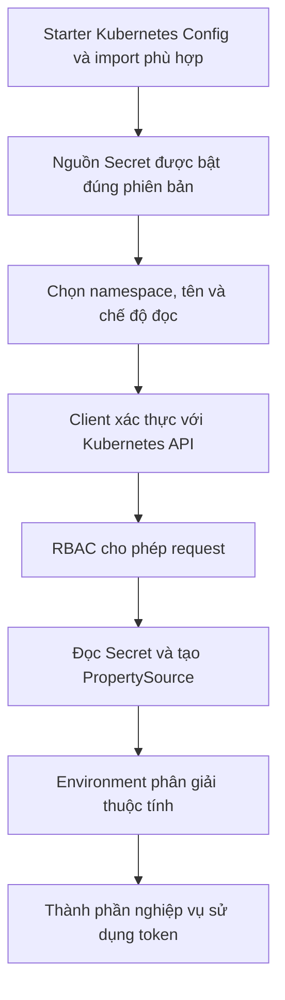

# Bật đọc Secret qua API một cách tường minh

Trong chương **Secret** của module **SPRING_CLOUD_KUBERNETES**, đọc Secret qua Kubernetes API là một lựa chọn cần được khai báo rõ. Ứng dụng không nên vô tình có quyền đọc bí mật chỉ vì đã thêm thư viện tích hợp Kubernetes.

Để đường nạp hoạt động, cần đồng thời có dependency phù hợp, cấu hình bật đúng theo phiên bản, resource đích rõ ràng, danh tính Kubernetes và quyền đọc tương ứng. Sau khi nạp, dữ liệu vẫn phải được bảo vệ trong bộ nhớ, log và công cụ chẩn đoán của ứng dụng Spring.

Bài này dùng một token mô phỏng cho `payments-service`. Các manifest và lệnh là hướng dẫn thực hành; bài không thực hiện tạo Secret, cấp quyền hay gọi API trên một cluster.

## 1. Phân biệt đọc API với Secret được đưa vào container

Một ứng dụng có thể nhận cùng loại dữ liệu bằng nhiều đường:

| Đường cung cấp | Thành phần lấy dữ liệu từ Kubernetes | Điều ứng dụng nhìn thấy |
| --- | --- | --- |
| `secretKeyRef` trong `env` | Hạ tầng Kubernetes | Biến môi trường |
| Secret volume | Hạ tầng Kubernetes | File trong container |
| Spring Cloud Kubernetes đọc API | Kubernetes client trong ứng dụng | Thuộc tính từ nguồn Secret |

Với hai cách đầu, nhận dữ liệu từ Secret không đồng nghĩa ứng dụng phải được cấp quyền trực tiếp `get secrets`. Với cách thứ ba, tiến trình ứng dụng dùng danh tính của mình để yêu cầu API trả nội dung Secret.

Token dùng để **xác thực với Kubernetes API** khác với token nghiệp vụ **đọc từ Secret để gọi hệ thống thanh toán**. Không dùng lẫn hai loại token này.

Tài liệu [Secrets PropertySource](https://docs.spring.io/spring-cloud-kubernetes/reference/property-source-config/secrets-propertysource.html) giải thích các đường đọc và khuyến nghị cân nhắc mounted volumes. Trong bài này, ta chủ động chọn API để hiểu các điều kiện cần thiết và phạm vi quyền phát sinh.

## 2. Cờ bật thay đổi theo phiên bản

Không có một đoạn YAML áp dụng nguyên vẹn cho mọi dòng Spring Cloud Kubernetes.

### Dòng 3.3.x: phân biệt enabled và enable-api

Trong tài liệu 3.3, hai thuộc tính có vai trò riêng:

| Thuộc tính | Ý nghĩa |
| --- | --- |
| `spring.cloud.kubernetes.secrets.enabled` | Bật nguồn cấu hình Secret |
| `spring.cloud.kubernetes.secrets.enable-api` | Cho phép đường đọc Secret qua API |

Phụ lục 3.3 ghi `enabled` mặc định là `true`, còn `enable-api` mặc định là `false`. Khi chủ động đọc API, nên viết rõ cả hai:

```yaml
spring:
  config:
    import: "kubernetes:"
  cloud:
    kubernetes:
      config:
        enabled: false
      secrets:
        enabled: true
        enable-api: true
        name: payments-api-credentials
        namespace: payments
        include-profile-specific-sources: false
        use-name-as-prefix: false
```

Đoạn trên dành cho dòng có thuộc tính `enable-api`; xem [Common application properties 3.3](https://docs.spring.io/spring-cloud-kubernetes/reference/3.3/appendix.html). Chỉ đặt `enabled: true` chưa đủ để bật API trong cơ chế này.

Cấu trúc cấu hình được thể hiện trong [SecretsConfigProperties của phiên bản 3.3.3](https://github.com/spring-cloud/spring-cloud-kubernetes/blob/v3.3.3/spring-cloud-kubernetes-commons/src/main/java/org/springframework/cloud/kubernetes/commons/config/SecretsConfigProperties.java).

### Phiên bản 5.1.0: enabled và lựa chọn chế độ đọc

Ở 5.1.0, lớp `SecretsConfigProperties` không còn tham số `enableApi`; nó có `enabled` với mặc định `false` và `readType`. Không lấy cờ cũ làm bằng chứng rằng API đã được bật trên dòng này. Xem [SecretsConfigProperties 5.1.0](https://github.com/spring-cloud/spring-cloud-kubernetes/blob/v5.1.0/spring-cloud-kubernetes-commons/src/main/java/org/springframework/cloud/kubernetes/commons/config/SecretsConfigProperties.java).

**Ví dụ chính từ mục 4 sử dụng cơ chế 5.1.0, Fabric8 và chế độ SINGLE đọc theo tên.** Đây là phạm vi của ví dụ, không phải khẳng định repository của người học đang dùng phiên bản đó.

Khi áp dụng vào dự án:

1. Xác định phiên bản thực tế từ bộ dependency/BOM của dự án.
2. Tra tài liệu đúng dòng phiên bản.
3. Chọn cấu hình tương ứng, thay vì trộn cờ của 3.3 với chế độ đọc của 5.1.
4. Đối chiếu quyền RBAC với request mà client thực sự tạo.

Một thuộc tính xuất hiện trong file YAML không chứng minh framework đã nhận diện và sử dụng nó.

## 3. Những điều kiện phải cùng được đáp ứng

Có thể hình dung đường nạp như sau:



Các điều kiện này độc lập:

- Bật tính năng không tự tạo quyền.
- Có RoleBinding không tự bật nguồn Secret.
- Đặt tên Secret không đảm bảo nó tồn tại.
- API trả thành công không đảm bảo ứng dụng dùng đúng khóa.
- Đọc được thuộc tính không chứng minh nó đến từ Secret nếu có nguồn khác ghi đè.

Ứng dụng cần starter Config tương thích với Spring Boot và Spring Cloud đang dùng. Ví dụ Fabric8 sử dụng `spring-cloud-starter-kubernetes-fabric8-config` theo bộ phiên bản phù hợp. Starter chỉ phục vụ discovery không thay thế loader cấu hình Secret.

Với Config Data, khai báo `spring.config.import: "kubernetes:"`. Không đồng thời dùng legacy bootstrap để nạp lại cùng các Kubernetes properties. Cơ chế import được trình bày trong [Kubernetes PropertySource implementations](https://docs.spring.io/spring-cloud-kubernetes/reference/property-source-config.html).

## 4. Khai báo tường minh cho ví dụ 5.1.0

Giả sử ứng dụng chạy trong namespace `payments`, dùng Secret tên `payments-api-credentials`:

```yaml
spring:
  application:
    name: payments-service
  config:
    import: "kubernetes:"
  cloud:
    kubernetes:
      config:
        enabled: false
      discovery:
        enabled: false
      secrets:
        enabled: true
        read-type: SINGLE
        name: payments-api-credentials
        namespace: payments
        include-profile-specific-sources: false
        use-name-as-prefix: false
        fail-fast: true
        retry:
          enabled: false
      sanitize:
        secrets: true
```

Ý nghĩa của các lựa chọn:

| Lựa chọn | Mục đích |
| --- | --- |
| `secrets.enabled: true` | Chủ động bật nguồn Secret ở phiên bản đang minh họa |
| `read-type: SINGLE` | Đọc nguồn theo tên thay vì tải batch toàn namespace |
| `name` và `namespace` | Xác định resource đích |
| Tắt profile-specific sources | Tránh tìm thêm tên Secret theo profile |
| Tắt prefix | Giữ tên khóa nghiệp vụ như đã khai báo |
| `fail-fast: true` | Yêu cầu xử lý lỗi tải theo chính sách fail-fast |
| Tắt retry | Giữ ví dụ khởi động đơn giản, không thêm vòng thử lại |
| `sanitize.secrets: true` | Bổ sung cơ chế che dữ liệu Secret của tích hợp |

Phụ lục có thuộc tính `spring.cloud.kubernetes.secrets.read-type`; xem [Common application properties](https://docs.spring.io/spring-cloud-kubernetes/reference/appendix.html). Cơ chế đọc theo tên cũng được sử dụng bởi [Fabric8SecretsPropertySourceLocator 5.1.0](https://github.com/spring-cloud/spring-cloud-kubernetes/blob/v5.1.0/spring-cloud-kubernetes-fabric8-config/src/main/java/org/springframework/cloud/kubernetes/fabric8/config/Fabric8SecretsPropertySourceLocator.java).

ConfigMap và discovery được tắt vì ví dụ chỉ cần đọc một Secret. LoadBalancer, health indicator và Configuration Watcher không phải điều kiện bắt buộc để thực hiện bước đọc này.

Cấu hình bật API, tên nguồn và namespace phải có sẵn trước khi loader đọc Secret. Không đặt duy nhất cờ bật hoặc tên nguồn bên trong chính Secret đang chờ được tìm.

## 5. Secret đích và tên thuộc tính

Resource mô phỏng:

```yaml
apiVersion: v1
kind: Secret
metadata:
  name: payments-api-credentials
  namespace: payments
type: Opaque
stringData:
  payments.api.token: "DEMO_ONLY_NOT_A_REAL_TOKEN"
```

Chuỗi trên chỉ là dữ liệu giả để minh họa hợp đồng. Dữ liệu thật cần được cung cấp qua quy trình quản lý bí mật của môi trường triển khai.

Có ba tên cần phân biệt:

| Tên | Vai trò |
| --- | --- |
| `payments-service` | Tên ứng dụng Spring |
| `payments-api-credentials` | Tên resource Secret |
| `payments.api.token` | Khóa cấu hình mà thành phần nghiệp vụ đọc |

Chọn Secret theo tên không bắt buộc tên resource phải bằng tên ứng dụng. Với prefix tắt, khóa không tự trở thành `payments-api-credentials.payments.api.token`.

Kubernetes nhận dữ liệu `stringData` và biểu diễn dữ liệu Secret qua trường `data` trong API. Base64 là biểu diễn mã hóa, không phải cơ chế mã hóa bảo mật. Tài liệu [Kubernetes Secrets](https://kubernetes.io/docs/concepts/configuration/secret/) mô tả cấu trúc và cách sử dụng resource.

Đường tích hợp đưa giá trị đã xử lý từ Secret vào nguồn cấu hình. Ứng dụng không nên tự giải mã Base64 lần thứ hai đối với giá trị token đã nhận từ `Environment`.

## 6. Dùng ServiceAccount riêng và Role giới hạn theo tên

Danh tính của Pod trong ví dụ là `payments/payments-app`:

```yaml
apiVersion: v1
kind: ServiceAccount
metadata:
  name: payments-app
  namespace: payments
```

Với **SINGLE, nguồn theo tên, không tìm biến thể profile và không bật watcher**, có thể cấp quyền đọc riêng resource:

```yaml
apiVersion: rbac.authorization.k8s.io/v1
kind: Role
metadata:
  name: payments-credentials-reader
  namespace: payments
rules:
  - apiGroups: [""]
    resources: ["secrets"]
    resourceNames: ["payments-api-credentials"]
    verbs: ["get"]
---
apiVersion: rbac.authorization.k8s.io/v1
kind: RoleBinding
metadata:
  name: payments-credentials-reader
  namespace: payments
subjects:
  - kind: ServiceAccount
    name: payments-app
    namespace: payments
roleRef:
  apiGroup: rbac.authorization.k8s.io
  kind: Role
  name: payments-credentials-reader
```

Gắn ServiceAccount vào Pod template của Deployment đã có:

```yaml
spec:
  template:
    spec:
      serviceAccountName: payments-app
      automountServiceAccountToken: true
```

Đây là phần bổ sung cho Deployment, không phải manifest triển khai hoàn chỉnh. Trong ví dụ dùng xác thực in-cluster thông thường, client cần credential Kubernetes của ServiceAccount được cung cấp cho Pod. Nếu môi trường dùng cơ chế credential khác, phải cấu hình đường xác thực tương ứng.

Không gắn token nghiệp vụ `payments.api.token` vào cấu hình xác thực Kubernetes client. Không chép kubeconfig quản trị vào Pod để tránh thiết lập ServiceAccount.

Role mẫu không cấp:

- Đọc mọi Secret trong namespace.
- Liệt kê Secret.
- Theo dõi thay đổi Secret.
- Ghi, sửa hoặc xóa Secret.
- Quyền trên ConfigMap, Pod, Service hay tài nguyên toàn cluster.

Quy tắc `resourceNames` và ý nghĩa từng verb được mô tả trong [Using RBAC Authorization](https://kubernetes.io/docs/reference/access-authn-authz/rbac/).

Quyền RBAC là cộng dồn. Nếu ServiceAccount còn được cấp quyền từ RoleBinding hoặc ClusterRoleBinding khác, tổng quyền có thể rộng hơn Role mẫu.

## 7. Vì sao không dùng get-only cho mọi phiên bản?

Role giới hạn tên chỉ hoạt động khi các request thực tế phù hợp. Đặc biệt:

| Cách đọc | Hệ quả cần xem xét |
| --- | --- |
| Đọc trực tiếp theo tên | Có thể dùng `get` với `resourceNames` |
| Đọc batch rồi lọc trong client | Cần quyền phù hợp cho request `list` |
| Chọn Secret theo label | Có thể cần liệt kê nhiều resource |
| Theo dõi thay đổi | Cần xem thêm request `watch` và danh tính watcher |

Không áp nguyên Role get-only của ví dụ 5.1.0 vào một ứng dụng 3.3.x rồi cho rằng chỉ cần thêm `enable-api: true` là đủ. Phải xác nhận cơ chế đọc của phiên bản và client đó.

Nếu client bắt buộc list trong namespace, việc cấp quyền đó là một thay đổi phạm vi truy cập đáng kể. Kubernetes nhấn mạnh quyền `list` Secret cho phép đọc cả nội dung, không chỉ danh sách tên; xem [Good practices for Kubernetes Secrets](https://kubernetes.io/docs/concepts/security/secrets-good-practices/).

Một bộ lọc `name` hoặc `labels` trong cấu hình Spring không tự tạo giới hạn bảo mật trên API. API chỉ thực thi chính sách authorization đối với request nó nhận.

Khi cần giảm phạm vi mà client hiện tại vẫn đòi list rộng, các lựa chọn thiết kế gồm dùng cơ chế đọc theo tên đã được phiên bản hỗ trợ, tách namespace phù hợp hoặc chuyển sang đường cung cấp Secret khác. Không chữa lỗi Forbidden bằng cách cấp `cluster-admin`.

Cũng không thêm `watch` chỉ vì ứng dụng chạy trên Kubernetes. Đọc cấu hình khi khởi động và theo dõi thay đổi là hai nhu cầu riêng.

## 8. Xác minh việc nạp mà không in token

Có thể bổ sung bean sau vào lớp cấu hình Spring của ứng dụng demo:

```java
import org.springframework.boot.ApplicationRunner;
import org.springframework.context.annotation.Bean;
import org.springframework.core.env.Environment;

@Bean
ApplicationRunner verifyCredentialPresence(Environment environment) {
    return args -> {
        String token = environment.getProperty("payments.api.token");

        if (token == null || token.isBlank()) {
            throw new IllegalStateException(
                    "Thiếu cấu hình bắt buộc payments.api.token");
        }

        System.out.println("Cấu hình token bắt buộc đã hiện diện");
    };
}
```

Các dòng import đặt ở đầu file Java; phương thức `@Bean` nằm trong lớp `@Configuration` hoặc `@SpringBootApplication`.

Đoạn này không in giá trị token, độ dài hoặc bản mã của nó. Nó chỉ kiểm tra điều kiện hiện diện trong ví dụ. Thành phần gọi hệ thống thanh toán vẫn cần nhận và sử dụng token đúng cách.

Kết quả dự kiến khi mọi điều kiện của ví dụ được đáp ứng:

```text
Cấu hình token bắt buộc đã hiện diện
```

Thông báo đó chưa đủ chứng minh token đến từ Kubernetes API, vì cùng khóa có thể tồn tại trong nguồn khác. Khi xác minh đường nạp:

1. Kiểm tra tên, namespace và chế độ đọc hiệu lực.
2. Kiểm tra PropertySource hoặc thông tin origin mà công cụ chẩn đoán cung cấp.
3. Kiểm tra ServiceAccount và quyền thực tế.
4. Đảm bảo bản demo không còn giá trị mặc định, biến môi trường hay file mount cung cấp cùng khóa.
5. Quan sát metadata request phù hợp nếu môi trường có công cụ audit đã cấu hình.

Không dump toàn bộ `Environment`, response Secret hoặc đối tượng credentials để tìm nguồn. Việc che dữ liệu ở Actuator không tự bảo vệ mọi câu lệnh log của ứng dụng.

## 9. Lệnh kiểm tra quyền và danh tính

Các lệnh sau chỉ là hướng dẫn cho môi trường thực hành. Tài khoản chạy lệnh impersonation phải có quyền tương ứng.

### Kiểm tra Pod dùng ServiceAccount nào

Thay `<pod-name>` bằng tên Pod:

```bash
kubectl -n payments get pod <pod-name> -o 'jsonpath={.spec.serviceAccountName}'
```

Giá trị mong đợi là `payments-app`. Quyền của tài khoản người vận hành không chứng minh quyền của tiến trình trong Pod.

### Kiểm tra quyền đọc đúng resource

```bash
kubectl auth can-i get secret/payments-api-credentials -n payments --as=system:serviceaccount:payments:payments-app
```

Với Role mẫu, kết quả dự kiến là `yes`.

Kiểm tra phạm vi không cần dùng:

```bash
kubectl auth can-i list secrets -n payments --as=system:serviceaccount:payments:payments-app
kubectl auth can-i get secret/unrelated-credentials -n payments --as=system:serviceaccount:payments:payments-app
kubectl auth can-i watch secrets -n payments --as=system:serviceaccount:payments:payments-app
```

Kết quả dự kiến là `no` nếu không có grant khác mở rộng quyền. Đây là kiểm tra authorization, không đọc nội dung token. Nếu lệnh bị từ chối ở bước impersonation, phải phân biệt lỗi đó với quyền của ServiceAccount.

Có thể xác nhận resource tồn tại mà chỉ in tên:

```bash
kubectl -n payments get secret payments-api-credentials -o name
```

Tránh dùng output YAML/JSON đầy đủ hoặc lệnh giải mã token làm bằng chứng trong log triển khai. Output Base64 vẫn là dữ liệu bí mật có thể phục hồi.

## 10. Phân loại lỗi trước khi sửa cấu hình

| Hiện tượng | Điều cần kiểm tra |
| --- | --- |
| Không xuất hiện nguồn Kubernetes | Dependency, Config Data import và cơ chế khởi động |
| Dòng 3.3.x bật nguồn nhưng không gọi API | Giá trị hiệu lực của `secrets.enable-api` |
| 5.1.0 vẫn không nạp Secret | `enabled`, tên, namespace và chế độ đọc |
| API trả 401 | Credential Kubernetes của client |
| API trả 403 | Danh tính và quyền đối với request cụ thể |
| Lỗi kết nối hoặc TLS | Địa chỉ API, mạng, CA và cấu hình client |
| Resource không được tìm thấy | Tên, namespace, profile-aware sources |
| Secret nạp được nhưng thiếu khóa | Tên khóa, prefix và nội dung resource |
| Giá trị hiện diện nhưng nghiệp vụ bị từ chối | Token nghiệp vụ, quyền của token và nơi sử dụng |

Đừng tắt kiểm tra TLS để xử lý lỗi RBAC. Cũng không mở rộng quyền Secret để xử lý một lỗi tên khóa hoặc binding.

`fail-fast` giúp áp dụng chính sách khi lỗi tải nguồn xảy ra; nó không thay thế kiểm tra thuộc tính bắt buộc. Cách xử lý một resource không có, lỗi API và dữ liệu không đáp ứng yêu cầu cần được xác nhận theo phiên bản đang dùng.

Retry có thể hữu ích với lỗi tạm thời. Nó không tạo quyền mới cho một request bị Forbidden và không làm một tên Secret sai trở thành đúng.

Một ứng dụng khởi động được có thể đang dùng credential cũ từ nguồn khác. Vì vậy, kiểm tra “có giá trị” cần đi cùng kiểm tra “đúng nguồn”.

## 11. Bảo vệ dữ liệu sau khi đã đọc thành công

Khi token vào `Environment`, ứng dụng có thể tiếp tục làm lộ nó qua log, exception, dump hoặc endpoint quản trị. Bật đọc API chỉ là bước đầu của đường xử lý bí mật.

Nếu có Actuator, có thể giữ các endpoint cấu hình ở chế độ không hiển thị giá trị và chỉ expose endpoint cần dùng:

```yaml
management:
  endpoints:
    web:
      exposure:
        include: "health"
  endpoint:
    env:
      show-values: never
    configprops:
      show-values: never
```

Cấu hình này áp dụng khi dependency và endpoint Actuator tương ứng có mặt. Nó không thay thế kiểm soát truy cập và không làm dữ liệu tự biến mất khỏi mọi nơi trong ứng dụng. Xem [Actuator Endpoints](https://docs.spring.io/spring-boot/reference/actuator/endpoints.html).

Không log `toString()` của đối tượng chứa token. Nếu dùng record hoặc thư viện tự sinh `toString`, cần kiểm soát biểu diễn đó thay vì giả định kiểu dữ liệu cấu hình tự biết che mật khẩu.

Tùy chọn `spring.cloud.kubernetes.sanitize.secrets=true` của ví dụ là một lớp hỗ trợ bổ sung cho tích hợp, như tài liệu [Secrets PropertySource](https://docs.spring.io/spring-cloud-kubernetes/reference/property-source-config/secrets-propertysource.html) mô tả. Nó không bảo vệ được một câu lệnh tự in token hoặc một HTTP client đang log header authorization.

Không đặt cùng khóa bí mật trong ConfigMap để làm giá trị dự phòng. Điều đó vừa mở rộng nơi lưu token vừa làm khó xác định nguồn hiệu lực.

## 12. Bật đọc API không đồng nghĩa tự động xoay vòng Secret

Sau khi thay đổi Secret trên Kubernetes, cần xác định ứng dụng nạp lại bằng cách nào và thành phần nghiệp vụ dùng bản mới vào thời điểm nào.

Các giai đoạn khác nhau gồm:

```text
Secret trên API đã thay đổi
    -> nguồn cấu hình của ứng dụng được nạp lại
        -> bean hoặc client nhận credential mới
            -> hệ thống đích chấp nhận credential mới
```

Ví dụ chính chỉ cấp `get` theo tên và không cấu hình watcher. Nó không hứa rằng token mới tự được áp dụng ngay khi sửa Secret.

Nếu bổ sung Configuration Watcher, phải thiết kế danh tính và quyền của watcher riêng, phạm vi theo dõi Secret, ứng dụng được thông báo và đường refresh. Không tự mở rộng quyền của mọi Pod ứng dụng thành `list/watch` toàn namespace chỉ để có cập nhật động. Xem [Spring Cloud Kubernetes Configuration Watcher](https://docs.spring.io/spring-cloud-kubernetes/reference/spring-cloud-kubernetes-configuration-watcher.html).

Khi ngừng dùng đường API, cần xử lý cả hai mặt: tắt cấu hình đọc đúng phiên bản và thu hồi các grant không còn cần thiết sau khi chuyển đổi thành công. Đổi một cờ trong YAML không tự xóa RoleBinding đã tồn tại.

Một cấu hình đọc Secret qua API có thể giải thích rõ phải trả lời được: **phiên bản nào nhận cờ nào, Secret nào được đọc, danh tính nào gọi API, request nào được phép và dữ liệu được đưa vào thành phần nào**. Đó là cơ sở để bật tính năng có chủ đích và vận hành được.
