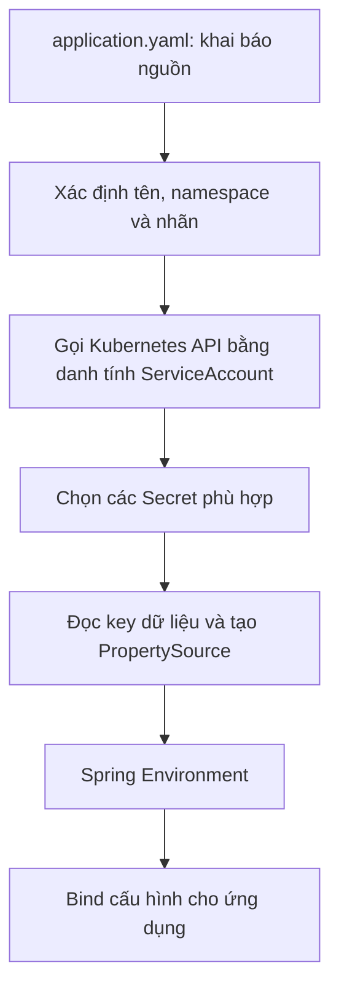

# Chỉ định nguồn Secret theo tên, namespace và bộ chọn

Trong chương **Secret** của module **Spring Cloud Kubernetes**, việc chọn nguồn quyết định dữ liệu bí mật nào được đưa vào `Environment` của ứng dụng Spring. Một cấu hình đúng phải trả lời được ba câu hỏi: đọc Secret nào, đọc ở namespace nào và nếu dùng nhãn thì những Secret nào thực sự khớp.

Bài này dùng tình huống `order-service`: ứng dụng chạy trong namespace `orders-dev`, cần thông tin đăng nhập cơ sở dữ liệu và có thể đọc thêm thông tin tích hợp từ namespace `integration-dev`. Mục tiêu là mô tả nguồn rõ ràng, dự đoán được tập kết quả và cấp quyền vừa đủ cho cách đọc đã chọn.

## 1. Phạm vi ví dụ và điều kiện chuẩn bị

Các cấu hình Spring trong bài lấy **Spring Cloud Kubernetes 3.3.x**, **Fabric8** và cơ chế **Config Data** làm mốc. Dự án cần quản lý phiên bản bằng Spring Cloud BOM tương thích với Spring Boot đang dùng. Những đoạn YAML được ghi là phương án thay thế thì dùng riêng từng phương án.

Dependency phục vụ việc nạp ConfigMap và Secret:

```xml
<dependency>
    <groupId>org.springframework.cloud</groupId>
    <artifactId>spring-cloud-starter-kubernetes-fabric8-config</artifactId>
</dependency>
```

Chọn starter theo tính năng ứng dụng cần. Nếu chỉ cần nạp cấu hình, starter này đã phù hợp; không cần thêm DiscoveryClient hay LoadBalancer chỉ để đọc Secret. Spring Cloud Kubernetes có hai họ client và yêu cầu chọn một họ cho ứng dụng. [Tài liệu starter 3.3](https://docs.spring.io/spring-cloud-kubernetes/reference/3.3/getting-started.html).

Bài dùng `spring.config.import: "kubernetes:"` trong `application.yaml`. Cách này không dùng đồng thời với cơ chế bootstrap cũ. Cấu hình chỉ đường đến Secret phải có sẵn trước lúc nạp Secret, chẳng hạn trong tệp cấu hình đi cùng ứng dụng hoặc biến môi trường. [Kubernetes PropertySource 3.3](https://docs.spring.io/spring-cloud-kubernetes/reference/3.3/property-source-config.html).

## 2. Phân biệt đối tượng nguồn và dữ liệu bên trong

| Thành phần | Ví dụ | Ý nghĩa |
|---|---|---|
| Tên Secret | `orders-db-v1` | Giá trị `metadata.name` của đối tượng cần đọc |
| Namespace | `orders-dev` | Phạm vi chứa đối tượng Secret |
| Nhãn của Secret | `app=order-service`, `purpose=database` | Thuộc tính trong `metadata.labels` dùng để chọn tập đối tượng |
| Key dữ liệu | `orders.db.username` | Tên thuộc tính bên trong `data` hoặc `stringData` |

Bộ chọn nhãn xét `metadata.labels` của **Secret**. Nhãn trên Pod hoặc Deployment không tự chuyển thành nhãn của Secret. Một key như `orders.db.password` cũng không phải nhãn dùng để tìm đối tượng.

Ví dụ Secret dùng trong bài; tất cả giá trị đăng nhập dưới đây đều là dữ liệu giả dành cho lab:

```yaml
apiVersion: v1
kind: Secret
metadata:
  name: orders-db-v1
  namespace: orders-dev
  labels:
    app: order-service
    environment: dev
    purpose: database
    slot: active
type: Opaque
stringData:
  orders.db.username: orders_lab
  orders.db.password: demo-only-password
```

`stringData` giúp khai báo chuỗi khi tạo Secret; API server chuyển dữ liệu sang biểu diễn `data`. Base64 trong `data` không phải cơ chế mã hóa bảo mật. Các ví dụ manifest chứa giá trị giả có thể dùng để học; thông tin đăng nhập thật cần đi qua quy trình quản lý bí mật của hệ thống. [Kubernetes Secrets](https://kubernetes.io/docs/concepts/configuration/secret/).

Luồng nạp cấu hình có thể hình dung như sau:



Chọn nguồn đúng mới hoàn thành bước xác định dữ liệu đầu vào. Việc ứng dụng có nhận đủ key hay có cập nhật khi Secret thay đổi còn cần cơ chế tương ứng.

## 3. Chọn một Secret theo tên

Khi ứng dụng biết chính xác tên nguồn, cấu hình đầy đủ có thể là:

```yaml
spring:
  application:
    name: order-service
  config:
    import: "kubernetes:"
  cloud:
    kubernetes:
      config:
        enabled: false
      secrets:
        enabled: true
        enable-api: true
        name: orders-db-v1
        namespace: orders-dev
        include-profile-specific-sources: false
        fail-fast: true
```

Các điểm cần hiểu:

- `config.enabled: false` tắt việc nạp ConfigMap trong ví dụ chỉ đọc Secret.
- `secrets.enabled` bật Secret PropertySource; `enable-api` cho phép lấy Secret qua Kubernetes API ở dòng 3.3.x.
- `name` trỏ đến `metadata.name`, còn `namespace` trỏ đến nơi chứa Secret.
- `include-profile-specific-sources: false` giữ ví dụ tập trung vào tên đã khai báo, tránh bổ sung nguồn theo profile.
- `fail-fast` yêu cầu báo lỗi khi việc nạp nguồn gặp lỗi; ứng dụng vẫn cần kiểm tra các thuộc tính bắt buộc.

Tên và namespace cùng tạo thành đích tra cứu `orders-dev/orders-db-v1`. Không viết `name: orders-dev/orders-db-v1`, vì namespace có thuộc tính riêng. Các thuộc tính bật API và chọn tên được mô tả trong [Secret PropertySource 3.3](https://docs.spring.io/spring-cloud-kubernetes/reference/3.3/property-source-config/secrets-propertysource.html).

Nếu không chỉ định tên, Spring Cloud Kubernetes 3.3.x dùng `spring.application.name`; nếu tên ứng dụng cũng không có thì dùng `application`. Vì vậy, đổi tên ứng dụng có thể làm thay đổi tên Secret được tìm. [Quy tắc lấy tên trong ConfigUtils 3.3.0](https://github.com/spring-cloud/spring-cloud-kubernetes/blob/v3.3.0/spring-cloud-kubernetes-commons/src/main/java/org/springframework/cloud/kubernetes/commons/config/ConfigUtils.java).

Trong lab này, đặt tên rõ ràng giúp tách tên dịch vụ `order-service` khỏi tên tài nguyên bí mật `orders-db-v1`. Đó cũng là lựa chọn dễ kiểm tra khi triển khai nhiều môi trường.

## 4. Xác định namespace và quy tắc kế thừa

`spring.cloud.kubernetes.secrets.namespace` là namespace mặc định cho nguồn Secret. Khi dùng danh sách `sources`, mỗi phần tử có thể ghi đè namespace đó.

Đoạn dưới thay phần `spring.cloud.kubernetes.secrets` của cấu hình trước; giữ nguyên `spring.application`, `spring.config.import` và `config.enabled: false`:

```yaml
secrets:
  enabled: true
  enable-api: true
  name: orders-default
  namespace: orders-dev
  include-profile-specific-sources: false
  fail-fast: true
  sources:
    - name: orders-db-v1
    - namespace: integration-dev
    - name: partner-api-v1
      namespace: integration-dev
```

Đọc từng phần tử sẽ cho kết quả:

| Phần tử trong sources | Tên hiệu lực | Namespace hiệu lực |
|---|---|---|
| `name: orders-db-v1` | `orders-db-v1` | `orders-dev` |
| Chỉ có `namespace: integration-dev` | `orders-default` | `integration-dev` |
| Có cả name và namespace | `partner-api-v1` | `integration-dev` |

`name: orders-default` ở cấp chung đóng vai trò giá trị kế thừa cho phần tử thiếu tên. Không đọc cấu hình này thành “ba phần tử cộng thêm một nguồn mặc định”; danh sách `sources` được chuẩn hóa thành các nguồn cần nạp. [Khai báo nhiều nguồn Secret](https://docs.spring.io/spring-cloud-kubernetes/reference/3.3/property-source-config/secrets-propertysource.html).

Nếu chưa có namespace ở nguồn hoặc cấp chung, việc phân giải tiếp tục theo thứ tự:

1. `spring.cloud.kubernetes.client.namespace`.
2. Nội dung tệp do `spring.cloud.kubernetes.client.serviceAccountNamespacePath` chỉ ra.
3. Tệp namespace ServiceAccount chuẩn trong Pod: `/var/run/secrets/kubernetes.io/serviceaccount/namespace`.
4. Namespace mà Kubernetes client cung cấp.

Không xác định được namespace sẽ gây lỗi. Do đó, khi chạy ngoài cluster, không mặc định rằng namespace đang chọn trong terminal chắc chắn cũng là namespace ứng dụng sẽ dùng. [Namespace resolution 3.3](https://docs.spring.io/spring-cloud-kubernetes/reference/3.3/property-source-config/namespace-resolution.html).

Việc khai báo `integration-dev` cũng không tạo namespace và không cấp quyền truy cập. Namespace đích, Secret đích và quyền của ứng dụng phải được chuẩn bị riêng.

## 5. Chọn nguồn bằng nhãn

### 5.1. Khi nào nên dùng bộ chọn

Chọn theo tên phù hợp khi hợp đồng triển khai giữ tên Secret ổn định. Chọn theo nhãn phù hợp khi hệ thống quản lý bí mật tạo tài nguyên theo tên có phiên bản, còn ứng dụng nhận diện nguồn bằng vai trò.

Ví dụ, `orders-db-v1` và `orders-db-v2` có thể cùng tồn tại trong quá trình xoay vòng. Nếu chỉ một đối tượng có `slot=active`, ứng dụng có thể dùng nhãn để nhận diện đối tượng đang được công bố.

Thay phần `secrets` bằng:

```yaml
secrets:
  enabled: true
  enable-api: true
  namespace: orders-dev
  include-profile-specific-sources: false
  fail-fast: true
  sources:
    - labels:
        app: order-service
        environment: dev
        purpose: database
        slot: active
```

Phần lựa chọn theo nhãn yêu cầu Secret thỏa **tất cả** bốn cặp key/value. Kubernetes cho phép nhiều đối tượng có cùng nhãn; nhãn không đảm bảo tính duy nhất. [Labels and Selectors](https://kubernetes.io/docs/concepts/overview/working-with-objects/labels/).

Với tập dữ liệu giả sau:

| Secret | app | environment | purpose | slot | Khớp nhãn? |
|---|---|---|---|---|---|
| `orders-db-v1` | order-service | dev | database | active | Có |
| `orders-db-v2` | order-service | dev | database | candidate | Không |
| `orders-partner-v1` | order-service | dev | partner | active | Không |
| `billing-db-v1` | billing-service | dev | database | active | Không |

Nếu đổi `orders-db-v2` thành `slot=active` trước khi bỏ nhãn active ở v1, cả hai cùng khớp. Đây là thay đổi tập nguồn thực tế, dù cấu hình ứng dụng không đổi.

### 5.2. Map labels và các loại selector khác

Trong cấu hình này, `labels` là map cặp key/value khớp bằng. Không đặt biểu thức `in`, `notin`, danh sách giá trị hoặc cấu trúc `matchExpressions` của Deployment vào map đó.

Ví dụ sai về ý nghĩa:

```yaml
labels:
  environment: "dev,staging"
```

Giá trị trên không diễn tả “dev hoặc staging”. Khi cần một hợp đồng lựa chọn chung cho hai môi trường, có thể thiết kế nhãn khác với giá trị đơn, hoặc tách các nguồn và namespace rõ ràng. Phạm vi map nhãn và cách chuẩn hóa nguồn có thể xem trong [SecretsConfigProperties 3.3.0](https://github.com/spring-cloud/spring-cloud-kubernetes/blob/v3.3.0/spring-cloud-kubernetes-commons/src/main/java/org/springframework/cloud/kubernetes/commons/config/SecretsConfigProperties.java).

### 5.3. Không giả định name và labels tạo phép giao

Ở mốc 3.3.0, một khai báo nguồn có nhãn vẫn được chuẩn hóa thành nguồn theo tên, rồi bổ sung nguồn theo nhãn. Khi thiếu tên cụ thể, quy tắc tên mặc định vẫn có thể tham gia.

Vì vậy, `name: orders-db-v1` đi cùng `labels: ...` không có nghĩa chắc chắn là “chỉ đọc orders-db-v1 nếu nó có những nhãn này”. Cũng cần lưu ý Secret tên `order-service` có thể được tìm theo tên mặc định trong ví dụ chỉ khai báo nhãn. [Mã chuẩn hóa nguồn Secret 3.3.0](https://github.com/spring-cloud/spring-cloud-kubernetes/blob/v3.3.0/spring-cloud-kubernetes-commons/src/main/java/org/springframework/cloud/kubernetes/commons/config/SecretsConfigProperties.java).

Với lab nhãn, hãy chủ động kiểm tra có Secret `order-service` trong namespace hay không và nó có đóng góp cấu hình ngoài dự kiến không. Nếu yêu cầu triển khai là chỉ đọc một tên được phê duyệt, cấu hình theo tên và kiểm tra quyền truy cập thường dễ kiểm soát hơn.

## 6. Nhiều nguồn và key trùng

Ứng dụng có thể cần thông tin đăng nhập database và đối tác từ hai nguồn khác nhau. Một phương án rõ ràng là khai báo hai nguồn theo tên, gắn prefix cố định:

```yaml
secrets:
  enabled: true
  enable-api: true
  namespace: orders-dev
  include-profile-specific-sources: false
  fail-fast: true
  sources:
    - name: orders-db-v1
      explicit-prefix: database
    - name: partner-api-v1
      namespace: integration-dev
      explicit-prefix: partner
```

Nếu dữ liệu trong `orders-db-v1` có key `orders.db.username`, cấu hình trên đưa nó vào tên thuộc tính `database.orders.db.username`. Nếu `partner-api-v1` có key `token`, thuộc tính tương ứng là `partner.token`.

Các prefix là một phần của hợp đồng với mã Java. Thêm prefix đòi hỏi cập nhật nơi bind hoặc đọc thuộc tính; prefix không làm đổi tên Secret và không bổ sung quyền bảo mật. `explicit-prefix` được khai báo ở cấp phần tử nguồn, có ưu tiên cao hơn `use-name-as-prefix`. [Cấu hình prefix cho Secret](https://docs.spring.io/spring-cloud-kubernetes/reference/3.3/property-source-config/configmap-propertysource.html).

Nếu bộ chọn trả về nhiều Secret chứa cùng key, không thiết kế ứng dụng dựa trên giả định API sẽ trả Secret mới nhất ở cuối. Prefix cố định của một nguồn nhãn cũng không tự phân biệt hai đối tượng trong cùng tập kết quả.

Với thông tin đăng nhập cần đúng một bộ username/password, nên thiết kế nhãn để chỉ một Secret khớp. Khi cần nhiều nguồn độc lập, dùng key khác nhau hoặc prefix theo nguồn và quy định rõ cách ứng dụng sử dụng chúng.

## 7. RBAC phải khớp với namespace và cách đọc

Ví dụ sau tạo ServiceAccount ở `orders-dev` và cấp quyền đọc Secret trong chính namespace đó:

```yaml
apiVersion: v1
kind: ServiceAccount
metadata:
  name: order-service
  namespace: orders-dev
---
apiVersion: rbac.authorization.k8s.io/v1
kind: Role
metadata:
  name: orders-secret-reader
  namespace: orders-dev
rules:
  - apiGroups: [""]
    resources: ["secrets"]
    verbs: ["get", "list"]
---
apiVersion: rbac.authorization.k8s.io/v1
kind: RoleBinding
metadata:
  name: order-service-secret-reader
  namespace: orders-dev
subjects:
  - kind: ServiceAccount
    name: order-service
    namespace: orders-dev
roleRef:
  apiGroup: rbac.authorization.k8s.io
  kind: Role
  name: orders-secret-reader
```

Pod của ứng dụng phải dùng ServiceAccount đó. Đây là đoạn trích đặt dưới `spec.template` của Deployment:

```yaml
spec:
  serviceAccountName: order-service
```

Role ở trên cho phép đọc Secret trong cả namespace `orders-dev`. Bộ chọn `app=order-service` chỉ giới hạn dữ liệu ứng dụng muốn chọn; nó không biến quyền `list` thành quyền chỉ đọc Secret có nhãn đó. Chỉ cấp quyền trên tài nguyên cần dùng và giới hạn namespace chứa dữ liệu. [Phân quyền cho ứng dụng Spring Cloud Kubernetes](https://docs.spring.io/spring-cloud-kubernetes/reference/3.3/security-service-accounts.html).

Để đọc `partner-api-v1` ở `integration-dev`, cần thêm Role và RoleBinding trong **namespace đích**, nhưng subject vẫn là ServiceAccount ở namespace chạy ứng dụng:

```yaml
apiVersion: rbac.authorization.k8s.io/v1
kind: Role
metadata:
  name: integration-secret-reader
  namespace: integration-dev
rules:
  - apiGroups: [""]
    resources: ["secrets"]
    verbs: ["get", "list"]
---
apiVersion: rbac.authorization.k8s.io/v1
kind: RoleBinding
metadata:
  name: orders-read-integration-secrets
  namespace: integration-dev
subjects:
  - kind: ServiceAccount
    name: order-service
    namespace: orders-dev
roleRef:
  apiGroup: rbac.authorization.k8s.io
  kind: Role
  name: integration-secret-reader
```

Đây là quyền đọc cấp namespace để minh họa việc nạp cấu hình bằng client; không phải phương án hạn chế đến một Secret duy nhất. Một triển khai cần giới hạn theo tên phải xem thư viện thực sự gọi `get` hay `list`: với RBAC có `resourceNames`, yêu cầu `list/watch` còn phải có field selector `metadata.name` phù hợp. [Quy tắc resourceNames của Kubernetes RBAC](https://kubernetes.io/docs/reference/access-authn-authz/rbac/).

Ở dòng 5.x, Spring Cloud Kubernetes bổ sung lựa chọn đọc `BATCH/SINGLE`; `BATCH` lấy tài nguyên theo namespace rồi lọc. Khi chuyển phiên bản, cần xem lại chế độ đọc và quyền tương ứng thay vì sao chép nguyên cấu hình 3.3.x. [Chế độ đọc cấu hình](https://docs.spring.io/spring-cloud-kubernetes/reference/property-source-config/configmap-propertysource.html).

Các manifest trên phục vụ đọc cấu hình; chưa bật theo dõi thay đổi. Quyền `watch` chỉ bổ sung khi cơ chế đang triển khai thực sự cần.

## 8. Kiểm tra cấu hình bằng sự hiện diện, không bằng giá trị bí mật

### 8.1. Xác nhận tên, namespace và số đối tượng khớp

Các lệnh dưới chỉ hiển thị tên hoặc metadata của Secret:

```shell
kubectl get secret orders-db-v1 -n orders-dev -o name

kubectl get secrets -n orders-dev --selector="app=order-service,environment=dev,purpose=database,slot=active" -o name

kubectl get secrets -n orders-dev --selector="app=order-service,environment=dev,purpose=database,slot=active" --show-labels

kubectl get secret order-service -n orders-dev -o name
```

Lệnh cuối kiểm tra nguồn có thể được tìm theo tên ứng dụng khi thử cấu hình nhãn. `NotFound` ở bước kiểm tra này là thông tin cần đối chiếu với tập nguồn dự kiến, không phải lý do tự tạo một Secret có nội dung tùy ý.

Với ví dụ database, kỳ vọng bộ chọn nhãn trả đúng một tên. Không có kết quả thì kiểm tra namespace và từng cặp nhãn; có nhiều kết quả thì xem lại quy trình gắn `slot=active`.

### 8.2. Xác nhận quyền bằng đúng danh tính ứng dụng

```shell
kubectl auth can-i get secrets/orders-db-v1 -n orders-dev --as=system:serviceaccount:orders-dev:order-service

kubectl auth can-i list secrets -n orders-dev --as=system:serviceaccount:orders-dev:order-service

kubectl auth can-i list secrets -n integration-dev --as=system:serviceaccount:orders-dev:order-service
```

Các lệnh dùng `--as` cần người thực hiện có quyền impersonation tương ứng. Nếu bị từ chối impersonation, chưa thể kết luận ServiceAccount thiếu quyền đọc Secret. Đồng thời kiểm tra `serviceAccountName` của Pod đang chạy để chắc rằng ứng dụng dùng đúng danh tính.

### 8.3. Kiểm tra thuộc tính bắt buộc khi ứng dụng khởi động

Cho phương án đọc database **không có prefix**, có thể đăng ký một lớp cấu hình và từ chối khởi động khi thiếu key. Ví dụ cần `spring-boot-starter-validation`; đặt lớp dưới trong phạm vi component scan:

```java
import jakarta.validation.constraints.NotBlank;

import org.springframework.boot.context.properties.ConfigurationProperties;
import org.springframework.stereotype.Component;
import org.springframework.validation.annotation.Validated;

@Component
@Validated
@ConfigurationProperties(prefix = "orders.db")
public class OrdersDatabaseProperties {

    @NotBlank
    private String username;

    @NotBlank
    private String password;

    public String getUsername() {
        return username;
    }

    public void setUsername(String username) {
        this.username = username;
    }

    public String getPassword() {
        return password;
    }

    public void setPassword(String password) {
        this.password = password;
    }
}
```

Không thêm `toString()` chứa password và không log đối tượng cấu hình này. Nếu dùng phương án `explicit-prefix: database`, đổi prefix bind thành `database.orders.db`.

Lớp trên kiểm tra hợp đồng thuộc tính mà ứng dụng nhận được. Nó không chứng minh dữ liệu chắc chắn đến từ Secret đã chọn: biến môi trường hay một nguồn cấu hình khác cũng có thể cung cấp cùng key. Vì vậy, cần đối chiếu cả metadata nguồn và cấu hình triển khai, đồng thời tránh giá trị mặc định giả khiến thiếu Secret vẫn khởi động bình thường.

`fail-fast` không thay thế việc kiểm tra đủ key. Trong xử lý nguồn theo tên ở mốc 3.3.0, tên không tìm thấy có thể chỉ sinh cảnh báo; lớp validation giúp ứng dụng không tiếp tục với username/password rỗng. [Xử lý dữ liệu theo tên trong ConfigUtils](https://github.com/spring-cloud/spring-cloud-kubernetes/blob/v3.3.0/spring-cloud-kubernetes-commons/src/main/java/org/springframework/cloud/kubernetes/commons/config/ConfigUtils.java).

## 9. Chẩn đoán theo triệu chứng

| Hiện tượng | Điểm cần kiểm tra | Hướng xử lý |
|---|---|---|
| API trả 403 Forbidden | ServiceAccount, namespace của RoleBinding, verb bị từ chối | Sửa quyền cho đúng danh tính và namespace đích |
| Không có Secret khớp | Namespace, chữ hoa/thường, giá trị nhãn, nhãn đặt nhầm trên Pod | Đối chiếu metadata Secret bằng truy vấn chỉ đọc |
| Không thấy gọi API nạp Secret | Starter, `spring.config.import`, `enabled`, `enable-api` ở 3.3.x | Đảm bảo đường nạp cấu hình đã được bật |
| Thấy tìm Secret tên order-service | Quy tắc tên mặc định khi chuẩn hóa nguồn | Đối chiếu tập nguồn thực tế với khai báo nhãn |
| Đọc nguồn được nhưng bind thiếu thuộc tính | Key dữ liệu, prefix nguồn và prefix Java | Căn chỉnh hợp đồng key và thêm validation |
| Database dùng thông tin đăng nhập ngoài dự kiến | Nhiều Secret khớp, key trùng, biến môi trường | Thu hẹp tập nguồn và loại bỏ ghi đè ngoài chủ đích |
| Chạy được ở máy cá nhân nhưng lỗi trong Pod | Danh tính kubeconfig khác ServiceAccount, namespace khác | Kiểm tra bằng danh tính và namespace khi triển khai |
| Đổi nhãn active nhưng ứng dụng chưa đổi cấu hình | Thời điểm nạp và cơ chế cập nhật | Thực hiện quy trình refresh hoặc rollout đã thiết kế |

Bài tập trung vào chọn và nạp nguồn. Thay đổi dữ liệu hay nhãn không tự bảo đảm bean đang chạy được bind lại. Nếu hệ thống cần cập nhật động, phải cấu hình riêng cơ chế theo dõi và cập nhật, chẳng hạn Configuration Watcher phù hợp với cách triển khai; đồng thời kiểm tra việc tái tạo các thành phần sử dụng thông tin đăng nhập.

## 10. Thực hành quyết định nguồn cho order-service

Trong một cluster lab, chuẩn bị hai namespace `orders-dev` và `integration-dev`, rồi thực hiện lần lượt:

1. Tạo `orders-db-v1` bằng manifest dữ liệu giả ở đầu bài. Dùng cấu hình theo tên và xác nhận ứng dụng nhận đủ hai thuộc tính `orders.db.*`.
2. Chuyển sang cấu hình nhãn. Kiểm tra bộ chọn trả đúng một tên và kiểm tra riêng sự tồn tại của Secret tên `order-service`.
3. Tạo `orders-db-v2` với `slot=candidate`. Xác nhận bộ chọn vẫn chỉ khớp v1.
4. Trong lab, thử tình huống cả v1 và v2 cùng active. Quan sát danh sách tên khớp để nhận ra sự mơ hồ trước khi cho ứng dụng nạp lại.
5. Khôi phục đúng một Secret active. Chọn một quy trình chuyển đổi có kiểm soát để ứng dụng nhận bộ thông tin đăng nhập mới.
6. Thử nguồn `partner-api-v1` ở `integration-dev`. Kiểm tra RoleBinding ở namespace đích và prefix khi đưa dữ liệu vào ứng dụng.

Kết quả cần ghi nhận là tên nguồn, namespace, nhãn dùng để chọn, số đối tượng khớp, danh tính ServiceAccount và tên thuộc tính sau prefix. Không đưa giá trị bí mật vào biên bản thực hành.

Một cấu hình nguồn có thể giải thích được phải chỉ ra rõ tập Secret dự kiến, quyền đọc cần thiết và hợp đồng key với ứng dụng. Khi các yếu tố này rõ ràng, việc tách môi trường và xoay vòng thông tin đăng nhập mới có cơ sở để triển khai ổn định.

