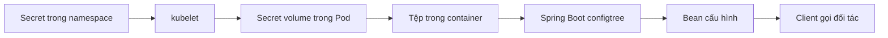

# Đọc Secret từ volume được gắn vào container

Trong chương **Secret** của module **SPRING_CLOUD_KUBERNETES**, bài này hướng dẫn đưa thông tin nhạy cảm vào ứng dụng Spring qua tệp trong container. Kubernetes gắn Secret thành volume; ứng dụng đọc tệp hoặc để Spring Boot ánh xạ tệp thành thuộc tính cấu hình.

Tình huống xuyên suốt là một dịch vụ Spring Boot cần token để gọi đối tác. Token được cấp khi triển khai, không nằm trong mã nguồn hoặc image. Ta dùng thêm một mã phiên bản công khai để quan sát quá trình đổi token mà không in token ra màn hình.

Sau bài học, bạn có thể:

- Khai báo Secret volume và ánh xạ từng key sang đường dẫn ứng dụng cần.
- Dùng `configtree:` để bind nội dung tệp vào `@ConfigurationProperties`.
- Phối hợp quyền tệp với UID/GID của tiến trình Java.
- Phân biệt cập nhật tệp trên volume, cập nhật cấu hình Spring và thay đổi credential mà client đang sử dụng.
- Xác định khi nào cần quyền Kubernetes API hoặc Configuration Watcher.

## 1. Secret đi từ Kubernetes đến Spring như thế nào?



Trong luồng này, kubelet thực hiện việc đưa dữ liệu Secret tới volume. Tiến trình Java chỉ cần quyền đọc tệp tương ứng; không cần tự gọi API lấy Secret. Spring Cloud Kubernetes cũng khuyến nghị chia sẻ Secret bằng volume khi cách triển khai cho phép. [Tham chiếu Secrets PropertySource](https://docs.spring.io/spring-cloud-kubernetes/reference/property-source-config/secrets-propertysource.html).

Ba khái niệm thường bị nhầm:

| Thành phần | Vai trò trong ví dụ |
| --- | --- |
| `volumes[].secret.secretName` | Chọn đối tượng Secret cùng namespace với Pod |
| `volumeMounts[].mountPath` | Chọn nơi container nhìn thấy dữ liệu |
| `spring.config.import` | Chỉ dẫn Spring Boot nạp cấu hình từ đường dẫn đã mount |

Một thư mục đã xuất hiện trong container chưa đủ để Spring tự biết thuộc tính nào nằm trong đó. Ngược lại, khai báo `configtree:` không tạo volume; Kubernetes vẫn cần cấu hình mount.

## 2. Phạm vi và điều kiện thực hành

Mẫu Java dưới đây dùng Java 17 trở lên và Spring Boot 3.x. Project cần ba starter, với version được quản lý bởi parent/BOM Spring Boot của project:

```xml
<dependencies>
    <dependency>
        <groupId>org.springframework.boot</groupId>
        <artifactId>spring-boot-starter-web</artifactId>
    </dependency>
    <dependency>
        <groupId>org.springframework.boot</groupId>
        <artifactId>spring-boot-starter-validation</artifactId>
    </dependency>
    <dependency>
        <groupId>org.springframework.boot</groupId>
        <artifactId>spring-boot-starter-actuator</artifactId>
    </dependency>
</dependencies>
```

Đây là ví dụ đọc volume bằng khả năng có sẵn của Spring Boot, nên không cần thêm starter Spring Cloud Kubernetes chỉ để nạp Secret. Khi ghép vào project có Spring Cloud, tiếp tục dùng bộ version Boot/Cloud tương thích mà project đã chọn.

Bạn cần có cluster Kubernetes chạy Linux container, `kubectl` trỏ đúng môi trường lab và quyền tạo Namespace, Secret, ServiceAccount, Deployment. Quyền của người triển khai khác với quyền của ServiceAccount mà ứng dụng sử dụng.

Các tên tệp trong phần thực hành là những tệp người học sẽ tạo khi triển khai ví dụ. Image `registry.example.com/training/partner-service:secret-volume-v1` là địa chỉ minh họa, phải thay bằng image thực chứa ứng dụng bên dưới và có thể chạy với UID 10001.

## 3. Tạo Secret và thiết kế tên tệp

Tạo `namespace.yaml`:

```yaml
apiVersion: v1
kind: Namespace
metadata:
  name: secret-volume-lab
```

Tạo `partner-secret.yaml`:

```yaml
apiVersion: v1
kind: Secret
metadata:
  name: partner-credentials
  namespace: secret-volume-lab
type: Opaque
stringData:
  api-token: "DEMO_ONLY_TOKEN_V1"
  credential-version: "v1"
```

Token trên hoàn toàn giả, chỉ dùng cho lab. Với credential thực, dùng quy trình cấp phát Secret được tổ chức chấp thuận thay vì đưa giá trị vào repository hoặc lịch sử lệnh.

Ta chủ động tách tên key lưu trữ khỏi tên thuộc tính Spring:

| Key trong Secret | Tệp dự kiến trong container | Thuộc tính Spring |
| --- | --- | --- |
| `api-token` | `/etc/partner-secrets/app.partner.token` | `app.partner.token` |
| `credential-version` | `/etc/partner-secrets/app.partner.credential-version` | `app.partner.credential-version` |

Cột đường dẫn sẽ được hiện thực bằng `items[].path` trong Deployment. `credential-version` là nhãn công khai của bộ credential, không phải token và không được dùng làm bằng chứng rằng đối tác đã chấp nhận token.

## 4. Gắn volume vào container

Tạo `deployment.yaml`:

```yaml
apiVersion: v1
kind: ServiceAccount
metadata:
  name: partner-service
  namespace: secret-volume-lab
---
apiVersion: apps/v1
kind: Deployment
metadata:
  name: partner-service
  namespace: secret-volume-lab
spec:
  replicas: 1
  selector:
    matchLabels:
      app: partner-service
  strategy:
    type: RollingUpdate
    rollingUpdate:
      maxSurge: 1
      maxUnavailable: 0
  template:
    metadata:
      labels:
        app: partner-service
    spec:
      serviceAccountName: partner-service
      automountServiceAccountToken: false
      securityContext:
        runAsNonRoot: true
        runAsUser: 10001
        runAsGroup: 10001
        fsGroup: 10001
        seccompProfile:
          type: RuntimeDefault
      containers:
        - name: app
          image: registry.example.com/training/partner-service:secret-volume-v1
          ports:
            - name: http
              containerPort: 8080
          securityContext:
            allowPrivilegeEscalation: false
            capabilities:
              drop:
                - ALL
          volumeMounts:
            - name: partner-secret-volume
              mountPath: /etc/partner-secrets
              readOnly: true
          startupProbe:
            httpGet:
              path: /actuator/health/liveness
              port: http
            periodSeconds: 5
            failureThreshold: 30
          readinessProbe:
            httpGet:
              path: /actuator/health/readiness
              port: http
            periodSeconds: 5
          livenessProbe:
            httpGet:
              path: /actuator/health/liveness
              port: http
            periodSeconds: 10
      volumes:
        - name: partner-secret-volume
          secret:
            secretName: partner-credentials
            optional: false
            defaultMode: 288
            items:
              - key: api-token
                path: app.partner.token
              - key: credential-version
                path: app.partner.credential-version
```

Các quyết định trong manifest:

- `name: partner-secret-volume` nối khai báo volume với mount; tên này không phải tên Secret.
- `items` chỉ chiếu hai key cần dùng và đổi tên tệp theo hợp đồng cấu hình của ứng dụng.
- `optional: false` thể hiện Secret là bắt buộc. Thiếu Secret hoặc một key được liệt kê sẽ khiến volume không được thiết lập thành công.
- `readOnly: true` thể hiện ứng dụng chỉ tiêu thụ dữ liệu.
- Mount cả thư mục chuyên dụng giúp tránh che mất các tệp khác trong image và không cần `subPath`.

Kubernetes hỗ trợ đặt quyền cho toàn bộ Secret volume bằng `defaultMode`, hoặc cho từng phần tử trong `items`. [Hướng dẫn chiếu key và quyền truy cập](https://kubernetes.io/docs/tasks/inject-data-application/distribute-credentials-secure/).

### Quyền đọc của tiến trình Java

`288` ở trên là số thập phân tương đương `0440` theo bát phân: chủ sở hữu và nhóm được đọc. Dùng số thập phân giúp tránh nhầm cách biểu diễn số khi manifest đi qua công cụ chuyển đổi JSON/YAML.

`runAsUser` và `runAsGroup` xác định tài khoản chạy ứng dụng; `fsGroup` hỗ trợ quyền truy cập volume thông qua nhóm. Trên môi trường lab Linux này, nhóm 10001 phải đọc được tệp Secret. Luôn kiểm tra quyền thực trong container sau khi admission policy và runtime áp dụng. [Security context và quyền volume](https://kubernetes.io/docs/tasks/configure-pod-container/security-context/).

Đừng đổi thành `0400` rồi mặc định rằng tiến trình non-root sẽ đọc được: nếu tệp thuộc root và chỉ owner có quyền đọc, UID 10001 có thể nhận `Permission denied`. Cũng không cần chạy ứng dụng bằng root để né lỗi quyền.

### Vì sao không có Role hoặc RoleBinding?

Ví dụ chỉ dùng tệp đã được Kubernetes mount, nên không cấp quyền `get/list/watch` Secret cho ServiceAccount của ứng dụng. `automountServiceAccountToken: false` phù hợp với ví dụ không gọi Kubernetes API này.

Khi tích hợp thêm DiscoveryClient, nạp ConfigMap/Secret qua API, hoặc tính năng Spring Cloud Kubernetes khác có gọi API, hãy thiết kế riêng thông tin xác thực và RBAC cho các thao tác đó. Khả năng đọc volume không chứng minh những tính năng ấy đã có đủ quyền hoạt động.

## 5. Nạp các tệp bằng Spring Boot configtree

Đặt cấu hình sau trong `application.yaml` của ứng dụng:

```yaml
spring:
  application:
    name: partner-service
  config:
    import: "configtree:/etc/partner-secrets/"

management:
  endpoints:
    web:
      exposure:
        include: health
  endpoint:
    health:
      probes:
        enabled: true
      show-details: never
```

Với `configtree:`, tên tệp và thư mục tạo tên thuộc tính; nội dung tệp tạo giá trị. Vì vậy, tệp `app.partner.token` được sử dụng như thuộc tính `app.partner.token`. Một tệp chứa trọn cấu hình YAML cần import dạng `file:`, thay vì coi toàn bộ YAML đó là giá trị của một key configtree. [Spring Boot: configuration trees](https://docs.spring.io/spring-boot/3.5/reference/features/external-config.html#features.external-config.files.configtrees).

Ví dụ dùng import bắt buộc. `optional:configtree:/etc/partner-secrets/` chỉ thích hợp khi ứng dụng có thiết kế chấp nhận thiếu thư mục; nó không thay thế việc kiểm tra các thuộc tính bắt buộc.

### Bind và kiểm tra giá trị khi khởi động

Tạo `PartnerProperties.java`:

```java
package com.example.partner;

import jakarta.validation.constraints.NotBlank;
import org.springframework.boot.context.properties.ConfigurationProperties;
import org.springframework.validation.annotation.Validated;

@Validated
@ConfigurationProperties(prefix = "app.partner")
public record PartnerProperties(
        @NotBlank String token,
        @NotBlank String credentialVersion
) {
    @Override
    public String toString() {
        return "PartnerProperties[token=<redacted>, credentialVersion="
                + credentialVersion + "]";
    }
}
```

Đăng ký bean cấu hình trong `PartnerApplication.java`:

```java
package com.example.partner;

import org.springframework.boot.SpringApplication;
import org.springframework.boot.autoconfigure.SpringBootApplication;
import org.springframework.boot.context.properties.EnableConfigurationProperties;

@SpringBootApplication
@EnableConfigurationProperties(PartnerProperties.class)
public class PartnerApplication {

    public static void main(String[] args) {
        SpringApplication.run(PartnerApplication.class, args);
    }
}
```

Các ràng buộc `@NotBlank` giúp ứng dụng dừng khởi động khi thiếu token hoặc mã phiên bản. Phương thức `toString()` được ghi đè vì phiên bản mặc định của record sẽ chứa cả trường token; dù vậy, ứng dụng vẫn phải tránh ghi log token qua accessor hoặc HTTP client.

Thêm một endpoint chỉ dành cho lab để quan sát giá trị đã bind, trong `CredentialVersionController.java`:

```java
package com.example.partner;

import java.util.Map;
import org.springframework.web.bind.annotation.GetMapping;
import org.springframework.web.bind.annotation.RestController;

@RestController
public class CredentialVersionController {

    private final PartnerProperties properties;

    public CredentialVersionController(PartnerProperties properties) {
        this.properties = properties;
    }

    @GetMapping("/lab/credential-version")
    public Map<String, String> credentialVersion() {
        return Map.of("boundVersion", properties.credentialVersion());
    }
}
```

Endpoint chỉ trả mã phiên bản công khai. Đối với luồng nghiệp vụ, client gọi đối tác sẽ nhận token từ bean này để thiết lập cơ chế xác thực mà API đối tác yêu cầu. Không bổ sung endpoint trả token để thử xem Secret đã được nạp hay chưa.

Health probes trong mẫu cho kubelet biết ứng dụng có chạy và sẵn sàng phục vụ theo trạng thái Spring Boot. Chúng chưa kiểm tra token có hợp lệ ở hệ thống đối tác. Một phép kiểm tra xác thực thật cần được thiết kế riêng; tránh gắn sự cố của đối tác vào liveness khiến Pod khởi động lại liên tục. [Spring Boot: Kubernetes probes](https://docs.spring.io/spring-boot/3.5/reference/actuator/endpoints.html#actuator.endpoints.kubernetes-probes).

### Chọn một đường nạp cấu hình rõ ràng

Bài này chỉ import `configtree:`, không đồng thời thêm `kubernetes:` để đọc lại cùng Secret. Nếu project đã có các starter và import Kubernetes, hãy kiểm tra cấu hình hiện hữu trước khi ghép mẫu.

Các ví dụ cũ có thể sử dụng `spring.cloud.kubernetes.secrets.paths` và cơ chế bootstrap. Không mặc định áp dụng những thuộc tính đó cho mọi phiên bản. Dùng tài liệu đúng release của project; với bài này, hợp đồng cần duy trì là đường dẫn mount và import configtree của Spring Boot.

Nếu đồng thời đặt token qua biến môi trường hoặc tham số JVM, ứng dụng có thể chọn nguồn có độ ưu tiên cao hơn. Khi đó, file đúng nhưng credential ứng dụng sử dụng vẫn khác với điều bạn dự kiến.

## 6. Triển khai và kiểm tra mà không in token

Sau khi build và cung cấp image thực, chạy các lệnh sau trong môi trường lab:

```shell
kubectl apply -f namespace.yaml
kubectl apply -f partner-secret.yaml
kubectl apply -f deployment.yaml
kubectl -n secret-volume-lab rollout status deployment/partner-service --timeout=180s
kubectl -n secret-volume-lab get pods -l app=partner-service
```

Đây là các bước thực hành để người học chạy trên cluster của mình. Thời gian khởi động còn phụ thuộc khả năng kéo image và tài nguyên cluster.

Nếu image có các tiện ích kiểm tra tương ứng:

```shell
kubectl -n secret-volume-lab exec deployment/partner-service -c app -- id
kubectl -n secret-volume-lab exec deployment/partner-service -c app -- ls -lnL /etc/partner-secrets
kubectl -n secret-volume-lab exec deployment/partner-service -c app -- test -r /etc/partner-secrets/app.partner.token
kubectl -n secret-volume-lab exec deployment/partner-service -c app -- test -s /etc/partner-secrets/app.partner.token
kubectl -n secret-volume-lab exec deployment/partner-service -c app -- cat /etc/partner-secrets/app.partner.credential-version
```

`test -r` kiểm tra quyền đọc, `test -s` kiểm tra tệp không rỗng; thành công được thể hiện bằng exit code 0, không có nội dung token. Mã phiên bản đọc được ở bước cuối dự kiến là `v1`.

`ls -lnL` giúp quan sát UID/GID và quyền của tệp đích khi mount có liên kết tượng trưng. Không chỉnh sửa cấu trúc liên kết do kubelet quản lý. Nếu image tối giản không có `ls`, `test` hoặc `cat`, lỗi không tìm thấy chương trình không phải lỗi Secret; dùng công cụ chẩn đoán được cho phép hoặc xác minh qua ứng dụng.

Mở một terminal riêng:

```shell
kubectl -n secret-volume-lab port-forward deployment/partner-service 8080:8080
```

Từ terminal khác, gọi:

```shell
curl http://localhost:8080/lab/credential-version
```

Kết quả dự kiến:

```json
{"boundVersion":"v1"}
```

Bằng chứng này xác nhận luồng ánh xạ mã phiên bản từ Secret tới bean. Nó không phải phép thử gọi đối tác thành công, và không yêu cầu xuất token ra terminal.

## 7. Cập nhật Secret: tệp mới chưa có nghĩa bean mới

Kubernetes cập nhật Secret volume theo cơ chế nhất quán cuối cùng. Không có cam kết mọi Pod nhìn thấy thay đổi ngay khi `kubectl apply` trả về. Đặc biệt, mount Secret bằng `subPath` không nhận cập nhật tự động theo cách mount thư mục thông thường. [Kubernetes: cập nhật Secret volume](https://kubernetes.io/docs/concepts/configuration/secret/#using-secrets-as-files-from-a-pod).

### Quan sát hai lớp cập nhật

Đổi hai giá trị trong bản lab `partner-secret.yaml`:

```yaml
stringData:
  api-token: "DEMO_ONLY_TOKEN_V2"
  credential-version: "v2"
```

Đây là phần thay thế `stringData` của manifest đầy đủ ở phần 3, không phải manifest độc lập. Giữ nguyên tên Secret và namespace, rồi áp dụng lại:

```shell
kubectl apply -f partner-secret.yaml
kubectl -n secret-volume-lab exec deployment/partner-service -c app -- cat /etc/partner-secrets/app.partner.credential-version
```

Đọc lại mã phiên bản cho đến khi thấy `v2`; không suy ra thất bại chỉ từ một lần đọc còn `v1`. Sau đó gọi lại endpoint của Pod đang chạy.

Với đúng mẫu ứng dụng trên, không có cơ chế refresh bổ sung:

| Điểm quan sát | Sau khi tệp đã nhận cập nhật |
| --- | --- |
| Tệp `app.partner.credential-version` | `v2` |
| Endpoint trả giá trị từ record đã bind | Vẫn `v1` |
| Client đã lưu token trong bộ nhớ từ lúc khởi tạo | Có thể vẫn dùng token cũ |

Record cấu hình trong mẫu được tạo khi ứng dụng khởi động. Việc thay đổi tệp không tự tạo lại record hoặc client phụ thuộc vào record đó.

Đối với ví dụ này, dùng rollout để ứng dụng nạp lại cấu hình:

```shell
kubectl -n secret-volume-lab rollout restart deployment/partner-service
kubectl -n secret-volume-lab rollout status deployment/partner-service --timeout=180s
```

Khi Pod cũ bị thay thế, phiên port-forward có thể kết thúc. Mở lại port-forward và gọi endpoint để kiểm tra `boundVersion` đã thành `v2`.

### Nếu cần thay đổi mà không rollout

Spring Cloud Kubernetes Configuration Watcher có thể hỗ trợ kích hoạt refresh trong một thiết kế phù hợp. Cần cấu hình việc theo dõi Secret, RBAC của watcher, tuyến gửi sự kiện và độ trễ đủ để volume nhận dữ liệu. Khả năng refresh bean/client còn phải được kiểm tra riêng; không thể chỉ thêm `@RefreshScope` rồi coi toàn bộ luồng đổi credential đã hoàn tất. [Configuration Watcher](https://docs.spring.io/spring-cloud-kubernetes/reference/spring-cloud-kubernetes-configuration-watcher.html).

Trong triển khai thực, hãy lập kế hoạch khoảng giao nhau khi credential cũ và mới đều còn hợp lệ, nếu đối tác hỗ trợ. Xác nhận các instance đã dùng credential mới trước khi thu hồi credential cũ. `maxUnavailable: 0` hỗ trợ rollout giữ Pod sẵn sàng nhưng không tự tạo ra khoảng giao nhau về hiệu lực token.

## 8. Đọc trực tiếp tệp khi thư viện cần đường dẫn hoặc byte

Không phải mọi giá trị đều nên trở thành thuộc tính Spring. Một thư viện TLS có thể nhận đường dẫn chứng chỉ hoặc khóa riêng; một client khác có thể cần byte của credential.

Ví dụ đọc trực tiếp tệp token:

```java
package com.example.partner;

import java.io.IOException;
import java.nio.charset.StandardCharsets;
import java.nio.file.Files;
import java.nio.file.Path;

public final class PartnerTokenFileReader {

    private static final Path TOKEN_PATH =
            Path.of("/etc/partner-secrets/app.partner.token");

    private PartnerTokenFileReader() {
    }

    public static String readToken() throws IOException {
        return Files.readString(TOKEN_PATH, StandardCharsets.UTF_8);
    }
}
```

Đoạn này giữ nguyên nội dung văn bản. Đối với dữ liệu nhị phân, dùng `Files.readAllBytes`. Đừng tự động `trim()` mọi Secret: khoảng trắng hoặc xuống dòng có thể là một phần dữ liệu, tùy loại credential và hợp đồng với bên cấp.

Mỗi lần gọi phương thức là một lần mở lại đường dẫn. Nếu chỉ gọi khi tạo client rồi client lưu token trong bộ nhớ, ứng dụng vẫn giữ credential đó cho đến khi có thao tác thay thế. Đọc trực tiếp tệp không tự giải quyết cache, vòng đời client hoặc connection pool.

Khi credential gồm nhiều phần cần khớp nhau, hãy thiết kế cách đọc và chuyển đổi bộ giá trị nhất quán, tránh cập nhật riêng từng trường mà client đang dùng. Phần này là trách nhiệm của ứng dụng, độc lập với việc Kubernetes đã đưa tệp mới vào container.

## 9. Chẩn đoán theo điểm đứt của luồng dữ liệu

| Hiện tượng | Điểm cần kiểm tra | Cách xử lý |
| --- | --- | --- |
| Pod ở `ContainerCreating`, có sự kiện `FailedMount` | Secret, namespace và key trong `items` | Đối chiếu chính xác tên; tạo đủ tài nguyên bắt buộc |
| Container có thư mục nhưng thiếu tệp mong đợi | `items[].path`, `mountPath`, tên volume | Dùng bảng ánh xạ ở phần 3 để đối chiếu |
| Java báo `AccessDeniedException` | UID/GID, mode và quyền thư mục cha | Kiểm tra bằng đúng tài khoản chạy ứng dụng; sửa security context phù hợp |
| Boot báo không tìm thấy vị trí cấu hình | `spring.config.import` và mount thực | Kiểm tra đường dẫn tuyệt đối, thư mục và dấu `/` cuối import |
| Binding báo thiếu `app.partner.token` | Tên tệp sau ánh xạ, nội dung và prefix | Đối chiếu `app.partner.token` với `@ConfigurationProperties` |
| File đã đổi, bean vẫn cũ | Vòng đời bean/client | Rollout hoặc triển khai cơ chế refresh đã kiểm chứng |
| Mount không cập nhật như dự kiến | `subPath`, Secret bất biến, độ trễ lan truyền | Xem kiểu mount và chiến lược thay thế; không chờ cập nhật in-place cho Secret bất biến |
| File đúng nhưng ứng dụng dùng giá trị khác | Nguồn cấu hình có độ ưu tiên cao hơn | Kiểm tra biến môi trường, JVM và các import trùng thuộc tính |

Các lệnh thường dùng:

```shell
kubectl -n secret-volume-lab describe pod <ten-pod>
kubectl -n secret-volume-lab get events --sort-by=.lastTimestamp
kubectl -n secret-volume-lab logs <ten-pod> -c app
```

Thay `<ten-pod>` bằng tên thực. Khi xem log lỗi, tránh bật chế độ debug có thể in toàn bộ cấu hình hoặc header xác thực. Cũng không dùng `kubectl get secret ... -o yaml` như bước mặc định để chứng minh mount hoạt động, vì thao tác đó xuất dữ liệu Secret dưới dạng có thể giải mã.

## 10. Giới hạn bảo vệ và lựa chọn tính năng cần dùng

Volume giúp phân phối credential mà không đóng gói nó trong image. Tuy nhiên, tiến trình có quyền đọc tệp vẫn đọc được giá trị thật. Base64 trong đối tượng Secret không phải mã hóa bảo mật; cần bảo vệ quyền truy cập, chính sách mã hóa dữ liệu lưu trữ và các đường xuất dữ liệu. [Thực hành bảo vệ Kubernetes Secrets](https://kubernetes.io/docs/concepts/security/secrets-good-practices/).

Trong ví dụ, chỉ container `app` được khai báo mount. Khi bổ sung sidecar, chỉ chia sẻ volume nếu sidecar thực sự cần credential. Không sao chép Secret sang thư mục log, thư mục làm việc dùng chung hoặc lớp image để tiện xử lý.

Lựa chọn cơ chế theo nhu cầu:

| Nhu cầu | Cách áp dụng |
| --- | --- |
| Nạp credential thành thuộc tính khi khởi động | Secret volume và Spring Boot configtree |
| Thư viện yêu cầu đường dẫn khóa/chứng chỉ | Secret volume và truyền đường dẫn cho thư viện |
| Credential thay đổi ít, chấp nhận thay Pod | Volume và rollout có kiểm soát |
| Cần thay đổi trong tiến trình đang chạy | Thiết kế refresh/reload, vòng đời client và kiểm chứng rotation |
| Cần truy vấn Secret qua Kubernetes API | Đánh giá tính năng Spring Cloud Kubernetes phù hợp và RBAC tương ứng |

Một cấu hình triển khai hoàn chỉnh cần có bằng chứng cho cả ba việc: container đọc được đúng tệp; Spring/client tiêu thụ đúng dữ liệu; quy trình đổi credential đưa tất cả instance sang giá trị mới. Chỉ kiểm tra Pod ở trạng thái `Running` chưa chứng minh được ba điều đó.
