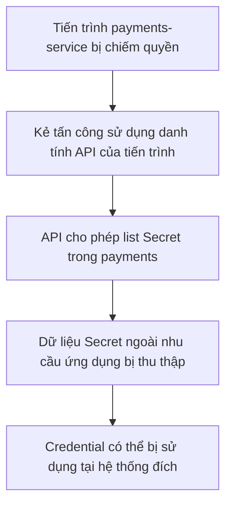

# Quyền đọc Secret và nguy cơ lộ toàn bộ thông tin trong namespace

Trong chương **Secret** của module **SPRING_CLOUD_KUBERNETES**, việc tích hợp ứng dụng Spring với Kubernetes cần đi cùng một quyết định rõ ràng: **tiến trình nào được phép đọc những bí mật nào**. Một ứng dụng khởi động thành công nhờ được cấp quyền rộng có thể đồng thời tạo ra đường truy cập đến credential của nhiều hệ thống khác.

Bài này xét ứng dụng `payments-service` trong namespace `payments`. Ứng dụng chỉ cần một token thanh toán. Mục tiêu là hiểu phạm vi của quyền đọc, thiết kế Role phù hợp với request thực tế của Spring Cloud Kubernetes và kiểm tra quyền mà không đưa dữ liệu Secret vào báo cáo.

Các manifest và lệnh dưới đây là ví dụ thực hành trong môi trường được phép quản trị. Bài không yêu cầu đọc giá trị Secret thật để chứng minh rằng một quyền đang quá rộng.

## 1. “Toàn bộ thông tin trong namespace” cần hiểu đúng phạm vi

Giả sử namespace `payments` có các Secret sau:

| Secret | Bên sử dụng dự kiến | Dữ liệu nghiệp vụ được bảo vệ |
| --- | --- | --- |
| `payments-api-credentials` | `payments-service` | Token gọi cổng thanh toán |
| `billing-db-credentials` | `billing-service` | Credential cơ sở dữ liệu hóa đơn |
| `invoice-signing-key` | `invoice-service` | Khóa ký hóa đơn |
| `registry-pull-credentials` | Hạ tầng triển khai | Credential kéo image |

Ứng dụng đầu tiên chỉ cần dòng đầu. Nếu danh tính của nó được cấp `list` trên `secrets` mà không giới hạn tên trong namespace này, khả năng truy cập không còn dừng ở token thanh toán.

Ở đây, “toàn bộ” nói đến **nội dung các Secret thuộc phạm vi quyền được cấp**. Quyền đó không tự trở thành quyền đọc tất cả ConfigMap, Pod, database hay mọi đối tượng Kubernetes trong namespace. Tuy nhiên, credential lấy được có thể mở đường sang hệ thống khác, tùy quyền của chính credential ấy.

Ví dụ, việc đọc được `billing-db-credentials` chưa tự chứng minh tiến trình có thể kết nối database. Nó còn phụ thuộc mạng, trạng thái credential và chính sách của database. Dù vậy, mất tính bí mật của credential đã là một sự cố cần xử lý.

Cũng không phải mọi cluster đều lưu token ServiceAccount dài hạn dưới dạng Secret. Không nên giả định danh sách Secret lúc nào cũng chứa token có thể dùng để quản trị cluster.

## 2. Phân biệt get, list và watch

Khi đánh giá RBAC, cần xét verb của Kubernetes, loại resource, namespace và tên resource.

| Quyền trên `secrets` | Khả năng được cấp |
| --- | --- |
| `get` có `resourceNames` | Đọc trực tiếp những Secret mang tên được cho phép |
| `get` không có giới hạn tên | Đọc từng Secret bất kỳ trong phạm vi namespace khi biết tên |
| `list` không có giới hạn tên | Yêu cầu danh sách Secret cùng dữ liệu của chúng trong phạm vi namespace |
| `watch` không có giới hạn tên | Nhận sự kiện chứa đối tượng Secret; dữ liệu nhạy cảm có thể nằm trong đối tượng sự kiện |

API cho thấy sự khác biệt giữa đọc một đối tượng và đọc collection:

```http
GET /api/v1/namespaces/payments/secrets/payments-api-credentials
GET /api/v1/namespaces/payments/secrets
GET /api/v1/namespaces/payments/secrets?watch=true
```

Cả ba dùng HTTP `GET`, nhưng khi authorization, Kubernetes phân biệt `get`, `list` và `watch`. Không suy verb RBAC chỉ từ phương thức HTTP. Các endpoint được mô tả trong [Secret API](https://kubernetes.io/docs/reference/kubernetes-api/core/secret-v1/).

Một nhầm lẫn thường gặp là coi `list` chỉ cho xem tên. Với biểu diễn Secret đầy đủ, các mục trong response chứa cả trường `data`. Chọn bảng hiển thị ngắn hoặc yêu cầu metadata không biến quyền `list` thành một quyền chỉ được đọc metadata. Chủ thể vẫn có thể yêu cầu biểu diễn đầy đủ trong phạm vi authorization. Kubernetes nhấn mạnh rủi ro này trong [Good practices for Kubernetes Secrets](https://kubernetes.io/docs/concepts/security/secrets-good-practices/).

### get theo tên vẫn đọc cả đối tượng

Giả sử một Secret chứa nhiều khóa:

```yaml
apiVersion: v1
kind: Secret
metadata:
  name: payments-api-credentials
  namespace: payments
type: Opaque
stringData:
  payments.api.token: DEMO_PAYMENT_TOKEN
  unrelated.admin.password: DEMO_ADMIN_PASSWORD
```

Hai giá trị trên là dữ liệu giả. Ví dụ cố ý đặt một khóa không liên quan vào cùng đối tượng để minh họa thiết kế cần tránh.

Ứng dụng chỉ sử dụng `payments.api.token` không có nghĩa API chỉ trả khóa ấy. RBAC chuẩn không có cơ chế cấp `get` riêng một khóa trong `Secret.data`. Nếu hai nhóm dữ liệu cần hai tập người đọc khác nhau, nên tách thành hai Secret và thiết kế quyền tương ứng. Cấu trúc `data` và `stringData` được mô tả trong [Kubernetes Secrets](https://kubernetes.io/docs/concepts/configuration/secret/).

## 3. Vì sao quyền “chỉ đọc” vẫn có thể gây thiệt hại lớn?

Xét rule sau:

```yaml
# Minh họa phạm vi rộng; không phải rule đề xuất cho ứng dụng.
rules:
  - apiGroups: [""]
    resources: ["secrets"]
    verbs: ["get", "list", "watch"]
```

Nếu rule thuộc Role của namespace `payments` và đã được bind đến ServiceAccount của ứng dụng, nó cho phép đọc Secret vượt nhu cầu một token. Việc không có `create`, `update` hay `delete` không ngăn được hành vi lấy dữ liệu ra ngoài.

Tình huống minh họa:



Đây là phân tích tình huống, không phải khẳng định một ứng dụng đã bị tấn công. Điểm cần quan sát là một request được API chấp nhận vẫn có thể phục vụ mục đích trái với nhu cầu nghiệp vụ.

Ba lớp bảo vệ giải quyết ba vấn đề khác nhau:

| Lớp bảo vệ | Điều nó bảo vệ | Điều vẫn cần xử lý |
| --- | --- | --- |
| TLS khi gọi API | Dữ liệu trên đường truyền | Chủ thể hợp lệ nhưng có quyền quá rộng |
| Mã hóa dữ liệu khi lưu trữ | Dữ liệu trong kho lưu trữ được bảo vệ tương ứng | Response đã được API trả cho người có quyền |
| RBAC giới hạn resource và thao tác | Phạm vi request được phép | Cách ứng dụng xử lý giá trị sau khi nhận |

Giá trị Base64 trong `data` có thể khôi phục thành dữ liệu gốc. Nó không bổ sung tính bí mật như mã hóa bảo mật; xem [Good practices for Kubernetes Secrets](https://kubernetes.io/docs/concepts/security/secrets-good-practices/). Không cần in hoặc giải mã các giá trị thật để minh họa rủi ro.

Một tiêu chí đánh giá hữu ích là: **nếu tiến trình này bị chiếm quyền, người kiểm soát tiến trình có thể yêu cầu API trả thêm dữ liệu của ai?**

## 4. Thiết kế quyền cho ứng dụng chỉ đọc một Secret

Giả định thiết kế:

- Ứng dụng chạy trong `payments`.
- Danh tính Kubernetes là ServiceAccount `payments-app`.
- Client thực sự đọc trực tiếp Secret `payments-api-credentials` theo tên.
- Đường nạp này không yêu cầu `list` hoặc `watch`.
- Không có binding khác cấp thêm quyền Secret cho danh tính hay các nhóm của nó.

ServiceAccount là danh tính cho tiến trình; nó không phải token nghiệp vụ dùng để gọi cổng thanh toán. Tạo ServiceAccount không tự cấp quyền đọc Secret. Xem [Service Accounts](https://kubernetes.io/docs/concepts/security/service-accounts/).

### ServiceAccount, Role và RoleBinding

```yaml
apiVersion: v1
kind: ServiceAccount
metadata:
  name: payments-app
  namespace: payments
---
apiVersion: rbac.authorization.k8s.io/v1
kind: Role
metadata:
  name: payments-token-reader
  namespace: payments
rules:
  - apiGroups: [""]
    resources: ["secrets"]
    resourceNames: ["payments-api-credentials"]
    verbs: ["get"]
---
apiVersion: rbac.authorization.k8s.io/v1
kind: RoleBinding
metadata:
  name: payments-token-reader
  namespace: payments
subjects:
  - kind: ServiceAccount
    name: payments-app
    namespace: payments
roleRef:
  apiGroup: rbac.authorization.k8s.io
  kind: Role
  name: payments-token-reader
```

Gắn danh tính đó vào Pod template của Deployment:

```yaml
spec:
  template:
    spec:
      serviceAccountName: payments-app
```

Đây là phần cấu hình bổ sung cho Deployment đã có, không phải một Deployment hoàn chỉnh. Namespace `payments` phải tồn tại trước khi áp dụng các resource có namespace.

Với các giả định trên, manifest diễn đạt một hợp đồng cụ thể: `payments-app` được gọi `get` đối với một Secret mang tên đã định trong `payments`. Nó không diễn đạt quyền đọc từng khóa bên trong Secret.

Các đối tượng và cách giới hạn theo `resourceNames` được trình bày trong [Using RBAC Authorization](https://kubernetes.io/docs/reference/access-authn-authz/rbac/).

### Giới hạn tên phải có hiệu lực ở phía API

Một lựa chọn tên trong cấu hình Spring cho biết ứng dụng muốn nạp nguồn nào. Rule RBAC cho biết API được phép trả nguồn nào. Hai điều kiện này phải phù hợp với nhau.

Nếu ứng dụng có quyền đọc rộng nhưng chỉ tự lọc một tên, một đoạn mã khác chạy cùng danh tính vẫn có thể yêu cầu những Secret khác. Việc chọn đúng tên trong code không thu hẹp quyền của danh tính.

Trường hợp ngược lại cũng có thể xảy ra: Role giới hạn theo tên là đúng ý định, nhưng client lại gọi `list` cả namespace rồi mới lọc tên. Khi ấy request không phù hợp với Role `get` ở trên và sẽ bị từ chối.

## 5. Đối chiếu quyền với đường đọc của Spring Cloud Kubernetes

Trước khi cấp quyền, cần biết ứng dụng lấy Secret bằng Kubernetes API, file mount hay biến môi trường. Với đường API, tiếp tục xác định phiên bản Spring Cloud Kubernetes, client sử dụng và kiểu request thực tế.

Tài liệu [Secrets PropertySource](https://docs.spring.io/spring-cloud-kubernetes/reference/property-source-config/secrets-propertysource.html) mô tả lựa chọn theo tên, label, nhiều nguồn và cảnh báo về quyền `list`. Các chi tiết bật tính năng và cơ chế đọc cần được đối chiếu với phiên bản dự án đang dùng.

Không lấy Role `get` ở mục 4 làm cấu hình tương thích mặc định cho mọi phiên bản, client và chế độ nạp.

| Nhu cầu của đường tích hợp | Quyết định cần đưa ra |
| --- | --- |
| Đọc trực tiếp một Secret theo tên | Dùng quyền `get` giới hạn tên nếu client hỗ trợ đường đọc đó |
| Liệt kê rồi lọc Secret | Đánh giá lại phạm vi `list`; không cấp thêm chỉ để hết lỗi |
| Chọn nhiều Secret bằng label | Xác định request và phạm vi dữ liệu API có thể trả |
| Theo dõi thay đổi | Đánh giá thêm `watch` và chủ thể thực hiện theo dõi |
| Đọc ở nhiều namespace | Thiết kế quyền cho từng namespace đích |

### Label không tự tạo ranh giới RBAC

Giả sử ứng dụng cấu hình chỉ lấy Secret có label `app=payments-service`. Nếu danh tính có `list` Secret rộng trong namespace, việc bỏ selector khỏi request vẫn có thể nằm trong quyền đã cấp.

RBAC chuẩn không có field selector theo label trong một rule Role để biến label của Secret thành điều kiện giới hạn người đọc. Label dùng để lựa chọn dữ liệu trong request không tự trở thành điều kiện authorization.

Đối với `list` hoặc `watch` có giới hạn `resourceNames`, Kubernetes yêu cầu client gửi field selector `metadata.name` phù hợp. Đây là điều kiện khác với label selector. Chỉ cân nhắc cách này khi đường gọi của client thực sự hỗ trợ; không giả định API sẽ tự lọc một request liệt kê rộng thành danh sách các tên được phép. Xem [giới hạn theo tên trong RBAC](https://kubernetes.io/docs/reference/access-authn-authz/rbac/#referring-to-resources).

### Mỗi tính năng cần phạm vi quyền riêng

DiscoveryClient, ConfigMap PropertySource, Secret PropertySource, Spring Cloud LoadBalancer và Configuration Watcher có mục đích khác nhau. Nhu cầu khám phá Service hoặc theo dõi sức khỏe Pod không tự chứng minh nhu cầu đọc Secret.

Trong thiết kế ví dụ, `payments-service` chỉ cần lấy token khi khởi động. Nếu bổ sung watcher sau này, phải xác định watcher có đọc Secret không, theo dõi những namespace nào và dùng ServiceAccount nào. Không sao chép bộ quyền của watcher vào mọi Pod ứng dụng.

Ngược lại, tắt một tính năng Spring cũng không tự xóa các RoleBinding đã cấp từ trước. Cấu hình tính năng và cấu hình authorization cần được quản lý cùng nhau.

## 6. Kiểm tra quyền thực tế mà không xuất giá trị Secret

Một Role trong repository chỉ thể hiện một nguồn cấp quyền. Danh tính có thể nhận thêm quyền qua binding trực tiếp, binding cho nhóm hoặc ClusterRoleBinding.

RBAC là cộng dồn và không có rule `deny`. Thêm Role hẹp không vô hiệu hóa một grant rộng đã có. RoleBinding tham chiếu ClusterRole có thể giới hạn grant của tài nguyên có namespace vào namespace của binding; ClusterRoleBinding có thể cấp phạm vi toàn cluster. Xem [Using RBAC Authorization](https://kubernetes.io/docs/reference/access-authn-authz/rbac/).

### Xác nhận đúng ServiceAccount của Pod

Với Pod thực hành, thay `<pod-name>` bằng tên Pod:

```powershell
kubectl -n payments get pod <pod-name> -o 'jsonpath={.spec.serviceAccountName}'
```

Giá trị dự kiến là `payments-app`. Nếu Pod đang chạy với ServiceAccount khác, kết quả kiểm tra `payments-app` không mô tả danh tính của Pod ấy.

Một ứng dụng còn có thể dùng credential Kubernetes được cấu hình riêng. Vì vậy cần xác nhận client thực sự dùng danh tính in-cluster dự kiến, thay vì chỉ nhìn Pod template.

### Kiểm tra cả danh tính và nhóm

Các ví dụ sau dùng PowerShell. Mảng tham số biểu diễn ServiceAccount cùng các nhóm tiêu chuẩn liên quan:

```powershell
$reviewIdentity = @(
    '--as=system:serviceaccount:payments:payments-app'
    '--as-group=system:serviceaccounts'
    '--as-group=system:serviceaccounts:payments'
    '--as-group=system:authenticated'
)

kubectl auth can-i get secret/payments-api-credentials -n payments @reviewIdentity
kubectl auth can-i get secret/billing-db-credentials -n payments @reviewIdentity
kubectl auth can-i list secrets -n payments @reviewIdentity
kubectl auth can-i watch secrets -n payments @reviewIdentity
kubectl auth can-i get secret/payments-api-credentials -n finance @reviewIdentity
kubectl auth can-i list secrets --all-namespaces @reviewIdentity
```

Khi chỉ có grant Secret ở mục 4, kết quả dự kiến theo thứ tự:

```text
yes
no
no
no
no
no
```

Các phép kiểm tra này hỏi authorization, không tải giá trị Secret. Cú pháp lệnh và các tùy chọn impersonation được mô tả trong [kubectl auth can-i](https://kubernetes.io/docs/reference/kubectl/generated/kubectl_auth/kubectl_auth_can-i/).

Tài khoản chạy lệnh phải có quyền impersonate danh tính và các nhóm tương ứng. Nếu lỗi nằm ở impersonation, chưa thể kết luận ServiceAccount có hoặc không có quyền đọc. Việc đưa nhóm vào phép kiểm tra giúp phát hiện grant được gán cho cả nhóm; tên và nhóm ServiceAccount được giải thích trong [Service Accounts](https://kubernetes.io/docs/concepts/security/service-accounts/).

`can-i` trả `yes` không chứng minh Secret tồn tại hoặc ứng dụng đã nạp đúng dữ liệu. Nó cũng không kiểm tra đường mạng, CA, khóa cấu hình hay cách bean sử dụng token.

Một phép thử đọc dùng `-o name` có thể tránh hiển thị giá trị, nhưng bản thân request vẫn có thể nhận đối tượng Secret đầy đủ ở phía client. Giảm output là biện pháp xử lý dữ liệu; nó không thay đổi quyền của request.

### Khi kết quả rộng hơn dự kiến

Nếu phép thử `list secrets` trả `yes`, cần tìm các grant có thể áp dụng cho:

- ServiceAccount `payments/payments-app`.
- Nhóm `system:serviceaccounts:payments`.
- Nhóm `system:serviceaccounts`.
- Nhóm `system:authenticated`.
- Danh tính hoặc nhóm bổ sung nếu môi trường dùng cơ chế xác thực khác.

Người có quyền kiểm tra RBAC cần xem cả RoleBinding lẫn ClusterRoleBinding liên quan. Không sửa ngẫu nhiên Role hẹp rồi mong một binding rộng ở nơi khác tự mất hiệu lực.

## 7. Không có quyền đọc Secret trực tiếp chưa đủ để kết luận an toàn

Cần xem cả quyền có thể tạo ra đường đọc gián tiếp.

Theo [RBAC good practices](https://kubernetes.io/docs/concepts/security/rbac-good-practices/), quyền tạo workload trong một namespace có thể cho phép truy cập Secret được mount và sử dụng quyền của ServiceAccount khác trong namespace, nếu không có ràng buộc bổ sung ngăn điều đó.

Xét tình huống thiết kế:

1. Một người không được gọi API để đọc `invoice-signing-key`.
2. Người đó lại được tạo Pod tùy ý trong `payments`.
3. Nếu Pod được phép tham chiếu Secret ấy, tiến trình trong Pod có thể nhận dữ liệu qua volume hoặc biến môi trường.

Do đó, một kết quả `can-i get secret/... = no` chỉ mô tả đường đọc trực tiếp đang được hỏi. Nó không mô tả mọi đường tiếp cận dữ liệu.

Các quyền sau cũng cần được xem trong bối cảnh workload cụ thể:

| Khả năng | Câu hỏi cần trả lời |
| --- | --- |
| Tạo hoặc sửa workload | Có thể thay image, lệnh chạy hay Secret tham chiếu không? |
| Chọn ServiceAccount cho Pod | Có thể chạy dưới danh tính mạnh hơn không? |
| Exec vào container | Container đang có những credential nào? |
| Truy cập log hoặc công cụ chẩn đoán | Có dữ liệu bí mật đã bị ghi ra đó không? |
| Sửa quyền hoặc binding | Có cơ chế kiểm soát việc mở rộng quyền không? |

Bảng này là khung phân tích cho ví dụ, không có nghĩa mọi quyền trong bảng tự động cho phép đọc mọi Secret. Admission policy, cấu hình Pod và các quyền kết hợp quyết định đường truy cập thực tế.

Nếu `payments-service` và `invoice-service` thuộc hai mức tin cậy khác nhau, việc đặt chung namespace cần được đánh giá lại. Namespace giúp tổ chức phạm vi RBAC, nhưng không nên giả định rằng các workload có quyền tạo Pod tùy ý trong cùng namespace đã được cách ly bí mật với nhau.

## 8. Chọn đường cung cấp Secret để giảm quyền của tiến trình

Nếu ứng dụng chỉ cần một vài giá trị cấu hình, có thể cân nhắc cung cấp qua volume hoặc `secretKeyRef` thay vì cấp quyền gọi Secret API trực tiếp.

Ví dụ phần cấu hình container:

```yaml
env:
  - name: PAYMENTS_API_TOKEN
    valueFrom:
      secretKeyRef:
        name: payments-api-credentials
        key: payments.api.token
```

Đây là fragment trong cấu hình container, không phải manifest Pod hoàn chỉnh. Secret phải nằm trong namespace phù hợp với Pod.

Với đường cung cấp này, hạ tầng Kubernetes lấy Secret; tiến trình ứng dụng nhận biến môi trường. Không cần cấp `get secrets` cho chính ServiceAccount của ứng dụng chỉ để thực hiện tham chiếu trên. Các đường sử dụng Secret được mô tả trong [Kubernetes Secrets](https://kubernetes.io/docs/concepts/configuration/secret/).

Trong ví dụ, `PAYMENTS_API_TOKEN` có thể được Spring Boot phân giải theo quy tắc cấu hình môi trường thông thường. Cần bảo đảm hợp đồng tên khóa của ứng dụng phù hợp, thay vì giữ đồng thời nhiều nguồn token khó xác định ưu tiên.

Lựa chọn đường cung cấp cần cân bằng các yếu tố:

| Lựa chọn | Phạm vi quyền của tiến trình | Việc cần thiết kế tiếp |
| --- | --- | --- |
| Đọc API trực tiếp | Tiến trình cần credential và quyền Kubernetes tương ứng | Giới hạn request, danh tính và nguồn nạp |
| Biến môi trường | Có thể tránh cấp quyền Secret API cho tiến trình | Cập nhật giá trị thường cần tạo lại container |
| Volume | Có thể tránh cấp quyền Secret API cho tiến trình | Cách ứng dụng đọc lại file và nhận giá trị mới |

Đổi đường cung cấp không làm dữ liệu hết nhạy cảm. Người kiểm soát tiến trình vẫn có thể đọc giá trị mà ứng dụng hợp lệ được nhận.

Nếu ứng dụng không dùng bất kỳ Kubernetes API nào, có thể đánh giá việc tắt tự động mount token ServiceAccount. Nếu vẫn dùng DiscoveryClient hoặc một tính năng gọi API khác, cần tính đến đường xác thực của tính năng đó; không tắt token theo công thức chung.

## 9. Dữ liệu vẫn cần được bảo vệ sau khi vào ứng dụng Spring

Giới hạn RBAC giúp giảm số Secret có thể bị đọc. Nó không ngăn ứng dụng làm lộ token đã được cấp hợp lệ.

Ví dụ các đường rò rỉ cần loại bỏ trong thiết kế:

- In toàn bộ `Environment` hoặc response Secret khi debug.
- Log đối tượng cấu hình có `toString()` chứa credential.
- Ghi header authorization của HTTP client vào log.
- Cho nhiều người truy cập dump hoặc endpoint chẩn đoán có dữ liệu nhạy cảm.
- Đưa manifest chứa giá trị thật vào repository hoặc báo cáo kiểm thử.

Spring Cloud Kubernetes có cơ chế hỗ trợ che dữ liệu Secret tại các endpoint Actuator liên quan; xem [Secrets PropertySource](https://docs.spring.io/spring-cloud-kubernetes/reference/property-source-config/secrets-propertysource.html). Việc áp dụng cần theo phiên bản và cách expose endpoint của ứng dụng. Nó không che được một câu lệnh tự in token.

Với bài thực hành này, bằng chứng phù hợp là:

```text
Danh tính: payments/payments-app
Secret cần đọc: payments/payments-api-credentials
Kiểm tra quyền mong muốn: PASS
Kiểm tra quyền ngoài phạm vi: PASS
Kiểm tra thuộc tính bắt buộc hiện diện: PASS
```

Đây là mẫu báo cáo, không phải kết quả đã chạy trên cluster. Không cần thêm token, độ dài token hoặc bản sao Base64 để làm báo cáo thuyết phục hơn.

## 10. Xử lý khi phát hiện quyền Secret quá rộng

Một tình huống vận hành giả định: `payments-service` chỉ cần token thanh toán nhưng phép kiểm tra cho thấy danh tính của nó được `list` Secret trên cả namespace.

Quy trình khắc phục nên gắn với đường nạp cụ thể:

1. **Xác định grant tạo ra quyền rộng.** Kiểm tra danh tính, nhóm và binding liên quan; một Role mới chưa đủ để giải thích tổng quyền.
2. **Xác nhận request ứng dụng cần.** Phân biệt đọc theo tên, đọc theo label, batch và theo dõi thay đổi.
3. **Chọn phạm vi phù hợp.** Dùng quyền theo tên khi client đáp ứng; nếu cần quyền rộng hơn, đánh giá lại namespace hoặc đường cung cấp.
4. **Triển khai thay đổi có kiểm chứng.** Kiểm tra cả khả năng nạp credential cần thiết và việc từ chối các quyền ngoài phạm vi.
5. **Thu hồi grant thừa.** Tắt tính năng hoặc thay cấu hình Spring không tự thực hiện bước này.
6. **Đánh giá dữ liệu đã có thể bị truy cập.** Nếu có dấu hiệu lộ credential, thay đổi hoặc thu hồi credential tại hệ thống đích theo quy trình sự cố.

Đây là cách áp dụng cho tình huống minh họa. Việc thay credential database, token thanh toán hay khóa ký cần theo quy trình của từng hệ thống; không thể dùng một thao tác RBAC để thay thế tất cả.

Thu hồi quyền API chỉ ngăn những request tiếp theo khi chính sách mới có hiệu lực. Nó không xóa dữ liệu đã được tải vào bộ nhớ, sao chép ra log hoặc lấy khỏi tiến trình. Vì vậy, khắc phục authorization và xử lý credential đã lộ là hai phần việc có liên quan nhưng cần bằng chứng riêng.

Một cấu hình quyền đọc Secret có thể giải thích được phải chỉ ra **danh tính, namespace, tên Secret, verb thực tế và đường cung cấp dữ liệu**. Với `payments-service`, đích đến là đủ quyền nhận token thanh toán và không có thêm khả năng đọc credential của các dịch vụ khác chỉ vì chúng cùng nằm trong một namespace.
