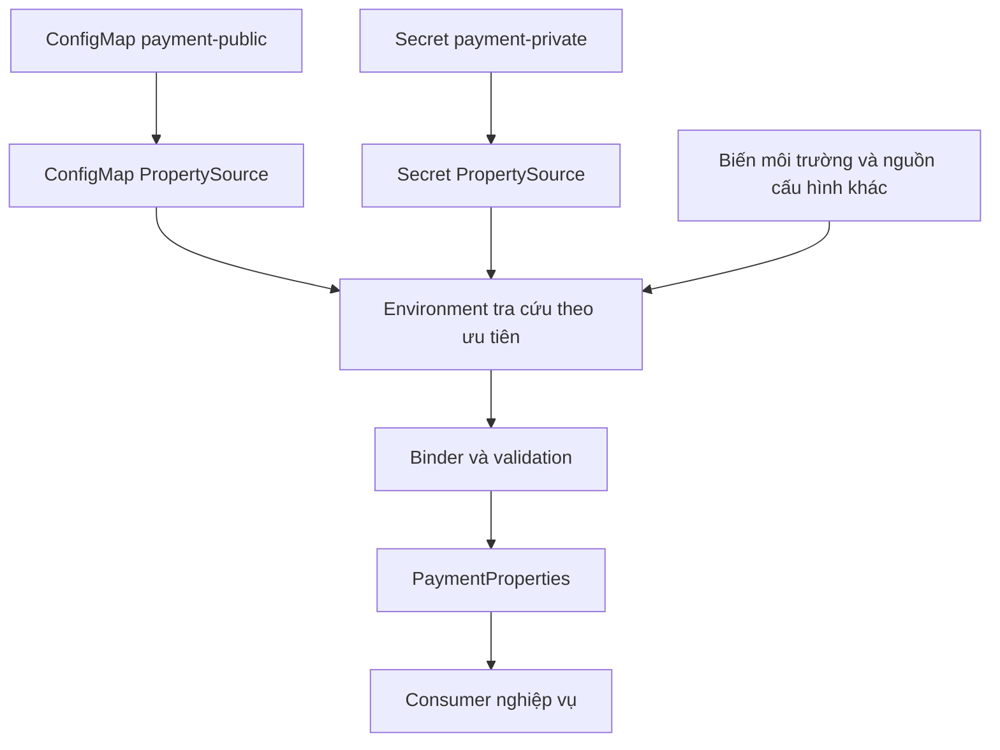

# Hợp nhất Secret với ConfigMap và xử lý trùng khóa

## 1. Mục tiêu của việc hợp nhất cấu hình

Ứng dụng thanh toán thường cần URL dịch vụ, timeout và khóa truy cập. URL và timeout có thể nằm trong ConfigMap; khóa truy cập nằm trong Secret. Đối tượng cấu hình mà nghiệp vụ sử dụng cần nhận đủ các giá trị này dù chúng đến từ những tài nguyên khác nhau.

Trong module `SPRING_CLOUD_KUBERNETES`, bài thuộc chương **Secret**, tập trung vào cách Spring Cloud Kubernetes đưa hai loại tài nguyên vào Spring `Environment`, cách xác định giá trị hiệu lực và cách ngăn khóa trùng làm sai cấu hình. DiscoveryClient, Spring Cloud LoadBalancer, sức khỏe Pod và Configuration Watcher giải quyết những nhu cầu khác trong triển khai; chúng không quyết định thay cho quy tắc chọn giá trị ở đây.

Sau bài này, người học cần làm được bốn việc:

- Ghép các thuộc tính không trùng từ ConfigMap và Secret vào cùng một bean cấu hình.
- Dự đoán và kiểm chứng giá trị khi cả hai nguồn cùng cung cấp một khóa.
- Thiết kế quyền sở hữu khóa hoặc prefix để xung đột không xảy ra ngoài ý muốn.
- Điều tra nguồn thắng mà không xuất giá trị bí mật ra log.

Ví dụ dùng Java 17, Spring Boot 3.2 và Spring Cloud Kubernetes 3.1, nạp cấu hình qua Kubernetes API bằng Config Data. Đây là phạm vi phiên bản minh họa; dependency cần được quản lý bằng BOM tương thích của dự án. Những đầu ra bên dưới là **kết quả kỳ vọng**, không phải báo cáo đã chạy trên cluster thực tế.

## 2. Hai tài nguyên vẫn độc lập, Environment mới là nơi kết hợp

Kubernetes không tạo một tài nguyên chung khi ứng dụng đọc đồng thời ConfigMap và Secret. Hai đối tượng vẫn có tên, quyền truy cập và vòng đời riêng. Spring Cloud Kubernetes chuyển dữ liệu đọc được thành các `PropertySource`; Spring tìm giá trị qua chuỗi nguồn cấu hình và Binder chuyển chúng thành đối tượng Java.



Với một khóa đơn, phép tra cứu chọn giá trị của nguồn ưu tiên cao nhất có cung cấp khóa ấy. Nếu hai nguồn cung cấp các khóa khác nhau, bean có thể nhận một phần trường từ nguồn này và các trường còn lại từ nguồn kia. Không có thao tác nối hai chuỗi hay chọn nguyên một tài nguyên cho tất cả thuộc tính.

Ví dụ, ConfigMap có `payment.base-url`, Secret có `payment.api-key`: cùng prefix `payment` giúp Binder đưa chúng vào hai trường của cùng bean. Tên tài nguyên `payment-public` và `payment-private` không tự trở thành một phần tên khóa khi chưa bật prefix theo nguồn.

### 2.1. Quy tắc cốt lõi khi ConfigMap và Secret trùng khóa

Với các Kubernetes PropertySource của Spring Cloud Kubernetes 3.1, **ConfigMap có ưu tiên cao hơn Secret nếu cả hai chứa cùng một thuộc tính**. Vì vậy, Secret không tự thắng nhờ chứa dữ liệu nhạy cảm. Đây là quy tắc được công bố trong [Order of ConfigMaps and Secrets](https://docs.spring.io/spring-cloud-kubernetes/reference/3.1/property-source-config/order_of_configMaps_and_secrets.html).

Chỉ xét hai nguồn này và chưa có nguồn bên ngoài ghi đè:

| Khóa | ConfigMap | Secret | Giá trị hiệu lực |
| --- | --- | --- | --- |
| `payment.base-url` | Có URL | Không có | URL từ ConfigMap |
| `payment.api-key` | Không có | Có khóa truy cập | Giá trị từ Secret |
| `payment.route` | `from-configmap` | `from-secret` | `from-configmap` |

Đây là thứ tự giữa các PropertySource của tích hợp này. Không suy từ bảng rằng ConfigMap luôn thắng biến môi trường, đối số tiến trình hoặc mọi phương thức gắn cấu hình vào container.

### 2.2. Giá trị rỗng và giá trị sai kiểu không phải là khóa vắng mặt

Nếu ConfigMap cung cấp `payment.route: ""`, khóa ấy vẫn tồn tại. Không có quy tắc tự động chuyển sang giá trị Secret chỉ vì chuỗi rỗng không phù hợp với nghiệp vụ. Tương tự, khi giá trị thắng không chuyển được sang kiểu Java cần bind, cần xử lý lỗi cấu hình; không mong Binder tự thử lần lượt từng nguồn cho đến khi gặp một giá trị hợp lệ.

Điều này dẫn đến hai câu hỏi riêng: **nguồn nào thắng** và **giá trị thắng có hợp lệ hay không**. Việc lưu giá trị hợp lệ trong Secret không sửa được một khóa cùng tên đang ghi đè nó từ ConfigMap.

## 3. Bộ dữ liệu thực hành có xung đột dễ quan sát

Ví dụ sử dụng namespace riêng `merge-lab`. Ghép các tài nguyên Kubernetes ở phần này và phần 5 vào một manifest thực hành, chẳng hạn `merge-lab.yaml`.

```yaml
apiVersion: v1
kind: Namespace
metadata:
  name: merge-lab
---
apiVersion: v1
kind: ConfigMap
metadata:
  name: payment-public
  namespace: merge-lab
data:
  payment.base-url: "https://sandbox.payments.example"
  payment.timeout: "2s"
  payment.route: "from-configmap"
---
apiVersion: v1
kind: Secret
metadata:
  name: payment-private
  namespace: merge-lab
type: Opaque
stringData:
  payment.api-key: "lab-only-token-not-a-real-credential"
  payment.route: "from-secret"
```

`payment.route` là marker không nhạy cảm, cố ý đặt trùng để thấy thứ tự ưu tiên. Trong thiết kế thật, cần quyết định nguồn nào sở hữu khóa này rồi loại bỏ bản sao không cần thiết.

`stringData` cho phép viết giá trị chuỗi mà không phải tự mã hóa Base64. Kubernetes chuyển dữ liệu đó sang dạng lưu trữ của Secret; ứng dụng đọc được giá trị đã được xử lý bởi tích hợp Kubernetes. Base64 không cung cấp tính bí mật như mã hóa. Không thay token giả trong tài liệu bằng thông tin xác thực thật rồi commit manifest vào kho mã. Xem [Kubernetes Secrets](https://kubernetes.io/docs/concepts/configuration/secret/).

Chủ đích của bộ dữ liệu là có **một khóa chỉ thuộc ConfigMap**, **một khóa chỉ thuộc Secret** và **một khóa xuất hiện ở cả hai**. Nếu chỉ dùng khóa trùng, sẽ khó chứng minh ứng dụng đã đọc thành công phần dữ liệu riêng của từng nguồn.

## 4. Cấu hình Spring Cloud Kubernetes đọc cả hai nguồn

### 4.1. Chọn dependency theo tính năng cần dùng

Ví dụ giả định ứng dụng đã dùng `spring-boot-starter-web`. Bổ sung starter cấu hình và validation dưới đây; phiên bản do dependency management của ứng dụng quyết định:

```xml
<dependency>
    <groupId>org.springframework.cloud</groupId>
    <artifactId>spring-cloud-starter-kubernetes-fabric8-config</artifactId>
</dependency>
<dependency>
    <groupId>org.springframework.boot</groupId>
    <artifactId>spring-boot-starter-validation</artifactId>
</dependency>
```

Ví dụ chọn họ Fabric8. Nếu dự án chọn Kubernetes Java Client thì dùng `spring-cloud-starter-kubernetes-client-config` tương ứng và thống nhất họ client trong ứng dụng. Tài liệu [Spring Cloud Kubernetes Starters](https://docs.spring.io/spring-cloud-kubernetes/reference/3.1/getting-started.html) nêu rõ không kết hợp hai họ starter.

Không cần thêm DiscoveryClient hoặc LoadBalancer chỉ để hợp nhất thuộc tính. Việc giảm dependency còn giúp giới hạn các tài nguyên Kubernetes mà ứng dụng phải đọc.

### 4.2. Chọn tên nguồn và namespace tường minh

Đặt cấu hình sau trong `application.yml` được ứng dụng nạp từ đầu:

```yaml
spring:
  application:
    name: payment-service
  config:
    import: "kubernetes:"
  cloud:
    kubernetes:
      config:
        enabled: true
        enableApi: true
        namespace: merge-lab
        fail-fast: true
        useNameAsPrefix: false
        includeProfileSpecificSources: false
        sources:
          - name: payment-public
      secrets:
        enabled: true
        enableApi: true
        namespace: merge-lab
        fail-fast: true
        useNameAsPrefix: false
        includeProfileSpecificSources: false
        sources:
          - name: payment-private
```

`"kubernetes:"` kích hoạt đường Config Data; danh sách `sources` chọn các tài nguyên cần đọc. Không tự thêm tên Secret hoặc ConfigMap vào chuỗi import theo một cú pháp chưa được hỗ trợ. Không đồng thời bật bootstrap legacy cho cùng cách nạp này; xem [Kubernetes PropertySource implementations](https://docs.spring.io/spring-cloud-kubernetes/reference/3.1/property-source-config.html).

Hai cờ của Secret có ý nghĩa khác nhau:

- `secrets.enabled` bật tích hợp Secrets PropertySource.
- `secrets.enableApi` cho phép đọc Secret qua API; trong dòng 3.1, cờ này mặc định là `false`.

Bật `enabled` mà bỏ quên `enableApi` không đủ cho bài thực hành đọc qua API. Mô tả các cờ và lựa chọn đọc Secret được nêu tại [Secrets PropertySource](https://docs.spring.io/spring-cloud-kubernetes/reference/3.1/property-source-config/secrets-propertysource.html).

Ở lượt cơ sở, tắt nguồn theo profile để khi bật profile kiểm chứng, ứng dụng không tìm thêm những tài nguyên như `payment-public-merge-lab`. Không khai báo lại `payment.*` trong JAR, biến môi trường hoặc đối số khởi chạy. Các giá trị dự phòng giống dữ liệu thực hành sẽ che mất lỗi chưa đọc được nguồn ngoài. Các tùy chọn tương ứng có trong [Common application properties](https://docs.spring.io/spring-cloud-kubernetes/reference/3.1/appendix.html).

`fail-fast` yêu cầu xử lý lỗi nạp theo hướng thất bại khi khởi động; nó không thay thế việc khai báo trường nghiệp vụ bắt buộc. Một tài nguyên hoặc thuộc tính không có mặt cần được phát hiện thêm ở bước binding/validation thay vì giả định mọi trường hợp thiếu dữ liệu đều trở thành cùng một lỗi API.

### 4.3. Giá trị dự kiến sau khi hợp nhất

| Trường Java | Khóa cấu hình | Kỳ vọng của lượt cơ sở |
| --- | --- | --- |
| `baseUrl` | `payment.base-url` | `https://sandbox.payments.example` |
| `timeout` | `payment.timeout` | `Duration` tương đương 2 giây |
| `apiKey` | `payment.api-key` | Có giá trị từ bộ dữ liệu Secret; không in giá trị |
| `route` | `payment.route` | `from-configmap` |

Không đổi vị trí hai nhóm `config` và `secrets` trong YAML để cố đảo thứ tự ưu tiên. Vị trí văn bản của hai nhóm thuộc tính không phải chỉ thị thay đổi cách các PropertySource được sắp xếp.

## 5. Quyền đọc cho đúng ServiceAccount

Bổ sung các tài nguyên dưới đây vào manifest thực hành. Role chỉ áp dụng trong namespace riêng của bài; ví dụ này đọc cấu hình ban đầu, chưa triển khai cơ chế watch hoặc DiscoveryClient.

```yaml
---
apiVersion: v1
kind: ServiceAccount
metadata:
  name: payment-app
  namespace: merge-lab
---
apiVersion: rbac.authorization.k8s.io/v1
kind: Role
metadata:
  name: payment-config-reader
  namespace: merge-lab
rules:
  - apiGroups: [""]
    resources: ["configmaps", "secrets"]
    verbs: ["get", "list"]
---
apiVersion: rbac.authorization.k8s.io/v1
kind: RoleBinding
metadata:
  name: payment-config-reader
  namespace: merge-lab
subjects:
  - kind: ServiceAccount
    name: payment-app
    namespace: merge-lab
roleRef:
  apiGroup: rbac.authorization.k8s.io
  kind: Role
  name: payment-config-reader
---
apiVersion: apps/v1
kind: Deployment
metadata:
  name: payment-service
  namespace: merge-lab
spec:
  replicas: 1
  selector:
    matchLabels:
      app: payment-service
  template:
    metadata:
      labels:
        app: payment-service
    spec:
      serviceAccountName: payment-app
      containers:
        - name: app
          image: registry.example.com/learning/payment-service:merge-lab
          ports:
            - containerPort: 8080
          env:
            - name: SPRING_PROFILES_ACTIVE
              value: merge-lab
```

Thay image minh họa bằng image thực tế đã chứa ứng dụng và cấu hình của bài. Không cần tạo Service hoặc Ingress để quan sát phép kiểm tra khởi động trong log.

Quyền `list` Secret cho phép đọc dữ liệu các Secret trong namespace, không chỉ xem tên. Danh sách `secrets.sources` giới hạn lựa chọn của ứng dụng, **không thu hẹp Role**. Vì vậy, Role trên phù hợp với namespace lab chỉ chứa dữ liệu giả; khi thiết kế hệ thống thật, cần chọn phạm vi quyền và phương thức cung cấp Secret phù hợp. Không tự thêm `cluster-admin` để bỏ qua lỗi truy cập.

Spring Cloud Kubernetes mô tả các loại tài nguyên mà starter cần đọc trong [Security Configurations Inside Kubernetes](https://docs.spring.io/spring-cloud-kubernetes/reference/3.1/security-service-accounts.html). Những tính năng cần theo dõi thay đổi có thể cần thêm quyền `watch`; không cấp quyền đó chỉ để thực hiện lần đọc khởi động của ví dụ này.

Lệnh `kubectl get secret` thành công dưới tài khoản cá nhân không chứng minh ServiceAccount `payment-app` có quyền đọc. Cần đối chiếu đúng namespace, RoleBinding và danh tính của Pod đang chạy.

## 6. Bind và kiểm chứng bean ứng dụng sử dụng

### 6.1. Kiểu cấu hình có validation

Tạo `PaymentProperties.java`:

```java
package example.payment;

import java.net.URI;
import java.time.Duration;

import jakarta.validation.constraints.NotBlank;
import jakarta.validation.constraints.NotNull;

import org.springframework.boot.context.properties.ConfigurationProperties;
import org.springframework.validation.annotation.Validated;

@Validated
@ConfigurationProperties(prefix = "payment")
public record PaymentProperties(
    @NotNull URI baseUrl,
    @NotNull Duration timeout,
    @NotBlank String apiKey,
    @NotBlank String route
) {
    @Override
    public String toString() {
        return "PaymentProperties[redacted]";
    }
}
```

`@ConfigurationProperties` gắn kiểu Java với nhóm thuộc tính bên ngoài; xem [ConfigurationProperties API](https://docs.spring.io/spring-boot/docs/3.2.12/api/org/springframework/boot/context/properties/ConfigurationProperties.html). Khi bind record này, các trường có thể được lấy từ nhiều nguồn khác nhau.

Các constraint ở đây yêu cầu có URL, timeout và hai chuỗi không blank. Chúng chưa kiểm tra toàn bộ hợp đồng nghiệp vụ, chẳng hạn scheme của URL hoặc timeout phải dương. Cũng không có constraint nào tự chứng minh `apiKey` xuất phát từ một Secret: giá trị không blank từ ConfigMap vẫn có thể vượt qua validation.

Record mặc định có `toString()` chứa các thành phần của nó. Ví dụ ghi đè phương thức đó để tránh việc log cả bean vô tình làm lộ API key. Việc này chỉ bảo vệ đường gọi `toString()`; không bảo vệ mọi kiểu serialize, endpoint quản trị hoặc log thủ công từng trường.

### 6.2. Đăng ký bean trong ứng dụng

Tạo `PaymentApplication.java`:

```java
package example.payment;

import org.springframework.boot.SpringApplication;
import org.springframework.boot.autoconfigure.SpringBootApplication;
import org.springframework.boot.context.properties.EnableConfigurationProperties;

@SpringBootApplication
@EnableConfigurationProperties(PaymentProperties.class)
public class PaymentApplication {
    public static void main(String[] args) {
        SpringApplication.run(PaymentApplication.class, args);
    }
}
```

`@EnableConfigurationProperties` đăng ký kiểu cấu hình để Spring xử lý; xem [EnableConfigurationProperties API](https://docs.spring.io/spring-boot/docs/3.2.12/api/org/springframework/boot/context/properties/EnableConfigurationProperties.html). Consumer cần inject bean này, thay vì tự gọi constructor với các hằng số rồi coi đó là bằng chứng binding.

### 6.3. Phép kiểm tra dành riêng cho profile lab

Tạo `MergeLabVerification.java` cùng package:

```java
package example.payment;

import java.net.URI;
import java.time.Duration;

import org.slf4j.Logger;
import org.slf4j.LoggerFactory;
import org.springframework.boot.ApplicationRunner;
import org.springframework.context.annotation.Bean;
import org.springframework.context.annotation.Configuration;
import org.springframework.context.annotation.Profile;

@Configuration(proxyBeanMethods = false)
@Profile("merge-lab")
public class MergeLabVerification {
    private static final Logger log =
        LoggerFactory.getLogger(MergeLabVerification.class);

    @Bean
    ApplicationRunner verifyMergedProperties(PaymentProperties properties) {
        return args -> {
            require("payment.base-url",
                URI.create("https://sandbox.payments.example")
                    .equals(properties.baseUrl()));
            require("payment.timeout",
                Duration.ofSeconds(2).equals(properties.timeout()));
            require("payment.route",
                "from-configmap".equals(properties.route()));
            require("payment.api-key presence",
                properties.apiKey() != null && !properties.apiKey().isBlank());

            log.info(
                "MERGE_LAB_PASS route={} timeout={} apiKeyConfigured={}",
                properties.route(), properties.timeout(), true
            );
        };
    }

    private static void require(String key, boolean matches) {
        if (!matches) {
            throw new IllegalStateException("Merge lab mismatch: " + key);
        }
    }
}
```

Kỳ vọng của phép thử được xác định từ manifest, không tạo bằng cách đọc lại chính bean cần kiểm tra. Lớp này chỉ chạy khi bật `merge-lab`; các hằng số của fixture không nên trở thành chính sách production.

Log kỳ vọng với bộ dữ liệu cơ sở:

```text
MERGE_LAB_PASS route=from-configmap timeout=PT2S apiKeyConfigured=true
```

Dòng log chứng minh bean được inject nhận các giá trị đã kiểm tra. Riêng `apiKeyConfigured=true` chỉ chứng minh API key không rỗng, chưa chứng minh nguồn gốc của nó. Khi môi trường có nhiều nguồn, cần kết hợp kiểm tra bean với tên PropertySource/origin và các phép thử âm. Không in API key để thay cho công việc đối chiếu nguồn.

### 6.4. Chạy lượt cơ sở và gắn bằng chứng với Pod

Sau khi chuẩn bị image đúng và ghép manifest:

```powershell
kubectl apply -f .\merge-lab.yaml
kubectl -n merge-lab rollout status deployment/payment-service --timeout=120s
kubectl -n merge-lab get configmap payment-public
kubectl -n merge-lab get secret payment-private
kubectl -n merge-lab get pods -l app=payment-service -o wide

$podName = 'THAY-BANG-TEN-POD-THUC'
kubectl -n merge-lab get pod $podName -o 'custom-columns=NAME:.metadata.name,UID:.metadata.uid,SA:.spec.serviceAccountName,IMAGE:.spec.containers[*].image'
kubectl -n merge-lab logs $podName -c app --tail=150
```

Các lệnh trên là hướng dẫn cho môi trường thực hành. Chúng không xuất toàn bộ dữ liệu Secret. Ghi UID Pod và image để tránh đối chiếu cấu hình của Pod mới với log của Pod cũ trong quá trình rollout.

Manifest minh họa chưa khai báo readiness probe. Vì vậy, kết quả rollout hoặc trạng thái Pod không thay thế việc tìm kết quả kiểm chứng bean; một tiến trình có thể được tạo rồi mới thất bại ở runner. Khi container đã restart, có thể cần xem log lần chạy trước bằng `--previous`.

## 7. Kiểm tra xung đột bằng các thay đổi có chủ đích

Thực hiện từng tình huống riêng, dùng dữ liệu giả và khôi phục baseline trước lượt kế tiếp. Sau khi sửa ConfigMap/Secret, tạo một lần khởi động mới để bài kiểm tra không phụ thuộc cơ chế refresh.

```powershell
kubectl apply -f .\merge-lab.yaml
kubectl -n merge-lab rollout restart deployment/payment-service
```

Với các lượt dự kiến thành công, tiếp tục kiểm tra rollout và log của Pod mới. Với lượt cố ý sai, kiểm tra lỗi binding, validation hoặc mismatch thay vì coi việc rollout không thành công là kết luận duy nhất.

| Thay đổi so với baseline | Kỳ vọng trên lần khởi động mới | Ý nghĩa |
| --- | --- | --- |
| Không đổi gì | Runner PASS, route là `from-configmap` | Các trường riêng được kết hợp, khóa trùng theo ưu tiên |
| Xóa `payment.route` khỏi ConfigMap | Bean nhận `from-secret`; runner baseline báo mismatch | Secret có thể cung cấp khóa khi ConfigMap không còn khóa đó |
| Đặt `payment.route: ""` trong ConfigMap | Validation `@NotBlank` thất bại | Chuỗi rỗng không tự nhường cho Secret |
| Tắt `secrets.enableApi`, không có Secret mount hay nguồn dự phòng | Thiếu API key; validation thất bại | Đọc được ConfigMap chưa chứng minh đã đọc Secret |
| Xóa `payment.api-key` khỏi Secret và không thêm ở nguồn khác | Validation thất bại | Trường bắt buộc không được che bởi giá trị mặc định |
| Thêm `payment.api-key` vào ConfigMap với một token giả khác | Bean dùng bản ConfigMap; phép kiểm tra presence vẫn có thể PASS | Validation và presence không xác thực nguồn bí mật |
| Thêm biến môi trường `PAYMENT_ROUTE=from-env` vào container | Bean nhận `from-env`; runner baseline báo mismatch | Nguồn ngoài nhóm Kubernetes có thể ghi đè kết quả |
| Đổi timeout của ConfigMap thành `very-fast` | Binding sang `Duration` thất bại | Xung đột nguồn và chuyển kiểu là hai tầng lỗi khác nhau |

Tình huống thêm API key giả vào ConfigMap đặc biệt quan trọng: ứng dụng có thể khởi động, giá trị không blank, nhưng chính sách nguồn dữ liệu đã bị vi phạm. Bản ConfigMap không trở thành nơi lưu bí mật chỉ vì cùng tên khóa với một Secret.

Đối với lượt xóa route khỏi ConfigMap, lỗi runner là kết quả mong đợi vì runner vẫn so với fixture ban đầu. Muốn ghi một dòng PASS cho fixture mới, phải thay kỳ vọng của lượt kiểm chứng một cách có chủ đích; không nới phép kiểm tra đến mức mọi giá trị đều được chấp nhận.

Nếu kết quả khác dự kiến, kiểm tra lần lượt đúng Pod, nguồn bổ sung, prefix, profile và cách bean được tạo. Đừng sửa RBAC hoặc thứ tự nguồn dựa trên một log không gắn với instance đang điều tra.

## 8. Thiết kế để không phải dựa vào xung đột ngầm

### 8.1. Ưu tiên quyền sở hữu khóa rõ ràng

Đối với ứng dụng ví dụ, một chính sách phù hợp là:

| Nhóm khóa | Nguồn sở hữu | Quy tắc |
| --- | --- | --- |
| `payment.base-url`, `payment.timeout` | ConfigMap | Giá trị vận hành không chứa thông tin xác thực |
| `payment.api-key` | Secret | Không khai báo bản sao trong ConfigMap hoặc giá trị mặc định trong JAR |
| `payment.route` | ConfigMap | Bỏ bản sao trong Secret sau khi kết thúc thí nghiệm trùng khóa |

Đây là quyết định thiết kế của ví dụ, không phải luật mà Kubernetes tự áp dụng. Nhóm phát triển có thể kiểm tra manifest trước triển khai để phát hiện khóa bí mật xuất hiện sai nguồn. Khi kiểm kê, dùng tên khóa chuẩn nhất quán, chẳng hạn kebab-case; khác cách viết nhưng cùng bind vào một trường vẫn có thể gây xung đột về ý nghĩa.

Nếu cần override có chủ đích, ghi rõ khóa được phép ghi đè, nguồn được phép sở hữu giá trị thắng và cách kiểm chứng. Không dùng một ConfigMap rộng để vô tình ghi đè thông tin xác thực của nhiều dịch vụ.

### 8.2. Dùng prefix khi hai giá trị cùng cần tồn tại

Giả sử cần giữ cả route công khai và route riêng trong mô hình cấu hình. Có thể thêm prefix theo nguồn, thay vì bắt hai giá trị tranh cùng một khóa. Trong cấu hình phần 4, thay **hai danh sách `sources`** bằng:

```yaml
# Bên dưới spring.cloud.kubernetes.config
sources:
  - name: payment-public
    explicitPrefix: shared
```

```yaml
# Bên dưới spring.cloud.kubernetes.secrets
sources:
  - name: payment-private
    explicitPrefix: credentials
```

Giữ nguyên những cờ bật API, namespace và cấu hình còn lại. Hai đoạn trên là trích đoạn ở hai vị trí khác nhau, không phải một tài liệu YAML chứa hai khóa `sources` ở cùng cấp.

Với dữ liệu hiện tại:

| Khóa trước prefix | Từ ConfigMap | Từ Secret |
| --- | --- | --- |
| `payment.base-url` | `shared.payment.base-url` | Không có |
| `payment.timeout` | `shared.payment.timeout` | Không có |
| `payment.api-key` | Không có | `credentials.payment.api-key` |
| `payment.route` | `shared.payment.route` | `credentials.payment.route` |

Đây là **đổi tên khóa hiệu lực**, không phải đảo thứ tự ưu tiên. Bean cũ có prefix `payment` sẽ không tự tìm các khóa dưới `shared.payment` hoặc `credentials.payment`. Cần tách thành hai kiểu cấu hình, đăng ký chúng rồi inject vào consumer tương ứng. Runner baseline cũng phải được thay bằng phép kiểm tra dành cho hai bean mới.

Một lựa chọn khác là `useNameAsPrefix: true`, dùng tên tài nguyên làm prefix. `explicitPrefix` được đặt ở từng phần tử `sources` và có ưu tiên hơn chiến lược dùng tên. Các cơ chế prefix, thứ tự nguồn được khai báo và nguồn theo profile được mô tả tại [Using a ConfigMap PropertySource](https://docs.spring.io/spring-cloud-kubernetes/reference/3.1/property-source-config/configmap-propertysource.html).

Prefix chỉ giải quyết không gian tên thuộc tính. Nó không mã hóa dữ liệu, không thay đổi quyền RBAC và không bảo đảm hai nguồn sẽ không đụng nhau nếu người triển khai cố tình chọn cùng prefix.

### 8.3. Phân biệt thứ tự trong một nhóm với thứ tự giữa hai nhóm

Nếu cấu hình nhiều ConfigMap có tên trong `config.sources`, thứ tự danh sách có ý nghĩa: nguồn đứng sau ghi đè khóa trùng của nguồn trước theo quy tắc tài liệu 3.1. Đây là một tình huống khác với ưu tiên ConfigMap so với Secret.

Ví dụ danh sách `[payment-common, payment-production]` có thể thể hiện chủ đích dùng cấu hình production ghi đè cấu hình chung. Không áp dụng quy tắc này bằng cách di chuyển nhóm `secrets` xuống dưới nhóm `config` trong YAML. Với các nguồn chọn bằng label, tránh dựa vào thứ tự kết quả trả về để tạo chính sách override cho dữ liệu quan trọng; chọn tên tường minh hoặc prefix giúp thiết kế dễ kiểm tra hơn.

## 9. Những cơ chế dễ bị nhầm với Spring Cloud Kubernetes

### 9.1. Biến môi trường và đối số tiến trình

Trong đường Config Data đang sử dụng, biến môi trường, Java system properties và đối số dòng lệnh thuộc các nguồn có thể ghi đè dữ liệu cấu hình đã import. Ví dụ `PAYMENT_ROUTE=from-env` giải thích vì sao bean nhận giá trị không xuất hiện ở cả ConfigMap lẫn Secret của bài. Xem [Spring Boot Externalized Configuration](https://docs.spring.io/spring-boot/docs/3.2.12/reference/html/features.html#features.external-config).

Vì vậy, điều tra chỉ bằng cách xem hai tài nguyên Kubernetes là chưa đủ. Cần kiểm tra cả cấu hình container và cách JVM được khởi chạy, nhưng không dump toàn bộ môi trường khi có thể chứa bí mật.

### 9.2. `envFrom` có quy tắc chọn giá trị riêng

Khi Kubernetes tạo biến môi trường từ nhiều mục `envFrom`, nguồn đứng sau thắng nếu trùng tên biến; mục `env` tường minh thắng biến cùng tên từ `envFrom`. Đây là quy tắc của container API, không phải quy tắc “ConfigMap thắng Secret” của Spring Cloud Kubernetes. Xem [Kubernetes Pod API: envFrom](https://kubernetes.io/docs/reference/kubernetes-api/core/pod-v1/).

Đoạn minh họa sau là một phương án cung cấp cấu hình **khác** với baseline đọc API:

```yaml
envFrom:
  - configMapRef:
      name: payment-env-public
  - secretRef:
      name: payment-env-private
```

Nếu cả hai tài nguyên môi trường này chứa `PAYMENT_ROUTE`, mục Secret ở sau cung cấp biến thắng. Đảo thứ tự hai mục sẽ đổi kết quả ở tầng `envFrom`. Ví dụ này dùng các khóa kiểu biến môi trường; không lấy nguyên manifest dữ liệu dạng dấu chấm của baseline để giả định mọi cách gắn vào môi trường đều tương đương.

Nếu vừa nạp qua API, vừa inject cùng cấu hình qua môi trường, ứng dụng có hai đường nhận giá trị. Cần ghi rõ đường nào được thiết kế làm nguồn có hiệu lực; đừng chỉ đổi thứ tự các nguồn API khi giá trị thắng thực tế nằm trong `systemEnvironment`.

### 9.3. Volume và Config Tree

Mount Secret/ConfigMap thành file rồi dùng Spring Boot Config Tree là một lựa chọn khác. Cần xác định đường dẫn, cách import và quy tắc ưu tiên của cách đọc file đó. Không mang mặc định ưu tiên của hai Kubernetes PropertySource sang mọi cấu hình file được mount. Dùng thư mục riêng giúp tránh lẫn dữ liệu trước khi Spring bắt đầu binding.

### 9.4. Danh sách và đối tượng phức tạp

“Hợp nhất cấu hình” không đồng nghĩa ghép mọi cấu trúc theo từng phần tử. Spring Boot có quy tắc riêng cho collection: danh sách cấu hình ở nhiều nguồn được thay thế theo nguồn ưu tiên, không tự nối thành một danh sách dài hơn. Với Map hoặc đối tượng lồng, cần kiểm tra từng khóa và kết quả bind thực tế. Tham khảo [Merging Complex Types](https://docs.spring.io/spring-boot/docs/3.2.12/reference/html/features.html#features.external-config.typesafe-configuration-properties.merging-complex-types).

Để tránh sai giả định trong bài này, lượt cơ sở chỉ dùng các trường đơn. Khi mở rộng sang danh sách endpoint hoặc tập thông tin xác thực, thiết kế riêng dữ liệu và phép kiểm tra thay vì suy rộng từ một ví dụ chuỗi đơn.

## 10. Cập nhật cấu hình và kết thúc điều tra

### 10.1. Cập nhật hai tài nguyên không phải một giao dịch

ConfigMap và Secret có thể được sửa ở hai thời điểm khác nhau. Không có bảo đảm chung rằng ứng dụng sẽ đồng thời thấy URL mới từ ConfigMap và API key mới từ Secret chỉ vì chúng cùng prefix `payment`.

Khi hai giá trị phải đi cùng nhau, có thể dùng tên tài nguyên theo phiên bản và chuyển cấu hình `sources` của bản triển khai sang một cặp đã chuẩn bị sẵn. Việc này cần được thể hiện trong cấu hình phát hành và kiểm chứng trên các Pod mới; không chỉ ghi một marker trong một nguồn rồi kết luận cả cặp đã đồng bộ.

Trong bài thực hành, restart/rollout tạo lượt nạp mới. Việc sửa Secret không tự bảo đảm bean và consumer đang tồn tại nhận giá trị mới. Configuration Watcher cung cấp cơ chế thông báo refresh theo cấu hình triển khai, nhưng không thay đổi thứ tự ưu tiên giữa hai nguồn hoặc tạo giao dịch chung cho hai tài nguyên. Xem [Spring Cloud Kubernetes Configuration Watcher](https://docs.spring.io/spring-cloud-kubernetes/reference/3.1/spring-cloud-kubernetes-configuration-watcher.html).

Nếu Secret thay đổi nhưng cùng khóa vẫn bị ConfigMap ghi đè, một lần nạp mới vẫn có thể nhận giá trị ConfigMap như trước. Trước khi điều tra watcher, cần xác định việc thay đổi đó có thể ảnh hưởng đến khóa hiệu lực hay không.

### 10.2. Bảng khoanh vùng lỗi

| Hiện tượng | Kiểm tra tiếp theo |
| --- | --- |
| Có URL, timeout nhưng API key bị thiếu | `secrets.enableApi`, quyền đọc, tên Secret, namespace và trường bắt buộc |
| API key không rỗng nhưng nghi sai nguồn | Khóa cùng tên trong ConfigMap, môi trường và đối số khởi chạy |
| Route vẫn là bản ConfigMap sau khi sửa Secret | Quy tắc ưu tiên và khóa trùng, rồi mới xét thời điểm nạp |
| Bật prefix xong bean cũ không bind | Đường dẫn thuộc tính sau prefix và prefix của bean |
| Lỗi 403 khi đọc nguồn | ServiceAccount của đúng Pod, Role, RoleBinding và thao tác API bị từ chối |
| Nguồn có giá trị nhưng bean nhận mặc định | Đường đăng ký bean, prefix, nguồn ghi đè và giá trị dự phòng |
| Xóa khóa ở một nguồn mà ứng dụng vẫn chạy | Khóa còn tồn tại ở nguồn khác hoặc có mặc định |
| Có log PASS ở một replica nhưng lỗi vẫn xuất hiện | UID Pod, image, thời điểm khởi động và kết quả của các replica còn lại |

Nếu ứng dụng đã có các endpoint quản trị để quan sát cấu hình, đối chiếu tên nguồn và origin với giá trị đã được che. Không mở công khai endpoint chứa `Environment` hoặc toàn bộ bean chỉ để tìm nguồn thắng. Việc quan sát cần đủ để xác định khóa và nguồn, không cần công bố nội dung bí mật.

### 10.3. Bằng chứng cần có sau bài thực hành

Một lượt kiểm chứng hoàn chỉnh xác định được namespace, Pod, ServiceAccount và các tài nguyên đã chọn; chứng minh bean được Spring quản lý nhận đủ trường riêng của hai nguồn; đồng thời chỉ ra `payment.route` trùng khóa được giải quyết theo đúng ưu tiên đã công bố.

Các phép thử âm cần phân biệt khóa thiếu, khóa rỗng, giá trị sai kiểu và giá trị hợp lệ nhưng sai nguồn. Cuối cùng, chọn chính sách sở hữu khóa hoặc prefix cho triển khai thực tế, nêu cách kiểm tra nguồn của thuộc tính quan trọng và giữ dữ liệu bí mật ngoài log. Đó là cơ sở để hợp nhất cấu hình có thể dự đoán và điều tra được khi hệ thống thay đổi.
