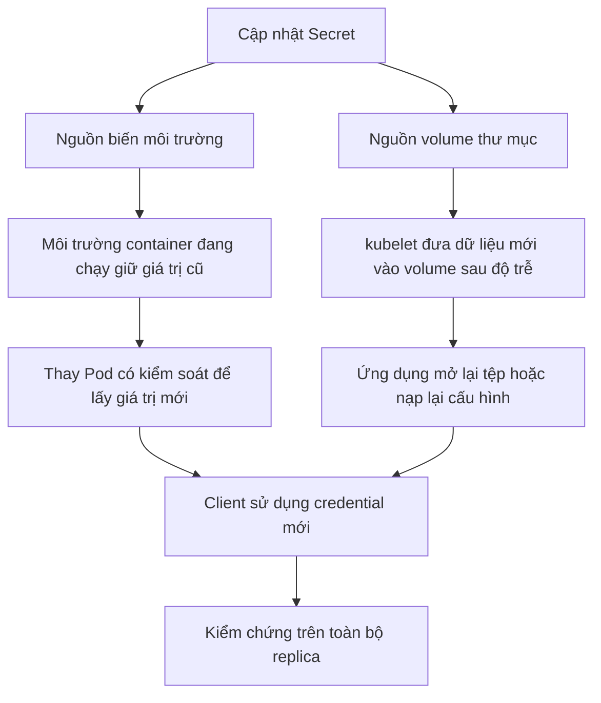

# Đặc điểm cập nhật Secret khi dùng volume hoặc biến môi trường

Trong chương **Secret** của module **SPRING_CLOUD_KUBERNETES**, một câu hỏi vận hành quan trọng là: sau khi cập nhật Secret, ứng dụng Spring đang chạy có sử dụng credential mới hay chưa?

Câu trả lời phụ thuộc vào cách Secret được đưa vào container và cách ứng dụng giữ giá trị trong bộ nhớ. Biến môi trường, tệp trên volume, bean cấu hình và client kết nối đến hệ thống bên ngoài có vòng đời khác nhau.

Bài này tập trung vào hành vi cập nhật và cách kiểm chứng. Bạn sẽ so sánh ba cách tiêu thụ cùng một Secret, sau đó chọn giữa rollout và refresh cho ứng dụng Spring Cloud Kubernetes.

## 1. Phân biệt bốn thời điểm của một lần đổi credential

Hãy xét token gọi một dịch vụ đối tác được đổi từ bộ giá trị `r1` sang `r2`:

| Mốc | Điều vừa xảy ra | Điều chưa thể kết luận |
| --- | --- | --- |
| A | Kubernetes API chấp nhận cập nhật Secret | Mọi container đã nhận giá trị mới |
| B | Tệp Secret trên volume của một Pod đã đổi | Bean Spring đã được bind lại |
| C | Ứng dụng hoặc client đã chuyển sang credential mới | Tất cả replica đã chuyển xong |
| D | Mọi instance cần thiết đã sử dụng credential mới thành công | Credential cũ đã được thu hồi an toàn, nếu chưa kiểm tra bên cấp |

Trong thực tế, một replica có thể ở mốc B trong khi replica khác vẫn ở trước mốc B. Mã HTTP thành công của lệnh cập nhật Secret chỉ xác nhận mốc A.



Đây là cách phân tích dành cho luồng native Kubernetes Secret trong bài. Nếu dùng CSI driver hoặc hệ thống cấp credential bên ngoài, còn phải xét cơ chế đồng bộ và rotation của thành phần đó.

## 2. So sánh hành vi cập nhật

| Cách tiêu thụ | Khi Secret đổi, container đang chạy thấy gì? | Bước thường cần |
| --- | --- | --- |
| `env[].valueFrom.secretKeyRef` | Biến môi trường đã cấp cho container không tự đổi | Rollout để tạo Pod mới |
| `envFrom.secretRef` | Cùng giới hạn về môi trường của container đang chạy | Rollout để tạo Pod mới |
| Mount Secret thành thư mục | Tệp có thể được cập nhật sau độ trễ | Ứng dụng đọc lại hoặc nạp lại cấu hình |
| Mount một tệp bằng `subPath` | Mount hiện hữu không nhận cập nhật tự động từ Secret | Thay Pod hoặc đổi thiết kế mount |
| Sao chép tệp Secret sang nơi khác lúc khởi động | Bản sao không tự đổi theo tệp gốc | Chạy lại bước sao chép hoặc cơ chế đồng bộ riêng |
| Đọc tệp một lần rồi cache trong client | Tệp nguồn có thể mới nhưng client vẫn giữ giá trị cũ | Tạo lại hoặc cập nhật client theo thiết kế |

Kubernetes ghi rõ biến môi trường từ Secret không phản ánh cập nhật trong container đang chạy. Đây không phải lỗi của Spring hay của `@Value`. [Secret dùng qua biến môi trường](https://kubernetes.io/docs/tasks/inject-data-application/distribute-credentials-secure/#define-container-environment-variables-using-secret-data).

### Biến môi trường là dữ liệu được cấp khi tạo container

Giả sử container có cấu hình:

```yaml
env:
  - name: PARTNER_TOKEN
    valueFrom:
      secretKeyRef:
        name: integration-credential
        key: token
```

Khi container chạy, tiến trình Java nhận `PARTNER_TOKEN`. Việc thay đổi key `token` trong đối tượng Secret không sửa môi trường của tiến trình đó.

Lệnh `kubectl exec` mở shell mới bên trong chính container này cũng không phải cơ chế cấp lại Secret. Khởi chạy lại JVM dưới một supervisor đang giữ môi trường cũ có thể tiếp tục truyền giá trị cũ cho JVM mới.

Container được Kubernetes tạo lại có cơ hội nhận cấu hình mới tại thời điểm tạo. Trong vận hành Deployment, dùng rollout tạo Pod mới là cách chủ động, theo dõi được; không chờ crash hoặc liveness probe gây restart.

### Volume thư mục có độ trễ lan truyền

Kubernetes cập nhật tệp Secret volume theo cơ chế nhất quán cuối cùng. Độ trễ liên quan đến chu kỳ đồng bộ kubelet và cách phát hiện thay đổi/cache. Mount `subPath` là ngoại lệ không nhận cập nhật tự động. [Cơ chế cập nhật Secret volume](https://kubernetes.io/docs/concepts/configuration/secret/#using-secrets-as-files-from-a-pod).

Vì vậy, không đặt giả định “sau đúng 5 giây mọi Pod phải đổi”. Với một mục tiêu vận hành, hãy đo thời gian lan truyền trên cluster và đặt timeout theo quan sát thực tế. Thất bại sau một lần đọc quá sớm chưa chứng minh mount bị lỗi.

## 3. Thí nghiệm: quan sát ba cách đọc trong cùng một Pod

Thí nghiệm dùng một container công cụ để tách hành vi Kubernetes khỏi hành vi bind của Spring. Bạn cần cluster chạy Linux container, `kubectl` trỏ đúng môi trường lab và quyền tạo Namespace, Secret, Deployment.

Chỉ dùng giá trị giả. Key `revision` là mã phiên bản công khai, cho phép quan sát thay đổi mà không xuất token. Các tệp YAML dưới đây là tệp người học tạo để thực hành.

### 3.1. Tạo namespace và Secret ban đầu

Tệp `namespace.yaml`:

```yaml
apiVersion: v1
kind: Namespace
metadata:
  name: secret-update-lab
```

Tệp `credential.yaml`:

```yaml
apiVersion: v1
kind: Secret
metadata:
  name: integration-credential
  namespace: secret-update-lab
type: Opaque
stringData:
  token: "DEMO_ONLY_TOKEN_R1"
  revision: "r1"
```

Mã `revision` mô tả bộ credential trong thí nghiệm, không phải `metadata.resourceVersion` của Kubernetes. Thấy revision mới cũng chưa chứng minh token được đối tác chấp nhận.

### 3.2. Tạo Deployment quan sát

Tệp `observer.yaml`:

```yaml
apiVersion: apps/v1
kind: Deployment
metadata:
  name: secret-observer
  namespace: secret-update-lab
spec:
  replicas: 1
  selector:
    matchLabels:
      app: secret-observer
  template:
    metadata:
      labels:
        app: secret-observer
    spec:
      automountServiceAccountToken: false
      securityContext:
        runAsNonRoot: true
        runAsUser: 10001
        runAsGroup: 10001
        fsGroup: 10001
        seccompProfile:
          type: RuntimeDefault
      containers:
        - name: observer
          image: busybox:1.36
          command:
            - sh
            - -c
            - exec sleep 86400
          env:
            - name: SECRET_REVISION
              valueFrom:
                secretKeyRef:
                  name: integration-credential
                  key: revision
          securityContext:
            allowPrivilegeEscalation: false
            capabilities:
              drop:
                - ALL
          volumeMounts:
            - name: credential
              mountPath: /run/secret-live
              readOnly: true
            - name: credential
              mountPath: /run/revision-fixed
              subPath: revision
              readOnly: true
      volumes:
        - name: credential
          secret:
            secretName: integration-credential
            defaultMode: 288
            items:
              - key: token
                path: token
              - key: revision
                path: revision
```

Trong cùng container, `SECRET_REVISION`, `/run/secret-live/revision` và `/run/revision-fixed` đều xuất phát từ key `revision`. Chúng có ba hành vi cập nhật cần so sánh.

`defaultMode: 288` tương đương quyền bát phân `0440`; nhóm 10001 được sử dụng để đọc volume. Ví dụ không gọi Kubernetes API từ container, nên không cấp token ServiceAccount cho nó.

Container công cụ này chỉ ngủ để phục vụ quan sát, không mô phỏng health hoặc mức sẵn sàng nghiệp vụ của một ứng dụng Spring.

### 3.3. Đọc trạng thái ban đầu

```shell
kubectl apply -f namespace.yaml
kubectl apply -f credential.yaml
kubectl apply -f observer.yaml
kubectl -n secret-update-lab rollout status deployment/secret-observer --timeout=120s
kubectl -n secret-update-lab get pods -l app=secret-observer
```

Ghi lại tên Pod rồi thay `POD_NAME` trong các lệnh sau bằng tên đó. Dùng cùng một Pod giúp tránh lẫn kết quả nếu Pod bị thay thế trong lúc thực hành.

```shell
kubectl -n secret-update-lab exec POD_NAME -c observer -- printenv SECRET_REVISION
kubectl -n secret-update-lab exec POD_NAME -c observer -- cat /run/secret-live/revision
kubectl -n secret-update-lab exec POD_NAME -c observer -- cat /run/revision-fixed
```

Cả ba lần đọc ban đầu dự kiến trả `r1`. Các lệnh chỉ xuất mã phiên bản, không xuất key `token`.

### 3.4. Đổi Secret và đọc lại cùng Pod

Trong `credential.yaml`, giữ nguyên định danh và thay phần dữ liệu bằng:

```yaml
stringData:
  token: "DEMO_ONLY_TOKEN_R2"
  revision: "r2"
```

Đây là phần thay thế trong manifest đầy đủ, không phải manifest độc lập. Áp dụng lại:

```shell
kubectl apply -f credential.yaml
```

Lặp lại ba lệnh đọc ở phần 3.3 với đúng `POD_NAME` cũ. Sau khi volume thư mục đã nhận cập nhật, kết quả dự kiến:

| Điểm đọc trong Pod cũ | Kết quả |
| --- | --- |
| `printenv SECRET_REVISION` | `r1` |
| `cat /run/secret-live/revision` | `r2` |
| `cat /run/revision-fixed` | `r1` |

Nếu tệp trong thư mục vẫn là `r1`, đọc lại sau một khoảng ngắn và kiểm tra sự kiện Pod khi vượt timeout vận hành. Đừng kết luận cả ba cách đều giữ giá trị cũ chỉ vì đọc ngay sau lệnh apply.

### 3.5. Thay Pod để lấy trạng thái mới

```shell
kubectl -n secret-update-lab rollout restart deployment/secret-observer
kubectl -n secret-update-lab rollout status deployment/secret-observer --timeout=120s
kubectl -n secret-update-lab get pods -l app=secret-observer
```

Đổi `POD_NAME` sang Pod mới rồi đọc lại. Trong thí nghiệm này, sau khi Secret `r2` đã sẵn có và rollout hoàn tất, cả ba điểm đọc dự kiến là `r2`.

Lệnh rollout không sửa Secret. Nó thay đổi template của Deployment để controller thay Pod; Pod mới thiết lập lại biến môi trường và mount. [Kubernetes Deployments](https://kubernetes.io/docs/concepts/workloads/controllers/deployment/).

## 4. Trong ứng dụng Spring, tệp mới và bean mới là hai việc khác nhau

Ví dụ thực tế dùng thuộc tính `partner.token` và `partner.revision`. Với Spring Boot, có thể chọn một trong hai nguồn:

| Nguồn | Cấu hình đầu vào cho ứng dụng thật |
| --- | --- |
| Biến môi trường | Đặt `PARTNER_TOKEN`, `PARTNER_REVISION` bằng `secretKeyRef` |
| Volume và configtree | Mount các tệp `partner.token`, `partner.revision`, rồi import thư mục |

Ví dụ cấu hình cho phương án volume:

```yaml
spring:
  config:
    import: "configtree:/etc/partner-secrets/"
```

Trong volume của ứng dụng Spring, ánh xạ key theo tên thuộc tính:

```yaml
items:
  - key: token
    path: partner.token
  - key: revision
    path: partner.revision
```

Hai đoạn trên là phần cấu hình để ghép vào ứng dụng thật, không phải tài nguyên Kubernetes độc lập. Thư mục mount phải đúng `/etc/partner-secrets`. Deployment quan sát ở phần 3 dùng đường dẫn và tên biến khác để dễ đối chiếu ba cơ chế.

Spring Boot cung cấp `configtree:` để chuyển tên tệp thành tên thuộc tính, nhưng import này không có nghĩa mọi bean tự được tái tạo khi tệp đổi. [Configuration trees trong Spring Boot](https://docs.spring.io/spring-boot/3.5/reference/features/external-config.html#features.external-config.files.configtrees).

### 4.1. Giá trị được giữ khi bean khởi tạo

Trong một ứng dụng Spring Boot chạy Java 17 trở lên, bean quan sát có thể viết như sau:

```java
package com.example.rotation;

import java.io.IOException;
import java.nio.charset.StandardCharsets;
import java.nio.file.Files;
import java.nio.file.Path;

import org.springframework.beans.factory.annotation.Value;
import org.springframework.stereotype.Component;

@Component
public class RevisionView {

    private final String boundRevision;

    public RevisionView(@Value("${partner.revision}") String revision) {
        this.boundRevision = revision;
    }

    public String boundRevision() {
        return boundRevision;
    }

    public String mountedRevision() throws IOException {
        return Files.readString(
                Path.of("/etc/partner-secrets/partner.revision"),
                StandardCharsets.UTF_8
        );
    }
}
```

Lớp này thuộc package được ứng dụng Spring Boot component-scan. Phương thức `mountedRevision()` chỉ dùng cho biến thể có volume đúng đường dẫn đã nêu.

Sau khi tệp trên volume đổi từ `r1` sang `r2`, singleton trong mẫu vẫn có `boundRevision = r1`. Gọi `mountedRevision()` mở lại tệp và có thể thấy `r2`. Không có mâu thuẫn: hai phương thức đọc từ hai nơi khác nhau.

Nếu client HTTP được tạo một lần với token từ bean cấu hình, client cũng có thể giữ token cũ. Việc cấu hình được bind lại, nếu có, vẫn cần đi tiếp đến bước cập nhật client đang phục vụ request.

### 4.2. Nguồn cấu hình có thể che khuất volume

Nếu đồng thời có `PARTNER_TOKEN` và `configtree:` cung cấp `partner.token`, biến môi trường có độ ưu tiên cao hơn config data theo quy tắc Spring Boot thông thường. Khi đó, sửa tệp chưa chắc thay đổi nguồn được Spring chọn. [Thứ tự nguồn cấu hình](https://docs.spring.io/spring-boot/3.5/reference/features/external-config.html).

Khi chẩn đoán, xác định cả nguồn có hiệu lực lẫn revision đã dùng. Đừng chỉ kiểm tra nội dung tệp rồi suy ra giá trị bên trong bean.

## 5. Vì sao ứng dụng đọc tệp vẫn có thể giữ dữ liệu cũ?

### 5.1. Stream hoặc file descriptor mở lâu

Secret volume trên Linux sử dụng cơ chế chiếu dữ liệu với liên kết tượng trưng; Kubernetes có thể công bố bộ tệp mới bằng cách đổi đích liên kết. Vì vậy, giữ một stream mở từ trước không tương đương mở lại đường dẫn sau cập nhật. [AtomicWriter của Kubernetes](https://github.com/kubernetes/kubernetes/blob/master/pkg/volume/util/atomic_writer.go).

Trong ứng dụng:

- Đọc lại bằng đường dẫn logic khi cần lấy phiên bản mới.
- Đóng tài nguyên sau khi đọc, tránh giữ stream vô thời hạn cho một tệp credential nhỏ.
- Nếu dùng file watcher, kiểm chứng loại sự kiện thực tế và cách đăng ký lại watcher khi dữ liệu được thay thế.
- Không sửa hoặc phụ thuộc vào tên thư mục nội bộ do kubelet tạo.

Đọc lại mỗi request có thể tăng I/O và gây khó kiểm soát thời điểm đổi credential. Một cơ chế reload có kiểm soát thường cần cache riêng, phát hiện revision, kiểm tra dữ liệu rồi thay thế bộ credential đang dùng.

### 5.2. Đọc nhiều tệp không phải giao dịch của ứng dụng

Giả sử credential gồm username, password và revision trong ba tệp. Dù cơ chế chiếu công bố một bộ dữ liệu, ứng dụng có thể đọc username trước lần chuyển và password sau lần chuyển.

Nếu cặp giá trị phải khớp tuyệt đối, một lựa chọn thiết kế là chứa toàn bộ credential trong một tệp có định dạng rõ ràng, đọc hết một lần, parse và validate rồi hoán đổi đối tượng cấu hình. Một lựa chọn khác là cơ chế kiểm tra revision và đọc lại khi có thay đổi giữa chừng.

Đây là quyết định ở tầng ứng dụng; không được suy ra rằng nhiều lệnh đọc tệp riêng biệt tạo thành một transaction.

### 5.3. Connection pool và phiên kết nối

Với cơ sở dữ liệu hoặc hệ thống có phiên đăng nhập, credential mới có thể chỉ được dùng khi tạo kết nối mới. Kết nối đang mở có vòng đời riêng, tùy máy chủ và thư viện.

Kế hoạch rotation cần kiểm tra cả việc tạo kết nối mới lẫn các kết nối cũ đang phục vụ. Tránh coi phép kiểm tra một request trên connection đang có là bằng chứng đủ cho việc chuyển toàn bộ pool.

## 6. Chọn rollout hoặc refresh

### Phương án A: rollout có kiểm soát

Phù hợp khi ứng dụng dùng biến môi trường, cấu hình được nạp lúc khởi động hoặc client chưa có cơ chế đổi credential trong tiến trình.

Ví dụ phần chiến lược của Deployment ứng dụng thật:

```yaml
spec:
  strategy:
    type: RollingUpdate
    rollingUpdate:
      maxSurge: 1
      maxUnavailable: 0
```

Cần đủ tài nguyên cho Pod tăng thêm và readiness phản ánh khả năng phục vụ mong muốn. `maxUnavailable: 0` không bảo đảm không có lỗi xác thực nếu credential cũ bị thu hồi trước khi các replica chuyển xong.

Sửa dữ liệu Secret không tự làm thay đổi `.spec.template` của Deployment, nên native Deployment không tự rollout chỉ vì Secret đổi. Bạn có thể kích hoạt rollout trong pipeline hoặc dùng controller chuyên trách đã được cấu hình.

Một annotation chứa mã phiên bản công khai trong `.spec.template.metadata.annotations` cũng có thể gắn lần triển khai với revision credential. Nó phải nằm trong Pod template; chỉ đổi annotation ở metadata ngoài cùng của Deployment không có tác dụng tương đương.

### Phương án B: reload/refresh trong tiến trình

Phù hợp khi ứng dụng có đường đọc lại dữ liệu, kiểm tra cấu hình mới và chuyển client sang trạng thái mới mà không thay Pod.

Spring Cloud Kubernetes Configuration Watcher có thể phát hiện thay đổi và gửi thông báo refresh. Với volume, cần tính đến khả năng sự kiện API đến trước lúc kubelet cập nhật tệp; refresh quá sớm có thể đọc lại dữ liệu cũ. Cần thiết lập theo dõi Secret, RBAC, tuyến thông báo và độ trễ phù hợp với cluster. [Configuration Watcher](https://docs.spring.io/spring-cloud-kubernetes/reference/spring-cloud-kubernetes-configuration-watcher.html).

`@RefreshScope` hỗ trợ vòng đời bean khi refresh được kích hoạt, nhưng không tự tạo sự kiện thay đổi và không thay thế nguồn cấu hình. Một bean được tạo lại từ biến môi trường cũ vẫn có thể nhận giá trị cũ. Các kiểu client và DataSource có giới hạn refresh riêng; kiểm tra theo phiên bản đang dùng. [Spring Cloud Refresh Scope](https://docs.spring.io/spring-cloud-commons/reference/spring-cloud-commons/application-context-services.html#refresh-scope).

Chỉ thêm Watcher hoặc endpoint refresh khi bạn đã xác định được chuỗi chuyển đổi đầy đủ: nguồn mới, cấu hình mới, client mới và request dùng client mới.

## 7. Quy trình rotation cho nhiều replica

Giả sử dịch vụ có ba replica P1, P2, P3 và nhà cung cấp token hỗ trợ một khoảng thời gian chấp nhận cả token cũ lẫn mới. Có thể tổ chức như sau:

1. **Cấp bộ credential mới.** Xác nhận phía đối tác đã chấp nhận token mới trước khi đưa vào ứng dụng.
2. **Công bố Secret.** Gắn mã revision công khai để phục vụ quan sát; không đưa token vào log hoặc annotation.
3. **Kích hoạt cơ chế chuyển đổi.** Rollout với nguồn môi trường; reload/refresh đã được thiết kế với nguồn volume.
4. **Kiểm tra từng replica.** Ghi nhận revision được ứng dụng/client sử dụng và kết quả thao tác xác thực phù hợp.
5. **Theo dõi lỗi và request đang xử lý.** Bao gồm kết nối được tạo mới, retry và background job dùng cùng credential.
6. **Thu hồi credential cũ.** Chỉ thực hiện khi các điều kiện chuyển đổi của hệ thống đã đạt.

Bảng quan sát có thể là:

| Replica | Revision tại nguồn | Revision client đang dùng | Thao tác xác thực |
| --- | --- | --- | --- |
| P1 | `r2` | `r2` | Thành công |
| P2 | `r2` | `r1` | Còn dùng token cũ |
| P3 | `r2` | `r2` | Thành công |

Bảng này cho thấy vì sao “cả ba volume đã đổi” vẫn chưa đủ để thu hồi token cũ.

Đây là quy trình gợi ý cho tình huống có thời gian giao nhau. Nếu nhà cung cấp chỉ chấp nhận một credential tại một thời điểm, cần thiết kế cutover khác và chấp nhận hoặc xử lý khoảng gián đoạn có thể xảy ra.

### Readiness, liveness và bằng chứng xác thực

Pod `Running` chỉ phản ánh trạng thái chạy của container. Readiness mặc định cũng chưa chắc kiểm tra credential với hệ thống đích.

Nếu dùng một phép thử xác thực trong readiness, hãy cân nhắc timeout, tần suất và ảnh hưởng khi đối tác gián đoạn. Không dùng liveness như bộ điều khiển rotation: restart liên tục có thể khuếch đại lỗi bên ngoài.

DiscoveryClient và Spring Cloud LoadBalancer giúp tìm hoặc chọn instance, nhưng không tự chứng minh mỗi instance đã đổi token. Cơ chế quan sát rotation vẫn cần nhận diện được replica hoặc một bản ghi revision đáng tin cậy.

## 8. Secret bất biến, Secret theo phiên bản và rollback

Khi đặt `immutable: true`, dữ liệu Secret không được cập nhật in-place như trong thí nghiệm. Với nhu cầu đổi credential, một phương án là tạo Secret có tên mới rồi đổi tham chiếu trong Pod template. [Secret bất biến](https://kubernetes.io/docs/concepts/configuration/secret/#immutable-secrets).

Ví dụ hai phiên bản có thể mang tên:

```text
integration-credential-r1
integration-credential-r2
```

Khi chuyển ứng dụng sang `r2`, cập nhật mọi tham chiếu liên quan trong template: `secretKeyRef`, `envFrom` hoặc `volumes[].secret.secretName`. Thay đổi template kích hoạt rollout và giúp liên kết phiên bản triển khai với tên Secret.

Điểm cần phân biệt khi rollback:

| Thiết kế | Rollback Deployment có phục hồi credential cũ không? |
| --- | --- |
| Một tên Secret cố định, dữ liệu bị ghi đè | Không tự khôi phục dữ liệu Secret đã ghi đè |
| Secret theo phiên bản, template cũ tham chiếu tên cũ | Có thể quay lại tham chiếu cũ nếu Secret và credential cũ vẫn hợp lệ |

Đừng xóa Secret cũ hoặc thu hồi token cũ trước khi hết cửa sổ rollback đã thỏa thuận. Ngược lại, nếu rotation là để xử lý credential bị lộ, không khôi phục credential đó chỉ để làm rollback thuận tiện.

## 9. Chẩn đoán hiện tượng “Secret đã đổi nhưng ứng dụng chưa đổi”

Đi theo thứ tự nguồn dữ liệu, phân phối, bộ nhớ ứng dụng và hệ thống đích:

| Hiện tượng | Kiểm tra trước | Hướng xử lý |
| --- | --- | --- |
| Env còn revision cũ | Container có được thay sau cập nhật không? | Rollout và kiểm tra Pod mới |
| Volume thư mục còn cũ | Đúng Secret/namespace/key, độ trễ và sự kiện mount | Chờ trong timeout phù hợp rồi điều tra kubelet/mount |
| Chỉ tệp mount riêng còn cũ | Có `subPath` không? | Thay Pod hoặc mount thư mục |
| Tệp mới nhưng bean cũ | Bean có nạp lúc khởi động và có refresh thực không? | Rollout hoặc hoàn thiện refresh |
| Bean mới nhưng request vẫn lỗi token cũ | Client/cache/pool đang giữ gì? | Chuyển đổi client và xác minh kết nối mới |
| Refresh được gọi nhưng vẫn cũ | Tệp đã lan truyền chưa, nguồn nào có ưu tiên? | Sửa thứ tự/thời điểm refresh hoặc nguồn cấu hình |
| Rollout xong mà một số request còn dùng cũ | Replica, job, worker hoặc tiến trình ngoài Deployment | Kiểm kê đủ mọi consumer của credential |

Các lệnh lab hữu ích:

```shell
kubectl -n secret-update-lab get pods -l app=secret-observer -o wide
kubectl -n secret-update-lab describe pod POD_NAME
kubectl -n secret-update-lab get events --sort-by=.lastTimestamp
```

Chỉ quan sát mã revision đã được thiết kế là không nhạy cảm. Không xuất toàn bộ môi trường, nội dung token, heap dump hoặc cấu hình Actuator ra nơi công khai để chứng minh cập nhật.

Sau bài thực hành, kết luận cần ghi rõ nguồn đang dùng, thời điểm nguồn đổi, thời điểm client đổi và cách xác minh trên mọi consumer. Với biến môi trường, trọng tâm là thay container/Pod có kiểm soát; với volume, phải bổ sung bước ứng dụng thực sự tiêu thụ dữ liệu mới.
