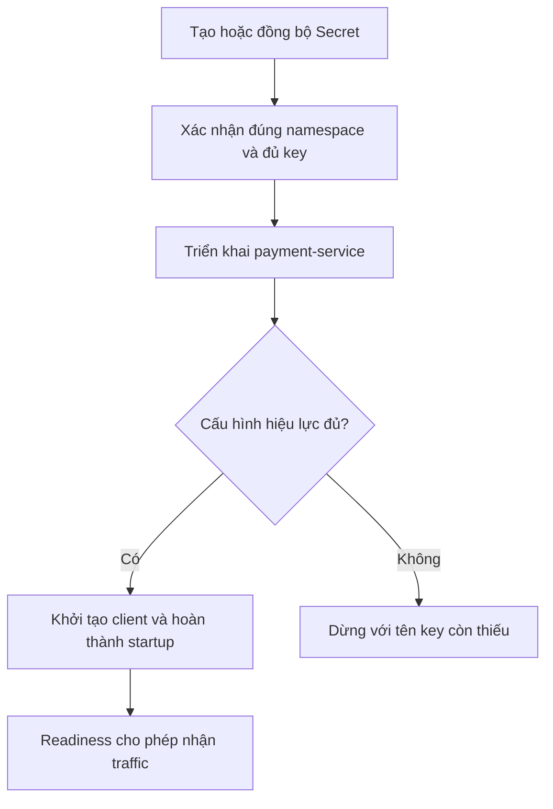

# Ứng xử khi Secret chưa tồn tại hoặc thiếu khóa bắt buộc

Trong chương **Secret** của module **Spring Cloud Kubernetes**, đọc được một đối tượng Secret chưa đủ để kết luận ứng dụng có thể phục vụ. Secret có thể chưa được tạo, nằm sai namespace, thiếu một key, chứa giá trị rỗng hoặc chứa thông tin đăng nhập đã hết hiệu lực. Mỗi tình huống cần một cách xử lý phù hợp.

Bài này xây dựng chính sách cho `payment-service` chạy trong namespace `payments-dev`. Dịch vụ cần hai thuộc tính `payments.gateway.username` và `payments.gateway.token` để thực hiện thanh toán. Hai thuộc tính này là bắt buộc: ứng dụng không được thay chúng bằng tài khoản dùng chung hoặc tự bỏ bước xác thực khi thiếu cấu hình.

Mục tiêu là xác định lỗi xảy ra ở đâu, ngăn ứng dụng nhận việc khi chưa đủ cấu hình và cung cấp thông tin chẩn đoán mà không làm lộ giá trị bí mật.

## 1. Phân loại tình huống trước khi chọn cách xử lý

| Tình huống | Ví dụ | Chính sách cho chức năng thanh toán bắt buộc |
|---|---|---|
| Secret chưa tồn tại | Chưa tạo `payment-gateway` | Dừng khởi động hoặc chờ có giới hạn theo thiết kế |
| Chọn sai nguồn | Đọc nhầm namespace hoặc sai tên | Báo lỗi cấu hình nguồn; sửa khai báo triển khai |
| Không có quyền đọc | Kubernetes API trả 403 | Sửa RBAC cho đúng danh tính, không thay bằng cấu hình rỗng |
| Secret tồn tại nhưng thiếu key | Không có `payments.gateway.token` | Từ chối khởi động với tên key còn thiếu |
| Key có giá trị rỗng | Token là chuỗi rỗng hoặc chỉ có khoảng trắng | Từ chối theo hợp đồng thuộc tính |
| Giá trị không đúng định dạng | Tệp chứng thư không đọc được | Báo lỗi định dạng mà không in nội dung |
| Giá trị có định dạng hợp lệ nhưng không dùng được | Gateway trả 401 | Xử lý lỗi xác thực và quy trình cập nhật thông tin đăng nhập |

Các chính sách ở bảng là lựa chọn thiết kế cho ví dụ. Một tính năng phụ, chẳng hạn gửi bản tin tiếp thị, có thể được tắt khi thiếu Secret. Chức năng thanh toán cốt lõi cần hợp đồng nghiêm ngặt hơn.

Cần phân biệt ba mức kiểm tra:

1. **Có nguồn:** xác định được đối tượng hoặc tệp cấu hình cần đọc.
2. **Đủ cấu hình:** có đủ key bắt buộc với giá trị chấp nhận được.
3. **Dùng được:** thông tin đăng nhập thực sự được hệ thống đích chấp nhận.

Kiểm tra mức trước không tự bảo đảm mức sau.

## 2. Xác định lớp nào đang đọc Secret

Có hai đường triển khai thường gặp và hành vi lỗi khác nhau:

| Đường cung cấp dữ liệu | Thành phần đọc Secret | Lỗi có thể xuất hiện lúc nào? |
|---|---|---|
| Pod dùng `secretKeyRef` hoặc Secret volume | Kubernetes/kubelet chuẩn bị dữ liệu cho container | Trước khi tiến trình Java chạy |
| Spring Cloud Kubernetes gọi API để tạo PropertySource | Kubernetes client trong ứng dụng | Trong quá trình nạp cấu hình Spring |

Với tham chiếu Secret không tùy chọn trong Pod, Kubernetes yêu cầu Secret sẵn có; tham chiếu đến key cụ thể còn yêu cầu key đó tồn tại. `optional: true` cho phép bỏ qua phần tham chiếu vắng mặt. Tùy chọn này không tự cung cấp giá trị mặc định hợp lệ cho ứng dụng. [Optional Secrets trong Kubernetes](https://kubernetes.io/docs/concepts/configuration/secret/#optional-secrets).

Ví dụ dưới là **đoạn trích của một container** trong Deployment, dùng cho phương án nhận token qua biến môi trường:

```yaml
env:
  - name: PAYMENTS_GATEWAY_TOKEN
    valueFrom:
      secretKeyRef:
        name: payment-gateway
        key: payments.gateway.token
        optional: false
```

Nếu Secret hoặc key không có, container có thể ở trạng thái chờ như `CreateContainerConfigError`; với Secret volume có thể gặp Event `FailedMount`. Khi Java chưa chạy, sửa `spring.cloud.kubernetes.secrets.fail-fast` không giải quyết được lỗi chuẩn bị container.

Ngược lại, nếu Pod không tham chiếu Secret ở phần env/volume mà ứng dụng tự đọc qua API, container có thể chạy được rồi ứng dụng mới thất bại. Hai cách này là các phương án triển khai khác nhau; không cần bật cả hai chỉ để kiểm tra cùng một token.

## 3. Hiểu đúng giới hạn của fail-fast

Các ví dụ Spring trong bài lấy **Spring Cloud Kubernetes 3.3.x**, **Fabric8**, **Spring Boot 3.x tương thích** và cơ chế **Config Data** làm mốc. Dependency nạp Secret là:

```xml
<dependency>
    <groupId>org.springframework.cloud</groupId>
    <artifactId>spring-cloud-starter-kubernetes-fabric8-config</artifactId>
</dependency>
```

Quản lý phiên bản bằng Spring Cloud BOM tương thích với Spring Boot của dự án. Không thêm các starter DiscoveryClient hay LoadBalancer chỉ để xử lý Secret thiếu.

Trong `application.yaml`:

```yaml
spring:
  application:
    name: payment-service
  config:
    import: "kubernetes:"
  cloud:
    kubernetes:
      config:
        enabled: false
      secrets:
        enabled: true
        enable-api: true
        name: payment-gateway
        namespace: payments-dev
        include-profile-specific-sources: false
        fail-fast: true
        retry:
          enabled: false
```

Cấu hình này chủ động bật đọc Secret qua API và tắt ConfigMap trong ví dụ. `retry.enabled: false` giúp tập trung vào một lần nạp và lỗi nhận được; chính sách thử lại được bàn riêng ở phần sau.

`fail-fast: true` yêu cầu thất bại khi quá trình nạp nguồn gặp lỗi. Đây là xử lý ở lớp đọc cấu hình, không phải danh sách các key nghiệp vụ bắt buộc. [Secret PropertySource 3.3](https://docs.spring.io/spring-cloud-kubernetes/reference/3.3/property-source-config/secrets-propertysource.html).

Có một chi tiết cần đặc biệt lưu ý ở mốc **3.3.0**: xử lý nguồn theo tên có thể trả về nguồn rỗng khi không tìm thấy Secret; nhánh này không nhất thiết ném exception để kích hoạt `fail-fast`. [NamedSourceData 3.3.0](https://github.com/spring-cloud/spring-cloud-kubernetes/blob/v3.3.0/spring-cloud-kubernetes-commons/src/main/java/org/springframework/cloud/kubernetes/commons/config/NamedSourceData.java).

Vì vậy, không xây dựng hợp đồng “thiếu Secret bắt buộc thì ứng dụng dừng” chỉ bằng một cờ. Cần kiểm tra thêm các thuộc tính bắt buộc của ứng dụng.

Tương tự, việc đổi thành `optional:kubernetes:` không khai báo key nào là bắt buộc, không tạo token và không thay thế kiểm tra dữ liệu. Bài dùng `spring.config.import`; không trộn cơ chế này với bootstrap cũ. [Kubernetes PropertySource và Config Data](https://docs.spring.io/spring-cloud-kubernetes/reference/3.3/property-source-config.html).

## 4. Khai báo hợp đồng dữ liệu và kiểm tra ngay lúc tạo bean

Secret mẫu dưới đây chỉ chứa dữ liệu giả dành cho lab:

```yaml
apiVersion: v1
kind: Secret
metadata:
  name: payment-gateway
  namespace: payments-dev
type: Opaque
stringData:
  payments.gateway.username: payment_lab
  payments.gateway.token: demo-only-token
```

Hợp đồng của ví dụ:

- Cả `payments.gateway.username` và `payments.gateway.token` đều phải có.
- Giá trị rỗng hoặc chỉ có khoảng trắng không hợp lệ.
- Thông báo lỗi chỉ chứa tên thuộc tính.
- Không tự cắt khoảng trắng hay sửa nội dung token để cố làm cho nó hợp lệ.
- Không cung cấp token mặc định cho môi trường triển khai.

Một cách thực hiện trực tiếp là tạo bean chứa thông tin đăng nhập sau khi kiểm tra cấu hình. Đặt lớp dưới trong package thuộc phạm vi component scan của ứng dụng:

```java
import java.util.ArrayList;
import java.util.List;

import org.springframework.context.annotation.Bean;
import org.springframework.context.annotation.Configuration;
import org.springframework.context.annotation.Lazy;
import org.springframework.core.env.Environment;
import org.springframework.util.StringUtils;

@Configuration(proxyBeanMethods = false)
public class GatewayConfiguration {

    @Bean
    @Lazy(false)
    public GatewayCredentials gatewayCredentials(Environment environment) {
        String username = environment.getProperty("payments.gateway.username");
        String token = environment.getProperty("payments.gateway.token");

        List<String> missing = new ArrayList<>();

        if (!StringUtils.hasText(username)) {
            missing.add("payments.gateway.username");
        }
        if (!StringUtils.hasText(token)) {
            missing.add("payments.gateway.token");
        }

        if (!missing.isEmpty()) {
            throw new IllegalStateException(
                    "Thiếu cấu hình bắt buộc hoặc giá trị rỗng: "
                            + String.join(", ", missing));
        }

        return new GatewayCredentials(username, token);
    }

    public static final class GatewayCredentials {

        private final String username;
        private final String token;

        private GatewayCredentials(String username, String token) {
            this.username = username;
            this.token = token;
        }

        public String getUsername() {
            return username;
        }

        public String getToken() {
            return token;
        }

        @Override
        public String toString() {
            return "GatewayCredentials[redacted]";
        }
    }
}
```

Bean được tạo sớm, không trì hoãn việc kiểm tra đến request thanh toán đầu tiên. `@Lazy(false)` thể hiện yêu cầu này ngay tại bean. Thành phần gọi gateway nên nhận `GatewayCredentials` qua constructor, để việc tạo client phụ thuộc vào cấu hình đã qua kiểm tra.

Nếu chỉ thiếu token, thông báo sẽ có dạng:

```text
Thiếu cấu hình bắt buộc hoặc giá trị rỗng: payments.gateway.token
```

Nếu Secret không có và không nguồn nào khác cung cấp hai thuộc tính, thông báo liệt kê cả hai tên. Không đưa giá trị đã đọc vào exception, log hoặc health details.

Có thể dùng `@ConfigurationProperties` kết hợp validation để tổ chức cấu hình lớn hơn. Khi chọn cách đó, vẫn cần kiểm soát thông báo lỗi và phần giá trị bị từ chối, tránh để thông tin bí mật xuất hiện trong log chẩn đoán.

### Kiểm tra Environment không chứng minh nguồn gốc dữ liệu

Ví dụ Java kiểm tra cấu hình **hiệu lực** trong Spring Environment. Một biến môi trường, tham số chạy hoặc nguồn cấu hình khác có thể cung cấp cùng key.

Nếu yêu cầu triển khai bắt buộc dữ liệu phải đến từ một Secret cụ thể, ngoài kiểm tra thuộc tính còn phải kiểm soát các nguồn ghi đè và xác minh tên/namespace của Secret. Không để giá trị giả trong `application.yaml` che khuất việc thiếu nguồn bí mật.

Ví dụ dễ che lỗi:

```java
// Không dùng giá trị giả này cho token bắt buộc.
String token = environment.getProperty(
        "payments.gateway.token", "demo-only-token");
```

Trong ví dụ trên, kiểm tra “không rỗng” vẫn có thể đạt dù Secret chưa được tạo.

## 5. Chọn dừng, chờ hoặc tắt tính năng

### 5.1. Dừng khởi động khi cấu hình bắt buộc thiếu

Đây là chính sách của mẫu Java ở trên. Nó phù hợp khi hệ thống triển khai có thể bảo đảm Secret được chuẩn bị trước ứng dụng.

Luồng triển khai nên là:



Nếu dùng bộ điều khiển đồng bộ bí mật từ kho bên ngoài, việc đã tạo tài nguyên yêu cầu đồng bộ chưa có nghĩa Secret đích đã xuất hiện. Pipeline cần đợi điều kiện đồng bộ và kiểm tra hợp đồng của Secret đích trước khi triển khai ứng dụng.

Khi cấu hình sai và ứng dụng liên tục thoát, Kubernetes có thể đưa container vào `CrashLoopBackOff`. Tăng số lần restart không sửa được tên Secret sai hoặc key còn thiếu.

### 5.2. Chờ có giới hạn khi biết Secret sẽ xuất hiện sau

Một số hệ thống tạo Secret bất đồng bộ sau khi Pod được tạo. Nếu cho phép chờ, cần quy định rõ:

| Quyết định | Ví dụ chính sách |
|---|---|
| Thời gian chờ tối đa | 60 giây cho giai đoạn chuẩn bị thông tin đăng nhập |
| Nhịp đọc lại | Backoff có giới hạn, kèm độ lệch ngẫu nhiên giữa các Pod |
| Trạng thái phục vụ | Chưa nhận thanh toán trong lúc chờ |
| Điều kiện thành công | Đọc lại được nguồn và đủ các key bắt buộc |
| Hết hạn | Dừng khởi động hoặc chuyển trạng thái lỗi đã được thiết kế |
| Quan sát | Ghi mã lỗi, tên nguồn và số lần thử; không ghi token |

Đây là ví dụ chính sách, không phải hành vi tự động của cấu hình ở phần 3. Muốn chờ, hệ thống cần một cơ chế thực sự đọc lại nguồn: pipeline đợi đồng bộ, bước chuẩn bị riêng, hoặc thành phần tải cấu hình được thiết kế cho việc đó.

Không đặt vòng lặp `while` chờ vô hạn trong hàm tạo bean và không cho readiness báo thành công khi client thanh toán chưa được tạo. Mẫu kiểm tra ở phần 4 chọn **dừng ngay**, không triển khai chế độ chờ.

### 5.3. Thiếu Secret của tính năng tùy chọn

Giả sử dịch vụ có thêm chức năng gửi báo cáo cho một đối tác, nhưng chức năng này có thể tắt mà thanh toán vẫn hoạt động. Khi đó:

- Dùng một cờ bật tính năng rõ ràng.
- Khi cờ tắt, không khởi tạo client và không yêu cầu thông tin đăng nhập của tính năng đó.
- Khi cờ bật, kiểm tra đủ cấu hình trước khi cho phép sử dụng.
- Nếu cho phép hoạt động suy giảm, trả trạng thái tính năng không khả dụng theo hợp đồng API.

Không dùng một token mặc định hoặc tự chuyển sang chế độ không xác thực. `optional: true` trong Pod chỉ giúp bỏ qua tham chiếu vắng mặt; ứng dụng vẫn phải thực hiện chính sách tính năng của mình.

Cũng không hạ `fail-fast` cho toàn bộ việc nạp cấu hình chỉ để bỏ qua lỗi của một tính năng phụ, nếu điều đó làm mất kiểm soát cấu hình thanh toán bắt buộc.

## 6. Thử lại phải phù hợp với nguyên nhân lỗi

| Nguyên nhân | Thử lại có tự giải quyết không? | Hướng xử lý |
|---|---|---|
| Timeout, API tạm thời không truy cập được | Có thể | Thử lại có giới hạn và theo dõi thời gian chờ |
| Secret đang được đồng bộ | Có thể, nếu có bước đọc lại | Đồng bộ thứ tự triển khai hoặc chờ nguồn với thời hạn |
| 403 do RBAC | Thường không | Sửa Role/RoleBinding và ServiceAccount |
| Sai namespace hoặc sai tên | Không nếu cấu hình không đổi | Sửa nguồn được chọn |
| Thiếu key nghiệp vụ | Không nếu Secret không đổi | Sửa dữ liệu và kiểm tra lại hợp đồng |
| Token bị gateway từ chối | Không chỉ bằng cách gọi lại | Xác minh thông tin đăng nhập và quy trình xoay vòng |

Spring Cloud Kubernetes 3.3 có cơ chế retry cho việc nạp nguồn. Khi dùng cơ chế đó, cần bật `fail-fast`, có các dependency hỗ trợ theo tài liệu và cấu hình `retry.*` phù hợp. Retry của loader xử lý lỗi nạp nguồn; nó không thay thế kiểm tra key trong bean nghiệp vụ. [Cấu hình retry của PropertySource 3.3](https://docs.spring.io/spring-cloud-kubernetes/reference/3.3/property-source-config/configmap-propertysource.html).

Đặc biệt, nếu việc không tìm thấy Secret chỉ tạo nguồn rỗng thì có thể không có exception để kích hoạt retry. [Nhánh xử lý tên nguồn không tồn tại](https://github.com/spring-cloud/spring-cloud-kubernetes/blob/v3.3.0/spring-cloud-kubernetes-commons/src/main/java/org/springframework/cloud/kubernetes/commons/config/ConfigUtils.java).

Khi tính thời gian khởi động, cộng cả timeout của từng lần gọi API, khoảng nghỉ giữa các lần thử và thời gian khởi tạo ứng dụng. Chỉ đếm số lần thử không cho biết tổng thời gian chờ thực tế.

## 7. Phối hợp startup, readiness và liveness

Với một ứng dụng cần thông tin đăng nhập thanh toán trước khi phục vụ:

- **Startup:** cho ứng dụng thời gian hoàn tất quá trình khởi động đã được giới hạn.
- **Readiness:** chỉ cho phép nhận traffic khi ứng dụng có thể phục vụ theo hợp đồng.
- **Liveness:** phát hiện tình trạng tiến trình cần được khởi động lại; tránh phụ thuộc trực tiếp vào tình trạng của gateway bên ngoài.

Spring Boot Actuator cung cấp các nhóm health cho readiness và liveness. Những kiểm tra tùy chỉnh không tự được đưa vào nhóm readiness; nếu dùng cơ chế chờ nền, phải tích hợp trạng thái sẵn sàng của cấu hình vào nhóm này hoặc quản lý ApplicationAvailability tương ứng. [Kubernetes Probes trong Spring Boot 3.5](https://docs.spring.io/spring-boot/3.5/reference/actuator/endpoints.html#actuator.endpoints.kubernetes-probes).

Nếu ứng dụng đã có Actuator, có thể bật endpoint kiểm tra:

```yaml
management:
  endpoints:
    web:
      exposure:
        include: health
  endpoint:
    health:
      probes:
        enabled: true
      show-details: never
```

Đoạn dưới đặt trong cấu hình container, giả sử ứng dụng dùng cổng HTTP 8080 và Actuator phục vụ trên cùng cổng:

```yaml
startupProbe:
  httpGet:
    path: /actuator/health/liveness
    port: 8080
  periodSeconds: 5
  failureThreshold: 24
readinessProbe:
  httpGet:
    path: /actuator/health/readiness
    port: 8080
  periodSeconds: 5
  failureThreshold: 1
livenessProbe:
  httpGet:
    path: /actuator/health/liveness
    port: 8080
  periodSeconds: 10
  failureThreshold: 3
```

Các con số chỉ là ví dụ cần điều chỉnh theo ngân sách khởi động. Startup probe trì hoãn các probe còn lại cho đến khi thành công; nó không tạo Secret hoặc bù cho key thiếu. [Cấu hình startup, readiness và liveness probe](https://kubernetes.io/docs/tasks/configure-pod-container/configure-liveness-readiness-startup-probes/).

Với mẫu bean kiểm tra sớm, thiếu thuộc tính sẽ làm khởi động thất bại. Với thiết kế chờ nền, HTTP server có thể đã chạy trong khi cấu hình chưa sẵn sàng; readiness phải phản ánh trạng thái đó.

## 8. Chẩn đoán mà không in nội dung Secret

### 8.1. Xem trạng thái Pod và Events

Các lệnh dưới là ví dụ cho cluster lab:

```shell
kubectl get pods -n payments-dev -l app=payment-service

kubectl get events -n payments-dev --field-selector involvedObject.kind=Pod --sort-by=.metadata.creationTimestamp

kubectl get secret payment-gateway -n payments-dev -o name
```

Quan sát xem lỗi xuất hiện trước hay sau khi Java chạy. Không có log ứng dụng có thể đơn giản là container chưa khởi động vì tham chiếu Secret chưa hợp lệ.

Nếu container đã chạy rồi thoát, lấy tên Pod thực tế từ kết quả trước và xem log, kể cả log lần chạy trước khi có restart:

```shell
kubectl logs <pod-name> -n payments-dev -c payment-service

kubectl logs <pod-name> -n payments-dev -c payment-service --previous
```

Tên container phải khớp Deployment. Mục tiêu là tìm tên key thiếu và loại lỗi, không tăng mức log để in toàn bộ Environment.

### 8.2. Kiểm tra đúng danh tính đọc API

```shell
kubectl auth can-i get secrets/payment-gateway -n payments-dev --as=system:serviceaccount:payments-dev:payment-service

kubectl auth can-i list secrets -n payments-dev --as=system:serviceaccount:payments-dev:payment-service
```

Client có thể cần `list` để nạp tài nguyên theo namespace; chỉ kiểm tra `get` chưa đủ trong mọi cách đọc. Người chạy `--as` cần có quyền impersonation. Đồng thời kiểm tra Pod đang dùng ServiceAccount nào; quyền của kubeconfig trên máy cá nhân không đại diện cho quyền trong Pod.

### 8.3. Chỉ xuất tên key khi cần kiểm tra cấu trúc

Lệnh dưới sử dụng go-template để chỉ in tên các key trong `data`:

```shell
kubectl get secret payment-gateway -n payments-dev -o go-template='{{range $key, $value := .data}}{{printf "%s\n" $key}}{{end}}'
```

Lệnh không in giá trị nhưng vẫn thực hiện yêu cầu đọc đối tượng Secret; cần dùng trong phiên thao tác được cấp quyền. Đừng coi cách định dạng đầu ra là cơ chế hạn chế quyền API.

Nếu Secret lưu một tệp `application.yaml` thay vì các key phẳng, danh sách key của đối tượng chỉ cho thấy tên tệp. Phải phân biệt cấu trúc Secret với các thuộc tính Spring sau khi nội dung tệp được xử lý.

Không dùng `kubectl get secret -o yaml`, giải mã Base64 hoặc bật endpoint `env` chỉ để chứng minh token có mặt. Bằng chứng chẩn đoán nên gồm namespace, tên nguồn, tên key thiếu, danh tính gọi API và thời điểm xảy ra lỗi.

## 9. Khôi phục sau khi Secret được bổ sung

Sau khi sửa nguồn hoặc thêm key, phải xác định dữ liệu được cung cấp cho ứng dụng theo đường nào:

| Đường cung cấp dữ liệu | Điều cần làm để khôi phục |
|---|---|
| Container chưa chạy do secretKeyRef/volume bắt buộc thiếu | Kiểm tra kubelet đã đọc lại nguồn và container có bắt đầu chạy không |
| Biến môi trường của container đang chạy | Tạo lại container/rollout theo quy trình để nhận giá trị mới |
| Secret volume của container đang chạy | Kiểm tra dữ liệu tệp đã cập nhật và ứng dụng có đọc lại tệp hay không |
| Spring Cloud Kubernetes nạp PropertySource lúc startup | Khởi động lại hoặc dùng cơ chế cập nhật cấu hình đã thiết kế |
| Thông tin đăng nhập được giữ trong client | Bảo đảm client được tạo lại hoặc cập nhật phù hợp |

Biến môi trường lấy từ Secret không tự đổi trong container đang chạy. Secret volume có cơ chế cập nhật, nhưng ứng dụng đọc giá trị một lần không tự thay đổi đối tượng cấu hình đã tạo. [Cung cấp thông tin đăng nhập bằng Secret](https://kubernetes.io/docs/tasks/inject-data-application/distribute-credentials-secure/).

Với mẫu `GatewayCredentials` bất biến ở phần 4, không giả định chỉ cập nhật Secret là bean tự nhận token mới. Nếu dùng Configuration Watcher hoặc refresh, cần thiết kế cả vòng đời bean và client phụ thuộc vào nó.

Nếu thiếu Secret do triển khai sai thứ tự, sửa pipeline để lần triển khai tiếp theo không lặp lại sự cố. Nếu thiếu key do thay đổi schema, cần phối hợp phiên bản ứng dụng và phiên bản dữ liệu bí mật.

## 10. Thực hành các tình huống thiếu cấu hình

Thực hiện trong môi trường lab với dữ liệu giả; không dùng Secret của hệ thống thật. Chuẩn bị ứng dụng theo cấu hình API ở phần 3, lớp kiểm tra ở phần 4 và quyền đọc tương ứng.

| Lần thử | Điều kiện đầu vào | Kết quả mong đợi |
|---|---|---|
| 1 | Chưa tạo payment-gateway, không có giá trị ghi đè | Không hoàn tất khởi động; báo tên hai thuộc tính thiếu |
| 2 | Secret chỉ có username | Báo thiếu payments.gateway.token |
| 3 | Có token nhưng giá trị rỗng | Từ chối theo hợp đồng giá trị |
| 4 | Có đủ dữ liệu giả | Qua bước kiểm tra cấu hình; chưa chứng minh xác thực với gateway thật |
| 5 | Secret đủ nhưng ServiceAccount thiếu quyền | Nhận diện lỗi truy cập nguồn, không che bằng token mặc định |
| 6 | Secret thiếu nhưng biến môi trường cung cấp token | Nhận ra kiểm tra Environment có thể đạt nhờ nguồn khác |
| 7 | Đổi token khi container còn chạy | Đối chiếu cách cấp dữ liệu và cơ chế cập nhật, không giả định tự nhận |
| 8 | Thiếu Secret của tính năng phụ đã tắt | Dịch vụ cốt lõi vẫn hoạt động theo chính sách đã chọn |

Ở lần thử 6, cung cấp cả các thuộc tính còn lại cần thiết rồi đối chiếu nguồn cấu hình; kết quả nhằm chứng minh giới hạn của kiểm tra sự hiện diện.

Ghi nhận mã lỗi, tên nguồn, tên key thiếu và trạng thái Pod/readiness. Với ví dụ thanh toán, tiêu chí đạt là ứng dụng không nhận giao dịch khi cấu hình bắt buộc chưa sẵn sàng, đồng thời người vận hành biết cần sửa nguồn, quyền truy cập hay hợp đồng key. Không đưa giá trị token vào kết quả thực hành.

