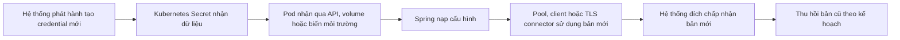

# Luân chuyển mật khẩu, token và chứng chỉ

Trong chương **Secret** của module **SPRING_CLOUD_KUBERNETES**, luân chuyển credential là quá trình thay đổi dữ liệu xác thực đang được hệ thống sử dụng. Việc sửa một đối tượng Secret mới chỉ hoàn thành một đoạn của quá trình đó.

Ứng dụng Spring có thể đã đọc mật khẩu vào connection pool, giữ token trong HTTP client hoặc tạo `SSLContext` từ một cặp chứng chỉ và khóa riêng. Những đối tượng này không nhất thiết thay đổi ngay khi Secret được cập nhật.

Bài này trình bày cách phối hợp nơi phát hành credential, Kubernetes, ứng dụng và hệ thống đích. Ví dụ chính dùng `payments-service` trong namespace `payments`. Các giá trị minh họa đều là dữ liệu giả; các lệnh là hướng dẫn thực hành, không phải kết quả thao tác trên cluster.

## 1. Một lần luân chuyển phải đi qua những lớp nào?

Có thể mô hình hóa đường đi như sau:



Mỗi mũi tên cần một cơ chế và bằng chứng riêng. Ví dụ:

- Secret đã có dữ liệu mới nhưng container đang chạy vẫn giữ biến môi trường cũ.
- File trong volume đã đổi nhưng ứng dụng chỉ đọc file một lần khi khởi động.
- `Environment` đã đổi nhưng HTTP client vẫn giữ header authorization được tạo trước đó.
- Pool vẫn thực hiện query thành công qua kết nối đã xác thực từ trước, trong khi kết nối mới dùng mật khẩu sai.
- File chứng chỉ đã đổi nhưng một TLS connector vẫn phục vụ chứng chỉ cũ.

Do đó, “Secret đã cập nhật”, “Pod đã Ready” và “credential mới đã được sử dụng thành công” là ba nhận định cần được kiểm chứng riêng.

### Phân biệt phiên bản dữ liệu với phiên bản đối tượng Kubernetes

Có thể dùng nhãn như `v2` hoặc một mã phát hành không bí mật để theo dõi lần chuyển đổi. `metadata.resourceVersion` phục vụ cơ chế phiên bản và đồng bộ của Kubernetes; không dùng nó như số thứ tự credential nghiệp vụ hoặc bằng chứng rằng một client đã dùng dữ liệu mới.

Một nhãn phiên bản trên Pod cũng chỉ cho biết cấu hình dự kiến của Pod. Nó không thay thế phép thử xác thực thực tế.

## 2. Mật khẩu, token và chứng chỉ có vòng đời khác nhau

| Loại dữ liệu | Nơi quyết định hiệu lực | Thành phần ứng dụng thường giữ trạng thái | Điều cần xác minh |
| --- | --- | --- | --- |
| Mật khẩu database | Database hoặc hệ thống quản lý tài khoản | DataSource, connection pool | Một kết nối mới đăng nhập được bằng tài khoản mới |
| API token | Nhà cung cấp API | HTTP client, interceptor, bộ nhớ đệm | Request mới được chấp nhận bằng token mới |
| OAuth access/refresh token | Authorization server và resource server | OAuth client, kho token | Cấp lại, hết hạn và thu hồi hoạt động đúng giao thức |
| Chứng chỉ và private key | CA cùng các bên kiểm tra TLS | TLS connector, SSLContext, client TLS | Handshake mới dùng đúng chứng chỉ và chuỗi tin cậy |

Kubernetes Secret lưu và phân phối dữ liệu. Nó không tự đổi mật khẩu trong database, phát hành API key, gia hạn chứng chỉ hay thu hồi token tại nhà cung cấp.

Ví dụ, thay chuỗi `old-password` thành `new-password` trong Secret mà database chưa chấp nhận mật khẩu mới sẽ làm những lần đăng nhập tiếp theo thất bại.

Cũng cần phân biệt token nghiệp vụ với token ServiceAccount dùng để gọi Kubernetes API. Luân chuyển một token thanh toán không đồng nghĩa thay token danh tính Kubernetes của Pod.

## 3. Chọn cơ chế đưa bản mới đến ứng dụng

| Đường nhận Secret | Điều xảy ra khi Secret thay đổi | Việc ứng dụng cần làm |
| --- | --- | --- |
| `env` hoặc `envFrom` | Biến môi trường của container đang chạy không tự được thay mới | Tạo lại container/Pod theo kế hoạch |
| Secret volume thông thường | Kubernetes cập nhật file theo cơ chế nhất quán cuối cùng | Đọc lại file và cập nhật thành phần sử dụng |
| Secret được mount bằng `subPath` | Không nhận cập nhật Secret tự động qua mount đó | Thiết kế lại mount hoặc tạo lại Pod |
| Spring Cloud Kubernetes đọc API lúc khởi động | Bản đã nạp không tự trở thành một cơ chế theo dõi liên tục | Nạp lại có hỗ trợ hoặc khởi động lại |
| Configuration Watcher | Có thể phát thông báo refresh khi được cấu hình phù hợp | Nhận thông báo, nạp nguồn và thay đổi client/bean phù hợp |

Kubernetes mô tả độ trễ cập nhật volume và giới hạn `subPath` trong [Secrets](https://kubernetes.io/docs/concepts/configuration/secret/#using-secrets-as-files-from-a-pod). Việc dùng Secret làm biến môi trường được trình bày trong [Distribute Credentials Securely Using Secrets](https://kubernetes.io/docs/tasks/inject-data-application/distribute-credentials-secure/).

Không chọn một con số như “đợi 10 giây” rồi xem đó là bảo đảm rằng mọi Pod đã nhận bản mới. Độ trễ và đường cập nhật phải được đo, quan sát và kiểm chứng theo môi trường.

### Đọc lại file không chỉ là mở một đường dẫn

Một file có thể đã thay đổi nhưng ứng dụng còn giữ giá trị cũ trong bộ nhớ. Nếu triển khai nạp lại động, cần xác định:

1. Tín hiệu nào báo dữ liệu thay đổi.
2. Lần đọc mới lấy toàn bộ tập dữ liệu cần thiết ở đâu.
3. Cách kiểm tra dữ liệu mới trước khi kích hoạt.
4. Cách thay client/pool mà không làm hỏng request đang xử lý.
5. Hành vi khi dữ liệu mới không hợp lệ.

Các khóa có quan hệ với nhau, chẳng hạn username/password hoặc certificate/private key, cần được xử lý như một bộ tương thích. Không xây dựng cơ chế có thể kích hoạt username mới cùng password cũ do đọc và áp dụng từng giá trị rời rạc.

## 4. Quy trình có khoảng chồng lấn giữa bản cũ và bản mới

Với hệ thống cho phép hai credential cùng có hiệu lực trong một khoảng thời gian, có thể dùng quy trình sau:

| Giai đoạn | Hoạt động | Điều kiện để đi tiếp |
| --- | --- | --- |
| Chuẩn bị | Kiểm kê tất cả bên sử dụng, đường nạp và kế hoạch phục hồi | Không bỏ sót Job, consumer hay dịch vụ ngoài Deployment chính |
| Phát hành | Tạo bản mới tại hệ thống đích, giữ bản cũ tạm thời | Bản mới có đúng phạm vi quyền và đã có hiệu lực |
| Phân phối | Đưa bản mới vào Secret | Đúng namespace, tên và khóa |
| Chuyển đổi | Rollout hoặc nạp lại các thành phần sử dụng | Các instance cần thiết đã nhận cấu hình mới |
| Xác minh | Tạo request, kết nối hoặc handshake mới | Có bằng chứng bản mới hoạt động |
| Thu hồi | Vô hiệu hóa bản cũ tại nơi quyết định hiệu lực | Không còn bên hợp lệ cần bản cũ |
| Dọn dẹp | Loại bỏ tham chiếu, Secret và quyền thừa theo chính sách | Không làm mất dữ liệu còn cần cho vận hành |

Khoảng chồng lấn phải đủ cho các bước phân phối, chuyển đổi, hoàn tất công việc đang chạy và xác minh. Có thể lập ngân sách bảo thủ:

```text
T_overlap cần bao phủ:
  thời gian phân phối
  + thời gian nạp lại hoặc rollout
  + thời gian hoàn tất công việc/kết nối cũ cần giữ
  + thời gian xác minh
  + dự phòng
```

Đây là khung lập kế hoạch, không phải công thức chứng minh một giới hạn thời gian cứng. Một Job chạy dài hoặc một hệ thống ngoài cluster bị bỏ sót có thể phá vỡ giả định của kế hoạch.

### Nếu nhà cung cấp chỉ chấp nhận một bản

Không phải database, API hay hệ thống định danh nào cũng hỗ trợ hai credential đồng thời. Khi không có khoảng chồng lấn, cần chọn cơ chế được hệ thống đích hỗ trợ, chẳng hạn tài khoản thứ hai, credential thứ hai, chuyển đổi có phối hợp hoặc một khoảng bảo trì.

Không hứa “không gián đoạn” chỉ dựa vào việc Kubernetes có rolling update.

### Nếu bản cũ bị lộ

Luân chuyển định kỳ ưu tiên chuyển đổi có kiểm soát. Khi xử lý credential bị lộ, có thể phải thu hồi bản cũ sớm hơn và chấp nhận gián đoạn để giảm thời gian bị khai thác.

Trong trường hợp đó, kế hoạch phục hồi phải tránh đưa credential đã lộ quay lại sử dụng.

## 5. Luân chuyển mật khẩu database và xử lý connection pool

Giả sử `billing-service` sử dụng tài khoản database `billing_app_v1`. Một phương án khi database và chính sách cho phép là:

1. Tạo `billing_app_v2` với quyền nghiệp vụ tương đương và được giới hạn đúng nhu cầu.
2. Cung cấp username/password mới qua Secret mới.
3. Chuyển các instance sang tài khoản mới.
4. Thử mở kết nối mới và thực hiện thao tác nghiệp vụ được phép.
5. Chờ hoặc xử lý các phiên cũ theo chính sách.
6. Vô hiệu hóa tài khoản cũ.

Đây là phương án minh họa dùng hai tài khoản. Nó khác với đổi mật khẩu tại chỗ của một tài khoản, vốn có thể khiến client cũ không mở thêm được kết nối.

### Vì sao query thành công chưa đủ?

Một pool có thể trả về kết nối đã xác thực trước khi đổi mật khẩu. Query thành công trên kết nối ấy không chứng minh mật khẩu mới đúng.

Cần phân biệt:

- Kết nối đang tồn tại tiếp tục hoạt động.
- Pool có thể mở kết nối mới bằng cấu hình mới.
- Các instance mới khởi động có thể tạo pool.
- Quyền nghiệp vụ của tài khoản mới đáp ứng nhu cầu.

Việc đổi mật khẩu hoặc khóa tài khoản có chấm dứt ngay các phiên đang mở hay không phụ thuộc database. Kế hoạch cần kiểm tra riêng hành vi đó.

### Refresh cấu hình không bảo đảm refresh DataSource

Không áp dụng `@RefreshScope` như một công tắc chung cho mọi pool. Tài liệu Spring Cloud Context nêu `HikariDataSource` nằm trong nhóm không refresh theo cơ chế mặc định; xem [Refresh Scope](https://docs.spring.io/spring-cloud-commons/reference/spring-cloud-commons/application-context-services.html#refresh-scope).

Nếu chưa có cơ chế thay pool được thiết kế và xác minh, rolling restart có kiểm soát thường tạo ra ranh giới dễ hiểu hơn: Pod mới khởi tạo pool bằng credential mới, Pod cũ hoàn tất công việc theo chính sách dừng.

Ứng dụng vẫn phải cấu hình thời gian dừng, transaction và connection timeout phù hợp. Thay pool giữa lúc đang có transaction không phải chỉ là thay một thuộc tính trong `Environment`.

## 6. Ví dụ luân chuyển API token bằng Secret có tên phiên bản

Ví dụ sau giả định nhà cung cấp API cho phép `token-v1` và `token-v2` cùng có hiệu lực trong khoảng chuyển đổi. Hai tên này là định danh phiên bản; không phải giá trị token thật.

Hiện tại `payments-service` đọc token qua `secretKeyRef` từ `payments-api-credentials-v1`. Ta chọn Secret mới và rolling update để mỗi container mới nhận một bộ dữ liệu xác định.

### Bước 1: phát hành token mới tại nhà cung cấp

Tạo token mới với đúng scope, đối tượng sử dụng và thời hạn theo chính sách. Xác minh token đã có hiệu lực bằng công cụ được phép; không đưa giá trị token vào log triển khai.

Nếu token mới chỉ được tạo trong Secret mà chưa tồn tại ở nhà cung cấp, chưa hoàn thành bước phát hành.

### Bước 2: tạo Secret mới

```yaml
apiVersion: v1
kind: Secret
metadata:
  name: payments-api-credentials-v2
  namespace: payments
type: Opaque
immutable: true
stringData:
  payments.api.token: DEMO_ONLY_NOT_A_REAL_TOKEN_V2
```

Giá trị giả trên chỉ minh họa cấu trúc. Trong môi trường thật, pipeline hoặc hệ thống quản lý bí mật được phép cung cấp dữ liệu; không commit token thật vào manifest.

`immutable: true` khiến lần thay đổi dữ liệu tiếp theo cần một đối tượng mới thay vì sửa dữ liệu của đối tượng này. Nó giúp giữ một tên gắn với một bộ dữ liệu trong ví dụ, nhưng không thay thế RBAC hay cơ chế thu hồi tại nhà cung cấp. Xem [Immutable Secrets](https://kubernetes.io/docs/concepts/configuration/secret/#immutable-secrets).

### Bước 3: đổi tham chiếu trong Pod template

Phần cấu hình bổ sung cho Deployment đã có:

```yaml
spec:
  replicas: 3
  strategy:
    type: RollingUpdate
    rollingUpdate:
      maxUnavailable: 0
      maxSurge: 1
  template:
    metadata:
      annotations:
        credentials.example/revision: "v2"
    spec:
      containers:
        - name: payments-service
          env:
            - name: PAYMENTS_API_TOKEN
              valueFrom:
                secretKeyRef:
                  name: payments-api-credentials-v2
                  key: payments.api.token
```

Đây là fragment để tích hợp vào manifest hiện hữu, không phải Deployment hoàn chỉnh. Cần giữ các trường image, selector, probe, resource và cấu hình khác phù hợp của Deployment.

Đổi tham chiếu Secret trong Pod template tạo ra thay đổi triển khai. `maxUnavailable: 0` và `maxSurge: 1` thể hiện ý định giữ số replica sẵn sàng trong lúc tăng thêm tối đa một Pod; cluster phải có tài nguyên và các điều kiện liên quan để rollout tiến triển. Cơ chế này được mô tả trong [Deployments](https://kubernetes.io/docs/concepts/workloads/controllers/deployment/).

Ứng dụng phải thực sự sử dụng `PAYMENTS_API_TOKEN` theo hợp đồng cấu hình của nó. Nếu còn một giá trị khác có ưu tiên cao hơn hoặc client đang đọc một tên thuộc tính khác, Pod mới vẫn có thể không dùng token dự kiến.

### Bước 4: quan sát rollout và kiểm tra nghiệp vụ

Sau khi thay đổi Deployment đã được áp dụng theo quy trình môi trường:

```powershell
kubectl -n payments rollout status deployment/payments-service --timeout=180s
kubectl -n payments get pods -l app=payments-service
```

Selector `app=payments-service` là giả định của ví dụ; dùng selector thực tế khi triển khai. Timeout của lệnh là giới hạn chờ của người vận hành, không phải bằng chứng rollout chắc chắn hoàn tất trong ba phút.

Tiếp tục kiểm tra một request mới từ các instance đã chuyển đổi đến API đích, ưu tiên thao tác kiểm tra không tạo giao dịch thật. Có thể dùng định danh credential do nhà cung cấp cung cấp để đối chiếu mà không in token.

Readiness và kết quả rollout cần đi cùng bằng chứng xác thực. Một health endpoint chỉ kiểm tra tiến trình sống không chứng minh token mới được chấp nhận.

### Bước 5: thu hồi token cũ và dọn dẹp

Chỉ thu hồi `token-v1` sau khi đã kiểm tra các bên sử dụng, kể cả worker, Job chạy dài và hệ thống ngoài Deployment chính.

Sau thu hồi, xác minh bản mới vẫn hoạt động và bản cũ bị từ chối bằng công cụ được phép. Cuối cùng loại bỏ tham chiếu và Secret cũ theo chính sách lưu giữ.

Xóa `payments-api-credentials-v1` khỏi Kubernetes không tự vô hiệu hóa token-v1 tại nhà cung cấp. Token đã bị sao chép ra ngoài cluster vẫn có thể có hiệu lực nếu chưa được thu hồi hoặc hết hạn.

Nếu một ứng dụng khác đọc Secret qua API với Role giới hạn `resourceNames`, cần cấp quyền cho tên phiên bản mới trước khi chuyển ứng dụng và thu hồi quyền đối với tên cũ khi kết thúc. Đường `secretKeyRef` trong ví dụ này không yêu cầu cấp quyền Secret API trực tiếp cho tiến trình ứng dụng.

## 7. Token OAuth cần cơ chế của giao thức, không chỉ thay Secret

Một access token ngắn hạn thường cần được OAuth client lấy lại theo luồng được hệ thống định danh hỗ trợ. Nếu ứng dụng nhận một token tĩnh qua Secret rồi giữ vô thời hạn, việc token có thời hạn ngắn không tự tạo thành cơ chế gia hạn.

Cần phân biệt ba thao tác:

| Thao tác | Ý nghĩa |
| --- | --- |
| Cấp token mới | Authorization server phát hành credential mới |
| Refresh token hoặc lấy lại token theo grant phù hợp | Client nhận access token tiếp theo theo giao thức |
| Revoke token | Yêu cầu vô hiệu hóa token theo khả năng của authorization server |

[RFC 7009 — OAuth 2.0 Token Revocation](https://www.rfc-editor.org/rfc/rfc7009.html) định nghĩa endpoint thu hồi OAuth token. Khả năng thu hồi và tác động đến các token liên quan phải được đối chiếu với nhà cung cấp đang sử dụng.

Không suy rằng sửa hoặc xóa Secret chứa một JWT sẽ khiến mọi resource server ngừng chấp nhận JWT ấy ngay lập tức. Nơi kiểm tra token, cơ chế xác minh và chính sách thu hồi quyết định hiệu lực thực tế.

Nếu cần luân chuyển `client_secret` dùng để lấy token, đó là credential khác với access token. Phải chuyển các OAuth client sang client secret mới, sau đó mới thu hồi bản cũ theo khả năng của nhà cung cấp.

Trong lúc chuyển đổi, lỗi xác thực cần được phân biệt với lỗi scope, audience, đồng hồ hoặc quyền nghiệp vụ. Việc thử lại một giao dịch thanh toán còn phải tuân theo hợp đồng idempotency; không dùng vòng retry vô hạn để che lỗi credential.

## 8. Luân chuyển chứng chỉ: vật liệu khóa và chuỗi tin cậy

Đối với TLS, cần xác định nơi kết thúc kết nối:

- Nếu TLS kết thúc tại Ingress hoặc gateway, thành phần đó cần nhận và nạp lại chứng chỉ.
- Nếu TLS kết thúc trong ứng dụng Spring, web server của ứng dụng là bên sử dụng vật liệu khóa.
- Nếu ứng dụng dùng mTLS để gọi dịch vụ khác, còn có client certificate, private key và trust material phía client.

Cập nhật chứng chỉ tại một nơi không tự cập nhật mọi nơi còn lại.

### Gia hạn chứng chỉ cùng CA

Khi CA tin cậy không thay đổi, quá trình thường tập trung vào chứng chỉ mới, chuỗi chứng chỉ phù hợp và private key tương ứng.

Cần kiểm tra hostname/SAN, thời gian hiệu lực, mục đích sử dụng, cặp khóa và nơi sử dụng trước khi kích hoạt. “Chứng chỉ mới có ngày hết hạn xa hơn” chưa đủ để kết luận nó dùng được cho endpoint hiện tại.

Nếu private key cũ bị lộ, chỉ gia hạn chứng chỉ mà tiếp tục dùng chính khóa ấy không xử lý hết sự cố. Cần phát hành với khóa mới và xử lý việc thu hồi hoặc loại bỏ tin cậy theo chính sách PKI.

### Ví dụ nạp lại PEM SSL bundle trong Spring Boot

Ví dụ cấu hình này dành cho cơ chế được tài liệu **Spring Boot 4.0** mô tả. Nó không khẳng định dự án của người học đang dùng phiên bản đó; cần đối chiếu với BOM và runtime thực tế.

Giả sử Secret `payments-tls` đã được hệ thống phát hành chứng chỉ cung cấp với `tls.crt` và `tls.key` hợp lệ. Mount cả thư mục vào container:

```yaml
spec:
  template:
    spec:
      containers:
        - name: payments-service
          volumeMounts:
            - name: inbound-tls
              mountPath: /etc/payments-tls
              readOnly: true
      volumes:
        - name: inbound-tls
          secret:
            secretName: payments-tls
```

Đây là fragment của Deployment, không phải manifest hoàn chỉnh. Không dùng `subPath` trong ví dụ cần nhận cập nhật file này.

Cấu hình ứng dụng:

```yaml
spring:
  ssl:
    bundle:
      pem:
        inbound:
          reload-on-update: true
          keystore:
            certificate: "file:/etc/payments-tls/tls.crt"
            private-key: "file:/etc/payments-tls/tls.key"

server:
  port: 8443
  ssl:
    bundle: inbound
```

Cơ chế yêu cầu bên sử dụng bundle hỗ trợ nạp lại. Tài liệu 4.0 nêu Tomcat và Netty web server là các bên tương thích; xem [Reloading SSL bundles](https://docs.spring.io/spring-boot/4.0/reference/features/ssl.html#features.ssl.reloading).

Đừng suy rằng một HTTP client tự tạo `SSLContext` một lần sẽ tự thay đổi chỉ vì bundle đã nạp lại. Với client đó, cần cơ chế cập nhật riêng hoặc tạo lại tiến trình.

Cấu hình trên cũng không tự xin hay gia hạn chứng chỉ. Nó xử lý bước sử dụng file mới sau khi hệ thống phát hành đã cập nhật chúng.

### Phát hành tự động vẫn cần phía sử dụng nạp lại

Nếu môi trường dùng cert-manager, cần xác định chính sách khóa riêng, thời điểm gia hạn và hành vi ứng dụng khi Secret đổi. Có thể khai báo rõ `spec.privateKey.rotationPolicy: Always` theo phiên bản hỗ trợ để thể hiện ý định thay khóa khi cấp lại; xem [Certificate resource](https://cert-manager.io/docs/usage/certificate/#issuance-behavior-rotation-of-the-private-key).

Cert-manager ghi dữ liệu mới vào Secret không đồng nghĩa một ứng dụng chỉ đọc lúc khởi động đã phục vụ chứng chỉ mới.

### Khi chuyển sang CA mới

Thay CA đòi hỏi phối hợp phía tin cậy và phía trình bày chứng chỉ. Một thứ tự có khoảng chồng lấn là:

1. Phân phối trust bundle có cả CA cũ và CA mới cho các bên cần xác minh.
2. Xác nhận các bên đó đã nạp trust bundle mới.
3. Chuyển server hoặc client mTLS sang chứng chỉ được CA mới phát hành.
4. Thực hiện handshake mới từ những đường kết nối đại diện.
5. Khi không còn thành phần hợp lệ phụ thuộc CA cũ, loại bỏ CA cũ theo kế hoạch.

Tài liệu [trust-manager về certificate rotation](https://cert-manager.io/docs/trust/trust-manager/#cert-manager-integration-intentionally-copying-ca-certificates) giải thích nhu cầu giữ cả hai root trong giai đoạn chuyển đổi.

Không phân phối private key của CA trong trust bundle. Cũng không dùng tùy chọn bỏ kiểm tra TLS để vượt qua lỗi khi chuyển CA; điều đó làm mất bằng chứng rằng chuỗi tin cậy mới hoạt động đúng.

## 9. Configuration Watcher giúp ở bước nào?

Configuration Watcher có thể thông báo refresh qua HTTP hoặc Spring Cloud Bus khi được triển khai phù hợp. Theo tài liệu Spring Cloud Kubernetes 5.1, theo dõi Secret cần được bật riêng và các Secret đích cần label phù hợp; xem [Configuration Watcher](https://docs.spring.io/spring-cloud-kubernetes/reference/spring-cloud-kubernetes-configuration-watcher.html).

Đường nạp lại có thể được hình dung như sau:

```text
Sự kiện thay đổi
  -> chọn đúng ứng dụng nhận thông báo
  -> nạp lại đúng nguồn
  -> cập nhật bean/client được hỗ trợ
  -> xác thực thành công với hệ thống đích
```

Nếu dùng file mount, thông báo refresh đến quá sớm có thể khiến ứng dụng đọc lại file chưa được cập nhật. Khoảng trì hoãn của watcher cần phù hợp với môi trường và đi cùng bằng chứng rằng bản mới đã được áp dụng.

Không coi response thành công từ `/actuator/refresh` là bằng chứng toàn bộ credential của mọi replica đã được thay. Cần kiểm tra số replica được thông báo và các thành phần sử dụng dữ liệu.

Nếu bật endpoint refresh, thiết kế quyền gọi và đường mạng của nó. Watcher có thể cần quyền quan sát Secret; không vì vậy mà cấp `list/watch` rộng cho mọi Pod ứng dụng.

DiscoveryClient và Spring Cloud LoadBalancer phục vụ khám phá hoặc chọn instance. Chúng không thay credential trong pool, client hay TLS connector thay cho ứng dụng. Chỉ bật các thành phần cần cho thiết kế luân chuyển đã chọn.

## 10. Khôi phục khi chuyển đổi thất bại

Cần xác định “quay lại” nghĩa là quay lại image, Pod template, Secret hay trạng thái tại hệ thống đích. Các trạng thái này không nhất thiết thay đổi cùng nhau.

### Bản cũ còn an toàn và còn hiệu lực

Nếu dùng Secret có tên phiên bản, có thể đưa Deployment về tham chiếu bản cũ theo quy trình triển khai, với điều kiện:

- Credential cũ chưa bị thu hồi, chưa hết hạn và không bị đánh giá là đã lộ.
- Secret cũ còn tồn tại và quyền truy cập cần thiết còn phù hợp.
- Phiên bản ứng dụng được phục hồi tương thích với cấu hình cũ.
- Việc phục hồi không làm mất dữ liệu hoặc tạo lại giao dịch không an toàn.

`kubectl rollout undo` có thể khôi phục Pod template của một revision, nhưng không khôi phục hiệu lực token ở nhà cung cấp hay mật khẩu đã đổi trong database.

### Bản cũ đã bị thu hồi hoặc bị lộ

Không đưa bản cũ vào sử dụng lại chỉ để hết lỗi. Cần sửa đường nạp bản mới hoặc phát hành một bản mới tiếp theo, chẳng hạn `v3`.

Nếu đã thay dữ liệu tại chỗ trong một Secret dùng chung, quay về revision Deployment trước đó cũng có thể vẫn đọc dữ liệu mới tại cùng tên Secret. Đây là một lý do cần quyết định chiến lược phiên bản từ trước.

### Hành vi khi dữ liệu mới không hợp lệ

Với nạp lại động, cần định nghĩa rõ có giữ bản đang hoạt động, từ chối bản mới hay dừng phục vụ. Giữ bản cũ chỉ có ý nghĩa khi bản đó còn hợp lệ và chính sách cho phép.

Theo dõi lỗi nạp lại, lỗi xác thực và thời hạn còn lại để tránh tình trạng ứng dụng âm thầm giữ credential sắp hết hạn trong thời gian dài.

## 11. Bằng chứng hoàn thành và các lỗi thường gặp

Bằng chứng nên cho biết trạng thái luân chuyển mà không chứa giá trị bí mật.

| Lớp kiểm tra | Bằng chứng phù hợp | Điều chưa thể suy ra chỉ từ bằng chứng đó |
| --- | --- | --- |
| Nơi phát hành | Định danh credential/chứng chỉ mới và trạng thái có hiệu lực | Mọi Pod đã sử dụng bản mới |
| Kubernetes | Secret đích và Pod template tham chiếu đúng phiên bản | Client đang dùng đúng giá trị |
| Rollout | Replica mới sẵn sàng, replica cũ đã rời phục vụ theo kế hoạch | Request đến hệ thống đích đã xác thực thành công |
| Database | Kết nối mới bằng tài khoản mới thực hiện thao tác được phép | Mọi phiên cũ đã kết thúc |
| API token | Request mới thành công, đối chiếu credential ID nếu hệ thống hỗ trợ | Token cũ đã bị thu hồi |
| TLS | Handshake mới thấy đúng chứng chỉ và xác minh chuỗi/hostname thành công | Mọi client hoặc gateway đều đã chuyển |
| Thu hồi | Bản cũ bị từ chối ở hệ thống quyết định hiệu lực | Không còn bản sao dữ liệu cũ ở log hoặc nơi lưu khác |

Đối với chứng chỉ công khai, serial, thời gian hiệu lực hoặc fingerprint có thể hỗ trợ đối chiếu. Tuy nhiên, đọc metadata của file chứng chỉ trong container vẫn chưa chứng minh endpoint mạng đang phục vụ chính chứng chỉ ấy.

Cần kiểm tra handshake qua đúng hostname/SNI và đúng đường TLS thực tế. Một kết nối TLS cũ hoặc một kết nối HTTP trong pool có thể không tạo handshake mới trong lần gọi đang quan sát.

Mẫu báo cáo cho ví dụ token:

```text
Ứng dụng: payments-service
Phiên bản dự kiến: v2
Các bên sử dụng đã chuyển: xác nhận theo danh sách kiểm kê
Request mới với credential mới: PASS
Credential cũ đã thu hồi tại nhà cung cấp: PASS
Giá trị token trong báo cáo: không có
```

Đây là mẫu bằng chứng cần thu thập, không phải kết quả thực hành đã chạy.

### Phân loại lỗi để sửa đúng lớp

| Hiện tượng | Lớp cần kiểm tra trước |
| --- | --- |
| Secret đổi nhưng token trong ứng dụng vẫn cũ | Đường env/volume/API, nguồn ưu tiên và client cache |
| File mới đã có nhưng ứng dụng chưa đổi | Cơ chế đọc lại, bean/client và lỗi nạp lại |
| Pod mới không khởi động | Secret/khóa thiếu, namespace, quyền API nếu có, dữ liệu khởi tạo |
| Database chỉ lỗi khi cần thêm connection | Credential dùng cho kết nối mới và cấu hình pool |
| Một số replica còn lỗi xác thực | Rollout chưa hoàn tất, bỏ sót consumer hoặc refresh chưa đến tất cả instance |
| TLS báo không tin cậy | Trust bundle, chuỗi trình bày và thứ tự chuyển CA |
| TLS vẫn phục vụ chứng chỉ cũ | Điểm kết thúc TLS, connector, đường qua gateway và handshake mới |
| Thu hồi bản cũ gây lỗi sau một thời gian | Job hoặc consumer bị bỏ sót, phiên dài hạn, cache và credential chưa chuyển |

Đừng đưa mật khẩu, token, private key hoặc toàn bộ Secret vào log để tìm nguyên nhân. Với request đã tạo tác động nghiệp vụ, việc thử lại phải theo chính sách của chính nghiệp vụ đó.

Luân chuyển thành công cần khép kín vòng đời: **phát hành bản mới, phân phối đúng, kích hoạt ở mọi bên sử dụng cần thiết, xác minh bằng hoạt động mới và thu hồi bản cũ tại nơi quyết định hiệu lực**. Kubernetes và Spring Cloud Kubernetes hỗ trợ các bước phân phối hoặc thông báo; thiết kế ứng dụng và quy trình vận hành phải nối các bước đó thành một quá trình có thể kiểm chứng.
