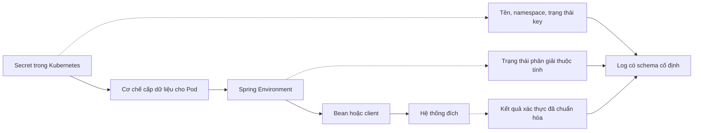

# Kiểm tra Secret mà không ghi giá trị nhạy cảm ra log

## Mục tiêu và tình huống thực tế

Trong module SPRING_CLOUD_KUBERNETES, ứng dụng Spring tích hợp với Kubernetes qua DiscoveryClient, ConfigMap, Secret, Spring Cloud LoadBalancer và Configuration Watcher. Khi chẩn đoán Secret, người vận hành cần biết dữ liệu đã được cung cấp đúng hay chưa, còn người phát triển cần biết thuộc tính đã được ứng dụng sử dụng hay chưa. Hai việc này có thể kiểm chứng bằng trạng thái và metadata được chọn lọc.

Giả sử `orders-service` sử dụng Secret `payment-credentials` trong namespace `training`. Secret có hai key `username`, `password`, được ánh xạ thành `payment.username` và `payment.password`. Bài này hướng dẫn kiểm tra đường đi đó mà không đưa username, password hoặc biểu diễn có thể khôi phục chúng vào log.

Các ví dụ Java giả định dự án Spring Boot đang chạy và đã có cơ chế nhận Secret. Phần cấu hình Actuator dùng cú pháp Spring Boot 3.5.x; thiết lập sanitization riêng của Spring Cloud Kubernetes được đối chiếu theo nhánh 3.3.x. Khi dự án dùng phiên bản khác, kiểm tra tài liệu tương ứng trước khi áp dụng.

## 1. Xác định chính xác điều cần chứng minh

Một thông báo “Secret hoạt động” thường gộp nhiều điều khác nhau:

| Tầng kiểm tra | Câu cần trả lời | Bằng chứng có thể ghi |
| --- | --- | --- |
| Kubernetes | Đúng tài nguyên, đúng namespace chưa? | Tên tài nguyên và namespace được phép công bố |
| Cấu trúc dữ liệu | Key bắt buộc có tồn tại không? | `REQUIRED_KEYS_NON_EMPTY` hoặc trạng thái thiếu |
| Cấp dữ liệu cho Pod | Pod tham chiếu đúng Secret và key chưa? | Tên tham chiếu, tên biến hoặc đường dẫn đã quy định |
| Spring | Thuộc tính có phân giải thành giá trị phù hợp hợp đồng không? | `PRESENT`, `MISSING`, `BLANK`, `RESOLUTION_FAILED` |
| Hệ thống đích | Credential có được chấp nhận không? | `AUTH_ACCEPTED`, `AUTH_REJECTED`, `REMOTE_UNAVAILABLE` |

Không cần in mật khẩu để chứng minh key tồn tại. Ngược lại, key có dữ liệu chưa chứng minh Spring đã bind đúng hoặc hệ thống đích chấp nhận credential.



Sơ đồ cũng giúp khoanh vùng lỗi: `PRESENT` ở Spring nhưng `AUTH_REJECTED` ở hệ thống thanh toán là một tình huống khác với thiếu Secret trong Kubernetes.

## 2. Chọn dữ liệu được phép ghi ngay từ đầu

Thiết kế log theo danh sách trường được phép ghi. Với ví dụ này, một sự kiện chẩn đoán chỉ cần:

```text
event=secret_config_check
component=payment-client
property=payment.password
state=PRESENT
```

`component` và `property` là tên cố định trong mã hoặc cấu hình chẩn đoán đã kiểm soát. `state` thuộc một tập giá trị hữu hạn.

| Có thể dùng khi chính sách cho phép | Không đưa vào sự kiện chẩn đoán |
| --- | --- |
| Tên key hoặc tên thuộc tính cố định | Giá trị username, password, token |
| Namespace và tên Secret đã chọn | Toàn bộ object Secret hoặc map `data` |
| Mã kết quả từ enum | Header `Authorization`, cookie, token phiên |
| Mã lỗi nội bộ đã chuẩn hóa | Request/response body chưa được kiểm soát |
| Phiên bản cấu hình không được sinh từ credential | Hash, Base64, prefix hoặc suffix của credential |

Username có thể là thông tin nhạy cảm; không coi nó đương nhiên an toàn chỉ vì không phải mật khẩu. Tên key, label và annotation cũng phải được thiết kế để không chứa credential.

Base64 là biểu diễn có thể giải mã. Hash của mật khẩu yếu có thể hỗ trợ thử đoán ngoại tuyến. Cắt vài ký tự hoặc ghi độ dài tạo thêm thông tin mà việc kiểm tra hiện diện thường không cần đến. Khi cần đối chiếu hai giá trị, thực hiện trong tiến trình và chỉ xuất `MATCH` hoặc `MISMATCH` theo nhu cầu chẩn đoán cụ thể.

OWASP nêu password, access token và thông tin xác thực trong nhóm dữ liệu cần loại khỏi log. Xem [Logging Cheat Sheet](https://cheatsheetseries.owasp.org/cheatsheets/Logging_Cheat_Sheet.html).

## 3. Kiểm tra tài nguyên bằng kubectl với đầu ra giới hạn

Các lệnh dưới dùng PowerShell. Giả định danh tính đang chạy `kubectl` có quyền phù hợp trong namespace thực hành. Lệnh được thiết kế để đầu ra không chứa giá trị Secret; không bật thêm HTTP tracing hoặc một wrapper đang ghi toàn bộ phản hồi API.

### Chỉ lấy các cột cần thiết

```powershell
kubectl get secret payment-credentials -n training -o 'custom-columns=NAME:.metadata.name,NAMESPACE:.metadata.namespace,TYPE:.type,VERSION:.metadata.resourceVersion'
```

Kết quả minh họa:

```text
NAME                  NAMESPACE   TYPE     VERSION
payment-credentials   training    Opaque   31245
```

`resourceVersion` giúp ghi nhận phiên bản tài nguyên đã quan sát. Nó không chứng minh bean Spring đã dùng credential của phiên bản ấy.

Không xuất toàn bộ `metadata` chỉ vì nó có tên “metadata”. Một annotation do công cụ hoặc quy trình triển khai tạo ra có thể chứa cấu hình gốc. Chỉ chọn các trường đã xác định như ví dụ trên.

### Chỉ liệt kê tên key

Nếu tên key được phép công bố:

```powershell
kubectl get secret payment-credentials -n training -o 'go-template={{range $key, $value := .data}}{{println $key}}{{end}}'
```

Đầu ra mong đợi:

```text
password
username
```

Template chỉ in `$key`. Biến `$value` được dùng để duyệt map và không được đưa ra đầu ra. Thứ tự hiển thị không phải hợp đồng kiểm tra.

Nếu chỉ cần biết đủ hai key hay chưa, dùng kết quả tổng hợp:

```powershell
kubectl get secret payment-credentials -n training -o 'go-template={{if and .data.username .data.password}}REQUIRED_KEYS_NON_EMPTY{{else}}REQUIRED_KEYS_MISSING_OR_EMPTY{{end}}'
```

Lệnh này kiểm tra trường dữ liệu được lưu có hiện diện và khác rỗng. Nó không kiểm tra hợp đồng chuỗi như “không chỉ chứa khoảng trắng”, không thực hiện binding và không xác thực hệ thống thanh toán.

Kubernetes hỗ trợ lựa chọn định dạng đầu ra cho `kubectl`; xem [tài liệu công cụ dòng lệnh](https://kubernetes.io/docs/reference/kubectl/).

### Giới hạn của việc lọc đầu ra

`kubectl get secret` vẫn có thể nhận object Secret đầy đủ trong bộ nhớ client rồi mới áp dụng template. Lọc cột chỉ giới hạn thứ được in, không biến quyền `get Secret` thành một quyền chỉ đọc metadata.

Tài liệu Kubernetes giải thích rằng đầu ra mặc định của `get` và `describe` tránh hiển thị nội dung dữ liệu Secret. Tuy vậy, hãy cân nhắc cả annotation và các trường phụ trước khi đưa đầu ra vào một kênh chia sẻ. Xem [quản lý Secret bằng kubectl](https://kubernetes.io/docs/tasks/configmap-secret/managing-secret-using-kubectl/).

Trong quy trình này không cần dùng `-o yaml`, `-o json`, in `.data`, decode Base64, `printenv` hoặc đọc nội dung file Secret bằng `cat`. Việc che kết quả sau khi dữ liệu đã vào log không thu hồi các bản sao đã được lưu trước đó.

## 4. Kiểm tra quyền đúng với đường cấp Secret

Nếu ứng dụng đọc trực tiếp Kubernetes API, kiểm tra quyền theo danh tính thực tế và loại yêu cầu. Ví dụ, với danh tính hiện đang sử dụng `kubectl`:

```powershell
kubectl auth can-i get secret/payment-credentials -n training
```

Kết quả `yes` nói về danh tính đang chạy lệnh, không tự động nói về ServiceAccount của Pod. Muốn kiểm tra danh tính Pod, người vận hành cần dùng cơ chế impersonation được cấp phép hoặc một môi trường chẩn đoán đúng danh tính.

Nếu ứng dụng nhận Secret qua `secretKeyRef` hoặc volume, nó không cần tự gọi API chỉ để nhận giá trị đó. Không cấp quyền API mới cho ServiceAccount chỉ để thêm một dòng log kiểm tra.

Đối với một client sử dụng `list` hoặc `watch`, quyền `get` theo tên chưa đủ. Quyền danh sách Secret có thể cho phép đọc nhiều giá trị nhạy cảm trong namespace. Chọn quyền theo cách truy cập thực tế, thay vì mở rộng quyền đến khi hết lỗi. Xem [thực hành tốt với Secret Kubernetes](https://kubernetes.io/docs/concepts/security/secrets-good-practices/).

## 5. Kiểm tra tham chiếu trước khi kiểm tra giá trị

Một fragment cấu hình container:

```yaml
env:
  - name: PAYMENT_USERNAME
    valueFrom:
      secretKeyRef:
        name: payment-credentials
        key: username
  - name: PAYMENT_PASSWORD
    valueFrom:
      secretKeyRef:
        name: payment-credentials
        key: password
```

Với fragment này, bản ghi kiểm tra hợp đồng có thể là:

```text
Secret: training/payment-credentials
Key: password
Biến đích: PAYMENT_PASSWORD
Thuộc tính đích: payment.password
```

Đây là mô tả ánh xạ, không có dữ liệu credential. Khi dùng file hoặc Secret PropertySource, ghi lại đường dẫn import hoặc prefix đã quy định thay cho tên biến môi trường.

Tránh dump toàn bộ Deployment để tìm hai tham chiếu trên nếu Deployment có biến môi trường khai báo trực tiếp, command hoặc annotation chứa dữ liệu nhạy cảm. Chỉ đọc đúng trường tham chiếu cần thiết trong công cụ nội bộ hoặc xem bản cấu hình triển khai đã loại dữ liệu nhạy cảm.

Sau khi xác nhận tham chiếu, kiểm tra trạng thái Pod và sự kiện liên quan. `CreateContainerConfigError` có thể gợi ý thiếu Secret/key; `FailedMount` có thể gợi ý lỗi volume. Đây là hướng khoanh vùng, không phải kết luận cuối cùng. Một phần thông báo lỗi cũng cần được kiểm tra trước khi đưa vào ticket.

## 6. Kiểm tra Spring Environment bằng trạng thái cố định

Đoạn mã sau đọc đúng hai thuộc tính và chỉ ghi tên thuộc tính cùng trạng thái. Đặt lớp trong vùng package được ứng dụng Spring Boot quét.

```java
package example.orders;

import java.util.List;

import org.slf4j.Logger;
import org.slf4j.LoggerFactory;

import org.springframework.boot.ApplicationRunner;
import org.springframework.context.annotation.Bean;
import org.springframework.context.annotation.Configuration;
import org.springframework.core.env.Environment;

@Configuration(proxyBeanMethods = false)
public class SecretDiagnosticsConfiguration {

    private static final Logger log =
            LoggerFactory.getLogger(SecretDiagnosticsConfiguration.class);

    private static final List<String> REQUIRED_PROPERTIES = List.of(
            "payment.username",
            "payment.password");

    private enum ProbeState {
        MISSING,
        BLANK,
        PRESENT,
        RESOLUTION_FAILED
    }

    @Bean
    ApplicationRunner verifySecretConfiguration(Environment environment) {
        return args -> {
            boolean usable = true;

            for (String property : REQUIRED_PROPERTIES) {
                ProbeState state = inspect(environment, property);

                log.info(
                        "event=secret_config_check component=payment-client "
                                + "property={} state={}",
                        property,
                        state);

                usable = usable && state == ProbeState.PRESENT;
            }

            if (!usable) {
                throw new IllegalStateException(
                        "Required payment configuration is unavailable");
            }
        };
    }

    private static ProbeState inspect(
            Environment environment,
            String property) {

        try {
            String value = environment.getProperty(property);

            if (value == null) {
                return ProbeState.MISSING;
            }

            return value.isBlank()
                    ? ProbeState.BLANK
                    : ProbeState.PRESENT;
        } catch (RuntimeException ignored) {
            return ProbeState.RESOLUTION_FAILED;
        }
    }
}
```

Các điểm cần hiểu:

- Danh sách tên thuộc tính cố định ngăn chẩn đoán trở thành chức năng dump tùy ý toàn bộ `Environment`.
- Giá trị chỉ được kiểm tra trong bộ nhớ và không trở thành tham số log.
- `RESOLUTION_FAILED` biểu thị không thể phân giải thuộc tính, chẳng hạn một placeholder không hợp lệ. Mã không nối thông báo exception vào log.
- Khi cấu hình bắt buộc không sử dụng được, runner ném exception với thông báo cố định, không đính kèm cause có thể chứa giá trị.
- Quy tắc `isBlank()` là hợp đồng của ví dụ: credential không được thiếu hoặc chỉ gồm khoảng trắng. Đây không phải quy tắc áp dụng cho mọi loại Secret, chẳng hạn dữ liệu nhị phân.

Ví dụ bảo vệ các điểm log do chính lớp này tạo ra. Một lỗi xảy ra trước runner, như lỗi tải PropertySource hoặc binding của bean khác, vẫn cần được kiểm tra ở nguồn phát sinh.

Spring Boot cung cấp cách đọc thuộc tính qua `Environment` và binding bằng `@ConfigurationProperties`. Xem [Externalized Configuration](https://docs.spring.io/spring-boot/reference/features/external-config.html).

### PRESENT không xác nhận nguồn dữ liệu

Nếu biến môi trường cũ ghi đè dữ liệu được import, runner vẫn có thể báo `PRESENT`. Nó xác nhận thuộc tính phân giải được, không xác nhận nguồn đã thắng hoặc phiên bản Secret đang được sử dụng.

Khi cần kiểm tra nguồn, ghi một mã nguồn do ứng dụng định nghĩa như `ENVIRONMENT`, `MOUNTED_FILE` hoặc `KUBERNETES_API` dựa trên chế độ cấu hình được chọn. Không coi mã chế độ đó là bằng chứng tự động về nguồn thắng trong mọi trường hợp. Muốn xác nhận precedence, phải kiểm tra tập nguồn thực tế trong môi trường chẩn đoán có kiểm soát và vẫn tránh in giá trị.

## 7. Kiểm soát những đường log gián tiếp

Ngay cả khi không viết `log.info(password)`, dữ liệu vẫn có thể đi vào log qua:

| Điểm phát sinh | Cách kiểm soát |
| --- | --- |
| Log object Secret hoặc map cấu hình | Chỉ log các trường trong schema đã duyệt |
| `toString()` của DTO/record chứa credential | Ghi đè để trả mô tả cố định; không serialize object đó vào log |
| Lỗi validation/binding | Không tự log `rejectedValue`; kiểm tra thông báo thất bại với dữ liệu giả |
| Exception từ HTTP client | Chuẩn hóa mã lỗi; kiểm tra trước khi đính kèm throwable hoặc message |
| HTTP wire logging | Không bật ghi header/body chứa credential trong quy trình kiểm tra |
| Script CI, shell tracing, transcript | Tránh đưa giá trị vào command hoặc đầu ra trước bước lọc |
| Structured logging/MDC/tracing/metric tags | Không đưa credential vào trường bổ sung hoặc nhãn |

Ví dụ cần tránh:

```java
log.info("Loaded secret: {}", secretObject);
log.info("Payment properties: {}", paymentProperties);
log.error("Payment failed: {}", exception.getMessage());
```

Dòng dùng `getMessage()` không mặc nhiên an toàn: exception có thể chứa URL, header, body hoặc giá trị bị từ chối.

Một dạng sự kiện tốt hơn khi mã gọi hệ thống đích đã phân loại kết quả:

```text
event=payment_auth_check component=payment-client outcome=AUTH_REJECTED
```

Phân loại riêng lỗi xác thực, timeout, DNS và kết nối. Timeout không chứng minh mật khẩu sai. Đừng ghi toàn bộ phản hồi của hệ thống đích để giải thích một mã `401`.

Việc thay `toString()` cũng không ngăn getter, JSON serializer hoặc công cụ debug đọc giá trị. Nó chỉ xử lý một đường xuất dữ liệu cụ thể.

## 8. Giữ Actuator ở chế độ không hiển thị giá trị

Với dự án có Spring Boot Actuator, có thể khai báo tường minh:

```yaml
management:
  endpoints:
    web:
      exposure:
        include: "health"
    jmx:
      exposure:
        exclude: "*"
  endpoint:
    env:
      show-values: never
    configprops:
      show-values: never
    health:
      show-details: never
      show-components: never
```

`show-values: never` giữ giá trị được che khi endpoint liên quan được truy cập. `exposure` quyết định endpoint nào được công bố qua kênh đó; nó không thay thế cơ chế xác thực hoặc kiểm soát mạng.

Ví dụ chỉ công bố health qua HTTP. Nếu cần kiểm tra `env`/`configprops` trong một phiên chẩn đoán được bảo vệ, giữ nguyên `show-values: never` và chỉ mở endpoint cần thiết theo quy trình vận hành. Không chuyển sang `always` để tiện xem một mật khẩu.

Spring Boot phân biệt các chế độ `never`, `when-authorized` và `always` cho giá trị có thể sanitization. Xem [Actuator Endpoints của Spring Boot 3.5](https://docs.spring.io/spring-boot/3.5/reference/actuator/endpoints.html).

Với Secret PropertySource của Spring Cloud Kubernetes 3.3.x, có thêm thiết lập:

```yaml
spring:
  cloud:
    kubernetes:
      sanitize:
        secrets: true
```

Thiết lập này hỗ trợ sanitization cho dữ liệu Secret trong các endpoint liên quan. Nó không lọc mọi câu lệnh logger, không bảo vệ một HTTP client đang ghi body và không bảo đảm mọi dữ liệu từ biến môi trường/file được nhận diện theo nguồn Secret. Xem [Secrets PropertySource 3.3](https://docs.spring.io/spring-cloud-kubernetes/reference/3.3/property-source-config/secrets-propertysource.html).

Một endpoint che giá trị cũng không biến các response thành dữ liệu công khai: tên thuộc tính, cấu trúc nguồn và thông tin ứng dụng vẫn có thể cần giới hạn truy cập.

## 9. Kiểm tra hiệu lực credential mà không hiển thị credential

Khi tất cả thuộc tính đều `PRESENT`, muốn kiểm chứng xác thực hãy dùng thao tác được hệ thống đích hỗ trợ, không tạo tác dụng phụ không cần thiết. Ví dụ một API xác minh danh tính hoặc một truy vấn kiểm tra kết nối đã được nhóm quản lý hệ thống thống nhất.

Ứng dụng gửi credential theo giao thức bình thường nhưng chỉ xuất kết quả đã chuẩn hóa:

| Kết quả | Cách diễn giải |
| --- | --- |
| `AUTH_ACCEPTED` | Hệ thống đích đã chấp nhận phép xác thực vừa thực hiện |
| `AUTH_REJECTED` | Credential hoặc chính sách xác thực không được chấp nhận |
| `REMOTE_UNAVAILABLE` | Chưa kết luận về credential vì hệ thống đích không khả dụng |
| `CHECK_NOT_RUN` | Chỉ kiểm tra cấu hình, chưa thực hiện xác thực |

Kết quả gắn với thời điểm và thao tác kiểm tra. Nó không bảo đảm credential sẽ tiếp tục hợp lệ sau khi bị thu hồi hoặc thay đổi quyền.

Không đưa credential vào query string, log request hoặc metric label. Nếu hệ thống đích trả về danh tính/tokens, chỉ chuyển kết quả sang mã trạng thái cần thiết thay vì ghi response.

Health probe cần giữ đúng mục đích. Một sự cố của hệ thống thanh toán không nên mặc nhiên trở thành lý do làm liveness probe khởi động lại Pod liên tục. Nếu theo dõi ở readiness hoặc health component riêng, xác định rõ chính sách và chỉ xuất trạng thái cần thiết.

## 10. Kiểm tra sau khi cập nhật Secret

Configuration Watcher hoặc thao tác rolling restart có thể kích hoạt một vòng nhận cấu hình mới. Khi đó cần kiểm tra lại các tầng đã nêu, không chỉ thấy sự kiện thay đổi Secret là kết luận thành công.

Có thể ghi:

```text
event=secret_resource_observed component=payment-client state=OBSERVED
event=secret_config_check component=payment-client property=payment.password state=PRESENT
event=payment_auth_check component=payment-client outcome=AUTH_ACCEPTED
```

Chỉ ghi sự kiện nào thực sự được quan sát. Không phát `AUTH_ACCEPTED` từ kết quả kiểm tra key tồn tại.

Với biến môi trường, tiến trình đang chạy không tự nhận giá trị mới chỉ vì Secret đổi. File volume được cập nhật cũng chưa chứng minh bean đã bind hoặc client đã được tạo lại. Các đặc điểm cập nhật này được mô tả trong [tài liệu Secret Kubernetes](https://kubernetes.io/docs/concepts/configuration/secret/).

Nếu cần theo dõi một đợt triển khai, dùng mã đợt triển khai hoặc phiên bản cấu hình không sinh từ credential. Không dùng hash của mật khẩu làm correlation ID.

## 11. Thực hành kiểm chứng log bằng dữ liệu giả

Dùng namespace thực hành và credential giả, không dùng credential thật để thử xem hệ thống có làm lộ hay không. Quy trình kiểm chứng nên bao phủ cả đường thành công lẫn thất bại:

1. Cấp một chuỗi giả dễ nhận diện vào credential, ví dụ `LAB_SECRET_CANARY_012`. Không sử dụng chuỗi này cho hệ thống thật.
2. Khởi động ứng dụng với đủ key. Chỉ mong đợi trạng thái `PRESENT` ở kiểm tra cấu hình.
3. Thử thiếu key, chuỗi rỗng và placeholder không phân giải được. Mong đợi trạng thái hoặc thông báo thất bại cố định.
4. Nếu có hệ thống đích giả lập, thử xác thực thành công, bị từ chối và timeout.
5. Thu log của ứng dụng, sidecar/proxy và pipeline thực hành để kiểm tra. Khi ứng dụng restart, xem cả log của container trước đó.
6. Xác minh response Actuator theo cấu hình; giá trị gốc không được xuất hiện.

Giả sử log thực hành đã được lưu tại `app-lab.log`, đoạn PowerShell sau chỉ xuất kết luận:

```powershell
$canary = 'LAB_SECRET_CANARY_012'
$encodedCanary = [Convert]::ToBase64String(
    [System.Text.Encoding]::UTF8.GetBytes($canary))
$patterns = @($canary, $encodedCanary)

foreach ($pattern in $patterns) {
    $leaked = Select-String -LiteralPath '.\app-lab.log' -Pattern $pattern -SimpleMatch -Quiet

    if ($leaked) {
        throw 'SECRET_LOG_LEAK_DETECTED'
    }
}

Write-Output 'CANARY_NOT_FOUND_IN_CAPTURED_LOG'
```

`-Quiet` trả kết quả kiểm tra thay vì dòng log chứa dữ liệu. Đoạn mã tìm canary nguyên văn và Base64 của nó; nó không chứng minh mọi kiểu biến đổi, mọi kênh hoặc mọi lỗi đều đã được bao phủ. Mở rộng tình huống theo formatter và thư viện thực tế, đồng thời vẫn chỉ xuất kết quả cố định.

Đừng dùng tùy chọn in dòng khớp để kiểm tra credential thật. Một công cụ “tìm rò rỉ” có thể tự tạo thêm bản sao dữ liệu nếu in toàn bộ dòng tìm thấy.

## 12. Biên bản chẩn đoán đủ dùng cho bàn giao

Một biên bản có thể gồm:

```text
Ứng dụng: orders-service
Namespace: training
Secret được tham chiếu: payment-credentials
Key bắt buộc: username, password
Kiểm tra tài nguyên: FOUND
Kiểm tra key: REQUIRED_KEYS_NON_EMPTY
payment.username: PRESENT
payment.password: PRESENT
Xác thực hệ thống đích: CHECK_NOT_RUN
Giới hạn: chưa chứng minh hệ thống thanh toán chấp nhận credential
Giá trị credential: không thu thập vào biên bản
```

Nếu chỉ hoàn tất các bước trên, kết luận phải dừng ở việc cấu hình đã có và phân giải được. Nếu đã chạy xác thực, thay `CHECK_NOT_RUN` bằng kết quả thực tế và ghi thời điểm kiểm tra.

Khi phát hiện credential đã lọt vào log, dừng đường ghi gây rò rỉ, báo đúng người quản lý credential để xử lý thu hồi hoặc luân chuyển, và hạn chế truy cập các bản log theo quy trình của hệ thống. Không sao chép lại giá trị đó vào ticket để mô tả sự cố.

Một quy trình chẩn đoán tốt để lại đủ bằng chứng xác định tầng lỗi: tài nguyên, cấu trúc key, ánh xạ, binding hay xác thực. Mỗi tầng chỉ xuất những sự kiện cần thiết để người nhận bàn giao có thể tiếp tục xử lý.
