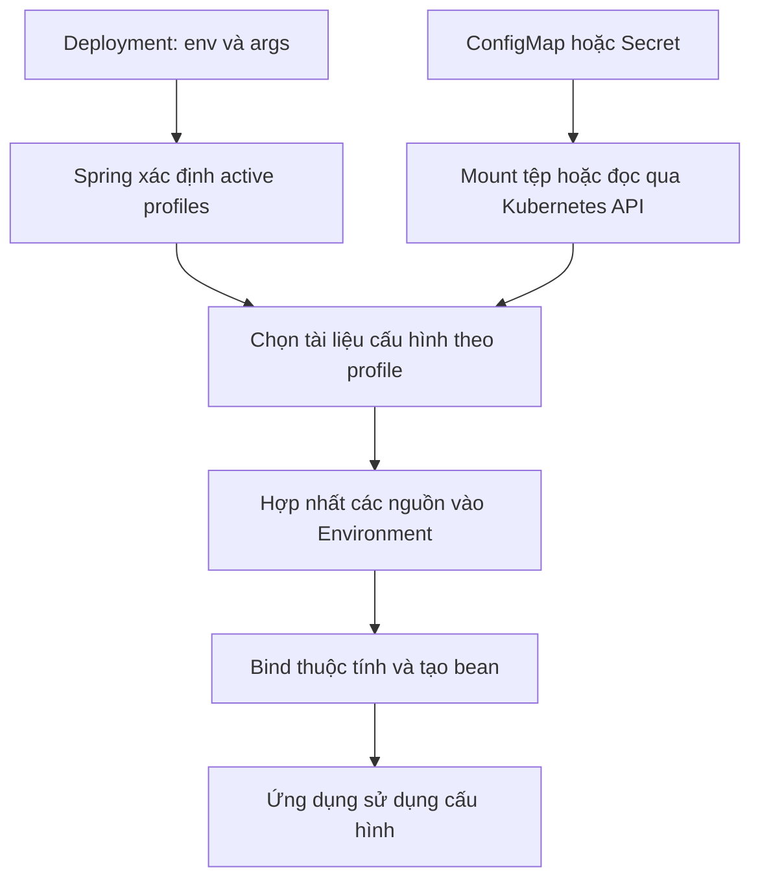

# Quan hệ giữa active profile và cấu hình Kubernetes

Trong chương **Profile và ưu tiên** của module **SPRING_CLOUD_KUBERNETES**, bài này giải thích cách active profile của Spring tham gia vào việc chọn cấu hình khi ứng dụng chạy trên Kubernetes.

Một Pod có thể nằm trong namespace `production` nhưng ứng dụng vẫn chạy profile `dev`. Ngược lại, một ứng dụng chạy trên máy cá nhân có thể bật profile `prod`. Vì vậy, cần kiểm tra riêng môi trường triển khai, tập profile thực sự hoạt động và nguồn cung cấp giá trị cấu hình.

Sau bài học, bạn có thể:

- Phân biệt profile Spring với namespace, label và cơ chế nhận diện Kubernetes.
- Chọn profile sớm qua Deployment để Spring nạp đúng tài liệu cấu hình.
- Hiểu sự khác nhau giữa ConfigMap được mount thành tệp và ConfigMap được Spring Cloud Kubernetes đọc qua API.
- Kiểm chứng profile đang hoạt động và một thuộc tính có hiệu lực mà không xuất Secret.
- Nhận ra trường hợp profile đúng nhưng giá trị cuối cùng bị nguồn khác ghi đè.

## 1. Bốn khái niệm độc lập cần phân biệt

| Khái niệm | Ví dụ | Vai trò |
| --- | --- | --- |
| Active profile của Spring | `dev`, `prod`, `metrics` | Chọn cấu hình và bean có điều kiện theo profile |
| Nền tảng được Spring nhận diện | `kubernetes` | Cho phép điều kiện theo cloud platform khớp |
| Namespace Kubernetes | `profile-lab`, `payments-prod` | Xác định phạm vi tài nguyên và phân quyền |
| Label Kubernetes | `environment: prod` | Gắn metadata, phục vụ selector và quy trình triển khai |

Kubernetes không tự chuyển label hoặc tên namespace thành `spring.profiles.active`. Nếu tổ chức muốn namespace `payments-prod` tương ứng với profile `prod`, manifest hoặc pipeline phải diễn đạt quy ước đó.

Ví dụ:

```yaml
metadata:
  namespace: profile-lab
  labels:
    environment: lab
spec:
  containers:
    - name: app
      env:
        - name: SPRING_PROFILES_ACTIVE
          value: prod
```

Đây là phần trích của Pod spec: ứng dụng được yêu cầu bật `prod` dù namespace và label mang tên lab. Trong bài thực hành, `prod` chỉ chọn các giá trị minh họa, không kết nối hệ thống sản xuất thật.

Profile cũng không phải cơ chế phân quyền. Bật `prod` hoặc `kubernetes` không cấp quyền đọc ConfigMap, Secret, Service hay EndpointSlice.

## 2. Profile tham gia vào quá trình khởi động ở đâu?



Sơ đồ mô tả các trách nhiệm, không khẳng định mọi nguồn cấu hình đều được đọc trong đúng một lượt. Điểm cần giữ rõ là: nguồn phải được nạp, điều kiện profile phải khớp và quy tắc ưu tiên phải được áp dụng trước khi suy ra giá trị ứng dụng dùng.

### Chọn profile từ bên ngoài image

Trong Deployment, thường đặt:

```yaml
env:
  - name: SPRING_PROFILES_ACTIVE
    value: "prod"
```

Với ứng dụng đóng gói thành executable JAR, một lựa chọn khác là:

```shell
java -jar profile-demo.jar --spring.profiles.active=prod
```

Có thể bật nhiều profile bằng danh sách phân cách bởi dấu phẩy, chẳng hạn `prod,metrics`. Đây là các profile cùng hoạt động, không phải chuỗi tên một môi trường duy nhất.

`spring.profiles.active` tuân theo độ ưu tiên nguồn cấu hình. Nếu một giá trị được đặt trong biến môi trường nhưng lệnh khởi chạy có `--spring.profiles.active=dev`, tham số dòng lệnh có thể thay giá trị đó theo thứ tự thông thường của Spring Boot. [Spring Boot Profiles](https://docs.spring.io/spring-boot/3.5/reference/features/profiles.html).

Không đóng cứng `prod` vào image để rồi phải build image khác chỉ nhằm đổi môi trường. Giữ cùng image và truyền quyết định triển khai từ manifest giúp việc đối chiếu cấu hình rõ ràng hơn.

### Điều kiện chọn tài liệu khác với lệnh bật profile

Một tài liệu có thể chỉ áp dụng khi `prod` đang hoạt động:

```yaml
app:
  marker: common
---
spring:
  config:
    activate:
      on-profile: prod
app:
  marker: selected-for-prod
```

`on-profile: prod` kiểm tra điều kiện; nó không tự bật profile `prod`. Tương tự, chỉ tạo tệp `application-prod.yaml` không làm profile này hoạt động.

Đừng đặt `spring.profiles.active` trong chính `application-prod.yaml` hoặc tài liệu đã được kích hoạt bằng `on-profile` để tìm cách bật ngược lại profile. Spring Boot yêu cầu thuộc tính kích hoạt này nằm trong tài liệu không phụ thuộc profile.

## 3. Profile kubernetes có phải profile prod không?

Khi có thành phần awareness của Spring Cloud Kubernetes và ứng dụng được nhận diện đang chạy trong Pod, thư viện có thể tự thêm profile `kubernetes`. Cơ chế này phụ thuộc vào thư viện trên classpath và nhận diện nền tảng, không phải do Kubernetes sửa biến `SPRING_PROFILES_ACTIVE`. [Kubernetes Ecosystem Awareness](https://docs.spring.io/spring-cloud-kubernetes/reference/5.1/kubernetes-awareness.html).

`kubernetes` mô tả nền tảng triển khai; `prod` mô tả một lựa chọn cấu hình của ứng dụng. Chúng có thể cùng hoạt động. Cluster phát triển và cluster sản xuất đều là Kubernetes, nên chỉ có profile `kubernetes` chưa đủ để xác định cấu hình nghiệp vụ.

Spring Boot còn hỗ trợ điều kiện cloud platform độc lập với tên profile:

```yaml
app:
  marker: common
---
spring:
  config:
    activate:
      on-cloud-platform: kubernetes
      on-profile: prod
app:
  marker: prod-on-kubernetes
```

Tài liệu thứ hai chỉ áp dụng khi cả hai điều kiện khớp. Đây là cách tách “đang ở nền tảng nào” khỏi “đang dùng biến thể cấu hình nào”. [Activation properties](https://docs.spring.io/spring-boot/3.5/reference/features/external-config.html#features.external-config.files.activation-properties).

Nếu ép `spring.main.cloud-platform=KUBERNETES` khi chạy cục bộ để thử một điều kiện, thao tác đó cũng không tạo cluster, không cung cấp namespace và không cấp credential cho Kubernetes client.

## 4. Thực hành: profile chọn tệp trong ConfigMap được mount

Ví dụ này dùng Spring Boot 3.x, Java 17 trở lên và starter web. Cấu hình được Kubernetes mount thành tệp, nên bản lab tối thiểu không cần starter Spring Cloud Kubernetes để gọi API.

Nếu ghép vào project đã có Spring Cloud Kubernetes, tiếp tục dùng bộ version Boot/Cloud tương thích của project và kiểm tra các tính năng đã bật. Tập active profile có thể chứa thêm `kubernetes`; kết quả quan trọng trong lab là có `prod` và đúng giá trị được chọn.

### 4.1. Cấu hình đóng gói trong ứng dụng

Project cần dependency web, version do Spring Boot parent/BOM quản lý:

```xml
<dependency>
    <groupId>org.springframework.boot</groupId>
    <artifactId>spring-boot-starter-web</artifactId>
</dependency>
```

Tệp `src/main/resources/application.yaml`:

```yaml
spring:
  application:
    name: profile-demo

app:
  integration-mode: mock
  marker: packaged-default
```

Tệp `src/main/resources/application-prod.yaml`:

```yaml
app:
  integration-mode: live
  marker: packaged-prod
```

Trong mẫu, `mock` và `live` chỉ là chuỗi cấu hình để quan sát. Không có client gọi hệ thống ngoài được tạo bởi những giá trị này.

### 4.2. Endpoint quan sát có giới hạn

Tạo `ProfileDemoApplication.java`:

```java
package com.example.profiledemo;

import org.springframework.boot.SpringApplication;
import org.springframework.boot.autoconfigure.SpringBootApplication;

@SpringBootApplication
public class ProfileDemoApplication {

    public static void main(String[] args) {
        SpringApplication.run(ProfileDemoApplication.class, args);
    }
}
```

Tạo `ConfigViewController.java` trong cùng package:

```java
package com.example.profiledemo;

import java.util.Map;

import org.springframework.core.env.Environment;
import org.springframework.web.bind.annotation.GetMapping;
import org.springframework.web.bind.annotation.RestController;

@RestController
public class ConfigViewController {

    private final Environment environment;

    public ConfigViewController(Environment environment) {
        this.environment = environment;
    }

    @GetMapping("/lab/config")
    public Map<String, Object> config() {
        return Map.of(
                "activeProfiles", environment.getActiveProfiles(),
                "integrationMode",
                environment.getRequiredProperty("app.integration-mode"),
                "marker",
                environment.getRequiredProperty("app.marker")
        );
    }
}
```

Endpoint chỉ dành cho lab và chỉ trả hai thuộc tính đã xác định là không nhạy cảm. Nó không xuất toàn bộ `Environment`, credential hay nội dung Secret.

### 4.3. Namespace và ConfigMap

Tệp `namespace.yaml`:

```yaml
apiVersion: v1
kind: Namespace
metadata:
  name: profile-lab
```

Tệp `configmap.yaml`:

```yaml
apiVersion: v1
kind: ConfigMap
metadata:
  name: profile-demo-files
  namespace: profile-lab
data:
  application.yaml: |-
    app:
      marker: mounted-default
  application-prod.yaml: |-
    app:
      marker: mounted-prod
  application-dev.yaml: |-
    app:
      marker: mounted-dev
```

ConfigMap lưu ba chuỗi có tên key trông giống tên tệp. Khi mount, các key trở thành tệp. Kubernetes đưa chúng vào container; Spring Boot mới là thành phần chọn tài liệu phù hợp với profile. [ConfigMaps](https://kubernetes.io/docs/concepts/configuration/configmap/).

Việc có `application-dev.yaml` trong volume không khiến `dev` hoạt động và không làm tệp đó được chọn khi chỉ có `prod`.

### 4.4. Deployment khai báo cả profile và nơi tìm cấu hình

Tệp `deployment.yaml`:

```yaml
apiVersion: apps/v1
kind: Deployment
metadata:
  name: profile-demo
  namespace: profile-lab
spec:
  replicas: 1
  selector:
    matchLabels:
      app: profile-demo
  template:
    metadata:
      labels:
        app: profile-demo
        environment: lab
    spec:
      automountServiceAccountToken: false
      securityContext:
        runAsNonRoot: true
        runAsUser: 10001
        runAsGroup: 10001
        seccompProfile:
          type: RuntimeDefault
      containers:
        - name: app
          image: registry.example.com/training/profile-demo:1.0
          ports:
            - name: http
              containerPort: 8080
          env:
            - name: SPRING_PROFILES_ACTIVE
              value: prod
            - name: SPRING_CONFIG_ADDITIONAL_LOCATION
              value: "file:/etc/profile-demo/"
          securityContext:
            allowPrivilegeEscalation: false
            capabilities:
              drop:
                - ALL
          volumeMounts:
            - name: config-files
              mountPath: /etc/profile-demo
              readOnly: true
      volumes:
        - name: config-files
          configMap:
            name: profile-demo-files
```

Thay địa chỉ image minh họa bằng image thực chứa ứng dụng trên, có thể chạy với UID 10001 và truy cập được từ cluster.

Hai biến môi trường có hai nhiệm vụ khác nhau:

- `SPRING_PROFILES_ACTIVE` chọn profile.
- `SPRING_CONFIG_ADDITIONAL_LOCATION` bổ sung thư mục mà Spring Boot tìm cấu hình.

`additional-location` giữ các vị trí mặc định trong image và bổ sung thư mục mount. Nó khác với `spring.config.location`, vốn thay thế tập vị trí mặc định. Đường dẫn thư mục kết thúc bằng `/` để Spring Boot tìm các tệp cấu hình theo tên. [Config data locations](https://docs.spring.io/spring-boot/3.5/reference/features/external-config.html#features.external-config.files).

Trong bản lab chỉ đọc volume này, Java không gọi Kubernetes API, nên không cần cấp quyền đọc ConfigMap qua API cho ServiceAccount. Không áp dụng quyết định tắt ServiceAccount token một cách máy móc cho biến thể có DiscoveryClient hoặc nạp cấu hình qua API.

### 4.5. Triển khai và đọc kết quả

Sau khi build và cung cấp image thực, người học chạy trên cluster lab:

```shell
kubectl apply -f namespace.yaml
kubectl apply -f configmap.yaml
kubectl apply -f deployment.yaml
kubectl -n profile-lab rollout status deployment/profile-demo --timeout=180s
kubectl -n profile-lab get pods -l app=profile-demo
```

Mở một terminal riêng:

```shell
kubectl -n profile-lab port-forward deployment/profile-demo 8080:8080
```

Ở terminal khác:

```shell
curl http://localhost:8080/lab/config
```

Với bản lab Spring Boot tối thiểu và không có nguồn ghi đè khác, kết quả dự kiến:

```json
{
  "activeProfiles": ["prod"],
  "integrationMode": "live",
  "marker": "mounted-prod"
}
```

Thứ tự field JSON có thể khác. Nếu project có Spring Cloud Kubernetes awareness, mảng profile có thể chứa thêm `kubernetes`.

Kết quả thể hiện hai lựa chọn:

- `integrationMode = live` đến từ cấu hình `prod` đóng gói trong ứng dụng.
- `marker = mounted-prod` đến từ tệp cấu hình `prod` trong thư mục bổ sung.

Giá trị của một thuộc tính không nhất thiết đến từ cùng nguồn với thuộc tính khác. Spring hợp nhất cấu hình theo từng key, không chọn một tệp duy nhất làm toàn bộ cấu hình ứng dụng.

### 4.6. Đổi profile mà giữ nguyên image và ConfigMap

Để thử `dev`:

```shell
kubectl -n profile-lab set env deployment/profile-demo SPRING_PROFILES_ACTIVE=dev
kubectl -n profile-lab rollout status deployment/profile-demo --timeout=180s
```

Thay đổi env trong Pod template khiến Deployment tạo Pod mới. Mở lại port-forward sau khi Pod cũ được thay, rồi gọi endpoint.

Với đúng các tệp đã khai báo, không có nguồn ghi đè khác:

| Profile đang hoạt động | `integrationMode` | `marker` |
| --- | --- | --- |
| `prod` | `live` | `mounted-prod` |
| `dev` | `mock` | `mounted-dev` |
| Chỉ `kubernetes` | `mock` | `mounted-default` |

Dòng cuối là một tình huống cấu hình để đối chiếu, không phải khuyến nghị chỉ bật `kubernetes` cho production. Nó cho thấy profile hạ tầng không tự thay thế profile nghiệp vụ.

### 4.7. Profile đúng nhưng giá trị vẫn có thể khác dự kiến

Trong khi đang dùng `dev`, thêm một biến môi trường nghiệp vụ:

```shell
kubectl -n profile-lab set env deployment/profile-demo APP_MARKER=env-override
kubectl -n profile-lab rollout status deployment/profile-demo --timeout=180s
```

Sau khi kết nối lại tới Pod mới, dự kiến:

```json
{
  "activeProfiles": ["dev"],
  "integrationMode": "mock",
  "marker": "env-override"
}
```

Profile vẫn là `dev`; chỉ giá trị `app.marker` bị ghi đè bởi nguồn có ưu tiên cao hơn. Nếu muốn thử tiếp với cấu hình tệp, bỏ biến môi trường vừa thêm và theo dõi rollout:

```shell
kubectl -n profile-lab set env deployment/profile-demo APP_MARKER-
kubectl -n profile-lab rollout status deployment/profile-demo --timeout=180s
```

Đây là hai bài toán khác nhau: **profile quyết định tài liệu đủ điều kiện được nạp**, còn **độ ưu tiên quyết định giá trị thắng khi các nguồn cùng cung cấp một key**.

## 5. Khi Spring Cloud Kubernetes đọc ConfigMap qua API

Biến thể này dùng chức năng Config của Spring Cloud Kubernetes, khác với việc Kubernetes mount tệp cho Spring Boot đọc. Ví dụ thuộc tính dưới đây theo dòng Spring Cloud Kubernetes 3.3.x; cần starter Config phù hợp và bộ version Boot/Cloud tương thích.

Một cấu hình ứng dụng cho named source:

```yaml
spring:
  application:
    name: profile-demo
  config:
    import: "kubernetes:"
  cloud:
    kubernetes:
      config:
        enabled: true
        namespace: "${POD_NAMESPACE}"
        sources:
          - name: profile-demo-settings
            include-profile-specific-sources: true
      secrets:
        enabled: false
```

Ứng dụng cần nhận `POD_NAMESPACE`, ví dụ qua Downward API trong Deployment:

```yaml
env:
  - name: POD_NAMESPACE
    valueFrom:
      fieldRef:
        fieldPath: metadata.namespace
  - name: SPRING_PROFILES_ACTIVE
    value: prod
```

Đặt các thông tin chọn nguồn, namespace và import ở nơi ứng dụng đọc được khi khởi động. Với mẫu này, không trông chờ ConfigMap đích tự cung cấp thông tin để tìm ra chính nó.

Nếu thử riêng biến thể API, hãy chuẩn bị ServiceAccount, xác thực client và RBAC cho thao tác đọc ConfigMap của release đang dùng. Cấu hình volume và `automountServiceAccountToken: false` của lab tối thiểu không đáp ứng mặc nhiên các yêu cầu đó.

### Lookup nguồn theo active profile

Với named source `profile-demo-settings` và profile `prod`, cơ chế profile-specific sources sẽ thử cả nguồn cơ sở và nguồn có hậu tố profile:

```text
profile-demo-settings
profile-demo-settings-prod
```

Nếu tập active profile còn có `kubernetes`, tên `profile-demo-settings-kubernetes` cũng có thể tham gia lookup. Không suy ra tập tên nguồn chỉ từ riêng giá trị `SPRING_PROFILES_ACTIVE`; cần xem tập profile thực tế sau khi các thành phần khởi động xử lý.

Hai ConfigMap minh họa cho biến thể API:

```yaml
apiVersion: v1
kind: ConfigMap
metadata:
  name: profile-demo-settings
  namespace: profile-lab
data:
  app.marker: api-common
---
apiVersion: v1
kind: ConfigMap
metadata:
  name: profile-demo-settings-prod
  namespace: profile-lab
data:
  app.marker: api-prod
```

Các key trong ví dụ là thuộc tính trực tiếp. Đây là một thiết kế khác với ConfigMap `profile-demo-files` chứa nhiều tệp ở phần 4. Có thể tắt việc thêm nguồn theo profile bằng `include-profile-specific-sources: false` nếu muốn quản lý danh sách nguồn tường minh. [Profile-aware ConfigMap sources](https://docs.spring.io/spring-cloud-kubernetes/reference/3.3/property-source-config/configmap-propertysource.html).

Một tên ConfigMap kết thúc bằng `-prod` không có ý nghĩa đặc biệt đối với Kubernetes. Ý nghĩa đó đến từ cơ chế chọn nguồn của thư viện hoặc quy ước triển khai của ứng dụng.

### Phân biệt ba kiểu “cấu hình theo profile”

| Cách lưu và đọc | Thành phần thực hiện việc chọn |
| --- | --- |
| ConfigMap mount ra `application-prod.yaml` trong thư mục Boot tìm kiếm | Spring Boot chọn tệp theo profile |
| Tài liệu có `spring.config.activate.on-profile` | Bộ nạp cấu hình xét điều kiện của tài liệu |
| Named source `profile-demo-settings-prod` qua Spring Cloud Kubernetes | Thư viện mở rộng lookup tài nguyên theo profile |

Đừng áp dụng quy tắc của một hàng cho mọi hàng còn lại. Ví dụ, chỉ tạo ConfigMap tên `profile-demo-settings-prod` sẽ không làm nó xuất hiện trong volume của Deployment đang tham chiếu `profile-demo-files`.

Spring Cloud Kubernetes dùng `spring.config.import: "kubernetes:"` cho Config Data. Cơ chế bootstrap cũ là một lựa chọn khác; không kết hợp cả hai phương thức nạp cùng lúc. [Kubernetes PropertySource implementations](https://docs.spring.io/spring-cloud-kubernetes/reference/3.3/property-source-config.html).

## 6. Namespace, tên nguồn và Secret vẫn phải cấu hình riêng

Giả sử bật `prod` nhưng cấu hình API đang đặt namespace là `profile-lab`. Thư viện sẽ tìm nguồn trong namespace được cấu hình; nó không tự chuyển sang namespace tên `prod`.

Tương tự, `spring.application.name` có thể được dùng làm tên nguồn mặc định, nhưng nguồn tường minh trong `sources` có thể chọn tên khác. Muốn chẩn đoán lookup, phải xét đủ:

```text
namespace + tên nguồn cơ sở + tập active profile + kiểu nạp
```

Quy tắc phân giải namespace còn có các nguồn fallback từ cấu hình client hoặc namespace của ServiceAccount, tùy cấu hình và client. Vì vậy, trong một tình huống lỗi, hãy xác nhận namespace hiệu lực thay vì suy đoán từ profile. [Namespace resolution](https://docs.spring.io/spring-cloud-kubernetes/reference/3.3/property-source-config/namespace-resolution.html).

Với Secret, bật profile không tự bật khả năng đọc Secret qua API và không cấp thêm quyền. Các tính năng chọn nguồn cũng cần được xem cùng cấu hình Secret, phương thức phân phối và RBAC. [Secrets PropertySource](https://docs.spring.io/spring-cloud-kubernetes/reference/3.3/property-source-config/secrets-propertysource.html).

Credential thực nên được quản lý qua Secret hoặc hệ thống cấp bí mật phù hợp. Không đưa mật khẩu vào `application-prod.yaml` trong ConfigMap chỉ vì tệp có tên production.

## 7. Những điều active profile không tự thực hiện

| Mong đợi dễ nhầm | Điều cần cấu hình thực tế |
| --- | --- |
| Bật `kubernetes` là đọc được mọi ConfigMap | Cần bộ nạp, import hoặc mount, tên nguồn và quyền tương ứng |
| Bật `prod` là chọn namespace production | Namespace phải được chọn riêng |
| Bật `prod` là tạo RBAC an toàn | ServiceAccount, Role và RoleBinding cần thiết kế riêng |
| Có `application-prod.yaml` là profile tự bật | Phải kích hoạt profile từ nguồn cấu hình phù hợp |
| Profile cuối cùng luôn thắng mọi giá trị khác | Cần xét cả nguồn và độ ưu tiên |
| Bật một profile là tự bật DiscoveryClient, LoadBalancer, Watcher | Cần dependency và cấu hình tính năng thực sự có nhu cầu |
| Đổi ConfigMap là đổi ngay tập profile và toàn bộ bean | Cần xem vòng đời ứng dụng và cơ chế triển khai lại |

`@Profile` có thể giới hạn bean nào được tạo khi khởi động. Với ứng dụng dùng profile để chọn bean, việc đổi một thuộc tính thông thường và việc thay tập profile có hệ quả khác nhau.

Configuration Watcher phục vụ thay đổi cấu hình trong thiết kế hỗ trợ refresh. Không mặc định rằng refresh sẽ dựng lại toàn bộ application context, đánh giá lại mọi `@Profile` và chuyển đầy đủ các bean sang một “môi trường” khác.

Khi thay active profile của một Deployment, cách dễ kiểm chứng là cập nhật Pod template và rollout, sau đó xác nhận cả tập profile lẫn thuộc tính hiệu lực trên Pod mới. Nếu profile được cấp từ ConfigMap qua env, sửa dữ liệu ConfigMap cũng không tự thay môi trường của container đang chạy.

## 8. Cách kiểm chứng và chẩn đoán

Bắt đầu từ bằng chứng ứng dụng đang dùng gì, rồi mới truy ngược đến khai báo:

1. **Xác định đúng Pod.** Trong rollout có thể đồng thời tồn tại Pod cũ và mới; port-forward cũng có thể còn gắn với Pod cũ.
2. **Đọc tập active profile thực tế.** Dùng log khởi động hoặc API quan sát có giới hạn như lab. Nếu tập active rỗng, xem thêm `Environment.getDefaultProfiles()` để hiểu profile mặc định.
3. **Xác định nguồn nạp.** Đang đọc tệp mount, biến môi trường hay Kubernetes API?
4. **Đối chiếu tên và phạm vi.** Kiểm tra thư mục, namespace, tên nguồn, tên tệp và điều kiện của tài liệu.
5. **Tìm nguồn ghi đè.** Kiểm tra biến môi trường, tham số JVM, dòng lệnh và các import có cùng key.
6. **Xác nhận vòng đời.** Đã có Pod mới hoặc cơ chế refresh đúng với kiểu thay đổi chưa?

Các lệnh dành cho lab:

```shell
kubectl -n profile-lab get pods -l app=profile-demo -o wide
kubectl -n profile-lab rollout status deployment/profile-demo --timeout=180s
kubectl -n profile-lab describe pod POD_NAME
kubectl -n profile-lab logs POD_NAME -c app
```

Thay `POD_NAME` bằng tên thực. Không dùng log toàn bộ cấu hình để tìm một key nếu ứng dụng có Secret.

Nếu dùng Actuator `env` hoặc `configprops` để kiểm tra nguồn cấu hình, cần kiểm soát exposure, quyền truy cập và che giá trị nhạy cảm. Endpoint lab trong bài chỉ trả các trường đã chọn nhằm giới hạn dữ liệu quan sát. [Actuator endpoints](https://docs.spring.io/spring-boot/3.5/reference/actuator/endpoints.html).

| Hiện tượng | Điểm cần kiểm tra đầu tiên |
| --- | --- |
| Pod ở namespace prod nhưng Spring báo dev | Env/args và nguồn đặt `spring.profiles.active` |
| Tập profile có kubernetes nhưng không có prod | Quyết định profile nghiệp vụ có được truyền vào không |
| Tệp prod đã mount nhưng marker còn mặc định | Profile thực tế và thư mục cấu hình Boot đang tìm |
| Profile prod đúng nhưng marker là env-override | Biến môi trường nghiệp vụ có ưu tiên cao hơn |
| Có ConfigMap hậu tố prod nhưng API không tìm thấy | Named source cơ sở, namespace, profile-specific sources và RBAC |
| Sửa profile nhưng kết quả quan sát không đổi | Pod đã được thay và port-forward đã kết nối lại chưa |
| Pod chạy nhưng không có bean kỳ vọng | Điều kiện profile của bean và dependency liên quan |

Một mô tả triển khai rõ ràng cần trả lời được bốn câu: profile nào hoạt động, dữ liệu cấu hình đến từ đâu, namespace/tài nguyên nào được chọn và nguồn nào quyết định giá trị cuối cùng. Khi bốn câu trả lời tách bạch, việc kết hợp Spring Profiles với ConfigMap, Secret và các tính năng Spring Cloud Kubernetes sẽ dễ kiểm chứng hơn.
