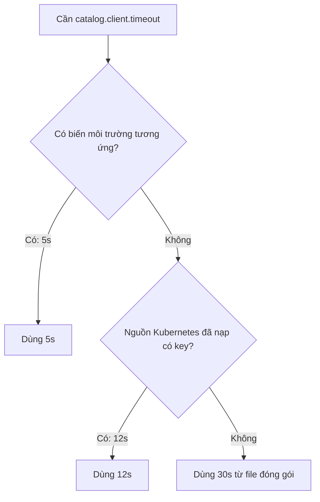

# Thứ tự ưu tiên giữa file đóng gói, nguồn Kubernetes và biến môi trường

Trong chương **Profile và ưu tiên** của module **Spring Cloud Kubernetes**, một lỗi cấu hình thường gặp là sửa ConfigMap nhưng ứng dụng vẫn dùng giá trị cũ. Nguyên nhân có thể là một biến môi trường đang ghi đè cùng thuộc tính. Để giải thích được giá trị cuối cùng, cần biết cả **nguồn nào được nạp** và **nguồn nào có ưu tiên cao hơn**.

Bài này dùng `catalog-service` với thuộc tính không nhạy cảm `catalog.client.timeout`. Ví dụ chính có ba giá trị: `30s` trong file đóng gói, `12s` trong ConfigMap và `5s` trong biến môi trường. Các ví dụ lấy **Spring Boot 3.5.x**, **Spring Cloud Kubernetes 3.3.x**, **Fabric8** và cơ chế **Config Data** làm mốc.

## 1. Thứ tự cần nhớ và điều kiện áp dụng

Trong ví dụ dùng `spring.config.import: "kubernetes:"` ở `application.yaml` đóng gói, không có profile hay nguồn ghi đè khác:

```text
Ưu tiên cao
    Biến môi trường của tiến trình
    Nguồn Kubernetes được import bởi application.yaml
    application.yaml đóng gói trong JAR
Ưu tiên thấp
```

Nguồn import có ưu tiên cao hơn **document khai báo import**. Biến môi trường tiếp tục có ưu tiên cao hơn nhóm Config Data. Đây là quy tắc của cơ chế nạp cấu hình, không phải vì Kubernetes biết một giá trị nào đó là “cấu hình production”. [Quy tắc ưu tiên của Kubernetes PropertySource](https://docs.spring.io/spring-cloud-kubernetes/reference/property-source-config.html#property-source-precedence).

Mô hình ba lớp này có điều kiện: không có tham số dòng lệnh, Java system property, JSON cấu hình hoặc nguồn bổ sung làm thay đổi kết quả. Với ứng dụng Spring Boot thông thường, một thứ tự rút gọn từ thấp đến cao là:

| Nguồn | Ví dụ |
|---|---|
| Config Data | File application và cấu hình được import |
| Biến môi trường | `CATALOG_CLIENT_TIMEOUT=5s` |
| Java system property | `-Dcatalog.client.timeout=4s` |
| SPRING_APPLICATION_JSON | JSON chứa thuộc tính tương ứng |
| Tham số dòng lệnh | `--catalog.client.timeout=3s` |

Bảng rút gọn không liệt kê các nguồn dành cho servlet container, kiểm thử hoặc tùy biến Environment. Khi có nguồn khác, cần xem toàn bộ thứ tự thực tế. [Externalized Configuration của Spring Boot 3.5](https://docs.spring.io/spring-boot/3.5/reference/features/external-config.html).

## 2. Ưu tiên được giải quyết theo từng thuộc tính

Spring tập hợp các PropertySource vào Environment. Với một thuộc tính đơn như timeout, nguồn có ưu tiên cao nhất **có cung cấp thuộc tính đó** quyết định giá trị được đọc.

Giả sử:

| Thuộc tính | File trong JAR | ConfigMap | Biến môi trường | Giá trị hiệu lực |
|---|---|---|---|---|
| `catalog.client.timeout` | 30s | 12s | 5s | 5s |
| `catalog.client.retries` | 2 | 4 | Không có | 4 |
| `catalog.display.title` | Catalog | Không có | Không có | Catalog |

Biến môi trường của timeout không xóa các thuộc tính khác trong ConfigMap hoặc file. Nó chỉ cung cấp giá trị thắng cho thuộc tính tương ứng.



Sơ đồ chỉ mô tả ba nguồn của ví dụ, sau khi chúng đã được nạp thành công. Nếu nạp Kubernetes gặp lỗi, chính sách `fail-fast` có thể làm ứng dụng dừng; không được đồng nhất lỗi nạp nguồn với việc nguồn không có một key.

## 3. Ví dụ hoàn chỉnh với file đóng gói và ConfigMap

### 3.1. Dependency và file trong JAR

Ứng dụng cần starter để đọc ConfigMap qua API:

```xml
<dependency>
    <groupId>org.springframework.cloud</groupId>
    <artifactId>spring-cloud-starter-kubernetes-fabric8-config</artifactId>
</dependency>
```

Phiên bản được quản lý bằng Spring Cloud BOM tương thích với Spring Boot của dự án. Chỉ dùng một họ Kubernetes client.

File `src/main/resources/application.yaml` của ứng dụng mẫu:

```yaml
spring:
  application:
    name: catalog-service
  config:
    import: "kubernetes:"
  cloud:
    kubernetes:
      config:
        enabled: true
        name: catalog-runtime
        namespace: catalog-dev
        include-profile-specific-sources: false
        fail-fast: true
      secrets:
        enabled: false

catalog:
  client:
    timeout: 30s
    retries: 2
  display:
    title: Catalog
```

Ví dụ cố định một ConfigMap và tắt Secret PropertySource để dễ quan sát. `include-profile-specific-sources: false` tránh đọc thêm ConfigMap theo profile. Đây không phải cờ tắt profile của Spring Boot.

Bài dùng Config Data; không đồng thời bật bootstrap cũ bằng `spring-cloud-starter-bootstrap` hoặc `spring.cloud.bootstrap.enabled`. [Kubernetes PropertySource 3.3](https://docs.spring.io/spring-cloud-kubernetes/reference/3.3/property-source-config.html).

### 3.2. Nguồn Kubernetes

ConfigMap dùng dữ liệu không nhạy cảm:

```yaml
apiVersion: v1
kind: ConfigMap
metadata:
  name: catalog-runtime
  namespace: catalog-dev
data:
  catalog.client.timeout: "12s"
  catalog.client.retries: "4"
```

Namespace và ConfigMap phải tồn tại. ServiceAccount của Pod cần quyền đọc phù hợp với client đang dùng, thường cần kiểm tra cả `get` và `list`. Ứng dụng phải nạp được nguồn trước khi bàn đến ưu tiên của các giá trị bên trong.

Spring Cloud Kubernetes có thể đưa key trực tiếp của ConfigMap hoặc nội dung tệp cấu hình nhúng vào PropertySource. Với ví dụ trên, key `catalog.client.timeout` trở thành thuộc tính cùng tên. [ConfigMap PropertySource 3.3](https://docs.spring.io/spring-cloud-kubernetes/reference/3.3/property-source-config/configmap-propertysource.html).

Nếu không có nguồn cao hơn, kết quả là timeout `12s`, retries `4`, title `Catalog`.

### 3.3. Ghi đè bằng biến môi trường

Đoạn sau là phần `env` của container chạy ứng dụng:

```yaml
env:
  - name: CATALOG_CLIENT_TIMEOUT
    value: "5s"
```

Khi container mới chạy với biến này, timeout hiệu lực là `5s`. ConfigMap vẫn chứa `12s`; giá trị đó vẫn là một ứng viên trong Environment nhưng không thắng cho key này.

Nếu đổi ConfigMap thành `18s` mà giữ biến môi trường `5s`, timeout vẫn là `5s` sau khi nguồn đã được nạp lại. Muốn ConfigMap điều khiển timeout, cần bỏ giá trị ghi đè ở môi trường của tiến trình mới, rồi thực hiện quy trình cập nhật ứng dụng phù hợp.

## 4. Tên biến môi trường phải ánh xạ đúng

Với cấu hình chuẩn của Spring Boot, đổi tên thuộc tính sang biến môi trường theo các bước: thay dấu chấm bằng gạch dưới, bỏ dấu gạch ngang và chuyển sang chữ hoa.

| Thuộc tính | Biến môi trường dùng khi bind |
|---|---|
| `catalog.client.timeout` | `CATALOG_CLIENT_TIMEOUT` |
| `catalog.client.max-retries` | `CATALOG_CLIENT_MAXRETRIES` |
| `spring.profiles.active` | `SPRING_PROFILES_ACTIVE` |

Không tự thêm gạch dưới cho mọi ranh giới từ trong tên Java. Đặc biệt, tên trường camelCase trong Java không phải quy tắc trực tiếp để đặt tên biến môi trường. [Binding từ biến môi trường](https://docs.spring.io/spring-boot/3.5/reference/features/external-config.html#features.external-config.typesafe-configuration-properties.relaxed-binding.environment-variables).

Nên dùng tên thuộc tính chuẩn, chẳng hạn `catalog.client.max-retries`, khi khai báo trong YAML và khi mô tả hợp đồng cấu hình.

Một biến môi trường có giá trị không hợp lệ cũng không có nghĩa Spring sẽ tự bỏ qua để thử ConfigMap. Chẳng hạn, nếu `catalog.client.timeout` được bind sang `Duration`, giá trị `CATALOG_CLIENT_TIMEOUT=not-a-duration` có thể làm bind thất bại; không nên kỳ vọng nó tự quay về `12s`.

## 5. Nguồn gốc Kubernetes khác với lớp ưu tiên trong Spring

Cùng một ConfigMap có thể đến ứng dụng qua nhiều đường:

| Cách đưa dữ liệu vào ứng dụng | Spring nhìn thấy gì? | Điều quyết định ưu tiên |
|---|---|---|
| Spring Cloud Kubernetes đọc ConfigMap qua API với Config Data | PropertySource từ import Kubernetes | Quy tắc Config Data và vị trí import |
| Pod dùng configMapKeyRef để tạo biến môi trường | Biến môi trường của tiến trình | Lớp ưu tiên của biến môi trường |
| Pod mount ConfigMap thành file và Spring đọc file đó | Config Data từ file | Vị trí file/location/import trong cấu hình |
| Pod mount file nhưng Spring không đọc file | Không có thuộc tính tương ứng | Chưa có nguồn tham gia Environment |

Kubernetes hỗ trợ dùng ConfigMap qua biến môi trường, tham số, volume hoặc đọc API. Vì vậy, tên tài nguyên ConfigMap không tự quyết định ưu tiên của dữ liệu trong Spring. [Các cách sử dụng ConfigMap](https://kubernetes.io/docs/concepts/configuration/configmap/).

Ví dụ thay vì đọc timeout trực tiếp qua API, Pod có thể lấy một key của ConfigMap để tạo biến môi trường:

```yaml
env:
  - name: CATALOG_CLIENT_TIMEOUT
    valueFrom:
      configMapKeyRef:
        name: catalog-runtime
        key: catalog.client.timeout
```

Ở đây, dữ liệu có nguồn gốc từ ConfigMap nhưng đến Spring dưới dạng `CATALOG_CLIENT_TIMEOUT`. Nó tham gia lớp biến môi trường, không phải lớp import Kubernetes.

Nếu cấu hình đồng thời cả hai đường, ứng dụng có hai bản cung cấp cùng thuộc tính ở hai lớp ưu tiên. Việc thay đổi đường đọc phải được xem là thay đổi kiến trúc cấu hình, dù tên ConfigMap vẫn giữ nguyên.

Các giá trị trong `env` và `envFrom` là cấu hình môi trường của container. Cần kiểm tra Pod thực tế và entrypoint chạy Java, không chỉ giá trị trong terminal của người triển khai. [Khai báo biến môi trường cho container](https://kubernetes.io/docs/tasks/inject-data-application/define-environment-variable-container/).

## 6. Profile và vị trí import ảnh hưởng đến các nguồn Config Data

### 6.1. Profile chọn thêm cấu hình, không vượt mọi lớp ưu tiên

Bật `prod` có thể làm Spring đọc thêm `application-prod.yaml`. Điều đó không đưa file profile lên trên biến môi trường hoặc tham số dòng lệnh.

`spring.profiles.active` cũng là một thuộc tính chịu quy tắc ưu tiên của Environment. Khi cần chọn profile triển khai, có thể dùng:

```yaml
env:
  - name: SPRING_PROFILES_ACTIVE
    value: prod
```

Không đặt `spring.profiles.active` trong chính file profile như `application-prod.yaml` để tự kích hoạt file đó. [Profiles của Spring Boot 3.5](https://docs.spring.io/spring-boot/3.5/reference/features/profiles.html).

### 6.2. Ví dụ có vị trí import được xác định rõ

Đây là **phương án thay thế** cho ví dụ chính:

1. Giữ các giá trị mặc định và cấu hình chọn `catalog-runtime` trong `application.yaml`.
2. Chuyển khai báo `spring.config.import` khỏi file đó sang `application-prod.yaml`.
3. Bật profile `prod`.
4. Giữ `include-profile-specific-sources: false` để chỉ đọc một ConfigMap đã chỉ định.

Nội dung `application-prod.yaml` đóng gói:

```yaml
spring:
  config:
    import: "kubernetes:"

catalog:
  client:
    timeout: 25s
```

Trong phương án này:

| Nguồn | Timeout |
|---|---|
| application.yaml đóng gói | 30s |
| application-prod.yaml khai báo import | 25s |
| ConfigMap được import từ document prod | 12s |
| Biến môi trường, nếu có | 5s |

Nếu chỉ có ba nguồn Config Data nêu trên, kết quả là `12s` vì import có ưu tiên cao hơn document khai báo nó. Nếu thêm biến môi trường thì kết quả là `5s`.

Không suy ra “profile luôn thắng Kubernetes” hoặc “Kubernetes luôn thắng mọi file” chỉ từ tên nguồn. Muốn so sánh các Config Data, phải xác định document khai báo import và những document/file khác được nạp. Với nhiều địa chỉ trong một `spring.config.import`, địa chỉ import phía sau có ưu tiên cao hơn phía trước. [Ưu tiên giữa các import](https://docs.spring.io/spring-cloud-kubernetes/reference/property-source-config.html#property-source-precedence).

### 6.3. File ngoài JAR cần được tính riêng

Một file được mount vào `/etc/catalog/application.yaml` không tự động được đọc chỉ vì nó nằm trong Pod. Spring phải tìm thấy nó qua location được hỗ trợ hoặc một khai báo import.

Trong các location mặc định của Spring Boot, file application bên ngoài JAR có thể ghi đè file đóng gói. Tuy nhiên, không nên gộp mọi file ngoài JAR vào một hàng ưu tiên tuyệt đối rồi bỏ qua vị trí import. Với nhiều location, profile và import, cần xem thứ tự Config Data đã hình thành.

Để tránh nhầm lẫn khi vận hành, nên ghi lại đường dẫn file đang được đọc và nơi khai báo import, thay vì chỉ ghi “cấu hình từ Kubernetes”.

## 7. Ưu tiên giữa ConfigMap và Secret là một câu hỏi riêng

Ví dụ chính tắt Secret để chỉ so sánh ba lớp. Nếu đồng thời bật ConfigMap và Secret PropertySource, cần xem thêm thứ tự bên trong nhóm nguồn Kubernetes.

Tài liệu Spring Cloud Kubernetes 3.3 quy định khi cả hai cùng cung cấp một thuộc tính, giá trị từ ConfigMap có ưu tiên cao hơn Secret. Không giả định Secret luôn thắng vì dữ liệu của nó nhạy cảm hơn. [Order of ConfigMaps and Secrets 3.3](https://docs.spring.io/spring-cloud-kubernetes/reference/3.3/property-source-config/order_of_configMaps_and_secrets.html).

Ví dụ chỉ dùng một giá trị không nhạy cảm để minh họa:

| Nguồn | catalog.client.timeout |
|---|---|
| File đóng gói khai báo import | 30s |
| Secret PropertySource | 18s |
| ConfigMap PropertySource | 12s |
| Biến môi trường | 5s |

Với cách nạp Config Data của ví dụ, `5s` vẫn thắng. Khi bỏ biến môi trường, ConfigMap thắng Secret cho key này.

Quy tắc trên nói về PropertySource của Spring Cloud Kubernetes. Nếu Secret được dùng để tạo biến môi trường cho Pod, dữ liệu đó lại tham gia lớp biến môi trường như đã phân tích ở phần 5.

Với dữ liệu thật, nên tách phạm vi key: thông tin đăng nhập ở Secret, cấu hình không nhạy cảm ở ConfigMap. Tránh khai báo cùng tên thuộc tính bí mật ở cả hai nguồn rồi dựa vào ưu tiên để che một giá trị.

## 8. Quan sát giá trị hiệu lực và các nguồn có cùng key

Đọc ConfigMap bằng `kubectl` chỉ chứng minh giá trị đang lưu trong Kubernetes. Nó chưa chứng minh ứng dụng đã nạp giá trị đó hoặc giá trị đó thắng trong Environment.

Đoạn Java sau dùng thuộc tính timeout không nhạy cảm để quan sát lúc khởi động. Đặt lớp trong phạm vi component scan:

```java
import java.time.Duration;
import java.util.Arrays;

import org.slf4j.Logger;
import org.slf4j.LoggerFactory;

import org.springframework.boot.ApplicationRunner;
import org.springframework.boot.context.properties.ConfigurationProperties;
import org.springframework.boot.context.properties.EnableConfigurationProperties;
import org.springframework.context.annotation.Bean;
import org.springframework.context.annotation.Configuration;
import org.springframework.core.env.ConfigurableEnvironment;
import org.springframework.core.env.PropertySource;

@Configuration(proxyBeanMethods = false)
@EnableConfigurationProperties(PrecedenceProbe.ClientProperties.class)
public class PrecedenceProbe {

    private static final Logger log =
            LoggerFactory.getLogger(PrecedenceProbe.class);

    private static final String KEY = "catalog.client.timeout";

    @Bean
    ApplicationRunner reportPrecedence(
            ConfigurableEnvironment environment,
            ClientProperties properties) {

        return args -> {
            log.info("activeProfiles={}",
                    Arrays.toString(environment.getActiveProfiles()));
            log.info("catalog.client.timeout={}", properties.timeout());

            for (PropertySource<?> source : environment.getPropertySources()) {
                if ("configurationProperties".equals(source.getName())) {
                    continue;
                }
                if (source.containsProperty(KEY)) {
                    log.info("PropertySource có key: {}", source.getName());
                }
            }
        };
    }

    @ConfigurationProperties(prefix = "catalog.client")
    public record ClientProperties(Duration timeout) {
    }
}
```

Với biến môi trường `5s`, giá trị Duration được log thường có dạng `PT5S`. Các nguồn có key được liệt kê theo thứ tự Environment, giúp nhận ra `systemEnvironment` và nguồn Kubernetes đang cùng tham gia.

Nguồn tổng hợp `configurationProperties` được bỏ qua trong vòng lặp vì nó là lớp hỗ trợ tra cứu, không phải nơi khai báo dữ liệu gốc. Một PropertySource khác cũng có thể chứa nhiều nguồn con; khi cần truy nguyên chi tiết hơn, dùng cơ chế origin hoặc công cụ chẩn đoán cấu hình phù hợp.

Mẫu chỉ log một key đã biết là không nhạy cảm, không duyệt và in mọi giá trị. Actuator `env` và `configprops` có thể hỗ trợ chẩn đoán, nhưng cần bảo vệ quyền truy cập và giữ cơ chế che giá trị; không mở chúng công khai để xử lý một lỗi timeout. [Actuator endpoints của Spring Boot 3.5](https://docs.spring.io/spring-boot/3.5/reference/actuator/endpoints.html).

Nếu mã ứng dụng gọi thẳng `System.getenv()` hoặc tự đọc một file thay vì dùng Environment/binding, cần xem logic đó riêng. Nó có thể bỏ qua thứ tự ưu tiên mà bài đang mô tả.

## 9. Sửa nguồn chưa chắc đã thay đổi giá trị đang sử dụng

Có ba câu hỏi khác nhau khi ConfigMap thay đổi:

1. Giá trị trong Kubernetes đã đổi chưa?
2. PropertySource trong tiến trình đã được cập nhật chưa?
3. Bean hoặc client đang hoạt động đã nhận giá trị mới chưa?

Ví dụ đổi timeout ConfigMap từ `12s` thành `18s`:

| Trạng thái | Điều có thể quan sát |
|---|---|
| PropertySource chưa nạp lại | Ứng dụng vẫn thấy bản dữ liệu đã nạp trước đó |
| Đã nạp lại nhưng còn biến môi trường 5s | Environment vẫn chọn 5s |
| Đã nạp lại, bỏ biến môi trường trong container mới | ConfigMap có thể quyết định 18s |
| Environment đổi nhưng client giữ timeout cũ | Hành vi client chưa thay đổi |

ConfigMap dùng làm biến môi trường không tự cập nhật giá trị trong container đang chạy. File từ ConfigMap volume có cơ chế cập nhật, nhưng ứng dụng vẫn cần đọc lại dữ liệu và áp dụng thay đổi. [Cập nhật ConfigMap](https://kubernetes.io/docs/concepts/configuration/configmap/).

Tương tự, Configuration Watcher hoặc refresh không đảo thứ tự ưu tiên. Nếu một nguồn cao hơn vẫn cung cấp key, cập nhật nguồn thấp hơn sẽ không làm nó thắng.

Mẫu `PrecedenceProbe` chạy khi startup, không phải bộ theo dõi thay đổi. Nếu muốn quan sát sau cập nhật, thực hiện quy trình refresh hoặc rollout đã thiết kế và xác minh cả Environment lẫn client phụ thuộc cấu hình.

## 10. Chẩn đoán các kết quả ngoài dự kiến

| Hiện tượng | Nguyên nhân cần kiểm tra | Hành động |
|---|---|---|
| ConfigMap là 12s nhưng ứng dụng dùng 5s | Biến môi trường cùng key | Kiểm tra env/envFrom của container thực tế |
| Đã bỏ env nhưng vẫn dùng 4s | Java system property hoặc nguồn cao hơn | Kiểm tra cách entrypoint khởi chạy JVM |
| Bật prod nhưng timeout không như file prod | Nguồn khác có ưu tiên cao hơn | Xem vị trí import và danh sách PropertySource |
| Không thấy nguồn Kubernetes | Thiếu starter/import, sai tên/namespace, lỗi quyền | Xác minh việc nạp nguồn trước khi phân tích ưu tiên |
| Mount file nhưng giá trị không đổi | File chưa được Spring đọc | Kiểm tra location/import và đường dẫn mount |
| Đổi ConfigMap nhưng giá trị vẫn cũ | Chưa cập nhật PropertySource hoặc bean | Kiểm tra quy trình refresh/rollout |
| Bind Duration thất bại | Nguồn thắng cung cấp chuỗi không hợp lệ | Sửa giá trị ở nguồn thắng, không chỉ ở ConfigMap |
| Giá trị trong kiểm thử khác Pod | Kiểm thử thêm nguồn ưu tiên riêng | Đối chiếu nguồn cấu hình của hai môi trường |

Một Java system property có dạng:

```shell
java -Dcatalog.client.timeout=4s -jar catalog-service.jar
```

`-D` nằm trước `-jar` vì đó là tùy chọn JVM. Nếu còn biến môi trường `5s`, giá trị system property `4s` thắng trong môi trường chuẩn. [Thứ tự system properties và biến môi trường](https://docs.spring.io/spring-framework/docs/6.2.x/javadoc-api/org/springframework/core/env/StandardEnvironment.html).

Tham số ứng dụng có dạng:

```shell
java -jar catalog-service.jar --catalog.client.timeout=3s
```

Theo thứ tự rút gọn ở đầu bài, tham số này tiếp tục ghi đè các nguồn thấp hơn khi cơ chế nhận tham số dòng lệnh mặc định được giữ nguyên.

Khi ghi nhận kết quả, cần có: profile đang bật, tên key chuẩn, nguồn được nạp, nguồn thắng và thời điểm đọc. Với key nhạy cảm, chỉ ghi metadata nguồn và trạng thái kiểm tra, không ghi giá trị.

## 11. Thực hành dự đoán trước khi chạy

Dùng cùng một image ứng dụng và ConfigMap lab, không thay nhiều yếu tố trong một lần thử:

| Lần thử | Điều kiện | Timeout dự kiến |
|---|---|---|
| 1 | File JAR 30s, ConfigMap 12s, không env hay nguồn cao hơn | 12s |
| 2 | Như lần 1, thêm env 5s | 5s |
| 3 | ConfigMap đổi 18s, env vẫn 5s, ứng dụng đã nạp lại nguồn | 5s |
| 4 | ConfigMap 18s, bỏ env trong container mới, không nguồn cao hơn | 18s |
| 5 | Như lần 4, thêm system property 4s | 4s |
| 6 | Như lần 5, thêm tham số ứng dụng 3s | 3s |
| 7 | Nguồn Kubernetes được nạp nhưng không có key timeout; không nguồn cao hơn | 30s |
| 8 | Phương án import trong file prod ở phần 6, ConfigMap 12s, env 5s | 5s |

Ở lần 7, phân biệt “nguồn đã nạp nhưng thiếu key” với “nạp nguồn thất bại”. Các lỗi API hoặc `fail-fast` không được coi là một phép rơi về mặc định thông thường.

Sau mỗi lần, đối chiếu giá trị dự đoán với giá trị bind và danh sách nguồn có key. Nếu kết quả khác, kiểm tra đường cấp dữ liệu và các nguồn cao hơn trước khi sửa lại thứ tự các dòng YAML.

Trong triển khai thực tế, file đóng gói nên chứa giá trị mặc định, ConfigMap chứa cấu hình theo môi trường, còn biến môi trường ghi đè nên có mục đích rõ ràng. Một giá trị ghi đè tạm thời bị bỏ quên có thể khiến các lần cập nhật ConfigMap sau đó tiếp tục không có tác dụng.

