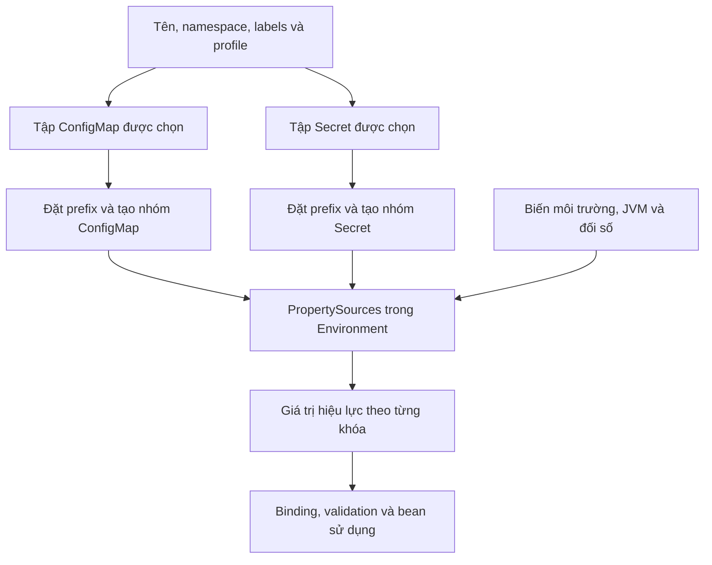

# Ưu tiên giữa nhiều ConfigMap và nhiều Secret

Trong module **SPRING_CLOUD_KUBERNETES**, ứng dụng Spring được tích hợp với Kubernetes qua DiscoveryClient, ConfigMap, Secret, Spring Cloud LoadBalancer và Configuration Watcher. Bài thuộc chương **Profile và ưu tiên**, giải quyết một vấn đề cụ thể: khi nhiều tài nguyên cùng cung cấp một khóa, giá trị nào thực sự được ứng dụng sử dụng, và làm sao thiết kế cấu hình để kết quả đó rõ ràng?

Một ứng dụng có thể nhận cấu hình chung của nền tảng, cấu hình riêng của dịch vụ, thông tin xác thực cho nhiều hệ thống và những điều chỉnh theo môi trường. Tách chúng thành nhiều tài nguyên giúp phân chia trách nhiệm, nhưng cũng tạo ra các lớp ghi đè. Đọc được tất cả tài nguyên chưa chứng minh rằng ứng dụng đang dùng giá trị mong muốn.

## 1. Quy tắc chính và phạm vi áp dụng

Kubernetes không tự gộp mọi ConfigMap và Secret thành một bộ cấu hình có ưu tiên chung. Trong đường nạp qua API, **Spring Cloud Kubernetes** chọn tài nguyên, tạo các `PropertySource` và đưa chúng vào Spring `Environment`.

Ví dụ chính trong bài chốt theo **Spring Cloud Kubernetes 5.0.3**, dùng **Config Data** với `spring.config.import: "kubernetes:"`. Các nguồn được chọn bằng tên, không dùng prefix và tắt việc tự tìm tài nguyên theo profile. Trong phạm vi đó:

| Xung đột | Quy tắc áp dụng |
| --- | --- |
| Hai ConfigMap trong `config.sources` cùng có một khóa | Nguồn khai báo sau có ưu tiên hơn |
| Hai Secret trong `secrets.sources` cùng có một khóa | Ở phiên bản 5.0.3, nguồn khai báo sau có ưu tiên hơn |
| Một ConfigMap và một Secret cùng có một khóa | Nhóm ConfigMap có ưu tiên hơn nhóm Secret |
| Nguồn ưu tiên cao không có khóa đang tra cứu | Spring tiếp tục tìm ở nguồn thấp hơn |
| Có biến môi trường hoặc đối số ưu tiên cao hơn Config Data | Nguồn đó có thể quyết định giá trị cuối cùng |

Thứ tự ConfigMap so với Secret được nêu trong [Order of ConfigMaps and Secrets](https://docs.spring.io/spring-cloud-kubernetes/reference/3.3/property-source-config/order_of_configMaps_and_secrets.html) và [tài liệu của nhánh mới](https://docs.spring.io/spring-cloud-kubernetes/reference/property-source-config/order_of_configMaps_and_secrets.html). Đây là thứ tự của các nguồn do thư viện nạp, không phải quy tắc rằng mọi dữ liệu có xuất xứ từ ConfigMap luôn thắng mọi dữ liệu có xuất xứ từ Secret, bất kể đường truyền vào ứng dụng.

### Khác biệt phiên bản cần biết

Không áp dụng máy móc quy tắc của 5.0.3 cho mọi bản thư viện. Ở tag **3.3.3**, `SecretsPropertySourceLocator` chuyển danh sách nguồn thành `HashSet`, không bảo toàn thứ tự khai báo. Vì vậy, không thể suy ra Secret đặt cuối YAML sẽ luôn thắng trong phiên bản đó. Đây là kết luận từ [mã nguồn SecretsPropertySourceLocator 3.3.3](https://github.com/spring-cloud/spring-cloud-kubernetes/blob/v3.3.3/spring-cloud-kubernetes-commons/src/main/java/org/springframework/cloud/kubernetes/commons/config/SecretsPropertySourceLocator.java), không phải khẳng định rằng giá trị sẽ ngẫu nhiên đổi ở mọi lần chạy.

Ở **5.0.3**, cả hai loại nguồn đi qua bộ xử lý chung dùng tập hợp giữ thứ tự và đưa nguồn sau lên trước trong composite. Quy tắc nguồn sau thắng được suy ra từ [CommonPropertySourceLocator 5.0.3](https://github.com/spring-cloud/spring-cloud-kubernetes/blob/v5.0.3/spring-cloud-kubernetes-commons/src/main/java/org/springframework/cloud/kubernetes/commons/config/CommonPropertySourceLocator.java).

Nếu hệ thống đang dùng phiên bản khác, ghi nhận phiên bản thực tế và kiểm chứng kết quả trên chính phiên bản đó. Với thông tin xác thực, tách khóa hoặc dùng prefix thường tạo ra hợp đồng rõ hơn việc dựa vào một va chạm giữa nhiều Secret.

## 2. Phân biệt ba loại thứ tự

Có ba câu hỏi độc lập:

1. **Nguồn nào được chọn?** Tên tài nguyên, namespace, label selector và profile quyết định tập nguồn.
2. **Các nguồn Kubernetes ghi đè nhau thế nào?** Thứ tự trong từng danh sách, thứ tự giữa nhóm ConfigMap và Secret, cùng cách đặt prefix quyết định các khóa cạnh tranh.
3. **Nguồn nào thắng trong toàn bộ Environment?** Biến môi trường, system property, đối số và các import khác còn có thể ghi đè.

Nếu nguồn chưa được chọn hoặc không đọc được, chưa có xung đột ưu tiên để phân tích. Nếu khóa được đổi tên bởi prefix, hai giá trị có thể không còn cạnh tranh với nhau.



Tên như `override`, `final`, `prod` hoặc `priority-100` không tự tạo ưu tiên. Thời điểm tạo tài nguyên, thứ tự chạy `kubectl apply` và thứ tự viết các khóa trong `data` cũng không thay thế chính sách nguồn của Spring.

## 3. Mô hình gộp theo từng khóa

Gọi `overlay(A, B)` là thao tác lấy dữ liệu của A, rồi cho các khóa có trong B ghi đè khóa tương ứng. Với các nguồn có tên riêng trong ví dụ 5.0.3:

```text
secrets    = overlay(secretChung, secretUngDung)
configMaps = overlay(configMapChung, configMapUngDung)
kubernetes = overlay(secrets, configMaps)
```

Đây là mô hình để suy luận kết quả của các giá trị đơn trong phạm vi đã nêu, không phải mã nguồn của loader.

Điểm đáng chú ý là **ghi đè theo khóa**, không phải chọn nguyên một tài nguyên rồi bỏ tất cả tài nguyên còn lại. Một ConfigMap riêng chỉ đặt `demo.mode` vẫn có thể kế thừa `demo.shared-only` từ ConfigMap chung.

Ngược lại, chuỗi rỗng vẫn là một giá trị. Nếu nguồn ưu tiên cao khai báo `some.key: ""`, đừng mặc định Spring sẽ bỏ qua để lấy chuỗi không rỗng ở nguồn thấp. Tương tự, một giá trị ưu tiên cao sai định dạng có thể làm binding thất bại thay vì tự quay về giá trị hợp lệ ở dưới.

Đối với danh sách và cấu trúc phức tạp, còn phải xét quy tắc binding. Một danh sách ở nguồn ưu tiên cao không mặc nhiên được nối vào danh sách ở nguồn thấp. Phần thực hành sau dùng các khóa đơn để tách rõ vấn đề ưu tiên.

## 4. Khai báo hai danh sách nguồn tường minh

Ví dụ dùng ứng dụng `order-service` trong namespace `precedence-lab`. Project cần Spring Boot và Spring Cloud BOM tương thích với Spring Cloud Kubernetes 5.0.x; chẳng hạn dòng Spring Boot 4.0.x đi với Spring Cloud 2025.1.x. Chọn phiên bản cụ thể qua [bảng tương thích Spring Cloud](https://spring.io/projects/spring-cloud/), thay vì trộn tùy ý phiên bản của từng starter.

Chỉ cần starter cấu hình phù hợp với client đã chọn:

```xml
<dependency>
    <groupId>org.springframework.cloud</groupId>
    <artifactId>spring-cloud-starter-kubernetes-client-config</artifactId>
</dependency>
```

Nếu dự án dùng Fabric8, dùng starter `spring-cloud-starter-kubernetes-fabric8-config` nhất quán. Không cần thêm DiscoveryClient, Spring Cloud LoadBalancer hoặc starter `-all` chỉ để thực hành thứ tự cấu hình.

Deployment thực hành bên dưới dùng một tiến trình web chạy liên tục. Với Spring Boot 4.0, bổ sung web starter để máy chủ nhúng giữ ứng dụng hoạt động sau khi runner in kết quả:

```xml
<dependency>
    <groupId>org.springframework.boot</groupId>
    <artifactId>spring-boot-starter-webmvc</artifactId>
</dependency>
```

Đây là dependency phục vụ cách chạy ví dụ; loader cấu hình không yêu cầu ứng dụng phải là web service. Xem [web starter của Spring Boot 4.0](https://docs.spring.io/spring-boot/4.0/tutorial/first-application/index.html).

Trong `application.yml`:

```yaml
spring:
  application:
    name: order-service
```

Trong `application-kubernetes.yml`:

```yaml
spring:
  config:
    import: "kubernetes:"
  cloud:
    kubernetes:
      config:
        enabled: true
        namespace: ${POD_NAMESPACE}
        include-profile-specific-sources: false
        use-name-as-prefix: false
        fail-fast: true
        sources:
          - name: platform-defaults
          - name: order-settings
      secrets:
        enabled: true
        namespace: ${POD_NAMESPACE}
        include-profile-specific-sources: false
        use-name-as-prefix: false
        fail-fast: true
        sources:
          - name: platform-credentials
          - name: order-credentials
```

Đây là cấu hình cho nhánh **5.0.x**. Thuộc tính `enabled: true` bật đường đọc Secret của nhánh này; không sao chép nguyên xi cách bật API của nhánh cũ. Ở **3.3.x**, ví dụ đọc Secret qua API còn cần `spring.cloud.kubernetes.secrets.enable-api: true`, trong khi thứ tự giữa các Secret có lưu ý phiên bản ở phần 1. Tham khảo [SecretsConfigProperties 5.0.3](https://github.com/spring-cloud/spring-cloud-kubernetes/blob/v5.0.3/spring-cloud-kubernetes-commons/src/main/java/org/springframework/cloud/kubernetes/commons/config/SecretsConfigProperties.java) và [Secrets PropertySource 3.3](https://docs.spring.io/spring-cloud-kubernetes/reference/3.3/property-source-config/secrets-propertysource.html).

Hai điểm cần giữ rõ trong cấu hình:

- `config.sources` và `secrets.sources` là **hai danh sách độc lập**. Đặt khối `secrets` sau khối `config` trong YAML không làm Secret vượt ưu tiên ConfigMap.
- Khi đã cung cấp `sources`, phải liệt kê những lớp muốn đọc. Không giả định tài nguyên mang tên `spring.application.name` hoặc một nguồn mặc định khác vẫn tự được thêm trước danh sách. Cách chọn nguồn được thể hiện trong [SourceConfigProperties 5.0.3](https://github.com/spring-cloud/spring-cloud-kubernetes/blob/v5.0.3/spring-cloud-kubernetes-commons/src/main/java/org/springframework/cloud/kubernetes/commons/config/SourceConfigProperties.java).

Thông tin chọn nguồn phải có trước khi loader đọc nguồn: import, profile, namespace và danh tính truy cập không được đặt duy nhất trong một ConfigMap mà ứng dụng chưa biết cách tìm.

## 5. Bốn tài nguyên để quan sát xung đột

Các giá trị trong Secret sau đây đều là dữ liệu giả dành cho thực hành. `demo.secret-source` chỉ là nhãn quan sát không nhạy cảm, không phải mật khẩu.

```yaml
apiVersion: v1
kind: Namespace
metadata:
  name: precedence-lab
---
apiVersion: v1
kind: ConfigMap
metadata:
  name: platform-defaults
  namespace: precedence-lab
data:
  demo.mode: "shared"
  demo.timeout-seconds: "10"
  demo.shared-only: "retained-from-platform"
---
apiVersion: v1
kind: ConfigMap
metadata:
  name: order-settings
  namespace: precedence-lab
data:
  demo.mode: "production"
  demo.timeout-seconds: "25"
  demo.app-only: "orders"
---
apiVersion: v1
kind: Secret
metadata:
  name: platform-credentials
  namespace: precedence-lab
type: Opaque
stringData:
  demo.mode: "secret-shared"
  demo.secret-source: "shared-v1"
  messaging.password: "training-only-mq"
---
apiVersion: v1
kind: Secret
metadata:
  name: order-credentials
  namespace: precedence-lab
type: Opaque
stringData:
  demo.mode: "secret-app"
  demo.secret-source: "orders-v2"
  payments.api-token: "training-only-payments"
```

Các ConfigMap dùng chuỗi trong `data`, bao gồm `"10"` và `"25"`. `stringData` của Secret cho phép khai báo chuỗi trực tiếp; trường `data` sử dụng biểu diễn base64. Base64 không tạo ra quyền ưu tiên hoặc cơ chế mã hóa bảo mật. Xem [tài liệu Secret của Kubernetes](https://kubernetes.io/docs/concepts/configuration/secret/).

Với cấu hình phần 4, cả bốn tài nguyên đều đọc được và không có nguồn ngoài ghi đè, kết quả là:

| Khóa | Giá trị hiệu lực | Giải thích |
| --- | --- | --- |
| `demo.mode` | `production` | `order-settings` thắng ConfigMap chung; nhóm ConfigMap thắng nhóm Secret |
| `demo.timeout-seconds` | `25` | ConfigMap khai báo sau trong `config.sources` thắng |
| `demo.shared-only` | `retained-from-platform` | ConfigMap riêng không có khóa này |
| `demo.app-only` | `orders` | Chỉ ConfigMap riêng cung cấp |
| `demo.secret-source` | `orders-v2` | Không ConfigMap nào có khóa; Secret khai báo sau thắng trong 5.0.3 |
| `messaging.password` | Không đưa vào log | Chỉ Secret chung cung cấp |
| `payments.api-token` | Không đưa vào log | Chỉ Secret riêng cung cấp |

Ba phép thay đổi giúp đọc đúng quy tắc:

1. Đảo hai mục trong `config.sources`: `demo.mode` trở thành `shared`, `demo.timeout-seconds` thành `10`; các khóa chỉ có ở một nguồn vẫn tồn tại.
2. Đảo hai mục trong `secrets.sources` ở 5.0.3: `demo.secret-source` thành `shared-v1`, nhưng `demo.mode` vẫn do ConfigMap quyết định.
3. Xóa khóa `demo.mode` khỏi cả hai ConfigMap: giá trị từ nhóm Secret mới có cơ hội quyết định khóa đó, nếu không có nguồn ngoài ưu tiên cao hơn.

Đảo vị trí các khối tài nguyên trong file manifest hoặc apply lại Secret sau ConfigMap không tạo ra các kết quả trên. Cần thay đổi đúng cấu hình nguồn hoặc dữ liệu liên quan.

## 6. RBAC là điều kiện đọc nguồn, không phải ưu tiên

Trước khi phân tích xung đột, cần đảm bảo ứng dụng thực sự có thể đọc cả hai loại tài nguyên. Dưới đây là quyền đọc dành cho namespace thực hành:

```yaml
apiVersion: v1
kind: ServiceAccount
metadata:
  name: precedence-reader
  namespace: precedence-lab
---
apiVersion: rbac.authorization.k8s.io/v1
kind: Role
metadata:
  name: precedence-reader
  namespace: precedence-lab
rules:
  - apiGroups: [""]
    resources: ["configmaps", "secrets"]
    verbs: ["get", "list"]
---
apiVersion: rbac.authorization.k8s.io/v1
kind: RoleBinding
metadata:
  name: precedence-reader
  namespace: precedence-lab
subjects:
  - kind: ServiceAccount
    name: precedence-reader
    namespace: precedence-lab
roleRef:
  apiGroup: rbac.authorization.k8s.io
  kind: Role
  name: precedence-reader
```

Role này cấp quyền đọc toàn bộ ConfigMap và Secret trong namespace, phù hợp với cách đọc theo lô mặc định của ví dụ. Danh sách tên trong `sources` không tự thu hẹp quyền RBAC xuống bốn tài nguyên. Nếu cần giới hạn đến từng tên, thiết kế đồng thời chế độ đọc và policy tương ứng với phiên bản/client, thay vì chỉ thêm `resourceNames` vào một policy dành cho thao tác liệt kê. Xem [RBAC của Kubernetes](https://kubernetes.io/docs/reference/access-authn-authz/rbac/).

Không có quyền ghi hoặc `watch` trong Role này. Nạp lúc khởi động không đòi hỏi triển khai luôn Configuration Watcher. Nếu một nguồn bị `403`, đó là lỗi quyền đọc; không nên giải thích việc mất giá trị của nó như một quy tắc ưu tiên.

Namespace cũng không tạo ưu tiên tự động. Một nguồn ở namespace khác chỉ tham gia nếu được cấu hình để chọn và danh tính ứng dụng có quyền đọc namespace đó.

## 7. Quan sát kết quả mà không in thông tin xác thực

Ứng dụng thực hành dùng starter cấu hình và web starter đã nêu. Ví dụ Java sau in các khóa đánh dấu không nhạy cảm và tên các nguồn theo thứ tự Spring nhìn thấy:

```java
package com.example.precedence;

import java.util.List;
import org.springframework.boot.ApplicationRunner;
import org.springframework.boot.SpringApplication;
import org.springframework.boot.autoconfigure.SpringBootApplication;
import org.springframework.context.annotation.Bean;
import org.springframework.core.env.CompositePropertySource;
import org.springframework.core.env.ConfigurableEnvironment;
import org.springframework.core.env.PropertySource;

@SpringBootApplication
public class PrecedenceApplication {

    public static void main(String[] args) {
        SpringApplication.run(PrecedenceApplication.class, args);
    }

    @Bean
    ApplicationRunner showPrecedence(ConfigurableEnvironment environment) {
        return args -> {
            for (String key : List.of(
                    "demo.mode", "demo.timeout-seconds",
                    "demo.shared-only", "demo.app-only",
                    "demo.secret-source")) {
                System.out.printf("%s=%s%n", key,
                        environment.getProperty(key));
            }
            System.out.println("PropertySources: ưu tiên cao đến thấp");
            for (PropertySource<?> source : environment.getPropertySources()) {
                printSourceNames(source, "  ");
            }
        };
    }

    private static void printSourceNames(PropertySource<?> source,
                                         String indentation) {
        System.out.println(indentation + source.getName());
        if (source instanceof CompositePropertySource composite) {
            for (PropertySource<?> child : composite.getPropertySources()) {
                printSourceNames(child, indentation + "  ");
            }
        }
    }
}
```

Phần giá trị mong đợi với dữ liệu ban đầu:

```text
demo.mode=production
demo.timeout-seconds=25
demo.shared-only=retained-from-platform
demo.app-only=orders
demo.secret-source=orders-v2
```

Tên cụ thể của `PropertySource` tùy phiên bản và client. Một composite có thể chứa nhiều nguồn con; nhìn tên composite mà không mở phần con có thể bỏ sót thứ tự cần phân tích. Ngoài ra, một wrapper như `configurationProperties` không phải một ConfigMap độc lập mới.

Đoạn code chỉ in giá trị của danh sách khóa cho phép và tên nguồn; nó không duyệt rồi in mọi giá trị trong Secret. Với khóa nhạy cảm, chẩn đoán bằng tên nguồn, sự hiện diện của khóa hoặc phiên bản credential do hệ thống quản lý, thay vì ghi giá trị gốc vào log.

### Chạy ví dụ trên Kubernetes

Đóng gói ứng dụng và thay `image` dưới đây bằng image của bạn. Lưu phần tài nguyên dữ liệu và RBAC vào các file thực hành của riêng bạn rồi apply trước Deployment:

```yaml
apiVersion: apps/v1
kind: Deployment
metadata:
  name: precedence-demo
  namespace: precedence-lab
spec:
  replicas: 1
  selector:
    matchLabels:
      app: precedence-demo
  template:
    metadata:
      labels:
        app: precedence-demo
    spec:
      serviceAccountName: precedence-reader
      containers:
        - name: application
          image: registry.example.com/training/precedence-demo:1.0.0
          env:
            - name: SPRING_PROFILES_ACTIVE
              value: kubernetes
            - name: POD_NAMESPACE
              valueFrom:
                fieldRef:
                  fieldPath: metadata.namespace
```

Web starter khởi động máy chủ nhúng và giữ tiến trình hoạt động sau `ApplicationRunner`; không cần tạo endpoint để đọc kết quả của bài. Sau khi apply Deployment, chờ rollout và đọc log:

```shell
kubectl -n precedence-lab rollout status deployment/precedence-demo
kubectl -n precedence-lab get pods -l app=precedence-demo
kubectl -n precedence-lab logs deployment/precedence-demo
```

Với nhiều replica, đọc log từng Pod để gắn kết quả với một instance cụ thể. Các thay đổi trong file `application-kubernetes.yml` nằm trong image cần được đưa vào image mới và triển khai lại; sửa chúng trên máy phát triển không sửa ứng dụng đang chạy trong cluster.

## 8. Prefix chuyển bài toán ghi đè thành các khóa độc lập

Khi hai hệ thống đều dùng khóa chung như `url`, `username` hoặc `password`, đôi khi mục tiêu là giữ cả hai giá trị. Khi đó cần đổi không gian tên của property thay vì quyết định một giá trị thắng.

Với hai ConfigMap hiện có, có thể thay phần nguồn ConfigMap bằng:

```yaml
spring:
  cloud:
    kubernetes:
      config:
        namespace: ${POD_NAMESPACE}
        include-profile-specific-sources: false
        sources:
          - name: platform-defaults
            explicit-prefix: platform
          - name: order-settings
            explicit-prefix: orders
```

Đây là một lựa chọn thay thế cho phần `config` trước đó, cần giữ các thuộc tính import và bật tính năng trong cấu hình hoàn chỉnh. Khi áp dụng, các khóa trở thành:

| Tài nguyên và khóa gốc | Khóa sau prefix | Giá trị |
| --- | --- | --- |
| `platform-defaults`: `demo.mode` | `platform.demo.mode` | `shared` |
| `order-settings`: `demo.mode` | `orders.demo.mode` | `production` |
| `platform-defaults`: `demo.timeout-seconds` | `platform.demo.timeout-seconds` | `10` |
| `order-settings`: `demo.timeout-seconds` | `orders.demo.timeout-seconds` | `25` |

Hai khóa `platform.demo.mode` và `orders.demo.mode` không cạnh tranh với nhau. Nhưng **prefix cũng đổi hợp đồng mà code đọc**: `environment.getProperty("demo.mode")` không tự hiểu nó cần chọn `orders.demo.mode`.

Trong ví dụ này, hai Secret vẫn cung cấp khóa không prefix `demo.mode`. Vì vậy, sau khi prefix toàn bộ ConfigMap, lần đọc `demo.mode` có thể nhận giá trị từ nhóm Secret. Cần đổi code sang các khóa mới hoặc chủ động tạo một lớp cấu hình ánh xạ về tên chuẩn; không chỉ bật prefix rồi giả định hành vi cũ được giữ nguyên.

Các lựa chọn prefix có thứ tự quyết định riêng:

1. `explicit-prefix` của một mục nguồn chỉ định prefix cụ thể.
2. Nếu không có prefix cụ thể, `use-name-as-prefix` ở mục nguồn ghi đè lựa chọn cùng tên ở cấp nhóm.
3. Nếu mục nguồn không có lựa chọn riêng, dùng `use-name-as-prefix` chung.

Chẳng hạn, `use-name-as-prefix: true` với nguồn `order-settings` sẽ tạo khóa dạng `order-settings.demo.mode`. Có thể dùng prefix tường minh như `orders` để code không phụ thuộc tên tài nguyên Kubernetes. Cách quyết định prefix được thể hiện trong [ConfigUtils 5.0.3](https://github.com/spring-cloud/spring-cloud-kubernetes/blob/v5.0.3/spring-cloud-kubernetes-commons/src/main/java/org/springframework/cloud/kubernetes/commons/config/ConfigUtils.java).

Secret cũng hỗ trợ các lựa chọn prefix tại `secrets.sources`. Nếu cấp cùng một prefix cho hai nguồn vẫn có khóa gốc trùng nhau, xung đột vẫn tồn tại. Prefix không tạo quyền truy cập và không tự thêm namespace Kubernetes vào tên property.

## 9. Nhiều Secret có thể tạo ra một bộ credential bị trộn

Việc gộp theo khóa có một hệ quả thực tế. Giả sử Secret nền tảng cung cấp:

```text
database.username = account-a
database.password = password-a
```

Secret ứng dụng ưu tiên cao hơn chỉ cung cấp:

```text
database.password = password-b
```

Trong mô hình giữ thứ tự của ví dụ, ứng dụng có thể nhận `account-a` cùng `password-b`. Không có quy tắc tự động yêu cầu các khóa cùng prefix phải đến từ một Secret duy nhất. Cả hai chuỗi đều không rỗng nhưng tổ hợp có thể không đăng nhập được.

Cách tổ chức phù hợp tùy mục tiêu:

- Nếu hai Secret đại diện hai hệ thống khác nhau, dùng khóa nghiệp vụ khác nhau hoặc prefix riêng.
- Nếu Secret riêng thay thế trọn bộ credential của cùng một hệ thống, cung cấp đủ các trường liên quan và quản lý chúng như một bộ.
- Nếu đang xoay vòng credential, chọn nguồn hoạt động một cách tường minh hoặc đổi tham chiếu đến phiên bản credential theo quy trình triển khai, thay vì dựa vào tên `new` hay thời điểm tạo.

Validation kiểu `@NotBlank` kiểm tra sự hiện diện của dữ liệu; nó không chứng minh username và password thuộc cùng một bộ. Tương tự, giá trị cấu hình hợp lệ không chứng minh nguồn cung cấp là nguồn dự định.

Đối với xung đột giữa ConfigMap và Secret, không đặt giá trị mặc định cho khóa nhạy cảm trong ConfigMap rồi mong Secret ghi đè: trong đường loader đang xét, ConfigMap có ưu tiên cao hơn. Nên phân chia quyền sở hữu khóa, chẳng hạn ConfigMap chứa timeout và chế độ hoạt động, còn Secret chứa token và mật khẩu.

## 10. Label selector chọn tập nguồn, không biểu diễn lớp ưu tiên

Một mục nguồn có thể dùng label để tìm nhiều tài nguyên. Ví dụ một phần khai báo:

```yaml
sources:
  - labels:
      config-group: payment-clients
    use-name-as-prefix: true
```

Một mục YAML như vậy không nhất thiết tương ứng đúng một ConfigMap hoặc Secret. Nếu selector khớp nhiều tài nguyên, cần phân biệt **thứ tự các mục trong `sources`** với **cách xử lý nhiều kết quả bên trong một mục selector**.

Không coi thứ tự hiển thị của `kubectl get`, tên sắp xếp theo chữ cái hay thời điểm tạo là hợp đồng ghi đè cho selector. Nếu hai tài nguyên cùng selector phải cung cấp hai lớp ghi đè có thứ tự nghiệp vụ, danh sách tên tường minh thường dễ giải thích hơn. Nếu muốn giữ nhiều cấu hình độc lập, dùng prefix theo tên tài nguyên và kiểm tra các khóa cuối cùng.

Hỗ trợ selector và prefix cho ConfigMap cũng như Secret được mô tả trong [Using a ConfigMap PropertySource](https://docs.spring.io/spring-cloud-kubernetes/reference/property-source-config/configmap-propertysource.html). Trong cấu hình phức tạp, xác minh tập nguồn thực tế được chọn; một selector rộng hơn dự kiến có thể đưa thêm nguồn vào trước khi bạn bắt đầu phân tích ưu tiên.

## 11. Profile có thể thay đổi tập nguồn và cả danh sách nguồn

### 11.1. Tài nguyên theo profile là một chiều mở rộng

Khi bật `include-profile-specific-sources`, thư viện có thể đọc thêm tài nguyên có tên gắn profile, chẳng hạn `order-settings-prod` khi profile `prod` hoạt động. Một tên kết thúc bằng `-prod` không tự bật profile đó.

Ví dụ chính tắt mở rộng này cho cả ConfigMap và Secret để bốn tài nguyên được liệt kê là những lớp có chủ đích. Nếu bật lại, cần đưa các tài nguyên phát sinh vào bảng phân tích, thay vì chỉ nhìn các tên viết trực tiếp trong `sources`.

Không suy luận rằng mọi giá trị từ Secret theo profile sẽ thắng ConfigMap chung. Profile tham gia việc chọn và xử lý nguồn, còn thứ tự giữa các nhóm và các nguồn trong toàn bộ `Environment` vẫn phải được xét. Nếu muốn cấu trúc dễ dự đoán, có thể liệt kê tường minh nguồn chung rồi nguồn theo môi trường và tiếp tục tắt mở rộng tự động.

### 11.2. Danh sách `sources` có thể bị thay thế khi đổi profile

Cần xét cả ưu tiên của **cấu hình dùng để chọn nguồn**. Giả sử file cơ sở khai báo:

```yaml
spring:
  cloud:
    kubernetes:
      config:
        sources:
          - name: platform-defaults
          - name: order-settings
```

Một file profile có ưu tiên cao hơn lại khai báo:

```yaml
spring:
  cloud:
    kubernetes:
      config:
        sources:
          - name: order-settings-prod
```

Với quy tắc binding danh sách của Spring Boot, không mặc định có ba nguồn được nối lại. Danh sách ở lớp ưu tiên cao có thể thay thế cả danh sách trước, khiến `platform-defaults` biến mất khỏi tập nguồn. Nếu cần cả cấu hình chung và cấu hình production, khai báo lại đầy đủ danh sách theo thứ tự mong muốn tại lớp đó. Xem phần gộp kiểu dữ liệu phức tạp trong [Externalized Configuration](https://docs.spring.io/spring-boot/3.5/reference/features/external-config.html).

Đây là lỗi **chọn thiếu nguồn**, khác với lỗi nguồn chung vẫn được đọc nhưng giá trị của nó bị ghi đè.

## 12. Đừng gộp quy tắc loader với quy tắc biến môi trường

Giả sử nhóm ConfigMap đang cho `demo.mode=production`. Deployment bổ sung:

```yaml
env:
  - name: DEMO_MODE
    value: emergency
```

Trong cơ chế Config Data thông thường, biến môi trường có thể ghi đè giá trị từ import Kubernetes, nên ứng dụng nhận `emergency`. Không cần đảo danh sách ConfigMap để giải thích kết quả đó.

Tương tự, nếu biến `DEMO_MODE` được cấp bằng `secretKeyRef`, giá trị đến từ Secret nhưng tham gia Spring với vai trò **biến môi trường**. Không áp dụng kết luận ConfigMap thắng Secret của loader để dự đoán trường hợp này.

Nếu Secret được mount và import bằng `configtree:`, thứ tự import và vị trí tài liệu Config Data tham gia quyết định ưu tiên. Đó là một cấu trúc nguồn khác với cả hai nhóm cùng được nạp qua `kubernetes:`. Trước khi so sánh, ghi rõ mỗi giá trị đi vào ứng dụng bằng đường nào.

Ví dụ điều chỉnh ở mức biến môi trường trên Deployment đang chạy:

```shell
kubectl -n precedence-lab set env deployment/precedence-demo DEMO_MODE=emergency
kubectl -n precedence-lab rollout status deployment/precedence-demo
```

Lệnh này cập nhật Pod template và tạo Pod mới. Khi kết thúc phép quan sát, gỡ giá trị ghi đè:

```shell
kubectl -n precedence-lab set env deployment/precedence-demo DEMO_MODE-
```

Mỗi lần đổi biến môi trường sẽ thay Pod template và kích hoạt một đợt rollout; đọc log của Pod mới để quan sát lần nạp mới.

## 13. Đổi ưu tiên không đồng nghĩa mọi bean tự cập nhật

Ứng dụng có thể tiếp tục dùng cấu hình đã nạp từ trước dù ConfigMap hoặc Secret vừa được sửa. Sửa dữ liệu trong Kubernetes không tự chứng minh rằng `Environment` và mọi đối tượng Java đã được cập nhật đồng thời.

Nếu dùng cách chỉ nạp lúc khởi động, triển khai lại ứng dụng sau khi đổi dữ liệu hoặc chính sách nguồn. Khi nhiều nguồn được chỉnh độc lập, cũng không nên giả định lần đọc của ứng dụng là một giao dịch nguyên tử trên toàn bộ các tài nguyên đó; một đợt triển khai có thể bắt gặp các phiên bản nguồn không đồng bộ.

Nếu dùng Configuration Watcher, thiết kế riêng đường phát hiện thay đổi và refresh, rồi quan sát lại nguồn lẫn giá trị hiệu lực sau sự kiện. DiscoveryClient hoặc LoadBalancer chỉ nên được thêm khi thiết kế đó cần chúng. Xem [Configuration Watcher](https://docs.spring.io/spring-cloud-kubernetes/reference/spring-cloud-kubernetes-configuration-watcher.html).

Pod `Ready` chỉ cho biết trạng thái sẵn sàng theo probe đang dùng; nó không chứng minh `demo.mode` đến từ ConfigMap mong muốn, hay mọi replica đang giữ cùng phiên bản credential. Khi theo dõi triển khai, gắn thông tin cấu hình không nhạy cảm với từng Pod và lần khởi động để đối chiếu.

## 14. Quy trình truy nguyên một khóa bị ghi đè

Với mỗi khóa có kết quả bất ngờ, lập một bảng nhỏ trước khi sửa dữ liệu:

| Nội dung cần ghi nhận | Ví dụ |
| --- | --- |
| Khóa mà code đọc | `demo.mode` |
| Phiên bản thư viện và cơ chế nạp | Spring Cloud Kubernetes 5.0.3, Config Data |
| Profile đang hoạt động | `kubernetes` |
| Danh sách nguồn sau khi binding | Hai ConfigMap, hai Secret như phần 4 |
| Namespace và quyền đọc | `precedence-lab`, danh tính `precedence-reader` |
| Khóa sau prefix | Không prefix trong ví dụ ban đầu |
| Các nguồn Kubernetes có khóa | Cả bốn tài nguyên |
| Nguồn ngoài Kubernetes loader | Có `DEMO_MODE`, JVM property hoặc đối số không? |
| Instance đang quan sát | Tên Pod và thời điểm khởi động |

Sau đó đối chiếu theo thứ tự:

1. Xác nhận nguồn được chọn và đọc thành công. Kiểm tra lỗi kết nối, `401`, `403`, namespace hoặc tên sai trước khi phân tích ưu tiên.
2. Xác nhận prefix và tên khóa cuối cùng. Khóa tồn tại dưới tên khác không phải khóa bị mất.
3. Tính kết quả trong từng nhóm theo quy tắc của đúng phiên bản.
4. Áp dụng ưu tiên giữa nhóm ConfigMap và Secret trong đường loader đang dùng.
5. Kiểm tra các nguồn cao hơn trong `Environment` và cơ chế binding.
6. Kiểm tra thời điểm nạp, refresh và bean thực sự sử dụng cấu hình.

Các lệnh hữu ích với dữ liệu thực hành:

```shell
kubectl -n precedence-lab get configmap platform-defaults -o yaml
kubectl -n precedence-lab get configmap order-settings -o yaml
kubectl -n precedence-lab get secret platform-credentials order-credentials
kubectl -n precedence-lab get deployment precedence-demo -o yaml
kubectl -n precedence-lab get pods -l app=precedence-demo
```

Lệnh liệt kê Secret ở đây không xuất nội dung credential. Khi chẩn đoán nguồn nhạy cảm, giữ sự phân biệt giữa việc xác nhận tài nguyên tồn tại, việc xác nhận danh tính ứng dụng có quyền đọc, và việc kiểm tra giá trị bên trong bằng kênh được kiểm soát.

Một thiết kế dễ vận hành cần ghi rõ ai sở hữu từng nhóm khóa, nguồn nào là mặc định, nguồn nào được phép ghi đè và phiên bản thư viện đang áp dụng chính sách đó. Khi một giá trị thay đổi, nhóm vận hành có thể giải thích được đường đi từ tài nguyên đến bean mà không phải đoán theo tên tài nguyên hoặc thứ tự tạo trong cluster.
