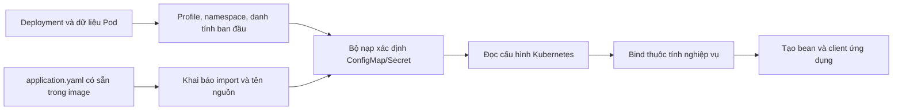

# Tránh vòng phụ thuộc khi thuộc tính cần thiết cho chính quá trình nạp

## Mục tiêu và bối cảnh

Trong module SPRING_CLOUD_KUBERNETES, ứng dụng Spring tích hợp với Kubernetes qua DiscoveryClient, ConfigMap, Secret, Spring Cloud LoadBalancer và Configuration Watcher. Trước khi những thành phần này sử dụng cấu hình, ứng dụng phải xác định nguồn cần đọc: có nhập cấu hình Kubernetes không, đọc tài nguyên nào, ở namespace nào và với danh tính nào.

Một lỗi thiết kế thường gặp là đặt thông tin cần để tìm nguồn cấu hình vào chính nguồn đó. Ví dụ: muốn biết tên ConfigMap phải đọc ConfigMap; muốn đọc Secret lấy token truy cập API phải có token ấy trước. Thay đổi thứ tự ưu tiên không tự giải quyết được quan hệ phụ thuộc này.

Bài học giúp bạn nhận diện các vòng phụ thuộc, chọn nguồn độc lập cho đầu vào ban đầu và xây dựng đường nạp cấu hình có thể giải thích được. Ví dụ sử dụng **Spring Boot 3.5.x** và **Spring Cloud Kubernetes 3.3.x**, theo cơ chế Config Data. Dependency cần được quản lý bằng Spring Cloud BOM tương thích; nếu dự án dùng nhánh khác, đối chiếu tài liệu của nhánh đó.

## 1. Độ ưu tiên và thời điểm có dữ liệu là hai trục khác nhau

Giả sử hai nguồn cùng cung cấp `orders.retry-count`. Sau khi cả hai được đọc, Spring dùng thứ tự ưu tiên để quyết định giá trị có hiệu lực.

Nhưng với `spring.cloud.kubernetes.config.name`, bộ nạp có thể cần giá trị trước khi gửi yêu cầu đọc ConfigMap. Nếu thuộc tính chỉ xuất hiện trong tài nguyên chưa tìm được, chưa có dữ liệu để tham gia so sánh ưu tiên.

| Câu hỏi | Điều cần phân tích |
| --- | --- |
| Hai nguồn đã được đọc cùng khai báo một key; nguồn nào thắng? | Thứ tự ưu tiên |
| Muốn đọc nguồn A cần key X; X có ở đâu trước lúc ấy? | Thời điểm và quan hệ phụ thuộc |
| Nguồn A chưa được nạp vì profile chưa active? | Điều kiện kích hoạt |
| Giá trị có trong Environment nhưng bộ nạp đã quyết định nguồn trước đó? | Thời điểm thành phần sử dụng thuộc tính |

Có thể hình dung giá trị dùng cho một bước nạp là giá trị từ các nguồn **đã sẵn có tại bước ấy**, không phải từ tất cả nguồn mà ứng dụng hy vọng sẽ đọc sau này.

Spring Boot quy định thứ tự PropertySource, đồng thời lưu ý một số nguồn được bổ sung quá muộn cho những quyết định khởi động nhất định. Xem [Externalized Configuration](https://docs.spring.io/spring-boot/3.5/reference/features/external-config.html).

## 2. Vẽ đồ thị phụ thuộc của quá trình nạp

Quy ước mũi tên `A -> B` nghĩa là phải có A trước khi thực hiện B.

Một đường đi hợp lệ:



Một vòng phụ thuộc:


Không có nút nào trong vòng cung cấp điểm bắt đầu độc lập. Thực tế ứng dụng có thể báo lỗi, chọn tên mặc định hoặc đọc một tài nguyên ngoài dự kiến. Không phải mọi trường hợp đều xuất hiện một exception có chữ “circular”.

Muốn phá vòng, chuyển ít nhất một đầu vào ra nguồn có sẵn trước bước cần nó. Với ví dụ trên, có thể đặt tên ConfigMap trong `application.yaml` đóng gói cùng image hoặc biến môi trường của Pod.

### Phân biệt vòng nạp với vòng placeholder

Hai cấu hình dưới gây vấn đề khác nhau:

```yaml
loader:
  target-name: ${settings.target-name}
```

Nếu `settings.target-name` chỉ có trong nguồn mà `loader.target-name` dùng để tìm, đây là phụ thuộc giữa các bước nạp.

```yaml
settings:
  first: ${settings.second}
  second: ${settings.first}
```

Ở ví dụ thứ hai, ngay cả khi tài liệu đã được đọc, hai placeholder vẫn tham chiếu vòng. Cần sửa chính quan hệ giá trị, không chỉ đổi nguồn chứa tài liệu.

Tên `loader.target-name` trong ví dụ là ký hiệu minh họa, không phải một thuộc tính chuẩn của Spring Cloud Kubernetes.

## 3. Lập danh sách đầu vào phải có trước khi tìm nguồn

Không phải mọi thuộc tính có prefix `spring.` đều cùng được đọc tại một thời điểm. Hãy gắn từng thuộc tính với thành phần cần nó.

| Nhóm đầu vào | Ví dụ | Nguồn thích hợp cho quyết định ban đầu |
| --- | --- | --- |
| Tìm file cấu hình ban đầu | `spring.config.name`, `spring.config.location`, `spring.config.additional-location` | Biến môi trường, Java system property, đối số khởi chạy |
| Khai báo nguồn nhập | `spring.config.import` | Tài liệu đã đọc được hoặc nguồn khởi chạy sẵn có |
| Chọn profile mở tài liệu chứa import | `spring.profiles.active`, profile group | Deployment hoặc tài liệu không phụ thuộc vào chính import ấy |
| Chọn tài nguyên Kubernetes | `spring.cloud.kubernetes.config.name`, `sources` | Cấu hình local hoặc thông tin triển khai sẵn có |
| Chọn namespace | `config.namespace`, `secrets.namespace` hoặc namespace của client | Cấu hình độc lập, Downward API hoặc cơ chế namespace của client |
| Kết nối và xác thực API | Địa chỉ API, CA, danh tính ServiceAccount | Môi trường chạy hoặc file được nền tảng cấp trước |
| Cấu hình nghiệp vụ sau khi nguồn đã đọc | Retry, timeout, feature flag, credential dịch vụ đích | ConfigMap, Secret hoặc nguồn đã chọn |

`spring.config.name`, `spring.config.location` và `spring.config.additional-location` được dùng rất sớm để tìm file. Đặt chúng trong một file mà chính chúng phải giúp tìm thường không đạt mục đích. Quy tắc này được mô tả trong [phần vị trí cấu hình của Spring Boot](https://docs.spring.io/spring-boot/3.5/reference/features/external-config.html).

Một `spring.config.import` trong tài liệu đã đọc được có thể hợp lệ. Tài liệu được import cũng có thể khai báo import tiếp theo. Vấn đề là mỗi bước phải có đủ đầu vào từ phần đã tiếp cận được, và không quay lại đòi dữ liệu chỉ tồn tại ở bước chưa thể thực hiện.

Đừng chỉ nhìn các import được viết từ trên xuống rồi kết luận mọi thuộc tính của import trước chắc chắn sẵn cho mọi resolver phía sau. Cơ chế resolve/load và extension cụ thể phải hỗ trợ quan hệ đó. Khi thiết kế đầu vào quan trọng, nguồn độc lập ban đầu dễ kiểm chứng hơn một chuỗi import dựa vào tác dụng phụ.

## 4. Bốn tình huống vòng phụ thuộc điển hình

### 4.1. Tên ứng dụng hoặc tên ConfigMap chỉ nằm trong ConfigMap cần tìm

Một nhóm tạo ConfigMap `orders-settings` rồi đặt vào đó:

```yaml
data:
  spring.application.name: orders-service
  spring.cloud.kubernetes.config.name: orders-settings
  orders.retry-count: "5"
```

Họ kỳ vọng ứng dụng tự tìm được tài nguyên này. Nhưng bộ nạp cần biết tên tài nguyên trước khi đọc các key trên. Nếu chưa có lựa chọn độc lập, nó có thể tìm theo tên ứng dụng đã biết hoặc tên mặc định khác.

Spring Cloud Kubernetes hỗ trợ chọn ConfigMap theo tên cấu hình, tên ứng dụng và mặc định tương ứng; cũng có danh sách `sources` để chọn tường minh. Xem [ConfigMap PropertySource](https://docs.spring.io/spring-cloud-kubernetes/reference/3.3/property-source-config/configmap-propertysource.html).

Cách sửa: đưa định danh ứng dụng và tên nguồn cần chọn ra cấu hình local hoặc Deployment. ConfigMap được chọn chỉ chứa thuộc tính nghiệp vụ trong thiết kế này.

Một giá trị `spring.application.name` có thể xuất hiện trong nguồn cấu hình khác theo yêu cầu của dự án. Điều cần tránh là dựa vào giá trị **chưa đọc được** để quyết định nguồn ban đầu. Một lần chạy tình cờ thành công nhờ tên mặc định trùng tên tài nguyên không chứng minh thiết kế không có vấn đề.

### 4.2. Namespace cần tìm chỉ có trong tài nguyên của namespace đó

Ví dụ local:

```yaml
spring:
  cloud:
    kubernetes:
      config:
        name: orders-settings
        namespace: ${platform.config-namespace}
```

Nếu `platform.config-namespace` chỉ nằm trong `orders-settings`, chưa thể hoàn thành việc chọn namespace.

Cách sửa: cung cấp `platform.config-namespace` từ Deployment, hoặc dùng trực tiếp một giá trị được lấy độc lập từ metadata của Pod. Spring Cloud Kubernetes cũng có cơ chế tìm namespace qua cấu hình client và file namespace của ServiceAccount; không nhất thiết phải dùng một key từ ConfigMap. Xem [Namespace resolution](https://docs.spring.io/spring-cloud-kubernetes/reference/3.3/property-source-config/namespace-resolution.html).

Không dùng một namespace dự phòng tùy ý để làm mất lỗi placeholder. Ứng dụng có thể đọc nhầm cấu hình của môi trường khác thay vì dừng ở lỗi đầu vào.

### 4.3. Profile mở đường import chỉ được bật trong nguồn đang bị khóa bởi profile

Giả sử chỉ `application-k8s.yaml` có:

```yaml
spring:
  config:
    import: "kubernetes:"
```

Nhưng `spring.profiles.active=k8s` chỉ được đặt trong ConfigMap mà import này sẽ đọc. Tài liệu chứa import chưa active, nên đường đi đến ConfigMap chưa được mở.

Cách sửa:

```yaml
env:
  - name: SPRING_PROFILES_ACTIVE
    value: "k8s"
```

Hoặc khai báo cơ chế profile phù hợp trong tài liệu gốc không phụ thuộc import đó. Không đặt `spring.profiles.active` vào một tài liệu có điều kiện `spring.config.activate.on-profile` để tài liệu tự kích hoạt chính mình.

Spring Boot chỉ cho phép `spring.profiles.active` và `spring.profiles.default` trong tài liệu không chuyên biệt theo profile; `include` và `group` cũng có giới hạn tương ứng. Xem [Profiles của Spring Boot](https://docs.spring.io/spring-boot/3.5/reference/features/profiles.html).

Điều này không có nghĩa mọi cấu hình remote đều bị cấm cung cấp profile. Thiết kế phải tuân thủ quy tắc tài liệu và phải có đường đọc ban đầu độc lập; không dựa vào một nguồn chưa thể đọc để mở chính nguồn ấy.

### 4.4. Credential đọc Kubernetes API chỉ lấy được qua chính API đó

Ứng dụng cần token T để đọc Secret S, nhưng T chỉ được lưu trong S. Retry không tạo ra danh tính ban đầu.

Trong Pod, có thể dùng danh tính ServiceAccount do nền tảng cấp và RBAC tương ứng. Một file credential được nền tảng mount trước khi tiến trình chạy cũng có thể là đầu vào độc lập, nếu client được cấu hình sử dụng nó.

Tính độc lập được xét từ góc nhìn tiến trình đọc cấu hình. Kubelet cấp một volume cho container là đường khác với việc Java tự gọi API bằng credential chưa có. Không đưa token vào một nguồn đọc qua chính client đang thiếu token ấy.

## 5. Thiết kế một đường nạp rõ ràng cho orders-service

Ví dụ này dùng Config Data và một nguồn ConfigMap được đặt tên tường minh. Không bật nguồn Secret để giữ bài thực hành tập trung vào quan hệ nạp.

### 5.1. Dependency đã sẵn trên classpath

Ví dụ chọn Fabric8:

```xml
<dependency>
    <groupId>org.springframework.cloud</groupId>
    <artifactId>spring-cloud-starter-kubernetes-fabric8-config</artifactId>
</dependency>
```

Version được quản lý bằng BOM phù hợp. Không ghép starter Fabric8 với starter dùng Kubernetes Java Client trong cùng ví dụ.

Khai báo `spring.config.import: "kubernetes:"` không tự tải dependency còn thiếu. Resolver cần tồn tại trên classpath trước khi xử lý loại nguồn này. Cơ chế import Kubernetes được mô tả trong [Kubernetes PropertySource implementations](https://docs.spring.io/spring-cloud-kubernetes/reference/3.3/property-source-config.html).

### 5.2. application.yaml có trong image

```yaml
spring:
  application:
    name: orders-service
  config:
    import: "kubernetes:"
  cloud:
    kubernetes:
      config:
        enabled: true
        enable-api: true
        name: orders-settings
        namespace: ${POD_NAMESPACE}
        include-profile-specific-sources: false
        fail-fast: true
      secrets:
        enabled: false

orders:
  retry-count: 2
```

Ở đây:

- Image đã cung cấp tên ứng dụng, cơ chế import và tên ConfigMap.
- `POD_NAMESPACE` phải có trước khi bộ nạp cần chọn namespace.
- Nguồn theo profile được tắt để ví dụ chỉ chọn một ConfigMap.
- `orders.retry-count` là mặc định nghiệp vụ, không phải thông tin dùng để tìm nguồn.
- `fail-fast` thể hiện chủ đích dừng khi có lỗi tải, nhưng vẫn cần kiểm chứng các thuộc tính nghiệp vụ bắt buộc sau khi nạp.

Ví dụ không dùng giá trị mặc định cho `POD_NAMESPACE` để tránh âm thầm chọn namespace khác khi Deployment thiếu đầu vào.

### 5.3. Deployment cung cấp dữ liệu độc lập

Fragment bên trong container:

```yaml
env:
  - name: SPRING_PROFILES_ACTIVE
    value: "prod"
  - name: POD_NAMESPACE
    valueFrom:
      fieldRef:
        fieldPath: metadata.namespace
```

Downward API đưa namespace của Pod vào biến môi trường trước khi Java cần đọc cấu hình. Nó không yêu cầu Java đọc `orders-settings` để tìm namespace. Xem [cấp thông tin Pod qua biến môi trường](https://kubernetes.io/docs/tasks/inject-data-application/environment-variable-expose-pod-information/).

Ví dụ giả định Pod chạy trong namespace `training`, sử dụng ServiceAccount có quyền đọc ConfigMap theo cách client thực tế truy cập và có thể kết nối API server. Những điều kiện này phải được chuẩn bị riêng; một trường YAML không tự cấp RBAC.

### 5.4. ConfigMap chỉ chứa dữ liệu cần sau khi đã tìm được nguồn

```yaml
apiVersion: v1
kind: ConfigMap
metadata:
  name: orders-settings
  namespace: training
data:
  orders.retry-count: "5"
  orders.batch-size: "50"
  orders.config-marker: "training-settings-v1"
```

Các key này không quyết định lại tên ConfigMap, namespace hoặc profile mở đường import. `orders.config-marker` là dấu mốc không nhạy cảm dành cho bài thực hành.

Với giả định không có nguồn khác ghi đè, ứng dụng mong đợi nhận các giá trị remote và marker trên. Biến môi trường hoặc đối số khởi chạy vẫn có thể ghi đè thuộc tính; điều đó là bài toán precedence sau khi nguồn đã nạp, không phải cơ chế phá vòng.

### 5.5. Bảng đầu vào của đường nạp

| Giá trị cần biết | Ai cấp? | Có phải đọc orders-settings trước không? |
| --- | --- | --- |
| Loại nguồn `kubernetes:` | `application.yaml` trong image | Không |
| Resolver Kubernetes | Dependency trên classpath | Không |
| Tên `orders-settings` | `application.yaml` trong image | Không |
| Namespace `training` | Downward API qua `POD_NAMESPACE` | Không |
| Danh tính và quyền API | ServiceAccount, RBAC và client | Không |
| Retry và batch size | ConfigMap đã chọn | Có, vì đây là kết quả cần nạp |

Dòng cuối là phụ thuộc hợp lệ: nghiệp vụ cần cấu hình remote. Không có mũi tên quay từ kết quả ấy về một đầu vào còn thiếu của chính bước đọc.

## 6. Tổ chức profile mà không tự khóa đường nạp

Một nhóm profile có thể được định nghĩa trong tài liệu local không chuyên biệt theo profile:

```yaml
spring:
  profiles:
    group:
      production:
        - k8s
        - metrics
```

Deployment kích hoạt `production`. Các profile thành viên có thể mở tài liệu tương ứng, chẳng hạn `application-k8s.yaml` chứa import. Như vậy, dữ liệu mở đường nằm trong Deployment và tài liệu gốc đã tiếp cận được.

Một tài liệu có điều kiện cũng có thể chứa import:

```yaml
spring:
  config:
    activate:
      on-profile: k8s
    import: "kubernetes:"
```

Tài liệu này cần profile `k8s` được xác định từ một đường độc lập phù hợp. `on-profile` là điều kiện áp dụng tài liệu, không phải lệnh bật profile.

Không đưa `spring.profiles.active` vào chính tài liệu có điều kiện ấy. Cũng không dựa vào một ConfigMap theo profile để bật profile cần thiết cho việc đọc nó.

Khi chuyển từ ví dụ import vô điều kiện ở mục 5 sang import theo profile, hãy kiểm tra hành vi chạy local: nếu không kích hoạt profile tương ứng, ứng dụng có thể không thử đọc Kubernetes. Đây có thể là chủ đích hợp lệ, nhưng cần phân biệt với tình huống triển khai thiếu biến profile.

## 7. Những thay đổi không giải quyết được vòng phụ thuộc

### Tăng độ ưu tiên của nguồn chưa đọc được

Không có giá trị nào từ ConfigMap chưa được tìm thấy để đưa lên ưu tiên cao hơn. Trước hết phải mở đường đến nguồn bằng đầu vào đã có.

Nếu một key xuất hiện sau khi nạp, không giả định mọi thành phần đã sử dụng giá trị cũ sẽ tự chạy lại. Cần xem chính thành phần đó đọc thuộc tính khi nào.

### Thêm retry hoặc tăng timeout

Retry hữu ích khi đầu vào đã đúng nhưng API tạm thời chưa khả dụng. Nó không tạo tên ConfigMap, namespace, resolver hoặc danh tính đang thiếu.

### Thêm optional: để ứng dụng bỏ qua lỗi

`optional:` dành cho tình huống chấp nhận nguồn không tồn tại theo cơ chế tương ứng. Nó không phải cam kết bỏ qua mọi lỗi placeholder, tài liệu không hợp lệ hoặc lỗi kết nối của mọi extension.

Nếu nguồn chứa cấu hình bắt buộc, làm ứng dụng khởi động với mặc định thiếu hoặc sai có thể chỉ chuyển lỗi sang bước nghiệp vụ.

### Dùng @DependsOn hoặc sửa vòng bean

`@DependsOn` điều khiển phụ thuộc khi tạo bean. Vấn đề trong bài nằm ở việc quyết định và đọc Config Data trước đó. Cho phép vòng tham chiếu bean không cung cấp dữ liệu còn thiếu cho bộ nạp.

### Set thuộc tính trong @PostConstruct hoặc ApplicationRunner

Các hook này chạy sau những bước khởi động đã cần cấu hình nguồn. Chúng phù hợp để kiểm chứng kết quả hoặc làm việc nghiệp vụ, không phải cách sửa đầu vào đã thiếu lúc chọn import.

Tương tự, một `@PropertySource` được thêm trong giai đoạn refresh context không phải giải pháp chung cho các thuộc tính dùng rất sớm.

### Trộn legacy bootstrap với Config Data

Trong nhánh Spring Cloud Kubernetes được dùng ở đây, chọn một cơ chế: legacy bootstrap hoặc `spring.config.import`. Không thêm `spring-cloud-starter-bootstrap` để thử buộc mọi cấu hình “đọc sớm hơn” trong khi vẫn giữ cấu hình Config Data tương ứng. Giới hạn này được nêu trong [tài liệu PropertySource](https://docs.spring.io/spring-cloud-kubernetes/reference/3.3/property-source-config.html).

## 8. Chẩn đoán bằng dữ liệu của từng giai đoạn

Trước khi thay cấu hình, lập bảng cho thuộc tính đang thiếu:

| Thuộc tính | Thành phần cần | Nguồn được kỳ vọng | Nguồn đã sẵn ở lúc cần chưa? |
| --- | --- | --- | --- |
| `POD_NAMESPACE` | Chọn namespace | Downward API | Cần kiểm tra Pod template |
| `spring.cloud.kubernetes.config.name` | Chọn ConfigMap | File trong image | Cần kiểm tra đúng image/cấu hình khởi chạy |
| `spring.profiles.active` | Mở tài liệu theo profile | Deployment | Cần kiểm tra biến môi trường hoặc đối số |
| Token đọc API | Kubernetes client | ServiceAccount hoặc nguồn độc lập | Cần kiểm tra cơ chế cấp danh tính |
| `orders.batch-size` | Bean nghiệp vụ | ConfigMap đã chọn | Chỉ có sau bước đọc remote |

Quy trình khoanh vùng:

1. Xác nhận cơ chế Config Data hay legacy bootstrap đang được dùng.
2. Xác nhận đầu vào rất sớm và profile từ lệnh khởi chạy, Pod template, file đã đóng gói.
3. Xác định chính xác tên và namespace của nguồn dự kiến.
4. Kiểm tra sự tồn tại của tài nguyên, kết nối và RBAC.
5. Sau khi nguồn được đọc, kiểm tra binding và thứ tự ưu tiên của các key nghiệp vụ.

Phân biệt một số nhóm lỗi:

| Dấu hiệu | Hướng điều tra |
| --- | --- |
| Placeholder tên nguồn/namespace không phân giải | Đầu vào chỉ nằm ở nguồn chưa đọc hoặc Deployment thiếu biến |
| Không nhận diện loại import Kubernetes | Dependency/resolver hoặc cú pháp import |
| Profile mong đợi không active | Đường kích hoạt profile, tài liệu chứa import |
| Tìm sai tên hoặc sai namespace | Giá trị đang có ở lúc resolver chạy, mặc định ngoài dự kiến |
| API trả `403` | Danh tính và quyền, không tự kết luận do precedence |
| API timeout | Kết nối hoặc dịch vụ API, không tự kết luận do vòng phụ thuộc |
| Bean thiếu thuộc tính dù đã đọc được nguồn | Key, kiểu binding, tập nguồn hoặc ghi đè |

Nếu bật log chi tiết cho quá trình nạp, thực hiện trong môi trường chẩn đoán có kiểm soát và kiểm tra dữ liệu được xuất. Chỉ cần ghi tên nguồn, giai đoạn và trạng thái; không in token hoặc toàn bộ Secret.

Một `ApplicationRunner` thành công có thể kiểm tra marker nghiệp vụ. Nhưng khi lỗi xảy ra trước lúc context tạo được runner, việc runner không có log không giúp phân biệt được nguyên nhân; phải xem giai đoạn nạp trước đó.

## 9. Thực hành chứng minh đầu vào độc lập

Thực hiện các tình huống dưới trong môi trường học tập với image, dependency và quyền đã chuẩn bị. Các đoạn cấu hình là nội dung để đưa vào dự án thực hành, không phải các tài nguyên được tự động tạo ra bởi bài viết.

### Tình huống A: đường nạp đầy đủ

Dùng cấu hình ở mục 5 và ConfigMap `training/orders-settings`.

Kỳ vọng:

- Namespace được lấy từ Pod, không từ ConfigMap.
- Bộ nạp có tên nguồn trước khi gọi API.
- Sau khi nạp, ứng dụng đọc được `orders.config-marker`.
- Không có lỗi phân giải đầu vào ban đầu.

Nếu bổ sung một kiểm tra lúc khởi động, yêu cầu marker đúng với giá trị không nhạy cảm đã chuẩn bị. Điều này giúp phân biệt thành công có đọc remote với khởi động chỉ bằng giá trị mặc định.

### Tình huống B: xóa đầu vào namespace ở Deployment

Bỏ biến `POD_NAMESPACE` nhưng giữ `namespace: ${POD_NAMESPACE}`. Dù đặt key `POD_NAMESPACE` trong ConfigMap, không coi đó là cách sửa: quá trình tìm tài nguyên vẫn cần đầu vào ấy trước.

Kỳ vọng là phát hiện cấu hình đầu vào thiếu; thông báo cụ thể phụ thuộc cơ chế phân giải và phiên bản. Khôi phục Downward API thay vì thêm fallback tùy ý.

### Tình huống C: giấu import sau một profile chưa active

Chuyển khai báo import sang `application-k8s.yaml`. Giữ profile `k8s` chỉ trong ConfigMap remote và không có đường kích hoạt độc lập.

Nếu ứng dụng không thử đọc remote, đó là điều phù hợp với điều kiện chưa được mở. Sửa bằng cách kích hoạt profile ở Deployment hoặc thiết kế tài liệu gốc phù hợp, rồi kiểm chứng lại marker.

### Tình huống D: ưu tiên thay đổi nhưng đường nạp vẫn đúng

Sau khi cấu hình nguồn hoạt động, thêm một biến môi trường:

```yaml
env:
  - name: ORDERS_RETRYCOUNT
    value: "7"
```

Tên này theo quy tắc binding biến môi trường cho `orders.retry-count`: dấu chấm thành gạch dưới, dấu gạch nối bị loại bỏ và chữ được viết hoa.

Với giả định không có nguồn ưu tiên cao hơn khác, retry count có thể bị ghi đè thành `7` trong khi ConfigMap vẫn được đọc đúng. Marker remote giúp chứng minh hai việc này độc lập: đọc nguồn thành công và chọn giá trị cuối cùng.

Đây là bài toán precedence, không phải vòng nạp. Bỏ biến ghi đè sau khi hoàn tất tình huống thực hành nếu muốn quay lại giá trị remote.

## 10. Giữ ổn định hợp đồng đầu vào qua các đợt triển khai

Với mỗi ứng dụng, nên ghi rõ:

```text
Cơ chế nạp: Config Data
Nguồn khai báo import: application.yaml trong image
Profile do Deployment quyết định: prod
Tên ConfigMap ban đầu: orders-settings
Namespace ban đầu: metadata.namespace qua POD_NAMESPACE
Danh tính API: ServiceAccount của workload
Dữ liệu remote: chỉ các thuộc tính nghiệp vụ đã quy định
Dấu hiệu đọc remote: orders.config-marker
Hành vi khi thiếu đầu vào: dừng và báo lỗi phù hợp
```

ConfigMap hoặc Secret có thể được cập nhật sau khi ứng dụng chạy, nhưng Configuration Watcher không thay thế thiết kế đầu vào ban đầu. Không mặc định một lần refresh sẽ tự thay toàn bộ cơ chế import, classpath, profile hoặc danh tính client.

Nếu cần đổi tên nguồn, namespace hay cách xác thực, xử lý như thay đổi cấu hình triển khai có chủ đích: cập nhật nguồn đầu vào, kiểm tra quyền và xác minh lại một lần khởi động đầy đủ.

Một đường nạp dễ vận hành có điểm bắt đầu độc lập, các bước tiến về phía cấu hình nghiệp vụ và hành vi rõ ràng khi đầu vào không có. Khi có thể chỉ ra nguồn của từng thuộc tính tại đúng thời điểm nó được cần đến, việc phân tích profile và ưu tiên mới có căn cứ.
