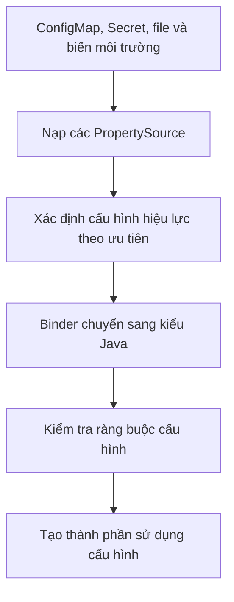

# Kiểu dữ liệu, binding và kiểm tra ràng buộc cấu hình

Trong chương **Profile và ưu tiên** của module **Spring Cloud Kubernetes**, sau khi chọn nguồn và xác định giá trị hiệu lực, ứng dụng còn phải chuyển dữ liệu cấu hình sang kiểu Java và kiểm tra xem giá trị đó có phù hợp hay không.

Một ConfigMap được Kubernetes chấp nhận vẫn có thể chứa `max-retries: many`. Giá trị `100` chuyển được sang số nguyên nhưng có thể vượt giới hạn vận hành. Hai timeout đều hợp lệ về kiểu vẫn có thể mâu thuẫn với nhau.

Bài này dùng `inventory-service`, lấy cấu hình cho client gọi một hệ thống tồn kho bên ngoài. Ví dụ sử dụng **Spring Boot 3.5.x**, **Spring Cloud Kubernetes 3.3.x**, **Fabric8** và **Config Data**. Cấu hình gồm URL, thời gian chờ, số lần thử lại, chế độ hoạt động, danh sách vùng và giới hạn connection pool.

## 1. Ba bước khác nhau: nạp nguồn, binding và validation



Sơ đồ là cách phân tích cho ứng dụng; với cấu trúc phức tạp, Binder có thể thực hiện tra cứu và chuyển đổi theo từng phần tử.

| Lớp xử lý | Câu hỏi | Ví dụ lỗi |
|---|---|---|
| Nạp nguồn | Có đọc được đúng ConfigMap/Secret không? | Sai namespace, thiếu quyền đọc API |
| Binding | Dữ liệu có chuyển được sang kiểu đích không? | Chuỗi `many` không chuyển được sang Integer |
| Validation | Giá trị đã chuyển có thỏa hợp đồng không? | Số lần thử lại là 100 trong khi giới hạn là 5 |

`spring.cloud.kubernetes.config.fail-fast` điều khiển việc thất bại khi đọc nguồn cấu hình gặp lỗi. Nó không định nghĩa giới hạn số lần thử lại của client nghiệp vụ hay quan hệ giữa hai timeout. Những ràng buộc đó thuộc về ứng dụng.

Cũng cần phân biệt validation cấu hình với kiểm tra kết nối: một URI có cú pháp đúng không chứng minh hệ thống đích đang hoạt động hoặc thông tin đăng nhập được chấp nhận.

## 2. Kiểu dữ liệu trong ConfigMap và kiểu dữ liệu của ứng dụng

### 2.1. Giá trị trực tiếp trong data là chuỗi

Trường `data` của ConfigMap chứa chuỗi UTF-8. Vì vậy, nếu đặt các thuộc tính trực tiếp vào đó, phải biểu diễn số và boolean dưới dạng chuỗi:

```yaml
apiVersion: v1
kind: ConfigMap
metadata:
  name: inventory-client
  namespace: inventory-dev
data:
  inventory.client.max-retries: "2"
  inventory.client.connect-timeout: "750ms"
```

Việc đặt `"2"` trong ConfigMap không buộc Java phải giữ nó dưới dạng String. Binder sẽ chuyển sang kiểu đích mà lớp cấu hình khai báo. [Cấu trúc ConfigMap](https://kubernetes.io/docs/concepts/configuration/configmap/#configmap-object).

Ngược lại, lỗi kiểu của manifest Kubernetes có thể xuất hiện trước khi Spring chạy. Ví dụ một số trần ở vị trí API yêu cầu chuỗi không phải lỗi Bean Validation trong Java.

### 2.2. Dùng YAML nhúng cho cấu trúc có danh sách và object

Ví dụ chính dùng một key chứa toàn bộ tệp YAML:

```yaml
apiVersion: v1
kind: ConfigMap
metadata:
  name: inventory-client
  namespace: inventory-dev
data:
  application.yaml: |-
    inventory:
      client:
        base-url: https://stock.example.test
        connect-timeout: 750ms
        read-timeout: 3s
        max-retries: 2
        mode: SYNC
        regions:
          - sg-1
          - sg-2
        pool:
          max-connections: 12
```

Ở lớp ngoài, `application.yaml` vẫn có giá trị là một chuỗi. Bên trong chuỗi đó, Spring Cloud Kubernetes xử lý nội dung YAML thành thuộc tính cấu hình, bao gồm cấu trúc lồng nhau và các phần tử danh sách. [ConfigMap PropertySource 3.3](https://docs.spring.io/spring-cloud-kubernetes/reference/3.3/property-source-config/configmap-propertysource.html).

Không dùng dấu ngoặc kép bao quanh cả danh sách để kỳ vọng mọi chuỗi JSON hoặc YAML đều tự trở thành collection đúng ý. Với dữ liệu có cấu trúc, nên khai báo cấu trúc rõ ràng trong YAML nhúng.

## 3. Chuẩn bị đường nạp cấu hình và bộ kiểm tra

Ứng dụng cần starter đọc cấu hình Kubernetes và một triển khai Bean Validation:

```xml
<dependency>
    <groupId>org.springframework.cloud</groupId>
    <artifactId>spring-cloud-starter-kubernetes-fabric8-config</artifactId>
</dependency>

<dependency>
    <groupId>org.springframework.boot</groupId>
    <artifactId>spring-boot-starter-validation</artifactId>
</dependency>
```

Dùng Spring Cloud BOM tương thích với Spring Boot đang chọn. Các annotation validation trong ví dụ thuộc `jakarta.validation`, phù hợp với Spring Boot 3.x.

File `application.yaml` đi cùng ứng dụng chỉ khai báo đường đến ConfigMap:

```yaml
spring:
  application:
    name: inventory-service
  config:
    import: "kubernetes:"
  cloud:
    kubernetes:
      config:
        enabled: true
        name: inventory-client
        namespace: inventory-dev
        include-profile-specific-sources: false
        fail-fast: true
      secrets:
        enabled: false
```

Namespace, ConfigMap và quyền đọc API của ServiceAccount phải được chuẩn bị trước. Bài cố định một nguồn và tắt Secret để tập trung vào binding; các thuộc tính bắt buộc của client chưa có giá trị dự phòng trong file đóng gói.

Không bật đồng thời bootstrap cũ và `spring.config.import`. [Kubernetes PropertySource và Config Data](https://docs.spring.io/spring-cloud-kubernetes/reference/3.3/property-source-config.html).

## 4. Xây dựng lớp cấu hình có kiểu và hợp đồng rõ ràng

Hợp đồng cho ví dụ:

| Thuộc tính | Kiểu Java | Ràng buộc |
|---|---|---|
| base-url | URI | Bắt buộc, có host và dùng HTTPS |
| connect-timeout | Duration | Dương, không lớn hơn read-timeout |
| read-timeout | Duration | Dương, không vượt 30 giây |
| max-retries | Integer | Bắt buộc, từ 0 đến 5 |
| mode | Enum | Bắt buộc, chọn SYNC hoặc ASYNC |
| regions | List<String> | Có ít nhất một phần tử, mỗi chuỗi không rỗng |
| pool.max-connections | Integer trong object Pool | Bắt buộc, từ 1 đến 100 |

Yêu cầu HTTPS và các giới hạn số là chính sách của client mẫu, không phải giới hạn chung của Kubernetes hay Spring Cloud Kubernetes.

Khai báo record:

```java
package com.example.inventory;

import java.net.URI;
import java.time.Duration;
import java.util.List;

import jakarta.validation.Valid;
import jakarta.validation.constraints.AssertTrue;
import jakarta.validation.constraints.Max;
import jakarta.validation.constraints.Min;
import jakarta.validation.constraints.NotBlank;
import jakarta.validation.constraints.NotEmpty;
import jakarta.validation.constraints.NotNull;

import org.springframework.boot.context.properties.ConfigurationProperties;
import org.springframework.validation.annotation.Validated;

@ConfigurationProperties(
        prefix = "inventory.client",
        ignoreUnknownFields = false)
@Validated
public record InventoryClientProperties(
        @NotNull URI baseUrl,
        @NotNull Duration connectTimeout,
        @NotNull Duration readTimeout,
        @NotNull @Min(0) @Max(5) Integer maxRetries,
        @NotNull Mode mode,
        @NotEmpty List<@NotBlank String> regions,
        @NotNull @Valid Pool pool) {

    public enum Mode {
        SYNC, ASYNC
    }

    public record Pool(
            @NotNull @Min(1) @Max(100) Integer maxConnections) {
    }

    @AssertTrue(message = "base-url phải dùng HTTPS và có host")
    public boolean isBaseUrlValid() {
        if (baseUrl == null) {
            return true;
        }

        return "https".equalsIgnoreCase(baseUrl.getScheme())
                && baseUrl.getHost() != null
                && !baseUrl.getHost().isBlank();
    }

    @AssertTrue(message =
            "timeout phải dương, connect-timeout không vượt read-timeout "
                    + "và read-timeout không vượt 30 giây")
    public boolean isTimeoutsValid() {
        if (connectTimeout == null || readTimeout == null) {
            return true;
        }

        return !connectTimeout.isZero()
                && !connectTimeout.isNegative()
                && !readTimeout.isZero()
                && !readTimeout.isNegative()
                && connectTimeout.compareTo(readTimeout) <= 0
                && readTimeout.compareTo(Duration.ofSeconds(30)) <= 0;
    }
}
```

Hai getter boolean được kiểm tra bằng `@AssertTrue` để diễn tả điều kiện bổ sung. Khi một giá trị đang null, chúng trả true để `@NotNull` chịu trách nhiệm báo thiếu giá trị, tránh phát sinh NullPointerException trong bộ kiểm tra. [Jakarta AssertTrue](https://jakarta.ee/specifications/bean-validation/3.0/apidocs/jakarta/validation/constraints/AssertTrue.html).

Đăng ký record với Spring Boot:

```java
package com.example.inventory;

import org.springframework.boot.SpringApplication;
import org.springframework.boot.autoconfigure.SpringBootApplication;
import org.springframework.boot.context.properties.EnableConfigurationProperties;

@SpringBootApplication
@EnableConfigurationProperties(InventoryClientProperties.class)
public class InventoryApplication {

    public static void main(String[] args) {
        SpringApplication.run(InventoryApplication.class, args);
    }
}
```

`@EnableConfigurationProperties` đăng ký kiểu cấu hình để Binder tạo và bind bean. Không thêm `@Component` vào record để thay thế cơ chế đăng ký constructor binding. [EnableConfigurationProperties](https://docs.spring.io/spring-boot/3.5/api/java/org/springframework/boot/context/properties/EnableConfigurationProperties.html).

Với record có một constructor chuẩn, không cần thêm `@ConstructorBinding`. Các thành phần nghiệp vụ nhận `InventoryClientProperties` qua constructor và dùng các giá trị đã có kiểu, thay vì tự chuyển chuỗi sang số ở từng nơi.

## 5. Chọn đúng annotation và phân biệt thiếu với giá trị mặc định

### 5.1. NotNull, NotBlank và NotEmpty không thay thế nhau

| Ràng buộc | Dùng cho | Điều kiểm tra trong bài |
|---|---|---|
| `@NotNull` | Kiểu tham chiếu | Phải có URI, Duration, Integer, enum hoặc object Pool |
| `@NotBlank` | Chuỗi/CharSequence | Tên vùng phải có ký tự không phải khoảng trắng |
| `@NotEmpty` | Collection và một số kiểu chứa dữ liệu khác | Danh sách regions phải có phần tử |
| `@Min`, `@Max` | Các kiểu số được hỗ trợ | Giới hạn max-retries và max-connections |
| `@Valid` | Object hoặc phần tử cần kiểm tra tiếp | Đi vào Pool để kiểm tra maxConnections |

`@NotBlank` dành cho CharSequence; không đặt nó lên `Duration`, `URI` hay `Integer`. [Jakarta NotBlank](https://jakarta.ee/specifications/bean-validation/3.0/apidocs/jakarta/validation/constraints/NotBlank.html).

`@Min` chấp nhận null, nên `@Min(0)` một mình chưa bảo đảm giá trị bắt buộc tồn tại. Nó cũng không phải ràng buộc dành cho Duration; ví dụ dùng getter boolean để kiểm tra thời gian. [Jakarta Min](https://jakarta.ee/specifications/bean-validation/3.0/apidocs/jakarta/validation/constraints/Min.html).

Với `pool`, `@NotNull` yêu cầu object tồn tại, còn `@Valid` yêu cầu kiểm tra các ràng buộc bên trong. Chỉ có `@Valid` không biến một object null thành lỗi bắt buộc. [Validation cascading](https://jakarta.ee/specifications/bean-validation/3.0/apidocs/jakarta/validation/Valid.html).

### 5.2. Wrapper giúp biểu đạt trường bắt buộc

Trong record mẫu, `maxRetries` là `Integer` thay vì `int`. Khi không có giá trị, null cho phép `@NotNull` nhận diện trường bị thiếu. Trong khi đó, primitive dùng giá trị mặc định như 0 hoặc false và không thể tự biểu đạt trạng thái “chưa cấu hình”.

Đối với `max-retries`, số 0 là một giá trị hợp lệ: không thử lại. Không dùng điều kiện `value == 0` để suy ra rằng key chưa có.

Nếu một thuộc tính thật sự có mặc định, hãy khai báo mặc định có chủ đích. Chẳng hạn, có thể thay một component Duration trong một thiết kế khác bằng:

```java
@DefaultValue("1s") @NotNull Duration connectTimeout
```

Annotation ở đây là `org.springframework.boot.context.properties.bind.DefaultValue`. Đây là phương án thay đổi hợp đồng của trường, không phải dòng cần thêm vào mẫu bắt buộc ở phần 4.

Không dùng giá trị mặc định để che việc thiếu endpoint bắt buộc hoặc thông tin đăng nhập. Mặc định được chọn phải có ý nghĩa vận hành và vẫn được kiểm tra ràng buộc.

### 5.3. Validation chỉ hoạt động khi có đủ cơ chế

Để các ràng buộc trên có tác dụng, cần đồng thời:

1. Kiểu cấu hình được đăng ký và bind bởi Spring Boot.
2. Có `@Validated` trên kiểu cấu hình.
3. Có triển khai Bean Validation trên classpath.
4. Có `@Valid` ở nơi cần đi vào cấu hình lồng nhau.

Việc thêm annotation ràng buộc vào một record do mã ứng dụng tự gọi constructor không tự kích hoạt validation cấu hình của Spring Boot. [ConfigurationProperties validation](https://docs.spring.io/spring-boot/3.5/reference/features/external-config.html#features.external-config.typesafe-configuration-properties.validation).

## 6. Kiểu Java nên biểu đạt đơn vị và tập giá trị hợp lệ

Các kiểu thường gặp khi thiết kế hợp đồng cấu hình:

| Kiểu đích | Ví dụ đầu vào | Ý nghĩa cần làm rõ |
|---|---|---|
| Integer | `2` | Số nguyên; vẫn cần giới hạn min/max |
| Boolean | `true`, `false` | Trạng thái bật/tắt; không đồng nhất false với thiếu |
| Enum | `SYNC`, `ASYNC` | Tập chế độ được ứng dụng hỗ trợ |
| Duration | `750ms`, `3s`, `PT3S` | Thời lượng có đơn vị |
| DataSize | `256KB`, `2MB` | Kích thước dữ liệu |
| URI | `https://stock.example.test` | Cấu trúc địa chỉ; cần thêm chính sách scheme/host |
| List<String> | Danh sách YAML regions | Nhiều giá trị có thứ tự |
| Map<String, Integer> | Map tên và trọng số | Giá trị theo key; cần kiểm tra cả key và value |

Bảng mô tả các lựa chọn kiểu, không yêu cầu thêm mọi kiểu vào record mẫu. Nếu bổ sung DataSize, Map hoặc Boolean cho client, phải thêm component tương ứng và cập nhật hợp đồng.

### 6.1. Ghi đơn vị thời gian ngay trong giá trị

Với Duration, số trần mặc định được hiểu là mili giây nếu không có annotation đổi đơn vị. Vì vậy:

```yaml
read-timeout: 3s
```

khác với:

```yaml
read-timeout: 3
```

Giá trị sau không diễn tả ba giây theo mặc định. Có thể dùng `@DurationUnit(ChronoUnit.SECONDS)` để quy định đơn vị khi đầu vào không ghi đơn vị, nhưng vẫn nên ghi đơn vị rõ ràng trong cấu hình triển khai. [DurationUnit](https://docs.spring.io/spring-boot/3.5/api/java/org/springframework/boot/convert/DurationUnit.html).

DataSize cũng có quy tắc đơn vị; số trần mặc định là byte trừ khi được thay đổi bằng `@DataSizeUnit`. Đừng dùng một trường số chung rồi để mỗi nơi gọi client tự hiểu đơn vị khác nhau. [Chuyển đổi Duration và DataSize](https://docs.spring.io/spring-boot/3.5/reference/features/external-config.html#features.external-config.typesafe-configuration-properties.conversion).

### 6.2. Bind được chưa có nghĩa là phù hợp

Các ví dụ sau đều minh họa những lỗi khác nhau:

| Dữ liệu | Binding | Validation theo hợp đồng mẫu |
|---|---|---|
| max-retries là `many` | Không chuyển được sang Integer | Chưa có giá trị hợp lệ để kiểm tra min/max |
| max-retries là `100` | Chuyển được | Vi phạm giới hạn 5 |
| connect-timeout là `5s`, read-timeout là `3s` | Chuyển được cả hai | Vi phạm quan hệ giữa timeout |
| base-url là `/stock` | Có thể tạo URI tương đối | Không có host và không dùng HTTPS |
| pool.max-connections là `0` | Chuyển được | Vi phạm giới hạn tối thiểu 1 |
| regions có một phần tử chỉ gồm khoảng trắng | Bind được danh sách | Vi phạm NotBlank trên phần tử |

Không tự thay giá trị sai bằng mặc định ngay trong converter hoặc khi tạo client. Nếu làm vậy, ứng dụng có thể khởi động với hành vi khác hợp đồng mà người triển khai không biết.

## 7. Binding phải được xem cùng profile và ưu tiên nguồn

Giả sử ConfigMap hợp lệ với `max-retries: 2`, nhưng container có:

```yaml
env:
  - name: INVENTORY_CLIENT_MAXRETRIES
    value: many
```

Giá trị hiệu lực từ biến môi trường không chuyển được sang Integer. Binder không tự chọn số 2 ở nguồn thấp hơn chỉ vì giá trị ưu tiên cao bị sai.

Tương tự:

```yaml
env:
  - name: INVENTORY_CLIENT_READTIMEOUT
    value: 100ms
```

Nếu connect-timeout hiệu lực vẫn là `750ms`, cả hai Duration đều bind được, nhưng kiểm tra quan hệ timeout thất bại.

Một số tên biến môi trường của hợp đồng mẫu:

| Thuộc tính | Biến môi trường |
|---|---|
| inventory.client.max-retries | INVENTORY_CLIENT_MAXRETRIES |
| inventory.client.connect-timeout | INVENTORY_CLIENT_CONNECTTIMEOUT |
| inventory.client.pool.max-connections | INVENTORY_CLIENT_POOL_MAXCONNECTIONS |

Đây là ánh xạ theo relaxed binding của Spring Boot: dấu chấm thành gạch dưới, bỏ gạch ngang và chuyển sang chữ hoa. Khi một profile hoặc nguồn ghi đè làm kết quả khác dự kiến, phải tìm giá trị hiệu lực trước khi sửa annotation validation.

### Danh sách có thể bị thay thế toàn bộ

Với ConfigMap chứa:

```yaml
regions:
  - sg-1
  - sg-2
```

và biến môi trường:

```yaml
env:
  - name: INVENTORY_CLIENT_REGIONS
    value: sg-3
```

danh sách hiệu lực có thể chỉ còn `sg-3`, không phải tự nối thêm thành ba vùng. Spring Boot xử lý ghi đè List bằng cách thay danh sách; với Map, các key có thể được lấy từ nhiều nguồn và ưu tiên được xét khi trùng key. [Merging complex types](https://docs.spring.io/spring-boot/3.5/reference/features/external-config.html#features.external-config.typesafe-configuration-properties.merging-complex-types).

Nếu hợp đồng cần đủ một tập vùng cụ thể, `@NotEmpty` chưa đủ. Cần bổ sung ràng buộc nội dung hoặc tính đầy đủ theo yêu cầu nghiệp vụ.

## 8. Phát hiện key gõ sai và phân biệt các nhóm lỗi

Record mẫu đặt `ignoreUnknownFields = false`. Nếu cấu hình trong prefix `inventory.client` chứa một key không thuộc hợp đồng, chẳng hạn `read-timout`, ứng dụng có thể báo thuộc tính không được bind thay vì âm thầm bỏ qua.

Hai cờ của `@ConfigurationProperties` có vai trò khác nhau:

| Cờ | Mặc định | Ý nghĩa |
|---|---|---|
| ignoreUnknownFields | true | Cho phép bỏ qua thuộc tính không thuộc kiểu cấu hình |
| ignoreInvalidFields | false | Không mặc nhiên bỏ qua dữ liệu không chuyển được sang kiểu đích |

Không bật `ignoreInvalidFields` để làm ứng dụng “chịu được mọi cấu hình”. Nó có thể che lỗi chuyển đổi mà ứng dụng cần biết. [ConfigurationProperties API](https://docs.spring.io/spring-boot/3.5/api/java/org/springframework/boot/context/properties/ConfigurationProperties.html).

Kiểm tra key chưa được bind có phạm vi theo prefix và khả năng liệt kê thuộc tính của nguồn. Nó không phải schema kiểm tra mọi key trong cluster.

Khi dùng chế độ chặt, cần phối hợp thay đổi hợp đồng: đưa một key mới vào ConfigMap trước khi ứng dụng cũ hiểu key đó có thể làm phiên bản cũ khởi động thất bại. Pipeline phải có kế hoạch tương thích giữa cấu hình và phiên bản ứng dụng.

### Đọc lỗi theo lớp xử lý

| Dấu hiệu | Lớp cần xem trước | Việc kiểm tra |
|---|---|---|
| API từ chối manifest vì data không đúng kiểu | Kubernetes | Kiểu giá trị trong manifest, dấu nháy của chuỗi |
| Forbidden hoặc lỗi đọc nguồn | Spring Cloud Kubernetes/API | Namespace, ServiceAccount, quyền get/list |
| Không chuyển được sang Duration, Integer hoặc enum | Binder/converter | Chuỗi hiệu lực và kiểu Java đích |
| must not be null hoặc lỗi min/max | Bean Validation | Trường bắt buộc và phạm vi giá trị |
| Thông báo về quan hệ timeout | Ràng buộc bổ sung của ứng dụng | Các giá trị liên quan sau khi đã xét ưu tiên |
| Unbound hoặc key không thuộc hợp đồng | Binding chặt | Lỗi chính tả, prefix hoặc thay đổi schema |
| Bind/validate đạt nhưng gọi API thất bại | Thành phần sử dụng cấu hình | Kết nối, TLS, xác thực và trạng thái hệ thống đích |

Tên exception và cách trình bày có thể khác theo phiên bản. Khi đọc failure analysis, ưu tiên tìm tên thuộc tính, origin nếu có, kiểu cần chuyển và ràng buộc thất bại.

## 9. Thời điểm kiểm tra, cập nhật cấu hình và dữ liệu nhạy cảm

### 9.1. Kiểm tra trước khi nhận công việc

Trong cấu hình khởi động thông thường, bean cấu hình được tạo và kiểm tra trong quá trình startup. Không trì hoãn việc bind bắt buộc đến request đầu tiên.

Nếu ứng dụng bật lazy initialization hoặc tự quản lý vòng đời các bean cấu hình, phải bảo đảm có một bước kiểm tra trước khi readiness cho phép nhận traffic. Việc HTTP server chạy được chưa chứng minh mọi cấu hình nghiệp vụ đã được kiểm tra.

### 9.2. Cập nhật ConfigMap không tự xác nhận client đã đổi

Ví dụ record trong bài mô tả binding và validation khi tạo bean. Khi cấu hình thay đổi, cần xác định:

1. PropertySource đã nhận dữ liệu mới chưa?
2. Cơ chế đang dùng có bind và validate lại kiểu cấu hình này không?
3. Client giữ các giá trị cũ đã được tạo lại hoặc cập nhật chưa?
4. Nếu dữ liệu mới không hợp lệ, ứng dụng xử lý trạng thái lỗi thế nào?

Configuration Watcher hoặc refresh không nên được hiểu là bảo đảm toàn bộ object graph tự cập nhật và tự rollback nguyên vẹn khi có lỗi. Với ví dụ này, rollout có kiểm soát là một phương án rõ ràng để tạo lại cấu hình và client từ đầu; mỗi Pod mới phải qua kiểm tra trước khi nhận traffic.

### 9.3. Không đưa giá trị bí mật vào thông báo lỗi

Ví dụ chính không chứa thông tin đăng nhập. Nếu sau này thêm thuộc tính lấy từ Secret:

- Dùng thông báo ràng buộc mô tả key và điều kiện, không ghép token/password vào message.
- Kiểm tra cách framework và hệ thống log xử lý giá trị bị từ chối.
- Không log toàn bộ record chứa bí mật: phương thức toString được sinh tự động có thể chứa giá trị các component.
- Bảo vệ endpoint chẩn đoán cấu hình và giới hạn nội dung được xuất.

Giá trị đã bind thành String chỉ chứng minh dữ liệu có mặt theo kiểu đó. `@NotBlank` không chứng minh token chưa hết hạn hoặc được hệ thống đích chấp nhận.

## 10. Thực hành thay đổi từng điều kiện đầu vào

Dùng ConfigMap dữ liệu giả ở phần 2, record ở phần 4 và ứng dụng đã có quyền đọc nguồn. Mỗi lần chỉ thay một điều kiện, rồi khởi động một tiến trình/Pod mới để quan sát rõ kết quả.

| Lần thử | Thay đổi | Kết quả mong đợi |
|---|---|---|
| 1 | Giữ nguyên cấu hình mẫu | Bind và validation thành công |
| 2 | max-retries thành many | Lỗi chuyển kiểu |
| 3 | max-retries thành 6 | Lỗi giới hạn tối đa |
| 4 | Bỏ max-retries, không có nguồn khác cung cấp | Lỗi bắt buộc tồn tại |
| 5 | pool.max-connections thành 0 | Lỗi validation trong object lồng nhau |
| 6 | Bỏ toàn bộ pool | Lỗi NotNull của pool |
| 7 | connect-timeout 5s, read-timeout 3s | Lỗi quan hệ timeout |
| 8 | read-timeout 31s | Lỗi giới hạn thời gian theo chính sách |
| 9 | mode thành một giá trị ngoài enum | Lỗi chuyển sang enum |
| 10 | regions có phần tử chỉ là khoảng trắng | Lỗi NotBlank trên phần tử |
| 11 | Thêm key read-timout trong prefix | Lỗi key không được bind khi kiểm tra chặt |
| 12 | ConfigMap hợp lệ nhưng env MAXRETRIES là many | Lỗi do giá trị hiệu lực ở nguồn cao hơn |

Ở lần 12, tên biến môi trường đầy đủ là `INVENTORY_CLIENT_MAXRETRIES`. Sau khi thử, cần bỏ giá trị ghi đè để nó không làm sai các lần tiếp theo.

Kết quả cần ghi nhận gồm tên thuộc tính, nguồn hiệu lực, kiểu Java, ràng buộc thất bại và thời điểm ứng dụng dừng. Một cấu hình đạt yêu cầu phải đi qua cả chuyển kiểu và kiểm tra hợp đồng trước khi thành phần nghiệp vụ sử dụng nó.

