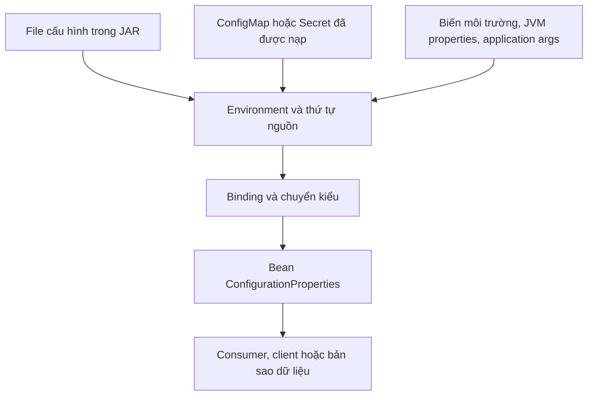

# Truy tìm nguồn ghi đè khi giá trị thực tế khác mong đợi

## 1. Từ “ConfigMap đã đúng” đến một kết luận có bằng chứng

ConfigMap đặt timeout 1.500 ms nhưng bean ứng dụng nhận 7 giây. Sửa ConfigMap lần nữa có thể không thay đổi kết quả, vì thuộc tính đó đang bị đối số khởi chạy ghi đè. Cũng có trường hợp Environment đã thấy giá trị mới nhưng consumer vẫn giữ dữ liệu đã sao chép khi khởi tạo.

Trong module `SPRING_CLOUD_KUBERNETES`, bài thuộc chương **Profile và ưu tiên**, tập trung vào cách tìm đúng nguồn quyết định giá trị, gắn bằng chứng với đúng Pod và phân biệt ghi đè thuộc tính với sai khác do binding hoặc vòng đời consumer. ConfigMap, Secret và profile là đầu vào của việc điều tra; DiscoveryClient, Spring Cloud LoadBalancer, sức khỏe Pod và Configuration Watcher chỉ liên quan khi đường sử dụng dữ liệu thực tế đi qua chúng.

Ví dụ dùng Java 17, Spring Boot 3.2 và Spring Cloud Kubernetes 3.1, nạp Kubernetes PropertySource bằng Config Data. Các dependency cần thuộc một BOM tương thích. Mọi log và kết quả trong bài là kết quả kỳ vọng của bộ dữ liệu minh họa, chưa phải bằng chứng đã chạy trên cluster của người học.

Một kết luận hữu ích cần trả lời được:

- Đang điều tra khóa nào, với giá trị kỳ vọng lấy từ đâu?
- Tiến trình nào đang được quan sát, trong namespace và Pod nào?
- Nguồn ưu tiên nào đang cung cấp khóa đó, origin có chỉ ra vị trí cụ thể không?
- Bean đã bind và consumer thực tế có cùng dùng kết quả ấy không?
- Sau khi sửa nguồn gây ghi đè, giá trị của instance mới có đúng kỳ vọng không?

## 2. Tách ba lớp quan sát trước khi sửa cấu hình



| Lớp quan sát | Câu hỏi trực tiếp | Giới hạn |
| --- | --- | --- |
| Environment / nguồn cấu hình | Khóa hiện được phân giải từ nguồn nào? | Chưa chứng minh bean đã được tạo lại hoặc consumer đã dùng giá trị đó |
| Bean được Spring quản lý | Giá trị sau binding và chuyển kiểu là gì? | Consumer có thể giữ một bản sao hoặc có cấu hình riêng |
| Consumer đang xử lý yêu cầu | Giá trị mà đường nghiệp vụ thực sự sử dụng là gì? | Một consumer đúng chưa đại diện cho tất cả replica hoặc tất cả client |

Nếu Environment và bean cùng sai theo một hướng, ưu tiên tìm nguồn ghi đè. Nếu Environment đúng nhưng bean hoặc consumer khác, xem thời điểm nạp, cách tạo bean, cấu hình client và cơ chế cập nhật. Đây là định hướng điều tra, không phải quy tắc khẳng định chỉ có một nguyên nhân cho mỗi biểu hiện.

Trước khi so sánh, chuẩn hóa kiểu và đơn vị. Chuỗi `1500ms` và đối tượng `Duration` hiển thị `PT1.5S` có cùng ý nghĩa; nhìn hai chuỗi khác nhau không đủ để kết luận ghi đè.

## 3. Thứ tự ưu tiên cần biết trong tình huống này

Đối với ứng dụng Boot thông thường dùng đường Config Data của ví dụ, những nguồn sau có quan hệ từ cao xuống thấp:

| Nguồn | Ví dụ cho `checkout.timeout` |
| --- | --- |
| Application command-line arguments | `--checkout.timeout=7s` |
| `SPRING_APPLICATION_JSON` | Thuộc tính timeout trong JSON được truyền lúc khởi chạy |
| Java system properties | `-Dcheckout.timeout=6s` |
| Biến môi trường hệ điều hành | `CHECKOUT_TIMEOUT=9s` |
| Config Data | File cấu hình và dữ liệu import từ Kubernetes |

Bảng chỉ chọn các nguồn thường gặp trong bài, không thay thế danh mục đầy đủ cho test, servlet container hoặc cấu hình tùy chỉnh. Quy tắc chính thức nằm trong [Spring Boot Externalized Configuration](https://docs.spring.io/spring-boot/docs/3.2.12/reference/html/features.html#features.external-config).

Với một khóa đơn thông thường, giá trị ở nguồn ưu tiên thấp vẫn có thể tồn tại nhưng bị che bởi nguồn cao hơn. Không cần xóa nó khỏi ConfigMap để giải thích tại sao ứng dụng đang nhận giá trị khác.

Trong nhóm Kubernetes, còn phải xét các quy tắc riêng: thứ tự danh sách nguồn, nguồn theo profile, prefix và trùng khóa giữa ConfigMap với Secret. Tài liệu 3.1 quy định ConfigMap có ưu tiên cao hơn Secret khi trùng thuộc tính; không mặc định dữ liệu từ Secret luôn thắng. Xem [Order of ConfigMaps and Secrets](https://docs.spring.io/spring-cloud-kubernetes/reference/3.1/property-source-config/order_of_configMaps_and_secrets.html).

Không áp dụng bảng Config Data cho một hệ thống đang nạp remote properties bằng bootstrap legacy mà chưa kiểm tra cấu hình thực tế. Trước khi giải thích thứ tự, phải biết ứng dụng dùng đường nạp nào.

## 4. Tạo một ca ghi đè có thể tái hiện

### 4.1. Bốn giá trị khác nhau cho cùng một khóa

Ứng dụng minh họa có cấu hình như sau:

| Vị trí | Giá trị khai báo | Giá trị sau chuẩn hóa |
| --- | --- | --- |
| `application.yml` trong JAR | `3s` | 3 giây |
| ConfigMap `checkout-runtime` | `1500ms` | 1,5 giây |
| Biến môi trường container | `9s` | 9 giây |
| Application args | `7s` | 7 giây |

Đội triển khai mong muốn dùng ConfigMap, nhưng hai override trong Pod template khiến giá trị thực tế khác kỳ vọng. Các giá trị được chọn khác nhau để thấy rõ nguồn thắng; nếu mọi nguồn cùng ghi `1500ms`, so sánh giá trị sẽ không xác định được nguồn gốc.

### 4.2. Dependency và cấu hình ứng dụng

Giả định ứng dụng đã có `spring-boot-starter-web`. Bổ sung các dependency sau với phiên bản do dependency management quyết định:

```xml
<dependency>
    <groupId>org.springframework.cloud</groupId>
    <artifactId>spring-cloud-starter-kubernetes-fabric8-config</artifactId>
</dependency>
<dependency>
    <groupId>org.springframework.boot</groupId>
    <artifactId>spring-boot-starter-validation</artifactId>
</dependency>
<dependency>
    <groupId>org.springframework.boot</groupId>
    <artifactId>spring-boot-starter-actuator</artifactId>
</dependency>
```

Ví dụ chọn họ Fabric8 và chỉ cần starter cấu hình. Không thêm discovery hoặc load balancing để xử lý một khóa bị ghi đè, và không kết hợp hai họ client Kubernetes trong cùng ví dụ.

`application.yml` đóng gói cùng ứng dụng:

```yaml
spring:
  application:
    name: checkout-service
  config:
    import: "kubernetes:"
  cloud:
    kubernetes:
      config:
        enabled: true
        enableApi: true
        name: checkout-runtime
        namespace: override-lab
        includeProfileSpecificSources: false
        fail-fast: true
      secrets:
        enabled: false

checkout:
  timeout: 3s
```

Đây là cấu hình cho bài thực hành trong cluster. Không chạy nguyên ví dụ trên máy không có điều kiện truy cập Kubernetes rồi coi lỗi kết nối là lỗi precedence. Import và việc lựa chọn nguồn được mô tả tại [Kubernetes PropertySource implementations](https://docs.spring.io/spring-cloud-kubernetes/reference/3.1/property-source-config.html).

Nguồn theo profile được tắt để profile chẩn đoán không làm ứng dụng tìm thêm ConfigMap có hậu tố ngoài bộ dữ liệu cơ sở. Giá trị 3 giây là fallback có chủ đích để quan sát; nếu chỉ nhìn thấy số 3 mà không kiểm tra nguồn, có thể bỏ sót việc ConfigMap chưa tham gia.

### 4.3. Manifest của môi trường thực hành

Lưu manifest thực hành, chẳng hạn `override-lab.yaml`. Thay image minh họa bằng image thực tế đã chứa ứng dụng. Image phải chuyển các mục `args` bên dưới thành application arguments của Spring Boot.

```yaml
apiVersion: v1
kind: Namespace
metadata:
  name: override-lab
---
apiVersion: v1
kind: ConfigMap
metadata:
  name: checkout-runtime
  namespace: override-lab
data:
  checkout.timeout: "1500ms"
---
apiVersion: v1
kind: ServiceAccount
metadata:
  name: checkout-app
  namespace: override-lab
---
apiVersion: rbac.authorization.k8s.io/v1
kind: Role
metadata:
  name: checkout-config-reader
  namespace: override-lab
rules:
  - apiGroups: [""]
    resources: ["configmaps"]
    verbs: ["get", "list"]
---
apiVersion: rbac.authorization.k8s.io/v1
kind: RoleBinding
metadata:
  name: checkout-config-reader
  namespace: override-lab
subjects:
  - kind: ServiceAccount
    name: checkout-app
    namespace: override-lab
roleRef:
  apiGroup: rbac.authorization.k8s.io
  kind: Role
  name: checkout-config-reader
---
apiVersion: apps/v1
kind: Deployment
metadata:
  name: checkout-service
  namespace: override-lab
spec:
  replicas: 1
  selector:
    matchLabels:
      app: checkout-service
  template:
    metadata:
      labels:
        app: checkout-service
    spec:
      serviceAccountName: checkout-app
      containers:
        - name: app
          image: registry.example.com/learning/checkout-service:override-lab
          args:
            - "--checkout.timeout=7s"
          env:
            - name: SPRING_PROFILES_ACTIVE
              value: config-trace
            - name: CHECKOUT_TIMEOUT
              value: "9s"
          ports:
            - containerPort: 8080
```

Role chỉ phục vụ đọc ConfigMap ban đầu trong namespace lab. Không có yêu cầu Secrets API, discovery hoặc watch trong lượt thử này. Sự tồn tại của ConfigMap dưới tài khoản chạy `kubectl` không chứng minh ServiceAccount của ứng dụng đã đọc nó.

## 5. Quan sát nguồn bằng Actuator mà vẫn che giá trị

### 5.1. Chỉ bật khả năng chẩn đoán cần dùng

Đặt trong `application-config-trace.yml`:

```yaml
management:
  server:
    port: 9091
    address: 127.0.0.1
  endpoints:
    web:
      exposure:
        include: "health,env,configprops"
  endpoint:
    env:
      show-values: never
    configprops:
      show-values: never
```

Cổng quản trị chỉ nghe loopback trong Pod; bài không tạo Service hoặc Ingress cho cổng này. Giữ cơ chế xác thực/phân quyền nếu ứng dụng đã có, và dùng quyền truy cập quản trị phù hợp. Expose một endpoint và cho phép xem giá trị không che là hai quyết định khác nhau.

`show-values: never` giữ các giá trị ở dạng che. Chuỗi `******` trong JSON không có nghĩa ứng dụng đã bind sáu dấu sao. Chính sách này được giải thích trong [Actuator: Sanitize Sensitive Values](https://docs.spring.io/spring-boot/docs/3.2.12/reference/html/actuator.html#actuator.endpoints.sanitization).

### 5.2. Gắn phiên quan sát với một Pod cụ thể

Sau khi chuẩn bị image và manifest:

```powershell
kubectl apply -f .\override-lab.yaml
kubectl -n override-lab get pods -l app=checkout-service -o wide

$podName = 'THAY-BANG-TEN-POD-THUC'
kubectl -n override-lab get pod $podName -o 'custom-columns=NAME:.metadata.name,UID:.metadata.uid,SA:.spec.serviceAccountName,IMAGE:.spec.containers[*].image,START:.status.startTime'
kubectl -n override-lab port-forward pod/$podName 19091:9091
```

Giữ terminal port-forward mở. Ở terminal khác:

```powershell
$details = Invoke-RestMethod -Uri 'http://127.0.0.1:19091/actuator/env/checkout.timeout'
$details.property.source
$details.activeProfiles
$details.propertySources |
    Where-Object { $null -ne $_.property } |
    Select-Object name, @{Name='origin'; Expression={$_.property.origin}}
```

Lệnh này chỉ trình bày nguồn và origin cho đúng khóa đang điều tra, không yêu cầu xuất toàn bộ Environment. Nếu endpoint trả 401/403 hoặc chưa được expose, xử lý điều kiện truy cập trước; không suy đó là bằng chứng khóa bị thiếu.

### 5.3. Đọc đúng trường trong phản hồi

Với baseline, cần tìm:

- `property.source`: dự kiến là `commandLineArgs`.
- `propertySources`: các nguồn theo thứ tự ưu tiên, trong đó có thể thấy nhiều nguồn cùng cung cấp khóa.
- `propertySources[].property.origin`: vị trí hoặc nguồn gốc cụ thể nếu runtime có cung cấp.
- `activeProfiles`: xác nhận phiên quan sát đang dùng đúng tập profile.

Một trích đoạn JSON minh họa, đã rút gọn:

```json
{
  "property": {
    "source": "commandLineArgs",
    "value": "******"
  },
  "propertySources": [
    {
      "name": "commandLineArgs",
      "property": { "value": "******" }
    },
    {
      "name": "systemEnvironment",
      "property": { "value": "******" }
    }
  ]
}
```

Cấu trúc đầy đủ được mô tả tại [Actuator Web API: Environment](https://docs.spring.io/spring-boot/docs/3.2.12/actuator-api/htmlsingle/#env). Không cố định tên PropertySource Kubernetes hoặc một chuỗi origin theo phỏng đoán; tên và metadata có thể khác theo client, phiên bản và cách nạp.

Origin có thể không tồn tại. Không tự điền dòng/cột hoặc resourceVersion của ConfigMap nếu đầu ra không cung cấp. Tên nguồn là bằng chứng về đường phân giải; mức độ chi tiết của origin quyết định có thể truy ngược tới đâu.

### 5.4. Đối chiếu bean, không dừng ở Environment

Truy vấn prefix của bean:

```powershell
Invoke-RestMethod -Uri 'http://127.0.0.1:19091/actuator/configprops/checkout' |
    ConvertTo-Json -Depth 12
```

Trong response, xác định context và bean có prefix `checkout`; xem phần `properties` và `inputs`, bao gồm origin nếu có. Không tự đoán một bean ID cố định rồi dùng nó làm điều kiện cho mọi ứng dụng.

Vì dữ liệu vẫn được che, endpoint chủ yếu giúp đối chiếu bean và đầu vào binding. Để xác nhận số timeout cụ thể của bộ dữ liệu không nhạy cảm, dùng phép quan sát Java ở phần sau. `configprops` không thay thế việc đọc consumer có thể đang giữ một bản sao.

## 6. Truy dấu một khóa qua API của Spring Boot

### 6.1. Bean và consumer mẫu

Tạo kiểu cấu hình và đăng ký nó trong ứng dụng:

```java
package example.checkout;

import java.time.Duration;
import jakarta.validation.constraints.NotNull;
import org.springframework.boot.context.properties.ConfigurationProperties;
import org.springframework.validation.annotation.Validated;

@Validated
@ConfigurationProperties(prefix = "checkout")
public record CheckoutProperties(@NotNull Duration timeout) {
}
```

```java
package example.checkout;

import org.springframework.boot.SpringApplication;
import org.springframework.boot.autoconfigure.SpringBootApplication;
import org.springframework.boot.context.properties.EnableConfigurationProperties;

@SpringBootApplication
@EnableConfigurationProperties(CheckoutProperties.class)
public class CheckoutApplication {
    public static void main(String[] args) {
        SpringApplication.run(CheckoutApplication.class, args);
    }
}
```

Consumer sau chỉ minh họa một đối tượng giữ snapshot, chưa thực hiện HTTP:

```java
package example.checkout;

import java.time.Duration;
import org.springframework.stereotype.Component;

@Component
public class CheckoutConsumer {
    private final Duration timeoutInUse;

    public CheckoutConsumer(CheckoutProperties properties) {
        this.timeoutInUse = properties.timeout();
    }

    public Duration timeoutInUse() {
        return timeoutInUse;
    }
}
```

### 6.2. Chỉ liệt kê các nguồn chứa khóa đang điều tra

`ConfigurationPropertySources` cung cấp các nguồn đã được Spring Boot thích nghi cho đường xử lý configuration properties. Dùng khóa canonical như `checkout.timeout` giúp theo dõi đường binding thay vì tự quét mọi tên biến môi trường bằng so sánh chuỗi.

Tạo `ConfigTraceConfiguration.java` cùng package:

```java
package example.checkout;

import java.util.Arrays;

import org.slf4j.Logger;
import org.slf4j.LoggerFactory;
import org.springframework.boot.ApplicationRunner;
import org.springframework.boot.context.properties.source.ConfigurationProperty;
import org.springframework.boot.context.properties.source.ConfigurationPropertyName;
import org.springframework.boot.context.properties.source.ConfigurationPropertySource;
import org.springframework.boot.context.properties.source.ConfigurationPropertySources;
import org.springframework.context.annotation.Bean;
import org.springframework.context.annotation.Configuration;
import org.springframework.context.annotation.Profile;
import org.springframework.core.env.Environment;
import org.springframework.core.env.PropertySource;

@Configuration(proxyBeanMethods = false)
@Profile("config-trace")
public class ConfigTraceConfiguration {
    private static final Logger log =
        LoggerFactory.getLogger(ConfigTraceConfiguration.class);
    private static final String KEY = "checkout.timeout";

    @Bean
    ApplicationRunner traceCheckoutTimeout(
            Environment environment,
            CheckoutProperties properties,
            CheckoutConsumer consumer) {
        return args -> {
            ConfigurationPropertyName name = ConfigurationPropertyName.of(KEY);
            int rank = 0;

            for (ConfigurationPropertySource source
                    : ConfigurationPropertySources.get(environment)) {
                ConfigurationProperty candidate = source.getConfigurationProperty(name);
                if (candidate == null) {
                    continue;
                }

                rank++;
                Object underlying = source.getUnderlyingSource();
                String sourceName = underlying instanceof PropertySource<?> ps
                    ? ps.getName()
                    : source.getClass().getSimpleName();

                log.info(
                    "CONFIG_CANDIDATE key={} rank={} first={} source={} origin={}",
                    KEY, rank, rank == 1, sourceName,
                    candidate.getOrigin() == null ? "<unknown>" : candidate.getOrigin()
                );
            }

            log.info(
                "CONFIG_SNAPSHOT key={} profiles={} resolvedText={} "
                    + "beanTimeout={} consumerTimeout={} candidates={}",
                KEY, Arrays.toString(environment.getActiveProfiles()),
                environment.getProperty(KEY), properties.timeout(),
                consumer.timeoutInUse(), rank
            );
        };
    }
}
```

API dùng trong ví dụ được mô tả tại [ConfigurationPropertySources](https://docs.spring.io/spring-boot/docs/3.2.12/api/org/springframework/boot/context/properties/source/ConfigurationPropertySources.html), [ConfigurationPropertySource](https://docs.spring.io/spring-boot/docs/3.2.12/api/org/springframework/boot/context/properties/source/ConfigurationPropertySource.html) và [ConfigurationProperty](https://docs.spring.io/spring-boot/docs/3.2.12/api/org/springframework/boot/context/properties/source/ConfigurationProperty.html).

Đoạn mã không gọi `toString()` lên đối tượng nguồn hoặc toàn bộ candidate để tránh vô tình đưa dữ liệu nguồn ra log. Chỉ timeout của fixture, một thuộc tính không nhạy cảm đã chọn trước, được in giá trị. Không biến mã này thành công cụ log tùy ý mọi khóa, đặc biệt là password, token hoặc connection string.

### 6.3. Diễn giải kết quả trong baseline

Kết quả cần quan sát gồm nguồn ứng viên đầu tiên là application args và snapshot tương đương:

```text
CONFIG_CANDIDATE key=checkout.timeout rank=1 first=true source=commandLineArgs origin=...
CONFIG_SNAPSHOT key=checkout.timeout profiles=... resolvedText=7s beanTimeout=PT7S consumerTimeout=PT7S candidates=...
```

Dấu `...` là chỗ phụ thuộc runtime, không phải chuỗi đầu ra cần khớp nguyên văn. Danh sách candidate vẫn có thể cho thấy biến môi trường, ConfigMap và file trong JAR ở phía sau.

`first=true` chỉ nguồn đầu tiên cung cấp khóa trong chuỗi nguồn được quan sát. Nó không chứng minh một consumer khác hoặc instance khác cũng dùng cùng snapshot. Mã chạy ở thời điểm khởi động; không phải endpoint theo dõi mọi thay đổi tương lai.

Nếu chỉ duyệt trực tiếp `environment.getPropertySources()` trong một công cụ khác, có thể thấy wrapper `configurationProperties` hoặc CompositePropertySource. Wrapper không phải tài nguyên Kubernetes mới và không đủ để kết luận nguồn gốc cuối cùng. Cần đi theo nguồn bên dưới hoặc dùng API thích nghi như trong ví dụ.

## 7. Truy ngược từ nguồn thắng tới cấu hình khởi chạy

Sau khi biết `commandLineArgs` thắng, kiểm tra đúng khóa trong Pod của phiên quan sát:

```powershell
$podName = 'THAY-BANG-TEN-POD-THUC'
$pod = kubectl -n override-lab get pod $podName -o json | ConvertFrom-Json
$container = $pod.spec.containers | Where-Object { $_.name -eq 'app' }

$container.args | Where-Object { $_ -like '--checkout.timeout=*' }
$container.env |
    Where-Object { $_.name -eq 'CHECKOUT_TIMEOUT' } |
    Select-Object name, value, valueFrom |
    ConvertTo-Json -Depth 6
```

Chỉ xuất phần liên quan đến khóa không nhạy cảm của bài. PodSpec cho biết cấu hình container đã được khai báo; các giá trị mặc định trong image entrypoint hoặc biến môi trường do đường khởi chạy khác đưa vào cần được đối chiếu thêm bằng bằng chứng từ tiến trình. Không giả định `args` trong manifest luôn là toàn bộ đối số JVM và ứng dụng.

| Nguồn thắng quan sát được | Nơi cần truy ngược |
| --- | --- |
| `commandLineArgs` | Pod args, script/entrypoint, tham số IDE hoặc cấu hình chạy |
| `spring.application.json` | Đầu vào `SPRING_APPLICATION_JSON` hoặc thuộc tính tương ứng, chỉ kiểm tra phần được phép công bố |
| `systemProperties` | JVM `-D`, cấu hình launcher, `JAVA_TOOL_OPTIONS`, `JDK_JAVA_OPTIONS` |
| `systemEnvironment` | Pod env, envFrom, giá trị từ ConfigMap/Secret key reference và môi trường tiến trình |
| File Config Data | Profile, đường dẫn file thực tế, file ngoài JAR, import và artifact đang chạy |
| Kubernetes PropertySource | Loại tài nguyên, tên nguồn, namespace, profile-specific source, prefix và quyền đọc |

Nếu ứng dụng dùng `envFrom`, Kubernetes chọn nguồn đứng sau khi trùng tên biến, còn mục `env` tường minh thắng biến cùng tên từ `envFrom`. Đây là ưu tiên ở tầng tạo môi trường container; sau đó Spring lại phân giải các PropertySource của nó. Xem [Kubernetes Pod API](https://kubernetes.io/docs/reference/kubernetes-api/core/pod-v1/).

Một giá trị có thể có hai lớp nguồn gốc: Spring báo `systemEnvironment`, còn biến ấy được kubelet lấy từ một Secret. Không gọi nó là Secrets PropertySource của Spring Cloud Kubernetes nếu ứng dụng thực tế nhận dữ liệu qua biến môi trường.

## 8. Sửa và kiểm chứng theo từng nguyên nhân

### 8.1. Bóc từng override của ví dụ

Thay đổi manifest theo từng lượt, không sửa đồng thời mọi nguồn rồi kết luận nguyên nhân đã được tìm ra:

| Lượt | Thay đổi | Nguồn dự kiến thắng | Timeout dự kiến |
| --- | --- | --- | --- |
| A | Giữ baseline | Application args | 7 giây |
| B | Xóa mục args `--checkout.timeout=7s`, giữ biến môi trường | `systemEnvironment` | 9 giây |
| C | Xóa thêm env `CHECKOUT_TIMEOUT`, giữ ConfigMap | Kubernetes ConfigMap PropertySource | 1,5 giây |

Sau mỗi sửa đổi Pod template:

```powershell
kubectl apply -f .\override-lab.yaml
kubectl -n override-lab rollout status deployment/checkout-service --timeout=120s
kubectl -n override-lab get pods -l app=checkout-service -o wide
```

Chọn Pod mới, ghi UID, mở lại port-forward nếu cần và đối chiếu nguồn cùng snapshot. Với lượt C, kết luận chỉ đủ khi nguồn thắng phù hợp với ConfigMap đã chọn và giá trị sau chuyển kiểu là 1,5 giây. Chỉ nhìn đúng số mà không xem nguồn có thể bỏ sót một bản sao trùng giá trị ở nơi khác.

Thay đổi ConfigMap đơn thuần không nhất thiết tạo Pod mới. Nếu thử một bộ dữ liệu ConfigMap khác trong bài không triển khai refresh, cần chủ động tạo lần khởi động mới:

```powershell
kubectl -n override-lab rollout restart deployment/checkout-service
```

Đây là cách tạo lượt kiểm chứng của bài, không phải khẳng định mọi hệ thống đều phải restart khi đổi một thuộc tính.

### 8.2. Kiểm tra trường hợp nguồn cao hơn chứa dữ liệu sai

Đổi application argument của baseline thành `--checkout.timeout=very-fast`. Binding sang `Duration` dự kiến thất bại. Không mong framework tự bỏ qua giá trị cao hơn để thử `9s` ở biến môi trường hoặc `1500ms` ở ConfigMap.

Khi ứng dụng không khởi động hoàn chỉnh, Actuator có thể chưa sẵn sàng. Khi đó lấy lỗi binding gốc, khóa, source/origin nếu log có cung cấp và đúng log container của lượt chạy. Không chờ một endpoint chưa thể hoạt động để chứng minh lỗi đã xảy ra.

### 8.3. Sửa nguồn sở hữu override

Nếu override nằm trong manifest được quản lý bằng công cụ triển khai, sửa nơi quản lý cấu hình đó rồi triển khai lại theo quy trình của hệ thống. Một thay đổi thủ công ở Pod hoặc tài nguyên sinh ra có thể bị lần reconcile kế tiếp khôi phục.

Không tăng timeout của ConfigMap cho bằng 7 giây chỉ để làm kết quả trông khớp trong khi kỳ vọng thực sự là 1,5 giây. Cần quyết định nguồn nào được phép sở hữu khóa và loại bỏ hoặc sửa override không còn chủ đích.

## 9. Những trường hợp cần mở rộng đường truy dấu

### 9.1. Profile đúng nhưng file hoặc tài nguyên không đúng

Kiểm tra tập profile đang hoạt động của đúng tiến trình. Các file profile-specific, file ngoài JAR hoặc nguồn Kubernetes theo profile có thể bổ sung giá trị khác. Namespace Kubernetes không tự chọn profile nghiệp vụ và tên tài nguyên cũng không tự bảo đảm đúng môi trường.

Đối với nhiều ConfigMap, kiểm tra `sources`, thứ tự khai báo và prefix. Đối với dữ liệu YAML nhúng, kiểm tra tài liệu/file nào được xử lý thay vì chỉ tìm một khóa có vẻ đúng trong manifest. Các cơ chế này được mô tả tại [Using a ConfigMap PropertySource](https://docs.spring.io/spring-cloud-kubernetes/reference/3.1/property-source-config/configmap-propertysource.html).

Nếu sửa file trong kho mã nhưng image chưa được build/rollout tương ứng, tiến trình vẫn có thể đọc bản cũ. Gắn điều tra với image thực tế và Pod UID, không chỉ tên Deployment.

### 9.2. Placeholder tạo thêm một mắt xích nguồn gốc

Giả sử giá trị được khai báo là:

```yaml
checkout:
  timeout: "${REQUEST_TIMEOUT:1500ms}"
```

Nguồn cung cấp `checkout.timeout` có thể là file hoặc ConfigMap chứa biểu thức, nhưng giá trị sau phân giải còn phụ thuộc `REQUEST_TIMEOUT`. Cần truy tiếp đầu vào placeholder, kể cả default sau dấu `:`, thay vì kết luận toàn bộ giá trị cuối cùng là một literal của nguồn đầu tiên.

Mã trace ở phần 6 chỉ theo dõi một khóa đã chọn; không tự xây toàn bộ cây phụ thuộc placeholder. Khi mở rộng công cụ, giới hạn các khóa và metadata được phép quan sát, không in các giá trị bí mật mà placeholder có thể tham chiếu.

### 9.3. Environment và bean/consumer không cùng thời điểm

Sau cập nhật cấu hình, so sánh ba lớp tại thời điểm được ghi nhận. Một bean tự tạo bằng `new`, một client khởi tạo từ giá trị cũ hoặc một trường đã sao chép có thể khác Environment hiện tại mà không có thêm nguồn ghi đè nào.

Record `@ConfigurationProperties` của ví dụ phục vụ lần nạp khởi động. Tài liệu Spring Cloud Commons 4.1 nêu record loại này không được refresh; không mặc định thay ConfigMap sẽ thay record đang inject. Xem [Environment Changes và Refresh Scope](https://docs.spring.io/spring-cloud-commons/reference/4.1/spring-cloud-commons/application-context-services.html).

Configuration Watcher có thể thông báo thay đổi theo cấu hình triển khai, nhưng không tự chứng minh consumer đã nhận dữ liệu mới hoặc làm một nguồn ưu tiên thấp vượt nguồn cao. Xem [Spring Cloud Kubernetes Configuration Watcher](https://docs.spring.io/spring-cloud-kubernetes/reference/3.1/spring-cloud-kubernetes-configuration-watcher.html).

### 9.4. Danh sách, map và giá trị mặc định

Khóa scalar của bài chỉ là điểm khởi đầu. Khi bind một danh sách hoặc đối tượng phức tạp, cần quan sát toàn bộ cấu trúc mà consumer dùng; không suy toàn bộ danh sách từ một phần tử đúng. Khi bean có default hoặc giá trị khởi tạo trong Java, trường có dữ liệu chưa chứng minh nguồn bên ngoài đã nạp.

Nếu tìm thấy nhiều nguồn cùng khai báo một khóa nhưng bean vẫn khác mọi giá trị dự kiến, kiểm tra conversion, default, validator và cách tạo bean trước khi tiếp tục thêm một override mới.

## 10. Ghi nhận kết luận và giới hạn của bằng chứng

### 10.1. Mẫu ghi nhận cho thuộc tính không nhạy cảm

Với baseline, một bản ghi điều tra có thể có cấu trúc sau; thông tin instance và thời điểm phải được điền từ lượt chạy thật:

```text
KEY=checkout.timeout
EXPECTED_VALUE=PT1.5S
EXPECTED_SOURCE=ConfigMap checkout-runtime trong override-lab
OBSERVED_ENVIRONMENT=7s
OBSERVED_BEAN=PT7S
OBSERVED_CONSUMER=PT7S
WINNING_SOURCE=commandLineArgs
OVERRIDE_LOCATION=container app, args --checkout.timeout=7s
POD_UID=<UID đã quan sát>
IMAGE=<image thực tế>
OBSERVED_AT=<thời điểm quan sát>
NEXT_ACTION=loại override args và kiểm tra tiếp biến CHECKOUT_TIMEOUT
```

Không dùng nguyên mẫu này để ghi token hoặc mật khẩu. Với khóa nhạy cảm, ghi nguồn, trạng thái có mặt, kết quả kiểm tra được phép công bố và metadata liên quan, thay cho nội dung bí mật.

Metadata hiện tại của ConfigMap chỉ mô tả tài nguyên lúc truy vấn. ResourceVersion hiện tại không tự chứng minh bean được bind từ chính phiên bản đó; cần thêm thời điểm nạp, dữ liệu/origin có sẵn hoặc cơ chế quan sát đã được thiết kế cho hệ thống.

### 10.2. Bảng khoanh vùng nhanh

| Quan sát | Hướng điều tra tiếp |
| --- | --- |
| ConfigMap đúng, source thắng là commandLineArgs | Tìm application args của tiến trình và nơi quản lý cấu hình khởi chạy |
| Source thắng là systemEnvironment | Truy Pod env, envFrom và key reference của đúng biến |
| Source là file lạ ngoài JAR | Kiểm tra đường dẫn cấu hình, profile, mount và import |
| Không thấy nguồn ConfigMap dự kiến | Kiểm tra import, namespace, name/sources, quyền đọc và profile |
| Thấy giá trị đúng nhưng origin không có | Giữ đúng mức kết luận; không tự suy dòng/cột hoặc phiên bản tài nguyên |
| Environment khác bean | Kiểm tra thời điểm, cách bind và vòng đời bean |
| Bean đúng nhưng client vẫn dùng giá trị khác | Quan sát chính client, bản sao khi khởi tạo và cấu hình riêng của consumer |
| Chỉ một replica sai | So Pod UID, image, args, env và thời điểm khởi động giữa các instance |
| Giá trị ở endpoint là ****** | Đây là sanitization; xem nguồn/origin và phép kiểm tra được phép công bố |
| Lỗi binding làm endpoint không hoạt động | Dùng lỗi gốc và log đúng container/lần chạy |

Một cuộc điều tra kết thúc khi chỉ ra được khóa, nguồn ghi đè, nơi khai báo override và giá trị consumer thực sự dùng; sau đó có bằng chứng trên instance phù hợp rằng thay đổi đã đưa hệ thống về kỳ vọng. Pod Running, ConfigMap tồn tại hoặc một lần refresh thành công riêng lẻ chưa đủ để thay thế chuỗi bằng chứng này.
