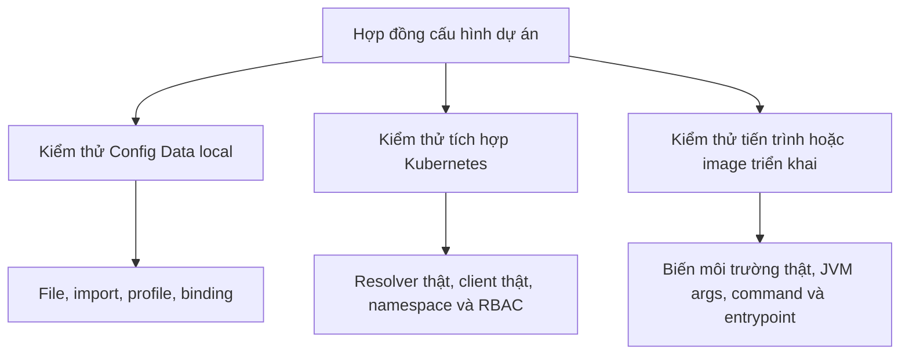

# Viết kiểm thử để xác nhận thứ tự ưu tiên của dự án

## Mục tiêu và tình huống thực tế

Trong module SPRING_CLOUD_KUBERNETES, ứng dụng Spring tích hợp với Kubernetes qua DiscoveryClient, ConfigMap, Secret, Spring Cloud LoadBalancer và Configuration Watcher. Khi một thuộc tính xuất hiện trong nhiều nguồn, giá trị được ứng dụng sử dụng phụ thuộc cơ chế nạp, profile, tập nguồn và thứ tự ưu tiên của phiên bản đang chạy.

Giả sử `orders-service` có giá trị mặc định trong image, cấu hình theo profile, ConfigMap, Secret và một biến môi trường dùng cho vận hành. Một kiểm thử chỉ xác nhận “ứng dụng khởi động được” không chứng minh nguồn mong muốn đã thắng. Cần chủ động tạo xung đột bằng dữ liệu giả, rồi kiểm tra giá trị có hiệu lực và việc các nguồn liên quan thực sự được nạp.

Bài này dùng ví dụ **Spring Boot 3.5.x**, **Spring Cloud Kubernetes 3.3.x**, JUnit Jupiter và AssertJ. Dependency phải theo BOM của dự án. Các đoạn mã là nội dung để đưa vào dự án thực hành; chúng không phải báo cáo rằng bộ kiểm thử đã được chạy trong môi trường của bạn.

## 1. Chuyển quy tắc ưu tiên thành hợp đồng kiểm thử

Một trường hợp kiểm thử cần trả lời bốn câu:

1. Những nguồn nào đang tham gia?
2. Mỗi nguồn cung cấp giá trị giả khác nhau nào cho cùng key?
3. Nguồn nào được yêu cầu thắng trong cấu hình dự án?
4. Bằng chứng nào xác nhận các nguồn còn lại đã được đọc, thay vì bị bỏ qua?

Ví dụ hợp đồng:

```text
Key kiểm thử: lab.value
Nguồn A: file application.yaml, giá trị from-base
Nguồn B: file imported.yaml, giá trị from-import
Kỳ vọng: from-import
Bằng chứng nạp nguồn B: lab.marker-import = import-loaded
Đối tượng nhận: Environment và LabProperties
```

Các marker là dữ liệu giả không nhạy cảm. Không dùng password hoặc token thật: thông báo assertion thất bại thường chứa cả expected và actual.

### Ma trận kiểm thử ban đầu

| Quan hệ cần kiểm tra | Nguồn cạnh tranh | Kỳ vọng trong ví dụ |
| --- | --- | --- |
| Import và tài liệu khai báo nó | `application.yaml`, `imported.yaml` | Giá trị từ import |
| Profile và cấu hình nền | Tài liệu nền, `application-prod.yaml` | Giá trị profile cho key được khai báo |
| Môi trường và Config Data | `LAB_VALUE`, file cấu hình | Giá trị môi trường |
| Java system property và môi trường | `lab.value`, `LAB_VALUE` | Giá trị system property |
| Đối số và các nguồn trên | `--lab.value`, system property, môi trường, file | Giá trị đối số |
| ConfigMap và Secret | Cùng key giả ở hai nguồn đã bật | Theo cơ chế và phiên bản đã chốt |
| Nguồn bắt buộc không đọc được | Thiếu tài nguyên hoặc thiếu quyền | Hành vi lỗi đã quy định, không thành công nhờ mặc định |

Đây là ma trận theo những nguồn cụ thể đang kiểm tra, không phải toàn bộ thứ tự của mọi loại PropertySource. Spring Boot có thêm các nguồn dành cho test và các tình huống triển khai khác. Xem [Externalized Configuration](https://docs.spring.io/spring-boot/3.5/reference/features/external-config.html).

## 2. Tách kiểm thử nạp file khỏi kiểm thử Kubernetes



Tầng local chạy nhanh và dễ cô lập. Nó không chứng minh resolver Kubernetes đã đọc ConfigMap hay Secret.

Tầng tích hợp chạy đúng thư viện và client với nguồn dữ liệu có kiểm soát. Nó không thay thế kiểm tra entrypoint của image hoặc cách nền tảng cấp biến môi trường.

Tầng tiến trình kiểm tra môi trường thực tế của chương trình được triển khai. Không nên gọi một `MapPropertySource` tự tạo là bằng chứng đã thử biến môi trường thật của container.

## 3. Tạo fixture Config Data có xung đột quan sát được

Dependency test phổ biến:

```xml
<dependency>
    <groupId>org.springframework.boot</groupId>
    <artifactId>spring-boot-starter-test</artifactId>
    <scope>test</scope>
</dependency>
```

Dùng thư mục fixture riêng để tránh vô tình đọc cấu hình ứng dụng thật:

```text
src/test/resources/precedence-lab/
├── application.yaml
├── application-prod.yaml
└── imported.yaml
```

`application.yaml`:

```yaml
spring:
  config:
    import: "classpath:/precedence-lab/imported.yaml"

lab:
  value: "from-base"
  timeout-ms: 1000
  marker-base: "base-loaded"
```

`imported.yaml`:

```yaml
lab:
  value: "from-import"
  timeout-ms: 2000
  marker-import: "import-loaded"
```

`application-prod.yaml`:

```yaml
lab:
  value: "from-prod"
  timeout-ms: 3000
  marker-profile: "prod-loaded"
```

Ba giá trị của `lab.value` khác nhau để nhận diện nguồn thắng. Các marker riêng giúp chứng minh nguồn đã nạp mà không phụ thuộc key đang bị ghi đè.

Không đặt cùng một chuỗi ở mọi nguồn. Nếu tất cả đều là `expected`, kiểm thử không phát hiện được việc đổi thứ tự.

## 4. Viết kiểm thử local bằng đường khởi động Config Data thật

Ví dụ dưới dùng JUnit thông thường và `SpringApplicationBuilder`. Nó không dùng `@SpringBootTest(properties = "lab.value=...")` để cấp chính giá trị đang kiểm tra.

Mỗi lần khởi động có một `StandardEnvironment` mới. Hai nguồn môi trường và system property được thay bằng dữ liệu có kiểm soát trong context thử nghiệm, không sửa trạng thái global của JVM.

```java
package example.precedence;

import java.util.ArrayList;
import java.util.List;
import java.util.Map;

import org.junit.jupiter.api.Test;

import org.springframework.boot.Banner;
import org.springframework.boot.WebApplicationType;
import org.springframework.boot.builder.SpringApplicationBuilder;
import org.springframework.boot.context.properties.ConfigurationProperties;
import org.springframework.boot.context.properties.EnableConfigurationProperties;
import org.springframework.boot.context.properties.source.ConfigurationProperty;
import org.springframework.boot.context.properties.source.ConfigurationPropertyName;
import org.springframework.boot.context.properties.source.ConfigurationPropertySource;
import org.springframework.boot.context.properties.source.ConfigurationPropertySources;
import org.springframework.context.ConfigurableApplicationContext;
import org.springframework.context.annotation.Configuration;
import org.springframework.core.env.ConfigurableEnvironment;
import org.springframework.core.env.MapPropertySource;
import org.springframework.core.env.StandardEnvironment;
import org.springframework.core.env.SystemEnvironmentPropertySource;

import static org.assertj.core.api.Assertions.assertThat;

class PrecedenceContractTest {

    @ConfigurationProperties(prefix = "lab")
    public record LabProperties(String value, int timeoutMs) {
    }

    @Configuration(proxyBeanMethods = false)
    @EnableConfigurationProperties(LabProperties.class)
    static class ProbeConfiguration {
    }

    @Test
    void importedFileOverridesItsDeclaringDocument() {
        try (var context = start(Map.of(), Map.of())) {
            assertWinner(context, "from-import");

            assertThat(context.getBean(LabProperties.class).timeoutMs())
                    .isEqualTo(2000);
            assertThat(context.getEnvironment()
                    .getProperty("lab.marker-base"))
                    .isEqualTo("base-loaded");
            assertThat(context.getEnvironment()
                    .getProperty("lab.marker-import"))
                    .isEqualTo("import-loaded");
            assertThat(origin(context.getEnvironment(), "lab.value"))
                    .contains("imported.yaml");
        }
    }

    @Test
    void prodProfileSelectsItsConfiguredValue() {
        try (var context = start(
                Map.of(),
                Map.of(),
                "--spring.profiles.active=prod")) {

            assertWinner(context, "from-prod");

            assertThat(context.getEnvironment().getActiveProfiles())
                    .contains("prod");
            assertThat(context.getEnvironment()
                    .getProperty("lab.marker-profile"))
                    .isEqualTo("prod-loaded");
            assertThat(context.getEnvironment()
                    .getProperty("lab.marker-import"))
                    .isEqualTo("import-loaded");
            assertThat(context.getBean(LabProperties.class).timeoutMs())
                    .isEqualTo(3000);
        }
    }

    @Test
    void environmentSourceOverridesConfigData() {
        try (var context = start(
                Map.of("LAB_VALUE", "from-env"),
                Map.of())) {

            assertWinner(context, "from-env");
            assertThat(context.getEnvironment()
                    .getProperty("lab.marker-import"))
                    .isEqualTo("import-loaded");
        }
    }

    @Test
    void systemPropertySourceOverridesEnvironmentSource() {
        try (var context = start(
                Map.of("LAB_VALUE", "from-env"),
                Map.of("lab.value", "from-system"))) {

            assertWinner(context, "from-system");
        }
    }

    @Test
    void commandLineOverridesOtherConfiguredSources() {
        try (var context = start(
                Map.of("LAB_VALUE", "from-env"),
                Map.of("lab.value", "from-system"),
                "--lab.value=from-cli")) {

            assertWinner(context, "from-cli");
            assertThat(context.getEnvironment()
                    .getProperty("lab.marker-import"))
                    .isEqualTo("import-loaded");
        }
    }

    private static ConfigurableApplicationContext start(
            Map<String, Object> environmentValues,
            Map<String, Object> systemValues,
            String... extraArguments) {

        StandardEnvironment environment = new StandardEnvironment();

        environment.getPropertySources().replace(
                StandardEnvironment.SYSTEM_ENVIRONMENT_PROPERTY_SOURCE_NAME,
                new SystemEnvironmentPropertySource(
                        StandardEnvironment.SYSTEM_ENVIRONMENT_PROPERTY_SOURCE_NAME,
                        environmentValues));

        environment.getPropertySources().replace(
                StandardEnvironment.SYSTEM_PROPERTIES_PROPERTY_SOURCE_NAME,
                new MapPropertySource(
                        StandardEnvironment.SYSTEM_PROPERTIES_PROPERTY_SOURCE_NAME,
                        systemValues));

        List<String> arguments = new ArrayList<>();
        arguments.add(
                "--spring.config.location=classpath:/precedence-lab/");
        arguments.addAll(List.of(extraArguments));

        return new SpringApplicationBuilder(ProbeConfiguration.class)
                .environment(environment)
                .web(WebApplicationType.NONE)
                .bannerMode(Banner.Mode.OFF)
                .logStartupInfo(false)
                .run(arguments.toArray(String[]::new));
    }

    private static void assertWinner(
            ConfigurableApplicationContext context,
            String expected) {

        assertThat(context.getEnvironment().getProperty("lab.value"))
                .isEqualTo(expected);
        assertThat(context.getBean(LabProperties.class).value())
                .isEqualTo(expected);
    }

    private static String origin(
            ConfigurableEnvironment environment,
            String key) {

        ConfigurationPropertyName name =
                ConfigurationPropertyName.of(key);

        for (ConfigurationPropertySource source
                : ConfigurationPropertySources.get(environment)) {

            ConfigurationProperty property =
                    source.getConfigurationProperty(name);

            if (property != null) {
                assertThat(property.getOrigin()).isNotNull();
                return property.getOrigin().toString();
            }
        }

        throw new AssertionError("Expected synthetic key was not found");
    }
}
```

### Những điều bộ kiểm thử này xác nhận

`spring.config.location` được cấp qua đối số để chọn đúng thư mục fixture và thay tập vị trí mặc định. Các file được nạp bởi Config Data, không phải đọc YAML thủ công rồi tự sắp xếp.

`ProbeConfiguration` là cấu hình nhỏ cho kiểm thử local. Nó không bật toàn bộ auto-configuration của ứng dụng và không gọi Kubernetes. Vì vậy bộ kiểm thử này xác nhận phần Config Data local và binding, chưa chứng minh cấu hình triển khai đầy đủ của `orders-service`.

`SystemEnvironmentPropertySource` mô hình hóa cách ánh xạ `LAB_VALUE`. Nó không thay đổi biến môi trường của hệ điều hành. Muốn kiểm tra biến được entrypoint hoặc container cấp thật, cần tầng tiến trình.

Cặp assertion trên `Environment` và `LabProperties` giúp phát hiện việc kết quả phân giải và kết quả binding không giống giả định. Với list, map hoặc kiểu dữ liệu phức tạp của dự án, bổ sung assertion trên đối tượng đã bind thay vì chỉ đọc một key chuỗi.

### Kiểm tra origin mà không khóa toàn bộ chuỗi mô tả

`ConfigurationProperty` có thể chứa thông tin origin. Ví dụ chỉ kiểm tra tên tài nguyên liên quan, không so khớp toàn bộ chuỗi có đường dẫn tuyệt đối và số dòng.

Không phải nguồn nào cũng cung cấp origin giống nhau. Với nguồn không có origin, dùng marker và metadata của adapter phù hợp thay vì bịa một origin cố định. Xem API [ConfigurationProperty](https://docs.spring.io/spring-boot/3.5/api/java/org/springframework/boot/context/properties/source/ConfigurationProperty.html) và [ConfigurationPropertySources](https://docs.spring.io/spring-boot/3.5/api/java/org/springframework/boot/context/properties/source/ConfigurationPropertySources.html).

## 5. Tránh để framework test tự cấp giá trị thắng

Một cách viết không chứng minh quan hệ ConfigMap và Secret:

```java
@SpringBootTest(properties = "lab.value=from-configmap")
class MisleadingPrecedenceTest {
    // Assertion lab.value == from-configmap chỉ chứng minh giá trị test có hiệu lực.
}
```

Tương tự, nếu `@TestPropertySource`, `@DynamicPropertySource` hoặc một helper `addFirst` tự chèn `lab.value`, kết quả có thể bị quyết định bởi lớp test thay vì các nguồn cần kiểm chứng.

Phân biệt hai loại thuộc tính:

| Vai trò | Ví dụ | Có thể cấp từ harness? |
| --- | --- | --- |
| Điều khiển môi trường kiểm thử | Namespace, tên fixture, địa chỉ server giả | Có, khi phù hợp mục tiêu |
| Giá trị đang được kiểm chứng | `lab.value` | Chỉ cấp theo đúng nguồn mà trường hợp đó chủ động kiểm tra |
| Kỳ vọng của kiểm thử | `from-configmap` trong assertion | Có, nhưng không chèn nó trở lại Environment dưới key đang kiểm tra |

Một `@DynamicPropertySource` dùng để truyền địa chỉ server test có thể hợp lệ. Dùng nó để truyền luôn kết quả mong đợi của key đang so sánh sẽ làm mất ý nghĩa phép thử. Framework mô tả độ ưu tiên cao của dynamic properties trong [tài liệu DynamicPropertySource](https://docs.spring.io/spring-framework/docs/current/javadoc-api/org/springframework/test/context/DynamicPropertySource.html).

Nếu dùng `ApplicationContextRunner`, đừng mặc định một context nhỏ tự chạy toàn bộ đường nạp Config Data như ứng dụng. Khi cần nạp file, phải cấu hình initializer hoặc đường khởi động phù hợp. `ConfigDataApplicationContextInitializer` là một công cụ được Spring Boot cung cấp; chức năng và giới hạn của nó được trình bày trong [Test Utilities](https://docs.spring.io/spring-boot/3.5/reference/testing/test-utilities.html).

## 6. Tạo kiểm thử tích hợp với ConfigMap và Secret thật

Đối với dự án dùng Config Data, kiểm thử phải đi qua resolver `kubernetes:`, client thực tế và nguồn Kubernetes có kiểm soát. Một mock trả lại map thuộc tính chỉ kiểm tra được phần bạn đã mô phỏng.

### 6.1. Điều kiện của môi trường tích hợp

Chuẩn bị trước:

- Cùng họ client và phiên bản Spring Cloud Kubernetes với dự án.
- Namespace thực hành hoặc namespace riêng cho mỗi job CI.
- ConfigMap và Secret fixture trong namespace ấy.
- Danh tính có đúng quyền và đường kết nối API mà client cần.
- Một tiến trình test không được cấp thêm `lab.value` ngoài những nguồn đang kiểm tra.

Ví dụ chọn namespace `precedence-lab-001`. Trong CI, nên tạo một namespace riêng cho mỗi lượt chạy, áp dụng fixture và dọn tài nguyên của lượt chạy đó khi kết thúc, kể cả khi kiểm thử thất bại.

Starter minh họa:

```xml
<dependency>
    <groupId>org.springframework.cloud</groupId>
    <artifactId>spring-cloud-starter-kubernetes-fabric8-config</artifactId>
</dependency>
```

Nếu dự án dùng Kubernetes Java Client, giữ đúng starter của họ client ấy cho kiểm thử. Không đổi sang client khác chỉ để bài test dễ chạy hơn rồi coi kết quả tương đương triển khai.

### 6.2. Tài liệu cấu hình tích hợp riêng

Tạo fixture `src/test/resources/kubernetes-contract/application.yaml` trong dự án thực hành:

```yaml
spring:
  application:
    name: precedence-probe
  config:
    import: "kubernetes:"
  cloud:
    kubernetes:
      config:
        enabled: true
        enable-api: true
        fail-fast: true
        name: precedence-cm
        include-profile-specific-sources: false
      secrets:
        enabled: true
        enable-api: true
        fail-fast: true
        name: precedence-secret
        include-profile-specific-sources: false
      discovery:
        enabled: false
      reload:
        enabled: false

lab:
  value: "from-local"
```

Namespace sẽ được harness cấp như đầu vào điều khiển. Việc tắt nguồn theo profile giữ trường hợp cơ bản chỉ tập trung vào hai tài nguyên đã đặt tên. Không trộn cơ chế legacy bootstrap với `spring.config.import`. Xem [Kubernetes PropertySource implementations 3.3](https://docs.spring.io/spring-cloud-kubernetes/reference/3.3/property-source-config.html).

### 6.3. Hai tài nguyên có cùng key và marker riêng

```yaml
apiVersion: v1
kind: ConfigMap
metadata:
  name: precedence-cm
  namespace: precedence-lab-001
data:
  lab.value: "from-configmap"
  lab.marker-configmap: "cm-loaded"
---
apiVersion: v1
kind: Secret
metadata:
  name: precedence-secret
  namespace: precedence-lab-001
type: Opaque
stringData:
  lab.value: "from-secret"
  lab.marker-secret: "secret-loaded"
```

Đây là Secret fixture chứa dữ liệu giả, không phải credential thật.

Tài liệu Spring Cloud Kubernetes 3.3 nêu rằng khi ConfigMap và Secret cùng bật và có chung thuộc tính, giá trị ConfigMap có độ ưu tiên cao hơn. Vì vậy trường hợp dưới kỳ vọng `from-configmap`, không suy luận rằng Secret phải thắng vì nhạy cảm hơn. Xem [Order of ConfigMaps and Secrets 3.3](https://docs.spring.io/spring-cloud-kubernetes/reference/3.3/property-source-config/order_of_configMaps_and_secrets.html).

Kỳ vọng này gắn với cơ chế và phiên bản đã chọn. Khi nâng phiên bản hoặc đổi cách nạp, chạy lại hợp đồng thay vì áp một bảng ưu tiên chung cho mọi dự án.

### 6.4. Lớp kiểm thử tích hợp

Đặt cùng package với `PrecedenceContractTest` để tái sử dụng record `LabProperties`:

```java
package example.precedence;

import java.util.ArrayList;
import java.util.List;

import org.junit.jupiter.api.Tag;
import org.junit.jupiter.api.Test;

import org.springframework.boot.Banner;
import org.springframework.boot.WebApplicationType;
import org.springframework.boot.autoconfigure.EnableAutoConfiguration;
import org.springframework.boot.builder.SpringApplicationBuilder;
import org.springframework.boot.context.properties.EnableConfigurationProperties;
import org.springframework.context.ConfigurableApplicationContext;
import org.springframework.context.annotation.Configuration;

import static org.assertj.core.api.Assertions.assertThat;

@Tag("kubernetes")
class KubernetesPrecedenceIT {

    @Configuration(proxyBeanMethods = false)
    @EnableAutoConfiguration
    @EnableConfigurationProperties(
            PrecedenceContractTest.LabProperties.class)
    static class ClusterProbeConfiguration {
    }

    @Test
    void configMapWinsWhenBothRemoteSourcesAreLoaded() {
        try (var context = start()) {
            assertRemoteSourcesLoaded(context);
            assertWinner(context, "from-configmap");
        }
    }

    @Test
    void disablingConfigMapExposesSecretValue() {
        try (var context = start(
                "--spring.cloud.kubernetes.config.enabled=false")) {

            assertThat(context.getEnvironment()
                    .getProperty("lab.marker-configmap"))
                    .isNull();
            assertThat(context.getEnvironment()
                    .getProperty("lab.marker-secret"))
                    .isEqualTo("secret-loaded");
            assertWinner(context, "from-secret");
        }
    }

    @Test
    void commandLineWinsWhileRemoteSourcesRemainLoaded() {
        try (var context = start("--lab.value=from-cli")) {
            assertRemoteSourcesLoaded(context);
            assertWinner(context, "from-cli");
        }
    }

    private static ConfigurableApplicationContext start(
            String... extraArguments) {

        String namespace = System.getenv("CONTRACT_NAMESPACE");

        if (namespace == null || namespace.isBlank()) {
            throw new IllegalStateException(
                    "CONTRACT_NAMESPACE is required");
        }

        if (System.getenv("LAB_VALUE") != null
                || System.getProperty("lab.value") != null) {
            throw new IllegalStateException(
                    "Remove unrelated lab.value overrides before this test");
        }

        List<String> arguments = new ArrayList<>();
        arguments.add(
                "--spring.config.location=classpath:/kubernetes-contract/");
        arguments.add(
                "--spring.cloud.kubernetes.config.namespace=" + namespace);
        arguments.add(
                "--spring.cloud.kubernetes.secrets.namespace=" + namespace);
        arguments.addAll(List.of(extraArguments));

        return new SpringApplicationBuilder(
                ClusterProbeConfiguration.class)
                .web(WebApplicationType.NONE)
                .bannerMode(Banner.Mode.OFF)
                .logStartupInfo(false)
                .run(arguments.toArray(String[]::new));
    }

    private static void assertRemoteSourcesLoaded(
            ConfigurableApplicationContext context) {

        assertThat(context.getEnvironment()
                .getProperty("lab.marker-configmap"))
                .isEqualTo("cm-loaded");
        assertThat(context.getEnvironment()
                .getProperty("lab.marker-secret"))
                .isEqualTo("secret-loaded");
    }

    private static void assertWinner(
            ConfigurableApplicationContext context,
            String expected) {

        assertThat(context.getEnvironment().getProperty("lab.value"))
                .isEqualTo(expected);
        assertThat(context.getBean(
                PrecedenceContractTest.LabProperties.class).value())
                .isEqualTo(expected);
    }
}
```

Tầng này giữ môi trường thật để client có thể dùng kubeconfig hoặc danh tính workload đã chuẩn bị. Vì vậy CI cần kiểm soát cả những nguồn khác như `SPRING_APPLICATION_JSON`, JVM arguments và profile được kế thừa. Hai kiểm tra đầu vào trong mã không thay thế việc cô lập toàn bộ tiến trình.

`ClusterProbeConfiguration` kiểm tra đường nạp cấu hình và binding với auto-configuration cần thiết. Nó chưa khởi động toàn bộ cấu hình nghiệp vụ của ứng dụng thật. Nếu classpath dự án có thêm database, messaging hoặc các thành phần cần hạ tầng, chuẩn bị fixture tương ứng hoặc một module probe có dependency được kiểm soát. Đừng bỏ chính resolver, client hoặc nguồn đang được kiểm tra để làm test vượt qua.

### Vì sao cần trường hợp tắt ConfigMap?

Nếu chỉ assert `from-configmap`, một cấu hình quên bật Secret vẫn có thể cho kết quả đó. Marker Secret và trường hợp tắt ConfigMap bổ sung bằng chứng rằng nguồn Secret tham gia và có thể cung cấp giá trị khi nguồn ConfigMap không còn.

Trường hợp CLI cũng cần marker của cả hai nguồn. Nếu thiếu marker, việc nhận `from-cli` có thể chỉ chứng minh ứng dụng chạy bằng đối số mà chưa đọc Kubernetes.

## 7. Chạy từng tầng trong pipeline và báo cáo đúng phạm vi

Một cách tổ chức Maven là đặt test local tên `*Test` và test tích hợp tên `*IT`. Maven Failsafe cần được cấu hình để chạy nhóm tích hợp; chỉ thêm `@Tag` không tự tạo ra một job CI.

Nếu dự án dùng Maven, khai báo goals Failsafe theo quản lý plugin của dự án:

```xml
<plugin>
    <groupId>org.apache.maven.plugins</groupId>
    <artifactId>maven-failsafe-plugin</artifactId>
    <executions>
        <execution>
            <goals>
                <goal>integration-test</goal>
                <goal>verify</goal>
            </goals>
        </execution>
    </executions>
</plugin>
```

Version plugin phải được quản lý bởi parent/plugin management hoặc được chốt tường minh theo dự án. Ví dụ không áp đặt version ngoài hệ thống quản lý dependency đang dùng.

Lệnh minh họa cho dự án đã có Maven Wrapper trên Windows:

```powershell
.\mvnw.cmd '-Dtest=PrecedenceContractTest' test
```

Sau khi chuẩn bị cluster và fixture:

```powershell
$env:CONTRACT_NAMESPACE = 'precedence-lab-001'
.\mvnw.cmd '-Dit.test=KubernetesPrecedenceIT' verify
```

Không ghi “kiểm thử Kubernetes đạt” nếu chỉ chạy lệnh thứ nhất. Với job tích hợp bắt buộc, thiếu namespace, thiếu quyền hoặc không kết nối cluster phải được báo là lỗi hạ tầng hoặc lỗi kiểm thử; không âm thầm skip rồi coi pipeline đã xác nhận hợp đồng.

Nếu dự án dùng công cụ build khác, cấu hình nhóm test tương đương và vẫn kiểm tra số trường hợp thực sự đã chạy.

## 8. Bổ sung kiểm thử tiến trình cho cách khởi chạy thật

Các test local đã mô hình hóa hai nguồn hệ thống mà không sửa biến môi trường global. Cần thêm kiểm thử tiến trình khi hợp đồng liên quan đến:

- Biến môi trường do Kubernetes hoặc entrypoint cấp.
- Java system property được script đưa vào qua `-D`.
- Đối số ứng dụng sau `-jar`.
- Đường dẫn file mount và vị trí làm việc của tiến trình.
- Image đã đóng gói cùng tài liệu cấu hình đúng phiên bản.

Một test tiến trình nên có giao thức kết quả rõ ràng: chạy artifact hoặc image của dự án, chờ ứng dụng sẵn sàng trong thời hạn xác định, đọc một kết quả chẩn đoán chỉ chứa marker giả và xác minh exit code hoặc trạng thái kết thúc.

Ví dụ ma trận:

| Giá trị file/remote | Biến môi trường | JVM property | Đối số ứng dụng | Kỳ vọng |
| --- | --- | --- | --- | --- |
| `from-configmap` | `LAB_VALUE=from-env` | Không cấp | Không cấp | `from-env` |
| `from-configmap` | `LAB_VALUE=from-env` | `-Dlab.value=from-system` | Không cấp | `from-system` |
| `from-configmap` | `LAB_VALUE=from-env` | `-Dlab.value=from-system` | `--lab.value=from-cli` | `from-cli` |

Với JUnit, có thể dùng `ProcessBuilder.environment()` để cấp biến cho **tiến trình con**. Điều đó khác với cố sửa biến môi trường của JVM đang chạy bằng reflection.

JVM property đặt trước `-jar`; đối số ứng dụng đặt sau tên jar. Kiểm thử nên chạy đúng câu lệnh mà dự án triển khai sử dụng, vì entrypoint có thể thêm hoặc biến đổi đối số.

Harness cần dọn tiến trình/container trong `finally`, có timeout và giữ lại bằng chứng không nhạy cảm khi thất bại. Nếu job dùng biến môi trường kế thừa, loại bỏ những override ngoài ma trận trước khi chạy. Không dùng sleep cố định rồi mặc định ứng dụng đã sẵn sàng.

## 9. Mở rộng từ ví dụ sang hợp đồng cấu hình của dự án

Khi các quan hệ nền đã rõ, chọn những xung đột có thể xảy ra trong dự án thật:

| Đặc điểm dự án | Kiểm thử nên có |
| --- | --- |
| Nhiều nguồn ConfigMap có tên | Trùng key giữa các nguồn và marker xác nhận từng nguồn |
| Nguồn được chọn bằng label | Cách xử lý trùng key; tránh phụ thuộc vào thứ tự tài nguyên không được bảo đảm |
| Nguồn theo profile | Profile active, tài nguyên nền, tài nguyên theo profile và nguồn thắng |
| Prefix cho từng nguồn | Key cuối cùng sau khi thêm prefix, tránh trùng hoặc thêm prefix hai lần |
| Tài liệu YAML/properties nhúng | Key trực tiếp và key từ tài liệu đã phân tích |
| List hoặc map trong `@ConfigurationProperties` | Kết quả binding đầy đủ theo hợp đồng, không chỉ một phần tử |
| Nguồn bắt buộc | Hành vi khi thiếu nguồn, thiếu key, lỗi parse hoặc bị từ chối quyền |
| Configuration Watcher | Trạng thái trước/sau cập nhật và bean/client nào thực sự nhận thay đổi |

Không gộp tất cả vào một test khổng lồ. Một test nên làm rõ quan hệ cụ thể; khi thất bại, tên test và fixture đủ giúp tìm nguồn thay đổi.

Với kiểm thử nâng phiên bản, giữ nguyên kỳ vọng đã được dự án chấp nhận rồi chạy với dependency mới. Nếu kết quả khác, điều tra thay đổi cơ chế trước khi sửa expected. Thay expected theo actual ngay lập tức chỉ biến lỗi hồi quy thành test xanh.

Nếu dự án chọn một hợp đồng khác với mặc định framework, phải có cấu hình hoặc extension thực hiện lựa chọn ấy. Một assertion đơn thuần không làm thay đổi thứ tự thực tế.

## 10. Những dạng kiểm thử xanh nhưng chưa chứng minh được ưu tiên

### Cấp chính giá trị kỳ vọng từ một nguồn test ưu tiên cao

Test nhận đúng giá trị nhưng không qua hai nguồn muốn so sánh. Sửa bằng cách bỏ override trên key đích và tạo xung đột ở fixture thật.

### Tự sắp thứ tự PropertySource rồi kiểm tra thứ tự vừa tạo

Một test gọi `addFirst` cho nguồn A rồi assert A thắng chỉ xác nhận hành vi cấu trúc bạn tự dựng. Nó có thể hữu ích khi kiểm tra extension sắp thứ tự do dự án viết, nhưng không chứng minh adapter Kubernetes tự đăng ký nguồn đúng như giả định.

### Không xác nhận nguồn thua đã được nạp

Nếu nguồn B lỗi kết nối và bị bỏ qua, A thắng không chứng minh A có ưu tiên cao hơn B. Dùng marker hoặc bằng chứng nạp tương ứng.

### Chỉ đọc Environment khi nghiệp vụ dùng đối tượng đã bind

Một bean có thể được tạo ở thời điểm khác, dùng prefix khác hoặc giữ dữ liệu cũ. Khi hành vi dự án phụ thuộc bean, assertion cần chạm đúng đối tượng ấy.

### Dùng một context đã bị thay đổi qua nhiều test

Profile, nguồn thuộc tính hoặc trạng thái refresh từ test trước có thể ảnh hưởng test sau. Ví dụ trong bài tạo và đóng context cho từng trường hợp. Nếu dùng Spring TestContext cache, xác định rõ sự khác nhau của cấu hình và chỉ làm bẩn context khi thật sự cần.

### Sửa system property global khi test chạy song song

Việc gọi `System.setProperty` rồi quên khôi phục gây nhiễu cả test khác. Ưu tiên environment riêng cho test logic hoặc tiến trình con cho kiểm thử thực tế. Nếu bắt buộc dùng trạng thái global, phải khôi phục trong `finally` và kiểm soát việc chạy đồng thời.

### So khớp toàn bộ chuỗi tên nguồn

Đường dẫn máy CI, tên namespace, định dạng origin và số dòng có thể thay đổi mà hợp đồng giá trị không đổi. Chọn assertion đủ mạnh về nguồn liên quan nhưng không khóa chi tiết không thuộc hợp đồng.

## 11. Ghi nhận kết quả để người khác có thể tái lập

Một báo cáo kiểm thử hữu ích có thể gồm:

```text
Cơ chế: Config Data
Phiên bản: lấy từ dependency lock/BOM của lượt chạy
Client Kubernetes: họ client đang dùng trong dự án
Profile: danh sách của trường hợp kiểm thử
Key: lab.value, dữ liệu giả
Nguồn cạnh tranh: ConfigMap precedence-cm và Secret precedence-secret
Marker ConfigMap: quan sát được
Marker Secret: quan sát được
Kỳ vọng: from-configmap
Actual: from-configmap
Binding LabProperties: khớp
Phạm vi: tích hợp resolver/client; chưa kiểm tra entrypoint image
```

Nếu chỉ chạy fixture local, ghi đúng phạm vi local. Nếu job tích hợp chưa chạy hoặc bị chặn bởi hạ tầng, báo điều đó riêng thay vì suy ra từ các test khác.

Kết quả cần bảo vệ là một hợp đồng có thể chạy lại: cùng nguồn, cùng điều kiện kích hoạt, cùng cơ chế nạp và cùng cách nhận cấu hình phải cho kết quả đã được dự án chấp nhận. Marker và assertion trên đối tượng thực sự sử dụng giúp phát hiện thay đổi trước khi nó trở thành lỗi triển khai.
