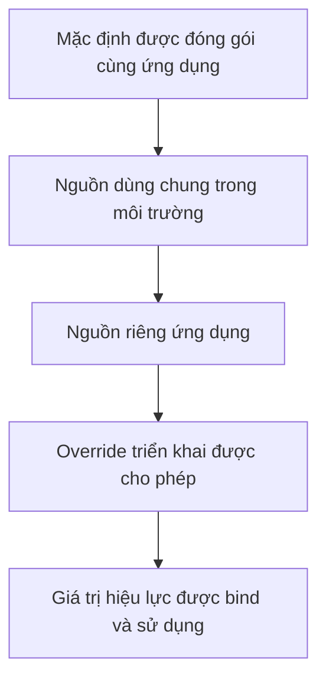

# Phân chia cấu hình dùng chung và cấu hình riêng ứng dụng

Trong chương **Thiết kế cấu hình** của module **SPRING_CLOUD_KUBERNETES**, một quyết định quan trọng là giá trị nào nên được nhiều ứng dụng dùng chung và giá trị nào thuộc quyền quyết định của từng ứng dụng.

Nếu gom mọi thứ vào một ConfigMap lớn, một thay đổi nhỏ có thể tác động đến nhiều dịch vụ. Nếu sao chép mọi giá trị sang từng ứng dụng, việc cập nhật và phát hiện sai lệch lại trở nên khó khăn. Thiết kế cần làm rõ **ý nghĩa, bên sở hữu, tập bên sử dụng và cách thay đổi** của từng nhóm cấu hình.

Bài này dùng `orders-service` và `inventory-service` trong namespace `commerce-prod`. Ví dụ tích hợp API tham chiếu Spring Cloud Kubernetes **5.1.0**, dùng Config Data và các nguồn theo tên. Khi áp dụng, chọn Spring Boot, Spring Cloud và starter theo BOM tương thích của dự án.

## 1. “Dùng chung” phải chung về hợp đồng, không chỉ chung giá trị

Hai ứng dụng cùng có timeout `2s` chưa đủ để kết luận timeout đó nên nằm trong cấu hình dùng chung.

Cần hỏi thêm:

- Timeout có cùng ý nghĩa kỹ thuật và cùng đơn vị không?
- Hai ứng dụng có cùng ngân sách độ trễ không?
- Ai được phép thay đổi giá trị?
- Khi thay đổi, cả hai ứng dụng có nên nhận cùng thay đổi đó không?
- Hai ứng dụng có cần triển khai và khôi phục độc lập không?

Ví dụ, `2s` là thời gian chờ của một truy vấn tra cứu và cũng là thời gian chờ một tác vụ xuất báo cáo. Hai con số giống nhau có thể chỉ là trùng hợp. Gộp chúng thành `global.timeout` khiến hai nghiệp vụ bị ràng buộc không cần thiết.

Ngược lại, nếu nhóm nền tảng cung cấp một hợp đồng client Catalog với ý nghĩa rõ ràng cho `connect-timeout` và `read-timeout`, những mặc định của hợp đồng đó có thể được dùng chung bởi các ứng dụng đã chấp nhận hợp đồng.

### Bốn nhóm nên phân biệt

| Nhóm | Mục đích | Ví dụ |
| --- | --- | --- |
| Mặc định đi cùng ứng dụng hoặc thư viện | Giá trị cơ sở được kiểm thử cùng mã nguồn | Mặc định định dạng hoặc hành vi local |
| Cấu hình dùng chung trong một phạm vi | Hợp đồng nhiều bên sử dụng và có bên quản lý | Mặc định timeout của client chung, định danh môi trường quan sát |
| Cấu hình riêng ứng dụng | Quyết định thuộc nghiệp vụ hoặc triển khai của một ứng dụng | TTL giữ chỗ đơn hàng, kích thước batch đồng bộ |
| Dữ liệu bí mật | Dữ liệu cần quản lý quyền đọc và vòng đời riêng | Mật khẩu, token, private key |

“Riêng ứng dụng” mô tả quyền sở hữu và phạm vi sử dụng. Nó không đồng nghĩa dữ liệu đó phải là Secret. Một kích thước batch riêng ứng dụng vẫn có thể là cấu hình không nhạy cảm.

“Dùng chung” cũng không có nghĩa được phép công khai. Một credential nhiều thành phần cùng cần vẫn phải được quản lý như bí mật, và cần đánh giá có thật sự nên dùng chung credential hay không.

## 2. Chọn ranh giới theo người sử dụng và vòng đời thay đổi

Có thể dùng các câu hỏi sau khi phân loại một khóa:

| Câu hỏi | Nếu câu trả lời khác nhau giữa các ứng dụng |
| --- | --- |
| Ai chịu trách nhiệm về ý nghĩa và giá trị? | Nên tách quyền sở hữu |
| Ai cần đọc dữ liệu? | Nên tách phạm vi phân phối hoặc truy cập |
| Khi nào cần cập nhật? | Nên tách vòng đời thay đổi |
| Có được phép override không? | Cần ghi rõ hợp đồng thay vì dựa vào thứ tự nguồn |
| Dữ liệu có nhạy cảm không? | Cần nguồn và quyền bảo vệ phù hợp |
| Khôi phục thay đổi ảnh hưởng những ai? | Cần giảm phạm vi dùng chung nếu tác động quá lớn |

Một cấu hình dùng chung có ích khi các bên sử dụng cùng chấp nhận ý nghĩa và quy trình thay đổi. Nó không nên trở thành nơi chứa những khóa chưa biết đặt ở đâu.

Ví dụ phân loại của hệ thống minh họa:

| Khóa | Phân loại đề xuất | Lý do |
| --- | --- | --- |
| `platform.telemetry.environment` | Dùng chung trong môi trường | Cùng định danh môi trường quan sát |
| `clients.catalog.connect-timeout` | Mặc định của hợp đồng client dùng chung | Cùng ý nghĩa và đơn vị; cho phép ngoại lệ được ghi nhận |
| `clients.catalog.read-timeout` | Mặc định dùng chung, ứng dụng được override | Ngân sách chờ có thể khác nhau theo luồng gọi |
| `clients.catalog.base-url` | Ứng dụng khai báo phụ thuộc cụ thể | Ứng dụng quyết định gọi nguồn nào |
| `orders.reservation-ttl` | Riêng orders-service | Gắn với quy tắc giữ chỗ đơn hàng |
| `inventory.sync.batch-size` | Riêng inventory-service | Gắn với thuật toán đồng bộ |
| Credential database của orders | Secret riêng cho bên cần dùng | Phạm vi quyền và vòng đời xác thực riêng |

Đây là một phương án thiết kế cho ví dụ, không phải quy tắc rằng mọi base URL luôn phải riêng hoặc mọi timeout luôn nên chung.

Hai ứng dụng có thể cùng khai báo một URL ở thời điểm hiện tại nhưng vẫn giữ quyền lựa chọn phụ thuộc riêng. Ngược lại, có thể chọn đưa một endpoint vào nguồn chung nếu hợp đồng của nền tảng yêu cầu tất cả bên sử dụng cùng endpoint.

## 3. Thiết kế các lớp cấu hình và quy tắc ghi đè

Một cấu trúc dễ giải thích có thể gồm:



Sơ đồ thể hiện ý định thiết kế: lớp riêng có thể thay những mặc định được phép thay ở lớp chung. Thứ tự PropertySource thực tế vẫn phải được cấu hình và kiểm chứng theo cơ chế nạp.

Cần ghi hợp đồng cho từng khóa quan trọng:

| Thuộc tính hợp đồng | Ví dụ |
| --- | --- |
| Tên | `clients.catalog.read-timeout` |
| Ý nghĩa | Giới hạn chờ đọc theo client Catalog của hệ thống |
| Kiểu và đơn vị | Thời lượng, dùng hậu tố `ms` hoặc `s` |
| Bên sở hữu mặc định | Nhóm nền tảng |
| Bên được override | Nhóm ứng dụng theo ngân sách độ trễ của luồng gọi |
| Miền giá trị | Phải dương; giới hạn vận hành cụ thể do hệ thống quy định |
| Cách áp dụng | Khởi động/rollout hoặc cơ chế nạp lại đã được hỗ trợ |
| Bằng chứng | Giá trị bind thực tế và hành vi của client |

### Mặc định và chính sách bắt buộc là hai loại quyết định

Nếu ứng dụng được nạp nguồn riêng có ưu tiên cao hơn, việc đặt một khóa trong nguồn chung không khiến giá trị ấy trở thành chính sách không thể thay đổi.

Ví dụ, yêu cầu bắt buộc không được tắt xác minh TLS cần được bảo đảm bằng thiết kế client, kiểm tra cấu hình và các kiểm soát phù hợp. Không chỉ đặt một khóa `tls.verify=true` vào ConfigMap chung rồi giả định mọi ứng dụng không thể ghi đè nó.

Tương tự, RBAC chuẩn không đặt giới hạn ghi từng khóa trong `ConfigMap.data`. Người được sửa ConfigMap riêng có thể thêm khóa trùng với khóa chung. Nếu cần giới hạn danh sách khóa được override, quy trình và công cụ quản trị cấu hình phải kiểm tra hợp đồng đó.

## 4. Ví dụ với một nguồn chung và hai nguồn riêng

Ví dụ sử dụng các khóa phẳng trong `data` để tập trung vào việc phân chia nguồn. Các giá trị đều được viết như chuỗi, phù hợp cấu trúc ConfigMap được mô tả trong [ConfigMaps](https://kubernetes.io/docs/concepts/configuration/configmap/).

### ConfigMap dùng chung

```yaml
apiVersion: v1
kind: ConfigMap
metadata:
  name: commerce-shared-v1
  namespace: commerce-prod
  annotations:
    configuration.example/owner: platform-team
immutable: true
data:
  platform.telemetry.environment: "prod"
  clients.catalog.connect-timeout: "500ms"
  clients.catalog.read-timeout: "2s"
```

`v1` và `immutable: true` thể hiện một lựa chọn phát hành: giữ tên phiên bản gắn với một bộ dữ liệu, rồi tạo tên mới khi thay đổi dữ liệu. Đây là chiến lược của ví dụ, không phải điều kiện bắt buộc để chia cấu hình dùng chung.

Annotation `configuration.example/owner` là thông tin do hệ thống minh họa quy ước. Nó không tự tạo quyền RBAC hoặc quy trình phê duyệt.

### ConfigMap riêng của orders-service

```yaml
apiVersion: v1
kind: ConfigMap
metadata:
  name: orders-service-config
  namespace: commerce-prod
  annotations:
    configuration.example/owner: orders-team
data:
  clients.catalog.base-url: "http://catalog-api:8080"
  clients.catalog.read-timeout: "800ms"
  orders.reservation-ttl: "15m"
```

`orders-service` thay thời gian chờ đọc mặc định vì luồng tạo đơn có ngân sách riêng. Đây là override được chủ động ghi nhận, không phải xung đột tình cờ.

### ConfigMap riêng của inventory-service

```yaml
apiVersion: v1
kind: ConfigMap
metadata:
  name: inventory-service-config
  namespace: commerce-prod
  annotations:
    configuration.example/owner: inventory-team
data:
  clients.catalog.base-url: "http://catalog-api:8080"
  inventory.sync.batch-size: "200"
```

`inventory-service` không khai báo lại read timeout nên sử dụng mặc định từ nguồn chung.

Tên Service và các số liệu là dữ liệu minh họa. Các khóa `platform.*`, `clients.*`, `orders.*` và `inventory.*` là hợp đồng của ứng dụng/thư viện; Spring không tự cấu hình client nghiệp vụ chỉ vì những khóa này xuất hiện.

## 5. Nạp các nguồn bằng Spring Cloud Kubernetes

Với `orders-service`, phần cấu hình nạp nguồn được đóng gói trong ứng dụng hoặc cung cấp sớm từ môi trường triển khai:

```yaml
spring:
  application:
    name: orders-service
  config:
    import: "kubernetes:"
  cloud:
    kubernetes:
      config:
        enabled: true
        namespace: commerce-prod
        read-type: SINGLE
        include-profile-specific-sources: false
        use-name-as-prefix: false
        fail-fast: true
        retry:
          enabled: false
        sources:
          - name: commerce-shared-v1
          - name: orders-service-config
      secrets:
        enabled: false
      discovery:
        enabled: false
```

Ví dụ cần starter Config tương thích, chẳng hạn `spring-cloud-starter-kubernetes-fabric8-config`, cùng đường xác thực và quyền Kubernetes phù hợp.

Đối với `inventory-service`, thay tên ứng dụng và nguồn riêng:

```yaml
spring:
  application:
    name: inventory-service
  cloud:
    kubernetes:
      config:
        sources:
          - name: commerce-shared-v1
          - name: inventory-service-config
```

Đoạn thứ hai là phần thay thế tương ứng trong cấu hình đầy đủ ở trên, không phải một cấu hình nạp nguồn hoàn chỉnh đứng riêng.

Cách khai báo nhiều nguồn và thứ tự xử lý được mô tả trong [Using a ConfigMap PropertySource](https://docs.spring.io/spring-cloud-kubernetes/reference/property-source-config/configmap-propertysource.html). Trong ví dụ có thứ tự nguồn tường minh này, nguồn riêng được đặt sau nguồn chung để ghi đè những khóa trùng.

### Ý nghĩa của các lựa chọn

| Lựa chọn | Mục đích |
| --- | --- |
| Danh sách `sources` theo tên | Xác định tập nguồn cần đọc và thứ tự của chúng |
| `read-type: SINGLE` | Chọn đường đọc từng resource theo tên trong phiên bản minh họa |
| Tắt profile-specific sources | Giữ ví dụ chỉ có các resource được liệt kê |
| Tắt name prefix | Giữ tên khóa chuẩn, cho phép override cùng khóa |
| `fail-fast: true` | Áp dụng chính sách lỗi khi nạp nguồn gặp lỗi được xử lý theo cơ chế đó |
| Tắt retry | Giữ đường khởi động của ví dụ dễ quan sát |
| Tắt Secret và discovery | Ví dụ chỉ cần đọc cấu hình không nhạy cảm |

`fail-fast` không thay thế việc kiểm tra các thuộc tính bắt buộc đã đầy đủ. Cần xác nhận riêng hành vi khi một resource không tồn tại và khi dữ liệu thiếu khóa.

Không đặt duy nhất cấu hình tìm nguồn trong chính ConfigMap đang chờ được tìm. Không nạp đồng thời cùng dữ liệu bằng legacy bootstrap và Config Data import; xem [Kubernetes PropertySource implementations](https://docs.spring.io/spring-cloud-kubernetes/reference/property-source-config.html).

### Kết quả dự kiến

Khi không có nguồn khác ghi đè:

| Khóa | orders-service | inventory-service |
| --- | --- | --- |
| `platform.telemetry.environment` | `prod`, từ nguồn chung | `prod`, từ nguồn chung |
| `clients.catalog.connect-timeout` | `500ms`, từ nguồn chung | `500ms`, từ nguồn chung |
| `clients.catalog.read-timeout` | `800ms`, từ nguồn riêng | `2s`, từ nguồn chung |
| `clients.catalog.base-url` | Từ nguồn orders | Từ nguồn inventory |
| `orders.reservation-ttl` | `15m` | Không được cung cấp bởi hai nguồn inventory nạp |
| `inventory.sync.batch-size` | Không được cung cấp bởi hai nguồn orders nạp | `200` |

Bảng mô tả nguồn nạp của ví dụ, không có nghĩa một thuộc tính không được nạp sẽ luôn không tồn tại: ứng dụng vẫn có thể nhận nó từ nguồn khác nếu hệ thống cho phép.

Không có cơ chế tự nhận biết từ tên `shared` hay `common`. Việc hai ứng dụng cùng đọc nguồn chung là do danh sách nguồn đã cấu hình.

## 6. Quản lý tên khóa, prefix và những nguồn ghi đè khác

Tên ConfigMap và tên thuộc tính giải quyết hai vấn đề khác nhau:

| Tên | Vai trò |
| --- | --- |
| `commerce-shared-v1` | Định danh resource và phiên bản dữ liệu trong ví dụ |
| `clients.catalog.read-timeout` | Hợp đồng mà mã ứng dụng bind |
| `commerce-prod` | Namespace chứa resource |
| `orders-service` | Định danh ứng dụng Spring |

Nên giữ tên khóa theo ý nghĩa nghiệp vụ hoặc kỹ thuật ổn định. Không buộc mã ứng dụng phải biết tên resource triển khai nếu không có nhu cầu đó.

### Chọn rõ giữa override và giữ hai bộ giá trị riêng biệt

Trong ví dụ, `clients.catalog.read-timeout` ở nguồn orders cố ý thay mặc định chung. Hai bên cùng dùng một hợp đồng và một tên khóa nên override có ý nghĩa.

Nếu hai nguồn chứa hai endpoint khác nhau đều có tên `url`, có thể cần giữ cả hai giá trị. Khi đó dùng hai prefix nghiệp vụ rõ ràng, chẳng hạn `clients.catalog.base-url` và `clients.pricing.base-url`, thay vì để một `url` tình cờ thắng.

Spring Cloud Kubernetes cũng hỗ trợ prefix theo tên nguồn hoặc explicit prefix. Bật prefix làm thay đổi tên khóa được đưa vào Environment; cần đối chiếu cấu hình và binding tương ứng. Nó không phải cơ chế xác định ai được đọc dữ liệu.

Không bật `use-name-as-prefix` cho toàn bộ nguồn rồi tiếp tục kỳ vọng các khóa gốc và quy tắc override của bảng mục 5 giữ nguyên.

### Nguồn riêng không tự có ưu tiên cao nhất trong mọi hoàn cảnh

Các nguồn Config Data vẫn chịu thứ tự ưu tiên chung của Spring Boot. Ví dụ, một command-line property có thể thay giá trị đã nạp từ ConfigMap:

```powershell
java -jar orders-service.jar --clients.catalog.read-timeout=600ms
```

Trong môi trường có đủ điều kiện nạp nguồn và command-line properties được bật, giá trị dự kiến sẽ là `600ms` thay vì `800ms`. Thứ tự các nguồn môi trường, system properties và command line được mô tả trong [Externalized Configuration](https://docs.spring.io/spring-boot/4.0/reference/features/external-config.html).

Một override khẩn cấp nên có người chịu trách nhiệm, lý do và thời điểm gỡ bỏ. Nếu không, sửa ConfigMap hoặc quay lại phiên bản chung cũ vẫn có thể không thay được giá trị đang bị nguồn cao hơn ghi đè.

Giữ bảng các khóa được phép trùng giữa nguồn chung và nguồn riêng. Những khóa trùng ngoài danh sách đó nên được xem như dấu hiệu cần kiểm tra, thay vì tự coi kết quả “ứng dụng chạy được” là đủ.

## 7. Tách quyền đọc và quyền thay đổi

Một mô hình trách nhiệm có thể là:

| Chủ thể | Đọc nguồn chung | Đọc nguồn orders | Đọc nguồn inventory | Quyền thay đổi dự kiến |
| --- | --- | --- | --- | --- |
| orders-service | Có | Có | Không cần | Không sửa các nguồn cấu hình |
| inventory-service | Có | Không cần | Có | Không sửa các nguồn cấu hình |
| Pipeline của nhóm orders | Theo nhiệm vụ | Theo nhiệm vụ | Không cần | Nguồn orders trong phạm vi được giao |
| Pipeline của nhóm nền tảng | Theo nhiệm vụ | Theo nhiệm vụ triển khai | Theo nhiệm vụ triển khai | Phát hành nguồn chung theo quy trình |

Đây là ma trận ý định. Cần hiện thực bằng danh tính, Role và RoleBinding của môi trường, không chỉ bằng tên team trong annotation.

Với đường `SINGLE` theo tên, không tìm nguồn profile và không có watcher trong ví dụ, Role đọc của orders có thể giới hạn hai resource:

```yaml
apiVersion: rbac.authorization.k8s.io/v1
kind: Role
metadata:
  name: orders-config-reader
  namespace: commerce-prod
rules:
  - apiGroups: [""]
    resources: ["configmaps"]
    resourceNames:
      - commerce-shared-v1
      - orders-service-config
    verbs: ["get"]
```

Role phải được gắn qua RoleBinding đến ServiceAccount thực tế của Pod orders. Namespace phải tồn tại, Pod phải dùng đúng ServiceAccount và client phải thực hiện đúng đường đọc theo tên. Đây là ví dụ Role cho phạm vi trên, không phải bộ manifest triển khai hoàn chỉnh.

Khi client hoặc tính năng khác tạo thêm request, cần thiết kế quyền cho những request đó riêng. Không áp nguyên Role get-only cho một đường đọc batch hoặc cho watcher.

RBAC có phạm vi resource và thao tác; các grant là cộng dồn. Một binding khác vẫn có thể mở rộng quyền của cùng danh tính. Xem [Using RBAC Authorization](https://kubernetes.io/docs/reference/access-authn-authz/rbac/).

### “Riêng” về tổ chức chưa chắc riêng về truy cập

Đặt các khóa orders trong `orders-service-config` giúp phân chia trách nhiệm, nhưng không ngăn inventory đọc nếu inventory vẫn được cấp `list configmaps` rộng hoặc quyền đọc resource đó từ grant khác.

Tương tự, tên khóa `orders.*` không tạo ranh giới bảo mật bên trong một ConfigMap chung. Người đọc được resource có thể nhận toàn bộ dữ liệu resource.

Có thể phân phối cùng một hợp đồng chung thành ConfigMap tương ứng ở từng namespace môi trường hoặc nhóm ứng dụng. Việc giữ một nguồn quản lý chuẩn trong quy trình không bắt buộc mọi Pod phải được đọc một namespace trung tâm.

## 8. Bind cấu hình theo hợp đồng và kiểm tra dữ liệu bắt buộc

Khi hai lớp cùng tạo ra bộ thuộc tính của một client, ứng dụng nên kiểm tra kết quả sau khi phân giải. Không giả định rằng có đủ ConfigMap thì chắc chắn có đủ khóa và kiểu dữ liệu.

Ví dụ cho Spring Boot dùng Jakarta Validation và starter validation tương thích, đặt record sau trong file Java phù hợp:

```java
import java.net.URI;
import java.time.Duration;

import jakarta.validation.constraints.AssertTrue;
import jakarta.validation.constraints.NotNull;

import org.springframework.boot.context.properties.ConfigurationProperties;
import org.springframework.validation.annotation.Validated;

@Validated
@ConfigurationProperties(prefix = "clients.catalog")
public record CatalogClientProperties(
        @NotNull URI baseUrl,
        @NotNull Duration connectTimeout,
        @NotNull Duration readTimeout) {

    @AssertTrue(message = "Catalog client timeouts phải lớn hơn 0")
    public boolean isTimeoutsPositive() {
        return connectTimeout != null
                && !connectTimeout.isNegative()
                && !connectTimeout.isZero()
                && readTimeout != null
                && !readTimeout.isNegative()
                && !readTimeout.isZero();
    }
}
```

Đăng ký record và chỉ báo cáo hai trường demo không nhạy cảm:

```java
import org.springframework.boot.ApplicationRunner;
import org.springframework.boot.context.properties.EnableConfigurationProperties;
import org.springframework.context.annotation.Bean;
import org.springframework.context.annotation.Configuration;

@Configuration(proxyBeanMethods = false)
@EnableConfigurationProperties(CatalogClientProperties.class)
class CatalogClientConfiguration {

    @Bean
    ApplicationRunner reportCatalogTimeouts(CatalogClientProperties properties) {
        return args -> System.out.printf(
                "catalog.connectTimeout=%s; catalog.readTimeout=%s%n",
                properties.connectTimeout(),
                properties.readTimeout());
    }
}
```

Lớp cấu hình cần nằm trong phạm vi được ứng dụng đăng ký hoặc quét. Kiểu binding và validation được Spring Boot trình bày trong [Type-safe Configuration Properties](https://docs.spring.io/spring-boot/4.0/reference/features/external-config.html#features.external-config.typesafe-configuration-properties).

Kết quả mong đợi với các nguồn ở mục 4 và không có override khác:

```text
# orders-service
catalog.connectTimeout=PT0.5S; catalog.readTimeout=PT0.8S

# inventory-service
catalog.connectTimeout=PT0.5S; catalog.readTimeout=PT2S
```

Đây là kết quả dự kiến, không phải kết quả đã chạy trên cluster. Cách biểu diễn `PT...` là chuỗi thời lượng của Java, khác cách viết đầu vào `500ms` hoặc `2s`.

Ví dụ chưa tạo HTTP client. Thành phần nghiệp vụ cần nhận và sử dụng các thuộc tính đã bind để timeout thực sự có tác dụng.

### Những bằng chứng khác nhau cần được giữ riêng

| Bằng chứng | Điều nó xác nhận |
| --- | --- |
| ConfigMap tồn tại | Resource đã được cung cấp |
| PropertySource/origin phù hợp nếu công cụ hỗ trợ | Ứng dụng đã nạp nguồn cần kiểm tra |
| Binding và validation thành công | Bộ dữ liệu hiệu lực đáp ứng phần hợp đồng đã kiểm tra |
| Báo cáo một vài khóa cho phép | Giá trị minh họa mà ứng dụng đang nhìn thấy |
| Phép thử hành vi client | Thành phần sử dụng cấu hình thực sự áp dụng giá trị |
| Kiểm tra quyền | Danh tính không có thêm quyền ngoài thiết kế dự kiến |

Validation thành công không chứng minh nguồn chung đã được nạp nếu những khóa bắt buộc đều có giá trị dự phòng từ nơi khác. Khi cần bắt buộc nguồn chung, hãy kiểm tra cả sự hiện diện của nguồn hoặc metadata phát hành được thiết kế cho việc đó.

Không dùng dump toàn bộ Environment hay toàn bộ đối tượng chứa credential làm bằng chứng. Việc báo cáo cấu hình nên có danh sách khóa được phép và tránh dữ liệu nhạy cảm.

## 9. Phát hành thay đổi chung theo tập bên sử dụng

Một thay đổi `clients.catalog.connect-timeout` trong nguồn chung có thể ảnh hưởng mọi ứng dụng đang sử dụng giá trị đó. Một thay đổi `read-timeout` chỉ ảnh hưởng những bên không có override cao hơn cho cùng khóa.

Vì vậy, cần lập danh sách bên sử dụng theo cả **nguồn** và **khóa hiệu lực**. Biết orders đọc `commerce-shared-v1` chưa đủ để kết luận mọi thay đổi trong nguồn này đều thay giá trị của orders.

### Dùng phiên bản để giảm thay đổi đồng thời

Với ConfigMap immutable của ví dụ:

1. Chuẩn bị `commerce-shared-v2` với hợp đồng và thay đổi được mô tả.
2. Chọn một nhóm instance hoặc một ứng dụng chuyển đầu tiên.
3. Đổi tham chiếu nguồn của nhóm đó sang v2 và triển khai theo kế hoạch.
4. Kiểm tra nguồn nạp, giá trị bind và hành vi.
5. Chuyển các bên sử dụng còn lại theo từng đợt.
6. Chỉ loại bỏ v1 khi không còn bên hợp lệ cần nó và hết thời gian lưu giữ.

Ở cùng một thời điểm, orders có thể dùng v2 trong khi inventory còn dùng v1 nếu hợp đồng tương thích cho giai đoạn đó. Đây là lựa chọn phối hợp phát hành, cần được kiểm kê.

Khi thay tên nguồn, cập nhật cả quyền `resourceNames` của bên cần đọc nếu đang giới hạn quyền theo tên. Không để một lần chuyển phiên bản cấu hình thất bại chỉ vì Role vẫn chỉ cho phép v1.

Khôi phục cần xem cả phiên bản ứng dụng và phiên bản dữ liệu. Quay lại Deployment cũ không tự phục hồi nội dung một ConfigMap mutable đã bị sửa tại chỗ.

### Nếu chọn nguồn chung được cập nhật tại chỗ

Đây là phương án khác với `commerce-shared-v1` immutable ở ví dụ chính. Khi sửa trực tiếp một nguồn chung mutable, cần biết những ứng dụng nào nhận thay đổi, nhận qua cơ chế nào và vào thời điểm nào.

Spring Cloud Kubernetes Configuration Watcher hỗ trợ chỉ định nhiều ứng dụng nhận thông báo qua annotation. Ví dụ metadata cho một ConfigMap chung mutable đã được thiết kế riêng:

```yaml
metadata:
  name: commerce-shared
  namespace: commerce-prod
  labels:
    spring.cloud.kubernetes.config: "true"
  annotations:
    spring.cloud.kubernetes.configmap.apps: "orders-service,inventory-service"
```

Fragment này chỉ minh họa metadata định tuyến thông báo; nó không tự triển khai watcher hoặc cấu hình endpoint nhận refresh. Cơ chế được mô tả trong [Configuration Watcher](https://docs.spring.io/spring-cloud-kubernetes/reference/spring-cloud-kubernetes-configuration-watcher.html#_monitoring_configmaps_and_secrets).

Không giả định watcher tự suy ra toàn bộ đồ thị bên sử dụng chỉ từ danh sách `sources` của từng ứng dụng. Tên ConfigMap chung cũng không nhất thiết trùng tên ứng dụng nhận thông báo.

Nhận thông báo, nạp lại PropertySource và cập nhật client là những bước khác nhau. Nếu cơ chế nạp lại chưa đáp ứng vòng đời của client hoặc pool, chọn rollout có kiểm soát thay vì giả định mọi thành phần đổi ngay.

## 10. Những thiết kế dễ tạo phụ thuộc ngoài ý muốn

| Thiết kế | Vấn đề | Hướng điều chỉnh |
| --- | --- | --- |
| Một ConfigMap lớn cho mọi dịch vụ | Phạm vi thay đổi và quyền đọc khó kiểm soát | Tách theo hợp đồng, bên sử dụng và vòng đời |
| Đưa khóa orders vào nguồn chung chỉ vì tiện quản lý | Dịch vụ khác nhận dữ liệu không thuộc trách nhiệm của họ | Đưa về nguồn riêng |
| Chia sẻ mọi giá trị giống nhau | Ràng buộc những ý nghĩa khác nhau | Kiểm tra ngữ nghĩa và cách thay đổi trước khi gom |
| Mỗi ứng dụng sao chép toàn bộ mặc định nền tảng | Khó theo dõi phiên bản và sai lệch | Dùng hợp đồng chung hoặc mặc định thư viện phù hợp |
| Bật prefix mà không đổi binding | Ứng dụng không đọc được khóa dự kiến | Thiết kế namespace thuộc tính trước |
| Để thứ tự các nguồn được chọn ngẫu nhiên quyết định override | Kết quả khó giải thích khi thêm nguồn | Chỉ rõ tập nguồn và quyền override |
| Đặt credential vào ConfigMap chung | Mở rộng phạm vi đọc bí mật | Tách nguồn bí mật và danh tính có nhu cầu |
| Đưa cấu hình bật mọi tính năng Kubernetes vào nguồn chung | Mỗi ứng dụng có thể phát sinh thêm nhu cầu API và RBAC | Chỉ bật tính năng theo nhu cầu của ứng dụng |
| Sửa nguồn chung và refresh tất cả cùng lúc | Khó giới hạn tác động hoặc khôi phục từng bên | Phát hành theo nhóm với bằng chứng |
| Có override tạm thời nhưng không theo dõi | Thay nguồn chung không tạo kết quả mong đợi | Quản lý vòng đời override |

Nếu cả ConfigMap và Secret cùng chứa một khóa, không suy rằng Secret tự có ưu tiên cao hơn chỉ vì nhạy cảm. Tài liệu Spring Cloud Kubernetes nêu quy tắc ưu tiên riêng giữa hai loại nguồn; xem [Order of ConfigMaps and Secrets](https://docs.spring.io/spring-cloud-kubernetes/reference/property-source-config/order_of_configMaps_and_secrets.html). Thiết kế tốt nên tránh đặt cùng một credential ở cả hai nơi.

Đối với DiscoveryClient, LoadBalancer, health indicator hoặc Configuration Watcher, chọn tính năng theo trường hợp sử dụng. Một cấu hình chung để chuẩn hóa quan sát không nên vô tình làm mọi ứng dụng bắt đầu theo dõi tài nguyên hoặc đọc Secret.

## 11. Chọn mức chia sẻ phù hợp khi hệ thống lớn dần

Có thể bắt đầu bằng một nguồn chung theo miền như `commerce`, rồi tách nhỏ khi các tập bên sử dụng hoặc vòng đời thay đổi khác nhau rõ rệt.

Ví dụ:

| Nhóm | Bên sử dụng phù hợp |
| --- | --- |
| Hợp đồng quan sát của môi trường | Các ứng dụng chấp nhận cùng cách gắn định danh quan sát |
| Hợp đồng client Catalog | Những ứng dụng dùng đúng client và cùng ý nghĩa thuộc tính |
| Cấu hình nghiệp vụ orders | orders-service và các thành phần được giao cùng trách nhiệm |
| Cấu hình nghiệp vụ inventory | inventory-service và các thành phần được giao cùng trách nhiệm |

Không cần tạo một ConfigMap cho từng khóa. Nếu nhiều khóa cần thay đổi cùng nhau, cùng bên sở hữu và cùng tập bên sử dụng, giữ chúng trong một đơn vị phát hành có thể dễ kiểm soát hơn.

Cũng không cần biến mọi hằng số thành cấu hình runtime. Những mặc định gắn chặt với phiên bản thư viện có thể phù hợp hơn khi được phát hành cùng thư viện, để ứng dụng chủ động nâng phiên bản và kiểm thử tương thích.

Một phương án phân chia có thể giải thích được cần chỉ ra **ai sở hữu, ai đọc, ai được override, thay đổi áp dụng như thế nào và khôi phục ảnh hưởng đến những ai**. Các ConfigMap và danh sách nguồn là cách hiện thực những quyết định đó; chất lượng thiết kế nằm ở việc các quyết định được giữ rõ ràng khi ứng dụng và môi trường thay đổi.
