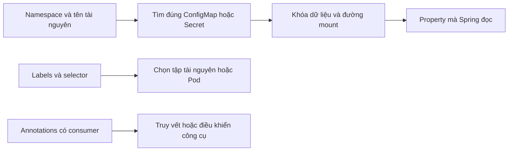

# Đặt tên tài nguyên, khóa và label nhất quán

Trong module **SPRING_CLOUD_KUBERNETES**, ứng dụng Spring được tích hợp với Kubernetes qua DiscoveryClient, ConfigMap, Secret, Spring Cloud LoadBalancer và Configuration Watcher. Bài thuộc chương **Thiết kế cấu hình**, tập trung vào một hợp đồng vận hành dễ bị xem nhẹ: tên nào dùng để tìm tài nguyên, khóa nào được code đọc, và label nào dùng để chọn đúng nhóm đối tượng.

Một quy ước tốt giúp đội phát triển trả lời được ba câu hỏi khi nhìn manifest: cấu hình này thuộc ứng dụng nào, được dùng cho mục đích gì, và những thành phần nào đang tham chiếu đến nó. Quy ước cũng phải phân biệt ràng buộc của Kubernetes với lựa chọn riêng của dự án; một tên hợp lệ về cú pháp chưa chắc đã thể hiện đúng ý nghĩa.

Ví dụ xuyên suốt là một dịch vụ đặt hàng trong namespace `commerce-staging`. Bài dùng cùng một bộ tên để mô tả cấu hình qua volume, cách chọn nguồn bằng Spring Cloud Kubernetes và cách định tuyến thông báo của Configuration Watcher. Các đoạn Spring Cloud Kubernetes được minh họa theo cơ chế Config Data của nhánh 3.3; khi dùng phiên bản khác, đối chiếu thuộc tính của đúng phiên bản.

## 1. Tách ba loại tên trước khi viết quy ước

Tên tài nguyên, khóa cấu hình và label có thể chứa những từ giống nhau nhưng làm các công việc khác nhau:

| Thành phần | Ví dụ | Được dùng để làm gì? |
| --- | --- | --- |
| Namespace | `commerce-staging` | Xác định phạm vi của tài nguyên |
| Tên ConfigMap | `order-service-main-runtime` | Tham chiếu một tài nguyên cấu hình cụ thể |
| Tên Secret | `order-service-main-partner` | Tham chiếu một tài nguyên chứa thông tin xác thực |
| Khóa dữ liệu | `order.partner.connect-timeout` | Cung cấp một property hoặc một tên file khi mount |
| Label ứng dụng | `app.kubernetes.io/name: "order-service"` | Nhóm tài nguyên theo ứng dụng logic |
| Label instance | `app.kubernetes.io/instance: "order-service-main"` | Phân biệt các bản cài đặt của cùng ứng dụng |
| Annotation | `config.example.com/schema-version: "1"` | Gắn thông tin mô tả hoặc thông tin mà công cụ có chủ đích đọc |

`metadata.name` không tự trở thành prefix của các khóa trong `data`. Label `app.kubernetes.io/name` cũng không tự đặt `spring.application.name` cho tiến trình Java. Muốn các giá trị liên hệ với nhau, manifest hoặc công cụ triển khai phải khai báo mối liên hệ đó.



Một cách chẩn đoán hữu ích là xác định đang sai ở tầng nào. Tên nguồn sai khiến ứng dụng không tìm được ConfigMap; khóa sai khiến binding không nhận đúng thuộc tính; label sai khiến selector chọn thiếu hoặc chọn nhầm đối tượng.

## 2. Chọn bộ định danh ổn định cho một ứng dụng

Trong ví dụ, các giá trị được thống nhất như sau:

| Khái niệm | Giá trị quy ước |
| --- | --- |
| Ứng dụng logic | `order-service` |
| Bản cài đặt chính | `order-service-main` |
| Namespace môi trường | `commerce-staging` |
| Deployment | `order-service-main` |
| Service | `order-service-main` |
| `spring.application.name` | `order-service-main` |
| ConfigMap cấu hình chạy | `order-service-main-runtime` |
| Secret xác thực đối tác | `order-service-main-partner` |
| Prefix property nghiệp vụ | `order.partner` |

Đây là quy ước của ví dụ, không phải yêu cầu mọi tên phải bằng nhau của Kubernetes hay Spring. Việc cho Service, Deployment và `spring.application.name` cùng tên giúp giảm số ánh xạ cần nhớ; hậu tố của ConfigMap và Secret thể hiện vai trò tài nguyên.

Nếu cùng namespace có một bản canary, dùng instance `order-service-canary`, cùng họ ứng dụng `order-service`, nhưng tên Deployment, Service và các tham chiếu cấu hình phải được xác định riêng. Không dùng chung một label instance cho hai bản cài đặt mà bạn muốn thao tác độc lập.

Nếu staging và production ở hai namespace riêng, có thể dùng cùng bộ tên tài nguyên trong mỗi namespace. Code vẫn đọc các khóa `order.partner.*`; môi trường quyết định giá trị. Không cần tạo các property riêng như `order.partner.production-api-key` và `order.partner.staging-api-key` chỉ để chọn môi trường.

Với ConfigMap và Secret, định danh cần nhớ gồm loại tài nguyên, namespace và tên. Hai loại tài nguyên có thể cùng tên; hai tài nguyên cùng loại cũng có thể cùng tên ở hai namespace khác nhau. Vì vậy, câu nói “đã có tài nguyên tên X” chưa đủ để chứng minh ứng dụng đang tham chiếu đúng đối tượng. Xem [Object Names and IDs](https://kubernetes.io/docs/concepts/overview/working-with-objects/names/).

## 3. Phân biệt cú pháp Kubernetes với quy ước dự án

ConfigMap và Secret sử dụng ràng buộc tên dạng DNS subdomain. Với ConfigMap, khóa trong `data` chỉ dùng chữ, số, dấu gạch nối, gạch dưới hoặc dấu chấm; các khóa không dùng cùng bộ quy tắc với tên tài nguyên. Xem [cấu trúc ConfigMap](https://kubernetes.io/docs/concepts/configuration/configmap/) và [Secret](https://kubernetes.io/docs/concepts/configuration/secret/).

Một quy ước dự án có thể chặt hơn giới hạn API để dễ dùng chung với Service, namespace và công cụ triển khai:

| Đối tượng | Quy ước đề xuất cho bài |
| --- | --- |
| Tên ứng dụng, instance, tài nguyên | Chữ thường, số và dấu `-`; bắt đầu bằng chữ, kết thúc bằng chữ hoặc số |
| Chiều dài tên do dự án tạo | Không quá 63 ký tự, tính cả hậu tố được công cụ thêm |
| Cấu trúc tên cấu hình | `<instance>-<purpose>` |
| Property Spring | Chữ thường; dấu chấm chia nhóm, dấu gạch nối chia từ |
| Label tùy biến | Dùng prefix DNS của tổ chức hoặc miền ví dụ có chủ đích |

Ví dụ bộ tên tài nguyên của dự án có thể tuân theo mẫu:

```text
^[a-z][a-z0-9]*(-[a-z0-9]+)*$
```

Mẫu này cần được kiểm tra cùng giới hạn chiều dài; nó là quy ước cục bộ, không phải biểu thức đầy đủ cho mọi tên hợp lệ của Kubernetes. Chẳng hạn, ConfigMap có thể chấp nhận dấu chấm trong tên, nhưng dự án chủ động chỉ dùng dấu gạch nối để thống nhất với các loại tên khác.

| Tên | Nhận xét theo quy ước dự án |
| --- | --- |
| `order-service-main-runtime` | Rõ instance và mục đích |
| `OrderService_Config` | Trộn chữ hoa, gạch dưới và cách chia từ |
| `config-final-new` | Không chỉ ra chủ sở hữu hay vai trò |
| `order-service-main-runtime-prod-latest-final` | Lặp môi trường, trạng thái và các khái niệm khó duy trì |
| `order-service-main-partner-r3` | Hợp lý nếu `r3` là phiên bản tài nguyên được quản lý có chủ đích |

Từ `latest`, `new` hay `final` không tạo ưu tiên cho Spring và không cho biết chính xác nội dung đang triển khai. Dùng chúng như tín hiệu phiên bản có thể khiến tên giữ nguyên trong khi ý nghĩa liên tục đổi.

## 4. Đặt tên theo vai trò và cách quản lý vòng đời

Không cần dồn mọi cấu hình vào một tài nguyên chỉ vì ứng dụng chỉ có một `spring.application.name`. Có thể chia tài nguyên theo chủ sở hữu, loại dữ liệu và cách cập nhật:

| Tên | Vai trò |
| --- | --- |
| `order-service-main-runtime` | Timeout, URL và cờ tính năng không nhạy cảm |
| `order-service-main-partner` | Credential dùng để gọi đối tác |
| `order-service-main-database` | Credential cơ sở dữ liệu nếu ứng dụng cần |
| `checkout-platform-defaults` | Các mặc định chung có phạm vi và chủ sở hữu rõ ràng |

Hậu tố phải có từ vựng chung. Nếu một nhóm dùng `runtime`, nhóm khác dùng `settings` cho cùng ý nghĩa, công cụ truy vấn khó dự đoán hơn. Ngược lại, không nên ép mọi tài nguyên có cùng hậu tố nếu chúng có vòng đời khác nhau.

Chọn rõ một trong hai chính sách tên:

- **Tên ổn định:** cập nhật nội dung của `order-service-main-runtime`; theo dõi lần thay đổi bằng revision và quy trình rollout hoặc refresh.
- **Tên theo phiên bản:** tạo tên như `order-service-main-runtime-r2`, cập nhật consumer để tham chiếu phiên bản đó, giữ bản cũ cho những consumer còn sử dụng.

Hai chính sách đều có thể phù hợp. Tên ổn định không tự khiến bean đang chạy cập nhật; tên phiên bản cũng không tự chuyển Deployment sang bản mới. Tên chỉ là một phần của hợp đồng triển khai.

Khi công cụ sinh tên có tiền tố hoặc hậu tố băm, kiểm tra tên đã render và toàn bộ tham chiếu tới tên đó. Không giả định một chuỗi tên viết trong cấu hình Spring sẽ được tự động sửa chỉ vì công cụ đã sửa các tham chiếu chuẩn của manifest.

## 5. Khóa Spring cần phản ánh ý nghĩa nghiệp vụ

Nên thống nhất dạng tên chuẩn như:

```text
order.partner.base-url
order.partner.connect-timeout
order.partner.read-timeout
order.partner.api-key
order.features.express-shipping.enabled
order.config-revision
```

Prefix xác định miền nghiệp vụ; phần cuối diễn đạt ý nghĩa thuộc tính. Cùng một prefix có thể trải trên ConfigMap và Secret: URL, timeout nằm trong ConfigMap, còn `api-key` nằm trong Secret. Không cần đổi tên property thành `secret.order.partner.api-key` chỉ vì cách lưu trữ là Secret.

Những tên như `url`, `timeout`, `password` ở cấp gốc khó phân biệt khi ứng dụng gọi nhiều hệ thống. Những tên như `v1-key`, `new-timeout` gắn tên khóa với một giai đoạn triển khai, khiến code và tài liệu nhanh mất đồng bộ.

Với đơn vị đo, chọn hợp đồng rõ ràng:

| Cách biểu diễn | Hợp đồng tương ứng |
| --- | --- |
| `order.partner.connect-timeout: "2s"` | Bind vào `Duration`, giá trị tự mang đơn vị |
| `order.partner.connect-timeout-ms: "2000"` | Số được quy định là mili giây |
| `timeout: "2000"` | Không rõ hệ thống nào và không rõ đơn vị |

Không đổi từ mili giây sang giây nhưng giữ nguyên cách hiểu của khóa cũ. Đó là thay đổi hợp đồng dù tên tài nguyên không đổi.

Spring Boot hỗ trợ relaxed binding, nhưng nên duy trì một cách viết chuẩn trong tài liệu và nguồn cấu hình. Các biến thể về chữ hoa, gạch nối, gạch dưới hoặc camelCase có thể cùng ánh xạ vào một thuộc tính Java; không dùng khác biệt hình thức đó để biểu diễn hai cấu hình có ý nghĩa khác nhau.

Ví dụ ánh xạ:

| Nơi sử dụng | Tên |
| --- | --- |
| Khóa chuẩn trong cấu hình | `order.partner.api-key` |
| Trường Java dưới prefix `order.partner` | `apiKey` |
| Biến môi trường theo quy tắc Spring Boot | `ORDER_PARTNER_APIKEY` |

Quy tắc chuyển sang biến môi trường là đổi dấu chấm thành gạch dưới, bỏ dấu gạch nối rồi viết hoa. Xem [Externalized Configuration của Spring Boot](https://docs.spring.io/spring-boot/reference/features/external-config.html).

## 6. Phân biệt khóa property với khóa chứa cả tài liệu

ConfigMap có thể dùng các khóa phẳng:

```yaml
data:
  order.partner.base-url: "https://partner.example.invalid"
  order.partner.connect-timeout: "2s"
  order.partner.read-timeout: "5s"
```

Hoặc chứa một tài liệu YAML hoàn chỉnh:

```yaml
data:
  application.yaml: |-
    order:
      partner:
        base-url: https://partner.example.invalid
        connect-timeout: 2s
        read-timeout: 5s
```

Ở dạng đầu, mỗi khóa đã là một tên property. Ở dạng sau, `application.yaml` là tên một tài liệu chứa các property. Khi được mount, khóa cũng quyết định tên file, trừ khi `items` ánh xạ lại đường dẫn.

Đường đọc phải phù hợp với cách đặt khóa:

| Hình thức trong volume | Cách import Spring Boot tương ứng |
| --- | --- |
| Một file `application.yaml` chứa cấu hình YAML | `file:/etc/order-config/application.yaml` |
| Nhiều file, mỗi file chứa một giá trị property | `configtree:/etc/order-config/` |

Import một thư mục bằng `configtree:` không tự parse nội dung của file `application.yaml` thành mọi property bên trong. Nếu đọc qua Spring Cloud Kubernetes, tên khóa tài liệu còn phải theo quy tắc xử lý của loader và phiên bản đang dùng; tránh trộn nhiều kiểu đặt tên tài liệu tùy ý trong cùng ConfigMap.

Chọn một kiểu chủ đạo cho một nhóm cấu hình để người vận hành biết một thao tác đổi khóa sẽ ảnh hưởng property Java hay tên file. Ví dụ hoàn chỉnh bên dưới dùng khóa phẳng cho cả ConfigMap và Secret.

## 7. Xây dựng bộ label có ý nghĩa nhất quán

Dùng các label Kubernetes khuyến nghị cho những chiều chung:

| Label | Giá trị trong ví dụ | Ý nghĩa |
| --- | --- | --- |
| `app.kubernetes.io/name` | `order-service` | Ứng dụng logic |
| `app.kubernetes.io/instance` | `order-service-main` | Bản cài đặt cụ thể |
| `app.kubernetes.io/part-of` | `checkout` | Hệ thống lớn hơn |
| `app.kubernetes.io/component` | `api` | Vai trò kiến trúc |
| `app.kubernetes.io/managed-by` | `kubectl` | Công cụ thực sự quản lý tài nguyên trong ví dụ |
| `app.kubernetes.io/version` | `1.0.0` | Phiên bản ứng dụng khi có ý nghĩa với đối tượng |

Đây là các label khuyến nghị phục vụ công cụ và truy vấn, không phải những trường bắt buộc để Kubernetes hiểu khái niệm ứng dụng. Xem [Recommended Labels](https://kubernetes.io/docs/concepts/overview/working-with-objects/common-labels/).

Với nhu cầu riêng, định nghĩa thêm từ vựng có chủ sở hữu:

```yaml
labels:
  config.example.com/purpose: "runtime"
  config.example.com/owner-team: "checkout"
```

Các miền `config.example.com` trong bài là tên minh họa. Trong tổ chức, chọn prefix mà nhóm có quyền quản lý thay vì tự tạo thêm khóa trong các không gian tên dành cho công cụ khác. Các prefix `kubernetes.io/` và `k8s.io/` được Kubernetes dành riêng.

Một khóa label gồm phần tên, có thể thêm prefix DNS và dấu `/`. Phần tên và giá trị có giới hạn độ dài riêng; chẳng hạn phần tên không quá 63 ký tự, giá trị không quá 63 ký tự. Label không phải nơi chứa URL, JSON, ghi chú dài hoặc credential. Chi tiết cú pháp nằm trong [Labels and Selectors](https://kubernetes.io/docs/concepts/overview/working-with-objects/labels/).

Ghi các giá trị label dưới dạng chuỗi, ví dụ `"true"`, `"1"`, `"1.0.0"`, để tránh YAML diễn giải thành kiểu khác. Đặt label trên Deployment không tự sao chép nó xuống Pod; cần khai báo đúng tại `spec.template.metadata.labels` khi selector hoặc công cụ cần đọc label của Pod.

## 8. Dùng annotation cho thông tin mô tả và hợp đồng công cụ

Các thông tin như tài liệu cấu hình, revision, phiên bản schema hoặc danh sách ứng dụng nhận refresh có thể phù hợp với annotation hơn label:

```yaml
annotations:
  config.example.com/schema-version: "1"
  config.example.com/revision: "cfg-20261124-01"
  config.example.com/description: "Timeout và URL cho client gọi đối tác đặt hàng"
```

Annotation không được dùng như label selector thông thường. Tuy vậy, annotation có thể ảnh hưởng hành vi nếu một controller được thiết kế để đọc nó. Do đó cần phân biệt annotation mô tả của dự án với annotation mang ý nghĩa điều khiển của một công cụ.

`schema-version: "1"` là quy ước metadata, không tự yêu cầu Kubernetes hoặc Spring kiểm tra schema nghiệp vụ. Muốn kiểm tra tương thích, cần consumer hoặc quy trình triển khai thực hiện việc đó. Revision cấu hình cũng không nên bị nhập nhằng với phiên bản image ứng dụng.

Cả label và annotation đều là metadata, không phải nơi lưu giá trị bí mật. Tên tài nguyên cũng không được chứa token, mật khẩu hoặc thông tin định danh nhạy cảm. Xem [Annotations của Kubernetes](https://kubernetes.io/docs/concepts/overview/working-with-objects/annotations/).

## 9. Một bộ manifest minh họa nhất quán

Ví dụ sau chọn **volume mount và Config Data của Spring Boot**. Cách này thể hiện rõ mối liên hệ giữa tên tài nguyên, khóa và file, đồng thời không đòi tiến trình Java đọc Kubernetes API chỉ để nhận cấu hình.

Các giá trị credential là dữ liệu giả; URL `example.invalid` là địa chỉ minh họa cần thay bằng endpoint của môi trường thực hành. Trường `image` cũng cần thay bằng image ứng dụng bạn đã đóng gói.

```yaml
apiVersion: v1
kind: Namespace
metadata:
  name: commerce-staging
---
apiVersion: v1
kind: ConfigMap
metadata:
  name: order-service-main-runtime
  namespace: commerce-staging
  labels:
    app.kubernetes.io/name: "order-service"
    app.kubernetes.io/instance: "order-service-main"
    app.kubernetes.io/part-of: "checkout"
    app.kubernetes.io/component: "api"
    app.kubernetes.io/managed-by: "kubectl"
    config.example.com/purpose: "runtime"
    config.example.com/owner-team: "checkout"
  annotations:
    config.example.com/schema-version: "1"
    config.example.com/revision: "cfg-20261124-01"
data:
  order.partner.base-url: "https://partner.example.invalid"
  order.partner.connect-timeout: "2s"
  order.partner.read-timeout: "5s"
  order.config-revision: "cfg-20261124-01"
---
apiVersion: v1
kind: Secret
metadata:
  name: order-service-main-partner
  namespace: commerce-staging
  labels:
    app.kubernetes.io/name: "order-service"
    app.kubernetes.io/instance: "order-service-main"
    app.kubernetes.io/part-of: "checkout"
    app.kubernetes.io/component: "api"
    app.kubernetes.io/managed-by: "kubectl"
    config.example.com/purpose: "partner-credentials"
    config.example.com/owner-team: "checkout"
  annotations:
    config.example.com/schema-version: "1"
type: Opaque
stringData:
  order.partner.api-key: "training-only-api-key"
---
apiVersion: apps/v1
kind: Deployment
metadata:
  name: order-service-main
  namespace: commerce-staging
  labels:
    app.kubernetes.io/name: "order-service"
    app.kubernetes.io/instance: "order-service-main"
    app.kubernetes.io/part-of: "checkout"
    app.kubernetes.io/component: "api"
    app.kubernetes.io/managed-by: "kubectl"
spec:
  replicas: 1
  selector:
    matchLabels:
      app.kubernetes.io/name: "order-service"
      app.kubernetes.io/instance: "order-service-main"
      app.kubernetes.io/component: "api"
  template:
    metadata:
      labels:
        app.kubernetes.io/name: "order-service"
        app.kubernetes.io/instance: "order-service-main"
        app.kubernetes.io/part-of: "checkout"
        app.kubernetes.io/component: "api"
        app.kubernetes.io/version: "1.0.0"
      annotations:
        config.example.com/revision: "cfg-20261124-01"
    spec:
      containers:
        - name: application
          image: registry.example.com/training/order-service:1.0.0
          ports:
            - name: http
              containerPort: 8080
          env:
            - name: SPRING_PROFILES_ACTIVE
              value: kubernetes
          volumeMounts:
            - name: runtime-config
              mountPath: /etc/order-config
              readOnly: true
            - name: partner-credentials
              mountPath: /etc/order-secrets
              readOnly: true
      volumes:
        - name: runtime-config
          configMap:
            name: order-service-main-runtime
        - name: partner-credentials
          secret:
            secretName: order-service-main-partner
---
apiVersion: v1
kind: Service
metadata:
  name: order-service-main
  namespace: commerce-staging
  labels:
    app.kubernetes.io/name: "order-service"
    app.kubernetes.io/instance: "order-service-main"
    app.kubernetes.io/part-of: "checkout"
    app.kubernetes.io/component: "api"
    app.kubernetes.io/managed-by: "kubectl"
spec:
  selector:
    app.kubernetes.io/name: "order-service"
    app.kubernetes.io/instance: "order-service-main"
    app.kubernetes.io/component: "api"
  ports:
    - name: http
      port: 80
      targetPort: http
```

Trong `application-kubernetes.yml` của ứng dụng Spring:

```yaml
spring:
  application:
    name: order-service-main
  config:
    import:
      - "configtree:/etc/order-config/"
      - "configtree:/etc/order-secrets/"
```

Vì không dùng `items` để đổi tên file, khóa `order.partner.api-key` được mount thành `/etc/order-secrets/order.partner.api-key`. Sau import, code tiếp tục dùng property `order.partner.api-key`. Tên Secret không trở thành một phần của property này.

Revision xuất hiện ở annotation ConfigMap, property không nhạy cảm và annotation Pod template vì ví dụ chủ động khai báo cùng một giá trị. Kubernetes không tự đồng bộ ba nơi. Khi dùng công cụ render, nên sinh chúng từ cùng một nguồn giá trị để giảm khả năng lệch nhau.

Ví dụ record Java thể hiện tên hợp đồng và kiểu dữ liệu:

```java
package com.example.orders;

import java.net.URI;
import java.time.Duration;
import jakarta.validation.constraints.NotBlank;
import jakarta.validation.constraints.NotNull;
import org.springframework.boot.context.properties.ConfigurationProperties;
import org.springframework.validation.annotation.Validated;

@ConfigurationProperties(prefix = "order.partner")
@Validated
public record OrderPartnerProperties(
        @NotNull URI baseUrl,
        @NotNull Duration connectTimeout,
        @NotNull Duration readTimeout,
        @NotBlank String apiKey
) {
}
```

Đăng ký record bằng `@EnableConfigurationProperties(OrderPartnerProperties.class)` trên cấu hình ứng dụng và có `spring-boot-starter-validation` để các ràng buộc được thực thi. Ví dụ dùng Java 17 trở lên và annotation Jakarta. Cần bổ sung ràng buộc nghiệp vụ nếu muốn kiểm tra timeout dương hoặc scheme URL; `@NotNull` chỉ kiểm tra sự hiện diện.

Không log toàn bộ record vì `apiKey` là trường nhạy cảm. Để truy vết, dùng `order.config-revision` hoặc các chỉ dấu không nhạy cảm đã chọn.

## 10. Selector phải giữ ổn định qua các lần phát hành

Service trong manifest chọn Pod theo ứng dụng, instance và component. Nếu sau này có `order-service-canary`, label instance khác ngăn Service chính vô tình chọn Pod canary.

Không đưa phiên bản image hoặc revision cấu hình vào selector ổn định chỉ để thuận tiện truy vấn:

```yaml
# Ví dụ không phù hợp cho một selector cần giữ qua nhiều lần phát hành:
selector:
  app.kubernetes.io/version: "1.0.0"
```

Khi Pod chuyển sang `1.0.1` nhưng selector Service vẫn giữ `1.0.0`, Service có thể không chọn được Pod mới. Có thể giữ label version trên Pod để quan sát, còn selector dùng các chiều định danh không thay đổi theo bản phát hành. Với Deployment, selector cũng phải khớp label của Pod template và có ràng buộc cập nhật riêng; đừng coi đổi quy ước selector như sửa một ghi chú.

Label không tạo tính duy nhất. Một truy vấn theo `app.kubernetes.io/name=order-service` có thể trả nhiều instance; thêm `app.kubernetes.io/instance=order-service-main` nếu cần đúng bản cài đặt. Các điều kiện trong selector phân tách bằng dấu phẩy được kết hợp theo nghĩa cùng thỏa mãn.

Tên label nhất quán cũng chưa đủ để chứng minh Pod đang khỏe: readiness và liveness vẫn do probe, trạng thái ứng dụng và thiết kế sức khỏe quyết định. Label version hoặc revision chỉ giúp truy vết, không thay thế kết quả probe.

## 11. Khi chuyển sang Spring Cloud Kubernetes, giữ rõ tham chiếu nguồn

Nếu chọn đọc ConfigMap qua API thay cho volume, phải chỉ đúng tên `order-service-main-runtime`; mặc định dựa vào `spring.application.name=order-service-main` sẽ không tự đoán hậu tố `-runtime`.

Một lựa chọn cấu hình nhánh 3.3, vẫn nhận Secret qua volume, là:

```yaml
spring:
  application:
    name: order-service-main
  config:
    import:
      - "kubernetes:"
      - "configtree:/etc/order-secrets/"
  cloud:
    kubernetes:
      config:
        enabled: true
        namespace: commerce-staging
        include-profile-specific-sources: false
        sources:
          - name: order-service-main-runtime
      secrets:
        enabled: false
```

Đây là phương án thay thế đường đọc ConfigMap của ví dụ trước. Cần starter cấu hình Spring Cloud Kubernetes phù hợp và ServiceAccount/RBAC để đọc ConfigMap trong namespace đích. Volume Secret vẫn giữ nguyên. Không dùng đồng thời cả đường API và volume cho cùng nhóm ConfigMap nếu không có chủ đích về việc nạp trùng và ưu tiên.

`include-profile-specific-sources: false` giúp danh sách tên đã chọn tường minh. Nếu bật tính năng nguồn theo profile, cần tính cả các tên như `order-service-main-runtime-prod` vào quy ước. Tên có hậu tố `prod` không tự kích hoạt profile `prod`.

Cách chọn tên nguồn và các nguồn theo profile được mô tả trong [ConfigMap PropertySource](https://docs.spring.io/spring-cloud-kubernetes/reference/3.3/property-source-config/configmap-propertysource.html).

Nếu dùng label để chọn nguồn, thống nhất đủ các chiều để phân biệt instance và mục đích. Ví dụ bộ điều kiện cho nguồn runtime gồm label instance và `config.example.com/purpose: "runtime"`; chỉ chọn theo ứng dụng logic có thể lấy cả cấu hình của nhiều instance. Một selector có thể khớp nhiều tài nguyên, nên không dùng thứ tự hiển thị của các tài nguyên để ngầm quyết định nguồn nào phải ghi đè.

Label selector cũng không cấp quyền RBAC. Đặt label “thuộc nhóm checkout” không ngăn một ServiceAccount có quyền rộng đọc tài nguyên khác. Tên và label phục vụ định danh, còn quyền đọc do policy thực tế quyết định.

## 12. Configuration Watcher cần metadata đúng nghĩa của nó

ConfigMap trong ví dụ có tên `order-service-main-runtime`, trong khi ứng dụng được phát hiện theo tên dịch vụ `order-service-main`. Nếu dùng Configuration Watcher, cần xem lại ánh xạ đích refresh; không mặc định watcher sẽ bỏ hậu tố `-runtime`.

Ví dụ bổ sung metadata khi đã thiết kế và triển khai cơ chế watcher phù hợp:

```yaml
metadata:
  name: order-service-main-runtime
  namespace: commerce-staging
  labels:
    spring.cloud.kubernetes.config: "true"
  annotations:
    spring.cloud.kubernetes.configmap.apps: "order-service-main"
```

Đây là phần metadata cần ghép vào ConfigMap hiện có, giữ lại các label và annotation của dự án. Label chuyên biệt giúp watcher nhận diện nguồn theo cấu hình của nó; annotation chỉ rõ tên ứng dụng đích khi tên nguồn khác tên ứng dụng. Secret có các khóa metadata tương ứng theo tài liệu watcher.

Các label `app.kubernetes.io/*` không thay thế label điều khiển `spring.cloud.kubernetes.config`. Thêm label cũng không tự triển khai watcher, cấp RBAC, mở endpoint refresh hay bảo đảm mọi bean sẽ cập nhật. Xem [Configuration Watcher nhánh 3.3](https://docs.spring.io/spring-cloud-kubernetes/reference/3.3/spring-cloud-kubernetes-configuration-watcher.html).

Tương tự, trong DiscoveryClient hoặc Spring Cloud LoadBalancer, đối tượng cần tìm thường là Service và định danh dịch vụ tương ứng, không phải tên ConfigMap. Việc dùng một họ tên chung giúp người vận hành liên hệ các đối tượng; các cơ chế vẫn cần tham chiếu đúng loại tài nguyên.

## 13. Đổi tên là thay đổi hợp đồng tham chiếu

Đổi `metadata.name` thực chất cần một tài nguyên mang tên mới; không coi đó là sửa nội dung của cùng đối tượng. Trước khi chuyển từ `order-service-main-runtime` sang `order-service-main-runtime-r2`, liệt kê những consumer cần cập nhật:

| Vị trí tham chiếu | Nội dung cần đối chiếu |
| --- | --- |
| `volumes[].configMap.name` | Tên ConfigMap mà Pod mount |
| `volumes[].secret.secretName` | Tên Secret mà Pod mount |
| `configMapKeyRef` hoặc `secretKeyRef` | Tên tài nguyên và tên khóa |
| `spring.cloud.kubernetes.config.sources` | Tên và namespace nguồn đọc qua API |
| `spring.cloud.kubernetes.secrets.sources` | Nguồn Secret nếu thiết kế đọc qua API |
| Cấu hình hoặc annotation watcher | Nguồn được theo dõi và ứng dụng đích |
| RBAC có `resourceNames` | Các tên được cho phép trong policy tương ứng |
| Công cụ render, GitOps hoặc tài liệu triển khai | Tên được sinh và tham chiếu sau render |

Một cách chuyển tên có kiểm soát:

1. Tạo tài nguyên mới với đủ dữ liệu và metadata, xác nhận đúng namespace.
2. Cập nhật các consumer cần chuyển sang tên mới, giữ nguyên tên property nếu ý nghĩa nghiệp vụ không đổi.
3. Triển khai hoặc khởi động lại theo cơ chế đã chọn, xác nhận từng instance dùng đúng revision.
4. Giữ tài nguyên cũ khi còn consumer hoặc kế hoạch rollback cần nó.
5. Thu hồi tài nguyên cũ khi đã xác nhận không còn tham chiếu.

Nếu đổi khóa từ `order.partner.connect-timeout` sang tên khác, còn phải phối hợp với phiên bản code và quy tắc binding. Không dựa vào relaxed binding để tự chuyển một khái niệm nghiệp vụ đã đổi tên. Có thể cần giai đoạn tương thích hoặc rollout phối hợp, với nguồn ưu tiên và thời điểm bỏ khóa cũ được ghi rõ.

Với Secret, đổi tên hoặc xoay vòng dữ liệu còn phải đối chiếu consumer đang dùng file, biến môi trường hay API. Biến môi trường của tiến trình đang chạy không tự nhận một giá trị mới chỉ vì Secret được cập nhật.

## 14. Kiểm tra quy ước bằng các truy vấn không lộ credential

Các lệnh sau minh họa cách kiểm tra sau khi đã triển khai bộ manifest bằng quy trình của bạn:

```shell
kubectl -n commerce-staging get configmap,secret -l app.kubernetes.io/instance=order-service-main --show-labels
kubectl -n commerce-staging get configmap -l app.kubernetes.io/instance=order-service-main,config.example.com/purpose=runtime
kubectl -n commerce-staging get pods -l app.kubernetes.io/name=order-service,app.kubernetes.io/instance=order-service-main,app.kubernetes.io/component=api --show-labels
kubectl -n commerce-staging get service order-service-main -o yaml
kubectl -n commerce-staging get deployment order-service-main -o yaml
```

Lệnh liệt kê Secret ở đây không xuất dữ liệu credential. Khi kiểm tra khóa Secret, dùng kênh có kiểm soát và chỉ quan sát thông tin cần thiết; không đưa toàn bộ nội dung Secret vào log hoặc metadata để thuận tiện đối chiếu.

Các dấu hiệu cần phân tích theo đúng tầng:

| Hiện tượng | Chỗ cần đối chiếu |
| --- | --- |
| ConfigMap tồn tại nhưng Pod không mount được | Namespace, tên trong volume và trạng thái tài nguyên |
| File đã mount nhưng property vắng mặt | Tên khóa, ánh xạ `items`, kiểu import file hay configtree |
| Service không có Pod đích mong muốn | Selector Service và label thật trên Pod |
| API loader tìm sai ConfigMap | `spring.application.name`, tên nguồn tường minh và namespace |
| Watcher nhận thay đổi nhưng nhắm sai ứng dụng | Label điều khiển và annotation ứng dụng đích |
| Bản canary cùng xuất hiện trong truy vấn chính | Thiếu điều kiện instance hoặc label instance bị dùng chung |
| Revision trong Pod không khớp giá trị ứng dụng dùng | Những nơi khai báo revision, thời điểm nạp và cơ chế rollout/refresh |

Quy ước nên được diễn đạt bằng một bộ quy tắc ngắn, bảng từ vựng mục đích và ví dụ tham chiếu hoàn chỉnh. Khi tự động hóa trong CI hoặc công cụ render, kiểm tra cả tên cuối cùng, quan hệ selector–Pod và những tham chiếu cấu hình; chỉ kiểm tra một biểu thức tên tài nguyên chưa đủ bảo đảm ứng dụng nhận đúng cấu hình.
