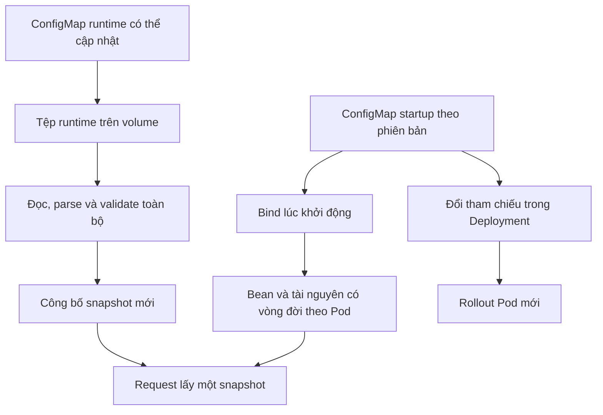

# Tách cấu hình thường xuyên thay đổi khỏi cấu hình cần khởi động lại

Trong chương **Thiết kế cấu hình** của module **SPRING_CLOUD_KUBERNETES**, việc đưa tất cả thuộc tính vào một ConfigMap chưa tạo ra một thiết kế vận hành rõ ràng. Một lần đổi hạn mức xử lý có thể vô tình đi chung với thay đổi cổng HTTP, profile hoặc thông tin tạo connection pool.

Mục tiêu của bài là tách hai đường thay đổi: cấu hình ứng dụng có thể áp dụng trong tiến trình đang chạy và cấu hình chỉ có hiệu lực sau khi tạo lại tài nguyên hoặc thay Pod. Tách tài nguyên Kubernetes phải đi cùng tách consumer, validation và quy trình triển khai.

Sau bài học, bạn có thể:

- Phân loại thuộc tính dựa trên vòng đời của thành phần sử dụng.
- Thiết kế ConfigMap, đường nạp và quyền thay đổi riêng cho từng nhóm.
- Áp dụng một bộ cấu hình runtime đã kiểm tra theo cách nhất quán trong mỗi request.
- Lập quy trình rollout và rollback cho cấu hình khởi động.
- Xác định vai trò và giới hạn của Spring Cloud Kubernetes Configuration Watcher.

## 1. Tần suất thay đổi và khả năng reload là hai trục khác nhau

Một thuộc tính thay đổi thường xuyên chưa chắc có thể cập nhật trực tiếp. Ngược lại, một thuộc tính hiếm khi đổi vẫn có thể được đọc động nếu ứng dụng đã thiết kế như vậy.

| Ví dụ | Tần suất có thể gặp | Quyết định thay đổi phụ thuộc vào |
| --- | --- | --- |
| Cho phép nhận lô xử lý mới | Nhiều lần trong ngày | Handler có đọc chính sách hiện tại ở mỗi lần nhận lô không |
| Giới hạn kích thước một lô | Theo tải hệ thống | Hạn mức được đọc theo request hay chép vào worker lúc khởi tạo |
| Timeout gọi dịch vụ ngoài | Có thể cần chỉnh nhanh | Thư viện hỗ trợ đặt theo request hay phải tạo lại client |
| Số luồng của executor | Có thể cần chỉnh theo tải | API resize, giới hạn và xử lý task đang chạy |
| Cổng HTTP | Hiếm hơn | Vòng đời web server, Service và probes |
| Active profile, lựa chọn bean | Theo đợt triển khai | ApplicationContext và điều kiện tạo bean |
| URL, credential hoặc tham số connection pool | Theo hệ thống | Hỗ trợ rotation/rebuild của pool và các kết nối hiện hữu |

Không nên ghi một quy tắc chung rằng “mọi timeout đều reload được” hoặc “mọi credential đều phải restart”. Cần kiểm tra đúng consumer và phiên bản thư viện.

Trong thiết kế chưa có cơ chế thay đổi an toàn, coi thuộc tính là cần rollout cho đến khi chứng minh được đường cập nhật trong tiến trình.

## 2. Hợp đồng thay đổi của một thuộc tính

Mỗi thuộc tính nên có các thông tin sau:

| Thông tin | Ví dụ |
| --- | --- |
| Consumer | Handler tiếp nhận lô xử lý |
| Thời điểm đọc | Lấy một snapshot ở đầu request |
| Ràng buộc | Kích thước lô trong khoảng 1 đến 500 |
| Cách áp dụng | Thay nguyên bộ chính sách sau validation |
| Phạm vi hiệu lực | Request bắt đầu sau khi snapshot mới được công bố |
| Khi dữ liệu mới lỗi | Giữ bộ hợp lệ trước đó và phát tín hiệu lỗi reload |
| Độ trễ chấp nhận | Tính cả lan truyền Kubernetes và chu kỳ đọc của ứng dụng |
| Cách quay lại | Công bố một bản hợp lệ trước đó và xác nhận từng replica |

Cấu hình khởi động có một hợp đồng khác: giá trị được bind lúc tạo thành phần, thay đổi được gắn với một đợt triển khai và kiểm tra trên Pod mới.

Việc phân loại phải được phản ánh bằng prefix, lớp cấu hình và luồng thay đổi. Hai key nằm trong hai ConfigMap nhưng cùng bị một thao tác refresh tái tạo toàn bộ client vẫn chưa có ranh giới vận hành rõ.

## 3. Kiến trúc hai đường cấu hình

Ví dụ dịch vụ tiếp nhận lô đơn hàng:



Trong bài:

- `orders-startup-s1` chứa cổng HTTP và một nhóm thuộc tính khởi động.
- `orders-runtime` chứa chính sách nhận lô và giới hạn kích thước lô.
- Cấu hình runtime có schema riêng, không chấp nhận thêm key startup.
- Credential, nếu có, thuộc Secret với chính sách rotation riêng; không đặt vào hai ConfigMap này.

Ví dụ chọn volume và bộ đọc nhỏ trong ứng dụng để làm rõ ranh giới. Không cần thêm Kubernetes API client chỉ để đọc các tệp đã mount. Phần sau giải thích cách áp dụng cùng nguyên tắc nếu dùng Configuration Watcher.

## 4. Thiết kế tài nguyên Kubernetes

Các tệp dưới đây là tệp người học chuẩn bị để thực hành trên cluster lab. Chưa có image dựng sẵn trong ví dụ.

### 4.1. Namespace và cấu hình khởi động bất biến

Tệp `namespace.yaml`:

```yaml
apiVersion: v1
kind: Namespace
metadata:
  name: config-split-lab
```

Tệp `startup-s1.yaml`:

```yaml
apiVersion: v1
kind: ConfigMap
metadata:
  name: orders-startup-s1
  namespace: config-split-lab
  labels:
    app.example.com/change-mode: rollout
immutable: true
data:
  application.yaml: |-
    server:
      port: 8080
    app:
      startup:
        revision: startup-s1
        processing-lanes: 4
```

Tên theo phiên bản giúp Deployment tham chiếu chính xác bộ cấu hình khởi động. `immutable: true` ngăn sửa dữ liệu tại chỗ; lần thay đổi tiếp theo tạo ConfigMap mới rồi cập nhật tham chiếu. [Immutable ConfigMaps](https://kubernetes.io/docs/concepts/configuration/configmap/#immutable-configmaps).

`processing-lanes` ở đây là thuộc tính minh họa được bind khi khởi động, đại diện cho tham số tạo tài nguyên xử lý. Mẫu lab chỉ hiển thị giá trị này, không triển khai một executor sản xuất.

### 4.2. Cấu hình runtime với schema nhỏ

Tệp `runtime.yaml`:

```yaml
apiVersion: v1
kind: ConfigMap
metadata:
  name: orders-runtime
  namespace: config-split-lab
  labels:
    app.example.com/change-mode: reload
data:
  runtime.properties: |-
    revision=runtime-r1
    accepting-requests=true
    max-batch-size=25
```

Ba key tạo thành một bộ chính sách. Mã revision là dữ liệu vận hành công khai, không chứa bí mật.

Các label `app.example.com/change-mode` chỉ mô tả quy ước của ví dụ. Chúng không tự bật reload, rollout, RBAC hoặc Configuration Watcher.

Hai nhóm có định dạng khác nhau có chủ đích: YAML startup được Spring Boot nạp, còn tệp properties runtime được bộ đọc riêng xử lý. Nhờ đó, việc thêm nhầm `server.port` vào runtime không được hiểu là yêu cầu đổi cổng.

### 4.3. Deployment mount hai thư mục riêng

Tệp `deployment.yaml`:

```yaml
apiVersion: apps/v1
kind: Deployment
metadata:
  name: config-split-demo
  namespace: config-split-lab
spec:
  replicas: 1
  selector:
    matchLabels:
      app: config-split-demo
  strategy:
    type: RollingUpdate
    rollingUpdate:
      maxSurge: 1
      maxUnavailable: 0
  template:
    metadata:
      labels:
        app: config-split-demo
    spec:
      automountServiceAccountToken: false
      securityContext:
        runAsNonRoot: true
        runAsUser: 10001
        runAsGroup: 10001
        seccompProfile:
          type: RuntimeDefault
      containers:
        - name: app
          image: registry.example.com/training/config-split-demo:1.0
          ports:
            - name: http
              containerPort: 8080
          env:
            - name: SPRING_CONFIG_ADDITIONAL_LOCATION
              value: "file:/etc/order-startup/"
          securityContext:
            allowPrivilegeEscalation: false
            capabilities:
              drop:
                - ALL
          volumeMounts:
            - name: startup
              mountPath: /etc/order-startup
              readOnly: true
            - name: runtime
              mountPath: /etc/order-runtime
              readOnly: true
          readinessProbe:
            httpGet:
              path: /lab/config
              port: http
            periodSeconds: 5
      volumes:
        - name: startup
          configMap:
            name: orders-startup-s1
        - name: runtime
          configMap:
            name: orders-runtime
```

Thay image minh họa bằng image thật chứa ứng dụng ở phần 5, có thể chạy với UID 10001 và được cluster kéo về. Probe lab chỉ xác nhận endpoint quan sát phục vụ được, không kiểm tra dependency nghiệp vụ bên ngoài.

Mount cả thư mục runtime để nhận cập nhật; tránh `subPath` cho đường này. Kubernetes cập nhật ConfigMap volume sau độ trễ, không bảo đảm mọi Pod nhận đồng thời. Biến môi trường từ ConfigMap không tự đổi trong container đang chạy. [Cơ chế tiêu thụ và cập nhật ConfigMap](https://kubernetes.io/docs/concepts/configuration/configmap/).

Cấu hình trong mẫu không gọi Kubernetes API từ Java, nên không cấp token ServiceAccount cho container. Nếu bổ sung DiscoveryClient, ConfigMap qua API hoặc watcher, hãy thiết kế xác thực và RBAC tương ứng thay vì suy ra quyền từ khả năng đọc volume.

## 5. Tách consumer trong ứng dụng Spring

Mẫu dùng Java 17 trở lên, Spring Boot 3.x và `spring-boot-starter-web`, với version do parent/BOM Spring Boot quản lý. Các lớp cùng package `com.example.configsplit`.

Tệp `src/main/resources/application.yaml`:

```yaml
spring:
  application:
    name: config-split-demo

app:
  runtime-file: /etc/order-runtime/runtime.properties
```

Đường dẫn tệp runtime là thông tin thiết lập bộ đọc; bản thân đường dẫn này thuộc nhóm khởi động trong mẫu.

### 5.1. Bean khởi động không tham gia reload runtime

Tệp `StartupSettings.java`:

```java
package com.example.configsplit;

import org.springframework.boot.context.properties.ConfigurationProperties;

@ConfigurationProperties(prefix = "app.startup")
public record StartupSettings(String revision, int processingLanes) {

    public StartupSettings {
        if (revision == null || revision.isBlank()) {
            throw new IllegalArgumentException("startup revision is required");
        }
        if (processingLanes < 1 || processingLanes > 16) {
            throw new IllegalArgumentException("processing-lanes out of range");
        }
    }
}
```

Nếu thiếu cấu hình startup bắt buộc, ứng dụng lỗi khi tạo bean thay vì tiếp tục với một cấu hình không xác định. Record được giữ theo vòng đời của ứng dụng; bộ đọc runtime bên dưới không bind lại nó.

### 5.2. Đối tượng chính sách runtime bất biến

Tệp `RuntimePolicy.java`:

```java
package com.example.configsplit;

public record RuntimePolicy(
        String revision,
        boolean acceptingRequests,
        int maxBatchSize
) {
    public RuntimePolicy {
        if (revision == null
                || !revision.matches("[A-Za-z0-9._-]{1,64}")) {
            throw new IllegalArgumentException("invalid runtime revision");
        }
        if (maxBatchSize < 1 || maxBatchSize > 500) {
            throw new IllegalArgumentException("max-batch-size out of range");
        }
    }
}
```

Record này không phải bean `@ConfigurationProperties` chờ Spring tự refresh. Nó là một snapshot do bộ đọc tạo, kiểm tra và công bố. Các field có quan hệ được chuyển cùng một bộ.

### 5.3. Đọc ứng viên, kiểm tra rồi công bố

Tệp `RuntimePolicyStore.java`:

```java
package com.example.configsplit;

import java.io.IOException;
import java.io.Reader;
import java.nio.charset.StandardCharsets;
import java.nio.file.Files;
import java.nio.file.Path;
import java.util.Properties;
import java.util.Set;
import java.util.concurrent.atomic.AtomicReference;

import org.slf4j.Logger;
import org.slf4j.LoggerFactory;
import org.springframework.beans.factory.annotation.Value;
import org.springframework.scheduling.annotation.Scheduled;
import org.springframework.stereotype.Component;

@Component
public class RuntimePolicyStore {

    private static final Logger log =
            LoggerFactory.getLogger(RuntimePolicyStore.class);

    private static final Set<String> KEYS = Set.of(
            "revision", "accepting-requests", "max-batch-size"
    );

    private final Path path;
    private final AtomicReference<RuntimePolicy> current;

    public RuntimePolicyStore(@Value("${app.runtime-file}") String file)
            throws IOException {
        this.path = Path.of(file);
        this.current = new AtomicReference<>(readCandidate());
    }

    public RuntimePolicy current() {
        return current.get();
    }

    @Scheduled(fixedDelay = 5000)
    public void reload() {
        try {
            RuntimePolicy candidate = readCandidate();
            RuntimePolicy previous = current.get();
            if (candidate.equals(previous)) {
                return;
            }
            if (candidate.revision().equals(previous.revision())) {
                throw new IllegalArgumentException("revision must change");
            }
            current.set(candidate);
            log.info("Applied runtime revision {}", candidate.revision());
        } catch (IOException | IllegalArgumentException ex) {
            log.warn("Runtime reload rejected ({})",
                    ex.getClass().getSimpleName());
        }
    }

    private RuntimePolicy readCandidate() throws IOException {
        Properties values = new Properties();
        try (Reader reader = Files.newBufferedReader(
                path, StandardCharsets.UTF_8)) {
            values.load(reader);
        }

        if (!values.stringPropertyNames().equals(KEYS)) {
            throw new IllegalArgumentException("runtime keys do not match");
        }

        String accepting = values.getProperty("accepting-requests");
        if (!"true".equals(accepting) && !"false".equals(accepting)) {
            throw new IllegalArgumentException("invalid boolean");
        }

        return new RuntimePolicy(
                values.getProperty("revision"),
                Boolean.parseBoolean(accepting),
                Integer.parseInt(values.getProperty("max-batch-size"))
        );
    }
}
```

Bộ đọc có các đặc điểm quan trọng:

- Lần đọc đầu tiên là bắt buộc; không có bản hợp lệ thì ứng dụng chưa khởi động thành công.
- Mỗi lần đọc mở lại đường dẫn, đọc hết một tệp rồi tạo ứng viên trong bộ nhớ.
- Thiếu key, thừa key, boolean sai hoặc kích thước lô ngoài giới hạn đều bị từ chối.
- Thay đổi nội dung cần có revision khác với bản đang áp dụng.
- Chỉ sau validation, tham chiếu hiện tại mới được thay.
- Khi reload lỗi, không xóa cấu hình đang phục vụ và không ghi toàn bộ dữ liệu vào log.

`AtomicReference` hỗ trợ thay nguyên một tham chiếu đối tượng theo cách nguyên tử trong tiến trình. Nó không tạo giao dịch trên nhiều Pod. [AtomicReference của Java](https://docs.oracle.com/en/java/javase/17/docs/api/java.base/java/util/concurrent/atomic/AtomicReference.html).

Chu kỳ 5 giây trong ví dụ là lựa chọn lab, không phải cam kết cập nhật sau đúng 5 giây kể từ lệnh apply. Nó chạy sau khi scheduling được bật, và còn phải tính độ trễ Kubernetes đưa tệp mới tới volume. [Spring scheduling](https://docs.spring.io/spring-framework/reference/integration/scheduling.html).

### 5.4. Request đọc đúng một snapshot

Tệp `LabController.java`:

```java
package com.example.configsplit;

import java.util.Map;

import org.springframework.http.ResponseEntity;
import org.springframework.web.bind.annotation.GetMapping;
import org.springframework.web.bind.annotation.RequestParam;
import org.springframework.web.bind.annotation.RestController;

@RestController
public class LabController {

    private final StartupSettings startup;
    private final RuntimePolicyStore policies;

    public LabController(
            StartupSettings startup,
            RuntimePolicyStore policies) {
        this.startup = startup;
        this.policies = policies;
    }

    @GetMapping("/lab/config")
    public Map<String, Object> config() {
        RuntimePolicy policy = policies.current();
        return Map.of(
                "startupRevision", startup.revision(),
                "processingLanes", startup.processingLanes(),
                "runtimeRevision", policy.revision(),
                "acceptingRequests", policy.acceptingRequests(),
                "maxBatchSize", policy.maxBatchSize()
        );
    }

    @GetMapping("/lab/admission")
    public ResponseEntity<Map<String, Object>> admission(
            @RequestParam("size") int size) {
        RuntimePolicy policy = policies.current();
        Map<String, Object> result = Map.of(
                "runtimeRevision", policy.revision(),
                "requestedSize", size
        );
        if (!policy.acceptingRequests()) {
            return ResponseEntity.status(503).body(result);
        }
        if (size < 1 || size > policy.maxBatchSize()) {
            return ResponseEntity.badRequest().body(result);
        }
        return ResponseEntity.ok(result);
    }
}
```

Endpoint admission chỉ mô phỏng quyết định nhận lô; không ghi đơn hàng hoặc khởi chạy tác vụ thật. Cờ ngừng nhận áp dụng cho request được đánh giá bằng snapshot tương ứng, không tự hủy tác vụ đã nhận trước đó.

Điểm đáng chú ý là `RuntimePolicy policy = policies.current()` được gọi một lần ở đầu phương thức. Nếu đọc từng field qua nhiều lần gọi `current()`, một request có thể ghép dữ liệu từ hai revision khác nhau.

### 5.5. Đăng ký cấu hình và scheduling

Tệp `ConfigSplitApplication.java`:

```java
package com.example.configsplit;

import org.springframework.boot.SpringApplication;
import org.springframework.boot.autoconfigure.SpringBootApplication;
import org.springframework.boot.context.properties.EnableConfigurationProperties;
import org.springframework.scheduling.annotation.EnableScheduling;

@SpringBootApplication
@EnableScheduling
@EnableConfigurationProperties(StartupSettings.class)
public class ConfigSplitApplication {

    public static void main(String[] args) {
        SpringApplication.run(ConfigSplitApplication.class, args);
    }
}
```

Spring Boot chỉ nạp YAML startup qua thư mục cấu hình bổ sung. `runtime.properties` được bộ đọc riêng xử lý, không được import lại thành một nguồn ghi đè các thuộc tính startup.

Đây là việc tách consumer thực tế: sửa chính sách runtime không đi qua bộ bind startup hoặc vòng đời web server.

## 6. Thực hành hai loại thay đổi

Sau khi cung cấp image thực, người học chạy các lệnh trên cluster lab:

```shell
kubectl apply -f namespace.yaml
kubectl apply -f startup-s1.yaml
kubectl apply -f runtime.yaml
kubectl apply -f deployment.yaml
kubectl -n config-split-lab rollout status deployment/config-split-demo --timeout=180s
kubectl -n config-split-lab get pods -l app=config-split-demo
```

Ghi lại tên và UID của Pod để kiểm chứng thay đổi runtime có cần thay Pod hay không:

```shell
kubectl -n config-split-lab get pods -l app=config-split-demo -o custom-columns=NAME:.metadata.name,UID:.metadata.uid,RESTARTS:.status.containerStatuses[0].restartCount
```

Mở một terminal riêng:

```shell
kubectl -n config-split-lab port-forward deployment/config-split-demo 8080:8080
```

Từ terminal khác:

```shell
curl http://localhost:8080/lab/config
curl -i "http://localhost:8080/lab/admission?size=10"
```

Trạng thái ban đầu dự kiến gồm `startup-s1`, `runtime-r1`, `processingLanes = 4` và `maxBatchSize = 25`. Lô kích thước 10 được endpoint lab chấp nhận với HTTP 200.

### 6.1. Đổi runtime mà giữ Pod

Trong `runtime.yaml`, thay nội dung tệp bằng:

```properties
revision=runtime-r2
accepting-requests=true
max-batch-size=5
```

Giữ nguyên định danh ConfigMap và áp dụng:

```shell
kubectl apply -f runtime.yaml
```

Đọc lại endpoint quan sát đến khi thấy `runtime-r2`, trong giới hạn timeout vận hành bạn đặt cho cluster. Sau đó gọi admission với size 10: kết quả dự kiến chuyển sang HTTP 400.

Kiểm tra UID và restart count. Nếu không có sự kiện ngoài thí nghiệm làm thay Pod, chúng phải giữ nguyên; `startupRevision` vẫn là `startup-s1`.

Đây là bằng chứng runtime được consumer sử dụng mà không thay Pod, thay vì chỉ chứng minh ConfigMap đã được cập nhật trên API server.

### 6.2. Từ chối runtime không hợp lệ

Thử một ứng viên:

```properties
revision=runtime-r3
accepting-requests=true
max-batch-size=0
```

Sau apply và sau khi tệp đã lan truyền, bộ đọc dự kiến từ chối ứng viên. Endpoint tiếp tục báo `runtime-r2` và giới hạn 5; log xuất hiện cảnh báo reload bị từ chối.

Không coi trạng thái này là đã triển khai thành công `runtime-r3`. Nguồn mong muốn và cấu hình được ứng dụng chấp nhận đang khác nhau.

Khôi phục bằng một bản hợp lệ, ví dụ:

```properties
revision=runtime-r4
accepting-requests=true
max-batch-size=15
```

Áp dụng lại và kiểm tra revision thực tế. Mẫu lab sẽ chấp nhận lô size 10 trở lại sau khi áp dụng `runtime-r4`.

### 6.3. Đổi startup bằng rollout

Để thay `processing-lanes` thành 8:

1. Tạo `startup-s2.yaml` từ manifest startup, đổi tên ConfigMap thành `orders-startup-s2`.
2. Đặt `revision: startup-s2` và `processing-lanes: 8`, giữ cổng 8080 trong thí nghiệm.
3. Tạo ConfigMap mới.
4. Trong `deployment.yaml`, đổi `volumes[].name: startup` tham chiếu đến `orders-startup-s2`.
5. Áp dụng Deployment và theo dõi rollout.

```shell
kubectl apply -f startup-s2.yaml
kubectl apply -f deployment.yaml
kubectl -n config-split-lab rollout status deployment/config-split-demo --timeout=180s
```

Thay tham chiếu bên trong Pod template kích hoạt một đợt rollout. Sau khi kết nối lại port-forward tới Pod mới, kiểm tra `startupRevision = startup-s2` và `processingLanes = 8`. Runtime được Pod mới đọc từ bản hiện có của `orders-runtime`. [Kubernetes Deployment updates](https://kubernetes.io/docs/concepts/workloads/controllers/deployment/#updating-a-deployment).

Nếu đổi cổng HTTP thật, còn phải đồng bộ container port, Service, probe và đường định tuyến liên quan. Sửa riêng key `server.port` không tạo ra một triển khai hoàn chỉnh.

## 7. Đặt Configuration Watcher ở đúng vai trò

Trong một hệ thống dùng Spring Cloud Kubernetes, Configuration Watcher có thể phát hiện ConfigMap/Secret thay đổi và gửi tín hiệu refresh qua HTTP hoặc Spring Cloud Bus. Nó không tự biết key nào có thể thay đổi an toàn trong client nghiệp vụ.

Với dòng Spring Cloud Kubernetes 3.3.x, ConfigMap có nhãn `spring.cloud.kubernetes.config: "true"` có thể tham gia luồng phát sự kiện của watcher đã cấu hình. Cần xét lựa chọn nguồn, namespace, tuyến tới ứng dụng và RBAC của controller. Với volume, phải tính độ trễ trước khi thông báo để tránh refresh khi tệp còn cũ. [Configuration Watcher](https://docs.spring.io/spring-cloud-kubernetes/reference/3.3/spring-cloud-kubernetes-configuration-watcher.html).

Bộ đọc lab đã dùng polling tệp và không đăng ký xử lý sự kiện refresh. Chỉ thêm nhãn watcher không biến lời gọi `/refresh` thành lời gọi `RuntimePolicyStore.reload()`.

Nếu chọn watcher làm cơ chế thông báo cho thiết kế thực, cần nối đầy đủ chuỗi:

```text
Sự kiện đổi nguồn
  -> đọc dữ liệu mới
  -> kiểm tra schema và ràng buộc
  -> áp dụng vào đúng consumer
  -> công bố revision được chấp nhận
```

Giữ cấu hình startup ngoài tập nguồn được phép áp dụng động. Đừng gắn cùng chính sách refresh cho mọi ConfigMap chỉ vì chúng thuộc cùng ứng dụng.

`@RefreshScope` và cơ chế rebind có giới hạn theo loại bean. Constructor binding, record cấu hình, client đang giữ cache và pool có vòng đời tài nguyên cần được đánh giá riêng. Không suy ra rằng đặt annotation lên một lớp cấu hình sẽ tự cập nhật mọi bean phụ thuộc hoặc mọi request đang xử lý. [Spring Cloud Context và Refresh Scope](https://docs.spring.io/spring-cloud-commons/reference/spring-cloud-commons/application-context-services.html#refresh-scope).

Cơ chế `PropertySource Reload` cũ được tài liệu Spring Cloud Kubernetes đánh dấu deprecated; khi thiết kế mới, đừng chỉ sao chép `spring.cloud.kubernetes.reload.enabled=true` để thay cho việc xác định ranh giới cập nhật. [PropertySource Reload](https://docs.spring.io/spring-cloud-kubernetes/reference/3.3/property-source-config/propertysource-reload.html).

## 8. Kiểm soát thay đổi và rollback theo từng đường

| Nội dung | Đường runtime | Đường startup |
| --- | --- | --- |
| Tài nguyên mẫu | ConfigMap nhỏ, có thể cập nhật | ConfigMap bất biến theo phiên bản |
| Người thay đổi | Có thể là nhóm vận hành được giới hạn phạm vi | Quy trình triển khai ứng dụng |
| Thực thi | Parse, validate, công bố snapshot | Tạo nguồn mới, đổi template, rollout |
| Bằng chứng | Revision đã áp dụng trên từng replica | Pod mới, startup revision và readiness |
| Khi ứng viên lỗi | Giữ bản hợp lệ trước đó theo hợp đồng | Pod mới không đạt yêu cầu, dừng/khôi phục rollout |
| Rollback | Công bố lại bộ runtime hợp lệ đã chọn | Quay về template tham chiếu nguồn startup cũ |

Tách ConfigMap cho phép thiết kế Role/RoleBinding khác nhau theo tài nguyên. Label chỉ là metadata, không tự giới hạn quyền cập nhật. Nếu pipeline dùng patch, update hoặc apply, quyền được cấp phải phù hợp với thao tác thực tế và namespace liên quan.

Trong ví dụ, giữ bản runtime hợp lệ trước đó là chính sách cho hạn mức nhận lô. Đây không phải chính sách chung cho mọi loại dữ liệu. Với quyết định bắt buộc ngừng truy cập hoặc credential bị thu hồi, dùng cấu hình cũ quá lâu có thể không chấp nhận được; cần quy định thời hạn hiệu lực và hành vi khi mất cập nhật.

Không ghi đè startup dưới cùng tên rồi kỳ vọng rollback Deployment khôi phục nội dung cũ. Template cũ chỉ giữ tham chiếu; ConfigMap theo phiên bản giúp giữ lại bộ dữ liệu tương ứng. Nguồn startup cũ phải còn tồn tại trong cửa sổ rollback.

## 9. Tính nhất quán và quan sát trên nhiều Pod

`AtomicReference` chỉ bảo đảm việc đọc snapshot trong một JVM. Nó không làm mọi Pod đổi revision cùng lúc. Trong một khoảng thời gian, P1 có thể dùng runtime-r4 còn P2 vẫn dùng runtime-r2.

Nếu nghiệp vụ chấp nhận khoảng giao nhau đó, ghi rõ phạm vi và độ trễ. Nếu yêu cầu mọi request trên cluster chuyển tại cùng một ranh giới, cần cơ chế phối hợp hoặc nguồn quyết định tập trung phù hợp hơn một ConfigMap volume thông thường.

Các cấu hình có quan hệ chặt chẽ nên được đổi cùng một bộ. Nếu tăng hạn mức runtime đòi hỏi phiên bản startup mới, hãy thiết kế tương thích hoặc thứ tự triển khai; tách hai file không tự giải quyết phụ thuộc giữa chúng.

Nên quan sát tối thiểu:

- Startup revision và runtime revision thực sự được mỗi replica chấp nhận.
- Thời điểm reload thành công gần nhất và số lần bị từ chối.
- Sự khác nhau giữa revision mong muốn và revision áp dụng.
- Lỗi và độ trễ nghiệp vụ sau khi đổi cấu hình.

Mẫu lab mới có endpoint revision và log, chưa cung cấp đầy đủ metric hoặc cảnh báo. Khi dùng trong hệ thống thực, bổ sung những tín hiệu này vào hạ tầng giám sát hiện có.

Không dùng liveness để chữa một ứng viên runtime sai bằng cách restart liên tục. Chỉ giữ trạng thái sẵn sàng và tiếp tục phục vụ bằng bản trước nếu điều đó đúng với hợp đồng đã chọn; đồng thời phải báo được việc cập nhật bị từ chối.

Một thiết kế hoàn chỉnh chứng minh được hai điều riêng biệt: đổi chính sách runtime chỉ tác động đến consumer được cho phép, còn đổi cấu hình startup đi qua đợt triển khai có thể theo dõi và khôi phục.
