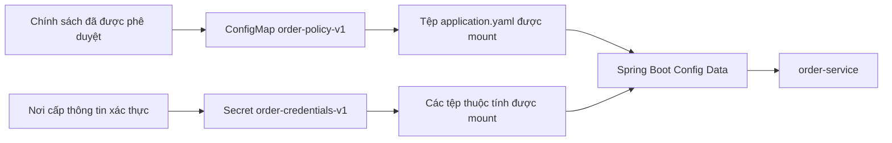

# Phân biệt cấu hình nghiệp vụ và bí mật truy cập

## Mục tiêu và bối cảnh

Trong chương **Thiết kế cấu hình** của module **SPRING_CLOUD_KUBERNETES**, việc tách dữ liệu theo mục đích và độ nhạy cảm giúp nhóm chọn đúng nơi lưu, người được sửa và cách đưa thay đổi vào ứng dụng Spring. Một dịch vụ có thể dùng DiscoveryClient, ConfigMap, Secret, Spring Cloud LoadBalancer hoặc Configuration Watcher, nhưng không cần bật tất cả những tính năng đó để quản lý cấu hình.

Sau bài học, bạn có thể:

- Phân loại tham số nghiệp vụ, tham số vận hành và thông tin xác thực dựa trên hậu quả khi lộ hoặc bị sửa.
- Thiết kế ConfigMap và Secret với phạm vi đủ nhỏ cho từng ứng dụng, từng môi trường.
- Đưa cấu hình vào Spring mà không đóng gói thông tin xác thực trong mã nguồn hay image.
- Phân biệt cập nhật cấu hình, refresh ứng dụng và xoay vòng thông tin xác thực.
- Chọn quyền RBAC, dấu hiệu quan sát và quy trình phát hành phù hợp với hai loại thay đổi.

Ví dụ xuyên suốt là `order-service`. Dịch vụ cần ngưỡng miễn phí vận chuyển, giới hạn số mặt hàng, địa chỉ cơ sở dữ liệu và token gọi đối tác thanh toán. Đây đều là đầu vào của ứng dụng, nhưng không có cùng chủ sở hữu hay vòng đời.

## 1. Hai câu hỏi phải được trả lời riêng

**Cấu hình nghiệp vụ** điều chỉnh chính sách mà ứng dụng thực hiện: đơn hàng được mua tối đa bao nhiêu mặt hàng, đơn nào được miễn phí vận chuyển, tính năng nào áp dụng cho một nhóm khách hàng. Thay đổi loại này làm đổi hành vi sản phẩm mà thường không cần sửa thuật toán.

**Bí mật truy cập** là dữ liệu giúp chứng minh danh tính hoặc thực hiện một quyền: mật khẩu cơ sở dữ liệu, API token, OAuth client secret, khóa riêng của chứng thư hoặc khóa ký. Ai có giá trị đó có thể thực hiện hành động trong phạm vi được cấp.

Không nên biến hai khái niệm này thành hai nhãn đối lập tuyệt đối. Hãy hỏi riêng:

1. **Giá trị này phục vụ điều gì?** Nghiệp vụ, vận hành, hay xác thực?
2. **Giá trị này cần bảo vệ thế nào?** Có thể công khai, chỉ dùng nội bộ, hay phải giữ bí mật?

Một quy tắc giá sắp công bố là cấu hình nghiệp vụ nhưng có thể cần giữ bí mật. Một URL vận hành thường không phải thông tin xác thực, nhưng URL chứa mật khẩu hoặc chữ ký truy cập lại phải được bảo vệ như bí mật. Tên trường, độ dài chuỗi và tần suất thay đổi không quyết định độ nhạy cảm.

| Giá trị | Mục đích | Phân loại và cách xử lý gợi ý |
| --- | --- | --- |
| `order.checkout.max-items = 50` | Giới hạn đặt hàng | Cấu hình nghiệp vụ; có thể đặt trong ConfigMap nếu không cần bảo mật nội dung |
| `order.checkout.free-shipping-threshold = 500000` | Chính sách miễn phí vận chuyển | Cấu hình nghiệp vụ; cần phê duyệt tác động doanh thu |
| `partner.base-url = https://payments.example.com` | Địa chỉ kết nối | Cấu hình vận hành; đánh giá mức độ nội bộ của địa chỉ |
| `spring.datasource.url = jdbc:postgresql://orders-db:5432/orders` | Kết nối dữ liệu | Cấu hình vận hành nếu không nhúng thông tin xác thực |
| `spring.datasource.password` | Đăng nhập cơ sở dữ liệu | Bí mật truy cập; dùng Secret hoặc hệ thống quản lý bí mật |
| `partner.api-token` | Gọi API đối tác | Bí mật truy cập; cần phạm vi quyền và quy trình thu hồi |
| Khóa riêng TLS hoặc khóa ký JWT | Chứng minh danh tính hoặc ký dữ liệu | Bí mật mật mã; hạn chế nơi xuất hiện và người đọc |
| URL tải tệp có chữ ký và thời hạn | Cấp quyền truy cập tài nguyên | Bí mật truy cập trong thời hạn còn hiệu lực, dù chỉ là một URL |
| Bảng giá nội bộ chưa công bố | Điều chỉnh nghiệp vụ | Nội dung nghiệp vụ mật; không đưa vào ConfigMap chỉ vì không phải mật khẩu |
| Hồ sơ hoặc giao dịch của từng khách hàng | Dữ liệu nghiệp vụ phát sinh | Đưa vào kho dữ liệu phù hợp; không biến ConfigMap hay Secret thành cơ sở dữ liệu |

Với dữ liệu không phải bí mật truy cập nhưng vẫn cần bảo mật, Secret có thể phù hợp cho lượng nhỏ cấu hình được cấp cho Pod; yêu cầu lớn hơn có thể cần kho cấu hình hoặc kho dữ liệu có kiểm soát truy cập. Việc chọn loại tài nguyên không thay thế bước phân loại.

## 2. Tính bí mật và tính toàn vẹn có hậu quả khác nhau

Lộ mật khẩu tạo rủi ro truy cập trái phép. Sửa ngưỡng miễn phí vận chuyển từ `500000` thành `0` có thể gây thất thoát dù không lộ bất kỳ mật khẩu nào. Vì vậy, “không bí mật” không có nghĩa là ai cũng được thay đổi.

Trong thiết kế ví dụ này, có ba trách nhiệm:

| Trách nhiệm | Cấu hình nghiệp vụ | Bí mật truy cập |
| --- | --- | --- |
| Quyết định giá trị | Người phụ trách chính sách sản phẩm | Chủ hệ thống cấp quyền hoặc nhóm quản lý danh tính |
| Phê duyệt thay đổi | Người chịu trách nhiệm hành vi và tác động nghiệp vụ | Người chịu trách nhiệm phạm vi quyền, thời hạn, thu hồi |
| Triển khai và kiểm tra | Pipeline hoặc người vận hành được ủy quyền | Bộ phận hoặc controller được cấp quyền đưa bí mật vào môi trường |

Nhóm phát triển cần biết tên thuộc tính, kiểu dữ liệu và cách xử lý khi thiếu. Họ không mặc nhiên cần biết giá trị bí mật production. Người xem cấu hình khuyến mại cũng không mặc nhiên cần quyền sửa Secret của cơ sở dữ liệu.

Một hợp đồng cấu hình nên ghi rõ: tên khóa, đơn vị, giá trị bắt buộc hay có mặc định, người chịu trách nhiệm, nguồn cấp, điều kiện hợp lệ và cách áp dụng thay đổi. Với bí mật, bổ sung nơi cấp, phạm vi quyền, thời hạn và người thực hiện thu hồi. Không ghi giá trị bí mật vào hợp đồng này.

## 3. ConfigMap và Secret giải quyết phần nào của bài toán?

ConfigMap dành cho dữ liệu không cần giữ bí mật; tài nguyên này không cung cấp cơ chế bảo mật nội dung. Vì vậy, hãy đưa vào đó những thông tin mà người được phép đọc ConfigMap thực sự có thể biết. Xem định nghĩa tại [Kubernetes ConfigMaps](https://kubernetes.io/docs/concepts/configuration/configmap/).

Secret có kiểu tài nguyên riêng cho dữ liệu nhạy cảm. Trường `data` dùng Base64, còn `stringData` cho phép nhập chuỗi chưa mã hóa Base64. Cả hai đều không làm cho manifest trở thành tài liệu an toàn để công khai. Base64 là biểu diễn dữ liệu, không phải mã hóa bảo mật; theo cấu hình mặc định của Kubernetes, Secret không tự được mã hóa khi lưu trong etcd. Cần kiểm tra cấu hình mã hóa khi lưu của cụm thực tế. Xem [Kubernetes Secrets](https://kubernetes.io/docs/concepts/configuration/secret/).

Tách hai đối tượng mang lại khả năng áp dụng quyền và quy trình khác nhau, nhưng vẫn phải kiểm soát cả nơi xuất hiện của dữ liệu:

- Mã nguồn, image, Docker build argument và cấu hình CI.
- Manifest trước khi áp dụng, artifact của pipeline và bản sao lưu.
- API Kubernetes, filesystem hoặc môi trường bên trong container.
- Log, trace, thông báo lỗi, heap dump và giao diện quản trị.

Không commit Secret production dưới dạng `data` hoặc `stringData`. Một repository riêng tư vẫn có người đọc, bản sao và lịch sử. Nếu đã lộ bí mật có hiệu lực, thao tác ưu tiên là thu hồi hoặc xoay vòng; chỉ xóa dòng trong commit mới không xử lý được giá trị đã bị sao chép.

## 4. Thiết kế tối thiểu cho `order-service`

Chọn thiết kế khởi đầu như sau:

- Chính sách đặt hàng và thông tin kết nối không mật nằm trong `order-policy-v1`.
- Tài khoản cơ sở dữ liệu và token đối tác nằm trong `order-credentials-v1`.
- Pod mount hai nguồn vào hai thư mục riêng.
- Spring Boot đọc tệp YAML và cây tệp bí mật qua Config Data lúc khởi động.
- Thay đổi được áp dụng bằng phát hành phiên bản cấu hình và rolling deployment.



Đây là ví dụ tích hợp cấu hình, giả định ứng dụng Spring đã có chức năng đặt hàng, driver và thành phần kết nối cần thiết. Các đoạn Java dùng `jakarta.validation`, phù hợp với ứng dụng Spring Boot hiện đại có starter validation. Namespace `training-order` đã tồn tại; image trong manifest là địa chỉ minh họa và phải được thay bằng image đã xây dựng của bạn. Bài không giả định một bản Spring Cloud release train cụ thể: khi bổ sung starter của Spring Cloud Kubernetes, phải chọn bộ phiên bản tương thích với Spring Boot đang dùng.

### 4.1. ConfigMap chứa chính sách và thông tin kết nối không mật

```yaml
apiVersion: v1
kind: ConfigMap
metadata:
  name: order-policy-v1
  namespace: training-order
immutable: true
data:
  application.yaml: |
    order:
      checkout:
        policy-version: "checkout-2026-11-a"
        max-items: 50
        free-shipping-threshold: 500000
    partner:
      base-url: https://payments.example.com
    spring:
      datasource:
        url: jdbc:postgresql://orders-db:5432/orders
```

Trong ví dụ, `free-shipping-threshold` dùng đơn vị VND và số lượng mặt hàng được hiểu là tổng số đơn vị sản phẩm trong một đơn. Hãy ghi rõ các quy ước đó trong hợp đồng cấu hình để tránh trường hợp một bên hiểu là số dòng sản phẩm.

`policy-version` là mã nghiệp vụ do nhóm tự quản lý; nó không phải `resourceVersion` của Kubernetes. Dùng mã này để đối chiếu phiên bản chính sách đang phục vụ. `immutable: true` ngăn sửa dữ liệu của ConfigMap này; khi thay đổi, tạo đối tượng mới thay vì kỳ vọng cập nhật trực tiếp.

Không thêm `spring.datasource.password` hay `partner.api-token` vào tệp trên. Cũng không để URL chứa `user:password@host` hoặc tham số mang token.

### 4.2. Secret có hợp đồng khóa riêng

Dịch vụ cần một Secret với ba khóa:

| Khóa trong Secret | Tên tệp sau khi mount | Thuộc tính Spring |
| --- | --- | --- |
| `db-username` | `spring.datasource.username` | `spring.datasource.username` |
| `db-password` | `spring.datasource.password` | `spring.datasource.password` |
| `partner-api-token` | `partner.api-token` | `partner.api-token` |

Trong phòng thực hành, người được cấp quyền có thể tạo Secret từ các tệp do họ chuẩn bị trong thư mục riêng, ngoài repository. Lệnh sau chỉ nêu đường dẫn, không nhúng giá trị bí mật vào tham số:

```powershell
kubectl -n training-order create secret generic order-credentials-v1 --from-file=db-username=./private/db-username.txt --from-file=db-password=./private/db-password.txt --from-file=partner-api-token=./private/partner-api-token.txt
```

Thư mục `./private` ở đây là thư mục làm việc bảo mật của người thực hành, không phải đề xuất thêm thư mục bí mật vào dự án. Các tệp phải chứa đúng giá trị được cấp, không có xuống dòng hoặc ký tự thừa ngoài ý muốn. Tài khoản cơ sở dữ liệu và token cũng phải đã có hiệu lực ở hệ thống đích; tạo Kubernetes Secret không tạo ra tài khoản ở PostgreSQL hay ở đối tác.

Trong production, ưu tiên đường cấp bí mật đã được tổ chức kiểm soát, chẳng hạn pipeline được giới hạn quyền hoặc hệ thống quản lý bí mật tích hợp với cụm. Cần xác định rõ một giải pháp đồng bộ có tạo bản sao Kubernetes Secret hay cấp trực tiếp qua volume, vì hai cách có phạm vi lưu trữ và quyền khác nhau.

### 4.3. Spring đọc hai nguồn mà không có mặc định bí mật

Đặt phần cấu hình khởi động sau trong `application.yaml` của ứng dụng:

```yaml
spring:
  application:
    name: order-service
  config:
    import:
      - "file:/etc/order/config/application.yaml"
      - "configtree:/etc/order/secrets/"

management:
  endpoints:
    web:
      exposure:
        include: health
  endpoint:
    health:
      probes:
        enabled: true
      show-details: never
```

Với `configtree:`, mỗi tệp cung cấp một thuộc tính: tệp `partner.api-token` cung cấp giá trị cho khóa cùng tên. Không có `optional:` trong mẫu vì các nguồn là bắt buộc. Tuy vậy, thư mục tồn tại không chứng minh mọi giá trị đều hợp lệ; vẫn cần kiểm tra khóa bắt buộc và giá trị rỗng. Cơ chế import, thứ tự ưu tiên và validation được mô tả trong [Spring Boot Externalized Configuration](https://docs.spring.io/spring-boot/reference/features/external-config.html).

Ví dụ này chỉ cần Spring Boot Config Data để đọc volume. Không cần bật ConfigMap/Secret PropertySource qua API, DiscoveryClient hoặc Spring Cloud LoadBalancer cho riêng nhu cầu đó. Nếu ứng dụng đã có starter Spring Cloud Kubernetes, hãy kiểm tra tính năng nào đang được kích hoạt để tránh đọc cùng một nhóm khóa từ nhiều nguồn ngoài dự kiến.

### 4.4. Deployment chỉ mount những khóa cần dùng

```yaml
apiVersion: v1
kind: ServiceAccount
metadata:
  name: order-runtime
  namespace: training-order
---
apiVersion: apps/v1
kind: Deployment
metadata:
  name: order-service
  namespace: training-order
spec:
  replicas: 2
  selector:
    matchLabels:
      app: order-service
  strategy:
    type: RollingUpdate
    rollingUpdate:
      maxUnavailable: 0
      maxSurge: 1
  template:
    metadata:
      labels:
        app: order-service
    spec:
      serviceAccountName: order-runtime
      automountServiceAccountToken: false
      containers:
        - name: order-service
          image: registry.example.com/training/order-service:1.0.0
          ports:
            - name: http
              containerPort: 8080
          volumeMounts:
            - name: policy
              mountPath: /etc/order/config
              readOnly: true
            - name: credentials
              mountPath: /etc/order/secrets
              readOnly: true
          startupProbe:
            httpGet:
              path: /actuator/health/liveness
              port: http
            periodSeconds: 10
            failureThreshold: 30
          readinessProbe:
            httpGet:
              path: /actuator/health/readiness
              port: http
            periodSeconds: 5
          livenessProbe:
            httpGet:
              path: /actuator/health/liveness
              port: http
            periodSeconds: 10
      volumes:
        - name: policy
          configMap:
            name: order-policy-v1
            items:
              - key: application.yaml
                path: application.yaml
        - name: credentials
          secret:
            secretName: order-credentials-v1
            items:
              - key: db-username
                path: spring.datasource.username
              - key: db-password
                path: spring.datasource.password
              - key: partner-api-token
                path: partner.api-token
```

Mẫu giả định container không cần gọi Kubernetes API; kubelet cấp volume theo Pod specification. Vì thế không cần cấp quyền đọc Secret qua API cho `order-runtime` chỉ để đọc các tệp đã mount. Tùy chọn `automountServiceAccountToken: false` phù hợp với giả định này; nếu bổ sung DiscoveryClient gọi API bằng danh tính Pod thì phải thiết kế lại token và RBAC cho chức năng đó.

`items` thể hiện rõ các khóa được cấp cho container. Với các khóa bắt buộc trong mẫu, Secret hoặc khóa thiếu làm việc chuẩn bị volume thất bại; đó là lỗi triển khai, không phải lý do để ứng dụng tự dùng mật khẩu mặc định. Khi áp dụng thêm quy tắc UID/GID và quyền tệp cho container, phải kiểm tra tiến trình Java vẫn đọc được các tệp được cấp.

Các probe ở đây phục vụ vòng đời ứng dụng. Readiness mặc định không khẳng định đăng nhập cơ sở dữ liệu hoặc token đối tác còn hiệu lực. Nếu muốn kiểm tra phụ thuộc, cần thiết kế kiểm tra có thời hạn, không gây tải lớn và không làm lộ thông tin. Không dùng sự cố dịch vụ ngoài làm lý do khởi động lại hàng loạt Pod qua liveness.

## 5. Ràng buộc giá trị ở biên ứng dụng

Tách nơi lưu vẫn chưa ngăn được cấu hình sai kiểu hoặc sai đơn vị. Dùng `@ConfigurationProperties` để gom chính sách và kiểm tra lúc khởi động.

```java
import java.math.BigDecimal;

import jakarta.validation.constraints.DecimalMin;
import jakarta.validation.constraints.Max;
import jakarta.validation.constraints.Min;
import jakarta.validation.constraints.NotBlank;
import jakarta.validation.constraints.NotNull;

import org.springframework.boot.context.properties.ConfigurationProperties;
import org.springframework.validation.annotation.Validated;

@Validated
@ConfigurationProperties(prefix = "order.checkout")
public record CheckoutProperties(
        @NotBlank String policyVersion,
        @Min(1) @Max(500) int maxItems,
        @NotNull @DecimalMin("0.00") BigDecimal freeShippingThreshold) {
}
```

Đăng ký nhóm thuộc tính trong ứng dụng, chẳng hạn thêm `@ConfigurationPropertiesScan` vào lớp có `@SpringBootApplication` và đặt record trong phạm vi package được quét. Cần dependency `spring-boot-starter-validation` để chạy các ràng buộc trong ví dụ.

Tương tự, nhóm thuộc tính chứa thông tin xác thực phải kiểm tra không thiếu hoặc rỗng. Khi báo lỗi, chỉ nêu tên khóa hoặc loại lỗi, không chèn giá trị. Tránh mặc định như `${partner.api-token:demo}` trong cấu hình production, vì ứng dụng có thể khởi động với một giá trị sai nhưng trông có vẻ hợp lệ.

Record có `toString()` sinh tự động, nên ví dụ chỉ chứa chính sách không mật. Đối với kiểu chứa password hoặc token, tránh in toàn bộ đối tượng; nếu dùng Lombok hoặc một kiểu dữ liệu tự sinh `toString()`, phải loại trường bí mật khỏi biểu diễn. Không log toàn bộ Spring `Environment` để “xem đã nạp đúng chưa”.

### Một khóa cần một nguồn có thẩm quyền

Trong ví dụ, `spring.datasource.password` chỉ nên được cấp từ cây bí mật. Nếu đồng thời có biến môi trường `SPRING_DATASOURCE_PASSWORD`, biến môi trường có thể ghi đè giá trị Config Data theo thứ tự ưu tiên của Spring Boot. Kết quả là sửa Secret mà ứng dụng vẫn dùng giá trị khác.

Vì vậy, hợp đồng cấu hình nên chỉ rõ nguồn có thẩm quyền cho từng khóa và cấm các bản sao không cần thiết trong ConfigMap, biến môi trường, tham số JVM hoặc tham số dòng lệnh. Không dựa vào suy đoán rằng “Secret luôn ưu tiên hơn ConfigMap”: loại tài nguyên Kubernetes không tự quyết định thứ tự các PropertySource của Spring.

## 6. Quyền RBAC phải đi theo cách ứng dụng nhận dữ liệu

Có hai đường nhận cấu hình cần phân biệt:

| Đường nhận | Thành phần đọc Kubernetes API | Quyền của ứng dụng |
| --- | --- | --- |
| Mount vào Pod, Spring đọc tệp | Thành phần Kubernetes chuẩn bị volume | Không cần quyền đọc API chỉ cho thao tác đọc tệp này |
| Ứng dụng dùng ConfigMap/Secret PropertySource qua API | Client trong ứng dụng | Cần quyền phù hợp với thao tác thực tế của client |
| Configuration Watcher theo dõi đối tượng | ServiceAccount của Watcher | Thiết kế quyền riêng cho Watcher; không sao chép nguyên quyền sang ứng dụng |

Spring Cloud Kubernetes có cơ chế Secrets PropertySource; đọc Secret qua API không được bật mặc định trong tài liệu tham chiếu. Nếu chọn đường API, phải kiểm tra client, tên nguồn, namespace và quyền cần dùng của phiên bản đã chọn. Không bật API chỉ vì đã tạo Secret trong namespace. Xem [Spring Cloud Kubernetes Secrets PropertySource](https://docs.spring.io/spring-cloud-kubernetes/reference/property-source-config/secrets-propertysource.html).

Điểm dễ bỏ sót là `list` và `watch` trên Secret có thể cung cấp nội dung, không chỉ tên. Quyền tạo Pod hoặc sửa workload cũng có thể tạo đường truy cập Secret bằng cách đưa nó vào container. Vì thế, người được quyền triển khai cần được xem xét cùng người được quyền đọc Secret trực tiếp. Hướng dẫn về mã hóa khi lưu, quyền tối thiểu và đường cấp dữ liệu có tại [Good practices for Kubernetes Secrets](https://kubernetes.io/docs/concepts/security/secrets-good-practices/).

Khi cần API, ưu tiên giới hạn theo namespace và tập tài nguyên cần dùng. `resourceNames` có thể giới hạn tên cho thao tác phù hợp, nhưng không mặc nhiên tương thích với mọi client dùng `list/watch`; selector của ứng dụng cũng không tự trở thành ranh giới RBAC. Không cấp `cluster-admin`, `edit` hoặc quyền đọc mọi Secret để xử lý nhanh một lỗi `Forbidden`.

## 7. Cập nhật cấu hình và xoay vòng bí mật là hai quy trình

### 7.1. Cập nhật chính sách nghiệp vụ

Giả sử tăng ngưỡng miễn phí vận chuyển từ `500000` lên `600000` VND:

1. Người phụ trách nghiệp vụ phê duyệt tác động và thời điểm áp dụng.
2. Tạo `order-policy-v2` với `policy-version` mới và giá trị đã kiểm tra.
3. Cập nhật Pod template để tham chiếu `order-policy-v2`; giữ nguyên Secret nếu thông tin xác thực không đổi.
4. Theo dõi rollout và xác minh hành vi tại biên: dưới ngưỡng, bằng ngưỡng, trên ngưỡng.
5. Đối chiếu phiên bản chính sách trên các Pod trước khi kết thúc phát hành.

Trong rolling deployment, Pod cũ và mới có thể cùng xử lý yêu cầu với chính sách khác nhau. Nếu một quy trình mua hàng phải giữ nguyên điều kiện đã báo cho khách, hãy gắn phiên bản chính sách vào báo giá hoặc đơn hàng và giữ quy tắc xử lý tương ứng. Việc cập nhật ConfigMap không tạo ra một giao dịch đồng bộ trên mọi Pod hay mọi request.

Rollback chính sách có thể là cho Deployment tham chiếu lại ConfigMap trước đó. Quyết định rollback vẫn phải xét đơn đã tạo, giá đã cam kết và những tác động nghiệp vụ đã xảy ra.

### 7.2. Xoay vòng thông tin xác thực

Giả sử cần thay token gọi đối tác:

1. Cấp thông tin xác thực mới tại đối tác với quyền và thời hạn phù hợp.
2. Nếu đối tác hỗ trợ nhiều thông tin xác thực đồng thời, giữ giá trị cũ và mới cùng hợp lệ trong một khoảng chuyển tiếp.
3. Cấp Secret mới, ví dụ `order-credentials-v2`, giữ các khóa khác nhất quán với hợp đồng.
4. Đổi tham chiếu trong Pod template để tạo Pod mới và khởi tạo client bằng giá trị mới.
5. Xác minh chức năng xác thực bằng lời gọi không gây tác dụng phụ hoặc phép kiểm tra đã được thỏa thuận; theo dõi lỗi `401`, `403` và lỗi đăng nhập cơ sở dữ liệu.
6. Khi toàn bộ instance và tác vụ nền đã chuyển, thu hồi giá trị cũ ở nơi cấp và xử lý bản sao cũ theo chính sách lưu giữ.

Nếu hệ thống đích chỉ chấp nhận một mật khẩu tại một thời điểm, không được hứa hẹn xoay vòng không gián đoạn bằng cách chỉ thay Secret. Có thể cần tài khoản thứ hai, cửa sổ bảo trì hoặc cơ chế chuyển tiếp do hệ thống đó hỗ trợ.

Một connection pool hoặc HTTP client có thể giữ giá trị được nhận lúc khởi tạo. Tệp mới, Spring property mới và client thực sự dùng giá trị mới là ba trạng thái phải kiểm tra riêng. Không kết luận thành công chỉ vì API Kubernetes đã nhận bản cập nhật.

Sau khi thông tin xác thực cũ bị thu hồi, rollback Deployment về Secret cũ có thể làm mất dịch vụ. Cần phương án rollback dùng thông tin xác thực vẫn còn hiệu lực, thay vì coi rollback bí mật giống rollback một ngưỡng nghiệp vụ.

## 8. Khi nào mới cần Configuration Watcher?

Thiết kế mẫu dùng tên đối tượng theo phiên bản và rolling deployment. ConfigMap còn được đặt immutable, nên không có thay đổi nội dung tại chỗ để theo dõi. Đây là lựa chọn đủ dùng nếu chấp nhận áp dụng cấu hình qua một đợt phát hành.

Một biến thể khác là giữ tên ổn định, dùng đối tượng mutable và triển khai cơ chế refresh. Khi chọn biến thể đó, cần phân biệt:

| Cách cấp | Khi tài nguyên thay đổi | Điều ứng dụng còn phải làm |
| --- | --- | --- |
| Biến môi trường từ ConfigMap hoặc Secret | Giá trị trong tiến trình đang chạy không tự đổi | Tạo Pod hoặc tiến trình mới để nhận giá trị |
| Volume thông thường | Nội dung có thể được cập nhật sau độ trễ lan truyền | Đọc lại, nạp lại hoặc khởi động lại theo thiết kế |
| Volume mount dùng `subPath` | Không nhận cập nhật tự động của ConfigMap/Secret | Phát hành lại hoặc đổi cách mount |
| Client đọc qua Kubernetes API | Có thể nhận sự kiện theo dõi | Xử lý sự kiện và áp dụng giá trị vào thành phần dùng cấu hình |

Đặc tính cập nhật volume và ngoại lệ `subPath` được mô tả trong [Kubernetes ConfigMaps](https://kubernetes.io/docs/concepts/configuration/configmap/) và [Kubernetes Secrets](https://kubernetes.io/docs/concepts/configuration/secret/).

Configuration Watcher có thể phát thông báo refresh qua HTTP hoặc Spring Cloud Bus. Với HTTP, phải kiểm soát đường đến endpoint refresh; với volume, phải xét độ trễ cập nhật tệp. Sự kiện refresh không bảo đảm mọi bean, client, pool và request đang chạy đều chuyển đổi an toàn. Xem [Spring Cloud Kubernetes Configuration Watcher](https://docs.spring.io/spring-cloud-kubernetes/reference/spring-cloud-kubernetes-configuration-watcher.html).

Chỉ chọn cơ chế này khi đã xác định được nhóm thuộc tính có thể thay đổi lúc chạy, cách các bean nhận giá trị mới, phạm vi theo dõi và điều kiện xác minh. Không mở `/actuator/refresh` ra Internet để tiện thử, và không bật theo dõi mọi Secret trong cụm chỉ để cập nhật một chính sách đặt hàng.

DiscoveryClient và Spring Cloud LoadBalancer phục vụ khám phá dịch vụ và chọn instance đích. Chúng không mã hóa ConfigMap, không thay thế RBAC và không tự xoay vòng token. Cần chọn tính năng theo nhu cầu thực tế của ứng dụng thay vì bật theo tên module.

## 9. Quan sát và kiểm tra mà không in bí mật

Một nhật ký khởi động hữu ích có thể ghi:

```text
service=order-service policyVersion=checkout-2026-11-a credentialsConfigured=true
```

Dòng này chỉ xác nhận đã có cấu hình theo kiểm tra của ứng dụng, chưa chứng minh thông tin xác thực được hệ thống đích chấp nhận. Có thể ghi mã phiên bản phát hành bí mật do nhóm tự đặt, nhưng không ghi token, password, URL có chữ ký hoặc bản dump cấu hình. Không dùng hash của bí mật như nhãn metric hay cách kiểm tra mặc định: nó tạo thêm dấu vết liên kết và có thể hỗ trợ dò giá trị có ít khả năng.

Các lệnh dưới đây phục vụ bài thực hành trên môi trường đã được cấp quyền:

```powershell
kubectl -n training-order get configmap order-policy-v1
kubectl -n training-order get secret order-credentials-v1
kubectl -n training-order get pods -l app=order-service
kubectl -n training-order rollout status deployment/order-service
kubectl auth can-i get secret/order-credentials-v1 -n training-order --as=system:serviceaccount:training-order:order-runtime
kubectl auth can-i list secrets -n training-order --as=system:serviceaccount:training-order:order-runtime
```

`get secret` ở dạng bảng mặc định chỉ phục vụ kiểm tra sự hiện diện và metadata, không thêm `-o yaml` hoặc `-o json` để đưa nội dung vào đầu ra chẩn đoán. Lệnh `--as` cần người chạy được quyền impersonate; lỗi do thiếu quyền impersonate không phải kết quả kiểm tra quyền của ứng dụng.

Với thiết kế mount và không cấp quyền đọc API trong ví dụ, hai câu hỏi `can-i` nên trả lời `no`, trừ khi đã có RoleBinding khác cấp quyền. Dù vậy, kết quả `no` không chứng minh dữ liệu an toàn trước mọi người có quyền exec, sửa workload hoặc quản trị node.

### Dấu hiệu lỗi và hướng kiểm tra

| Hiện tượng | Giả thuyết cần kiểm tra trước | Cách thu thập bằng chứng phù hợp |
| --- | --- | --- |
| Pod không chuẩn bị được volume | Sai tên Secret, sai namespace hoặc thiếu khóa trong `items` | Xem trạng thái Pod và event theo quyền được cấp |
| Ứng dụng báo thiếu thuộc tính | Sai import, sai tên tệp hoặc cấu hình không được bind | Đối chiếu hợp đồng khóa và cấu hình mount; không in nội dung tệp bí mật |
| Secret đã đổi nhưng còn lỗi xác thực | Client giữ giá trị cũ, Pod chưa thay hoặc quyền ở nơi cấp chưa đúng | Đối chiếu phiên bản phát hành và kiểm tra xác thực có kiểm soát |
| Sửa cấu hình nhưng hành vi không đổi | Biến môi trường ghi đè, Pod còn bản cũ hoặc bean chưa nhận giá trị mới | Xem nguồn thuộc tính không mật và phiên bản chính sách trên từng instance |
| Readiness xanh nhưng đối tác trả `401` | Probe chưa kiểm tra xác thực đối tác | Kiểm tra chức năng riêng; không suy diễn từ sức khỏe tiến trình |

## 10. Bài thực hành ngắn

Thực hiện trên namespace thực hành, dùng tài khoản và token dành riêng cho môi trường đó. Không đưa giá trị có hiệu lực vào bài nộp, ảnh chụp hoặc log.

1. Lập bảng phân loại tám đầu vào của `order-service`, nêu cả mục đích lẫn hậu quả nếu lộ hoặc bị sửa. Có ít nhất một giá trị nghiệp vụ cần bảo mật và một URL có khả năng mang quyền truy cập.
2. Cấp Secret theo hợp đồng ba khóa; áp dụng ConfigMap và Deployment mẫu sau khi thay image. Xác minh Pod khởi động và ứng dụng dùng đúng phiên bản chính sách.
3. Tạo chính sách phiên bản mới với ngưỡng `600000` VND, đổi tham chiếu và quan sát giai đoạn các Pod dùng hai phiên bản. Kiểm tra đơn có tổng tiền `599999`, `600000` và `600001` VND theo quy tắc đã thống nhất.
4. Chuẩn bị thông tin xác thực mới tại hệ thống đích, cấp Secret phiên bản mới, phát hành rồi kiểm tra chức năng trước khi thu hồi giá trị cũ. Ghi lại điều kiện cho phép thu hồi, không ghi giá trị.
5. Đề xuất cách xử lý khi đối tác không cho hai token cùng tồn tại. Nêu thời gian gián đoạn có thể có và phương án quay lại một trạng thái còn xác thực được.

Bài thực hành đạt yêu cầu khi người đọc có thể xác định được từng khóa lấy từ đâu, ai được sửa, phiên bản nào đang chạy, bằng chứng nào cho thấy giá trị mới đã được sử dụng và cách phục hồi khi phát hành lỗi. Không cần bổ sung Watcher chỉ để đáp ứng bài tập nếu rolling deployment đã đáp ứng yêu cầu.

## 11. Các nguyên tắc cần ghi nhớ

- Phân loại theo mục đích và độ nhạy cảm; nội dung nghiệp vụ vẫn có thể là thông tin mật.
- ConfigMap chỉ chứa dữ liệu đã được xác định là không cần giữ bí mật; thay đổi của nó vẫn cần kiểm soát tính đúng đắn.
- Secret tạo một ranh giới quản lý riêng, nhưng Base64 không cung cấp mã hóa bảo mật.
- Một khóa cần một nguồn có thẩm quyền; không duy trì bản sao token trong nhiều PropertySource.
- Quyền đọc API, quyền nhận tệp mount và quyền triển khai workload là những đường truy cập cần xem xét riêng.
- Cập nhật tài nguyên, cập nhật tệp và áp dụng giá trị trong client là những bước khác nhau.
- Xoay vòng bí mật kết thúc bằng xác minh sử dụng giá trị mới và thu hồi giá trị cũ tại nơi cấp.
- Chỉ thêm tính năng Spring Cloud Kubernetes khi nó giải quyết một yêu cầu đã được xác định và có cách kiểm chứng.
