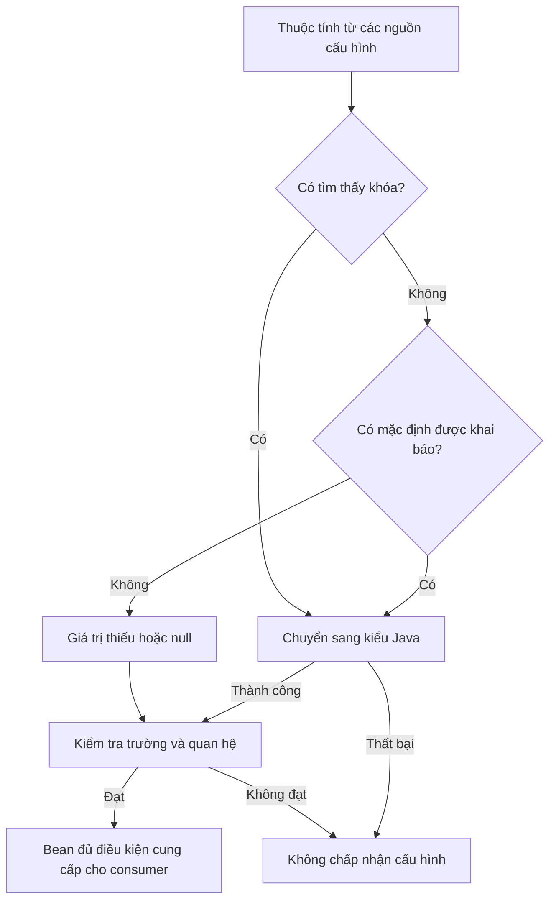

# Thiết kế giá trị mặc định và thuộc tính bắt buộc

## 1. Giá trị mặc định là một quyết định về hành vi

Một ứng dụng thiếu timeout có thể dùng một giới hạn đã được thiết kế trước. Nhưng thiếu endpoint thanh toán hoặc token mà vẫn âm thầm dùng dữ liệu mẫu có thể khiến ứng dụng chạy sai đích hoặc chỉ thất bại khi có yêu cầu thật. Câu hỏi cần trả lời không chỉ là “điền gì khi thiếu”, mà còn là “ứng dụng được phép làm gì trong tình huống đó”.

Trong module `SPRING_CLOUD_KUBERNETES`, bài thuộc chương **Thiết kế cấu hình**, tập trung vào hợp đồng giữa mã ứng dụng, ConfigMap, Secret và người triển khai. Các quy tắc này giúp chọn thuộc tính bắt buộc, đặt mặc định có giới hạn và phát hiện lỗi trước khi consumer nghiệp vụ dùng dữ liệu.

DiscoveryClient, Spring Cloud LoadBalancer, Configuration Watcher và sức khỏe Pod có thể tham gia một hệ thống Spring chạy trên Kubernetes, nhưng không thay thế hợp đồng cấu hình. Thêm một starter hoặc nhận được thông báo refresh không tự làm một giá trị mặc định trở nên phù hợp.

Ví dụ dùng Java 17, Spring Boot 3.2 và Spring Cloud Kubernetes 3.1. Các dependency cần được quản lý bằng BOM tương thích. Các giá trị thời gian và giới hạn trong bài là chính sách minh họa, cần đánh giá theo tải và yêu cầu của hệ thống thực tế. Kết quả thực hành bên dưới là kỳ vọng, không phải báo cáo đã chạy trên cluster.

## 2. Phân loại thuộc tính trước khi viết YAML

Với mỗi thuộc tính, hãy xác định người sở hữu, phạm vi ảnh hưởng, trường hợp được bỏ qua và phản ứng khi dữ liệu không hợp lệ.

| Loại thuộc tính | Cách thiết kế thường phù hợp | Ví dụ |
| --- | --- | --- |
| Xác định đích hoặc danh tính môi trường | Bắt buộc cung cấp, không đoán mặc định dùng chung | Endpoint, tenant, định danh tài khoản tích hợp |
| Bí mật truy cập | Bắt buộc khi tính năng cần dùng; không có token mẫu trong production | Token, mật khẩu |
| Giới hạn hành vi có chính sách chung | Có thể có mặc định hữu hạn và được kiểm tra | Timeout, kích thước batch |
| Cờ tính năng tùy chọn | Mặc định theo trạng thái được thiết kế rõ | Tắt retry của adapter minh họa |
| Thuộc tính bắt buộc có điều kiện | Kiểm tra quan hệ với trạng thái tính năng | Bật tính năng thì phải có endpoint tương ứng |

Một mặc định phù hợp cần có hành vi dự đoán được, phạm vi tác động đã biết và người chịu trách nhiệm thay đổi nó. Không chọn endpoint localhost, token `demo` hoặc thời gian chờ vô hạn chỉ để quá trình khởi động luôn thành công.

Khi tích hợp là bắt buộc để phục vụ nghiệp vụ, thiếu endpoint hoặc token nên được phát hiện lúc khởi động. Nếu tính năng thực sự tùy chọn, có thể thiết kế trạng thái tắt rõ ràng; không dùng một credential giả để biểu diễn trạng thái tắt.

### 2.1. Hợp đồng cấu hình của ví dụ

Ứng dụng minh họa có một adapter checkout bắt buộc được cấu hình:

| Khóa | Bắt buộc từ bên ngoài? | Mặc định khi không tìm thấy | Điều kiện |
| --- | --- | --- | --- |
| `checkout.endpoint` | Có | Không có | URI HTTPS tuyệt đối, có host, không chứa user info |
| `checkout.token` | Có | Không có | Không null, không blank |
| `checkout.connect-timeout` | Không | `1s` | Lớn hơn 0, tối đa 10 giây |
| `checkout.request-timeout` | Không | `3s` | Lớn hơn 0, tối đa 30 giây, không nhỏ hơn connect timeout |
| `checkout.retry.enabled` | Không | `false` | Cho phép cả true và false theo chính sách retry |
| `checkout.retry.max-attempts` | Không | `1` | Từ 1 đến 3, tính cả lần gọi đầu tiên |

Trong hợp đồng này, request timeout được hiểu là giới hạn cho một lần thử, bao gồm giai đoạn kết nối. Khi retry tắt, số lần thử phải bằng 1; khi bật thì phải từ 2 đến 3. Đây là ý nghĩa do adapter quy định, chưa phải cấu hình đã tự áp dụng lên một thư viện HTTP cụ thể.

## 3. Phân biệt thiếu, rỗng, sai kiểu và sai điều kiện



| Đầu vào | Ý nghĩa thiết kế | Phản ứng cần có |
| --- | --- | --- |
| Không nguồn nào cung cấp timeout | Thuộc tính bị thiếu | Dùng mặc định đã khai báo nếu hợp đồng cho phép |
| Nguồn cung cấp chuỗi rỗng | Có khóa nhưng không có nội dung hữu ích | Kiểm tra kết quả chuyển kiểu/validation; không coi là tự động thiếu |
| Nguồn cung cấp `very-fast` cho Duration | Sai biểu diễn kiểu | Báo lỗi binding, không lùi về mặc định |
| Timeout bằng 0 hoặc âm | Có thể chuyển kiểu nhưng sai chính sách | Validation từ chối |
| Token là khoảng trắng | Có chuỗi nhưng không đáp ứng yêu cầu | Constraint không blank từ chối |
| Token là `changeme` | Không blank nhưng chưa chắc dùng được | Presence validation chưa xác thực credential |

`@NotNull` chỉ yêu cầu giá trị khác null; `@NotBlank` còn yêu cầu chuỗi chứa ký tự không phải khoảng trắng. Xem [NotNull](https://jakarta.ee/specifications/bean-validation/3.0/apidocs/jakarta/validation/constraints/NotNull.html) và [NotBlank](https://jakarta.ee/specifications/bean-validation/3.0/apidocs/jakarta/validation/constraints/NotBlank.html).

Tương tự, `@Min` không thay thế yêu cầu có mặt vì null được xem là hợp lệ đối với constraint đó. Xem [Min](https://jakarta.ee/specifications/bean-validation/3.0/apidocs/jakarta/validation/constraints/Min.html). Với số bắt buộc, kết hợp điều kiện có mặt với điều kiện khoảng giá trị.

## 4. Chọn một nơi định nghĩa mặc định

Spring có nhiều cơ chế cung cấp giá trị dự phòng, nhưng chúng không có cùng ý nghĩa:

| Cơ chế | Phạm vi | Lưu ý |
| --- | --- | --- |
| Giá trị trong `application.yml` | Một nguồn cấu hình của ứng dụng | Có thể bị nguồn ưu tiên cao hơn ghi đè |
| `@DefaultValue` trên tham số/record component | Mặc định của constructor binding | Dùng khi Binder không tìm thấy thuộc tính |
| Giá trị khởi tạo trong JavaBean mutable | Trạng thái ban đầu của đối tượng | Có thể che trường chưa được bind nếu không thiết kế kiểm chứng |
| Placeholder có fallback | Giá trị dự phòng cho một tham chiếu | Phải phân biệt với chính sách mặc định của toàn bộ schema |
| Giá trị mặc định của Java | `0`, `false`, `null` theo kiểu | Không phải bằng chứng người triển khai đã khai báo giá trị |

Ví dụ chọn `@DefaultValue` làm nơi định nghĩa mặc định nghiệp vụ của bean. Không lặp lại cùng timeout ở cả annotation, YAML dùng chung, ConfigMap và constructor riêng nếu không có nhu cầu override có chủ đích. Khi các bản sao lệch nhau, việc tìm nguồn của hành vi trở nên khó hơn.

Theo [DefaultValue API](https://docs.spring.io/spring-boot/docs/3.2.12/api/org/springframework/boot/context/properties/bind/DefaultValue.html), mặc định chỉ được dùng khi không tìm thấy thuộc tính trong các PropertySource mà Binder sử dụng. Nếu thuộc tính đã có, kể cả giá trị rỗng, annotation không tự thay nó bằng default. Giá trị annotation phải là hằng số và không hỗ trợ phân giải placeholder.

Vì đây là mặc định cho quá trình binding, không xem annotation như một lệnh ghi thêm thuộc tính vào Environment. Khi chỉ có mặc định annotation, bean có thể nhận 1 giây trong khi phép tra cứu khóa qua Environment vẫn không có giá trị. Các consumer nên dùng cùng bean hợp đồng thay vì tự dựng một bộ fallback riêng bằng `@Value`.

## 5. Cài đặt hợp đồng bằng @ConfigurationProperties

### 5.1. Dependency cần thiết

Giả định ứng dụng đã có `spring-boot-starter-web`. Bổ sung dependency tương ứng với ví dụ:

```xml
<dependency>
    <groupId>org.springframework.cloud</groupId>
    <artifactId>spring-cloud-starter-kubernetes-fabric8-config</artifactId>
</dependency>
<dependency>
    <groupId>org.springframework.boot</groupId>
    <artifactId>spring-boot-starter-validation</artifactId>
</dependency>
<dependency>
    <groupId>org.springframework.boot</groupId>
    <artifactId>spring-boot-starter-test</artifactId>
    <scope>test</scope>
</dependency>
```

Các phiên bản do dependency management của dự án quyết định. Ví dụ chỉ chọn họ Fabric8 cho tích hợp cấu hình; không cần thêm DiscoveryClient hoặc LoadBalancer để thực hiện binding và validation.

### 5.2. Kiểu cấu hình bất biến có default và constraint

Tạo `CheckoutProperties.java`:

```java
package example.checkout;

import java.net.URI;
import java.time.Duration;

import jakarta.validation.Valid;
import jakarta.validation.constraints.AssertTrue;
import jakarta.validation.constraints.Max;
import jakarta.validation.constraints.Min;
import jakarta.validation.constraints.NotBlank;
import jakarta.validation.constraints.NotNull;

import org.springframework.boot.context.properties.ConfigurationProperties;
import org.springframework.boot.context.properties.bind.DefaultValue;
import org.springframework.validation.annotation.Validated;

@Validated
@ConfigurationProperties(prefix = "checkout", ignoreUnknownFields = false)
public record CheckoutProperties(
    @NotNull URI endpoint,
    @NotBlank String token,
    @DefaultValue("1s") @NotNull Duration connectTimeout,
    @DefaultValue("3s") @NotNull Duration requestTimeout,
    @DefaultValue @NotNull @Valid Retry retry
) {
    @AssertTrue(message = "checkout.endpoint must be an absolute HTTPS URI without user info")
    public boolean isEndpointAllowed() {
        return endpoint == null || (
            "https".equalsIgnoreCase(endpoint.getScheme())
                && endpoint.getHost() != null
                && endpoint.getUserInfo() == null
        );
    }

    @AssertTrue(message = "checkout timeouts must be positive, bounded and request >= connect")
    public boolean isTimeoutPolicyValid() {
        if (connectTimeout == null || requestTimeout == null) {
            return true;
        }
        return positiveAtMost(connectTimeout, Duration.ofSeconds(10))
            && positiveAtMost(requestTimeout, Duration.ofSeconds(30))
            && requestTimeout.compareTo(connectTimeout) >= 0;
    }

    private static boolean positiveAtMost(Duration value, Duration limit) {
        return !value.isZero() && !value.isNegative()
            && value.compareTo(limit) <= 0;
    }

    @Override
    public String toString() {
        return "CheckoutProperties[redacted]";
    }

    public record Retry(
        @DefaultValue("false") @NotNull Boolean enabled,
        @DefaultValue("1") @NotNull @Min(1) @Max(3) Integer maxAttempts
    ) {
        @AssertTrue(message = "disabled retry requires one attempt; enabled retry requires two or three")
        public boolean isAttemptPolicyValid() {
            if (enabled == null || maxAttempts == null) {
                return true;
            }
            return enabled ? maxAttempts >= 2 : maxAttempts == 1;
        }
    }
}
```

Các phương thức `is...` có `@AssertTrue` là các điều kiện validation theo dạng getter; chúng không phải các khóa bổ sung mà người triển khai cần điền trong YAML. `@AssertTrue` kiểm tra biểu thức boolean, xem [AssertTrue](https://jakarta.ee/specifications/bean-validation/3.0/apidocs/jakarta/validation/constraints/AssertTrue.html).

Nếu một trường đang null, các kiểm tra quan hệ trả true để điều kiện `@NotNull` báo lỗi trường thiếu. Chúng không hợp thức hóa null cho toàn bộ bean. Cách này cũng tránh gọi phương thức trên đối tượng null trong lúc tạo thông báo validation.

`@DefaultValue` không có đối số trên `retry` yêu cầu bind đối tượng lồng ngay cả khi không có khóa retry; các thành phần bên trong nhận default của chúng. `@Valid` yêu cầu kiểm tra tiếp các constraint của đối tượng lồng. Khái niệm cascading được mô tả tại [Valid](https://jakarta.ee/specifications/bean-validation/3.0/apidocs/jakarta/validation/Valid.html).

`Boolean` và `Integer` giúp diễn đạt trạng thái null khi cần. Trong một thiết kế yêu cầu người triển khai phải chọn cờ tường minh, có thể dùng `@NotNull Boolean` và bỏ default; giá trị false vẫn hợp lệ. Không dùng `@AssertTrue` chỉ để yêu cầu một cờ đã được khai báo, vì nó sẽ từ chối cả false hợp lệ.

`ignoreUnknownFields = false` giúp phát hiện khóa lạ trong prefix do bean này sở hữu, chẳng hạn `checkout.conect-timeout`. Nó không thay thế constraint bắt buộc và cần được cân nhắc nếu nhiều bean cùng chia sẻ prefix. Ý nghĩa tùy chọn nằm trong [ConfigurationProperties API](https://docs.spring.io/spring-boot/docs/3.2.12/api/org/springframework/boot/context/properties/ConfigurationProperties.html).

### 5.3. Đăng ký bean và dùng cùng một hợp đồng

```java
package example.checkout;

import org.springframework.boot.SpringApplication;
import org.springframework.boot.autoconfigure.SpringBootApplication;
import org.springframework.boot.context.properties.EnableConfigurationProperties;

@SpringBootApplication
@EnableConfigurationProperties(CheckoutProperties.class)
public class CheckoutApplication {
    public static void main(String[] args) {
        SpringApplication.run(CheckoutApplication.class, args);
    }
}
```

Consumer inject bean này rồi truyền giá trị cho adapter/client theo API tương ứng. Việc có trường `requestTimeout` trong record chưa tự cấu hình timeout của mọi HTTP client hoặc Spring Cloud LoadBalancer.

Không tự gọi constructor với dữ liệu khác rồi coi đối tượng đó đã trải qua binding và validation của Spring. Default annotation cũng không tự điền tham số cho lời gọi `new CheckoutProperties(...)` thông thường.

## 6. Kết nối với ConfigMap và Secret

### 6.1. Cấu hình đọc nguồn ngoài

Đặt trong `application.yml` của ứng dụng thực hành chạy trong cluster:

```yaml
spring:
  application:
    name: checkout-service
  config:
    import: "kubernetes:"
  cloud:
    kubernetes:
      config:
        enabled: true
        enableApi: true
        name: checkout-runtime
        namespace: defaults-lab
        includeProfileSpecificSources: false
        fail-fast: true
      secrets:
        enabled: false
```

Không khai báo lại timeout hoặc retry ở file này: bài cần chứng minh default của schema hoạt động khi các khóa đó không có trong nguồn cấu hình. Endpoint lấy từ ConfigMap, còn token được Kubernetes inject từ Secret qua biến môi trường container.

`"kubernetes:"` sử dụng Config Data. Không đồng thời bật bootstrap legacy; xem [Kubernetes PropertySource implementations](https://docs.spring.io/spring-cloud-kubernetes/reference/3.1/property-source-config.html).

`config.fail-fast` và validation bảo vệ hai lớp khác nhau. Cờ này xử lý lỗi khi đọc nguồn API; constraint xử lý dữ liệu hiệu lực sau binding. Không giả định mọi ConfigMap không tồn tại đều tạo cùng một lỗi với lỗi API, hoặc đọc thành công tài nguyên đồng nghĩa có đủ thuộc tính. Tham khảo [ConfigMap PropertySource](https://docs.spring.io/spring-cloud-kubernetes/reference/3.1/property-source-config/configmap-propertysource.html).

### 6.2. Manifest tối thiểu cho lượt thực hành

Thay image minh họa bằng image thực tế chứa ứng dụng. Toàn bộ token trong manifest này là dữ liệu giả dùng cho lab.

```yaml
apiVersion: v1
kind: Namespace
metadata:
  name: defaults-lab
---
apiVersion: v1
kind: ConfigMap
metadata:
  name: checkout-runtime
  namespace: defaults-lab
data:
  checkout.endpoint: "https://sandbox.payments.example"
---
apiVersion: v1
kind: Secret
metadata:
  name: checkout-credentials
  namespace: defaults-lab
type: Opaque
stringData:
  token: "lab-only-token-not-a-real-credential"
---
apiVersion: v1
kind: ServiceAccount
metadata:
  name: checkout-app
  namespace: defaults-lab
---
apiVersion: rbac.authorization.k8s.io/v1
kind: Role
metadata:
  name: checkout-config-reader
  namespace: defaults-lab
rules:
  - apiGroups: [""]
    resources: ["configmaps"]
    verbs: ["get", "list"]
---
apiVersion: rbac.authorization.k8s.io/v1
kind: RoleBinding
metadata:
  name: checkout-config-reader
  namespace: defaults-lab
subjects:
  - kind: ServiceAccount
    name: checkout-app
    namespace: defaults-lab
roleRef:
  apiGroup: rbac.authorization.k8s.io
  kind: Role
  name: checkout-config-reader
---
apiVersion: apps/v1
kind: Deployment
metadata:
  name: checkout-service
  namespace: defaults-lab
spec:
  replicas: 1
  selector:
    matchLabels:
      app: checkout-service
  template:
    metadata:
      labels:
        app: checkout-service
    spec:
      serviceAccountName: checkout-app
      containers:
        - name: app
          image: registry.example.com/learning/checkout-service:defaults-lab
          env:
            - name: SPRING_PROFILES_ACTIVE
              value: defaults-lab
            - name: CHECKOUT_TOKEN
              valueFrom:
                secretKeyRef:
                  name: checkout-credentials
                  key: token
```

Ứng dụng không đọc Secrets API trong ví dụ, nên Role chỉ cấp quyền ConfigMap. `secretKeyRef` là đường Kubernetes đưa dữ liệu vào container; nếu Secret hoặc khóa bắt buộc không có, container có thể chưa được khởi động, trước khi validation của Spring chạy. Xem [Distribute Credentials Securely Using Secrets](https://kubernetes.io/docs/tasks/inject-data-application/distribute-credentials-secure/).

Giá trị token không blank chỉ chứng minh nó đáp ứng constraint có mặt. Endpoint HTTPS không chứng minh DNS, mạng hoặc dịch vụ đích hoạt động. Bài không gọi endpoint minh họa để xác thực thông tin truy cập.

### 6.3. Quan sát bộ mặc định sau binding

Thêm cấu hình quan sát trong package được ứng dụng quét:

```java
package example.checkout;

import org.slf4j.Logger;
import org.slf4j.LoggerFactory;
import org.springframework.boot.ApplicationRunner;
import org.springframework.context.annotation.Bean;
import org.springframework.context.annotation.Configuration;
import org.springframework.context.annotation.Profile;

@Configuration(proxyBeanMethods = false)
@Profile("defaults-lab")
public class DefaultsLabEvidence {
    private static final Logger log =
        LoggerFactory.getLogger(DefaultsLabEvidence.class);

    @Bean
    ApplicationRunner reportDefaults(CheckoutProperties properties) {
        return args -> log.info(
            "DEFAULT_CONTRACT_READY connect={} request={} retryEnabled={} "
                + "maxAttempts={} tokenConfigured={}",
            properties.connectTimeout(), properties.requestTimeout(),
            properties.retry().enabled(), properties.retry().maxAttempts(),
            properties.token() != null && !properties.token().isBlank()
        );
    }
}
```

Kết quả kỳ vọng khi các khóa tùy chọn đều vắng mặt:

```text
DEFAULT_CONTRACT_READY connect=PT1S request=PT3S retryEnabled=false maxAttempts=1 tokenConfigured=true
```

Log chỉ nêu các giá trị không nhạy cảm của hợp đồng. Không in cả bean hoặc token để xác nhận credential đã được cung cấp. Dòng READY này chưa thay thế readiness probe hay kiểm tra kết nối thực tế của deployment.

## 7. Kiểm thử hợp đồng mà không cần cluster

Kiểm thử binding nên chứng minh ít nhất ba điều: thiếu thuộc tính tùy chọn nhận đúng default, thiếu thuộc tính bắt buộc bị từ chối, và dữ liệu được cung cấp nhưng sai không được “cứu” bởi default.

Ví dụ dùng một context nhỏ chỉ đăng ký kiểu cấu hình, không chạy lớp ứng dụng chứa import Kubernetes. Hai PropertySource của tiến trình được bỏ khỏi context test để kiểm tra trường thiếu không bị biến môi trường của máy hoặc CI vô tình bù vào; việc này không thay đổi biến môi trường của hệ điều hành.

```java
package example.checkout;

import java.time.Duration;

import org.junit.jupiter.api.Test;
import org.springframework.boot.autoconfigure.AutoConfigurations;
import org.springframework.boot.autoconfigure.validation.ValidationAutoConfiguration;
import org.springframework.boot.context.properties.EnableConfigurationProperties;
import org.springframework.boot.test.context.runner.ApplicationContextRunner;
import org.springframework.context.annotation.Configuration;
import org.springframework.core.env.StandardEnvironment;

import static org.assertj.core.api.Assertions.assertThat;

class CheckoutPropertiesContractTest {
    private final ApplicationContextRunner runner = new ApplicationContextRunner()
        .withConfiguration(AutoConfigurations.of(ValidationAutoConfiguration.class))
        .withUserConfiguration(PropertiesConfiguration.class)
        .withInitializer(context -> {
            var sources = context.getEnvironment().getPropertySources();
            sources.remove(StandardEnvironment.SYSTEM_ENVIRONMENT_PROPERTY_SOURCE_NAME);
            sources.remove(StandardEnvironment.SYSTEM_PROPERTIES_PROPERTY_SOURCE_NAME);
        });

    @Configuration(proxyBeanMethods = false)
    @EnableConfigurationProperties(CheckoutProperties.class)
    static class PropertiesConfiguration {
    }

    @Test
    void missingOptionalValuesUseSchemaDefaults() {
        runner.withPropertyValues(
            "checkout.endpoint=https://sandbox.payments.example",
            "checkout.token=test-only-token"
        ).run(context -> {
            assertThat(context).hasNotFailed();
            CheckoutProperties properties = context.getBean(CheckoutProperties.class);
            assertThat(properties.connectTimeout()).isEqualTo(Duration.ofSeconds(1));
            assertThat(properties.requestTimeout()).isEqualTo(Duration.ofSeconds(3));
            assertThat(properties.retry().enabled()).isFalse();
            assertThat(properties.retry().maxAttempts()).isEqualTo(1);
            assertThat(context.getEnvironment()
                .getProperty("checkout.connect-timeout")).isNull();
        });
    }

    @Test
    void missingRequiredTokenFails() {
        runner.withPropertyValues(
            "checkout.endpoint=https://sandbox.payments.example"
        ).run(context -> assertThat(context).hasFailed());
    }

    @Test
    void explicitBlankTimeoutDoesNotUseDefault() {
        runner.withPropertyValues(
            "checkout.endpoint=https://sandbox.payments.example",
            "checkout.token=test-only-token",
            "checkout.connect-timeout="
        ).run(context -> assertThat(context).hasFailed());
    }

    @Test
    void enablingRetryAlsoRequiresAConsistentAttemptCount() {
        runner.withPropertyValues(
            "checkout.endpoint=https://sandbox.payments.example",
            "checkout.token=test-only-token",
            "checkout.retry.enabled=true"
        ).run(context -> assertThat(context).hasFailed());
    }

    @Test
    void explicitValidOverridesAreAccepted() {
        runner.withPropertyValues(
            "checkout.endpoint=https://sandbox.payments.example",
            "checkout.token=test-only-token",
            "checkout.connect-timeout=250ms",
            "checkout.request-timeout=2s",
            "checkout.retry.enabled=true",
            "checkout.retry.max-attempts=2"
        ).run(context -> {
            assertThat(context).hasNotFailed();
            CheckoutProperties properties = context.getBean(CheckoutProperties.class);
            assertThat(properties.connectTimeout()).isEqualTo(Duration.ofMillis(250));
            assertThat(properties.requestTimeout()).isEqualTo(Duration.ofSeconds(2));
            assertThat(properties.retry().enabled()).isTrue();
            assertThat(properties.retry().maxAttempts()).isEqualTo(2);
        });
    }
}
```

Các test âm cần được xem cùng nguyên nhân startup failure: khóa, tầng binding/validation và thông báo constraint. Chỉ thấy context thất bại mà không đọc nguyên nhân sẽ chưa phân biệt được lỗi hợp đồng với một lỗi cấu hình test ngoài ý muốn. Khi mở rộng bộ kiểm thử, có thể bổ sung assertion về nguyên nhân phù hợp với phiên bản đang dùng.

Các test này không chứng minh RBAC, việc đọc ConfigMap hoặc cách Kubernetes inject Secret. Những đường cung cấp dữ liệu đó cần lượt kiểm chứng tích hợp riêng. Token trong code test chỉ là fixture giả.

## 8. Các lượt thử khi triển khai trên Kubernetes

Sau khi chuẩn bị image và manifest, có thể lưu manifest thực hành thành `defaults-lab.yaml` rồi chạy:

```powershell
kubectl apply -f .\defaults-lab.yaml
kubectl -n defaults-lab get pods -l app=checkout-service -o wide

$podName = 'THAY-BANG-TEN-POD-THUC'
kubectl -n defaults-lab get pod $podName -o 'custom-columns=NAME:.metadata.name,UID:.metadata.uid,SA:.spec.serviceAccountName,IMAGE:.spec.containers[*].image'
kubectl -n defaults-lab logs $podName -c app --tail=150
```

Thực hiện từng thay đổi riêng và ghi nhận đúng Pod mới. Khi chỉ thay dữ liệu ConfigMap trong bài không triển khai refresh, tạo một lần khởi động mới để kiểm tra:

```powershell
kubectl -n defaults-lab rollout restart deployment/checkout-service
```

| Thay đổi có chủ đích | Kỳ vọng |
| --- | --- |
| Chỉ có endpoint và token như baseline | Dùng default 1 giây, 3 giây, retry false, một lần thử |
| Xóa endpoint khỏi ConfigMap, không có nguồn khác cung cấp | Validation trường bắt buộc thất bại |
| Secret/key bắt buộc cho env không tồn tại | Kubernetes có thể chưa tạo được container; kiểm tra Pod events |
| Token được cung cấp nhưng blank | Validation `@NotBlank` thất bại |
| Thêm connect timeout bằng `very-fast` | Chuyển kiểu thất bại, không dùng default 1 giây |
| Thêm connect timeout bằng `0ms` | Chuyển kiểu được nhưng sai điều kiện dương |
| Thêm connect timeout bằng 2 giây, request timeout bằng 1 giây | Sai quan hệ giữa hai timeout |
| Bật retry nhưng không khai báo max attempts | Default một lần thử không đáp ứng trạng thái bật; validation từ chối |
| Bật retry và max attempts bằng 2 | Đạt chính sách của ví dụ nếu các trường còn lại hợp lệ |
| Gõ nhầm `checkout.conect-timeout` | Chính sách không bỏ qua khóa lạ phát hiện cấu hình thừa |

Nếu xóa một khóa mà ứng dụng vẫn chạy, kiểm tra các nguồn khác trước khi kết luận validation hỏng. Thuộc tính có thể còn trong biến môi trường, application args, profile khác hoặc file ngoài JAR.

## 9. Những quyết định thiết kế cần ghi rõ

### 9.1. Bắt buộc có giá trị khác với bắt buộc đúng nguồn

`@NotBlank` trên token chỉ kiểm tra giá trị hiệu lực. Nếu một nguồn khác cung cấp token không blank, bean vẫn có thể đạt validation dù Secret mong muốn chưa được dùng. Tương tự, một endpoint mẫu còn trong JAR có thể che việc ConfigMap không có khóa endpoint.

Để yêu cầu dữ liệu từ đúng nơi, kết hợp schema với chính sách nguồn: không đặt fallback cho thuộc tính bắt buộc trong JAR, kiểm soát manifest và override, đối chiếu source/origin khi cần, và kiểm tra đường đọc nguồn riêng. Không đổi credential thành tùy chọn chỉ để bỏ qua lỗi RBAC hoặc lỗi nạp ConfigMap.

### 9.2. Thuộc tính bắt buộc có điều kiện

Ví dụ coi adapter checkout là bắt buộc. Với một tính năng tùy chọn, hợp đồng có thể khác:

| Trạng thái | Điều kiện |
| --- | --- |
| Tính năng tắt | Không tạo consumer hoạt động; có thể không yêu cầu endpoint/token của tính năng đó |
| Tính năng bật | Endpoint/token và các giới hạn liên quan phải hợp lệ |

Khi ấy, cần validator quan hệ hoặc cách đăng ký cấu hình phù hợp, thay vì đặt `@NotBlank` vô điều kiện rồi chèn token giả để vượt qua validation. Mặc định tắt chỉ có ý nghĩa khi consumer thực sự tuân theo trạng thái tắt.

### 9.3. Mặc định tốt vẫn cần được giới hạn

Timeout phải có đơn vị rõ, giới hạn dương và ý nghĩa theo client cụ thể. Đối với retry, quy định `max-attempts` có tính lần đầu hay chỉ tính số lần thử lại, và xem tổng ngân sách thời gian cũng như tính idempotent của thao tác.

Mặc định retry false của bean chỉ điều khiển adapter sử dụng bean đó. Một client hoặc tầng load balancing khác có thể có chính sách retry riêng; cần kiểm tra đường gọi thực tế trước khi kết luận toàn hệ thống không retry.

### 9.4. Thay đổi default là thay đổi hành vi phát hành

Nếu đổi default request timeout từ 3 giây sang 5 giây, những deployment không khai báo khóa sẽ thay đổi hành vi khi dùng phiên bản mới; các deployment có override có thể giữ nguyên. Vì vậy, ghi nhận thay đổi default cùng phiên bản ứng dụng, tài liệu hợp đồng và kế hoạch kiểm chứng.

Đừng chỉ kiểm tra một môi trường đã luôn có override rồi kết luận default mới không ảnh hưởng. Cần biết môi trường nào thực sự đang dùng default và vì sao nó được phép dùng default đó.

### 9.5. Startup validation không thiết lập chính sách cập nhật tự động

Record cấu hình trong bài phục vụ một snapshot lúc khởi động. Spring Cloud Commons 4.1 nêu record `@ConfigurationProperties` không được refresh; xem [Environment Changes và Refresh Scope](https://docs.spring.io/spring-cloud-commons/reference/4.1/spring-cloud-commons/application-context-services.html).

Nếu hệ thống cần cập nhật tại chỗ bằng Configuration Watcher hoặc cơ chế khác, phải thiết kế riêng thời điểm validate, cách consumer nhận bộ dữ liệu mới và hành vi khi bộ dữ liệu mới sai. Không mặc định rằng thiếu một thuộc tính sau cập nhật sẽ khôi phục “giá trị tốt gần nhất” hoặc default theo một giao dịch chung.

## 10. Bằng chứng hoàn thành thiết kế

Một hợp đồng cấu hình đủ rõ cần chỉ ra từng khóa được phép bỏ qua hay bắt buộc, nơi định nghĩa default, đơn vị, giới hạn, quan hệ giữa các trường và phản ứng khi dữ liệu sai. Cùng một hợp đồng phải được dùng trong binding, consumer và kiểm thử.

Khi triển khai, ghi nhận namespace, UID Pod, image, giá trị không nhạy cảm sau binding và nguồn của thuộc tính quan trọng. Không coi Pod Running hoặc một dòng log khởi động là bằng chứng credential đã được xác thực hay mọi phụ thuộc đều khỏe.

Thiết kế đạt mục tiêu khi trường tùy chọn thiếu vẫn cho hành vi đã dự kiến, trường bắt buộc thiếu bị phát hiện đúng tầng, và dữ liệu được cung cấp nhưng không hợp lệ không bị default che mất. Chính sách đó phải còn dễ kiểm tra khi thay phiên bản ứng dụng hoặc thay nguồn cấu hình.
