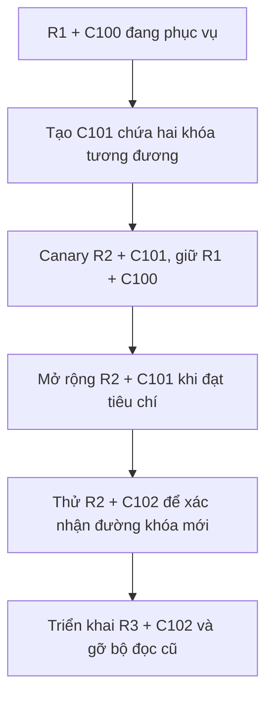

# Giữ hợp đồng cấu hình tương thích khi nhiều phiên bản cùng chạy

Trong chương **Thiết kế cấu hình** của module **SPRING_CLOUD_KUBERNETES**, tính tương thích phải được xem xét ở thời điểm hệ thống đang chuyển phiên bản, không chỉ khi một phiên bản chạy ổn định một mình.

Giả sử `checkout-service` đang rolling update. Một số Pod còn chạy R1, một số Pod đã chạy R2. Nếu nhóm phát triển đổi tên một khóa trong ConfigMap, R2 có thể khởi động đúng trong khi R1 vừa được tạo lại không còn đọc được cấu hình. Khi cần rollback, image R1 vẫn còn nhưng bộ cấu hình mà nó hiểu đã biến mất.

Bài học này xây dựng cách phát hành cấu hình cho tình huống đó: mô tả hợp đồng, kiểm tra những cặp ứng dụng–cấu hình có thể gặp nhau, dùng giai đoạn chuyển tiếp và giữ một đường khôi phục có thể thực hiện được.

Các tên R1, R2, R3 là phiên bản nghiệp vụ minh họa, không phải major version của Spring. Phần nạp ConfigMap tham chiếu API cấu hình trong tài liệu Spring Cloud Kubernetes 5.1.0; khi thực hành cần dùng Spring Boot, Spring Cloud và starter theo BOM tương thích của dự án. Các bước triển khai và kết quả trong bài là ví dụ dự kiến, chưa phải kết quả đã chạy trên cluster.

## 1. Hợp đồng cấu hình bao gồm cả cách hiểu giá trị

Một khóa cấu hình là giao diện giữa bên phát hành cấu hình và mã ứng dụng sử dụng nó. Giữ nguyên tên khóa chưa đủ để giữ giao diện đó ổn định.

| Thành phần của hợp đồng | Điều cần ghi rõ | Ví dụ thay đổi có thể phá tương thích |
| --- | --- | --- |
| Tên khóa | Tên chuẩn, tên cũ đang được hỗ trợ | Xóa `timeout-ms` khi R1 vẫn đọc nó |
| Kiểu dữ liệu | Số nguyên, boolean, Duration, danh sách | Đổi chuỗi số sang chuỗi có hậu tố đơn vị |
| Đơn vị | Millisecond, second, byte | Vẫn dùng `1500` nhưng đổi cách hiểu từ ms sang s |
| Ý nghĩa | Thao tác nào chịu tác động | Đổi read timeout thành tổng thời gian của toàn bộ request |
| Miền giá trị | Giới hạn, enum được chấp nhận | Thêm enum mà phiên bản cũ không nhận biết |
| Tính bắt buộc | Khi thiếu thì dừng hay dùng mặc định | R2 yêu cầu khóa mới mà cấu hình cũ chưa có |
| Mặc định | Giá trị và nơi định nghĩa | Đổi mặc định từ 1,5 giây thành 15 giây |
| Quan hệ giữa khóa | Các khóa cần đồng nhất hoặc thay đổi cùng nhau | Endpoint mới đi kèm credential cũ |
| Thời điểm áp dụng | Khởi động, rollout, hay refresh được hỗ trợ | Giả định client tự đổi sau khi Environment đổi |

Ví dụ, chuyển từ số nguyên `1500` sang Duration `1500ms` có thể giữ cùng ý nghĩa nghiệp vụ. Nhưng với bộ đọc cũ yêu cầu số nguyên, đưa thẳng `1500ms` vào khóa cũ vẫn là thay đổi không tương thích.

Đổi tên và đổi hành vi nên được xem là hai thay đổi riêng. Nếu vừa đổi tên khóa vừa giảm timeout, khi canary có lỗi sẽ khó phân biệt lỗi chuyển đổi cấu hình với tác động của timeout mới.

### Ba mức kiểm tra

1. **Đọc được:** ứng dụng tìm thấy dữ liệu, parse và bind được.
2. **Hiểu đúng:** giá trị sau chuyển đổi giữ đúng đơn vị, ý nghĩa và quy tắc mặc định.
3. **Dùng đúng:** client, pool hoặc luồng nghiệp vụ thực sự sử dụng giá trị đã phân giải.

Một Pod khởi động được chỉ chứng minh một phần của mức đầu tiên. Nó không chứng minh hành vi của hai phiên bản vẫn tương thích.

## 2. Kiểm kê phiên bản đang chạy và phiên bản có thể quay lại

Trong rolling update, các ReplicaSet cũ và mới có thể cùng có Pod. Deployment chỉ tạo revision khi Pod template thay đổi; việc sửa nội dung một ConfigMap được tham chiếu không tự tạo revision của Deployment. Đây là hành vi được mô tả trong [Deployments](https://kubernetes.io/docs/concepts/workloads/controllers/deployment/).

Vì vậy, trước khi thay đổi hợp đồng, cần kiểm kê cả:

- Phiên bản đang nhận lưu lượng, gồm cả canary.
- Phiên bản còn xử lý request đang chạy hoặc tác vụ nền.
- Image và Pod template mà quy trình rollback có thể dùng.
- Job, CronJob hoặc tiến trình chạy ít thường xuyên nhưng vẫn đọc nguồn đó.
- Các ứng dụng khác cùng sử dụng ConfigMap dùng chung.
- Những nguồn ghi đè còn tồn tại trong môi trường triển khai.

Một replica cũ đang bằng 0 chưa có nghĩa đã hết nhu cầu tương thích. Nếu ReplicaSet hoặc quy trình khôi phục còn có thể tạo lại image cũ, cấu hình dành cho image đó vẫn là một phần của kế hoạch.

### Hai cách phân phối dẫn đến hai yêu cầu khác nhau

| Cách phân phối | Cặp phiên bản cần tương thích |
| --- | --- |
| Nhiều thế hệ cùng đọc một nguồn mutable | Mỗi thế hệ có thể đọc mọi trạng thái mới được phát hành vào nguồn đó |
| Mỗi Pod được ghim vào một snapshot có tên riêng | Những cặp image–snapshot mà triển khai và rollback thực sự cho phép |

Trong cách thứ nhất, sửa nguồn chung phải đáp ứng mọi bên còn có khả năng đọc nó.

Trong cách thứ hai, R1 có thể tiếp tục đọc C100 trong khi R3 đọc C102. Không bắt buộc R1 hiểu C102 nếu có cơ chế bảo đảm R1 không bao giờ nhận C102. Đổi lại, phải giữ đúng tham chiếu, dữ liệu và quyền đọc cho từng cặp.

Có thể diễn đạt điều kiện phát hành như sau:

> Mọi cặp phiên bản ứng dụng và bộ cấu hình có thể được tạo ra bởi triển khai, refresh, restart hoặc rollback đều phải nằm trong tập cặp đã được chấp nhận.

## 3. Ví dụ chuyển từ số millisecond sang Duration

Giả sử R1 đang sử dụng:

```properties
checkout.catalog.timeout-ms=1500
```

Hợp đồng R1 quy định đây là **read timeout của client Catalog**, số nguyên millisecond trong khoảng từ 1 đến 30000. R1 yêu cầu khóa này và bỏ qua các thuộc tính ngoài tập mà nó sử dụng.

Nhóm muốn chuyển sang tên rõ ràng hơn:

```properties
clients.catalog.read-timeout=1500ms
```

Khóa mới vẫn có cùng ý nghĩa read timeout. Không đồng thời chuyển thành connect timeout hoặc tổng deadline.

Thiết kế các phiên bản:

| Phiên bản ứng dụng | Khả năng đọc |
| --- | --- |
| R1 | Chỉ dùng khóa cũ; thiếu khóa cũ thì không đáp ứng hợp đồng |
| R2 | Hiểu cả hai khóa; hỗ trợ chuyển tiếp và kiểm tra nhất quán |
| R3 | Chỉ dùng khóa mới; yêu cầu khóa mới |

Thiết kế các snapshot:

| Snapshot | Khóa cũ | Khóa mới |
| --- | --- | --- |
| C100 | `1500` | Không có |
| C101 | `1500` | `1500ms` |
| C102 | Không có | `1500ms` |

Ma trận tương thích dự kiến của ví dụ:

| Ứng dụng / cấu hình | C100 | C101 | C102 |
| --- | --- | --- | --- |
| R1 | Có | Có, với điều kiện bỏ qua khóa mới như đã quy định | Không |
| R2 | Có, qua nhánh tương thích cũ | Có, hai giá trị phải tương đương | Có |
| R3 | Không | Có, bỏ qua khóa cũ | Có |

Ma trận này là hợp đồng của các phiên bản minh họa. Một ứng dụng thực tế có kiểm tra khóa lạ nghiêm ngặt có thể từ chối C101; không được giả định mọi thay đổi thêm khóa đều an toàn.

### Quy tắc phân giải của R2

R2 áp dụng quy tắc sau sau khi các nguồn cấu hình đã được phân giải:

1. Nếu chỉ có khóa cũ, đổi millisecond sang Duration.
2. Nếu chỉ có khóa mới, dùng Duration mới.
3. Nếu cả hai có mặt, kiểm tra từng giá trị hợp lệ và yêu cầu chúng biểu diễn cùng thời lượng.
4. Nếu cả hai thiếu, dừng khởi động.
5. Nếu một khóa có mặt nhưng sai định dạng hoặc ngoài miền cho phép, không âm thầm bỏ qua nó.

Ví dụ:

| Khóa cũ | Khóa mới | Kết quả của R2 |
| --- | --- | --- |
| `1500` | Không có | `PT1.5S`, dùng nhánh cũ |
| Không có | `1500ms` | `PT1.5S`, dùng nhánh mới |
| `1500` | `1.5s` theo định dạng không được binder hỗ trợ | Lỗi binding; không trông chờ cơ chế fallback cứu dữ liệu sai |
| `1500` | `PT1.5S` | Hợp lệ, cùng thời lượng |
| `1500` | `2s` | Từ chối do mâu thuẫn |
| `0` | `1500ms` | Từ chối do khóa cũ không hợp lệ |
| Không có | Không có | Từ chối do thiếu cấu hình |

Để tránh phụ thuộc cách biểu diễn số thập phân trong hậu tố đơn vị, các manifest của bài dùng `1500ms`. Spring Boot hỗ trợ binding Duration với định dạng có đơn vị và ISO-8601; xem [Converting Durations](https://docs.spring.io/spring-boot/reference/features/external-config.html#features.external-config.typesafe-configuration-properties.conversion.durations).

Không đặt sẵn một giá trị mặc định của khóa mới ở nguồn khác rồi vẫn kỳ vọng R2 nhận biết được trường hợp “chỉ có khóa cũ”. Một giá trị mặc định hiện diện trong Environment có thể làm cả hai khóa cùng tồn tại. Ví dụ này chủ động yêu cầu ít nhất một khóa thay vì có mặc định ngầm.

## 4. Phát hành snapshot thay vì sửa mất dữ liệu cũ

Ba ConfigMap dưới đây đều thuộc namespace `commerce-prod`. Đây là dữ liệu không nhạy cảm.

### C100: hợp đồng cũ

```yaml
apiVersion: v1
kind: ConfigMap
metadata:
  name: checkout-config-c100
  namespace: commerce-prod
immutable: true
data:
  platform.config.release: "c100"
  checkout.catalog.timeout-ms: "1500"
```

### C101: hợp đồng chuyển tiếp

```yaml
apiVersion: v1
kind: ConfigMap
metadata:
  name: checkout-config-c101
  namespace: commerce-prod
immutable: true
data:
  platform.config.release: "c101"
  checkout.catalog.timeout-ms: "1500"
  clients.catalog.read-timeout: "1500ms"
```

### C102: hợp đồng mới

```yaml
apiVersion: v1
kind: ConfigMap
metadata:
  name: checkout-config-c102
  namespace: commerce-prod
immutable: true
data:
  platform.config.release: "c102"
  clients.catalog.read-timeout: "1500ms"
```

Kubernetes không cho sửa `data` và `binaryData` của ConfigMap đã đánh dấu immutable. Tuy nhiên, resource vẫn có thể bị xóa rồi tạo lại. Quy trình phát hành của ví dụ vì thế còn đặt thêm quy ước: **không tái sử dụng tên snapshot cho nội dung khác**. Xem [Immutable ConfigMaps](https://kubernetes.io/docs/concepts/configuration/configmap/#immutable-configmaps).

`c100`, `c101` và `c102` là mã phát hành do ví dụ quy định. Chúng không phải cơ chế version negotiation có sẵn của Spring hoặc Kubernetes. `platform.config.release` cũng là thuộc tính tự định nghĩa để ứng dụng có thể báo cáo snapshot đã nạp.

Không dùng `resourceVersion` của Kubernetes làm phiên bản hợp đồng nghiệp vụ. Nó phục vụ theo dõi thay đổi resource của API; ý nghĩa một khóa được ứng dụng hiểu như thế nào vẫn cần hợp đồng riêng.

### Vì sao giữ hai khóa trong cùng snapshot?

Nếu đặt khóa cũ ở một ConfigMap và khóa mới ở một ConfigMap khác, một lần đọc hoặc refresh có thể gặp hai thế hệ dữ liệu khác nhau. Các resource độc lập không tạo thành giao dịch cấu hình chung cho ứng dụng.

Trong ví dụ, hai biểu diễn của cùng một timeout được phát hành cùng nhau trong C101. Pipeline nên sinh chúng từ một giá trị chuẩn, rồi kiểm tra tương đương. Nếu người vận hành phải sửa bằng tay cả hai, nguy cơ lệch giá trị sẽ tăng.

Các tên khóa trong manifest không tự cấu hình HTTP client. Ứng dụng vẫn phải bind, kiểm tra và đưa timeout vào thành phần gọi Catalog.

## 5. Hiện thực bộ đọc chuyển tiếp trong Spring Boot

Dưới đây là một lớp Java minh họa cho R2. Có thể đặt toàn bộ mã trong `CatalogTimeoutConfiguration.java`, trong package mà ứng dụng đăng ký hoặc component scan được.

Ví dụ dùng record và `@EnableConfigurationProperties` để đăng ký các kiểu thuộc tính. Cơ chế này được Spring Boot mô tả trong [Type-safe Configuration Properties](https://docs.spring.io/spring-boot/reference/features/external-config.html#features.external-config.typesafe-configuration-properties).

```java
import java.time.Duration;

import org.springframework.boot.context.properties.ConfigurationProperties;
import org.springframework.boot.context.properties.EnableConfigurationProperties;
import org.springframework.context.annotation.Bean;
import org.springframework.context.annotation.Configuration;

@Configuration(proxyBeanMethods = false)
@EnableConfigurationProperties({
        CatalogTimeoutConfiguration.LegacyProperties.class,
        CatalogTimeoutConfiguration.CurrentProperties.class
})
public class CatalogTimeoutConfiguration {

    @ConfigurationProperties(prefix = "checkout.catalog")
    public record LegacyProperties(Long timeoutMs) {
    }

    @ConfigurationProperties(prefix = "clients.catalog")
    public record CurrentProperties(Duration readTimeout) {
    }

    public record CatalogReadPolicy(Duration timeout) {
    }

    @Bean
    CatalogReadPolicy catalogReadPolicy(
            LegacyProperties legacy,
            CurrentProperties current) {

        Duration oldValue = legacy.timeoutMs() == null
                ? null
                : Duration.ofMillis(legacy.timeoutMs());
        Duration newValue = current.readTimeout();

        if (oldValue != null) {
            validate("checkout.catalog.timeout-ms", oldValue);
        }
        if (newValue != null) {
            validate("clients.catalog.read-timeout", newValue);
        }

        if (oldValue == null && newValue == null) {
            throw new IllegalStateException(
                    "Missing Catalog read timeout configuration");
        }

        if (oldValue != null && newValue != null
                && !oldValue.equals(newValue)) {
            throw new IllegalStateException(
                    "Legacy and current Catalog timeouts disagree");
        }

        return new CatalogReadPolicy(
                newValue != null ? newValue : oldValue);
    }

    private static void validate(String key, Duration value) {
        if (value.compareTo(Duration.ofMillis(1)) < 0
                || value.compareTo(Duration.ofSeconds(30)) > 0) {
            throw new IllegalArgumentException(
                    key + " must be between 1ms and 30s");
        }
    }
}
```

Các giới hạn 1 ms và 30 s là hợp đồng minh họa, không phải khuyến nghị timeout chung cho mọi hệ thống.

Có một vài lựa chọn có chủ đích trong mã:

- `Long` được dùng thay cho `long` để phân biệt khóa vắng mặt với giá trị `0`.
- Chuyển đổi từ khóa cũ sang Duration chỉ diễn ra ở một nơi.
- Khi hai khóa cùng tồn tại, mâu thuẫn bị phát hiện thay vì để hai thế hệ ứng dụng âm thầm chạy hai timeout khác nhau.
- Một lỗi chuyển đổi kiểu ở bước binding sẽ làm quá trình khởi tạo thất bại; không có nhánh “parse lỗi thì dùng mặc định”.
- Thành phần nghiệp vụ chỉ cần nhận `CatalogReadPolicy`, không tự tìm khóa cũ ở nhiều lớp khác nhau.

Cần nối `CatalogReadPolicy.timeout()` vào cấu hình read timeout của HTTP client thực tế. Việc bean chứa đúng Duration chưa chứng minh client đã dùng nó.

Ví dụ tạo một policy tại lúc khởi động và không cài cơ chế refresh. Thay đổi cấu hình của ví dụ được áp dụng bằng rollout. Không gắn thêm `@RefreshScope` rồi mặc định toàn bộ chuỗi record, policy và HTTP client đã hỗ trợ cập nhật động. Tài liệu [Refresh Scope](https://docs.spring.io/spring-cloud-commons/reference/spring-cloud-commons/application-context-services.html#refresh-scope) nêu các giới hạn refresh, trong đó có record được annotate bằng `@ConfigurationProperties`.

Khi R2 phải dùng nhánh khóa cũ, hệ thống nên phát một sự kiện hoặc metric về việc còn sử dụng hợp đồng cũ. Tín hiệu này phục vụ quyết định gỡ hỗ trợ; không cần log toàn bộ Environment.

## 6. Ghim đúng ConfigMap cho từng Pod

Với starter Config phù hợp, chẳng hạn `spring-cloud-starter-kubernetes-fabric8-config`, cấu hình ứng dụng có thể khai báo:

```yaml
spring:
  application:
    name: checkout-service
  config:
    import: "kubernetes:"
  cloud:
    kubernetes:
      config:
        enabled: true
        namespace: commerce-prod
        name: "${CHECKOUT_CONFIG_NAME}"
        read-type: SINGLE
        include-profile-specific-sources: false
        use-name-as-prefix: false
        fail-fast: true
        retry:
          enabled: false
      secrets:
        enabled: false
      discovery:
        enabled: false
```

Cấu hình chọn nguồn phải có sẵn trước khi đọc ConfigMap. Biến `CHECKOUT_CONFIG_NAME` do Pod template cung cấp; không đặt nó duy nhất trong chính nguồn đang chờ được tìm.

`spring.config.import: "kubernetes:"` là đường Config Data được tài liệu [Kubernetes PropertySource implementations](https://docs.spring.io/spring-cloud-kubernetes/reference/property-source-config.html) hướng dẫn. Ví dụ không đồng thời nạp cùng dữ liệu bằng legacy bootstrap.

`name` chọn resource cụ thể; tắt nguồn theo profile và prefix để giữ phạm vi minh họa rõ ràng. `read-type: SINGLE` là chế độ đọc theo tên trong phiên bản tài liệu tham chiếu. Xem [Using a ConfigMap PropertySource](https://docs.spring.io/spring-cloud-kubernetes/reference/property-source-config/configmap-propertysource.html).

Các thuộc tính của Spring Cloud Kubernetes cần được đối chiếu theo phiên bản thư viện thực tế. Đừng áp dụng nguyên cấu hình `read-type` cho một dòng phiên bản chưa hỗ trợ nó.

Fragment Pod template dưới đây minh họa cặp **R2 + C101**; cần ghép vào một Deployment đầy đủ:

```yaml
spec:
  template:
    metadata:
      labels:
        app: checkout-service
        app.kubernetes.io/version: r2
        configuration.example/release: c101
    spec:
      serviceAccountName: checkout-service
      containers:
        - name: checkout-service
          image: registry.example/checkout-service:r2
          env:
            - name: CHECKOUT_CONFIG_NAME
              value: checkout-config-c101
```

Tên registry là ví dụ. Trong triển khai thực, image cần được xác định bằng digest hoặc một cách tham chiếu không bị thay nội dung ngoài quy trình phát hành.

Image và tham chiếu cấu hình được thay trong cùng một Pod template. Đây là cách ghi nhận một cặp phát hành; nó không tạo giao dịch bao trùm việc tạo ConfigMap và cập nhật Deployment. Phải tạo snapshot cùng quyền đọc trước khi Pod cần dùng nó.

### Quyền đọc là một điều kiện của khả năng khôi phục

Nếu Role giới hạn `resourceNames`, lần chuyển từ C100 sang C101 phải cho phép đọc tên mới trước khi tạo Pod. Giữ quyền đọc snapshot cũ trong thời gian còn hỗ trợ rollback.

Không suy từ việc “chỉ dùng một ConfigMap” rằng Role chỉ cần `get` trong mọi trường hợp. Quyền phải khớp chế độ đọc, profile lookup, client và tính năng đang bật. Bài này chọn đọc theo tên và không triển khai watcher; watcher hoặc discovery có nhu cầu API riêng.

Secret và DiscoveryClient được tắt trong cấu hình minh họa vì thao tác nạp timeout không cần chúng. Không bật thêm DiscoveryClient hay Spring Cloud LoadBalancer chỉ để đổi tên khóa cấu hình.

### Giá trị hiệu lực có thể khác nội dung snapshot

Ví dụ, một command-line argument còn sót lại có thể đặt:

```text
--clients.catalog.read-timeout=2s
```

Với C101 có khóa cũ `1500`, R2 sẽ thấy hai giá trị không tương đương và từ chối khởi động. Đây là phát hiện mâu thuẫn có ích, không phải lý do bỏ kiểm tra.

Các nguồn ưu tiên cao hơn như biến môi trường, system property và command line vẫn có thể ghi đè Config Data; xem [Property source precedence](https://docs.spring.io/spring-cloud-kubernetes/reference/property-source-config.html#_property_source_precedence). Do đó, phải kiểm tra dữ liệu đã phân giải trong ứng dụng và dọn cả override cũ, không chỉ nhìn manifest ConfigMap.

## 7. Triển khai theo ba giai đoạn: mở rộng, chuyển đổi, thu hẹp

Một lịch triển khai với snapshot có thể như sau:



### Mở rộng

1. Xác định hợp đồng hiện tại của R1, bao gồm cách xử lý khóa lạ.
2. Viết R2 hiểu được dữ liệu cũ và mới.
3. Tạo C101 chứa hai biểu diễn tương đương.
4. Kiểm tra những cặp sẽ xuất hiện trong rollout và rollback.
5. Giữ nguyên timeout hiệu lực khi thay đổi cấu trúc.

Không xóa khóa cũ ngay trong bước này. Một lần đổi tên trực tiếp sẽ bỏ qua khoảng thời gian cần thiết để các thế hệ cùng tồn tại.

### Chuyển đổi

Canary R2 dùng C101 trong khi R1 vẫn dùng C100. Xác nhận R2 đọc đúng nguồn, nhận đúng timeout và thực hiện hành vi client dự kiến. Sau đó mở rộng R2.

Tiếp theo, thử R2 với C102. Bước này cho thấy R2 thực sự chạy được chỉ bằng khóa mới, thay vì luôn vô tình dựa vào khóa cũ.

Nếu đã ghim nguồn riêng, R1 + C100 có thể còn tồn tại trong giai đoạn này. Điều kiện là tham chiếu phải được giữ chắc chắn, không có refresh hay pipeline nào đổi R1 sang C102.

### Thu hẹp

R3 loại bỏ bộ đọc khóa cũ sau khi các đường triển khai dành cho R3 đều có khóa mới. Gỡ nhánh tương thích trong mã và dọn snapshot cũ là hai quyết định có thể diễn ra ở hai thời điểm khác nhau.

Một image R1 còn được hỗ trợ rollback vẫn cần C100 hoặc C101. Có thể tiếp tục giữ C100 cho mục đích đó dù R3 đã dùng C102. Khi hết thời gian hỗ trợ R1 và không còn người sử dụng hợp lệ, mới xét xóa nguồn cũ.

Nếu hệ thống dùng **một ConfigMap mutable chung**, quy tắc chặt hơn: không xóa khóa cũ khỏi nguồn đó chừng nào còn R1 có thể đọc hoặc nạp lại nó. Nếu rollback chỉ đổi image và vẫn dùng nguồn chung, mục tiêu rollback cũng phải hỗ trợ hợp đồng mới trước khi thu hẹp.

## 8. Configuration Watcher không làm thay đổi trở nên nguyên tử

Một snapshot immutable được ghim theo Pod thường phù hợp với cách cập nhật qua rollout. Không cần thêm Configuration Watcher vào ví dụ chỉ để thay tham chiếu snapshot.

Nếu chọn nguồn mutable và refresh, thiết kế phải tính đến việc các instance nhận và áp dụng thay đổi vào những thời điểm khác nhau.

Configuration Watcher có cơ chế thông báo refresh qua HTTP hoặc messaging. Nó hỗ trợ chỉ định ứng dụng nhận thông báo, nhưng không kiểm tra thay ma trận tương thích nghiệp vụ của từng image. Xem [Spring Cloud Kubernetes Configuration Watcher](https://docs.spring.io/spring-cloud-kubernetes/reference/spring-cloud-kubernetes-configuration-watcher.html).

Những bước sau không đồng nhất:

1. Resource được cập nhật trong Kubernetes.
2. Instance nhận thông báo.
3. Nguồn cấu hình được nạp lại.
4. Đối tượng thuộc tính được cập nhật theo cơ chế hỗ trợ.
5. Client hoặc pool thực sự sử dụng bộ giá trị mới.

Không được giả định cả năm bước xảy ra đồng thời cho mọi Pod.

### Tình huống gây lệch giữa hai thế hệ

Giả sử nguồn chung đang có hai khóa tương đương 1500 ms. Người vận hành chỉ đổi khóa mới thành `2s`:

- R1 vẫn dùng khóa cũ và chờ 1500 ms.
- R2 phát hiện mâu thuẫn theo hợp đồng chuyển tiếp.
- Một thành phần không hỗ trợ refresh có thể còn dùng policy được tạo trước đó.

Đây là một thay đổi sai hợp đồng, dù ConfigMap vẫn hợp lệ về cú pháp.

Để vận hành refresh an toàn hơn, cần có quy tắc phân giải duy nhất, kiểm tra toàn bộ bộ cấu hình liên quan trước khi áp dụng, biết cách giữ bộ giá trị tốt trước đó khi cập nhật thất bại và chứng minh client thực sự đổi. Các khả năng này phải được thiết kế và kiểm tra cho ứng dụng; thông báo refresh không tự cung cấp chúng.

Tương tự, dữ liệu được mount đổi trên filesystem không có nghĩa bean Spring tự thay đổi. Biến môi trường từ ConfigMap không tự đổi trong tiến trình đã chạy. Kubernetes mô tả các cách tiêu thụ này trong [ConfigMaps](https://kubernetes.io/docs/concepts/configuration/configmap/).

Đối với thay đổi cấu trúc như xóa khóa hoặc chuyển đơn vị, rollout với cặp image–snapshot rõ ràng thường dễ kiểm soát và khôi phục hơn một đợt refresh rộng.

## 9. Kiểm tra tương thích theo cặp và theo hành vi

Không chỉ kiểm tra “R2 đọc C101 thành công”. Bộ kiểm tra phát hành cần bao gồm các cặp được phép, các cặp phải bị từ chối và thao tác khôi phục.

| Trường hợp | Kết quả cần chứng minh |
| --- | --- |
| R1 + C100 | Giữ hành vi đang được hỗ trợ |
| R1 + C101 nếu định cho phép | Khóa mới không làm bộ đọc cũ thất bại |
| R2 + C100 | Nhánh chuyển tiếp tạo timeout 1500 ms và có tín hiệu dùng khóa cũ |
| R2 + C101 | Hai biểu diễn tương đương được chấp nhận |
| R2 + C102 | Không còn phụ thuộc khóa cũ |
| R3 + C102 | Chỉ cần hợp đồng mới |
| R1 + C102 | Pipeline chặn cặp không tương thích |
| Hai khóa cùng có nhưng khác thời lượng | R2 từ chối ở lúc khởi động trong mô hình của bài |
| Giá trị âm, bằng 0 hoặc lớn hơn 30 s | Bị từ chối theo hợp đồng |
| Resource không đọc được, thiếu cả hai khóa | Không tạo một instance được coi là sẵn sàng hợp lệ |
| Override làm lệch một khóa | Phát hiện mâu thuẫn ở giá trị hiệu lực |
| Rollback sang cặp cũ | Đọc được snapshot cũ và phục vụ đúng hành vi đã kiểm tra |

Các hàng trên là kịch bản cần triển khai trong quy trình kiểm thử, không phải kết quả đã được thực thi trong bài học.

### Tách kiểm tra bộ đọc và kiểm tra tích hợp

Kiểm tra bộ đọc tập trung vào chuyển đổi đơn vị, miền giá trị, khóa thiếu và mâu thuẫn. Nó có thể dùng những bộ properties nhỏ để chỉ rõ đầu vào và kết quả mong đợi.

Kiểm tra tích hợp cần chạy với cơ chế nạp thực tế của dự án: starter, cấu hình import, ServiceAccount, RBAC và snapshot đúng tên. Một phép thử chỉ truyền thuộc tính từ test vào Spring context không chứng minh client Kubernetes đã đọc ConfigMap.

Cuối cùng, kiểm tra hành vi của HTTP client với một Catalog giả lập phản hồi chậm theo điều kiện đã kiểm soát. Cần biết loại timeout mà client đo; không suy từ tên `read-timeout` rằng nó luôn là tổng deadline của request.

### Quan sát trong rollout

Một bản ghi chẩn đoán an toàn có thể bao gồm:

```text
applicationRelease=r2
configRelease=c101
catalogReadTimeout=PT1.5S
legacyTimeoutPresent=true
currentTimeoutPresent=true
```

Đây là định dạng đề xuất do ứng dụng chủ động cung cấp, không phải output mặc định của Spring Cloud Kubernetes. Mã ví dụ ở mục 5 chưa cài phần báo cáo này.

Label trên Pod chỉ cho biết ý định triển khai. Giá trị `configRelease` được ứng dụng đọc từ cấu hình hiệu lực mới giúp đối chiếu nó đã nhìn thấy dữ liệu nào. Nếu cần kiểm soát chặt hơn, có thể kèm dấu vân tay của tập thuộc tính không nhạy cảm đã được chuẩn hóa.

Readiness nên phản ánh việc instance đã hoàn tất khởi tạo bắt buộc trước khi nhận lưu lượng. Liveness có thể vẫn thành công dù timeout nghiệp vụ sai. Dù Pod Ready, vẫn phải theo dõi tỷ lệ lỗi, độ trễ, timeout và hành vi của canary theo từng phiên bản.

DiscoveryClient hoặc Spring Cloud LoadBalancer có thể đưa request tới những instance đáp ứng điều kiện khám phá và định tuyến. Chúng không xác minh hợp đồng cấu hình của các instance đó; hai Pod cùng khỏe về mặt probe vẫn có thể chạy hành vi khác nhau do cấu hình sai.

## 10. Rollback là khôi phục một cặp đã biết

Không viết kế hoạch rollback chỉ là “đổi image về R1”. Cần ghi rõ:

- Image hoặc digest mục tiêu.
- Tên snapshot ConfigMap và namespace.
- Tham chiếu Secret nếu có.
- Những override của Pod template.
- Quyền đọc của danh tính chạy Pod.
- Điều kiện hạ tầng và hệ thống ngoài còn hỗ trợ cặp đó.

Với ví dụ:

| Từ cặp hiện tại | Về cặp mục tiêu | Đánh giá |
| --- | --- | --- |
| R2 + C101 | R1 + C100 | Có thể, nếu giữ nguồn và các điều kiện vận hành |
| R3 + C102 | R2 + C102 | Tương thích theo ma trận; vẫn cần bằng chứng hành vi |
| R3 + C102 | R1 + C102 | Không hợp lệ vì R1 thiếu khóa cũ |
| R3 + C102 | R1 + C100 | Có thể khi cặp này còn trong chính sách hỗ trợ và phụ thuộc ngoài vẫn phù hợp |

Nếu dùng `kubectl rollout undo`, phải biết Pod template được phục hồi tham chiếu snapshot nào. Lệnh này không phục hồi nội dung cũ của một ConfigMap mutable đã bị sửa tại chỗ.

Một số thao tác quan sát trong namespace ví dụ:

```powershell
kubectl rollout history deployment/checkout-service -n commerce-prod
kubectl rollout status deployment/checkout-service -n commerce-prod
kubectl get pods -n commerce-prod -l app=checkout-service -L app.kubernetes.io/version,configuration.example/release
```

Đây là lệnh minh họa để quan sát; chưa được chạy. Rollout hoàn tất vẫn cần được đối chiếu với giá trị hiệu lực và hành vi nghiệp vụ.

Giữ snapshot cũ cũng chưa đủ nếu pipeline đã thu hồi quyền đọc, image không còn truy cập được hoặc hệ thống ngoài không còn chấp nhận cách kết nối cũ. Khôi phục phải được kiểm tra theo toàn bộ điều kiện thực thi.

## 11. Mở rộng nguyên tắc cho Secret và cấu hình dùng chung

### Secret cần thêm thời gian chấp nhận credential

Đổi tên khóa chứa credential vẫn có bài toán bộ đọc cũ và mới. Ngoài ra, phía cung cấp dịch vụ phải còn chấp nhận credential mà các Pod đang sử dụng.

Nếu phải luân chuyển credential trong khi hai thế hệ chạy song song, cần phối hợp thời gian cấp credential mới, chuyển bên sử dụng và thu hồi credential cũ. Không xóa dữ liệu cũ trước khi các bên hợp lệ đã chuyển xong, trừ khi chính sách ứng phó sự cố yêu cầu thu hồi ngay và chấp nhận mất đường rollback đó.

Đặt dữ liệu bí mật trong nguồn phù hợp, giới hạn người đọc và không đưa giá trị credential vào báo cáo tương thích. Ví dụ timeout ở trên không phải lý do đưa credential vào ConfigMap.

### Cấu hình dùng chung có tập bên sử dụng lớn hơn một Deployment

Một ConfigMap dùng chung có thể được đọc bởi `checkout-service`, `inventory-service` và một worker đồng bộ. “Checkout đã lên R2” chưa chứng minh có thể xóa khóa cũ của nguồn chung.

Cần theo dõi hợp đồng theo từng bên sử dụng:

| Bên sử dụng | Phiên bản hợp đồng đã hỗ trợ | Snapshot hoặc nguồn đang đọc | Còn cần khóa cũ? |
| --- | --- | --- | --- |
| Checkout | Mới | Snapshot riêng C102 | Không |
| Inventory | Chuyển tiếp | Nguồn chung có hai khóa | Có thể còn trong rollback |
| Worker đồng bộ | Cũ | Nguồn chung | Có |

Nếu các bên cần lịch chuyển đổi khác nhau, có thể phát hành các snapshot theo thế hệ hợp đồng hoặc phân phối dữ liệu tương ứng cho từng bên. Không ép mọi dịch vụ nâng phiên bản đồng thời chỉ để dọn một khóa.

Khi thay đổi thực sự làm khác ý nghĩa, hãy tạo một hợp đồng mới rõ ràng. Ví dụ, giới hạn số lần retry và số lần thử tổng cộng có quan hệ lệch một; không đổi cách hiểu cùng một số rồi xem đó là đổi tên thuần túy.

## 12. Điều kiện kết thúc một đợt chuyển hợp đồng

Một đợt chuyển đổi có thể được kết thúc khi có bằng chứng cho các điều kiện phù hợp với chiến lược phân phối đã chọn:

1. Những cặp image–cấu hình còn được phép đều đã được kiểm tra.
2. Không có tuyến triển khai hoặc refresh đưa dữ liệu mới đến bộ đọc không tương thích.
3. Thành phần sử dụng cấu hình đã áp dụng đúng giá trị, không chỉ bind thành công.
4. Những override ngoài snapshot đã được kiểm kê.
5. Kế hoạch rollback chỉ về một cặp còn khả dụng và còn được hỗ trợ.
6. Việc dọn khóa, nhánh mã tương thích và snapshot cũ có người chịu trách nhiệm, thời điểm và tiêu chí rõ ràng.

Điểm quyết định là kiểm soát **cặp nào có thể gặp nhau**. Với nguồn chung mutable, giữ hợp đồng mà mọi bên còn đọc được. Với snapshot riêng, giữ đúng tham chiếu cho từng thế hệ và bảo toàn những cặp khôi phục đã cam kết. Cách phân phối nào cũng cần chứng minh cùng một điều: ứng dụng không chỉ đọc được cấu hình, mà còn hiểu và sử dụng nó theo hành vi được mong đợi.
