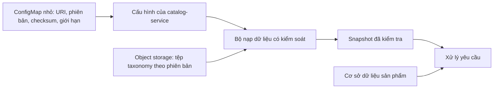

# Tránh lưu dữ liệu nghiệp vụ hoặc dữ liệu lớn trong ConfigMap

Trong module **SPRING_CLOUD_KUBERNETES**, ConfigMap giúp đưa cấu hình vào ứng dụng Spring chạy trên Kubernetes. Tuy nhiên, khả năng chứa chuỗi, YAML hoặc JSON không biến ConfigMap thành cơ sở dữ liệu hay kho tệp. Bài thuộc chương **Thiết kế cấu hình**, tập trung vào việc xác định ranh giới này và chọn cách tích hợp phù hợp.

Một thiết kế dễ vận hành thường giữ trong ConfigMap những thông số nhỏ, có ý nghĩa cấu hình: địa chỉ dịch vụ, timeout, kích thước lô xử lý, hoặc tham chiếu đến một bộ dữ liệu đã phát hành. Đơn hàng, hồ sơ khách hàng, tồn kho, ảnh sản phẩm và bộ dữ liệu lớn cần một nơi lưu trữ phục vụ đúng vòng đời của chúng.

Ví dụ xuyên suốt là `catalog-service` trong namespace `commerce-staging`. Dịch vụ đọc thông tin sản phẩm từ cơ sở dữ liệu và dùng một tệp phân loại sản phẩm được phát hành theo phiên bản. ConfigMap chỉ mô tả cách truy cập và phiên bản cần dùng; nội dung danh mục không được nhúng vào ConfigMap.

## 1. Phân biệt cấu hình với dữ liệu mà ứng dụng xử lý

Không thể phân loại chỉ bằng tên khóa hoặc định dạng tệp. Một giá trị có tên `settings.json` vẫn có thể chứa hàng nghìn bản ghi nghiệp vụ; ngược lại, một tài liệu YAML nhỏ có thể chỉ mô tả vài tham số kết nối.

Hãy xét ai tạo dữ liệu, ai thay đổi nó, ứng dụng đọc nó để làm gì và những bảo đảm nào cần có khi cập nhật.

| Tiêu chí | Thường là cấu hình | Thường là dữ liệu nghiệp vụ |
| --- | --- | --- |
| Vai trò | Điều khiển cách ứng dụng chạy | Là đối tượng ứng dụng tạo, xử lý hoặc truy vấn |
| Chủ thể cập nhật | Đội phát triển, vận hành hoặc quy trình phát hành cấu hình | Người dùng, hệ thống nghiệp vụ hoặc luồng tích hợp |
| Cách thay đổi | Thay đổi có kiểm soát theo môi trường hoặc đợt phát hành | Ghi thêm, sửa, xóa theo giao dịch hoặc sự kiện |
| Nhu cầu đọc | Đọc một nhóm thông số nhỏ | Tìm kiếm, lọc, phân trang, tổng hợp hoặc đọc theo định danh |
| Bảo đảm thường cần | Kiểm tra kiểu dữ liệu, phiên bản cấu hình, khả năng rollback | Ràng buộc dữ liệu, giao dịch, lịch sử, quyền theo đối tượng |

Các ví dụ cụ thể:

| Giá trị | Hướng thiết kế |
| --- | --- |
| Timeout gọi dịch vụ kho là `2s` | ConfigMap |
| Số bản ghi tối đa trong một lô xử lý là `200` | ConfigMap; đây là tham số của thuật toán |
| Danh sách 50.000 mã sản phẩm trong lô hiện tại | Kho dữ liệu hoặc hàng đợi phục vụ tác vụ |
| Địa chỉ JDBC không chứa credential | Có thể đặt trong ConfigMap |
| Mật khẩu kết nối cơ sở dữ liệu | Secret hoặc hệ thống quản lý bí mật phù hợp |
| Số dư, tồn kho, trạng thái đơn hàng | Cơ sở dữ liệu hoặc dịch vụ nghiệp vụ sở hữu dữ liệu |
| URI và phiên bản của tệp phân loại | ConfigMap |
| Nội dung tệp phân loại hàng chục MiB | Object storage, dịch vụ tệp hoặc volume phù hợp |
| Danh sách ngắn mã quốc gia được phép phục vụ | Có thể là cấu hình nếu nhỏ và được quản trị như cấu hình |

Không phải mọi quy tắc nghiệp vụ đều phải rời ConfigMap. Một công tắc bật tính năng hoặc một ngưỡng nhỏ có thể phù hợp nếu quyền thay đổi, cách kiểm tra và phạm vi tác động đã rõ. Khi cần người dùng nghiệp vụ tự chỉnh nhiều bản ghi, hiệu lực theo thời gian, phê duyệt, lịch sử và truy vấn, nên xem xét một dịch vụ quản lý quy tắc hoặc cơ sở dữ liệu.

Một câu hỏi hữu ích là: **nếu tách ứng dụng khỏi Kubernetes, thông tin này vẫn cần tồn tại như dữ liệu của hệ thống hay chỉ cần được cung cấp như tham số triển khai?** Đây là dấu hiệu để xem xét, không phải phép phân loại tuyệt đối.

## 2. Giới hạn dung lượng là giới hạn cứng, không phải mục tiêu sử dụng

Kubernetes giới hạn dữ liệu trong một ConfigMap ở mức **1 MiB**, tức 1.048.576 byte. Tài liệu Kubernetes nêu rõ ConfigMap không được thiết kế để chứa các khối dữ liệu lớn và gợi ý volume, cơ sở dữ liệu hoặc dịch vụ tệp cho nhu cầu lớn hơn. [Tài liệu ConfigMap của Kubernetes](https://kubernetes.io/docs/concepts/configuration/configmap/)

Có ba điểm cần phân biệt:

- Kích thước theo byte khác số ký tự. Nội dung tiếng Việt hoặc ký tự Unicode có thể chiếm nhiều byte khi mã hóa UTF-8.
- `binaryData` cho phép biểu diễn dữ liệu nhị phân; nó không cấp thêm một hạn mức độc lập để vượt giới hạn ConfigMap.
- Một payload được Kubernetes chấp nhận vẫn có thể không phù hợp về mục đích sử dụng.

Đội dự án có thể chọn một ngân sách nhỏ hơn, chẳng hạn yêu cầu xem xét lại khi một ConfigMap cấu hình vượt 32 KiB. Đây là **quy ước nội bộ minh họa**, không phải ngưỡng hiệu năng hay giới hạn do Kubernetes công bố. Ngưỡng nên dựa vào kiểu cấu hình, số ứng dụng, tần suất thay đổi và cách phân phối thực tế.

Một danh sách 5 KiB chứa dữ liệu cá nhân vẫn không nên được đưa vào ConfigMap chỉ vì nó nhỏ. Một tệp cấu hình hợp lệ 80 KiB cũng chưa đủ để kết luận thiết kế sai: cần xem nội dung, cách cập nhật và nhu cầu bảo mật.

## 3. Điều gì xảy ra khi dùng ConfigMap làm nơi chứa dữ liệu?

### 3.1. Luồng nghiệp vụ bị gắn vào hoạt động của Kubernetes API

Giả sử mỗi lần thay đổi giá của một sản phẩm, hệ thống lại cập nhật ConfigMap. Khi đó, thao tác nghiệp vụ phải phụ thuộc vào quyền sửa tài nguyên Kubernetes và đường đi qua Kubernetes API.

Một thiết kế như vậy kéo theo các vấn đề phải tự giải quyết:

- Ai được sửa dữ liệu, ai được sửa thông số triển khai?
- Làm sao ngăn hai người cùng cập nhật rồi ghi đè thay đổi của nhau?
- Truy vấn một sản phẩm theo mã bằng cách nào?
- Ghi nhận lịch sử giá và thời điểm hiệu lực ở đâu?
- Khôi phục cấu hình có vô tình khôi phục cả dữ liệu nghiệp vụ cũ không?

Kubernetes có cơ chế kiểm soát cập nhật đối tượng, nhưng điều đó không cung cấp sẵn mô hình giao dịch và truy vấn phù hợp cho danh mục sản phẩm. Không nên bắt ứng dụng tự xây các bảo đảm nghiệp vụ này trên một tài nguyên cấu hình.

### 3.2. Một thay đổi nhỏ có thể kéo theo xử lý một payload lớn

Khi nhiều consumer theo dõi cùng một đối tượng, việc cập nhật có thể dẫn tới truyền, đọc lại, giải mã và xử lý lại dữ liệu ở nhiều nơi. Chi phí thực tế phụ thuộc cách watch, cache, mount và refresh; không thể suy ra số request API chỉ bằng số Pod.

Có thể dùng phép tính đơn giản để hình dung **lượng dữ liệu mà consumer phải xử lý**, không phải để dự đoán chính xác tải mạng của cluster:

```text
payload cấu hình:              400 KiB
consumer phải xử lý lại:        30
số lần cập nhật trong một giờ:  60

khối lượng xử lý giả định:
400 × 30 × 60 = 720.000 KiB mỗi giờ
```

Nếu chỉ sửa một bản ghi mà phải phân tích lại cả danh mục, ConfigMap đã bắt đầu hoạt động như cơ chế đồng bộ dữ liệu thô. Việc chuyển payload sang một tệp nhị phân hoặc nén chuỗi không giải quyết nguyên nhân đó.

### 3.3. Quản lý cấu hình và quản lý dữ liệu có vòng đời khác nhau

Một ứng dụng thường cần rollback phiên bản cấu hình khi triển khai lỗi. Với dữ liệu nghiệp vụ, rollback có thể mang nghĩa khác: không thể xóa đơn hàng mới phát sinh chỉ để quay lại một timeout cũ.

Khi trộn hai loại thông tin trong một ConfigMap, thao tác vốn nhằm phục hồi ứng dụng có nguy cơ tác động đến dữ liệu cần được bảo toàn. Tách nơi lưu trữ giúp xác định rõ đối tượng nào được rollback và quy trình nào chịu trách nhiệm khôi phục dữ liệu.

## 4. Nhận diện một thiết kế sai trước khi ConfigMap chạm giới hạn

Ví dụ dưới đây là **phản ví dụ**. Chỉ có hai sản phẩm để dễ đọc, nhưng thiết kế giả định danh sách này sẽ tăng theo hoạt động kinh doanh:

```yaml
apiVersion: v1
kind: ConfigMap
metadata:
  name: catalog-service
  namespace: commerce-staging
data:
  application.yaml: |
    catalog:
      request-timeout: 2s
      products:
        - id: P1001
          name: Ban phim
          price: 490000
          available-quantity: 18
        - id: P1002
          name: Chuot
          price: 250000
          available-quantity: 42
```

Vấn đề không nằm ở việc YAML có parse được hay Spring có bind được vào `List<Product>` hay không. `products` chứa các thực thể cần cập nhật và truy vấn; `price` và `available-quantity` có vòng đời nghiệp vụ riêng.

Nếu đoạn này được đọc như một nguồn thuộc tính Spring, dữ liệu còn bị đưa vào cơ chế nạp cấu hình. Thay đổi tồn kho có thể trở thành thay đổi nguồn cấu hình của ứng dụng.

Cách sửa hợp lý là giữ lại `catalog.request-timeout`, chuyển sản phẩm sang kho dữ liệu và để service đọc qua repository hoặc API. Với tồn kho do dịch vụ khác sở hữu, `catalog-service` cần dùng hợp đồng của dịch vụ đó thay vì sao chép danh sách vào ConfigMap.

Các dấu hiệu khác cần xem xét:

| Dấu hiệu | Câu hỏi cần đặt ra |
| --- | --- |
| Khóa có dạng `customer-123`, `order-456` | Đang dùng mỗi khóa như một bản ghi? |
| ConfigMap được sửa mỗi vài giây | Đây là cập nhật cấu hình hay luồng sự kiện? |
| Người vận hành thường xuyên phải tăng số lượng ConfigMap để chứa thêm dữ liệu | Đang chia nhỏ kho dữ liệu để né giới hạn? |
| Ứng dụng cần đọc toàn bộ payload rồi lọc theo ID | Tại sao không dùng truy vấn của kho dữ liệu? |
| Cần lưu nhiều phiên bản có thời điểm hiệu lực nghiệp vụ | Có cần mô hình phiên bản dữ liệu riêng? |
| Có nội dung khách hàng, credential hoặc dữ liệu cần hạn chế truy cập | ConfigMap có đáp ứng mô hình bảo vệ dữ liệu đó không? |

## 5. Chọn nơi lưu trữ theo nhu cầu thực tế

| Loại thông tin | Nơi thường phù hợp | ConfigMap còn giữ gì? |
| --- | --- | --- |
| Sản phẩm, đơn hàng, tồn kho | Cơ sở dữ liệu hoặc dịch vụ nghiệp vụ | Địa chỉ kết nối, timeout, tên schema nếu phù hợp |
| Ảnh, báo cáo xuất, tệp nhập lớn | Object storage hoặc dịch vụ tệp | Endpoint, bucket hoặc URI không chứa bí mật |
| Bộ từ điển, taxonomy, mô hình được phát hành theo phiên bản | Kho artifact, object storage hoặc volume phù hợp | Phiên bản, vị trí, checksum và giới hạn tải |
| Chỉ mục hoặc dữ liệu tạm có thể tái tạo | Bộ nhớ đệm hoặc kho chuyên dụng | Chính sách cache và tham số kết nối |
| Trạng thái tác vụ, tiến độ xử lý | Cơ sở dữ liệu, hàng đợi hoặc hệ thống điều phối tác vụ | Tham số xử lý và tên tài nguyên liên quan |
| Tệp cần truy cập qua filesystem dùng chung | PersistentVolume khi workload cần cách truy cập đó | Đường dẫn và thông số ứng dụng |
| Tham số nhỏ, thay đổi cùng quy trình triển khai | ConfigMap | Chính nội dung cấu hình |

Không phải cứ đưa dữ liệu ra ngoài là cần triển khai thêm một sản phẩm. Dùng lại cơ sở dữ liệu hoặc object storage đã có thường đơn giản hơn vận hành một hệ thống mới. Nếu một tệp nhỏ thực sự gắn chặt với phiên bản chương trình và hiếm thay đổi, đóng gói nó trong image cũng có thể phù hợp; khi đó thay đổi tệp đồng nghĩa phát hành image mới.

Volume cung cấp một cách đưa dữ liệu vào filesystem. Nó không tự mang lại giao dịch, truy vấn theo đối tượng, lịch sử sửa đổi hay khả năng ghi đồng thời đúng cho mọi loại dữ liệu.

## 6. Giữ trong ConfigMap một mô tả nhỏ về dữ liệu ngoài

Với tệp phân loại lớn, có thể tách thành hai hợp đồng:

1. **Hợp đồng cấu hình:** ứng dụng phải dùng bộ dữ liệu nào, tải ở đâu và giới hạn xử lý ra sao.
2. **Hợp đồng dữ liệu:** định dạng tệp, phiên bản schema, nội dung, checksum và quy tắc phát hành.



Tham chiếu nên trỏ tới một phiên bản xác định. Một URI như `taxonomy/latest.json` có thể đổi nội dung mà không đổi ConfigMap, khiến khó xác định dữ liệu nào đã được sử dụng trong một lần triển khai. URI có phiên bản và checksum giúp phát hiện sự khác biệt đó.

Chỉ có một tên đường dẫn mang số phiên bản chưa bảo đảm nội dung bất biến. Kho lưu trữ và quy trình phát hành phải thực sự ngăn ghi đè phiên bản đã công bố, hoặc consumer phải kiểm tra được nội dung bằng checksum đáng tin cậy.

Không đặt access token, mật khẩu hoặc URL chứa credential trong ConfigMap. Với kho riêng tư, thiết kế xác thực riêng bằng cơ chế danh tính workload hoặc bí mật được quản lý phù hợp. ConfigMap chỉ chứa phần tham chiếu không nhạy cảm.

## 7. Ví dụ cấu hình nhỏ và cách nạp vào Spring

Ví dụ dùng file YAML được mount vào Pod và `spring.config.import` của Spring Boot. Cách này minh họa việc đưa cấu hình vào Spring mà không yêu cầu Java phải gọi Kubernetes API.

Namespace `commerce-staging` được giả định đã tồn tại. URI, image và checksum dưới đây là giá trị mẫu cần thay bằng tài nguyên của môi trường thực hành. Chuỗi checksum giữ chỗ cố ý không hợp lệ để ứng dụng không sử dụng nhầm một giá trị kiểm tra giả.

```yaml
apiVersion: v1
kind: ConfigMap
metadata:
  name: catalog-runtime-v3
  namespace: commerce-staging
  labels:
    app.kubernetes.io/name: catalog-service
    app.kubernetes.io/component: api
immutable: true
data:
  application.yaml: |
    spring:
      application:
        name: catalog-service
    catalog:
      dataset:
        uri: https://artifacts.example.com/catalog/taxonomy/2026-11-01/taxonomy.json
        version: "2026-11-01"
        sha256: "<SHA256_THUC_TE_GOM_64_KY_TU_HEX>"
        max-download-size: 16MB
        download-timeout: 15s
```

Các thuộc tính dưới `catalog.dataset` do ứng dụng tự định nghĩa. Kubernetes và Spring Cloud Kubernetes không tự tải tệp hoặc kiểm tra checksum chỉ vì những thuộc tính này tồn tại.

Một Deployment minh họa cách mount:

```yaml
apiVersion: apps/v1
kind: Deployment
metadata:
  name: catalog-service
  namespace: commerce-staging
spec:
  replicas: 2
  selector:
    matchLabels:
      app.kubernetes.io/name: catalog-service
  template:
    metadata:
      labels:
        app.kubernetes.io/name: catalog-service
    spec:
      automountServiceAccountToken: false
      containers:
        - name: catalog-service
          image: registry.example.com/catalog-service:1.4.0
          env:
            - name: SPRING_CONFIG_IMPORT
              value: file:/etc/catalog-config/application.yaml
          volumeMounts:
            - name: runtime-config
              mountPath: /etc/catalog-config
              readOnly: true
      volumes:
        - name: runtime-config
          configMap:
            name: catalog-runtime-v3
            items:
              - key: application.yaml
                path: application.yaml
```

Spring Boot hỗ trợ import trực tiếp file YAML bên ngoài bằng `spring.config.import`. Ở đây không dùng tiền tố `optional:`, vì thiếu cấu hình bắt buộc phải được phát hiện khi khởi động. [Cơ chế externalized configuration của Spring Boot](https://docs.spring.io/spring-boot/reference/features/external-config.html)

`immutable: true` phù hợp với cách phát hành cấu hình theo phiên bản của ví dụ: cần thay nội dung thì tạo ConfigMap mới và đổi tham chiếu của Deployment. Nó không khiến dữ liệu ngoài URI trở thành bất biến.

Manifest tập trung vào việc nạp cấu hình, chưa phải bộ triển khai hoàn chỉnh có xác thực tới kho artifact, probe và chính sách tài nguyên. Image thực hành phải chứa ứng dụng có bộ nạp tương ứng; địa chỉ `example.com` không cung cấp sẵn một taxonomy để tải.

Đặt `automountServiceAccountToken: false` vì mẫu này không sử dụng Kubernetes API từ tiến trình Java. Nếu cùng ứng dụng bật DiscoveryClient hoặc tính năng khác cần API, phải thiết kế lại danh tính và quyền cho tính năng đó. Việc nạp file đã mount không yêu cầu cấp Role đọc ConfigMap cho service account của ứng dụng.

## 8. Bind mô tả dữ liệu thay vì bind cả danh mục sản phẩm

Với Java 17 trở lên và Spring Boot 3.x, có thể biểu diễn phần cấu hình bằng một record nhỏ. Ví dụ sau minh họa kiểm tra descriptor; chưa triển khai client HTTP hoặc parser taxonomy.

```java
package com.example.catalog;

import java.net.URI;
import java.time.Duration;

import org.springframework.boot.context.properties.ConfigurationProperties;
import org.springframework.util.unit.DataSize;

@ConfigurationProperties(prefix = "catalog.dataset")
public record DatasetProperties(
        URI uri,
        String version,
        String sha256,
        DataSize maxDownloadSize,
        Duration downloadTimeout) {

    public DatasetProperties {
        if (uri == null
                || !"https".equalsIgnoreCase(uri.getScheme())
                || uri.getHost() == null
                || uri.getUserInfo() != null) {
            throw new IllegalArgumentException(
                    "catalog.dataset.uri must be an HTTPS URI without user info");
        }
        if (version == null || version.isBlank()) {
            throw new IllegalArgumentException(
                    "catalog.dataset.version is required");
        }
        if (sha256 == null || !sha256.matches("[0-9a-fA-F]{64}")) {
            throw new IllegalArgumentException(
                    "catalog.dataset.sha256 must contain 64 hexadecimal characters");
        }
        if (maxDownloadSize == null || maxDownloadSize.toBytes() <= 0) {
            throw new IllegalArgumentException(
                    "catalog.dataset.max-download-size must be positive");
        }
        if (downloadTimeout == null
                || downloadTimeout.isZero()
                || downloadTimeout.isNegative()) {
            throw new IllegalArgumentException(
                    "catalog.dataset.download-timeout must be positive");
        }
    }
}
```

Đăng ký kiểu cấu hình trong ứng dụng:

```java
package com.example.catalog;

import org.springframework.boot.SpringApplication;
import org.springframework.boot.autoconfigure.SpringBootApplication;
import org.springframework.boot.context.properties.EnableConfigurationProperties;

@SpringBootApplication
@EnableConfigurationProperties(DatasetProperties.class)
public class CatalogApplication {
    public static void main(String[] args) {
        SpringApplication.run(CatalogApplication.class, args);
    }
}
```

Cách bind này giữ nguồn cấu hình nhỏ và có kiểu dữ liệu rõ ràng. Nó không tạo sẵn `DatasetLoader`, không tải URI và không kiểm tra nội dung tệp. Ứng dụng cần một thành phần riêng nhận `DatasetProperties` rồi thực hiện các bước đó.

Checksum hợp lệ về cú pháp chưa đủ để xác thực nội dung. Bộ nạp phải tính checksum của byte thực tế và so sánh với giá trị mong đợi. Mô hình tin cậy cũng cần rõ: nếu một chủ thể sửa được cả URI lẫn checksum, checksum không ngăn chủ thể đó thay dữ liệu.

## 9. Thiết kế vòng đời nạp dữ liệu ngoài

Việc đưa payload ra khỏi ConfigMap giải quyết đúng ranh giới lưu trữ, nhưng ứng dụng vẫn phải xử lý tải xuống, kiểm tra và chuyển phiên bản.

Một quy trình tham khảo:

1. Đọc descriptor và kiểm tra các tham số bắt buộc.
2. Tải artifact tới vị trí tạm với timeout và giới hạn số byte thực nhận.
3. Kiểm tra checksum, định dạng, phiên bản schema và các ràng buộc cần thiết.
4. Dựng snapshot hoặc chỉ mục mới, không sửa dần snapshot đang phục vụ.
5. Công bố phiên bản mới bằng cơ chế chuyển trạng thái có kiểm soát.
6. Ghi nhận phiên bản đã dùng và dọn dữ liệu tạm hoặc phiên bản cũ theo chính sách.

```text
Descriptor hợp lệ
        |
        v
Tải bản mới vào vùng tạm
        |
        v
Kiểm tra kích thước + checksum + schema
        |
        +-- thất bại --> không công bố bản mới
        |
        v
Dựng snapshot hoàn chỉnh
        |
        v
Chuyển consumer sang snapshot mới
```

Không chỉ tin vào `Content-Length`. Giới hạn tải phải được kiểm soát trong quá trình đọc; nếu có giải nén, cần giới hạn cả dữ liệu sau giải nén. Tránh đọc toàn bộ một tệp lớn thành `String` rồi mới kiểm tra kích thước.

Checksum nên được tính trên đúng biểu diễn đã quy ước, chẳng hạn byte của artifact tải xuống. Không để bên phát hành tính trên tệp nén nhưng consumer lại so sánh với nội dung đã giải nén mà không có hợp đồng rõ ràng.

Chuyển một tham chiếu snapshot trong bộ nhớ chỉ giải quyết trạng thái bên trong một tiến trình. Nó không tạo giao dịch giữa các Pod, không đồng bộ cơ sở dữ liệu và không bảo đảm mọi request trong cluster cùng dùng một phiên bản. Nếu nghiệp vụ yêu cầu tính nhất quán đó, phải thiết kế thêm cách định tuyến theo phiên bản, gắn phiên bản vào yêu cầu hoặc phối hợp phát hành ở tầng ứng dụng.

Với dữ liệu lớn hơn đáng kể so với bộ nhớ Pod, cân nhắc đọc theo luồng, truy vấn từ dịch vụ dữ liệu, dùng chỉ mục trên đĩa hoặc cache có giới hạn. Không chuyển một vấn đề quá tải ConfigMap thành một vấn đề hết bộ nhớ Java.

### Xử lý khi kho dữ liệu tạm thời không sẵn sàng

Cần quyết định riêng cho hai thời điểm:

| Tình huống | Hướng xử lý có thể chọn |
| --- | --- |
| Lần khởi động đầu, chưa có dữ liệu bắt buộc | Chưa nhận traffic hoặc dừng khởi động với lỗi rõ ràng |
| Tải phiên bản mới thất bại, vẫn còn bản cũ được phép dùng | Tiếp tục phục vụ bản cũ và báo lỗi cập nhật |
| Bản cũ đã hết thời hạn nghiệp vụ cho phép | Ngừng chức năng liên quan hoặc không nhận traffic phù hợp phạm vi ảnh hưởng |
| Artifact sai checksum hoặc sai schema | Từ chối công bố bản đó; không lặng lẽ bỏ qua kiểm tra |

Không mặc định rằng dùng dữ liệu cũ luôn an toàn. Tệp phân loại sản phẩm và dữ liệu quyết định giá hoặc quyền truy cập có thể có yêu cầu về độ mới rất khác nhau.

Nếu tải dữ liệu là công việc bắt buộc trước khi phục vụ, readiness cần phản ánh khả năng đó. Liveness dùng để phát hiện tình trạng cần khởi động lại tiến trình; không nên biến mọi lần kho artifact mất kết nối thành lý do restart hàng loạt. Startup probe có thể cho ứng dụng thời gian khởi tạo dài hơn trước khi áp dụng các probe còn lại. [Tài liệu probe của Kubernetes](https://kubernetes.io/docs/concepts/workloads/pods/probes/)

Probe không tự biết snapshot taxonomy đã hợp lệ. Ứng dụng phải cung cấp trạng thái phù hợp, thay vì chỉ kiểm tra cổng HTTP đã mở.

## 10. Vai trò thực sự của Spring Cloud Kubernetes

Spring Cloud Kubernetes có thể giúp ứng dụng tìm dịch vụ và lấy cấu hình từ Kubernetes. Các khả năng đó không biến Kubernetes thành kho dữ liệu nghiệp vụ.

| Thành phần hoặc cách tích hợp | Vai trò trong thiết kế này |
| --- | --- |
| ConfigMap PropertySource | Đưa cấu hình nhỏ vào môi trường thuộc tính Spring khi chọn đọc qua API |
| ConfigMap mount + Spring Boot import file | Nạp cấu hình từ filesystem; phù hợp nếu không cần ứng dụng gọi API để đọc cấu hình |
| DiscoveryClient | Tìm instance của dịch vụ khi ứng dụng thật sự cần cơ chế discovery đó |
| Spring Cloud LoadBalancer | Chọn instance đích theo cách tích hợp được cấu hình |
| Configuration Watcher | Phát hiện thay đổi nguồn được theo dõi và kích hoạt luồng refresh tương ứng |
| Client cơ sở dữ liệu hoặc object storage | Đọc, ghi hoặc tải dữ liệu qua giao thức của kho dữ liệu |

Tài liệu ConfigMap PropertySource mô tả việc dùng cặp khóa–giá trị hoặc file `application.yaml` bên trong ConfigMap làm cấu hình của Spring. Đó là lý do cần chọn lọc nội dung nguồn, thay vì đưa cả bộ dữ liệu vào rồi mong cơ chế binding xử lý như một repository. [ConfigMap PropertySource của Spring Cloud Kubernetes](https://docs.spring.io/spring-cloud-kubernetes/reference/property-source-config/configmap-propertysource.html)

Chỉ bật những khả năng phục vụ một nhu cầu cụ thể. Với ví dụ nạp file đã mount, không cần thêm API loader chỉ để đọc lại cùng cấu hình. Nếu truy cập dịch vụ dữ liệu qua Kubernetes Service DNS đã đáp ứng yêu cầu, việc thêm DiscoveryClient và LoadBalancer cần có lý do riêng, như cần lựa chọn instance ở phía client.

Nếu chọn API loader, kiểm tra quyền đọc nguồn cấu hình theo client và phiên bản Spring Cloud Kubernetes đang dùng. Nếu triển khai Configuration Watcher, quyền của controller cần được thiết kế riêng với quyền của ứng dụng. Không cấp quyền ghi ConfigMap cho ứng dụng chỉ để nó cập nhật danh mục sản phẩm.

### Configuration Watcher không thay thế cơ chế đồng bộ dữ liệu

File mount được cập nhật không có nghĩa Spring tự nạp lại trạng thái ứng dụng. Configuration Watcher cung cấp cơ chế kích hoạt refresh cho ứng dụng Spring Cloud; luồng dùng file còn phải tính tới độ trễ cập nhật volume. [Tài liệu Configuration Watcher](https://docs.spring.io/spring-cloud-kubernetes/reference/spring-cloud-kubernetes-configuration-watcher.html)

Ngay cả khi descriptor mới đã vào `Environment`, vẫn cần bộ nạp tải và kiểm tra artifact mới. Refresh thuộc tính không tự:

- Tải tệp ngoài một cách có giới hạn.
- Xác thực checksum và tính tương thích schema.
- Chuyển snapshot nghiệp vụ an toàn.
- Bảo đảm tất cả Pod cập nhật cùng thời điểm.
- Khôi phục phiên bản dữ liệu ngoài khi ứng dụng rollback.

Không dùng mỗi lần thay đổi một sản phẩm làm sự kiện refresh cấu hình. Nếu cần đồng bộ dữ liệu gần thời gian thực, hãy thiết kế API dữ liệu, luồng sự kiện hoặc chiến lược đọc/cache phù hợp.

## 11. Cập nhật và rollback theo phiên bản rõ ràng

Ví dụ đã chọn ConfigMap bất biến và rollout Pod. Quy trình cập nhật taxonomy có thể là:

1. Phát hành artifact mới, ví dụ `taxonomy/2026-12-01/taxonomy.json`.
2. Kiểm tra nội dung, tính checksum và xác nhận artifact truy cập được từ môi trường triển khai.
3. Tạo ConfigMap mới, ví dụ `catalog-runtime-v4`, tham chiếu đúng artifact và checksum đó.
4. Đổi `spec.template.spec.volumes[].configMap.name` của Deployment sang ConfigMap mới.
5. Theo dõi rollout và xác nhận từng Pod công bố đúng phiên bản dữ liệu đã nạp.
6. Giữ bản cấu hình và artifact trước đó trong thời hạn cần cho rollback.

Việc đổi tham chiếu trong Pod template làm Deployment tạo đợt rollout mới. Ngược lại, sửa nội dung một ConfigMap có tên giữ nguyên không tự làm Deployment thay Pod chỉ vì dữ liệu trong ConfigMap thay đổi.

Trong khoảng rolling update, Pod cũ và Pod mới có thể cùng tồn tại. Trước khi phát hành, phải xác định hai phiên bản taxonomy có được phép phục vụ song song hay không. Nếu không được phép, cần chiến lược chuyển traffic hoặc tương thích dữ liệu cụ thể.

Rollback descriptor về `2026-11-01` chỉ có tác dụng khi artifact cũ còn tồn tại và code đang chạy đọc được phiên bản schema đó. Rollback Deployment cũng không khôi phục các bản ghi sản phẩm đã thay đổi trong cơ sở dữ liệu.

Với cơ chế refresh tại chỗ thay vì rollout, cần bổ sung xác nhận tải thành công, timeout chuyển phiên bản và trạng thái phiên bản đang hoạt động trên từng instance. Đừng đánh dấu thành công chỉ vì API đã chấp nhận thay đổi ConfigMap.

## 12. Những cách né giới hạn nhưng giữ nguyên vấn đề

| Cách làm | Vì sao chưa giải quyết đúng nhu cầu? |
| --- | --- |
| Chia danh mục thành hàng trăm ConfigMap | Vẫn đưa dữ liệu nghiệp vụ qua Kubernetes API; còn phải ghép dữ liệu và quản lý phiên bản giữa nhiều đối tượng |
| Nén JSON rồi lưu vào `binaryData` | Giảm số byte có thể không giải quyết được vòng đời dữ liệu, việc giải nén và nhu cầu truy vấn |
| Base64 toàn bộ tệp rồi lưu trong `data` | Base64 là mã hóa biểu diễn, thường tăng dung lượng; không tạo bảo mật |
| Dùng Secret thay ConfigMap cho một tệp lớn | Secret phục vụ dữ liệu bí mật và cũng có giới hạn kích thước; không phải kho tệp lớn |
| Ghi dữ liệu khách hàng vào annotation hoặc label | Metadata không phải nơi lưu payload nghiệp vụ và còn có các ràng buộc riêng |
| Tạo một custom resource cho từng bản ghi sản phẩm | Có thể phù hợp với tài nguyên do operator quản lý, nhưng không mặc nhiên thay thế cơ sở dữ liệu nghiệp vụ |
| Cho mọi Pod quyền sửa ConfigMap | Mở rộng quyền Kubernetes mà vẫn chưa có mô hình giao dịch nghiệp vụ thích hợp |
| Dùng một khóa JSON duy nhất để giảm số khóa | Tổng payload và nhu cầu phân tích lại dữ liệu vẫn còn |

Tách nhiều ConfigMap vẫn có ích khi phân chia cấu hình theo ứng dụng hoặc trách nhiệm rõ ràng. Điều cần tránh là chia một bộ dữ liệu lớn thành nhiều phần chỉ để vượt giới hạn một đối tượng, rồi coi đó là giải pháp lưu trữ lâu dài.

Secret có giới hạn riêng ở mức 1 MiB cho một Secret. Việc đổi loại tài nguyên không loại bỏ nhu cầu chọn kho lưu trữ phù hợp. [Tài liệu giới hạn Secret của Kubernetes](https://kubernetes.io/docs/concepts/configuration/secret/#size-limit)

## 13. Quan sát đúng thứ cần biết

Khi có sự cố, cần biết phiên bản cấu hình và phiên bản dữ liệu mà ứng dụng thực sự đang dùng. Không chỉ kiểm tra ConfigMap mới đã được tạo.

Các thông tin vận hành nên cân nhắc:

| Thông tin | Giúp trả lời |
| --- | --- |
| Tên ConfigMap mà Pod tham chiếu | Pod được triển khai với descriptor nào? |
| Phiên bản dữ liệu đang hoạt động | Ứng dụng đã chuyển sang bản mới hay vẫn dùng bản cũ? |
| Thời điểm tải thành công gần nhất | Dữ liệu đã bao lâu chưa được cập nhật thành công? |
| Số byte tải và thời gian tải | Payload có tăng bất thường hoặc kho tệp có chậm không? |
| Lỗi checksum, schema hoặc timeout | Vì sao bản mới bị từ chối? |
| Trạng thái readiness của từng Pod | Instance nào có thể phục vụ đúng yêu cầu? |

Có thể dùng log có cấu trúc cho mã phiên bản và nguyên nhân lỗi; dùng metric cho thời gian tải, số lần thất bại và kích thước tải. Không đưa URI tùy ý, mã bản ghi hoặc phiên bản phát sinh liên tục thành label metric nếu điều đó làm số chuỗi thời gian tăng không kiểm soát.

Không log toàn bộ dữ liệu tải xuống hoặc toàn bộ cấu hình chỉ để chứng minh ứng dụng đã đọc được. Một bản tóm tắt gồm phiên bản, checksum, kích thước và kết quả kiểm tra thường hữu ích hơn.

Các lệnh sau chỉ là minh họa quan sát sau khi triển khai, không phải thao tác mà bài này đã thực thi:

```shell
kubectl -n commerce-staging get configmap catalog-runtime-v3
kubectl -n commerce-staging get deployment catalog-service
kubectl -n commerce-staging get pods -l app.kubernetes.io/name=catalog-service
kubectl -n commerce-staging rollout status deployment/catalog-service
```

Trạng thái rollout thành công chỉ phản ánh các điều kiện mà Deployment và Pod đã khai báo. Nếu readiness không gắn với việc nạp taxonomy, rollout thành công vẫn chưa chứng minh taxonomy hợp lệ đã sẵn sàng.

### Ước lượng dung lượng giá trị trong ConfigMap

Trong PowerShell, có thể đọc một ConfigMap cấu hình không nhạy cảm và tính số byte của các giá trị:

```powershell
$catalogConfig = kubectl -n commerce-staging get configmap catalog-runtime-v3 -o json |
    ConvertFrom-Json

$catalogTextBytes = 0L
if ($null -ne $catalogConfig.data) {
    foreach ($entry in $catalogConfig.data.PSObject.Properties) {
        $catalogTextBytes += [System.Text.Encoding]::UTF8.GetByteCount(
            [string]$entry.Value
        )
    }
}

$catalogBinaryBytes = 0L
if ($null -ne $catalogConfig.binaryData) {
    foreach ($entry in $catalogConfig.binaryData.PSObject.Properties) {
        $catalogBinaryBytes += [System.Convert]::FromBase64String(
            [string]$entry.Value
        ).Length
    }
}

[pscustomobject]@{
    Name = $catalogConfig.metadata.name
    TextValueBytes = $catalogTextBytes
    BinaryValueBytes = $catalogBinaryBytes
    CombinedValueBytes = $catalogTextBytes + $catalogBinaryBytes
}
```

Đây là phép tính cho **nội dung giá trị**: chuỗi UTF-8 và byte nhị phân sau giải mã base64. Nó không đo kích thước toàn bộ đối tượng JSON/YAML, metadata hay chi phí truyền tải; cũng không thay thế validation của API server.

Nên quan sát xu hướng tăng và tần suất thay đổi bên cạnh dung lượng hiện tại. Một ConfigMap nhỏ nhưng chứa trạng thái được cập nhật liên tục vẫn đáng được xem lại.

## 14. Thực hành chuyển một thiết kế sang đúng ranh giới

Giả sử `catalog-service` đang có ba nguồn:

| Nguồn hiện tại | Nội dung |
| --- | --- |
| `catalog-runtime` | Timeout, địa chỉ dịch vụ và kích thước lô xử lý |
| `catalog-products` | Danh sách sản phẩm, giá và số lượng khả dụng |
| `catalog-taxonomy` | Toàn bộ JSON taxonomy, tăng theo mỗi lần phát hành |

Thực hiện chuyển đổi theo thứ tự sau:

1. Giữ `catalog-runtime` ở vai trò cấu hình; loại credential nếu có.
2. Xác định nơi sở hữu sản phẩm, giá và tồn kho. Chuyển `catalog-products` sang cơ sở dữ liệu hoặc API nghiệp vụ tương ứng.
3. Phát hành taxonomy thành artifact có phiên bản, schema và checksum rõ ràng.
4. Thay nội dung `catalog-taxonomy` bằng descriptor nhỏ hoặc đưa descriptor đó vào ConfigMap runtime theo ranh giới trách nhiệm phù hợp.
5. Chuyển code từ bind danh sách nghiệp vụ trong cấu hình sang repository/API và bộ nạp artifact.
6. Bổ sung trạng thái phiên bản đang dùng, chính sách khi tải lỗi và readiness phù hợp.
7. Triển khai thử với dữ liệu đại diện, xác nhận đọc đúng phiên bản trước khi thu hồi các nguồn cũ.

Đối với chuyển dữ liệu nghiệp vụ, cần một kế hoạch giữ dữ liệu nhất quán trong thời gian di chuyển. Không xóa nguồn cũ ngay khi tạo được bảng mới hoặc tải được một tệp mới; phải xác nhận consumer đã chuyển và phương án phục hồi còn hiệu lực.

Kết quả cần đạt là có thể chỉ ra rõ: ConfigMap điều khiển cách chạy và tham chiếu phiên bản; cơ sở dữ liệu sở hữu bản ghi nghiệp vụ; kho artifact sở hữu tệp lớn; ứng dụng chịu trách nhiệm kiểm tra và đưa dữ liệu hợp lệ vào phục vụ. DiscoveryClient, LoadBalancer và Configuration Watcher chỉ được bổ sung khi có nhu cầu tương ứng trong thiết kế đó.
