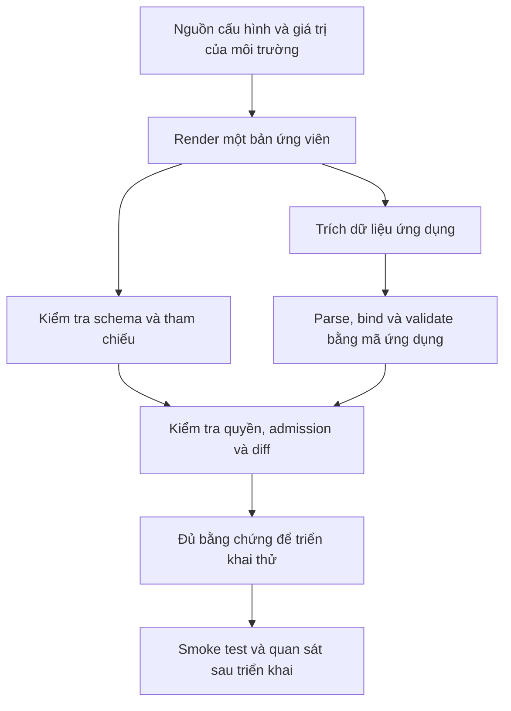

# Kiểm tra cấu hình trước khi đưa vào cluster

Trong chương **Thiết kế cấu hình** của module **SPRING_CLOUD_KUBERNETES**, một thay đổi cấu hình chỉ sẵn sàng triển khai khi có bằng chứng ở cả hai phía: Kubernetes chấp nhận tài nguyên và ứng dụng Spring hiểu đúng dữ liệu được cấp. ConfigMap tạo thành công chưa chứng minh timeout đúng đơn vị, profile đúng môi trường hoặc DiscoveryClient có đủ quyền đọc tài nguyên.

Bài học xây dựng một quy trình kiểm tra trước triển khai, từ manifest sau render đến hợp đồng cấu hình của ứng dụng, quyền truy cập và chính sách trên cluster đích. Quy trình cũng giúp quyết định có thực sự cần đọc ConfigMap qua Kubernetes API, DiscoveryClient, Spring Cloud LoadBalancer hay Configuration Watcher hay không.

Sau bài học, bạn có thể:

- Phân biệt kiểm tra cú pháp, schema Kubernetes, binding Spring và điều kiện vận hành.
- Kiểm tra đúng cấu hình cuối cùng sau khi ghép các nguồn và overlay.
- Viết kiểm tra tự động cho cấu hình bắt buộc, giới hạn giá trị và quan hệ giữa các thuộc tính.
- Dùng server dry-run và diff đúng mục đích, hiểu kết quả và giới hạn.
- Xây dựng điều kiện chặn triển khai cùng bằng chứng có thể truy vết.

## 1. Một cấu hình cần vượt qua nhiều lớp kiểm tra

Giả sử nhóm muốn đổi timeout gọi hệ thống thanh toán. Ba lỗi khác nhau có thể xuất hiện:

1. YAML của Deployment sai thụt dòng.
2. Manifest hợp lệ nhưng `orders.client.read-timeout` bị viết thành `read-timeuot`.
3. Spring bind thành công nhưng client được tạo bằng giá trị mặc định khác, hoặc URL trỏ nhầm môi trường.

Mỗi lỗi cần một cách phát hiện riêng.

| Lớp kiểm tra | Câu hỏi phải trả lời | Ví dụ lỗi có thể phát hiện |
| --- | --- | --- |
| Cú pháp và render | Tệp cuối cùng có parse được, còn placeholder không? | Template chưa thay giá trị, YAML lỗi |
| Schema Kubernetes | Field, kiểu dữ liệu và API version có hợp lệ? | `replicas` đặt sai vị trí, `ConfigMap.data` chứa số |
| Tham chiếu giữa tài nguyên | Tên, key, namespace và selector có khớp? | Deployment mount ConfigMap không tồn tại |
| Hợp đồng Spring | Dữ liệu có bind được vào đúng kiểu và được validate? | Timeout âm, thiếu URL, key gõ sai |
| Quyền và admission | Danh tính dự kiến có được phép thực hiện thao tác? | Pipeline không được patch, ứng dụng không được watch |
| Hành vi và vòng đời | Consumer thực sự dùng giá trị nào, khi nào đổi có hiệu lực? | Tệp đã đổi nhưng bean vẫn giữ cấu hình cũ |

Không dùng kết quả ở một lớp để suy ra kết quả ở mọi lớp. Một kiểm tra chỉ nên tuyên bố điều nó thực sự quan sát.



Trong sơ đồ, bước cuối vẫn cần chạy thực tế. Kiểm tra trước triển khai giảm lỗi có thể biết sớm; nó không thay thế việc theo dõi Pod sau triển khai.

## 2. Chốt đầu vào: kiểm tra đúng bản sẽ được triển khai

Trước khi chạy công cụ, xác định một bộ đầu vào cụ thể:

| Đầu vào | Cần ghi nhận |
| --- | --- |
| Mã ứng dụng | Commit và image tương ứng |
| Thư viện | Java, Spring Boot, Spring Cloud BOM và Spring Cloud Kubernetes nếu sử dụng |
| Môi trường | Context, namespace, profile và API version của cluster đích |
| Cấu hình | Revision của ConfigMap, tham chiếu Secret và phương thức nạp |
| Cách cập nhật | Rollout Pod, reload có kiểm soát hoặc rotation tài nguyên |
| Công cụ kiểm tra | Phiên bản renderer, validator và bộ schema |

Chọn tổ hợp phiên bản tương thích theo dự án, khóa chúng trong quy trình build. Mã Java phía dưới minh họa với Java 17 trở lên và Spring Boot 3.5.x; phần Configuration Watcher tham chiếu tài liệu Spring Cloud Kubernetes 3.3.x. Đây là phạm vi ví dụ, không phải yêu cầu nâng mọi ứng dụng lên một phiên bản mới.

Nếu dùng Helm hoặc Kustomize, hãy render đúng values hoặc overlay của môi trường, rồi kiểm tra đầu ra. Một chart đã lint thành công vẫn có thể render ra tên Secret sai ở một bộ values cụ thể.

Nên tạo một bản ứng viên duy nhất, tính hash và dùng lại bản đó ở các bước sau. Nếu pipeline render lại sau kiểm tra với một biến môi trường khác, kết quả kiểm tra trước đó không còn đại diện cho dữ liệu được gửi đi.

Các đường dẫn như `k8s.yaml` và `build/application.yaml` trong bài là tệp người học chuẩn bị trong dự án thực hành; chúng không phải tài nguyên đã được cài sẵn.

## 3. Ví dụ nền: cấu hình qua volume, chưa cần Kubernetes API trong Java

Dịch vụ `orders-api` gọi một backend thanh toán. Ví dụ chọn mount ConfigMap thành tệp và để Spring Boot đọc khi khởi động. Ứng dụng chưa cần DiscoveryClient hoặc watcher cho đường cấu hình này.

Tệp `k8s.yaml`:

```yaml
apiVersion: v1
kind: ConfigMap
metadata:
  name: orders-config-r1
  namespace: orders-staging
data:
  application.yaml: |-
    server:
      port: 8080
    orders:
      client:
        config-revision: orders-r1
        base-url: https://payments.staging.example.test
        connect-timeout: 500ms
        read-timeout: 2s
        max-attempts: 2
    management:
      endpoints:
        web:
          exposure:
            include: health
      endpoint:
        health:
          probes:
            enabled: true
---
apiVersion: v1
kind: ServiceAccount
metadata:
  name: orders-api
  namespace: orders-staging
---
apiVersion: apps/v1
kind: Deployment
metadata:
  name: orders-api
  namespace: orders-staging
spec:
  replicas: 2
  selector:
    matchLabels:
      app: orders-api
  template:
    metadata:
      labels:
        app: orders-api
    spec:
      serviceAccountName: orders-api
      automountServiceAccountToken: false
      containers:
        - name: app
          image: registry.example.test/training/orders-api:candidate
          ports:
            - name: http
              containerPort: 8080
          env:
            - name: SPRING_PROFILES_ACTIVE
              value: staging
            - name: SPRING_CONFIG_ADDITIONAL_LOCATION
              value: file:/etc/orders/application.yaml
          volumeMounts:
            - name: app-config
              mountPath: /etc/orders
              readOnly: true
          startupProbe:
            httpGet:
              path: /actuator/health/liveness
              port: http
            periodSeconds: 5
            failureThreshold: 24
          readinessProbe:
            httpGet:
              path: /actuator/health/readiness
              port: http
            periodSeconds: 5
          livenessProbe:
            httpGet:
              path: /actuator/health/liveness
              port: http
            periodSeconds: 10
      volumes:
        - name: app-config
          configMap:
            name: orders-config-r1
            items:
              - key: application.yaml
                path: application.yaml
---
apiVersion: v1
kind: Service
metadata:
  name: orders-api
  namespace: orders-staging
spec:
  selector:
    app: orders-api
  ports:
    - name: http
      port: 80
      targetPort: http
```

Namespace `orders-staging` được giả định đã tồn tại. Image và hostname trong ví dụ là giá trị minh họa: thay image bằng bản thực đã build, còn backend bằng địa chỉ staging hoặc stub kiểm thử phù hợp. Không đánh giá một hostname là truy cập được chỉ vì nó có dạng URL hợp lệ.

Ứng dụng cần các dependency `spring-boot-starter-web`, `spring-boot-starter-actuator` và `spring-boot-starter-validation`; kiểm tra Java dùng thêm `spring-boot-starter-test`. Các version do Spring Boot parent/BOM của dự án quản lý. Mẫu chưa có cấu hình security chặn health; nếu ứng dụng có Spring Security, phải kiểm tra quyền truy cập probe tương ứng.

`SPRING_CONFIG_ADDITIONAL_LOCATION` bổ sung nguồn cấu hình ngoài ứng dụng. Đường dẫn cụ thể không có `optional:` thể hiện tệp này là bắt buộc; cần kiểm tra cả việc mount đúng lẫn Spring tìm đúng tệp. [Spring Boot: vị trí cấu hình ngoài ứng dụng](https://docs.spring.io/spring-boot/3.5/reference/features/external-config.html#features.external-config.files).

Trong mẫu, `automountServiceAccountToken: false` phù hợp vì ứng dụng đọc tệp trên volume, không tự gọi Kubernetes API. Nếu thêm chức năng cần API, phải xem lại lựa chọn này cùng xác thực và quyền tương ứng.

## 4. Kiểm tra manifest sau render

Các lệnh thực hành bên dưới dùng Bash. Cần cài và khóa phiên bản công cụ trong môi trường kiểm tra; không giả định mọi phiên bản CLI có cùng hành vi.

### 4.1. Tạo bản ứng viên

Với manifest viết trực tiếp như mẫu:

```bash
mkdir -p build
cp k8s.yaml build/rendered.yaml
sha256sum build/rendered.yaml
```

Với Helm hoặc Kustomize, thay lệnh sao chép bằng bước render của dự án. Không nối thêm một bộ manifest khác sau khi đã tính hash mà vẫn dùng kết quả kiểm tra cũ.

Kiểm tra danh sách tài nguyên, namespace, image và các tên cấu hình trong đầu ra. Một quy tắc tìm placeholder phải theo đúng cú pháp template của dự án; grep một từ chung không đủ để chứng minh template đã hoàn tất.

### 4.2. Schema Kubernetes

Ví dụ dưới giả định cluster lab dùng Kubernetes `1.34.0`; thay bằng phiên bản đích của bạn và chuẩn bị bộ schema tương ứng:

```bash
kubeconform -strict -summary -kubernetes-version 1.34.0 build/rendered.yaml
```

Chế độ strict giúp phát hiện field ngoài schema và key trùng. Với CRD, cần cung cấp schema phù hợp với phiên bản CRD được cài; thiếu schema phải được phân loại rõ, tránh biến tài nguyên chưa kiểm tra thành kết quả đạt bằng cách bỏ qua hàng loạt. Kubeconform kiểm tra schema, không thay thế validation và admission trên API server. [Tài liệu chính thức của kubeconform](https://github.com/yannh/kubeconform).

Nếu cần kiểm tra hoàn toàn offline, chuẩn bị sẵn schema trong môi trường kiểm tra. Tải schema từ mạng vào lúc chạy khác với một bước không có phụ thuộc mạng.

Ví dụ lỗi Kubernetes có thể phát hiện:

```yaml
data:
  MAX_ATTEMPTS: 2
```

`ConfigMap.data` cần giá trị chuỗi, vì vậy dùng `"2"` khi biểu diễn một key trực tiếp. Tuy nhiên, toàn bộ `data.application.yaml` trong mẫu là một chuỗi nhiều dòng; Kubernetes không hiểu các ràng buộc nghiệp vụ bên trong. [Kubernetes ConfigMaps](https://kubernetes.io/docs/concepts/configuration/configmap/).

### 4.3. Kiểm tra tham chiếu riêng

Đối chiếu tối thiểu các quan hệ sau trên bản ứng viên:

| Quan hệ | Kết quả mong đợi trong mẫu |
| --- | --- |
| Deployment → ConfigMap | `orders-config-r1` cùng namespace |
| Volume item → key | `application.yaml` tồn tại |
| Volume mount → Spring | Tệp xuất hiện đúng tại `/etc/orders/application.yaml` |
| Deployment → ServiceAccount | `orders-api` trong `orders-staging` |
| Service selector → Pod label | Cùng `app: orders-api` |
| Service targetPort → container port | Cùng tên `http` |
| Probe → ứng dụng | Path health tồn tại trên cổng 8080 |

Một pipeline có thể xây danh mục object theo bộ `kind / namespace / name` rồi kiểm tra các tham chiếu nằm trong cùng bản ứng viên. Với tài nguyên được cấp sẵn ngoài bản ứng viên, cần một danh mục phụ thuộc hoặc truy vấn có kiểm soát trên môi trường đích.

Việc API server chấp nhận Deployment không bảo đảm ConfigMap được tham chiếu tồn tại, Service chọn được Pod hoặc image có thể kéo về. Các quan hệ này cần bằng chứng bổ sung.

## 5. Trích và kiểm tra cấu hình mà Spring sẽ đọc

### 5.1. Lấy dữ liệu từ đầu ra cuối cùng

Dùng Mike Farah `yq` v4 để trích đúng ConfigMap của mẫu:

```bash
yq eval -r 'select(.kind == "ConfigMap" and .metadata.name == "orders-config-r1" and .metadata.namespace == "orders-staging") | .data."application.yaml"' build/rendered.yaml > build/application.yaml
test -s build/application.yaml
```

Trong pipeline thực, kiểm tra có đúng một object khớp điều kiện và key có kiểu chuỗi. `test -s` chỉ kiểm tra tệp có dữ liệu; nó không thay thế kiểm tra số lượng object hoặc tính đúng đắn của YAML.

Không viết lại thủ công một `application-test.yaml` gần giống cấu hình triển khai rồi chỉ kiểm tra tệp đó. Sai sót cần tìm có thể nằm ngay trong values hoặc overlay tạo ra bản thực tế.

### 5.2. Biểu diễn hợp đồng bằng kiểu và validation

Tệp `OrderClientProperties.java`, package `com.example.orders`:

```java
package com.example.orders;

import java.net.URI;
import java.time.Duration;

import jakarta.validation.constraints.AssertTrue;
import jakarta.validation.constraints.Max;
import jakarta.validation.constraints.Min;
import jakarta.validation.constraints.NotBlank;
import jakarta.validation.constraints.NotNull;

import org.springframework.boot.context.properties.ConfigurationProperties;
import org.springframework.validation.annotation.Validated;

@ConfigurationProperties(
        prefix = "orders.client",
        ignoreUnknownFields = false
)
@Validated
public record OrderClientProperties(
        @NotBlank String configRevision,
        @NotNull URI baseUrl,
        @NotNull Duration connectTimeout,
        @NotNull Duration readTimeout,
        @Min(1) @Max(3) int maxAttempts
) {

    @AssertTrue(message = "base-url must be an HTTPS URL without user info")
    public boolean isBaseUrlAllowed() {
        if (baseUrl == null) {
            return true;
        }
        return "https".equalsIgnoreCase(baseUrl.getScheme())
                && baseUrl.getHost() != null
                && baseUrl.getUserInfo() == null;
    }

    @AssertTrue(message = "timeouts must satisfy the client timeout budget")
    public boolean isTimeoutBudgetValid() {
        if (connectTimeout == null || readTimeout == null) {
            return true;
        }
        return !connectTimeout.isNegative()
                && !connectTimeout.isZero()
                && connectTimeout.compareTo(Duration.ofSeconds(10)) <= 0
                && readTimeout.compareTo(connectTimeout) >= 0
                && readTimeout.compareTo(Duration.ofSeconds(30)) <= 0;
    }
}
```

Đăng ký lớp bằng `@EnableConfigurationProperties(OrderClientProperties.class)` trên cấu hình ứng dụng hoặc cơ chế scan phù hợp. Consumer tạo HTTP client phải nhận bean này và dùng các giá trị của nó; chỉ tạo một bean để validate nhưng client lại đọc hằng số khác sẽ bỏ sót lỗi hành vi.

`@Validated` cùng một Bean Validation implementation cho phép kiểm tra constraint khi bind cấu hình. Các điều kiện trong mẫu là hợp đồng do ứng dụng lựa chọn: URL dùng HTTPS, connect timeout dương và không quá 10 giây, read timeout từ connect timeout đến 30 giây, số lần thử từ 1 đến 3. [Spring Boot: validation của ConfigurationProperties](https://docs.spring.io/spring-boot/3.5/reference/features/external-config.html#features.external-config.typesafe-configuration-properties.validation).

`ignoreUnknownFields = false` giúp từ chối key không bind được trong prefix `orders.client`, ví dụ `read-timeuot`. Nó không kiểm tra mọi key trong toàn bộ môi trường Spring; các prefix khác cần hợp đồng hoặc kiểm tra riêng. [API ConfigurationProperties](https://docs.spring.io/spring-boot/3.5/api/java/org/springframework/boot/context/properties/ConfigurationProperties.html).

Hai phương thức validation trả về `true` khi dữ liệu liên quan là `null` để constraint `@NotNull` chịu trách nhiệm báo thiếu giá trị. Chúng không biến giá trị thiếu thành hợp lệ.

Quy tắc URL này cũng chưa phải danh sách endpoint được phép. Nếu môi trường staging tuyệt đối không được gọi production, hãy kiểm tra host theo danh mục môi trường và kiểm soát mạng tương ứng. HTTPS chỉ chứng minh một yêu cầu về dạng URL.

### 5.3. Chạy kiểm tra binding bằng dữ liệu đã trích

Tệp `OrderClientConfigurationTest.java`:

```java
package com.example.orders;

import java.io.IOException;
import java.io.UncheckedIOException;

import org.junit.jupiter.api.Test;
import org.springframework.boot.autoconfigure.ImportAutoConfiguration;
import org.springframework.boot.autoconfigure.validation.ValidationAutoConfiguration;
import org.springframework.boot.context.properties.EnableConfigurationProperties;
import org.springframework.boot.env.YamlPropertySourceLoader;
import org.springframework.boot.test.context.runner.ApplicationContextRunner;
import org.springframework.context.annotation.Configuration;
import org.springframework.core.io.FileSystemResource;

import static org.assertj.core.api.Assertions.assertThat;

class OrderClientConfigurationTest {

    private ApplicationContextRunner candidate(String... overrides) {
        return new ApplicationContextRunner()
                .withInitializer(context -> {
                    try {
                        var sources = new YamlPropertySourceLoader().load(
                                "rendered-candidate",
                                new FileSystemResource("build/application.yaml")
                        );
                        if (sources.size() != 1) {
                            throw new IllegalArgumentException(
                                    "this test expects one YAML document"
                            );
                        }
                        context.getEnvironment()
                                .getPropertySources()
                                .addLast(sources.get(0));
                    } catch (IOException ex) {
                        throw new UncheckedIOException(ex);
                    }
                })
                .withUserConfiguration(BindingConfiguration.class)
                .withPropertyValues(overrides);
    }

    @Test
    void acceptsRenderedCandidate() {
        candidate().run(context -> {
            assertThat(context).hasNotFailed();
            var settings = context.getBean(OrderClientProperties.class);
            assertThat(settings.configRevision()).isEqualTo("orders-r1");
            assertThat(settings.connectTimeout()).hasMillis(500);
            assertThat(settings.readTimeout()).hasSeconds(2);
            assertThat(settings.maxAttempts()).isEqualTo(2);
        });
    }

    @Test
    void rejectsAnInvalidTimeoutBudget() {
        candidate(
                "orders.client.connect-timeout=3s",
                "orders.client.read-timeout=1s"
        ).run(context -> assertThat(context).hasFailed());
    }

    @Test
    void rejectsAnUnknownPropertyUnderTheContractPrefix() {
        candidate(
                "orders.client.read-timeuot=2s"
        ).run(context -> assertThat(context).hasFailed());
    }

    @Configuration(proxyBeanMethods = false)
    @EnableConfigurationProperties(OrderClientProperties.class)
    @ImportAutoConfiguration(ValidationAutoConfiguration.class)
    static class BindingConfiguration {
    }
}
```

`YamlPropertySourceLoader` đưa YAML đã trích thành property source để kiểm tra. Ví dụ cố ý giới hạn một YAML document, không có document kích hoạt theo profile. [API YamlPropertySourceLoader](https://docs.spring.io/spring-boot/3.5/api/java/org/springframework/boot/env/YamlPropertySourceLoader.html).

Chạy từ gốc dự án sau bước trích cấu hình, ví dụ với Maven Wrapper của dự án:

```bash
./mvnw -Dtest=OrderClientConfigurationTest test
```

Ba test phải cùng đạt: ứng viên hợp lệ bind được, còn hai ứng viên lỗi bị từ chối. Assertion về revision và giá trị kỳ vọng thuộc bộ dữ liệu minh họa `orders-r1`; khi đổi bộ dữ liệu, cập nhật kỳ vọng đã được duyệt tương ứng.

Đây là test hợp đồng cấu hình, không phải chạy toàn bộ ứng dụng. Việc thêm property source thủ công chưa tái hiện đầy đủ Config Data import, profile, biến môi trường container, Secret, cơ chế API của Spring Cloud Kubernetes hoặc việc tạo HTTP client thực. Cần thêm một phép khởi động/smoke test với image ứng viên và cách cấp cấu hình tương đương triển khai.

Không gọi thành công HTTP tới một stub bằng timeout mặc định rồi kết luận cấu hình mới đã được áp dụng. Test hành vi nên tạo tình huống có thể phân biệt giá trị cũ và mới, chẳng hạn stub phản hồi chậm hơn timeout dự kiến.

## 6. Kiểm tra thứ tự nguồn và tính bắt buộc

Một thuộc tính có thể xuất hiện trong file đóng gói, file mount, biến môi trường và tham số dòng lệnh. Trong thứ tự thông thường của Spring Boot, biến môi trường và tham số dòng lệnh có thể ghi đè file cấu hình; vì vậy cần đối chiếu các nguồn được cấp vào image thực. [Spring Boot: thứ tự PropertySource](https://docs.spring.io/spring-boot/3.5/reference/features/external-config.html).

Ví dụ `ORDERS_CLIENT_MAXATTEMPTS=3` có thể ghi đè `orders.client.max-attempts: 2` trong file. Theo quy tắc chuyển tên sang biến môi trường của Spring Boot, dấu chấm thành dấu gạch dưới và dấu gạch ngang bị bỏ. Hãy kiểm tra kết quả bind, không chỉ đối chiếu tên bằng mắt.

Một bảng kiểm kê nhỏ giúp phát hiện ghi đè ngoài ý muốn:

| Thuộc tính | Nguồn dự kiến | Bằng chứng cần lấy |
| --- | --- | --- |
| `orders.client.base-url` | ConfigMap staging | Giá trị đã bind hoặc kiểm tra host đã che dữ liệu nhạy cảm |
| `orders.client.max-attempts` | ConfigMap staging | Không có env/argument ghi đè ngoài kế hoạch |
| Credential gọi backend | Secret hoặc nguồn bí mật được phê duyệt | Tham chiếu đúng, key tồn tại, không in giá trị |
| Profile | Pod environment | Profile hoạt động của tiến trình thử nghiệm |
| Cách nạp cấu hình | Thiết lập khởi động | Tệp/API/import thực sự được dùng |

Nếu chọn Config Data của Spring Cloud Kubernetes, kiểm tra import `"kubernetes:"`, lựa chọn nguồn, namespace và danh tính API theo đúng phiên bản. Không bật đồng thời cơ chế bootstrap cũ và Config Data import để “chắc chắn đọc được”. [Spring Cloud Kubernetes 3.3: PropertySource](https://docs.spring.io/spring-cloud-kubernetes/reference/3.3/property-source-config.html).

Phải phân biệt hai điều kiện: nguồn có tồn tại và dữ liệu bắt buộc có hợp lệ. Một nguồn đánh dấu optional có thể vắng mặt mà quá trình nạp vẫn tiếp tục, nhưng constraint bắt buộc của ứng dụng vẫn phải chặn việc chạy với dữ liệu thiếu.

## 7. Kiểm tra Secret và quyền theo đúng danh tính

### 7.1. Secret: kiểm tra tham chiếu, không tạo thêm bản sao bí mật

Nếu bổ sung Secret, kiểm tra namespace, tên, key bắt buộc và consumer sử dụng nó. Ví dụ `secretKeyRef` trỏ đúng tên nhưng sai key vẫn có thể làm container không khởi động được.

Base64 trong `Secret.data` không phải mã hóa bảo mật. Tránh đưa giá trị Secret vào báo cáo kiểm tra, artifact công khai, bản diff hoặc log shell. Kiểm tra schema có thể dùng dữ liệu giả trong CI không đặc quyền; xác minh tham chiếu thật cần diễn ra trong môi trường được phép. [Kubernetes Secrets](https://kubernetes.io/docs/concepts/configuration/secret/).

Với nguồn Secret bên ngoài hoặc controller đồng bộ Secret, còn phải kiểm tra điều kiện tài nguyên đích đã được cấp. Manifest của controller hợp lệ chưa chứng minh dữ liệu bí mật đã sẵn sàng.

### 7.2. Pipeline triển khai và ServiceAccount ứng dụng có vai trò khác nhau

Pipeline cần quyền tạo hoặc cập nhật các tài nguyên triển khai. Ứng dụng chỉ cần quyền API mà tính năng đang dùng đòi hỏi. Đối với mẫu mount volume, không cần trao cho `orders-api` quyền đọc ConfigMap qua API chỉ để ứng dụng đọc tệp mount.

Nếu thiết kế thực đọc ConfigMap qua API, kiểm tra quyền bằng danh tính ServiceAccount dự kiến. Ví dụ dành cho người vận hành có quyền impersonation:

```bash
kubectl --context staging-lab -n orders-staging auth can-i get configmaps/orders-config-r1 --as=system:serviceaccount:orders-staging:orders-api
kubectl --context staging-lab -n orders-staging auth can-i list configmaps --as=system:serviceaccount:orders-staging:orders-api
kubectl --context staging-lab -n orders-staging auth can-i watch configmaps --as=system:serviceaccount:orders-staging:orders-api
```

Kết quả mong đợi phụ thuộc vào cách thư viện truy cập API; không yêu cầu cả ba lệnh đều trả `yes` cho mọi ứng dụng. `auth can-i` kiểm tra quyền, không chứng minh object tồn tại, token được mount hoặc kết nối mạng/TLS từ Pod hoạt động. Tùy chọn `--as` cần quyền impersonation. [kubectl auth can-i](https://kubernetes.io/docs/reference/kubectl/generated/kubectl_auth/kubectl_auth_can-i/).

Nếu quyền được cấp qua group, cần mô phỏng cả group phù hợp khi impersonation; chỉ đổi username có thể chưa đại diện đầy đủ cho danh tính thật. Khi nghi ngờ, xác minh bằng luồng xác thực thực trong môi trường thử được phép.

Không tự sửa Role thành wildcard chỉ vì một kiểm tra bị từ chối. Với `resourceNames`, lệnh `get` theo tên và luồng `list/watch` có điều kiện khác nhau; client phải dùng field selector theo tên khi cần. Xác nhận request thực của thư viện trước khi chọn giới hạn quyền. [Kubernetes RBAC](https://kubernetes.io/docs/reference/access-authn-authz/rbac/).

## 8. Server dry-run trên đúng cluster

Sau các kiểm tra cục bộ, dùng danh tính triển khai và context đã xác định:

```bash
kubectl --context staging-lab -n orders-staging apply --server-side --field-manager=orders-delivery --dry-run=server --validate=strict -f build/rendered.yaml
```

Lệnh gửi yêu cầu tới API server để kiểm tra mà không lưu thay đổi. Chọn cùng phương thức apply và field manager với quy trình triển khai thực; nếu dự án dùng cơ chế khác, điều chỉnh phép thử cho tương ứng. Tránh dùng `--force-conflicts` chỉ để làm mất một lỗi sở hữu field cần được giải quyết. [kubectl apply](https://kubernetes.io/docs/reference/kubectl/generated/kubectl_apply/).

Server dry-run đi qua validation và admission áp dụng cho yêu cầu, đồng thời cần quyền tương ứng với thao tác thật. Admission webhook phải hỗ trợ dry-run đúng cách; lỗi không hỗ trợ hoặc không truy cập được phải được báo rõ. [Kubernetes API: dry-run](https://kubernetes.io/docs/reference/using-api/api-concepts/#dry-run).

Trong bài, “trước khi đưa vào cluster” nghĩa là trước khi lưu thay đổi triển khai. Server dry-run vẫn cần kết nối và gửi dữ liệu tới cluster; nó không phải kiểm tra offline.

Lưu ý về phạm vi:

- Namespace đích và CRD cần thiết phải có sẵn. Dry-run một Namespace không tạo Namespace thật cho yêu cầu tài nguyên tiếp theo.
- Một danh sách manifest không được giả lập như một cluster đã tạo đầy đủ mọi phụ thuộc.
- Dry-run Deployment không tạo Pod thực. Chính sách hoặc webhook chỉ áp dụng khi tạo Pod có thể cần phép kiểm tra bổ sung.
- Không có container nào được chạy để kiểm tra pull image, lịch chạy, DNS, Secret mount hay khả năng gọi backend.

Khi cần kiểm tra admission ở mức Pod, đội nền tảng có thể bổ sung phép dry-run cho một Pod đại diện được dựng từ template. Vẫn cần rollout thử để kiểm tra chuỗi controller và runtime thực tế.

Đừng coi kết quả `dry run` thành công là bằng chứng rằng ứng dụng đã sẵn sàng nhận traffic.

## 9. Xem diff và đánh giá tác động

Dùng cùng bản ứng viên và cách apply:

```bash
kubectl --context staging-lab -n orders-staging diff --server-side --field-manager=orders-delivery -f build/rendered.yaml
```

Exit code của `kubectl diff` là `0` khi không có khác biệt, `1` khi có khác biệt và lớn hơn `1` khi lỗi. Pipeline phải phân biệt “có thay đổi để xem” với “không thể tạo diff”; không bỏ qua mọi lỗi bằng `|| true`. [kubectl diff](https://kubernetes.io/docs/reference/kubectl/generated/kubectl_diff/).

Khi xem diff, tập trung vào tác động của thay đổi:

| Khác biệt | Điều cần xác nhận |
| --- | --- |
| Tên ConfigMap được Deployment tham chiếu đổi | Pod template thay đổi, kế hoạch rollout phù hợp |
| Chỉ nội dung ConfigMap cùng tên đổi | Có cơ chế consumer áp dụng hay cần rollout chủ động? |
| `server.port` hoặc management port đổi | Service, probe và tuyến truy cập có đồng bộ? |
| Profile đổi | Các bean, import và nguồn cấu hình hoạt động có thay đổi? |
| Quyền API mở rộng | Có đúng tính năng cần dùng, namespace và resource? |
| Secret tham chiếu đổi | Nguồn mới đã sẵn sàng và phương án rotation rõ? |

Bản diff có thể chứa dữ liệu cấu hình hoặc bí mật. Chỉ xuất và lưu nội dung trong kênh có quyền phù hợp; báo cáo thông thường nên ghi tên tài nguyên, revision và kết quả đã được làm sạch.

Nếu live state thay đổi sau bước dry-run/diff, kết quả trước đó không còn bảo đảm apply sẽ thành công. Chạy các bước liên quan sát thời điểm triển khai và xử lý xung đột thực tế, thay vì giả định kiểm tra đã “khóa” cluster.

## 10. Kiểm tra phần Spring Cloud Kubernetes thực sự được bật

Với mỗi tính năng, ghi cả nhu cầu lẫn cách kiểm chứng:

| Tính năng | Câu hỏi trước triển khai | Bằng chứng phù hợp |
| --- | --- | --- |
| ConfigMap qua file | Có đủ cho cấu hình khởi động không? | Tệp mount, đường nạp và binding hợp lệ |
| ConfigMap/Secret qua API | Tại sao cần API thay cho tệp? | Nguồn/namespace đúng, quyền đúng, xử lý lỗi rõ |
| DiscoveryClient | Ứng dụng có cần danh sách instance không? | Service cần tìm, quyền của đúng implementation, kết quả tìm kiếm trong lab |
| Spring Cloud LoadBalancer | Client nào thực sự dùng nó? | Request đi qua đúng client, service ID và hành vi khi không có instance |
| Configuration Watcher | Thuộc tính nào được phép đổi khi đang chạy? | Luồng phát hiện, thông báo, đọc mới, validation và consumer áp dụng |
| Health probes | Probe đang đo điều kiện nào? | Path/cổng truy cập được và phản ứng lỗi phù hợp |

Nếu ứng dụng chỉ gọi một Service qua DNS Kubernetes, hãy đánh giá liệu DNS và Service đã đáp ứng nhu cầu hay chưa trước khi thêm truy vấn danh sách instance trong Java.

Với Configuration Watcher 3.3.x, kiểm tra label nguồn, namespace được theo dõi, đích nhận thông báo, quyền của watcher và tuyến HTTP hoặc Spring Cloud Bus đã chọn. Đọc file volume mới và việc refresh bean là hai bước khác nhau; tài liệu watcher cũng yêu cầu cân nhắc độ trễ khi dữ liệu volume lan truyền. [Spring Cloud Kubernetes Configuration Watcher](https://docs.spring.io/spring-cloud-kubernetes/reference/3.3/spring-cloud-kubernetes-configuration-watcher.html).

Một phép thử có giá trị phải chứng minh consumer nhận cấu hình mới, không chỉ chứng minh watcher đã gửi sự kiện. Đừng dùng một record cấu hình bind lúc khởi động rồi mặc nhiên coi nó có thể refresh; cần thiết kế và kiểm thử vòng đời theo đúng loại bean và client.

Mẫu của bài chưa triển khai cơ chế refresh. Khi thay cấu hình đã bind cho mẫu, kế hoạch mặc định là tạo bản cấu hình mới, đổi tham chiếu trong Pod template và rollout.

## 11. Tiêu chí chặn triển khai và bằng chứng

Một báo cáo kiểm tra nên gắn với đúng ứng viên, ví dụ:

```text
applicationRevision: <commit của ứng dụng>
imageReference: <image đã xác định cho lần triển khai>
renderedManifestSha256: <hash của bản ứng viên>
configurationRevision: orders-r1
targetContext: staging-lab
targetNamespace: orders-staging

manifestSchema: PASS
resourceReferences: PASS
applicationBinding: PASS
negativeConfigurationCases: PASS
requiredPermissions: PASS
serverDryRun: PASS
diffReview: PASS
runtimeSmoke: NOT_RUN
```

Đây là mẫu báo cáo, không phải kết quả đã chạy. `runtimeSmoke: NOT_RUN` phải được giữ đúng nghĩa: đủ điều kiện triển khai thử nếu quy trình cho phép, chưa đủ để tuyên bố ứng dụng khỏe trong cluster.

Chặn triển khai khi có một trong các điều kiện:

- Manifest không hợp lệ hoặc không có schema cần thiết mà chưa có phép kiểm tra thay thế.
- Cấu hình ứng dụng không bind/validate được hoặc giá trị bị ghi đè ngoài kế hoạch.
- Không xác minh được nguồn bắt buộc, tên/key hoặc quan hệ giữa các tài nguyên.
- Quyền cần thiết bị thiếu, quyền vượt phạm vi chưa được giải thích hoặc không biết danh tính đang kiểm tra.
- Admission hoặc apply conflict chưa được giải quyết.
- Không biết thay đổi cần rollout hay có thể áp dụng trong tiến trình.
- Bản sẽ triển khai khác bản đã kiểm tra.

Với nhiều replica, còn cần kế hoạch cho khoảng thời gian các Pod dùng revision khác nhau. Một ứng viên hợp lệ riêng lẻ chưa chứng minh hai phiên bản cấu hình có thể cùng phục vụ an toàn trong quá trình chuyển đổi.

Sau triển khai thử, kiểm tra Pod startup, readiness, cấu hình được chấp nhận và một request nghiệp vụ tối thiểu. Readiness quyết định khả năng nhận traffic qua Service, còn liveness dùng cho tình trạng cần khởi động lại; không đưa mọi lỗi dependency bên ngoài vào liveness. [Kubernetes: cấu hình probes](https://kubernetes.io/docs/tasks/configure-pod-container/configure-liveness-readiness-startup-probes/).

Spring Boot có health group cho liveness/readiness; path phải khớp cổng Actuator thực tế. Mẫu bật probes rõ ràng để thuận tiện thử nghiệm, nhưng nhóm readiness mặc định không tự chứng minh mọi backend nghiệp vụ hoạt động. [Spring Boot: Kubernetes probes](https://docs.spring.io/spring-boot/3.5/reference/actuator/endpoints.html#actuator.endpoints.kubernetes-probes).

## 12. Bài thực hành: đặt lỗi vào đúng lớp

Bắt đầu với bản cấu hình hợp lệ, chạy các bước kiểm tra, sau đó tạo từng biến thể riêng. Không gộp nhiều lỗi vào cùng một lần thử.

| Biến thể | Lớp dự kiến phát hiện | Kết quả mong đợi |
| --- | --- | --- |
| Đổi `replicas` sang vị trí sai | Schema Kubernetes | Bị từ chối trước triển khai |
| Đổi key thành `read-timeuot` | Binding prefix nghiêm ngặt | Context kiểm tra thất bại |
| Đặt connect `3s`, read `1s` | Validation quan hệ thuộc tính | Ứng viên bị từ chối |
| Gõ sai tên ConfigMap trong volume | Kiểm tra tham chiếu | Báo nguồn không khớp dù Deployment có thể qua schema |
| Thêm env ghi đè max attempts | Kiểm tra nguồn và smoke test | Phát hiện giá trị hiệu lực khác file |
| Dùng image không tồn tại | Kiểm tra image hoặc rollout thử | Không tuyên bố dry-run đã kiểm tra được pull image |
| Chỉ sửa ConfigMap của mẫu | Kiểm tra vòng đời | Nhận ra cần kế hoạch rollout để bind lại |
| Gỡ quyền watch ở thiết kế dùng API watch | Kiểm tra danh tính và luồng API | Phát hiện đúng quyền thiếu, không cấp wildcard |

Với mỗi lần thử, ghi lại ứng viên, công cụ phát hiện, bằng chứng và phần còn chưa được kiểm chứng. Một quy trình kiểm tra cấu hình tốt giúp người vận hành biết rõ điều kiện đã đạt và điều kiện cần xác nhận tiếp theo, trước khi thay đổi bắt đầu ảnh hưởng đến workload.
