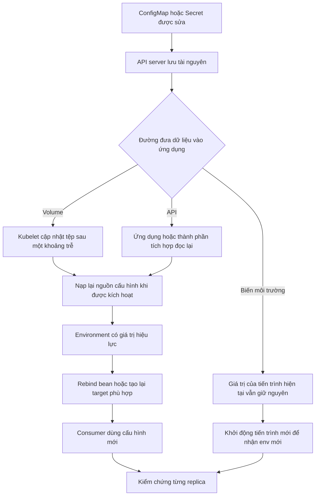

# Phân biệt cập nhật tài nguyên với cập nhật bean đang chạy

## 1. Hai thay đổi có thể diễn ra ở hai thời điểm khác nhau

Bạn sửa một ConfigMap từ thông điệp “alpha” sang “beta”, lệnh apply thành công, nhưng ứng dụng vẫn trả về “alpha”. Điều này chưa đủ để kết luận Kubernetes hoặc Spring bị lỗi: thao tác vừa làm mới xác nhận tài nguyên đã được cập nhật. Ứng dụng có thể chưa nhận dữ liệu mới, chưa nạp lại nguồn cấu hình, hoặc vẫn sử dụng một đối tượng đã chụp giá trị lúc khởi động.

Trong module **SPRING_CLOUD_KUBERNETES**, bài thuộc chương **Cập nhật cấu hình** và tập trung vào ranh giới đó. Mục tiêu là xác định được dữ liệu đang ở đâu và thành phần nào phải làm việc tiếp theo, trước khi lựa chọn ConfigMap, Secret, Configuration Watcher hay một lần rollout.

Sau bài học, bạn cần giải thích được ba tình huống:

- API server đã lưu ConfigMap mới nhưng bean vẫn dùng giá trị cũ.
- Environment đã có giá trị mới nhưng client nghiệp vụ vẫn giữ cấu hình trước đó.
- Một Pod đã áp dụng cấu hình mới nhưng những replica khác chưa áp dụng.

Ví dụ thực hành dùng ứng dụng JVM, Java 17, Spring Boot 3.5.x và Spring Cloud 2025.0.x. Đây là bộ phiên bản minh họa, không phải đề nghị luôn dùng phiên bản mới nhất. Release train 2025.0 liên kết Spring Cloud Commons 4.3 và Spring Cloud Kubernetes 3.3; chọn các bản vá tương thích qua BOM của dự án. Xem [Spring Cloud 2025.0 reference](https://docs.spring.io/spring-cloud-release/reference/2025.0/index.html).

Các mã nguồn, manifest và kết quả trong bài là hướng dẫn cùng kỳ vọng thực hành; không phải báo cáo đã build hoặc chạy trên cluster.

## 2. Theo dõi cấu hình qua sáu trạng thái

Thay vì hỏi chung “cấu hình đã đổi chưa?”, hãy gọi tên trạng thái cần kiểm tra:

| Trạng thái | Ví dụ | Bằng chứng phù hợp |
| --- | --- | --- |
| 1. Tài nguyên trong Kubernetes | ConfigMap có message = beta | Đọc đúng namespace, tên và data của tài nguyên |
| 2. Dữ liệu ứng dụng có thể đọc | Tệp mount đã có beta; hoặc API client đã đọc bản mới | Đọc lại đúng tệp hoặc kiểm tra kết quả truy xuất API |
| 3. Giá trị hiệu lực trong Spring Environment | Khóa demo.message tra cứu được beta | Đọc khóa không nhạy cảm qua endpoint chẩn đoán có kiểm soát |
| 4. Đối tượng cấu hình/bean | Bean đã bind beta hoặc target mới được tạo | Đọc getter, phiên bản cấu hình, mã định danh target |
| 5. Consumer thực thi | HTTP client thực sự gửi đến đích mới | Một yêu cầu nghiệp vụ có kiểm soát và telemetry tương ứng |
| 6. Toàn bộ replica hội tụ | Mọi Pod phục vụ đều dùng phiên bản v2 | Đối chiếu kết quả theo từng Pod |



Các mũi tên là những bước cần có cơ chế thực hiện, không phải mọi đường đều được nối sẵn. Ví dụ, ứng dụng tự đọc tệp ở mỗi request có thể dùng nội dung mới mà không đi qua Environment. Ngược lại, đọc Environment mỗi request cũng không giúp gì nếu PropertySource vẫn giữ dữ liệu cũ.

Một lần ghi tài nguyên không tạo ra giao dịch xuyên suốt API server, hệ thống tệp, ApplicationContext và các replica. Vì vậy, bằng chứng ở trạng thái trước không thay thế bằng chứng ở trạng thái sau.

## 3. Đường cung cấp cấu hình quyết định điều gì có thể tự đổi

### 3.1. ConfigMap qua env, volume và API

| Cách sử dụng | Sau khi sửa ConfigMap | Việc vẫn cần giải quyết |
| --- | --- | --- |
| env hoặc envFrom | Biến môi trường của container đang chạy giữ giá trị đã nhận lúc khởi động | Tạo tiến trình/container mới theo quy trình triển khai |
| Volume mount cả thư mục | Nội dung được project xuống volume sau một khoảng trễ | Ứng dụng phải đọc lại và áp dụng dữ liệu |
| Volume mount qua subPath | Không nhận cập nhật ConfigMap tự động vào mount đó | Đổi cách mount hoặc triển khai lại |
| Đọc bằng Kubernetes API | Phụ thuộc lần đọc tiếp theo, cache hoặc cơ chế watch của client | Nạp vào Spring và cập nhật consumer nếu cần |
| Chỉ khai báo tên tài nguyên trong manifest/tài liệu | Không tạo ra đường đọc trong ứng dụng | Cấu hình đúng cơ chế tiêu thụ trước |

Kubernetes mô tả volume thông thường được cập nhật theo cơ chế eventual consistency, còn env và subPath có các giới hạn nêu trên. Không chọn một thời gian chờ cố định rồi coi đó là bảo đảm cho mọi cluster. Xem [ConfigMaps: cập nhật volume và biến môi trường](https://kubernetes.io/docs/concepts/configuration/configmap/#mounted-configmaps-are-updated-automatically).

Ví dụ ứng dụng đọc file một lần trong constructor: dù file trên đĩa đã thay đổi, trường Java đã được gán vẫn giữ giá trị ban đầu. Muốn nó đổi, phải thiết kế việc đọc lại hoặc thay đối tượng sử dụng trường đó.

### 3.2. Secret có thêm bài toán vòng đời credential

Secret mount thông thường cũng được cập nhật theo cơ chế eventual consistency; Secret mount bằng subPath không nhận cập nhật tự động. Xem [Secrets: sử dụng dưới dạng file](https://kubernetes.io/docs/concepts/configuration/secret/#using-secrets-as-files-from-a-pod).

Nhưng “tệp token mới đã có” khác với “client đã xác thực bằng token mới”. Client có thể đã tạo authorization header, TLS context hoặc connection pool từ credential cũ. Quy trình rotation cần xác định cách tạo client mới, xử lý kết nối đang dùng và thời điểm vô hiệu credential trước đó.

Bài thực hành chỉ dùng ConfigMap với dữ liệu không nhạy cảm. Không áp dụng cách trả nội dung file ở endpoint minh họa cho Secret.

### 3.3. Thứ tự ưu tiên có thể che thay đổi

Spring lấy giá trị hiệu lực từ nhiều PropertySource. Với Config Data thông thường, biến môi trường và tham số dòng lệnh có thể ghi đè giá trị trong file. Xem [Spring Boot: thứ tự nguồn cấu hình](https://docs.spring.io/spring-boot/3.5/reference/features/external-config.html#features.external-config).

Ví dụ file đã có demo.message = beta nhưng tiến trình được khởi động với tham số --demo.message=forced. Nạp lại file không làm khóa hiệu lực tự chuyển sang beta. Khi chẩn đoán cần biết cả **giá trị** lẫn **nguồn đang thắng**, không chỉ nhìn manifest đã sửa.

## 4. Bean đang chạy có vòng đời riêng

### 4.1. Nạp lại nguồn, rebind và tạo lại bean là ba thao tác

- **Nạp lại nguồn cấu hình:** đọc dữ liệu mới và cập nhật các PropertySource liên quan.
- **Rebind:** bind dữ liệu hiệu lực vào đối tượng cấu hình được cơ chế tương ứng quản lý.
- **Tạo lại target/bean:** chạy lại cách khởi tạo đối tượng để các tham số constructor hoặc thiết lập client được áp dụng lại.

Trong Spring Cloud Context, ContextRefresher cập nhật Environment, phát EnvironmentChangeEvent rồi làm mới refresh scope. Đây là chuỗi thao tác cụ thể trong ứng dụng, không phải tác dụng trực tiếp của lệnh sửa ConfigMap. Xem [ContextRefresher 4.3.3](https://github.com/spring-cloud/spring-cloud-commons/blob/v4.3.3/spring-cloud-context/src/main/java/org/springframework/cloud/context/refresh/ContextRefresher.java).

| Cách bean sử dụng cấu hình | Khi nguồn đã được nạp lại |
| --- | --- |
| Đọc Environment lúc cần | Có thể đọc giá trị hiệu lực mới; không tự phát hiện file thay đổi |
| Singleton nhận chuỗi qua @Value lúc tạo | Chuỗi đã chụp thường vẫn giữ nguyên nếu bean không được tạo lại |
| JavaBean mutable có @ConfigurationProperties | Có thể được rebind khi Spring Cloud Context xử lý sự kiện phù hợp |
| Bean có @RefreshScope | Target cũ bị vô hiệu; lần gọi qua proxy tiếp theo có thể tạo target mới |
| Client giữ một bản sao của timeout/token | Phải kiểm tra đường cập nhật chính client, dù bean properties đã đổi |

ConfigurationPropertiesRebinder lắng nghe EnvironmentChangeEvent và thực hiện rebind cho các bean được theo dõi. Việc thêm @ConfigurationProperties chỉ mô tả binding, không đăng ký một bộ theo dõi ConfigMap. Xem [ConfigurationPropertiesRebinder 4.3.3](https://github.com/spring-cloud/spring-cloud-commons/blob/v4.3.3/spring-cloud-context/src/main/java/org/springframework/cloud/context/properties/ConfigurationPropertiesRebinder.java).

### 4.2. Giữ proxy khác với giữ một bản sao của giá trị

Với @RefreshScope, consumer thường giữ proxy ổn định; target phía sau có thể được tạo lại. Nếu consumer gọi proxy mỗi khi xử lý, nó có cơ hội dùng target mới. Nếu consumer chép kết quả vào một trường riêng rồi chỉ dùng trường đó, bản sao không tự đổi.

RefreshScope vô hiệu các target trong scope và áp dụng lại quá trình khởi tạo ở lần truy cập tiếp theo. Không dùng identity của proxy để chứng minh target đã đổi; có thể ghi một UUID trong constructor của target để quan sát. Xem [RefreshScope 4.3.3](https://github.com/spring-cloud/spring-cloud-commons/blob/v4.3.3/spring-cloud-context/src/main/java/org/springframework/cloud/context/scope/refresh/RefreshScope.java).

### 4.3. Các giới hạn cần xác định trước

Spring Cloud Commons 4.3 ghi rõ Java record gắn @ConfigurationProperties không được refresh; HikariDataSource mặc định thuộc nhóm không refresh được; context refresh cũng không được hỗ trợ cho Spring AOT/native image. Không suy từ một JavaBean đơn giản rằng mọi bean hạ tầng đều thay đổi an toàn. Xem [Spring Cloud Context 4.3: Environment Changes và Refresh Scope](https://docs.spring.io/spring-cloud-commons/reference/4.3/spring-cloud-commons/application-context-services.html#refresh-scope).

Bài dưới đây dùng JavaBean mutable cho binding và một bean thông điệp đơn giản cho refresh scope. Nó không hứa hẹn cập nhật nóng mọi datasource, HTTP client hay tài nguyên có kết nối.

## 5. Thực hành: cùng một ConfigMap, nhiều trạng thái trong cùng Pod

### 5.1. Chuẩn bị ứng dụng tối thiểu

Tạo dự án Spring Boot 3.5.x, Java 17, dùng Spring Cloud BOM 2025.0.x tương thích. Thêm các dependency sau vào phần dependencies của POM; không tự gán phiên bản riêng cho từng Spring Cloud artifact:

```xml
<dependency>
    <groupId>org.springframework.boot</groupId>
    <artifactId>spring-boot-starter-web</artifactId>
</dependency>
<dependency>
    <groupId>org.springframework.boot</groupId>
    <artifactId>spring-boot-starter-actuator</artifactId>
</dependency>
<dependency>
    <groupId>org.springframework.boot</groupId>
    <artifactId>spring-boot-starter-validation</artifactId>
</dependency>
<dependency>
    <groupId>org.springframework.cloud</groupId>
    <artifactId>spring-cloud-starter</artifactId>
</dependency>
```

Thí nghiệm dùng kubelet để mount file, Spring Boot để nạp file và Spring Cloud Context để refresh thủ công. Vì ứng dụng không đọc Kubernetes API, bước này không cần starter DiscoveryClient, LoadBalancer hoặc Kubernetes Config. Điều đó giúp kiểm tra riêng từng ranh giới.

Đặt application.yml trong tài nguyên của ứng dụng:

```yaml
spring:
  application:
    name: runtime-demo

management:
  endpoints:
    web:
      exposure:
        include: health,info,refresh
  endpoint:
    health:
      probes:
        enabled: true
```

Đường dẫn file import sẽ được truyền bằng biến môi trường trong Deployment. Không đặt demo.message hoặc demo.config-version vào JAR để tránh fallback che lỗi của bài thực hành.

### 5.2. Bean cấu hình mutable

Tệp DemoProperties.java:

```java
package example.runtime;

import jakarta.validation.constraints.NotBlank;
import org.springframework.boot.context.properties.ConfigurationProperties;
import org.springframework.validation.annotation.Validated;

@Validated
@ConfigurationProperties(prefix = "demo")
public class DemoProperties {
    @NotBlank
    private String message;

    @NotBlank
    private String configVersion;

    public String getMessage() {
        return message;
    }

    public void setMessage(String message) {
        this.message = message;
    }

    public String getConfigVersion() {
        return configVersion;
    }

    public void setConfigVersion(String configVersion) {
        this.configVersion = configVersion;
    }
}
```

Đây là hai trường độc lập để quan sát binding. Chúng chưa tạo thành một snapshot bất biến có bảo đảm nguyên tử cho luồng nghiệp vụ đồng thời.

### 5.3. Hai bean cùng nhận cấu hình nhưng khác vòng đời

Tệp DemoApplication.java:

```java
package example.runtime;

import java.util.Map;
import java.util.UUID;

import org.springframework.beans.factory.annotation.Value;
import org.springframework.boot.SpringApplication;
import org.springframework.boot.autoconfigure.SpringBootApplication;
import org.springframework.boot.context.properties.EnableConfigurationProperties;
import org.springframework.cloud.context.config.annotation.RefreshScope;
import org.springframework.context.annotation.Bean;

@SpringBootApplication
@EnableConfigurationProperties(DemoProperties.class)
public class DemoApplication {
    public static void main(String[] args) {
        SpringApplication.run(DemoApplication.class, args);
    }

    @Bean
    public SnapshotMessage snapshotMessage(
            @Value("${demo.message}") String message) {
        return new SnapshotMessage(message, UUID.randomUUID().toString());
    }

    @Bean
    @RefreshScope
    public RefreshableMessage refreshableMessage(
            @Value("${demo.message}") String message,
            @Value("${demo.config-version}") String configVersion) {
        return new RefreshableMessage(message, configVersion);
    }

    public record SnapshotMessage(String message, String instanceId) {
    }

    public static class RefreshableMessage {
        private final String message;
        private final String configVersion;
        private final String instanceId = UUID.randomUUID().toString();

        public RefreshableMessage(String message, String configVersion) {
            this.message = message;
            this.configVersion = configVersion;
        }

        public Map<String, String> view() {
            return Map.of(
                "message", message,
                "configVersion", configVersion,
                "instanceId", instanceId
            );
        }
    }
}
```

SnapshotMessage là DTO nhận giá trị một lần, không phải record gắn @ConfigurationProperties. RefreshableMessage là lớp có thể được proxy, và annotation được đặt trực tiếp trên phương thức tạo bean cần refresh.

### 5.4. Endpoint đối chiếu dữ liệu

Tệp StateController.java:

```java
package example.runtime;

import java.io.IOException;
import java.lang.management.ManagementFactory;
import java.nio.file.Files;
import java.nio.file.Path;
import java.util.LinkedHashMap;
import java.util.Map;

import example.runtime.DemoApplication.RefreshableMessage;
import example.runtime.DemoApplication.SnapshotMessage;

import org.springframework.core.env.Environment;
import org.springframework.web.bind.annotation.GetMapping;
import org.springframework.web.bind.annotation.RestController;

@RestController
public class StateController {
    private final Environment environment;
    private final DemoProperties properties;
    private final SnapshotMessage snapshot;
    private final RefreshableMessage refreshable;

    public StateController(
            Environment environment,
            DemoProperties properties,
            SnapshotMessage snapshot,
            RefreshableMessage refreshable) {
        this.environment = environment;
        this.properties = properties;
        this.snapshot = snapshot;
        this.refreshable = refreshable;
    }

    @GetMapping("/demo/state")
    public Map<String, Object> state() throws IOException {
        Map<String, Object> result = new LinkedHashMap<>();
        result.put("pod", System.getenv("POD_NAME"));
        result.put("podUid", System.getenv("POD_UID"));
        result.put("processStartedAt",
            ManagementFactory.getRuntimeMXBean().getStartTime());
        result.put("envMessage", System.getenv("ENV_MESSAGE"));
        result.put("fileContents",
            Files.readString(Path.of("/etc/demo-config/application.properties")));
        result.put("environmentMessage",
            environment.getRequiredProperty("demo.message"));
        result.put("bound", Map.of(
            "message", properties.getMessage(),
            "configVersion", properties.getConfigVersion()
        ));
        result.put("snapshot", snapshot);
        result.put("refreshable", refreshable.view());
        return result;
    }
}
```

Mỗi request mở và đọc lại đường dẫn file, rồi hỏi các đối tượng khác nhau. Endpoint chỉ phục vụ đối chiếu dữ liệu không nhạy cảm trong lab; các trường không được chụp trong cùng một giao dịch nếu refresh diễn ra đồng thời.

Spring Cloud có ConfigDataContextRefresher để xử lý lại Config Data khi refresh, thay vì biến mọi thao tác đọc Environment thành thao tác đọc file. Xem [ConfigDataContextRefresher 4.3.3](https://github.com/spring-cloud/spring-cloud-commons/blob/v4.3.3/spring-cloud-context/src/main/java/org/springframework/cloud/context/refresh/ConfigDataContextRefresher.java).

### 5.5. Deployment nhận cùng tài nguyên qua hai đường

Build ứng dụng thành image có cổng HTTP 8080 và đưa image lên registry cluster truy cập được. Thay YOUR_REGISTRY/runtime-demo:lab1 bằng image thực tế trước khi dùng manifest.

Lưu manifest thực hành dưới tên runtime-demo.yaml:

```yaml
apiVersion: v1
kind: Namespace
metadata:
  name: config-update-lab
---
apiVersion: v1
kind: ConfigMap
metadata:
  name: runtime-demo
  namespace: config-update-lab
data:
  env-message: alpha
  application.properties: |
    demo.message=alpha
    demo.config-version=v1
---
apiVersion: v1
kind: ServiceAccount
metadata:
  name: runtime-demo
  namespace: config-update-lab
automountServiceAccountToken: false
---
apiVersion: apps/v1
kind: Deployment
metadata:
  name: runtime-demo
  namespace: config-update-lab
spec:
  replicas: 2
  selector:
    matchLabels:
      app: runtime-demo
  template:
    metadata:
      labels:
        app: runtime-demo
    spec:
      serviceAccountName: runtime-demo
      containers:
        - name: app
          image: YOUR_REGISTRY/runtime-demo:lab1
          ports:
            - name: http
              containerPort: 8080
          env:
            - name: SPRING_CONFIG_IMPORT
              value: "file:/etc/demo-config/application.properties"
            - name: ENV_MESSAGE
              valueFrom:
                configMapKeyRef:
                  name: runtime-demo
                  key: env-message
            - name: POD_NAME
              valueFrom:
                fieldRef:
                  fieldPath: metadata.name
            - name: POD_UID
              valueFrom:
                fieldRef:
                  fieldPath: metadata.uid
          volumeMounts:
            - name: configuration
              mountPath: /etc/demo-config
              readOnly: true
          startupProbe:
            httpGet:
              path: /actuator/health/liveness
              port: http
            periodSeconds: 5
            failureThreshold: 30
          readinessProbe:
            httpGet:
              path: /actuator/health/readiness
              port: http
            periodSeconds: 5
          livenessProbe:
            httpGet:
              path: /actuator/health/liveness
              port: http
            periodSeconds: 10
      volumes:
        - name: configuration
          configMap:
            name: runtime-demo
---
apiVersion: v1
kind: Service
metadata:
  name: runtime-demo
  namespace: config-update-lab
spec:
  selector:
    app: runtime-demo
  ports:
    - name: http
      port: 8080
      targetPort: http
```

ENV_MESSAGE cố ý không ánh xạ vào demo.message, để biến môi trường chỉ làm mẫu đối chứng mà không ghi đè khóa đang kiểm tra. Volume mount cả thư mục và không dùng subPath.

Import file không có tiền tố optional để trường hợp thiếu file không âm thầm bị bỏ qua. Xem [Spring Boot: importing additional data và optional locations](https://docs.spring.io/spring-boot/3.5/reference/features/external-config.html#features.external-config.files.importing).

Không triển khai Configuration Watcher trong baseline. Nhờ đó, việc file tự đổi chưa bị trộn với việc có một thành phần tự gọi refresh. Lab dùng namespace riêng và truy cập thao tác quản trị qua port-forward. Khi áp dụng vào hệ thống thật, endpoint refresh cần cơ chế xác thực và giới hạn truy cập phù hợp.

## 6. Quan sát trước và sau cập nhật

### 6.1. Ghi baseline của một Pod cụ thể

Áp dụng manifest bằng tài khoản thực hành đã có quyền triển khai vào cluster:

```powershell
kubectl apply -f ./runtime-demo.yaml
kubectl -n config-update-lab rollout status deployment/runtime-demo --timeout=120s
kubectl -n config-update-lab get pods -l app=runtime-demo -o wide
```

Chọn một tên Pod từ kết quả. Trong một cửa sổ PowerShell riêng, chạy port-forward và giữ cửa sổ đó hoạt động:

```powershell
$podName = 'THAY-BANG-TEN-POD-THUC'
kubectl -n config-update-lab port-forward pod/$podName 18080:8080
```

Trong cửa sổ khác, lấy trạng thái:

```powershell
$baseline = Invoke-RestMethod -Uri 'http://localhost:18080/demo/state'
$baseline | ConvertTo-Json -Depth 6
kubectl -n config-update-lab get configmap runtime-demo -o yaml
```

Kỳ vọng ban đầu là mọi nơi đều có alpha, còn configVersion là v1. Lưu podUid, processStartedAt, snapshot.instanceId và refreshable.instanceId để phân biệt đổi target với đổi tiến trình.

### 6.2. Chỉ cập nhật tài nguyên, chưa gọi refresh

Sửa đúng ConfigMap:

```powershell
kubectl -n config-update-lab edit configmap/runtime-demo
```

Thay phần data, giữ nguyên các phần còn lại của tài nguyên:

```yaml
data:
  env-message: beta
  application.properties: |
    demo.message=beta
    demo.config-version=v2
```

Đọc lại tài nguyên, rồi gọi endpoint nhiều lần để quan sát quá trình truyền xuống volume:

```powershell
kubectl -n config-update-lab get configmap runtime-demo -o yaml
$observed = Invoke-RestMethod -Uri 'http://localhost:18080/demo/state'
$observed | ConvertTo-Json -Depth 6
```

Chỉ chuyển sang bước tiếp khi fileContents của **chính Pod này** đã hiện beta và v2. Nếu chưa thấy, kiểm tra lại Pod, nguồn volume và cách mount; không dùng một lần sleep như bằng chứng file chắc chắn đã đổi.

Khi file đã cập nhật nhưng chưa có refresh, kỳ vọng:

| Quan sát trên Pod được chọn | Kết quả kỳ vọng |
| --- | --- |
| ConfigMap data | beta / v2 |
| fileContents | beta / v2 |
| envMessage | alpha |
| environmentMessage | alpha |
| bound.message, bound.configVersion | alpha / v1 |
| snapshot.message | alpha |
| refreshable.message | alpha |
| podUid, processStartedAt | Giữ nguyên |

Đây là bằng chứng trực tiếp cho việc **cập nhật tài nguyên và tệp chưa đồng nghĩa cập nhật bean**. Nếu bảng không đúng, trước hết tìm các yếu tố ngoài baseline như watcher đang chạy, nguồn override hoặc thay đổi tiến trình.

Sửa data của ConfigMap không thay đổi Pod template của Deployment. Kubernetes chỉ kích hoạt rollout của Deployment khi Pod template thay đổi. Xem [Deployments: Updating a Deployment](https://kubernetes.io/docs/concepts/workloads/controllers/deployment/#updating-a-deployment).

### 6.3. Gọi refresh trên đúng một instance

Sau khi đã xác nhận file mới, gọi:

```powershell
Invoke-RestMethod -Method Post -Uri 'http://localhost:18080/actuator/refresh' -ContentType 'application/json' -Body '{}'
$afterRefresh = Invoke-RestMethod -Uri 'http://localhost:18080/demo/state'
$afterRefresh | ConvertTo-Json -Depth 6
```

Với dữ liệu hợp lệ và bộ dependency đã nêu, kỳ vọng:

| Quan sát | Sau refresh và request kiểm chứng |
| --- | --- |
| environmentMessage | beta |
| bound.message, bound.configVersion | beta / v2 |
| snapshot.message | Vẫn alpha |
| snapshot.instanceId | Giữ nguyên |
| refreshable.message, refreshable.configVersion | beta / v2 |
| refreshable.instanceId | Khác baseline |
| envMessage | Vẫn alpha |
| podUid, processStartedAt | Giữ nguyên |

Endpoint demo gọi phương thức view() qua proxy, nên đây cũng là lần truy cập giúp quan sát target sau refresh. Không chỉ nhìn danh sách khóa trả về từ actuator rồi kết luận mọi consumer đã cập nhật.

Việc snapshot vẫn giữ alpha là kết quả được thiết kế: bean đó là singleton nhận chuỗi tại lúc tạo, không được đặt trong refresh scope. Refresh cũng không viết lại biến môi trường của JVM hiện tại.

### 6.4. Kiểm tra replica còn lại

Mở port-forward đến Pod thứ hai bằng cổng local khác, chẳng hạn 18081, rồi gọi /demo/state trên cổng đó. Đọc trường pod để chắc chắn đang quan sát instance khác.

Nếu không có thành phần tự refresh và Pod thứ hai chưa bị khởi động lại, file của nó có thể đã là beta nhưng Environment và bean vẫn là alpha. Lệnh POST gửi qua port-forward đầu tiên chỉ tác động lên instance đầu tiên.

Khi khảo sát sự hội tụ, gọi qua Service hoặc LoadBalancer mà không ghi lại instance có thể làm bạn thấy alpha và beta xen kẽ nhưng không biết replica nào chưa cập nhật.

### 6.5. Đối chiếu với rollout

Để tạo các tiến trình mới và nạp lại cấu hình lúc khởi động:

```powershell
kubectl -n config-update-lab rollout restart deployment/runtime-demo
kubectl -n config-update-lab rollout status deployment/runtime-demo --timeout=120s
kubectl -n config-update-lab get pods -l app=runtime-demo -o wide
```

Port-forward cũ có thể kết thúc khi Pod cũ bị thay thế. Chọn các Pod mới, tạo lại port-forward và kiểm tra từng Pod.

Với ConfigMap hiện tại, kỳ vọng envMessage, snapshot và các bean đều dùng beta; configVersion là v2. Pod UID và thời điểm tiến trình bắt đầu cũng thay đổi. Đây là quy trình nạp cấu hình ở startup của tiến trình mới, khác với refresh bean trong tiến trình đang chạy.

## 7. Đặt Spring Cloud Kubernetes vào đúng vị trí

### 7.1. Đọc qua API là một phương án khác với mount file

Nếu chọn đọc ConfigMap bằng Spring Cloud Kubernetes 3.3, thêm starter Config tương ứng với một họ Kubernetes client, ví dụ spring-cloud-starter-kubernetes-fabric8-config. Cấu hình Config Data import dùng kubernetes:, với tên và namespace của nguồn cần đọc.

Đây là **biến thể triển khai khác**: thay cách import file trong baseline và thiết lập ServiceAccount/RBAC cho API client. Không chép thêm các cấu hình này rồi vẫn coi thí nghiệm ban đầu chỉ có một nguồn. Spring Cloud Kubernetes cũng yêu cầu chọn một trong hai đường Config Data hoặc bootstrap, không trộn cả hai. Xem [Kubernetes PropertySource implementations 3.3](https://docs.spring.io/spring-cloud-kubernetes/reference/3.3/property-source-config.html).

API import giải quyết đường **đọc cấu hình**. Nó chưa chứng minh ứng dụng đang theo dõi thay đổi, refresh đúng bean hoặc áp dụng giá trị vào client nghiệp vụ. Hãy kiểm chứng lại các trạng thái trong mục 2 khi thay cách cung cấp dữ liệu.

### 7.2. Configuration Watcher là thành phần kích hoạt cập nhật

Configuration Watcher 3.3 là controller riêng. Nó chọn nguồn theo label spring.cloud.kubernetes.config hoặc spring.cloud.kubernetes.secret có giá trị "true". Với HTTP, watcher dùng DiscoveryClient tìm các instance và POST tới actuator refresh; cũng có phương án Spring Cloud Bus. Nguồn mount cần tính đến độ trễ cập nhật tệp qua refresh delay. Xem [Configuration Watcher 3.3](https://docs.spring.io/spring-cloud-kubernetes/reference/3.3/spring-cloud-kubernetes-configuration-watcher.html).

Từ chuỗi trạng thái trong bài có thể suy ra: một sự kiện đến sớm hơn tệp mới có thể khiến lần refresh vẫn đọc dữ liệu cũ. Vì thế phải kiểm chứng phiên bản được áp dụng, thay vì chỉ ghi nhận watcher đã gửi sự kiện. Một giá trị delay cố định là tham số vận hành cần đo, không tạo giao dịch chung giữa kubelet và Spring.

DiscoveryClient trong watcher phục vụ việc tìm instance nhận thông báo. Spring Cloud LoadBalancer phục vụ phân phối lời gọi tới instance; việc thêm nó không biến ConfigMap thành nguồn cấu hình được theo dõi và áp dụng tự động.

### 7.3. Không nhầm với PropertySource Reload cũ

Các ví dụ dùng spring.cloud.kubernetes.reload.enabled và các strategy refresh, restart_context, shutdown thuộc cơ chế PropertySource Reload cũ đã deprecated từ release 2020.0. Đó không phải công tắc chung bắt buộc cho Configuration Watcher. Xem [PropertySource Reload 3.3](https://docs.spring.io/spring-cloud-kubernetes/reference/3.3/property-source-config/propertysource-reload.html).

Khi đọc tài liệu, cần nhận diện đúng thành phần đang chạy: listener trong ứng dụng, controller watcher riêng, Spring Cloud Bus hay bộ điều phối rollout. Trùng từ “refresh” không có nghĩa cùng đường phát hiện và phân phối thay đổi.

### 7.4. Phân quyền theo thành phần thực sự đọc API

| Thành phần | Câu hỏi phân quyền cần trả lời |
| --- | --- |
| Ứng dụng chỉ nhận file/env trong baseline | Có thực sự cần token truy cập API trong container không? |
| Ứng dụng đọc ConfigMap qua Kubernetes API | ServiceAccount nào đọc, trong namespace nào, cần get hay cả list/watch? |
| Watcher quan sát cấu hình và tìm instance | Có quyền cho nguồn được theo dõi và các tài nguyên discovery mà client sử dụng không? |
| Thành phần theo dõi Secret | Có lý do nghiệp vụ để đọc Secret và phạm vi được giới hạn chưa? |
| Người/pipeline chạy rollout | Có quyền thao tác Deployment phù hợp với nhiệm vụ không? |

RBAC phân biệt resource, verb và phạm vi namespace; có quyền đọc không đồng nghĩa có quyền watch. Trước khi cấp quyền, đối chiếu cách client thực sự truy cập; không lấy một Role rộng của ví dụ để mặc nhiên gán cho mọi ứng dụng. Xem [Kubernetes RBAC](https://kubernetes.io/docs/reference/access-authn-authz/rbac/).

Một lệnh chẩn đoán cho danh tính đọc API, nếu người vận hành có quyền impersonate:

```powershell
kubectl auth can-i get configmaps -n config-update-lab --as=system:serviceaccount:config-update-lab:runtime-demo
kubectl auth can-i watch configmaps -n config-update-lab --as=system:serviceaccount:config-update-lab:runtime-demo
```

Baseline không tạo RoleBinding cho ServiceAccount runtime-demo và không mount token vào ứng dụng. Không cần mở rộng quyền chỉ để file mount được cập nhật.

## 8. Chọn refresh hay triển khai lại theo hợp đồng hành vi

| Nhu cầu | Phương án thường dễ kiểm soát | Điều kiện cần kiểm chứng |
| --- | --- | --- |
| Đổi một thông điệp, ngưỡng hoặc cờ được thiết kế động | Refresh đối tượng phù hợp | Nguồn được nạp lại, kiểu hợp lệ, consumer dùng giá trị mới |
| Đổi client có vòng đời kết nối | Cơ chế thay client được thiết kế riêng hoặc rollout | Đóng/mở tài nguyên, xử lý request đang chạy |
| Đổi env của tiến trình | Tạo tiến trình mới qua quy trình triển khai | Container mới nhận đúng env |
| Đổi cấu hình startup, native image hoặc bean không hỗ trợ refresh | Rollout | Startup validation, readiness và khả năng quay lại phiên bản trước |
| Cần phát hành cấu hình cùng phiên bản ứng dụng | Tài nguyên cấu hình có phiên bản gắn với release | Kiểm soát tham chiếu và kiểm chứng trên từng Pod |

Đây là lựa chọn thiết kế, không phải lời hứa mọi cấu hình trong một hàng đều có thể hot reload. Một thay đổi timeout có vẻ nhỏ vẫn có thể cần tạo client mới nếu thư viện chỉ nhận timeout khi khởi tạo.

Phân biệt các sự kiện vòng đời:

- Refresh scope thay target trong cùng ApplicationContext.
- Restart ApplicationContext tạo lại context trong tiến trình, tùy cơ chế hỗ trợ; không đồng nghĩa tạo Pod mới.
- Restart container tạo tiến trình mới nhưng có thể vẫn trong cùng Pod.
- Rollout Deployment thay các Pod theo Pod template và chiến lược triển khai.

Để quay lại một phát hành, cần quản lý cả ứng dụng lẫn dữ liệu cấu hình. Rollback Deployment chỉ phục hồi Pod template tương ứng, không tự khôi phục nội dung một ConfigMap mutable vẫn giữ cùng tên. Có thể thiết kế tên ConfigMap theo phiên bản và đổi tham chiếu trong Pod template để làm mối quan hệ đó rõ ràng. Xem [Deployments: Rolling Back](https://kubernetes.io/docs/concepts/workloads/controllers/deployment/#rolling-back-a-deployment).

## 9. Giá trị hợp lệ và sức khỏe Pod là các kiểm chứng riêng

### 9.1. Refresh không mặc nhiên cung cấp “giá trị tốt gần nhất”

Trong lab, thử cung cấp message blank sẽ vi phạm @NotBlank. Với cập nhật động, không nên suy ra rằng framework tự phục hồi toàn bộ Environment, mọi bean và mọi client về trạng thái cũ khi một bước thất bại.

Một chính sách ứng dụng có yêu cầu chặt chẽ có thể cần quy trình riêng:

```text
Đọc bộ cấu hình ứng viên
    -> bind vào đối tượng mới
    -> kiểm tra kiểu, ràng buộc và quan hệ
    -> chuẩn bị tài nguyên phụ thuộc
    -> công bố snapshot hợp lệ cho consumer
    -> thu hồi tài nguyên cũ theo vòng đời request
```

Đây là thiết kế đề xuất, không phải mô tả tính nguyên tử có sẵn của actuator refresh. Nếu chưa có quy trình đó, hãy xác định rõ cách báo lỗi, phạm vi tác động và cách phục hồi bằng triển khai lại.

Việc xóa một khóa cũng cần thử riêng với phiên bản framework và kiểu bean đang dùng. Không coi “xóa khỏi ConfigMap rồi refresh” là lệnh chắc chắn trả mọi trường về default. Tài liệu Commons 4.3 lưu ý giới hạn khi loại bỏ giá trị trong quá trình refresh. Xem [Refresh Scope: lưu ý về xóa thuộc tính](https://docs.spring.io/spring-cloud-commons/reference/4.3/spring-cloud-commons/application-context-services.html#refresh-scope).

### 9.2. Không có giao dịch cấu hình chung cho cả cụm

Hai replica có thể áp dụng v2 ở hai thời điểm khác nhau. Ngay trong một tiến trình, đọc hai getter mutable trong lúc cập nhật cũng không tự trở thành một phép đọc snapshot nguyên tử.

Với các thuộc tính liên quan như endpoint và credential, định nghĩa một bộ phiên bản và yêu cầu consumer dùng một bộ nhất quán. Lưu desiredVersion và appliedVersion nếu cần theo dõi hội tụ; không đưa token hoặc mật khẩu vào log để chứng minh rotation.

Một request kiểm chứng nên ghi lại Pod, image/release, appliedVersion và hành vi quan trọng. Nếu chỉ kiểm tra qua đường cân bằng tải, cần có cách truy ra instance phục vụ request đó.

### 9.3. Probe kiểm tra điều kiện do ứng dụng công bố

Readiness quyết định Pod có sẵn sàng nhận traffic hay không; liveness xử lý tình trạng container cần được khởi động lại; startup probe hỗ trợ giai đoạn khởi động. Các probe không tự nạp ConfigMap hoặc rebind bean. Xem [Kubernetes: liveness, readiness và startup probes](https://kubernetes.io/docs/tasks/configure-pod-container/configure-liveness-readiness-startup-probes/).

Nếu yêu cầu nghiệp vụ là “chỉ nhận traffic khi đã áp dụng phiên bản cấu hình được chấp nhận”, ứng dụng cần công bố điều kiện đó qua readiness hoặc cơ chế điều phối phù hợp. Probe mặc định trả UP không chứng minh credential mới hoạt động hoặc toàn bộ replica đã nhận v2.

Không dùng việc cấu hình sai như một lý do mặc định để liveness liên tục giết tiến trình. Quyết định dừng nhận traffic, giữ cấu hình cũ hay triển khai lại phải xuất phát từ hợp đồng vận hành.

## 10. Chẩn đoán theo điểm đứt của chuỗi cập nhật

| Hiện tượng | Điểm cần kiểm tra tiếp |
| --- | --- |
| Apply thành công nhưng ứng dụng trả giá trị cũ | Đúng tài nguyên/namespace chưa; ứng dụng lấy bằng env, file hay API? |
| API server có giá trị mới nhưng file chưa đổi | Tên volume, Pod đang quan sát, subPath, cơ chế truyền và độ trễ |
| File mới nhưng Environment cũ | Đã có bước nạp lại Config Data hay mới chỉ thay file? |
| Environment mới nhưng bean properties cũ | Kiểu binding, cơ chế rebind, sự kiện và lỗi validation |
| Properties mới nhưng client cũ | Client có chụp giá trị khi tạo không; có đi qua proxy hoặc cơ chế thay client không? |
| Refresh trả lỗi | Log của đúng instance, lỗi đọc nguồn/binding/khởi tạo và trạng thái sau lỗi |
| Một replica mới, replica khác cũ | Đường phân phối sự kiện, instance đích, phiên bản đã áp dụng theo Pod |
| Pod Running/Ready nhưng hành vi sai | Điều kiện probe có bao gồm yêu cầu nghiệp vụ đang cần chứng minh không? |

Trong bài thực hành, bằng chứng quan trọng nhất là cặp quan sát **file đã là beta nhưng bean vẫn là alpha**, rồi **Environment và refreshable target đổi sang beta trong khi singleton snapshot vẫn alpha**. Đối chiếu tiếp với rollout để thấy một tiến trình mới nhận lại cả env lẫn cấu hình startup.

Khi thiết kế cho hệ thống thật, ghi rõ ai phát hiện thay đổi, ai đọc lại nguồn, đối tượng nào được cập nhật, khi nào consumer áp dụng và làm sao biết mọi replica đã hội tụ. Chỉ thêm tính năng Spring Cloud Kubernetes khi nó đảm nhiệm một bước cụ thể trong chuỗi đó.

