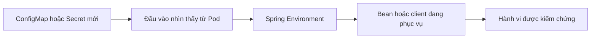

# Các cách áp dụng thay đổi: refresh, khởi động lại và triển khai lại

## Mục tiêu và bối cảnh

Trong chương **Cập nhật cấu hình** của module **SPRING_CLOUD_KUBERNETES**, một thay đổi chỉ hoàn tất khi thành phần đang xử lý yêu cầu đã sử dụng đúng giá trị mới. Việc sửa ConfigMap hoặc Secret là bước đưa dữ liệu vào hệ thống, chưa quyết định cách Spring và những client bên trong ứng dụng áp dụng dữ liệu đó.

Bài học giúp bạn:

- Phân biệt refresh bean, khởi động lại Spring context, khởi động lại tiến trình và triển khai Pod mới.
- Chọn cách áp dụng theo nguồn cấu hình, khả năng thay đổi của thành phần và yêu cầu phục hồi.
- Dùng một ví dụ thực hành để kiểm tra giá trị thực sự có hiệu lực trên từng Pod.
- Thiết kế rolling deployment, theo dõi sức khỏe và quay lui khi cập nhật thất bại.
- Xác định lúc cần Configuration Watcher và lúc chỉ cần cơ chế sẵn có của Kubernetes.

Spring Cloud Kubernetes có thể cung cấp ConfigMap/Secret PropertySource, DiscoveryClient và Configuration Watcher. Spring Cloud LoadBalancer giúp chọn instance đích khi gọi dịch vụ. Những tính năng này giải quyết các phần khác nhau của hệ thống; không tính năng nào tự bảo đảm mọi đối tượng trong bộ nhớ đổi cấu hình an toàn.

## 1. Bốn trạng thái của một thay đổi cấu hình

Giả sử `catalog-service` có ba Pod và một cấu hình giới hạn số sản phẩm nổi bật. Nhóm sửa giới hạn từ `12` thành `20`. Cần quan sát ít nhất bốn trạng thái:

1. **Nguồn đã đổi:** Kubernetes API đã nhận ConfigMap mới.
2. **Đầu vào của Pod đã đổi:** tệp mount đã cập nhật, hoặc client đã đọc lại nguồn. Với biến môi trường, có thể phải tạo tiến trình/Pod mới.
3. **Đối tượng dùng cấu hình đã đổi:** bean, connection pool hoặc HTTP client đã nhận và áp dụng giá trị.
4. **Hành vi đã đổi:** yêu cầu thực tế được xử lý theo phiên bản mong muốn trên tất cả instance thuộc phạm vi triển khai.



Ví dụ, tệp trong Pod A đã chứa giới hạn `20` nhưng bean vẫn giữ `12`; Pod B chưa nhận tệp mới; Pod C vừa được tạo nên đã dùng `20`. Cả ba Pod đều có thể đang `Running`. Trạng thái của API và trạng thái chạy của container chưa đủ để kết luận thay đổi đã có hiệu lực.

Nên thêm một mã phiên bản không mật, chẳng hạn `display-v2`, vào cùng nhóm cấu hình. Khi quan sát, phải phân biệt **phiên bản đọc từ nguồn** với **phiên bản được đối tượng đang phục vụ sử dụng**. Đọc trực tiếp `Environment` chỉ chứng minh lớp cấu hình, chưa chứng minh client khởi tạo trước đó đã đổi.

## 2. Làm rõ refresh, khởi động lại và triển khai lại

| Cách áp dụng | Phần được thay đổi hoặc tạo lại | Pod/JVM có nhất thiết đổi không? | Khi thường phù hợp |
| --- | --- | --- | --- |
| Refresh | Nạp lại nguồn được hỗ trợ; rebind hoặc tạo lại những bean đủ điều kiện | Không | Tham số có thể đổi lúc chạy và đã có thiết kế áp dụng rõ ràng |
| Khởi động lại Spring `ApplicationContext` | Đóng và tạo lại context cùng các bean thuộc vòng đời đó | Không nhất thiết đổi JVM hay Pod | Trường hợp đặc thù đã kiểm soát toàn bộ vòng đời ứng dụng |
| Khởi động lại tiến trình/container | Java khởi động lại, nạp lại cấu hình khởi động | JVM đổi; Pod có thể giữ nguyên | Cấu hình chỉ được dùng khi khởi tạo, nhưng phải xét cách đầu vào được cấp |
| Rolling restart của Deployment | Tạo các Pod thay thế theo chiến lược Deployment | Pod và JVM mới | Cần đọc lại cấu hình với cùng phiên bản ứng dụng |
| Triển khai lại với Pod template mới | Phát hành image, tham chiếu cấu hình hoặc thông số Pod mới | Pod và JVM mới | Cần bản phát hành có thể đối chiếu và quay lui |

Trong vận hành Kubernetes, một rolling restart cũng được thực hiện qua rollout. Sự khác nhau hữu ích là **ý định phát hành**: chạy lại cùng phiên bản ứng dụng để nhận cấu hình, hay phát hành một tập đầu vào mới gồm image, cấu hình và Pod specification.

Không được hiểu `kubectl apply` là “khởi động lại”. Nếu khai báo không đổi Pod template, Deployment không tạo một đợt thay thế Pod chỉ vì bạn chạy lại lệnh. Đặc biệt, sửa nội dung ConfigMap có cùng tên không tự đổi `.spec.template` của Deployment. Cơ chế kích hoạt rollout được mô tả tại [Kubernetes Deployments](https://kubernetes.io/docs/concepts/workloads/controllers/deployment/).

### Các tên chiến lược trong tài liệu cũ

Một số dự án dùng cơ chế PropertySource Reload trong tiến trình và các tên `refresh`, `restart_context`, `shutdown`. Đây là tên của chiến lược trong cơ chế đó, không phải ba lệnh tương đương của Kubernetes. `restart_context` không đồng nghĩa với tạo Pod mới; `shutdown` còn phụ thuộc tiến trình thực sự kết thúc và cách nền tảng khôi phục nó.

Tài liệu Spring Cloud Kubernetes đánh dấu PropertySource Reload cũ là deprecated và giới thiệu Configuration Watcher làm hướng thay thế. Khi bảo trì dự án cũ, phải đọc theo đúng phiên bản đang dùng; không sao chép `spring.cloud.kubernetes.reload.enabled=true` như cấu hình mặc định cho mọi dự án mới. Xem [PropertySource Reload](https://docs.spring.io/spring-cloud-kubernetes/reference/property-source-config/propertysource-reload.html).

## 3. Chọn cơ chế theo đường cấp dữ liệu

| Cách ứng dụng nhận dữ liệu | Sửa nguồn có làm đầu vào của tiến trình đang chạy đổi ngay không? | Hướng áp dụng |
| --- | --- | --- |
| `env` hoặc `envFrom` từ ConfigMap/Secret | Không làm biến môi trường trong tiến trình đang chạy tự thay đổi | Tạo Pod mới để nhận giá trị mới và kiểm tra lại |
| Tệp qua volume thông thường | Có thể được cập nhật sau độ trễ lan truyền | Chờ đầu vào mới rồi refresh nếu ứng dụng hỗ trợ, hoặc thay Pod |
| Tệp mount bằng `subPath` | Không nhận cập nhật tự động của nguồn mount | Thay Pod hoặc đổi thiết kế mount |
| PropertySource đọc qua Kubernetes API | Phụ thuộc thời điểm client đọc lại và cơ chế phát hiện thay đổi | Bổ sung trigger và cơ chế áp dụng phù hợp |
| Cấu hình đóng gói trong JAR/image | Không đổi ở tiến trình đang chạy khi chỉ sửa bản nguồn ngoài cụm | Xây dựng và triển khai image mới, hoặc thiết kế lại nguồn cấu hình ngoài |
| Tùy chọn JVM và tài nguyên container | Không được thay bằng refresh bean | Phát hành cấu hình tiến trình/Pod phù hợp |

Đối với ConfigMap, cập nhật volume có độ trễ; biến môi trường không tự đổi và `subPath` có ngoại lệ riêng. Xem [Kubernetes ConfigMaps](https://kubernetes.io/docs/concepts/configuration/configmap/). Secret có các lưu ý cấp dữ liệu tương tự; phải kiểm tra theo [Kubernetes Secrets](https://kubernetes.io/docs/concepts/configuration/secret/).

Nếu `SPRING_DATASOURCE_PASSWORD` đang ghi đè một thuộc tính đọc từ tệp, refresh tệp không làm mất lớp ghi đè đó. Vì vậy, trước khi chọn refresh hay restart, cần xác định **nguồn có thẩm quyền của từng khóa** và thứ tự ưu tiên thực tế. Cơ chế đọc cấu hình ngoài của Spring Boot được mô tả trong [Externalized Configuration](https://docs.spring.io/spring-boot/reference/features/external-config.html).

## 4. Refresh phù hợp khi nào?

Refresh phù hợp với một nhóm giá trị có thể chuyển đổi độc lập và có hành vi xác minh được, ví dụ tiêu đề hiển thị hoặc giới hạn kết quả mà ứng dụng đã thiết kế để thay đổi lúc chạy.

Ba điều kiện cần đồng thời tồn tại:

1. Nguồn mới được nạp lại vào môi trường cấu hình bằng cơ chế của ứng dụng.
2. Bean tiêu thụ có khả năng nhận cấu hình mới, chẳng hạn bean trong `@RefreshScope` hoặc nhóm `@ConfigurationProperties` hỗ trợ rebind.
3. Thành phần thực sự phục vụ yêu cầu sử dụng đối tượng mới, không giữ bản sao cũ ở nơi khác.

`@Value` trong một singleton thông thường không tự chạy lại constructor khi bạn sửa ConfigMap. Tương tự, một service sao chép thuộc tính vào `final` field lúc khởi tạo có thể giữ giá trị cũ, dù bean cấu hình đã được rebind.

`@RefreshScope` cung cấp proxy và cho phép tạo lại đối tượng đích khi được sử dụng sau refresh. Vì thế, phản hồi thành công của endpoint refresh có thể đến trước lần tạo lại bean. Việc khởi tạo thất bại có thể chỉ xuất hiện ở lần gọi tiếp theo. Cơ chế và giới hạn được mô tả tại [Spring Cloud Context: Refresh Scope](https://docs.spring.io/spring-cloud-commons/reference/spring-cloud-commons/application-context-services.html#refresh-scope).

### Những điều refresh không tự bảo đảm

- Không tạo một giao dịch nguyên tử trên tất cả bean và tất cả Pod.
- Không tự chuyển đổi trạng thái của request đang chạy, cache nghiệp vụ hoặc tác vụ nền.
- Không làm mọi thư viện tạo lại client từ thuộc tính mới.
- Không biến annotation đặt trên lớp `@Configuration` thành bảo đảm rằng mọi bean bên trong đều được refresh.
- Không cung cấp cơ chế rollback tổng thể khi một phần bean đã đổi và phần khác gặp lỗi.

Đối với nhóm thuộc tính bất biến, constructor binding hoặc record, phải kiểm tra khả năng hỗ trợ của phiên bản và thiết kế cụ thể; không suy diễn rằng annotation `@ConfigurationProperties` luôn có nghĩa là có thể thay đổi lúc chạy. Trong ứng dụng AOT/native, cũng không giả định refresh có cùng khả năng như JVM thông thường.

HikariDataSource là ví dụ cần thận trọng: Spring Cloud liệt kê nó trong nhóm mặc định không refresh. Đổi URL hoặc password trong `Environment` không đủ để bảo đảm pool kết nối đã chuyển. Với trường hợp đó, rolling replacement thường dễ kiểm chứng hơn việc cố refresh một phần của hệ thống.

## 5. Ví dụ refresh một chính sách hiển thị

Ví dụ này chỉ minh họa cấu hình không mật. Không đưa token, password hoặc dữ liệu cá nhân vào endpoint chẩn đoán.

### 5.1. Điều kiện thực hành

- Có namespace lab `training-config` và quyền triển khai ứng dụng trong đó.
- Ứng dụng JVM có Spring Web, Actuator và Spring Cloud Context phù hợp với Spring Boot; một lựa chọn phụ thuộc là `spring-cloud-starter` cùng các starter Spring Boot tương ứng, được quản lý bằng BOM tương thích.
- Có image `catalog-service` chứa các đoạn mã bên dưới; địa chỉ image trong mẫu phải được thay bằng image đã xây dựng.
- Không có Watcher tự động gửi refresh cho nguồn này trong bài thực hành, để quan sát được từng bước.
- Namespace lab không cung cấp đường công khai đến các endpoint quản trị. Nếu ứng dụng có Spring Security, người thực hành dùng cơ chế xác thực đã được cấu hình.

Mẫu đọc tệp bằng Spring Boot Config Data, nên không cần cấp quyền đọc ConfigMap qua Kubernetes API cho chính ứng dụng. Nếu dự án đã có các starter Spring Cloud Kubernetes khác, hãy xác định tính năng đang bật để tránh thêm một nguồn cấu hình không dự kiến.

### 5.2. ConfigMap có phiên bản quan sát được

Nội dung minh họa cho tệp `catalog-config.yaml` của người thực hành:

```yaml
apiVersion: v1
kind: ConfigMap
metadata:
  name: catalog-service
  namespace: training-config
data:
  application.yaml: |
    catalog:
      display:
        version: display-v1
        title: "Sản phẩm nổi bật"
        featured-limit: 12
```

ConfigMap này mutable để thử cập nhật tại chỗ. Không thêm `immutable: true` rồi mong refresh từ việc sửa nội dung của chính đối tượng đó.

Cấu hình khởi động của ứng dụng:

```yaml
spring:
  application:
    name: catalog-service
  config:
    import: "file:/etc/catalog/application.yaml"
  lifecycle:
    timeout-per-shutdown-phase: 20s

server:
  shutdown: graceful

management:
  endpoints:
    web:
      exposure:
        include: health,refresh
  endpoint:
    health:
      probes:
        enabled: true
      show-details: never
```

`refresh` là endpoint do thành phần Spring Cloud cung cấp; chỉ thêm tên vào danh sách exposure không tạo ra endpoint nếu ứng dụng thiếu thành phần tương ứng. Exposure cũng không thay thế xác thực và phân quyền. Hãy kiểm tra cơ chế bảo vệ endpoint theo [Spring Boot Actuator Endpoints](https://docs.spring.io/spring-boot/reference/actuator/endpoints.html).

### 5.3. Bean giữ một bản cấu hình cho mỗi thế hệ

```java
import org.springframework.beans.factory.annotation.Value;
import org.springframework.cloud.context.config.annotation.RefreshScope;
import org.springframework.stereotype.Component;

@Component
@RefreshScope
public class DisplayPolicy {
    private final String version;
    private final String title;
    private final int featuredLimit;

    public DisplayPolicy(
            @Value("${catalog.display.version}") String version,
            @Value("${catalog.display.title}") String title,
            @Value("${catalog.display.featured-limit}") int featuredLimit) {
        if (version.isBlank() || title.isBlank()) {
            throw new IllegalArgumentException("Thiếu thông tin chính sách hiển thị");
        }
        if (featuredLimit < 1 || featuredLimit > 100) {
            throw new IllegalArgumentException("catalog.display.featured-limit phải từ 1 đến 100");
        }
        this.version = version;
        this.title = title;
        this.featuredLimit = featuredLimit;
    }

    public Snapshot snapshot() {
        return new Snapshot(version, title, featuredLimit);
    }

    public record Snapshot(String appliedVersion, String title, int featuredLimit) {
    }
}
```

Lớp và phương thức cần proxy được để không `final`. `Snapshot` là giá trị trả về của ứng dụng, không phải một record `@ConfigurationProperties` được yêu cầu rebind.

Ứng dụng cần lấy snapshot qua bean khi xử lý yêu cầu. Nếu controller lưu `policy.snapshot()` vào field ngay trong constructor rồi chỉ trả field đó, nó sẽ tự giữ bản sao cũ ngoài phạm vi refresh.

Endpoint lab sau quan sát cùng bean chính sách mà phần hiển thị của ứng dụng sử dụng:

```java
import java.lang.management.ManagementFactory;

import org.springframework.beans.factory.annotation.Value;
import org.springframework.web.bind.annotation.GetMapping;
import org.springframework.web.bind.annotation.RestController;

@RestController
public class DisplayPolicyController {
    private final DisplayPolicy policy;
    private final String podName;
    private final long jvmStartedAtMillis;

    public DisplayPolicyController(
            DisplayPolicy policy,
            @Value("${HOSTNAME:local}") String podName) {
        this.policy = policy;
        this.podName = podName;
        this.jvmStartedAtMillis = ManagementFactory.getRuntimeMXBean().getStartTime();
    }

    @GetMapping("/internal/display-policy")
    public AppliedPolicy current() {
        DisplayPolicy.Snapshot snapshot = policy.snapshot();
        return new AppliedPolicy(podName, jvmStartedAtMillis, snapshot);
    }

    public record AppliedPolicy(
            String pod,
            long jvmStartedAtMillis,
            DisplayPolicy.Snapshot policy) {
    }
}
```

Đặt các lớp trong package ứng dụng được Spring quét. Endpoint `internal` là đường quan sát dành cho lab và quản trị đã được kiểm soát; tên đường dẫn tự nó không tạo ra bảo mật. Snapshot giúp một lần phản hồi lấy các trường từ cùng một đối tượng chính sách, nhưng không tạo ra giao dịch chung cho những bean khác hoặc những request khác.

### 5.4. Deployment dùng volume thông thường

Nội dung minh họa cho `catalog-deployment.yaml`:

```yaml
apiVersion: apps/v1
kind: Deployment
metadata:
  name: catalog-service
  namespace: training-config
spec:
  replicas: 3
  selector:
    matchLabels:
      app: catalog-service
  strategy:
    type: RollingUpdate
    rollingUpdate:
      maxUnavailable: 0
      maxSurge: 1
  template:
    metadata:
      labels:
        app: catalog-service
    spec:
      automountServiceAccountToken: false
      terminationGracePeriodSeconds: 60
      containers:
        - name: catalog-service
          image: registry.example.com/training/catalog-service:1.0.0
          ports:
            - name: http
              containerPort: 8080
          volumeMounts:
            - name: application-config
              mountPath: /etc/catalog
              readOnly: true
          startupProbe:
            httpGet:
              path: /actuator/health/liveness
              port: http
            periodSeconds: 5
            failureThreshold: 30
          readinessProbe:
            httpGet:
              path: /actuator/health/readiness
              port: http
            periodSeconds: 5
          livenessProbe:
            httpGet:
              path: /actuator/health/liveness
              port: http
            periodSeconds: 10
      volumes:
        - name: application-config
          configMap:
            name: catalog-service
            items:
              - key: application.yaml
                path: application.yaml
```

Mount cả thư mục giúp tránh ngoại lệ cập nhật của `subPath`. Giá trị timeout ở đây là ví dụ; cần đo thời gian khởi động, dừng và xử lý yêu cầu của ứng dụng thật để lựa chọn. Pod không được cấp token tự động vì mẫu không gọi Kubernetes API từ ứng dụng.

### 5.5. Quan sát trước và sau refresh trên đúng một Pod

Áp dụng các manifest sau khi người thực hành đã chuẩn bị image và namespace:

```powershell
kubectl -n training-config apply -f ./catalog-config.yaml
kubectl -n training-config apply -f ./catalog-deployment.yaml
kubectl -n training-config rollout status deployment/catalog-service
kubectl -n training-config get pods -l app=catalog-service
```

Chọn một Pod cụ thể đang sẵn sàng. Trong cửa sổ terminal thứ nhất, thay giá trị biến sau bằng tên Pod vừa quan sát và giữ port-forward chạy:

```powershell
$selectedPod = 'TEN_POD_DA_CHON'
kubectl -n training-config port-forward pod/$selectedPod 18080:8080
```

Trong cửa sổ PowerShell thứ hai, đặt cùng tên Pod vào biến để dùng cho các bước kiểm tra tiếp theo:

```powershell
$selectedPod = 'TEN_POD_DA_CHON'
Invoke-RestMethod -Method Get -Uri 'http://127.0.0.1:18080/internal/display-policy'
```

Kết quả mong đợi chứa `display-v1`, giới hạn `12`, tên Pod và mốc khởi động JVM. Sau đó sửa nguồn ConfigMap của bài thực hành thành:

```yaml
catalog:
  display:
    version: display-v2
    title: "Gợi ý dành cho bạn"
    featured-limit: 20
```

Đây là nội dung thay thế trong khóa `data.application.yaml`, không phải một manifest Kubernetes độc lập. Áp dụng lại `catalog-config.yaml`, rồi chờ tệp bên trong Pod đã phản ánh phiên bản mới. Nếu image có tiện ích `cat`, có thể xem đúng tệp cấu hình không mật này:

```powershell
kubectl -n training-config apply -f ./catalog-config.yaml
kubectl -n training-config exec $selectedPod -- cat /etc/catalog/application.yaml
```

Không dùng một khoảng ngủ cố định làm bằng chứng tệp đã đổi; kiểm tra dấu hiệu `display-v2`. Nếu image không có `cat`, dùng khả năng chẩn đoán được cho phép trong lab. Không mở rộng thao tác đọc tệp này sang thư mục chứa Secret.

Gọi lại endpoint trước refresh: với bean đã được tạo ở bước đầu, chính sách vẫn là `display-v1`. Tiếp theo, gửi refresh qua cùng port-forward:

```powershell
Invoke-RestMethod -Method Post -Uri 'http://127.0.0.1:18080/actuator/refresh' -ContentType 'application/json' -Body '{}'
Invoke-RestMethod -Method Get -Uri 'http://127.0.0.1:18080/internal/display-policy'
```

Sau refresh thành công và lần sử dụng bean mới, phản hồi cần chứa `display-v2`, giới hạn `20`; tên Pod và mốc khởi động JVM giữ nguyên. Đây là dấu hiệu refresh trong cùng tiến trình, khác với khởi động lại.

Một danh sách khóa thay đổi trả về từ `/actuator/refresh` không phải chứng nhận hành vi. Danh sách rỗng cũng cần được diễn giải theo trạng thái nguồn và lần refresh trước đó. Hãy đối chiếu snapshot mà ứng dụng thực sự đang dùng và chạy một yêu cầu hiển thị sản phẩm để kiểm tra giới hạn.

## 6. Refresh một Pod chưa phải cập nhật cả dịch vụ

Port-forward trực tiếp vào Pod giúp phép thử có đích xác định. Nếu thay bằng một lần gọi `/actuator/refresh` qua Service, Kubernetes hoặc một bộ cân bằng tải có thể chỉ chuyển yêu cầu đó đến một instance. Gọi lặp lại nhiều lần cũng không chứng minh mọi Pod đã được chọn.

Đối với cập nhật thủ công, phải lập danh sách instance thuộc phạm vi, áp dụng và xác minh từng instance. Danh sách này có thể đổi do autoscaling hoặc Pod được thay trong quá trình thao tác. Cách quan sát cần phân biệt Pod bị thay thế với Pod cũ chưa được cập nhật.

Configuration Watcher có thể tự động hóa việc phát thông báo. Đường HTTP dùng thông tin khám phá dịch vụ để gửi đến các instance; đường Spring Cloud Bus dùng sự kiện qua broker. Cần cấu hình đúng nguồn, ứng dụng đích, namespace, endpoint và quyền của phiên bản đang triển khai. Với volume, thời điểm gửi refresh phải xét độ trễ tệp đến Pod. Xem [Spring Cloud Kubernetes Configuration Watcher](https://docs.spring.io/spring-cloud-kubernetes/reference/spring-cloud-kubernetes-configuration-watcher.html).

Watcher là thành phần phát hiện và phát tín hiệu. Nó không làm cho một singleton thông thường tự thay đổi, không tự thay Pod dùng biến môi trường và không biến nhiều lần refresh thành một giao dịch phân tán. Khoảng `refreshDelay` hữu ích cho độ trễ lan truyền, nhưng không thay thế việc kiểm tra phiên bản áp dụng.

Nếu dùng Watcher, cấp quyền theo dõi cho ServiceAccount của Watcher trong phạm vi cần thiết. Không vì Watcher cần khám phá instance mà cấp cho mọi ứng dụng quyền đọc toàn bộ Secret của cụm. Bảo vệ endpoint refresh bằng kiểm soát mạng và quyền truy cập phù hợp; không phơi endpoint công khai để tiện vận hành.

## 7. Khởi động lại: chọn đúng phạm vi

### 7.1. Khởi động lại context khác khởi động lại JVM

Khởi động lại `ApplicationContext` có thể tạo lại nhiều bean hơn refresh, nhưng không tạo ra môi trường hệ điều hành mới và không thay Pod specification. Những đối tượng tĩnh, thread tự tạo, trạng thái ngoài context hoặc tác vụ chưa gắn đúng vòng đời có thể không được dọn dẹp như mong muốn.

Vì vậy, không nên dùng endpoint restart context như một nút xử lý mọi thay đổi. Cần kiểm soát vòng đời thread, cache, consumer, tài nguyên kết nối và hành vi nhận yêu cầu khi context đang đóng hoặc mở. Trong phần lớn quy trình Kubernetes, tạo Pod thay thế thường cho ranh giới vòng đời rõ hơn.

Khởi động lại tiến trình cũng không sửa được một nguồn cấu hình sai. Nếu tiến trình vẫn nhận biến môi trường cũ từ cơ chế khởi chạy, nó có thể lặp lại lỗi cũ. Với cấu hình cấp qua Pod, thay Pod theo controller là cách dễ đối chiếu hơn việc tự đóng context hoặc gửi tín hiệu tùy tiện vào một container đang chạy.

### 7.2. Rolling restart để nhận lại cấu hình

Giả sử `catalog-service` đang dùng một nhóm cấu hình chỉ được đọc khi khởi động. Sau khi cập nhật và xác minh nguồn, có thể yêu cầu Deployment thay dần các Pod:

```powershell
kubectl -n training-config get pods -l app=catalog-service
kubectl -n training-config rollout restart deployment/catalog-service
kubectl -n training-config rollout status deployment/catalog-service --timeout=180s
kubectl -n training-config get pods -l app=catalog-service
```

`kubectl rollout restart` thay đổi dấu mốc trong Pod template để kích hoạt rollout; nó không cần một image ứng dụng mới. Tham khảo lệnh tại [kubectl rollout restart](https://kubernetes.io/docs/reference/kubectl/generated/kubectl_rollout/kubectl_rollout_restart/).

Sau đợt này, Pod có danh tính mới và JVM có thời điểm khởi động mới. Cột `RESTARTS` không phải bằng chứng duy nhất: Pod mới có thể có `RESTARTS = 0`, trong khi việc thay thế vẫn đã xảy ra. Hãy đối chiếu tên/UID Pod và snapshot của ứng dụng.

Port-forward đến Pod cũ sẽ kết thúc khi Pod đó bị xóa. Chọn Pod mới, tạo lại port-forward và xác minh `appliedVersion`, giá trị cấu hình và chức năng. Không coi kết nối port-forward cũ bị đóng là bằng chứng rollout thất bại.

Khoảng `--timeout=180s` chỉ là giới hạn chờ của lệnh quan sát. Nếu lệnh hết thời gian, controller vẫn có thể tiếp tục xử lý. Cần xem trạng thái Deployment, Pod và event trước khi kết luận hoặc thử lại; không tự phát sinh nhiều đợt restart liên tiếp vì lệnh chờ vừa timeout.

### 7.3. Giữ dịch vụ trong quá trình thay Pod

Với mẫu ba replica, `maxUnavailable: 0` và `maxSurge: 1` cho phép tạo thêm Pod để thay thế trước khi giảm số Pod sẵn sàng. Cụm phải đủ tài nguyên cho phần tăng thêm. Nếu Pod mới `Pending` hoặc không qua readiness, rollout có thể không tiến triển.

Những thông số này không tự tạo ra bảo đảm không gián đoạn. Còn phải xét việc phân phối lưu lượng, kết nối đang mở, thời gian khởi động, readiness phản ánh đúng khả năng phục vụ và cách ứng dụng dừng.

Mẫu bật graceful shutdown với timeout một pha là `20s` và thời gian kết thúc Pod là `60s`. Ngân sách thực tế phải xét số pha dừng, tác vụ nền, hook `preStop` nếu có và độ trễ rút Pod khỏi đường nhận lưu lượng. Không suy ra rằng một pha `20s` luôn làm mọi hoạt động dừng xong trong đúng `20s`.

Spring Boot hỗ trợ graceful shutdown để dành thời gian cho yêu cầu đang xử lý trước khi đóng dịch vụ; hành vi từ chối yêu cầu mới phụ thuộc web server. Xem [Spring Boot Graceful Shutdown](https://docs.spring.io/spring-boot/reference/web/graceful-shutdown.html).

Readiness mặc định không chứng minh một bean `@RefreshScope` chưa từng được gọi sẽ khởi tạo thành công. Trong ứng dụng thật, cần xác minh hoặc làm nóng những thành phần thiết yếu theo thiết kế khởi động, đồng thời có phép thử chức năng sau thay đổi. Liveness dùng để nhận diện tình trạng tiến trình không thể tự hồi phục; không dùng nó như công cụ phát hành cấu hình hoặc cho mọi lỗi phụ thuộc bên ngoài.

## 8. Triển khai lại với cấu hình theo phiên bản

Rolling restart sau khi sửa ConfigMap có tên cố định giúp nạp lại giá trị, nhưng không lưu toàn bộ nội dung cấu hình trong lịch sử Deployment. Nếu cần tái hiện và quay lui rõ ràng, phát hành tập đầu vào có phiên bản.

Ví dụ, tạo `catalog-config-v3` thay vì tiếp tục sửa `catalog-service`:

```yaml
apiVersion: v1
kind: ConfigMap
metadata:
  name: catalog-config-v3
  namespace: training-config
immutable: true
data:
  application.yaml: |
    catalog:
      display:
        version: display-v3
        title: "Bộ sưu tập trong tuần"
        featured-limit: 16
```

Trong manifest Deployment đầy đủ, đổi tham chiếu volume tương ứng. Đoạn sau chỉ minh họa phần cần sửa, không phải manifest đủ để áp dụng độc lập:

```yaml
spec:
  template:
    spec:
      volumes:
        - name: application-config
          configMap:
            name: catalog-config-v3
            items:
              - key: application.yaml
                path: application.yaml
```

Giữ nguyên `mountPath` và đường import của ứng dụng. Vì tên ConfigMap trong Pod template đã đổi, việc áp dụng Deployment sẽ kích hoạt rollout mà không cần gọi thêm `rollout restart` cho cùng thay đổi.

```powershell
kubectl -n training-config apply -f ./catalog-config-v3.yaml
kubectl -n training-config apply -f ./catalog-deployment.yaml
kubectl -n training-config rollout status deployment/catalog-service --timeout=180s
kubectl -n training-config rollout history deployment/catalog-service
```

Image có thể giữ nguyên nếu chỉ thay cấu hình. Khi đổi mã hoặc thư viện, phát hành image mới cùng tham chiếu cấu hình tương thích. Nên nhận diện image bằng phiên bản bất biến hoặc digest để biết chính xác mã nào được chạy lại.

Một bản phát hành có thể được mô tả bằng bộ thông tin:

```text
applicationImage = một phiên bản image xác định
configurationReference = catalog-config-v3
appliedConfigurationVersion = display-v3
secretReference = một phiên bản bí mật còn hiệu lực, nếu ứng dụng cần
podTemplateRevision = revision quan sát từ Deployment
```

Không đưa giá trị bí mật vào bộ thông tin này. Giữ ConfigMap cũ trong thời gian cần rollback; không xóa ngay tài nguyên mà một revision trước vẫn tham chiếu.

### Dùng annotation để liên kết thay đổi cấu hình

Một cách khác là pipeline cập nhật annotation trong `.spec.template.metadata.annotations` khi cấu hình thay đổi, chẳng hạn mã revision hoặc checksum của cấu hình không mật. Annotation phải thật sự đổi thì mới tác động Pod template. Annotation chỉ nằm trên metadata ngoài cùng của Deployment không có cùng ý nghĩa.

Nếu dùng tên ConfigMap cố định, một annotation thay đổi chỉ kích hoạt thay Pod; nó không làm nội dung cũ được lưu trong lịch sử Deployment. Đừng nhầm tín hiệu rollout với kho phiên bản cấu hình. Không đưa token, password hoặc biểu diễn có thể suy ngược từ bí mật vào annotation, label và log.

Không cần tạo thêm một cơ chế tự động nếu tần suất thay đổi thấp và pipeline đang quản lý tham chiếu theo phiên bản rõ ràng. Khi nhiều controller cùng sửa Pod template, phải xác định chủ sở hữu của từng trường để tránh các thay đổi ngoài dự kiến.

## 9. Bảng quyết định cho những thay đổi thường gặp

| Thay đổi | Cách nên cân nhắc trước | Điều kiện để kết luận áp dụng thành công |
| --- | --- | --- |
| Tiêu đề, giới hạn hiển thị có bean refresh được | Refresh | Cùng Pod/JVM, snapshot và hành vi đã mang phiên bản mới |
| Timeout do HTTP client đọc duy nhất lúc tạo client | Tạo lại client có kiểm soát hoặc rolling replacement | Client mới thực sự dùng timeout mới; request cũ được xử lý theo chính sách |
| Password cơ sở dữ liệu với pool chưa có thiết kế chuyển đổi | Rolling replacement kết hợp xoay vòng thông tin xác thực | Pod mới xác thực được trước khi thu hồi thông tin cũ |
| Biến môi trường từ ConfigMap/Secret | Tạo Pod mới | Pod mới nhận đúng giá trị, không còn instance dùng nguồn ngoài dự kiến |
| Đường mount, tên Secret hoặc tham số khởi chạy | Sửa Pod template và triển khai | Workload tham chiếu đúng nguồn và khởi động được |
| Tùy chọn JVM như heap hoặc GC | Khởi động JVM mới với tùy chọn mới | Tiến trình mới có thông số mong muốn và đủ tài nguyên |
| Thay mã, thư viện hoặc schema cấu hình không tương thích | Phát hành ứng dụng và cấu hình tương thích | Kiểm tra tương thích giữa các phiên bản trong thời gian chuyển tiếp |
| Thuộc tính cần đổi đồng thời trên mọi request của nhiều Pod | Thiết kế giao thức chuyển phiên bản hoặc cửa sổ chuyển đổi | Có quy tắc nhất quán ở mức nghiệp vụ; chỉ refresh đồng loạt là chưa đủ |
| Ứng dụng AOT/native hoặc bean không hỗ trợ refresh | Khởi động mới hoặc triển khai lại theo khả năng hỗ trợ | Đã kiểm chứng trên chế độ đóng gói thực tế |

Ưu tiên ranh giới vòng đời mà ứng dụng đã kiểm soát được. Chấp nhận tạo Pod mới có thể hợp lý hơn việc duy trì một cơ chế refresh phức tạp cho một tham số ít thay đổi.

Đối với bí mật truy cập, phải phối hợp với nơi cấp quyền. Secret Kubernetes chỉ là một khâu cấp dữ liệu: tạo Secret mới không làm đối tác chấp nhận token mới, và refresh không tự thu hồi token cũ. Nếu nơi cấp không cho hai thông tin xác thực cùng tồn tại, phải thiết kế cách chuyển tiếp hoặc khoảng gián đoạn phù hợp.

## 10. Kiểm tra lỗi theo từng lớp

### 10.1. API đã nhận, hành vi vẫn cũ

Kiểm tra theo thứ tự:

1. Tên đối tượng, namespace và khóa được ứng dụng tham chiếu có đúng không?
2. Pod dùng biến môi trường, volume, `subPath` hay client API?
3. Đầu vào ở chính Pod đang kiểm tra đã mang phiên bản mới chưa?
4. Có PropertySource khác ghi đè, chẳng hạn biến môi trường hoặc tham số dòng lệnh không?
5. Bean có được refresh hoặc tạo lại không? Consumer có giữ bản sao trước đó không?
6. Yêu cầu kiểm tra đi đến Pod nào, và còn Pod nào đang phục vụ phiên bản cũ?

Không bắt đầu bằng việc mở rộng toàn bộ endpoint Actuator, bật debug mọi thư viện hoặc in `Environment`. Chỉ thu thập bằng chứng phù hợp với lớp đang cần kiểm tra, đặc biệt khi cùng nguồn còn chứa thông tin nhạy cảm.

### 10.2. Refresh trả về thành công, lần gọi kế tiếp lại lỗi

Trong ví dụ, giá trị `featured-limit = -1` không hợp lệ. Nếu nguồn đã nạp được nhưng bean đích chỉ được tạo lại ở lần sử dụng sau, constructor có thể ném lỗi lúc endpoint chức năng được gọi. Một mã HTTP thành công của thao tác refresh trước đó không loại trừ lỗi này.

Cần kiểm tra giá trị trước khi phát hành và gọi chức năng sau khi áp dụng. Nếu cần giữ cấu hình cũ khi cấu hình mới không hợp lệ, phải thiết kế bước kiểm tra trước khi thay thế đối tượng hoặc kho giữ bản hợp lệ gần nhất. Không giả định `@RefreshScope` tự cung cấp một giao dịch khôi phục toàn bộ ứng dụng.

### 10.3. Rollout không hoàn tất

Đối chiếu những nhóm dấu hiệu sau:

| Dấu hiệu | Câu hỏi cần trả lời |
| --- | --- |
| Pod mới `Pending` | Cụm có đủ tài nguyên cho `maxSurge`, đúng node selector và điều kiện scheduling không? |
| Lỗi mount | ConfigMap/Secret hoặc khóa bắt buộc có tồn tại trong cùng namespace không? |
| Container khởi động rồi thoát | Cấu hình có hợp lệ, nguồn bắt buộc có đọc được và ứng dụng có tương thích không? |
| Readiness không đạt | Ứng dụng chưa phục vụ được hay phép kiểm tra đang phụ thuộc sai vào hệ thống ngoài? |
| Pod mới Ready nhưng chức năng lỗi | Probe có bỏ sót client hoặc bean chưa khởi tạo không? |
| Pod cũ dừng chậm | Có request dài, thread không thuộc vòng đời, hoặc ngân sách dừng chưa đủ không? |

Chỉ restart thêm sau khi đã có lý do cụ thể. Restart lặp lại không sửa được một tham chiếu sai hay một cấu hình không tương thích.

## 11. Quay lui theo đúng cơ chế đã dùng

### 11.1. Quay lui sau refresh

Với ConfigMap mutable, khôi phục nội dung phiên bản tốt đã lưu trong nguồn quản lý, chờ dữ liệu đến Pod rồi refresh lại các instance cần thiết. Sau đó xác minh snapshot và chức năng trên từng instance.

Đổi lại `version` mà không đổi đúng các thuộc tính liên quan không phải rollback đầy đủ. Tương tự, xóa một khóa không nhất thiết khôi phục được giá trị cũ sau refresh; cần quy định rõ trường bắt buộc, giá trị mặc định và cách reset. Với các trường hợp khó tái lập trạng thái, thay Pod bằng tập cấu hình tốt là phương án phục hồi cần chuẩn bị sẵn.

Rollback cấu hình không tự đảo ngược tác dụng nghiệp vụ đã xảy ra, chẳng hạn các kết quả đã được cache, thông báo đã gửi hoặc dữ liệu đã ghi với chính sách mới.

### 11.2. Quay lui sau rolling restart với tên nguồn cố định

Giả sử ConfigMap `catalog-service` đã bị sửa từ `display-v1` sang `display-v2`, rồi Deployment được rolling restart. Chạy `rollout undo` có thể khôi phục Pod template trước đó nhưng Pod mới vẫn đọc đối tượng `catalog-service` đang chứa `display-v2`.

Vì vậy, muốn quay về giá trị cũ, phải khôi phục nội dung nguồn cấu hình và áp dụng cơ chế nhận lại thích hợp. Lịch sử Deployment không phải bản sao lịch sử của ConfigMap hay Secret.

### 11.3. Quay lui sau phát hành nguồn theo phiên bản

Nếu revision trước tham chiếu ConfigMap riêng còn tồn tại với nội dung giữ nguyên, quay về Pod template đó có thể đưa Pod mới trở lại cấu hình trước. Kiểm tra lịch sử trước khi dùng:

```powershell
kubectl -n training-config rollout history deployment/catalog-service
kubectl -n training-config rollout undo deployment/catalog-service
kubectl -n training-config rollout status deployment/catalog-service --timeout=180s
```

Lệnh `undo` không kèm revision chọn revision trước theo lịch sử mà Deployment đang giữ. Revision trước có thể là một lần restart, nên phải đối chiếu tham chiếu cấu hình thay vì chỉ dựa vào số revision. Cũng có thể chủ động áp dụng lại manifest của bản phát hành tốt đã được lưu và kiểm chứng.

Trong bài thực hành, các revision cũ ban đầu dùng ConfigMap mutable `catalog-service`. Muốn thử khả năng rollback tái lập theo phiên bản, hãy tạo ít nhất hai bản ConfigMap riêng được giữ nguyên nội dung và phát hành lần lượt chúng. Không suy ra revision cũ trong chuỗi thử nghiệm mutable đã trở thành bất biến khi bạn thêm `catalog-config-v3`.

Với Secret, còn phải xác minh thông tin xác thực mà bản cũ tham chiếu vẫn được hệ thống đích chấp nhận. Một bản Secret còn tồn tại nhưng token đã bị thu hồi không phải đích rollback dùng được.

## 12. Vận hành một đợt thay đổi có thể kiểm chứng

Một quy trình thực tế có thể gồm sáu bước:

1. **Xác định phạm vi:** liệt kê khóa thay đổi, nguồn cấp, bean/client sử dụng, tập Pod và ảnh hưởng đến tác vụ nền.
2. **Chọn cơ chế:** refresh nếu có hợp đồng thay đổi lúc chạy; nếu không, chọn ranh giới khởi động hoặc phát hành phù hợp.
3. **Chuẩn bị khôi phục:** giữ phiên bản tốt và nguồn tham chiếu; kiểm tra bí mật cũ còn hiệu lực nếu phương án phục hồi cần đến nó.
4. **Áp dụng từng phần:** dùng nhóm thử nghiệm hoặc thứ tự thay thế phù hợp; tránh đổi đồng thời cấu hình, image và cơ chế truyền khi không cần thiết.
5. **Xác minh:** đối chiếu phiên bản áp dụng, sức khỏe và hành vi; theo dõi lỗi, độ trễ và hoạt động xác thực liên quan.
6. **Kết thúc:** xác nhận mọi instance thuộc phạm vi đã chuyển, ghi nhận bằng chứng không mật và thu dọn nguồn cũ theo thời gian lưu giữ.

Có thể ghi log theo dạng sau khi ứng dụng thực sự đã sử dụng cấu hình:

```text
service=catalog-service pod=catalog-service-example appliedVersion=display-v3 applyMethod=rolling-deployment result=success
```

Phải xác định rõ ai sinh ra dấu mốc `success` và dựa trên phép kiểm tra nào. Không ghi một dòng “đã áp dụng” ngay khi API chấp nhận ConfigMap nếu ứng dụng chưa dùng nó. Tên Pod và mã phiên bản trong log hỗ trợ đối chiếu; tránh đưa các giá trị nhạy cảm vào metric, trace hoặc thông báo lỗi.

Không nên dùng việc cả ba Pod cùng có một marker làm bằng chứng duy nhất nếu marker được đọc trực tiếp từ nguồn còn client vẫn giữ giá trị cũ. Dấu hiệu mạnh hơn là marker gắn với đối tượng được dùng thực tế và phép thử hành vi tương ứng.

### Tính nhất quán trong giai đoạn chuyển đổi

Refresh trên ba Pod hoặc rolling deployment đều có thể tạo khoảng thời gian nhiều phiên bản cùng phục vụ. Nếu một request phải sử dụng một phiên bản chính sách xuyên suốt, lấy snapshot ở đầu đơn vị công việc và truyền nó theo luồng xử lý thay vì đọc rời rạc nhiều lần.

Nếu nhiều dịch vụ phải đồng ý cùng phiên bản, cần một thiết kế nghiệp vụ rộng hơn: gắn phiên bản vào yêu cầu, chấp nhận tương thích cũ/mới hoặc có thời điểm chuyển đổi được điều phối. Configuration Watcher và Spring Cloud LoadBalancer không tự giải quyết tính nhất quán đó.

## 13. Bài thực hành so sánh ba cách áp dụng

Dùng namespace và image dành cho bài thực hành. Các tên tệp trong bài là tài liệu người học chuẩn bị cho lab, không phải yêu cầu dùng một repository hay cấu trúc thư mục có sẵn.

### Phần A: Refresh trong cùng tiến trình

1. Chạy ba replica với ConfigMap mutable `display-v1`.
2. Gọi endpoint trên một Pod để bean được tạo, lưu tên Pod, thời gian khởi động JVM và snapshot không mật.
3. Sửa thành `display-v2`, đợi tệp tại Pod đó có dữ liệu mới rồi gọi endpoint trước refresh.
4. Refresh đúng Pod, gọi lại chức năng và ghi bằng chứng cấu hình đã đổi trong cùng JVM.
5. Kiểm tra hai Pod còn lại để thấy một thao tác nhắm một Pod không đồng nghĩa toàn dịch vụ đã cập nhật.

### Phần B: Rolling restart

1. Chuẩn bị một phiên bản hợp lệ tiếp theo trong ConfigMap mà Deployment đang tham chiếu.
2. Chạy `rollout restart`, quan sát sự xuất hiện và kết thúc của các Pod.
3. Thiết lập lại port-forward đến Pod mới và xác minh phiên bản áp dụng.
4. Ghi rõ vì sao thay đổi tên Pod khác với cột `RESTARTS` tăng trong cùng một Pod.

### Phần C: Phát hành cấu hình theo phiên bản

1. Tạo hai ConfigMap có tên khác nhau và nội dung được giữ nguyên cho hai phiên bản.
2. Phát hành lần lượt bằng cách đổi tham chiếu trong Pod template, giữ image không đổi.
3. Đối chiếu lịch sử Deployment với tham chiếu cấu hình và snapshot trên Pod.
4. Quay về tập đầu vào tốt đã chọn, rồi xác minh lại hành vi.
5. So sánh với tình huống `undo` khi mọi revision đều tham chiếu cùng một ConfigMap mutable.

Bảng bằng chứng có thể dùng:

| Lần thử | Nguồn cấu hình | Phiên bản áp dụng trên từng Pod | Pod/JVM có đổi không? | Phép thử hành vi | Cách phục hồi |
| --- | --- | --- | --- | --- | --- |
| Refresh | Đối tượng mutable đã được cập nhật | Ghi theo từng Pod | Không với instance được refresh | Giới hạn hiển thị mới | Khôi phục nguồn và refresh hoặc thay Pod |
| Rolling restart | Nguồn hiện tại được tham chiếu | Ghi trên các Pod mới | Có | Chức năng sau khởi động | Khôi phục đầu vào tốt rồi áp dụng lại |
| Triển khai nguồn theo phiên bản | Tên ConfigMap xác định trong Pod template | Ghi cùng tham chiếu đã phát hành | Có | Kiểm tra theo bản phát hành | Quay về manifest và nguồn trước còn dùng được |

Bài thực hành hoàn tất khi người học giải thích được cơ chế đã làm giá trị thay đổi, phạm vi instance đã áp dụng, giới hạn của phép đo sức khỏe và điều kiện để quay lui. Việc lựa chọn refresh, khởi động lại hay triển khai lại phải dựa trên vòng đời của thành phần đang dùng cấu hình và khả năng kiểm chứng sau thay đổi.
