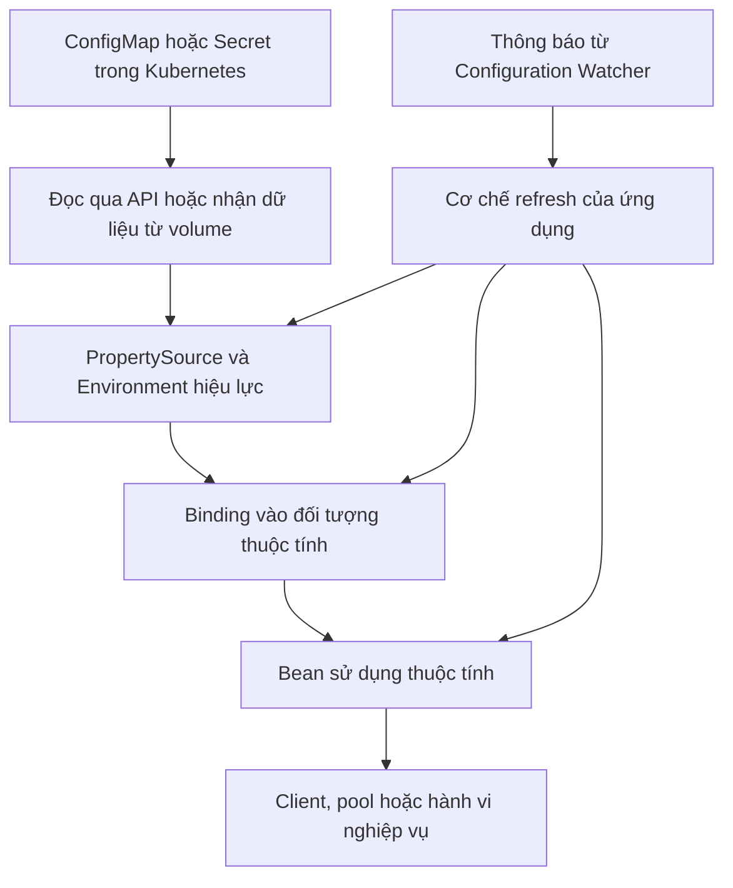
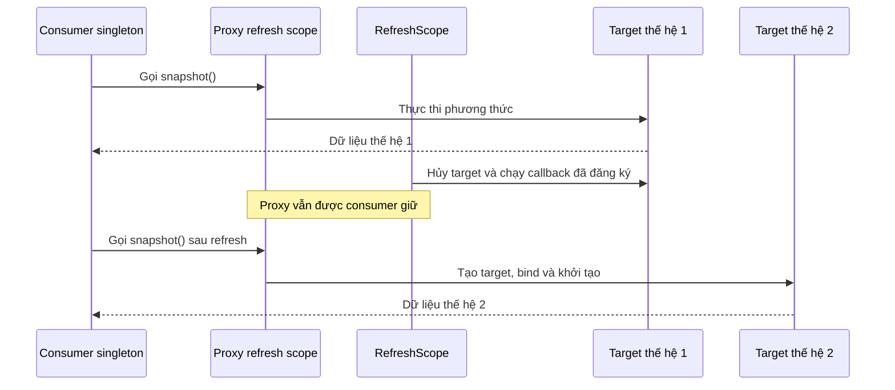

# @RefreshScope, @ConfigurationProperties và vòng đời bean

Trong chương **Cập nhật cấu hình** của module **SPRING_CLOUD_KUBERNETES**, câu hỏi quan trọng sau khi sửa ConfigMap hoặc Secret là: **đối tượng nào trong ứng dụng thực sự nhận cấu hình mới, và vào lúc nào?**

Một ConfigMap đã đổi không có nghĩa Environment của Spring đã đổi. Environment đã đổi cũng không có nghĩa mọi bean, HTTP client và connection pool đã được tạo lại. Nếu không phân biệt những bước này, ứng dụng có thể báo giá trị mới ở một nơi nhưng vẫn thực hiện nghiệp vụ bằng giá trị cũ.

Bài học dùng một chính sách khuyến mại đơn giản để quan sát binding, proxy, target và các callback vòng đời. Phần cơ chế tham chiếu Spring Cloud Context 5.1.0 và Spring Cloud Kubernetes 5.1.0 trên JVM thông thường. Khi thực hành, chọn Spring Boot, Spring Cloud và starter theo BOM tương thích của dự án; không lấy phiên bản mới nhất của từng thư viện rồi ghép tùy ý.

## 1. Xác định cấu hình đang thay đổi ở lớp nào

Có thể hình dung đường đi của một thay đổi như sau:



Các mũi tên diễn tả những bước cần được hiện thực, không phải cam kết tất cả tự xảy ra.

| Lớp quan sát | Câu hỏi cần trả lời |
| --- | --- |
| Kubernetes resource | Dữ liệu mong muốn đã được lưu chưa? |
| Nguồn ứng dụng đọc | Pod đọc đúng resource, namespace hoặc file chưa? |
| Environment | Giá trị hiệu lực là gì, có nguồn ưu tiên cao hơn ghi đè không? |
| Đối tượng thuộc tính | Giá trị đã được bind hoặc bind lại chưa? |
| Bean tiêu thụ | Bean đọc trực tiếp hay đã sao chép giá trị từ trước? |
| Tài nguyên bên ngoài | Client hoặc pool có hỗ trợ thay đổi đó theo vòng đời hiện tại không? |
| Nghiệp vụ | Hành vi sau cập nhật có đúng không? |

Spring Cloud Kubernetes có thể cung cấp dữ liệu cấu hình; Configuration Watcher có thể thông báo cần refresh. Quyết định một bean được giữ nguyên, bind lại hay tạo lại thuộc về cơ chế của Spring và thiết kế bean trong ứng dụng.

## 2. Hai annotation giải quyết hai vấn đề khác nhau

### `@ConfigurationProperties`: đưa dữ liệu vào một mô hình có kiểu

`@ConfigurationProperties` mô tả nhóm thuộc tính cần bind vào một bean. Nó giúp gom cấu hình theo prefix, chuyển đổi kiểu và kết hợp validation. Kiểu thuộc tính phải được đăng ký qua cơ chế phù hợp như `@EnableConfigurationProperties`, property scanning hoặc một phương thức `@Bean` được annotate.

Annotation này tự nó không theo dõi Kubernetes và không phát thông báo thay đổi. Cơ chế binding được trình bày trong [Type-safe Configuration Properties](https://docs.spring.io/spring-boot/reference/features/external-config.html#features.external-config.typesafe-configuration-properties).

### `@RefreshScope`: quản lý một thế hệ target của bean

`@RefreshScope` đặt bean vào scope tên `refresh`. Với proxy mặc định theo lớp, bên sử dụng nhận một đối tượng trung gian; target thực hiện công việc được quản lý phía sau nó. Annotation có thể đặt trên kiểu bean hoặc phương thức `@Bean`. Xem [mã nguồn annotation RefreshScope 5.1.0](https://github.com/spring-cloud/spring-cloud-commons/blob/v5.1.0/spring-cloud-context/src/main/java/org/springframework/cloud/context/config/annotation/RefreshScope.java).

Refresh scope không tự đọc ConfigMap và không tự biết dữ liệu ngoài cluster đã đổi. Nó xử lý vòng đời bean khi cơ chế refresh được kích hoạt.

### So sánh nhanh

| Cơ chế | Điều nó cung cấp | Điều còn cần thiết kế |
| --- | --- | --- |
| `@ConfigurationProperties` | Binding dữ liệu có kiểu | Đăng ký bean, validation, nguồn dữ liệu và đường cập nhật |
| `@RefreshScope` | Proxy và khả năng hủy target để tạo thế hệ mới | Kích hoạt refresh, đọc lại nguồn và xử lý tài nguyên |
| `@Value` trên singleton thông thường | Giá trị được inject khi bean được khởi tạo | Cách cập nhật bean nếu muốn đổi giá trị đã inject |
| Đọc `Environment` tại thời điểm gọi | Tra cứu giá trị hiệu lực tại lần đọc đó | Kiểm tra hợp lệ và giữ nhất quán giữa nhiều khóa |
| Rollout Pod | Khởi tạo lại ứng dụng theo cấu hình triển khai mới | Khả năng đọc nguồn, readiness và kế hoạch khôi phục |

Không cần gắn cả hai annotation lên mọi bean. Trước hết cần biết bean nào chỉ chứa dữ liệu, bean nào sao chép dữ liệu khi khởi tạo và bean nào giữ tài nguyên cần đóng.

## 3. Bind lại một JavaBean không giống thay đối tượng

Một JavaBean mutable có getter/setter có thể được Spring Cloud bind lại khi nhận `EnvironmentChangeEvent` và có hạ tầng rebinder tương ứng.

Trong phiên bản tham chiếu, `ConfigurationPropertiesRebinder` xử lý lại instance đã được quản lý, thay vì đơn giản cấp một đối tượng khác cho mọi consumer. Quá trình này cũng có bước hủy và khởi tạo lại instance; vì vậy, nhìn thấy callback khởi tạo lần nữa chưa đủ để kết luận object identity đã đổi. Xem [ConfigurationPropertiesRebinder 5.1.0](https://github.com/spring-cloud/spring-cloud-commons/blob/v5.1.0/spring-cloud-context/src/main/java/org/springframework/cloud/context/properties/ConfigurationPropertiesRebinder.java).

Giả sử một bean thuộc tính được bind lại từ 10% sang 20%. Consumer A gọi getter mỗi lần xử lý có thể nhìn thấy 20%. Consumer B đã chép 10 vào field riêng trong constructor vẫn dùng 10.

```java
// Minh họa lỗi sao chép: consumer này không có cơ chế tạo lại.
public class FrozenDiscountCalculator {

    private final int percent;

    public FrozenDiscountCalculator(PromotionSettings settings) {
        this.percent = settings.getDiscountPercent();
    }

    public int configuredPercent() {
        return percent;
    }
}
```

Kể cả `settings` là một proxy refresh scope, phép gọi getter trong constructor chỉ lấy một giá trị tại thời điểm đó. Field `percent` của calculator không biến thành tham chiếu động.

Điều tương tự xảy ra khi một singleton dựng HTTP client từ timeout trong constructor: thay đổi bean thuộc tính không tự sửa timeout đã được chép vào client.

### Không xem một lần rebind là giao dịch cho toàn bộ dữ liệu

Với JavaBean mutable, reader có thể gặp bộ giá trị gồm một phần cũ và một phần mới khi nhiều field được cập nhật. Đồng bộ các lần rebind không đồng nghĩa đồng bộ mọi reader của ứng dụng.

Nếu nhiều khóa cùng tạo thành một quyết định nghiệp vụ, cần một cách đọc thống nhất: chẳng hạn một target refresh scope chứa cả nhóm và một phương thức trả snapshot. Không giải quyết bằng việc gọi nhiều getter độc lập rồi giả định chúng thuộc cùng một thế hệ.

## 4. Vòng đời target trong refresh scope

Singleton thông thường có một instance cho một bean definition trong một container. Refresh scope bổ sung một tầng proxy để tham chiếu được inject có thể tiếp tục được dùng qua các thế hệ target. Khái niệm singleton theo container được giải thích trong [Bean Scopes](https://docs.spring.io/spring-framework/reference/core/beans/factory-scopes.html).

Với một target đã được khởi tạo, chu kỳ quan trọng là:



Refresh scope làm mất hiệu lực target đang lưu. Lần sử dụng tiếp theo tạo target từ bean definition, áp dụng lại các bước khởi tạo và dùng nó làm thế hệ mới. Callback hủy của target cũ được gọi nếu đã đăng ký. Cơ chế này nằm trong [RefreshScope 5.1.0](https://github.com/spring-cloud/spring-cloud-commons/blob/v5.1.0/spring-cloud-context/src/main/java/org/springframework/cloud/context/scope/refresh/RefreshScope.java).

Các điểm cần phân biệt:

- Proxy là đối tượng consumer sử dụng để đi tới target hiện hành.
- Target là đối tượng chứa trạng thái của một thế hệ cấu hình.
- Hủy target không có nghĩa controller singleton đã bị hủy.
- Hủy target không có nghĩa tiến trình JVM hoặc Pod đã khởi động lại.
- Sau refresh, việc target mới được tạo có thể chờ đến lần gọi phương thức tiếp theo.

Không dựa vào giả định “chưa có request thì bean chắc chắn chưa được khởi tạo”. Hạ tầng khởi động, warm-up hoặc một bean khác có thể đã truy cập target. Điều cần quan sát trong bài là đổi thế hệ sau refresh, không phải cam kết một thời điểm tạo target duy nhất ở lúc startup.

### `@PostConstruct` và `@PreDestroy`

Trong ứng dụng Spring dùng Jakarta, có thể dùng `jakarta.annotation.PostConstruct` cho callback khởi tạo và `jakarta.annotation.PreDestroy` cho callback hủy. Spring mô tả chúng tại [Using @PostConstruct and @PreDestroy](https://docs.spring.io/spring-framework/reference/core/beans/annotation-config/postconstruct-and-predestroy-annotations.html).

Đối với target refresh scope có tài nguyên:

- Khởi tạo cần đưa đối tượng về trạng thái có thể sử dụng.
- Hủy cần giải phóng những tài nguyên target thực sự sở hữu.
- Không đóng một tài nguyên dùng chung chỉ vì một target hết vòng đời.
- Không tạo thread, scheduler hoặc subscription mới mỗi lần mà không dừng thế hệ cũ.

Các callback là một phần vòng đời kỹ thuật. Nếu chúng có tác dụng nghiệp vụ như gửi thông báo hoặc trừ tiền, mỗi lần refresh có thể lặp lại tác dụng đó. Cần tách những thao tác nghiệp vụ ấy khỏi khởi tạo bean.

## 5. Ví dụ: một nhóm thuộc tính có target thay đổi được

Ví dụ dưới đây quan sát chính sách khuyến mại bằng ba thuộc tính:

```properties
shop.promotion.revision=r17
shop.promotion.enabled=true
shop.promotion.discount-percent=10
```

`revision` là mã phát hành tự định nghĩa để chẩn đoán. Nó không phải `resourceVersion` của Kubernetes và không tạo cơ chế khóa hay giao dịch.

Ví dụ cần ứng dụng web Spring Boot, Actuator, starter validation và Spring Cloud Context từ bộ dependency tương thích. Khi tích hợp Kubernetes, bổ sung starter Config phù hợp. Các đoạn Java sau là những lớp của ứng dụng minh họa; thêm package theo dự án thực tế.

### Bean dữ liệu: `PromotionSettings.java`

Lớp này dùng JavaBean mutable để binder thiết lập giá trị. Nó không tự đăng ký bằng `@Component`; phương thức factory ở phần sau chịu trách nhiệm đăng ký đúng một bean.

```java
import java.util.UUID;

import jakarta.annotation.PostConstruct;
import jakarta.annotation.PreDestroy;
import jakarta.validation.constraints.Max;
import jakarta.validation.constraints.Min;
import jakarta.validation.constraints.NotBlank;

import org.slf4j.Logger;
import org.slf4j.LoggerFactory;
import org.springframework.validation.annotation.Validated;

@Validated
public class PromotionSettings {

    private static final Logger log =
            LoggerFactory.getLogger(PromotionSettings.class);

    private final String instanceId = UUID.randomUUID().toString();

    @NotBlank
    private String revision = "local";

    private boolean enabled = true;

    @Min(0)
    @Max(50)
    private int discountPercent = 10;

    public String getRevision() {
        return revision;
    }

    public void setRevision(String revision) {
        this.revision = revision;
    }

    public boolean isEnabled() {
        return enabled;
    }

    public void setEnabled(boolean enabled) {
        this.enabled = enabled;
    }

    public int getDiscountPercent() {
        return discountPercent;
    }

    public void setDiscountPercent(int discountPercent) {
        this.discountPercent = discountPercent;
    }

    public Snapshot snapshot() {
        return new Snapshot(
                revision, enabled, discountPercent, instanceId);
    }

    @PostConstruct
    void initialized() {
        log.info("promotion target initialized: id={}, revision={}, percent={}",
                instanceId, revision, discountPercent);
    }

    @PreDestroy
    void destroyed() {
        log.info("promotion target destroyed: id={}, revision={}",
                instanceId, revision);
    }

    public record Snapshot(
            String revision,
            boolean enabled,
            int discountPercent,
            String instanceId) {
    }
}
```

Giới hạn 0–50% là quy tắc của ví dụ. `instanceId` được tạo bởi từng target để thấy thế hệ đối tượng đã thay đổi; nó không phải ID chuẩn của Spring.

Record `Snapshot` chỉ là dữ liệu trả về từ một phương thức, không phải bean `@ConfigurationProperties` và không phải target cần proxy. Do đó, việc dùng record cho snapshot không đồng nghĩa đang refresh một record cấu hình.

### Đăng ký bean: `PromotionConfiguration.java`

```java
import org.springframework.boot.context.properties.ConfigurationProperties;
import org.springframework.boot.context.properties.EnableConfigurationProperties;
import org.springframework.cloud.context.config.annotation.RefreshScope;
import org.springframework.context.annotation.Bean;
import org.springframework.context.annotation.Configuration;

@Configuration(proxyBeanMethods = false)
@EnableConfigurationProperties
public class PromotionConfiguration {

    @Bean
    @RefreshScope
    @ConfigurationProperties(prefix = "shop.promotion")
    public PromotionSettings promotionSettings() {
        return new PromotionSettings();
    }
}
```

Ở đây:

- `@ConfigurationProperties` đặt trên phương thức factory để bind target.
- `@RefreshScope` áp dụng cho chính bean `promotionSettings`.
- `@EnableConfigurationProperties` bật hạ tầng mà không đăng ký thêm một bean `PromotionSettings` theo lớp.
- Không thêm một khai báo scan hoặc enable khác khiến cùng kiểu bị đăng ký lần thứ hai.

Trong dòng mã tham chiếu, các bean đã thuộc refresh scope được loại khỏi tập bean bind lại theo cách thông thường của `ConfigurationPropertiesBeans`. Target mới sẽ được bind trong quá trình tạo của chính nó. Xem [ConfigurationPropertiesBeans 5.1.0](https://github.com/spring-cloud/spring-cloud-commons/blob/v5.1.0/spring-cloud-context/src/main/java/org/springframework/cloud/context/properties/ConfigurationPropertiesBeans.java).

### Consumer singleton: `PromotionController.java`

```java
import org.springframework.web.bind.annotation.GetMapping;
import org.springframework.web.bind.annotation.RestController;

@RestController
public class PromotionController {

    private final PromotionSettings settings;

    public PromotionController(PromotionSettings settings) {
        this.settings = settings;
    }

    @GetMapping("/demo/promotion")
    public PromotionSettings.Snapshot promotion() {
        return settings.snapshot();
    }
}
```

Controller không cần đổi scope để ví dụ hoạt động: nó giữ proxy và gọi `snapshot()` ở thời điểm xử lý request. Nó không chép giá trị discount vào field riêng trong constructor.

Nếu một luồng nghiệp vụ cần nhiều thuộc tính, lấy một snapshot ở đầu đơn vị công việc rồi dùng snapshot ấy xuyên suốt. Việc giữ snapshot cũ cho một công việc đang chạy là một lựa chọn rõ ràng; không nên vô tình trộn dữ liệu giữa hai lần đọc.

## 6. Đặt ví dụ vào đường nạp cấu hình Kubernetes

Một ConfigMap dùng cho ví dụ:

```yaml
apiVersion: v1
kind: ConfigMap
metadata:
  name: promotion-service
  namespace: commerce-dev
  labels:
    spring.cloud.kubernetes.config: "true"
data:
  shop.promotion.revision: "r17"
  shop.promotion.enabled: "true"
  shop.promotion.discount-percent: "10"
```

Label trong manifest phục vụ lựa chọn theo dõi của Configuration Watcher khi controller đó được triển khai. Label không tự tạo watcher, Service hoặc quyền API.

Cấu hình ứng dụng tối thiểu cho hướng đọc API bằng Config Data có thể là:

```yaml
spring:
  application:
    name: promotion-service
  config:
    import: "kubernetes:"
  cloud:
    kubernetes:
      config:
        enabled: true
        name: promotion-service
        namespace: commerce-dev
      secrets:
        enabled: false
      discovery:
        enabled: false

management:
  endpoints:
    web:
      exposure:
        include: health,refresh
```

Ví dụ cần starter Config như `spring-cloud-starter-kubernetes-fabric8-config`, đường xác thực tới API và RBAC phù hợp cơ chế đọc của phiên bản đang dùng. Fragment này không phải bộ manifest triển khai đầy đủ.

Config Data import và giới hạn không trộn với legacy bootstrap được mô tả tại [Kubernetes PropertySource implementations](https://docs.spring.io/spring-cloud-kubernetes/reference/property-source-config.html). Đặt thông tin tìm nguồn ở cấu hình có sẵn trước khi nguồn đó được đọc.

Phần `exposure` chỉ cấu hình xuất endpoint qua web. Endpoint còn phải tồn tại và được chính sách access cho phép thực hiện thao tác ghi. Xác thực và phân quyền HTTP là lớp kiểm soát riêng; xem [Actuator Endpoints](https://docs.spring.io/spring-boot/reference/actuator/endpoints.html).

Ở chế độ HTTP, watcher cần truy cập endpoint refresh của những instance được chọn; tài liệu [Configuration Watcher](https://docs.spring.io/spring-cloud-kubernetes/reference/spring-cloud-kubernetes-configuration-watcher.html) mô tả việc khám phá instance và gửi thông báo. Ứng dụng nhận thông báo không bắt buộc phải bật DiscoveryClient chỉ vì watcher phía ngoài sử dụng discovery.

Secret được tắt trong ví dụ vì chỉ cập nhật dữ liệu không nhạy cảm. Nếu bài toán thực tế cần Secret, phải thiết kế quyền và vòng đời riêng; annotation refresh scope không làm giảm yêu cầu đó.

### Nếu dùng volume hoặc biến môi trường

Dữ liệu ConfigMap được mount có thể được Kubernetes cập nhật theo cơ chế projection, nhưng ứng dụng vẫn cần đọc lại file và thực hiện chu trình cập nhật tương ứng. Mount bằng `subPath` không nhận cập nhật tự động như volume projection thông thường.

Biến môi trường được cấp từ ConfigMap không tự đổi trong tiến trình đang chạy. Gọi refresh không khiến hệ điều hành thay giá trị môi trường ấy. Xem [ConfigMaps](https://kubernetes.io/docs/concepts/configuration/configmap/).

Chọn rõ một đường nạp để thực hành. Nếu vừa đọc API, vừa mount cùng dữ liệu, vừa có override môi trường, việc xác định nguồn thực sự có hiệu lực sẽ khó hơn.

## 7. Quan sát một chu kỳ cập nhật

Nên kiểm tra riêng một instance trước khi đưa watcher vào luồng tự động. Như vậy có thể phân biệt lỗi vòng đời bean với lỗi thông báo hoặc định tuyến.

### Bước 1: đọc trạng thái ban đầu

Gọi `GET /demo/promotion` trên instance đã đọc cấu hình r17.

Kết quả dự kiến:

```json
{
  "revision": "r17",
  "enabled": true,
  "discountPercent": 10,
  "instanceId": "target-id-A"
}
```

Giá trị UUID thật sẽ khác. `target-id-A` chỉ ký hiệu một thế hệ.

### Bước 2: sửa dữ liệu mong muốn

Phát hành lại dữ liệu của cùng ConfigMap thành:

```yaml
data:
  shop.promotion.revision: "r18"
  shop.promotion.enabled: "true"
  shop.promotion.discount-percent: "20"
```

Nên thay revision và discount trong cùng một cập nhật resource. Việc resource đã lưu r18 chưa chứng minh instance đã áp dụng r18.

### Bước 3: kích hoạt refresh của đúng instance

Ví dụ PowerShell khi đã có đường truy cập quản trị hợp lệ tới instance tại cổng local 18080:

```powershell
Invoke-RestMethod -Method Post -Uri 'http://127.0.0.1:18080/actuator/refresh'
```

Cần bổ sung thông tin xác thực theo môi trường. Cổng 18080 là giả định của ví dụ; khi dùng port-forward, chọn một Pod cụ thể để theo dõi xuyên suốt.

Endpoint refresh gọi `ContextRefresher` và trả tập tên khóa thay đổi mà cơ chế đó phát hiện. Danh sách khóa không phải danh sách tất cả client đã tạo lại. Xem [RefreshEndpoint 5.1.0](https://github.com/spring-cloud/spring-cloud-commons/blob/v5.1.0/spring-cloud-context/src/main/java/org/springframework/cloud/endpoint/RefreshEndpoint.java).

### Bước 4: gọi lại phương thức qua proxy

Gọi lại `GET /demo/promotion`.

Kết quả dự kiến:

```json
{
  "revision": "r18",
  "enabled": true,
  "discountPercent": 20,
  "instanceId": "target-id-B"
}
```

Trong một chu kỳ không có truy cập đồng thời khác, log có thể cho thấy:

```text
promotion target initialized: id=target-id-A, revision=r17, percent=10
promotion target destroyed: id=target-id-A, revision=r17
promotion target initialized: id=target-id-B, revision=r18, percent=20
```

Thứ tự thời gian tạo target mới phụ thuộc lần truy cập tiếp theo hoặc warm-up. Quan sát quan trọng là target A kết thúc vòng đời, target B có ID khác và giá trị mới.

Các JSON, log và lệnh ở đây là minh họa dự kiến, chưa phải kết quả đã thực thi.

### Bước 5: chứng minh giới hạn bằng consumer sao chép

Nếu đăng ký `FrozenDiscountCalculator` ở mục 3 như một singleton và nó đã được tạo khi r17 có hiệu lực, `configuredPercent()` vẫn trả 10 sau khi target settings đổi sang r18.

Kết quả này chỉ ra đúng ranh giới: proxy giúp những lời gọi tương lai đến target hiện hành; nó không tìm và sửa mọi primitive hoặc object đã được consumer chép ra trước đó.

## 8. Phân biệt các thao tác mang tên “refresh”

Không dùng các API sau như thể chúng làm cùng một việc:

| Thao tác | Phạm vi chính |
| --- | --- |
| Đổi ConfigMap | Đổi dữ liệu ở Kubernetes |
| Phát `EnvironmentChangeEvent` | Thông báo cho listener rằng các khóa hiệu lực đã đổi; không tự đi lấy ConfigMap |
| `ContextRefresher.refreshEnvironment()` | Cập nhật Environment theo implementation và phát sự kiện thay đổi |
| `RefreshScope.refreshAll()` | Hủy các target hiện có trong scope; không tự nạp nguồn bên ngoài |
| `RefreshScope.refresh("promotionSettings")` | Làm mất hiệu lực target của bean được chỉ định |
| `ContextRefresher.refresh()` | Thực hiện chuỗi cập nhật Environment rồi refresh scope |
| Rollout hoặc restart Pod | Khởi động lại ứng dụng theo nguồn cấu hình được nạp lúc startup |

Trong [ContextRefresher 5.1.0](https://github.com/spring-cloud/spring-cloud-commons/blob/v5.1.0/spring-cloud-context/src/main/java/org/springframework/cloud/context/refresh/ContextRefresher.java), `refresh()` gọi `refreshEnvironment()` trước rồi mới gọi `scope.refreshAll()`.

Từ thứ tự đó có hai hệ quả thực hành:

- Chỉ gọi `refreshAll()` khi Environment vẫn cũ có thể tạo một target mới mang chính dữ liệu cũ.
- Chỉ cập nhật Environment hoặc bind lại bean thuộc tính không bảo đảm mọi target hay singleton phụ thuộc đã được tạo lại.

Không tự phát một `EnvironmentChangeEvent` rỗng chỉ để thay cho đường đọc cấu hình của Spring Cloud Kubernetes. Đường nạp phải thực sự đọc được dữ liệu mới.

Refresh cũng không phải `ApplicationContext.refresh()` lại toàn bộ ứng dụng và không tương đương restart. Nhiều singleton, thread và tài nguyên ngoài refresh scope vẫn tiếp tục tồn tại.

## 9. Ranh giới nhất quán và tài nguyên đang được sử dụng

### Một phương thức không phải toàn bộ request

Implementation scope tham chiếu sử dụng cơ chế khóa khi gọi phương thức qua proxy và khi hủy target. Cơ chế này giúp quản lý vòng đời target theo từng bean; xem [GenericScope 5.1.0](https://github.com/spring-cloud/spring-cloud-commons/blob/v5.1.0/spring-cloud-context/src/main/java/org/springframework/cloud/context/scope/GenericScope.java).

Nó không biến nhiều lần gọi ở nhiều bean thành một giao dịch cấu hình cho toàn bộ request hoặc toàn bộ cluster.

Ví dụ sau vẫn có khả năng lấy hai thế hệ:

```java
String revision = settings.getRevision();
// Refresh có thể xảy ra giữa hai lời gọi qua proxy.
int percent = settings.getDiscountPercent();
```

Trong ví dụ chính, gọi `settings.snapshot()` một lần lấy các field từ cùng target. Snapshot trả về là dữ liệu bất biến và được dùng tiếp mà không gọi lại proxy cho từng field.

Nếu một request gọi hai bean refresh scope khác nhau, nó vẫn cần quy tắc nhất quán giữa hai bean nếu nghiệp vụ yêu cầu. Dùng chung annotation không tạo ra một phiên bản cấu hình chung tự động.

### Tác vụ bất đồng bộ có vòng đời dài hơn lần gọi

Một phương thức trả `CompletableFuture`, stream hoặc publisher có thể kết thúc lời gọi Java trước khi công việc thật sự hoàn tất. Không suy rằng khóa của proxy sẽ giữ mọi tài nguyên sống đến khi tác vụ bất đồng bộ kết thúc.

Nếu target cũ sở hữu executor, HTTP client hoặc subscription, cần xác định:

- Ai giữ tài nguyên trong thời gian tác vụ đang chạy?
- Khi refresh, tác vụ cũ được hoàn tất, drain hay hủy?
- Callback hủy có được phép đóng tài nguyên ngay không?
- Lần gọi mới đã sẵn sàng dùng tài nguyên mới chưa?

Một chính sách thông báo khuyến mại đơn giản dễ đổi hơn connection pool có giao dịch đang chạy. Cơ chế scope giống nhau nhưng yêu cầu vận hành khác nhau.

### Tạo lại client phải theo khả năng của client

Có ba thiết kế thường gặp:

| Thiết kế consumer | Cách cập nhật phù hợp cần đánh giá |
| --- | --- |
| Đọc một snapshot nhỏ mỗi đơn vị công việc | Đổi target dữ liệu và dùng snapshot thống nhất |
| Singleton giữ một client được dựng từ cấu hình | Dùng API cập nhật runtime nếu client hỗ trợ, hoặc thiết kế lại vòng đời client |
| Client/pool cần đóng và tạo mới | Quản lý quyền sở hữu, drain, đóng và khởi tạo thế hệ mới |
| Tài nguyên không hỗ trợ refresh an toàn | Rollout có kiểm soát |

Đặt `@RefreshScope` trên bean thuộc tính rồi bỏ qua client là bỏ sót một mắt xích. Đặt annotation lên client cũng chưa đủ nếu không biết điều gì xảy ra với request hoặc giao dịch đang dùng client cũ.

## 10. Những giới hạn dễ bị bỏ qua

### Record và constructor binding

Không coi một record `@ConfigurationProperties` là JavaBean mutable có thể rebind. Tài liệu Spring Cloud Context tham chiếu nêu rằng đối tượng constructor-bound, gồm Java record cấu hình, không hỗ trợ refresh theo cơ chế đó.

Record cấu hình immutable có thể rất phù hợp khi cấu hình chỉ được áp dụng lúc startup và thay đổi bằng rollout. Record snapshot trong ví dụ vẫn phù hợp vì nó không phải bean cấu hình đang được rebind.

### Proxy theo lớp và kiểu `final`

Proxy mặc định của `@RefreshScope` theo lớp cần kiểu có thể tạo subclass. Lớp `final` và phương thức `final` không có các khả năng proxy như phương thức có thể override; Spring giải thích giới hạn tại [Proxying Mechanisms](https://docs.spring.io/spring-framework/reference/core/aop/proxying.html).

Vì vậy `PromotionSettings` là lớp không final và `snapshot()` là phương thức public không final. Không thay target này bằng record rồi kỳ vọng giữ nguyên thiết kế proxy.

### Đặt annotation lên lớp `@Configuration`

Gắn `@RefreshScope` lên một lớp `@Configuration` không tự đặt mọi bean do lớp đó tạo vào refresh scope. Cần chọn bean đích rõ ràng như phương thức `promotionSettings()` trong ví dụ.

### Pool và môi trường AOT

Trong tài liệu Spring Cloud Context tham chiếu:

- `HikariDataSource` thuộc danh sách mặc định không refresh; không bỏ giới hạn chỉ để ép pool được tạo lại mà chưa hiểu hệ quả.
- Context refresh không được hỗ trợ cho Spring AOT/native image; cấu hình `spring.cloud.refresh.enabled=false` được hướng dẫn cho trường hợp đó.

Các giới hạn constructor binding, cấu hình class, datasource và AOT được tập hợp trong [Spring Cloud Context: Refresh Scope](https://docs.spring.io/spring-cloud-commons/reference/spring-cloud-commons/application-context-services.html#refresh-scope).

### Bean ngoài container và tham chiếu raw

Một đối tượng do mã nghiệp vụ tự tạo bằng `new` và giữ ngoài bean definition không tự tham gia refresh scope. Tương tự, lấy raw target rồi lưu lâu dài có thể bỏ qua khả năng định tuyến của proxy.

Ở ví dụ factory, `new PromotionSettings()` tạo target theo bean definition được Spring quản lý; nó khác với việc consumer tự `new` settings bên ngoài container.

## 11. Validation, lỗi refresh và khôi phục

Validation giúp từ chối dữ liệu vi phạm hợp đồng, nhưng phải biết nó xảy ra ở đâu và khi nào.

Với ví dụ, thử đặt `shop.promotion.discount-percent=80`. Target mới không đáp ứng `@Max(50)`. Vì target có thể được tạo khi có lần sử dụng tiếp theo, lỗi có thể xuất hiện ở lần gọi nghiệp vụ sau refresh, thay vì ngay ở phản hồi HTTP của thao tác refresh.

Không kết luận “POST refresh thành công” nghĩa là mọi bean đã được dựng và mọi client đã sẵn sàng.

### Không có rollback dữ liệu tự động từ annotation

Nếu target cũ đã bị hủy và target mới tạo thất bại, `@RefreshScope` không tự phục hồi nội dung ConfigMap r17 hoặc bảo đảm tiếp tục phục vụ bằng target cũ.

Quy trình phục hồi có thể gồm:

1. Ngừng mở rộng đợt cập nhật.
2. Xác định revision đã áp dụng và lỗi binding/khởi tạo.
3. Phát hành lại một bộ dữ liệu hợp lệ, chẳng hạn revision phục hồi dùng giá trị tốt đã biết.
4. Kích hoạt lại đường nạp và refresh phù hợp.
5. Gọi phương thức cần dùng target để xác nhận khởi tạo thành công.
6. Kiểm tra hành vi rồi mới tiếp tục áp dụng cho các instance còn lại.

Đừng chỉ đổi label revision mà không khôi phục giá trị thực.

Nếu yêu cầu bắt buộc giữ bộ cấu hình tốt trước đó khi candidate sai, cần thiết kế cơ chế kiểm tra candidate trước khi chuyển tham chiếu, hoặc dùng chiến lược rollout cho phép giữ Pod tốt cũ. Đây là khả năng của thiết kế ứng dụng và triển khai, không phải cam kết mặc định của annotation.

### Khóa bị xóa và giá trị mặc định

Không dùng “xóa khóa rồi refresh” như một lệnh reset có hành vi đồng nhất cho mọi loại bean và mọi phiên bản. Kết quả còn phụ thuộc nguồn thấp hơn, mặc định của lớp, cơ chế nạp và rebinding đang sử dụng.

Với hợp đồng runtime, nên quy định rõ giá trị khi tắt hoặc reset. Ví dụ đặt `enabled=false` rõ ràng dễ kiểm tra hơn suy từ việc khóa enabled có còn trong một nguồn hay không.

Trong một đợt nhiều phiên bản cùng chạy, phải bảo đảm bộ dữ liệu mới vẫn được những bộ đọc còn sử dụng nguồn đó hiểu đúng. Refresh không chuyển đổi schema cấu hình giúp phiên bản cũ.

## 12. Quan sát sức khỏe và chẩn đoán theo đúng tầng

Có thể thu thập một số bằng chứng khác nhau:

| Bằng chứng | Xác nhận được gì | Chưa xác nhận được gì |
| --- | --- | --- |
| ConfigMap có revision r18 | Cluster đã lưu dữ liệu mong muốn | Pod đã đọc r18 |
| Giá trị hiệu lực trong Environment | Nguồn phân giải đang có giá trị đó | Client đã dùng giá trị đó |
| Bean thuộc tính sau binding | Binding của bean đã nhận dữ liệu | Consumer đã bỏ bản sao cũ |
| ID target đổi | Một thế hệ target mới được tạo | Mọi bean khác đã đổi |
| Callback hủy/khởi tạo | Các bước vòng đời tương ứng đã chạy | Không còn tác vụ bất đồng bộ dùng tài nguyên cũ |
| Một lần gọi nghiệp vụ có kiểm soát | Thành phần được kiểm tra thể hiện hành vi mong muốn | Mọi Pod đã áp dụng đồng thời |

Không dump toàn bộ Environment hoặc đối tượng chứa Secret để lấy bằng chứng. Ví dụ chỉ xuất các trường không nhạy cảm đã chọn.

Nếu sử dụng health indicator của refresh scope trong phiên bản dự án, cần kiểm tra nó có được đưa vào health group mà probe thực sự gọi hay không. Không giả định lỗi refresh sẽ tự khiến readiness của Kubernetes thất bại đúng theo mong muốn.

Liveness chủ yếu phục vụ phát hiện tiến trình cần khởi động lại theo thiết kế probe. Readiness và kiểm tra hành vi sau cập nhật cần được thiết kế để tránh cho Pod chưa áp dụng cấu hình hợp lệ nhận lưu lượng.

### Bảng chẩn đoán thường gặp

| Hiện tượng | Khả năng cần kiểm tra trước |
| --- | --- |
| ConfigMap đổi nhưng mọi giá trị trong Pod vẫn cũ | Chưa có đường đọc lại hoặc Pod dùng nguồn môi trường cố định |
| Environment mới, bean thuộc tính cũ | Thiếu cơ chế rebind hoặc kiểu binding không hỗ trợ |
| Thuộc tính mới, client vẫn cũ | Client đã sao chép cấu hình lúc khởi tạo |
| Target ID đổi nhưng giá trị vẫn cũ | Nguồn chưa được nạp lại hoặc override ưu tiên cao hơn |
| Log callback chạy lại nhưng ID không đổi | Có thể là rebind cùng instance, không phải thay target |
| Refresh trả thành công nhưng request tiếp theo lỗi | Target được tạo sau đó và validation/khởi tạo thất bại |
| Một vài Pod mới, một vài Pod cũ | Thông báo và áp dụng diễn ra theo từng instance |
| Số thread/connection tăng sau mỗi refresh | Thiếu cleanup hoặc sai quyền sở hữu tài nguyên |
| Lớp cấu hình được refresh nhưng bean con không đổi | Annotation không lan từ `@Configuration` sang mọi `@Bean` |
| Dữ liệu đổi nhưng calculator vẫn trả số cũ | Consumer giữ bản sao giá trị hoặc snapshot quá lâu |

Khi có nhiều replica, kiểm tra theo Pod và revision đã áp dụng. Một lần gọi qua Service hoặc LoadBalancer có thể gặp các instance khác nhau, nên không đủ để suy ra trình tự vòng đời của một target.

## 13. Chọn refresh hay rollout theo vòng đời thực tế

Có thể dùng các câu hỏi sau trước khi cho phép một nhóm cấu hình đổi trực tiếp:

1. Các kiểu thuộc tính có hỗ trợ cơ chế cập nhật dự định không?
2. Consumer đọc qua proxy, đọc snapshot hay giữ bản sao từ startup?
3. Những khóa liên quan có được dùng như một bộ nhất quán không?
4. Target cũ sở hữu tài nguyên nào, đóng chúng ảnh hưởng công việc nào?
5. Target mới lỗi thì hệ thống ngừng nhận việc, giữ cấu hình tốt cũ hay chuyển sang rollout?
6. Có xác nhận được revision và hành vi theo từng Pod không?

Một cờ hiển thị hoặc chính sách nhỏ có thể phù hợp với cập nhật qua snapshot. Thay đổi connection pool, cấu trúc bean hoặc dữ liệu khởi động quan trọng có thể phù hợp hơn với rollout đã được kiểm tra.

Trong tích hợp Spring với Kubernetes, chỉ chọn những tính năng thực sự phục vụ đường cập nhật: ConfigMap/Secret để cấp dữ liệu, watcher khi cần thông báo động, các bean có vòng đời phù hợp để áp dụng dữ liệu. DiscoveryClient, Spring Cloud LoadBalancer và health indicator có vai trò riêng; chúng không thay thế việc thiết kế binding và vòng đời bean.

Khi đánh giá một lần cập nhật, hãy chỉ ra được ba điều cụ thể: **Environment đã nhìn thấy gì, target nào đang phục vụ, và thành phần nghiệp vụ thực sự dùng bộ giá trị nào**. Đó là cơ sở để giải thích vì sao một thay đổi đã có hiệu lực hoặc đang dừng ở một mắt xích.
