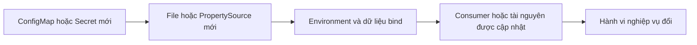

# Thuộc tính chỉ được đọc lúc khởi tạo và phần cần tái tạo

Trong chương **Cập nhật cấu hình** của module **SPRING_CLOUD_KUBERNETES**, câu hỏi quan trọng sau khi sửa ConfigMap không chỉ là “ứng dụng đã nhận sự kiện chưa?”, mà còn là “thành phần nào đã đọc giá trị này, đọc vào lúc nào và có đọc lại không?”.

Một HTTP client có thể đã chép timeout vào cấu trúc riêng khi được tạo. Một executor có thể đã tạo số luồng từ cấu hình ban đầu. Một bean có thể đã chọn chiến lược xử lý trong constructor. Dù nguồn cấu hình hiện tại chứa giá trị mới, các đối tượng này vẫn có thể tiếp tục dùng trạng thái cũ.

Bài học tập trung vào điểm giá trị cấu hình được chuyển thành trạng thái của đối tượng và cách xác định phần cần tái tạo. Nội dung liên hệ ConfigMap, Secret, Configuration Watcher, DiscoveryClient và Spring Cloud LoadBalancer, nhưng không giả định mọi ứng dụng phải bật tất cả các tính năng đó.

Sau bài học, bạn có thể:

- Nhận diện cấu hình chỉ được đọc khi tạo bean hoặc tài nguyên.
- Phân biệt cập nhật nguồn, rebind dữ liệu và tái tạo consumer.
- Chọn phạm vi thay đổi giữa một snapshot, một nhóm bean, một tài nguyên hoặc toàn bộ Pod.
- Dùng thí nghiệm để chứng minh consumer đã chuyển sang thế hệ cấu hình mới.
- Nhận ra giới hạn của `@RefreshScope` và yêu cầu quản lý tài nguyên khi thay thế đối tượng.

## 1. “Đọc lúc khởi tạo” là hành vi của consumer

Một thuộc tính không tự mang đặc tính “động” hay “tĩnh”. Đặc tính đó phụ thuộc vào cách thành phần sử dụng giá trị.

Xét hai cách dùng cùng một key:

```java
// Chỉ chụp giá trị khi tạo đối tượng.
this.timeout = environment.getProperty("partner.timeout", Duration.class);

// Đọc từ Environment tại mỗi lần gọi phương thức.
Duration timeout = environment.getProperty(
        "partner.timeout", Duration.class
);
```

Cách thứ hai chỉ có cơ hội thấy giá trị mới khi `Environment` đã thực sự được cập nhật. Nó cũng chưa làm thay đổi một HTTP client được tạo từ timeout cũ ở nơi khác.

“Khởi tạo” không nhất thiết xảy ra lúc JVM bắt đầu chạy. Bean lazy có thể được tạo muộn; client có thể được tạo ở lần gọi đầu tiên; một cache có thể được làm đầy sau startup. Khi một giá trị đã được chép vào trạng thái sống lâu, cần tìm đúng thời điểm chụp đó.

| Cách sử dụng | Thời điểm chụp giá trị | Điều không được tự suy ra |
| --- | --- | --- |
| `@Value` trên singleton thông thường | Khi tạo/inject bean | Nguồn đổi sẽ tự inject lại |
| Đọc trong constructor hoặc phương thức `@Bean` | Khi tạo đối tượng | Factory sẽ tự chạy lại sau refresh |
| Đọc trong `@PostConstruct` rồi xây cache | Khi khởi tạo bean | Dữ liệu đầu vào đổi sẽ tự xây lại cache |
| Bind lớp cấu hình rồi tạo client riêng | Khi client được tạo | Rebind lớp cấu hình sẽ sửa client |
| Đọc qua một provider ở mỗi thao tác | Theo hợp đồng của provider | Provider luôn trả snapshot mới hoặc nhất quán |
| Đọc file mỗi lần xử lý | Khi truy cập file | File đã lan truyền đồng thời đến mọi Pod |

Singleton của Spring có phạm vi trong container và bean definition tương ứng. Bình thường Spring dùng lại instance đó; đổi một property source không phải yêu cầu tạo lại tất cả singleton. [Spring Framework: bean scopes](https://docs.spring.io/spring-framework/reference/6.2/core/beans/factory-scopes.html).

## 2. Bốn trạng thái cần phân biệt

Khi chẩn đoán một lần cập nhật, tách bốn trạng thái:

1. **Nguồn mong muốn**: ConfigMap/Secret trên API server hoặc bản cấu hình được phê duyệt.
2. **Dữ liệu tiến trình nhìn thấy**: file volume hoặc property source trong ứng dụng.
3. **Trạng thái consumer đã xây dựng**: giá trị trong bean, client, pool, cache hoặc executor.
4. **Hành vi thực tế**: request dùng timeout nào, task chạy qua executor nào, phép tính dùng chính sách nào.



Mỗi mũi tên cần một cơ chế riêng. Configuration Watcher có thể tham gia đường thông báo; nó không thay thế hợp đồng cập nhật bên trong từng consumer.

Ví dụ một lỗi thường gặp:

```text
Environment: partner.timeout = 800ms
PartnerSettings: timeout = 800ms
HttpClient đã tạo: connect timeout = 3s
Request thực: vẫn chờ theo client cũ
```

Đây không nhất thiết là lỗi Kubernetes hay lỗi đọc ConfigMap. Nút cần xử lý có thể chính là client đã giữ cấu hình ban đầu.

Ngược lại, nếu file mount còn cũ thì tái tạo bean cũng có thể tạo ra một đối tượng mới với cùng cấu hình cũ. Hãy xác định trạng thái nào đang dừng lại trước khi chọn cách sửa.

## 3. Tìm phần cần tái tạo bằng đường phụ thuộc

Giả sử ứng dụng có chuỗi:

```text
PartnerSettings
    -> HttpTransport
        -> PartnerClient
            -> OrderService
```

Thay đổi timeout có thể dẫn đến các quyết định khác nhau:

| Tình huống | Phạm vi thay đổi có thể phù hợp |
| --- | --- |
| Transport hỗ trợ timeout theo từng request | Cập nhật chính sách request, giữ transport |
| Transport có API cập nhật an toàn cho đúng tham số | Gọi API được hỗ trợ và kiểm tra tác động |
| Timeout chỉ nhận trong builder của transport | Tạo transport/client mới |
| PartnerClient giữ tham chiếu trực tiếp tới transport cũ | Thay cả client hoặc chuyển sang một điểm truy cập có thể thay target |
| OrderService đã chép một giá trị từ client vào field riêng | Cập nhật/tái tạo thêm phần đã chép đó |
| Đổi thuộc tính quyết định bean nào được đăng ký | Thường cần quy trình khởi động lại phù hợp |

Không cần tái tạo `OrderService` chỉ vì nó phụ thuộc client nếu nó giữ đúng proxy/provider và truy cập target hiện tại qua đó. Nhưng nếu nó giữ một bản sao dữ liệu hoặc tham chiếu tới đối tượng cũ, ranh giới thay thế đã bị vượt qua.

Một câu hỏi hữu ích khi đọc mã là:

> Nếu đối tượng phía dưới được thay mới, mọi đường gọi nghiệp vụ có đi tới đối tượng mới không?

Tìm các vị trí `new`, builder, constructor, `@Bean`, `@PostConstruct`, biến `static`, cache và các closure giữ giá trị cũ. Với thư viện ngoài, đọc hợp đồng của đúng phiên bản thay vì suy từ tên property.

## 4. Phân biệt ba thao tác trong Spring

### 4.1. Cập nhật Environment

`Environment` là nơi tra cứu property. Nếu nó đổi, những lần tra cứu sau có thể thấy dữ liệu mới theo thứ tự nguồn hiện hành.

Điều này không tự sửa những giá trị đã chép vào field. Đọc `environment.getProperty(...)` trong constructor vẫn là đọc một lần.

### 4.2. Rebind dữ liệu cấu hình

Một số bean cấu hình mutable có thể được rebind qua cơ chế Spring Cloud. Nhưng rebind thay đổi dữ liệu trên bean cấu hình, không phải một lệnh tổng quát để xây lại mọi đối tượng đã được tạo từ bean đó.

Ví dụ:

```java
@Bean
PartnerClient partnerClient(PartnerSettings settings) {
    return new PartnerClient(settings.timeout());
}
```

Nếu `PartnerClient` chép timeout vào field hoặc xây một transport trong constructor, thay `settings` chưa làm transport đó đổi theo. Đoạn mã trên không tự trở thành refreshable.

### 4.3. Tái tạo target qua RefreshScope

Với bean thuộc refresh scope, điểm inject thường là proxy. Khi refresh làm mất target hiện có, lần gọi tiếp theo qua proxy có thể tạo target mới bằng factory và dependency tương ứng. Proxy giúp bean sử dụng tiếp tục gọi qua một điểm truy cập ổn định. [Triển khai annotation RefreshScope 4.3.x](https://github.com/spring-cloud/spring-cloud-commons/blob/4.3.x/spring-cloud-context/src/main/java/org/springframework/cloud/context/config/annotation/RefreshScope.java).

Trong Spring Cloud Commons 4.3.x, `ContextRefresher` cập nhật môi trường, phát sự kiện thay đổi rồi yêu cầu refresh scope làm mới. Đây là chuỗi trong một tiến trình, không phải một transaction bao phủ Kubernetes và mọi replica. [Mã nguồn ContextRefresher](https://github.com/spring-cloud/spring-cloud-commons/blob/4.3.x/spring-cloud-context/src/main/java/org/springframework/cloud/context/refresh/ContextRefresher.java).

Chọn đúng phạm vi target quan trọng hơn việc thêm annotation vào nhiều lớp.

## 5. Thí nghiệm: hai bean đọc cùng cấu hình lúc tạo

Thí nghiệm dùng một bộ tính giá không giữ kết nối hay thread riêng. Nhờ vậy, có thể quan sát việc tái tạo đối tượng trước khi xử lý vòng đời tài nguyên phức tạp.

Dùng ứng dụng JVM với Java 17 trở lên, Spring Boot 3.5.x và Spring Cloud release train 2025.0.x tương ứng. Khóa patch version theo dự án; bảng tương thích chính thức ghép train này với Boot 3.5.x. Phần cơ chế refresh trong bài tham chiếu Commons 4.3.x. [Spring Cloud: tương thích release train](https://spring.io/projects/spring-cloud/).

Các dependency cần có, version do parent/BOM phù hợp quản lý:

```xml
<dependency>
    <groupId>org.springframework.boot</groupId>
    <artifactId>spring-boot-starter-web</artifactId>
</dependency>
<dependency>
    <groupId>org.springframework.boot</groupId>
    <artifactId>spring-boot-starter-actuator</artifactId>
</dependency>
<dependency>
    <groupId>org.springframework.cloud</groupId>
    <artifactId>spring-cloud-starter</artifactId>
</dependency>
```

Mẫu đọc file mount nên chưa cần Kubernetes API client trong ứng dụng. Các tệp Java dưới đây cùng package `com.example.pricing`.

### 5.1. Snapshot chỉ có hiệu lực cho một thế hệ đối tượng

Tệp `PricingSettings.java`:

```java
package com.example.pricing;

import java.math.BigDecimal;

import org.springframework.boot.context.properties.bind.Bindable;
import org.springframework.boot.context.properties.bind.Binder;
import org.springframework.core.env.Environment;

public record PricingSettings(
        String revision,
        BigDecimal multiplier
) {

    public PricingSettings {
        if (revision == null
                || !revision.matches("[A-Za-z0-9._-]{1,48}")) {
            throw new IllegalArgumentException("invalid pricing revision");
        }
        if (multiplier == null
                || multiplier.signum() <= 0
                || multiplier.compareTo(new BigDecimal("5.00")) > 0) {
            throw new IllegalArgumentException(
                    "pricing multiplier must be in (0, 5]"
            );
        }
    }

    public static PricingSettings readFrom(Environment environment) {
        return Binder.get(environment)
                .bind("pricing", Bindable.of(PricingSettings.class))
                .orElseThrow(() -> new IllegalStateException(
                        "pricing configuration is required"
                ));
    }
}
```

Ở đây record là snapshot được factory tạo bằng `Binder`, không phải bean `@ConfigurationProperties` được kỳ vọng rebind tại chỗ. Mỗi snapshot đi cùng một target. [Spring Boot: API Binder](https://docs.spring.io/spring-boot/3.5/api/java/org/springframework/boot/context/properties/bind/Binder.html).

Các ràng buộc nằm trong constructor nên dữ liệu mới phải hợp lệ trước khi một instance `PricingSettings` được tạo thành công.

### 5.2. Consumer chụp snapshot trong constructor

Tệp `PricingEngine.java`:

```java
package com.example.pricing;

import java.math.BigDecimal;
import java.math.RoundingMode;
import java.util.UUID;

import jakarta.annotation.PreDestroy;
import org.slf4j.Logger;
import org.slf4j.LoggerFactory;

public class PricingEngine {

    private static final Logger log =
            LoggerFactory.getLogger(PricingEngine.class);

    private final String targetId = UUID.randomUUID().toString();
    private final PricingSettings settings;

    public PricingEngine(PricingSettings settings) {
        this.settings = settings;
        log.info("pricing target created id={} revision={}",
                targetId, settings.revision());
    }

    public Quote quote(BigDecimal base) {
        BigDecimal amount = base.multiply(settings.multiplier())
                .setScale(2, RoundingMode.HALF_UP);

        return new Quote(
                targetId,
                settings.revision(),
                settings.multiplier(),
                amount
        );
    }

    @PreDestroy
    public void destroyed() {
        log.info("pricing target destroyed id={} revision={}",
                targetId, settings.revision());
    }

    public record Quote(
            String targetId,
            String revision,
            BigDecimal multiplier,
            BigDecimal amount
    ) {
    }
}
```

`PricingEngine` không đọc lại `Environment` ở mỗi lần tính. Nó chỉ dùng snapshot đã nhận. Hook hủy trong mẫu ghi log để quan sát vòng đời; không có pool hay tài nguyên ngoài cần đóng.

Lớp và phương thức `quote` không khai báo `final` để phù hợp với proxy theo lớp trong mẫu. Record kết quả chỉ là dữ liệu trả về, không phải target của proxy. Proxy theo lớp có giới hạn với lớp hoặc phương thức `final`. [Spring Framework: proxying](https://docs.spring.io/spring-framework/reference/6.2/core/aop/proxying.html).

### 5.3. Một factory singleton và một factory refresh scope

Tệp `PricingApplication.java`:

```java
package com.example.pricing;

import org.springframework.boot.SpringApplication;
import org.springframework.boot.autoconfigure.SpringBootApplication;
import org.springframework.cloud.context.config.annotation.RefreshScope;
import org.springframework.context.annotation.Bean;
import org.springframework.core.env.Environment;

@SpringBootApplication
public class PricingApplication {

    public static void main(String[] args) {
        SpringApplication.run(PricingApplication.class, args);
    }

    @Bean("startupPricingEngine")
    PricingEngine startupPricingEngine(Environment environment) {
        return new PricingEngine(PricingSettings.readFrom(environment));
    }

    @Bean("refreshablePricingEngine")
    @RefreshScope
    PricingEngine refreshablePricingEngine(Environment environment) {
        return new PricingEngine(PricingSettings.readFrom(environment));
    }
}
```

Hai factory đọc cùng prefix. Khác biệt là vòng đời target:

- `startupPricingEngine` là singleton thông thường.
- `refreshablePricingEngine` có thể mất target hiện tại khi refresh và tạo target mới cho lần gọi sau.

Không thêm `@ConfigurationProperties` lên record để mong record tự đổi. Ranh giới cập nhật của ví dụ nằm ở bean `PricingEngine` được tạo lại, cùng snapshot mới của nó.

### 5.4. Quan sát nguồn và hai consumer riêng biệt

Tệp `PricingController.java`:

```java
package com.example.pricing;

import java.math.BigDecimal;
import java.util.Map;

import org.springframework.beans.factory.annotation.Qualifier;
import org.springframework.core.env.Environment;
import org.springframework.web.bind.annotation.GetMapping;
import org.springframework.web.bind.annotation.RequestMapping;
import org.springframework.web.bind.annotation.RequestParam;
import org.springframework.web.bind.annotation.RestController;

@RestController
@RequestMapping("/lab/pricing")
public class PricingController {

    private final PricingEngine startup;
    private final PricingEngine refreshable;
    private final Environment environment;

    public PricingController(
            @Qualifier("startupPricingEngine") PricingEngine startup,
            @Qualifier("refreshablePricingEngine") PricingEngine refreshable,
            Environment environment
    ) {
        this.startup = startup;
        this.refreshable = refreshable;
        this.environment = environment;
    }

    @GetMapping("/environment")
    public Map<String, String> environment() {
        return Map.of(
                "revision",
                environment.getProperty("pricing.revision", "missing"),
                "multiplier",
                environment.getProperty("pricing.multiplier", "missing")
        );
    }

    @GetMapping("/startup")
    public PricingEngine.Quote startup(
            @RequestParam(defaultValue = "100") BigDecimal base
    ) {
        return startup.quote(base);
    }

    @GetMapping("/refreshable")
    public PricingEngine.Quote refreshable(
            @RequestParam(defaultValue = "100") BigDecimal base
    ) {
        return refreshable.quote(base);
    }
}
```

Controller giữ reference được Spring inject và gọi phương thức mỗi request. Nó không lấy target ra khỏi proxy và không chép multiplier vào một field khác.

Endpoint `/environment` chỉ hiển thị hai thuộc tính công khai của lab. Không thay nó bằng một endpoint trả toàn bộ môi trường, nhất là khi có Secret.

### 5.5. Cấu hình đóng gói trong ứng dụng

Tệp `src/main/resources/application.yaml`:

```yaml
spring:
  application:
    name: pricing-demo

management:
  endpoints:
    web:
      exposure:
        include: health,refresh
  endpoint:
    health:
      probes:
        enabled: true
```

Không đặt giá trị pricing mặc định trong tệp này để việc thiếu nguồn bắt buộc dễ quan sát. Các giá trị pricing sẽ đến từ file ngoài ứng dụng.

Mẫu giả định lab chưa có Spring Security chặn endpoint. Khi áp dụng vào hệ thống thật, giới hạn quyền gọi refresh và bảo vệ tuyến quản trị; chỉ expose endpoint không phải cấu hình phân quyền.

## 6. Đưa thí nghiệm lên một Pod để quan sát vòng đời

Các manifest và lệnh sau dành cho cluster lab. Chuẩn bị namespace `config-init-lab` trước, thay context `lab` bằng context thực và thay image minh họa bằng image chứa ứng dụng vừa dựng.

Tệp `pricing-config.yaml`:

```yaml
apiVersion: v1
kind: ConfigMap
metadata:
  name: pricing-demo
  namespace: config-init-lab
data:
  application.yaml: |-
    pricing:
      revision: price-r1
      multiplier: "1.10"
```

Tệp `pricing-deployment.yaml`:

```yaml
apiVersion: apps/v1
kind: Deployment
metadata:
  name: pricing-demo
  namespace: config-init-lab
spec:
  replicas: 1
  selector:
    matchLabels:
      app: pricing-demo
  template:
    metadata:
      labels:
        app: pricing-demo
    spec:
      automountServiceAccountToken: false
      containers:
        - name: app
          image: registry.example.test/training/pricing-demo:lab
          ports:
            - name: http
              containerPort: 8080
          env:
            - name: SPRING_CONFIG_ADDITIONAL_LOCATION
              value: file:/etc/pricing/application.yaml
          volumeMounts:
            - name: pricing
              mountPath: /etc/pricing
              readOnly: true
          readinessProbe:
            httpGet:
              path: /actuator/health/readiness
              port: http
            periodSeconds: 5
      volumes:
        - name: pricing
          configMap:
            name: pricing-demo
```

Đường dẫn file cụ thể không dùng `optional:`. Spring Boot nhận thêm vị trí cấu hình qua `spring.config.additional-location`; hãy kiểm tra không có biến môi trường hoặc argument ưu tiên cao hơn đang ghi đè pricing. [Spring Boot: externalized configuration](https://docs.spring.io/spring-boot/3.5/reference/features/external-config.html).

Trong thiết kế mount file này, Java không cần token ServiceAccount để gọi Kubernetes API. Token và quyền API sẽ cần được xem xét lại nếu bổ sung một tính năng thực sự dùng API.

Áp dụng trong lab:

```bash
kubectl --context lab apply -f pricing-config.yaml
kubectl --context lab apply -f pricing-deployment.yaml
kubectl --context lab -n config-init-lab rollout status deployment/pricing-demo --timeout=180s
kubectl --context lab -n config-init-lab get pods -l app=pricing-demo
```

Chọn tên Pod cụ thể từ kết quả và dùng tên đó cho các lệnh `<pod-name>` bên dưới. Ghi nhận UID và restart count:

```bash
kubectl --context lab -n config-init-lab get pod <pod-name> -o jsonpath='{.metadata.uid}{" "}{.status.containerStatuses[0].restartCount}{"\n"}'
kubectl --context lab -n config-init-lab port-forward pod/<pod-name> 8080:8080
```

Giữ port-forward ở terminal riêng. Truy cập đúng Pod giúp tránh việc hai request đi tới hai replica khác nhau.

### 6.1. Xác lập trạng thái ban đầu

```bash
curl http://localhost:8080/lab/pricing/environment
curl "http://localhost:8080/lab/pricing/startup?base=100"
curl "http://localhost:8080/lab/pricing/refreshable?base=100"
```

Hai consumer dự kiến cùng báo `revision = price-r1`, `multiplier = 1.10` và `amount = 110.00`. Mỗi consumer có `targetId` riêng; ghi lại chúng.

ID trong kết quả là ID của target do chính target trả về. Đo identity của proxy sẽ không chứng minh target bên dưới đã được thay.

### 6.2. Đổi ConfigMap, chưa refresh

Sửa nội dung pricing trong `pricing-config.yaml`:

```yaml
pricing:
  revision: price-r2
  multiplier: "1.20"
```

Giữ phần wrapper ConfigMap và áp dụng lại:

```bash
kubectl --context lab apply -f pricing-config.yaml
```

Chờ file volume của chính Pod nhận dữ liệu mới. Nếu image lab có lệnh `cat` và người thực hành có quyền exec:

```bash
kubectl --context lab -n config-init-lab exec <pod-name> -- cat /etc/pricing/application.yaml
```

Nếu image không có công cụ đọc file, dùng phương thức chẩn đoán được cho phép trong môi trường lab; không giả định image tối giản có shell hoặc `cat`.

Kubernetes cập nhật dữ liệu ConfigMap volume theo cơ chế lan truyền có độ trễ; mount bằng `subPath` không nhận các cập nhật này. Biến môi trường từ ConfigMap cũng không tự đổi trong container đang chạy. [Kubernetes: cập nhật ConfigMap](https://kubernetes.io/docs/concepts/configuration/configmap/).

Khi chỉ file đã đổi mà chưa có cơ chế reload ứng dụng, hai consumer của thí nghiệm vẫn dùng `price-r1`. `@RefreshScope` không tự theo dõi file.

### 6.3. Refresh rồi quan sát target mới

Sau khi xác nhận file có `price-r2`:

```bash
curl -X POST http://localhost:8080/actuator/refresh
curl http://localhost:8080/lab/pricing/environment
curl "http://localhost:8080/lab/pricing/startup?base=100"
curl "http://localhost:8080/lab/pricing/refreshable?base=100"
```

Với đúng các thành phần của mẫu và không có nguồn ghi đè, kết quả dự kiến:

| Quan sát | Trước thay đổi | Sau file đổi, trước refresh | Sau refresh và gọi lại |
| --- | --- | --- | --- |
| File mount | `price-r1` | `price-r2` | `price-r2` |
| Environment | `price-r1` | `price-r1` | `price-r2` |
| Singleton startup | `110.00` | `110.00` | `110.00` |
| Target refreshable | `110.00` | `110.00` | `120.00` |
| ID target startup | ID ban đầu | Giữ nguyên | Giữ nguyên |
| ID target refreshable | ID ban đầu | Giữ nguyên | ID mới |
| UID Pod, restart count | Ban đầu | Không đổi do thí nghiệm | Không đổi do thí nghiệm |

Cơ chế Config Data refresher của Commons 4.3.x chạy lại xử lý nguồn cấu hình để cập nhật môi trường. Bước này độc lập với việc factory tạo consumer mới. [Mã nguồn ConfigDataContextRefresher](https://github.com/spring-cloud/spring-cloud-commons/blob/4.3.x/spring-cloud-context/src/main/java/org/springframework/cloud/context/refresh/ConfigDataContextRefresher.java).

Refresh scope hủy target đã có và cho phép khởi tạo lại khi được gọi tiếp. Log `destroyed` và `created`, cùng `targetId` và kết quả tính giá, giúp xác nhận vòng đời này. [Mã nguồn RefreshScope](https://github.com/spring-cloud/spring-cloud-commons/blob/4.3.x/spring-cloud-context/src/main/java/org/springframework/cloud/context/scope/refresh/RefreshScope.java).

Nếu kết quả khác dự kiến, kiểm tra lần lượt file, nguồn ghi đè, dependency refresh, endpoint, log tạo target và đường gọi qua proxy. Không thêm rollout ngay để che mất việc cần xác định tầng nào chưa đổi.

## 7. Refresh thành công chưa chứng minh target mới dùng được

Trong lab, thử một ứng viên có cú pháp YAML hợp lệ nhưng vi phạm hợp đồng:

```yaml
pricing:
  revision: price-invalid
  multiplier: "-1"
```

Áp dụng ConfigMap, chờ file đổi rồi gọi refresh. Với mẫu này, validation pricing nằm trong factory tạo target, không phải một bước validation toàn bộ ứng viên trước refresh.

Vì vậy có thể xuất hiện chuỗi:

1. `Environment` nhận `price-invalid`.
2. Refresh bỏ target refreshable cũ.
3. Endpoint refresh trả kết quả.
4. Request gọi `/lab/pricing/refreshable` mới kích hoạt tạo target.
5. Constructor snapshot từ chối multiplier, request lỗi.

Singleton startup có thể vẫn phục vụ bằng `price-r1`. Trong khi đó endpoint môi trường đã báo ứng viên mới. Đây là trạng thái khác nhau giữa nguồn và consumer, không phải một bản cập nhật nguyên tử.

`/actuator/refresh` trả danh sách key từ thao tác refresh, không trả báo cáo kiểm thử mọi consumer nghiệp vụ. [Mã nguồn RefreshEndpoint](https://github.com/spring-cloud/spring-cloud-commons/blob/4.3.x/spring-cloud-context/src/main/java/org/springframework/cloud/endpoint/RefreshEndpoint.java).

Khôi phục lab bằng cấu hình hợp lệ, ví dụ `price-r3` với multiplier `"1.05"`, chờ volume nhận dữ liệu và refresh lại. Endpoint refreshable dự kiến trở lại với `105.00`; singleton vẫn giữ thế hệ ban đầu.

Bài học vận hành:

- Kiểm tra schema, kiểu và ràng buộc trước khi phát hành cấu hình.
- Sau refresh, gọi một thao tác đại diện để buộc target cần thiết được tạo và xác nhận hành vi.
- Nếu cần giữ bản hợp lệ trước đó khi ứng viên lỗi, phải thiết kế cơ chế đó rõ ràng.
- Không mặc định coi `@RefreshScope` là cơ chế tạo mới thành công rồi mới bỏ bản cũ.

Readiness của lab chỉ dùng health group có sẵn, không gọi `PricingEngine.quote`. Nó có thể vẫn thành công trong khi target pricing tạo lỗi. Hệ thống thực cần quyết định điều kiện sẵn sàng theo yêu cầu phục vụ và bổ sung tín hiệu phù hợp.

## 8. Khi consumer giữ tài nguyên, việc tái tạo còn có nghĩa là chuyển quyền sở hữu

Ví dụ pricing chỉ giữ dữ liệu bất biến. Thay bằng một pool, transport hoặc consumer nhận message sẽ phát sinh thêm câu hỏi:

| Tài nguyên | Cần làm rõ khi thay thế |
| --- | --- |
| HTTP transport/client | Ai giữ connection pool, có dùng chung hay không, ai được đóng? |
| DataSource | Transaction và connection đang được mượn xử lý thế nào? |
| Executor | Task đang chạy, task xếp hàng và task mới chuyển đi đâu? |
| Message consumer | Subscription cũ dừng lúc nào, offset/ack thuộc thế hệ nào? |
| Cache | Có phải xây lại, dữ liệu cũ có còn tương thích không? |
| Stream hoặc tác vụ async | Tài nguyên còn được dùng sau khi phương thức trả về không? |

Không chỉ thêm `@PreDestroy` để đóng ngay mọi thứ. Hook hủy là nơi thực hiện hợp đồng kết thúc vòng đời đã xác định; đóng tài nguyên dùng chung có thể làm hỏng các consumer vẫn còn sống.

Với yêu cầu chuyển đổi nghiêm ngặt, một thiết kế riêng có thể cần các bước:

```text
Đọc và validate ứng viên
  -> tạo tài nguyên thế hệ mới
  -> kiểm tra khả năng sử dụng
  -> công bố thế hệ mới cho thao tác mới
  -> cho thế hệ cũ hoàn thành công việc được phép
  -> đóng tài nguyên cũ trong giới hạn thời gian
```

Đây là mô hình thiết kế, không phải trình tự được đảm bảo tự động bởi `@RefreshScope`. Cần xử lý lỗi tạo mới, giới hạn tài nguyên khi hai thế hệ cùng tồn tại, đồng bộ thao tác và giới hạn drain.

Trong triển khai refresh scope có cơ chế khóa cho lời gọi qua proxy. Tuy vậy, không thể suy từ phạm vi một lời gọi đồng bộ rằng stream trả về, future, transaction ngoài phương thức hoặc task đã đưa vào executor đều đã kết thúc. [Mã nguồn GenericScope](https://github.com/spring-cloud/spring-cloud-commons/blob/4.3.x/spring-cloud-context/src/main/java/org/springframework/cloud/context/scope/GenericScope.java).

Một phép gán `AtomicReference` chỉ giải quyết công bố một reference. Nó chưa giải quyết việc ngừng nhận việc mới, đợi người dùng cũ trả tài nguyên hay đóng đúng một lần.

Nếu chi phí xây và kiểm chứng cơ chế chuyển thế hệ lớn hơn lợi ích reload, rollout Pod với graceful shutdown có thể là lựa chọn phù hợp hơn.

## 9. Chọn cấp tái tạo theo hợp đồng của thuộc tính

| Nhóm thuộc tính | Cách xử lý cần đánh giá | Phạm vi mặc định khi chưa có bằng chứng hỗ trợ |
| --- | --- | --- |
| Chính sách thuần dữ liệu đọc mỗi thao tác | Thay snapshot đã validate | Snapshot chính sách |
| Timeout truyền theo từng request | Cấp giá trị mới cho request mới | Đường tạo request |
| Timeout chỉ nhận qua builder | Tạo lại client/transport và các bản sao liên quan | Nhóm consumer giữ transport |
| Giới hạn executor/pool | API resize được thư viện hỗ trợ hoặc thay tài nguyên | Theo hợp đồng của đúng implementation |
| URL, credential, TLS material | Rotation/rebuild và xử lý kết nối đang tồn tại | Quy trình tài nguyên hoặc rollout |
| Bean chọn qua profile/conditional | Khởi tạo lại bố cục ứng dụng phù hợp | Rollout Pod |
| Cổng web server | Đồng bộ server, Service, probe và tuyến truy cập | Rollout Pod |
| JVM option, agent, tham số bộ nhớ JVM | Tạo tiến trình với tham số mới | Thay JVM/container |

Không khẳng định mọi timeout đều động hoặc mọi credential đều cần restart. Một SDK có thể hỗ trợ credential provider cập nhật; SDK khác có thể chụp credential trong client. Cùng tên thuộc tính nhưng hợp đồng consumer khác nhau sẽ dẫn đến quyết định khác nhau.

Cũng không dùng refresh để mong Spring tự chạy lại mọi điều kiện `@ConditionalOnProperty` hoặc đăng ký lại toàn bộ tập bean như một lần khởi động mới.

Các giới hạn cần ghi nhớ ở Commons 4.3.x: record `@ConfigurationProperties` không được refresh theo cách rebind tại chỗ; `HikariDataSource` thuộc danh sách mặc định không refreshable; refresh context không hỗ trợ mô hình AOT/native theo tài liệu của dòng này. Gắn `@RefreshScope` lên lớp `@Configuration` cũng không tự đặt mọi bean do lớp đó tạo vào refresh scope. [Spring Cloud Context: giới hạn refresh](https://docs.spring.io/spring-cloud-commons/reference/4.3/spring-cloud-commons/application-context-services.html#refresh-scope).

Với Hikari hoặc thư viện tương tự, phân biệt API quản trị hỗ trợ chỉnh một tham số với việc yêu cầu Spring Cloud tái tạo toàn bộ bean. Không xóa giới hạn bảo vệ chỉ để làm một ví dụ refresh chạy được.

## 10. Đặt Configuration Watcher và RBAC đúng chỗ

Thí nghiệm dùng refresh thủ công để tách việc phát hiện thay đổi khỏi việc tái tạo consumer. Khi tự động hóa bằng Spring Cloud Kubernetes Configuration Watcher, vẫn giữ nguyên ranh giới đó.

Với dòng 3.3.x, kiểm tra namespace, label nguồn, đích nhận thông báo, cơ chế HTTP hoặc Bus và quyền của controller. Với file volume, cần tính độ trễ lan truyền trước khi thông báo refresh. Nếu thông báo đến khi file còn cũ, target mới có thể lại chụp dữ liệu cũ. [Spring Cloud Kubernetes Configuration Watcher](https://docs.spring.io/spring-cloud-kubernetes/reference/3.3/spring-cloud-kubernetes-configuration-watcher.html).

Vai trò của các thành phần trong một thiết kế có thể là:

| Thành phần | Trách nhiệm |
| --- | --- |
| Kubernetes | Lưu nguồn và cấp dữ liệu theo cách tiêu thụ được chọn |
| Configuration Watcher | Phát hiện thay đổi đủ điều kiện, gửi tín hiệu theo cấu hình |
| Cơ chế refresh của ứng dụng | Nạp lại nguồn và tác động tới phạm vi bean hỗ trợ |
| Consumer nghiệp vụ | Sử dụng snapshot/tài nguyên đúng thế hệ |
| Hệ thống quan sát | Xác nhận revision được chấp nhận và hành vi thực tế |

Không cấp quyền API cho ứng dụng chỉ vì watcher cần quyền. Controller và ứng dụng có thể dùng danh tính khác nhau với nhu cầu khác nhau. Secret phải có phạm vi quyền riêng; không ghi nội dung bí mật vào log tạo target hoặc endpoint quan sát.

Nếu dùng DiscoveryClient hoặc Spring Cloud LoadBalancer, kiểm tra cụ thể consumer của chúng:

- Tính năng nào giữ danh sách instance hoặc cache?
- Thuộc tính nào được đọc mỗi lần và thuộc tính nào dùng khi tạo client?
- Những request đang chọn instance có thể dùng thế hệ cũ trong bao lâu?
- Một thay đổi namespace, bộ lọc hoặc chiến lược có đòi hỏi tái tạo thành phần không?

Không suy ra rằng mọi bean tích hợp đều cập nhật chỉ vì cùng thuộc Spring Cloud. Nếu chỉ cần gọi một Kubernetes Service qua DNS, hãy đánh giá nhu cầu trước khi bổ sung cơ chế lấy danh sách instance trong Java.

Tính năng `PropertySource Reload` cũ được tài liệu Spring Cloud Kubernetes đánh dấu deprecated. Tránh dùng một cờ reload cũ như lời giải thay cho việc xác định consumer và vòng đời. [Spring Cloud Kubernetes: PropertySource Reload](https://docs.spring.io/spring-cloud-kubernetes/reference/3.3/property-source-config/propertysource-reload.html).

## 11. Khi nào nên rollout Pod?

Chọn rollout khi thay đổi thuộc phần chỉ khởi tạo ở cấp ứng dụng/JVM, hoặc khi chưa có cơ chế thay thế tài nguyên an toàn được kiểm chứng.

Trong lab, sau khi đã khôi phục file hợp lệ `price-r3`, có thể thử:

```bash
kubectl --context lab -n config-init-lab rollout restart deployment/pricing-demo
kubectl --context lab -n config-init-lab rollout status deployment/pricing-demo --timeout=180s
```

Kết nối lại port-forward tới Pod mới và kiểm tra cả hai consumer. Khi Pod mới đã đọc đúng `price-r3`, cả singleton và refreshable đều được tạo từ bản đó. UID Pod mới giúp phân biệt với thí nghiệm refresh trong cùng Pod.

Trong hệ thống thực, ưu tiên gắn cấu hình khởi động với một bản phát hành rõ ràng, chẳng hạn ConfigMap theo phiên bản và thay tham chiếu trong Pod template. Deployment rollout khi Pod template đổi; rollback Deployment khôi phục template, không tự phục hồi nội dung một ConfigMap mutable đã bị sửa dưới cùng tên. [Kubernetes Deployments](https://kubernetes.io/docs/concepts/workloads/controllers/deployment/#updating-a-deployment).

Cần tính cả:

- Readiness của Pod mới và kiểm tra nghiệp vụ đại diện.
- Graceful shutdown và thời gian hoàn thành công việc trên Pod cũ.
- Khả năng hai revision cùng phục vụ trong rolling update.
- Bản cấu hình cũ còn tồn tại và còn hợp lệ khi rollback.
- Credential cũ còn dùng được hay đã bị thu hồi.

Restart Spring ApplicationContext và thay tiến trình JVM là hai phạm vi khác nhau. Đừng chọn restart context cho một thay đổi chỉ có hiệu lực khi JVM được tạo mới.

## 12. Bằng chứng cần thu thập cho mỗi lần thay đổi

Một bảng quan sát nhỏ thường đủ tìm lỗi nhanh hơn việc bật nhiều cơ chế reload cùng lúc:

| Tín hiệu | Ý nghĩa |
| --- | --- |
| Revision mong muốn | Bản cấu hình người vận hành muốn áp dụng |
| Revision của nguồn tiến trình đọc | Dữ liệu đã đến Pod hay chưa |
| Revision được consumer chấp nhận | Target nào đang phục vụ bằng bộ dữ liệu nào |
| ID/thế hệ target | Đối tượng có được tái tạo không |
| Pod UID và restart count | Refresh trong tiến trình hay đã thay Pod/container |
| Lỗi tạo target, thời điểm áp dụng | Có ứng viên bị từ chối hoặc áp dụng chậm không |
| Hành vi nghiệp vụ | Thay đổi có thực sự tác động tới đường xử lý mong đợi không |

ID target chỉ nên phục vụ chẩn đoán có kiểm soát; không biến mỗi UUID thành nhãn metric không giới hạn. Revision và thời điểm áp dụng có thể ghi vào log vận hành không chứa bí mật.

Trên nhiều replica, một lần cập nhật không tạo ra thời điểm chuyển đồng loạt. Nếu P1 đã dùng revision mới còn P2 đang giữ target cũ, cần đánh giá khoảng giao nhau đó theo hợp đồng nghiệp vụ.

Với nhiều thuộc tính liên quan, ưu tiên một snapshot và một thao tác nghiệp vụ trên cùng target. Nếu đọc hai bean được refresh độc lập ở hai thời điểm khác nhau, request có thể trộn hai thế hệ ngay cả trong cùng JVM.

Trước khi tuyên bố cập nhật thành công, trả lời được bốn câu:

1. Dữ liệu mới đã đến đúng nguồn của đúng tiến trình chưa?
2. Consumer nào chỉ đọc lúc khởi tạo và consumer nào đã được cập nhật/tái tạo?
3. Tài nguyên cũ đã được kết thúc theo hợp đồng nào?
4. Có bằng chứng hành vi cho từng replica thuộc phạm vi triển khai chưa?

Một cấu hình có thể đổi trên API server trong vài thao tác, nhưng khả năng áp dụng an toàn được quyết định bởi toàn bộ đường đi từ giá trị đó tới đối tượng đang phục vụ request.
