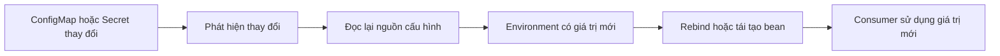
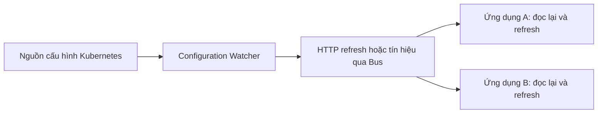

# Reload trong tiến trình và tình trạng hỗ trợ theo phiên bản

Trong chương **Cập nhật cấu hình** của module **SPRING_CLOUD_KUBERNETES**, một câu hỏi quan trọng là: sau khi ConfigMap hoặc Secret đổi, ứng dụng Spring đang chạy có thực sự sử dụng giá trị mới không? Câu trả lời phụ thuộc đồng thời vào cách nạp nguồn cấu hình, cơ chế phát hiện thay đổi, khả năng refresh của bean và phiên bản thư viện.

Spring Cloud Kubernetes từng cung cấp cơ chế để từng ứng dụng tự theo dõi nguồn cấu hình rồi kích hoạt cập nhật ngay trong tiến trình. Tài liệu gọi cơ chế này là **PropertySource Reload** và đánh dấu deprecated từ release train Spring Cloud **2020.0**, đồng thời chỉ tới Configuration Watcher như một lựa chọn thay thế. Deprecated không đồng nghĩa đã bị xóa khỏi mọi phiên bản về sau. [Cảnh báo trong tài liệu PropertySource Reload nhánh 3.3](https://docs.spring.io/spring-cloud-kubernetes/reference/3.3/property-source-config/propertysource-reload.html)

Bài phân biệt cơ chế cũ đó với việc refresh bean trong Spring Cloud Context, đối chiếu một số mốc phiên bản và đưa ra cách đánh giá một hệ thống đang vận hành. Ví dụ thực hành là `reload-demo` trong namespace `learning`, chỉ thay đổi một thông điệp và mã revision không nhạy cảm.

## 1. Tách phát hiện thay đổi khỏi áp dụng thay đổi

Một cập nhật cấu hình đi qua nhiều bước:



Mỗi mũi tên là một quan hệ cần được kiểm chứng. Việc Kubernetes API chấp nhận bản cập nhật chỉ xác nhận bước đầu; không xác nhận consumer đã đổi hành vi.

Cần phân biệt ba thuật ngữ:

| Thuật ngữ trong bài | Ý nghĩa |
| --- | --- |
| Reload nội bộ của Spring Cloud Kubernetes | Ứng dụng tự phát hiện thay đổi nguồn Kubernetes và chọn chiến lược cập nhật |
| Refresh trong tiến trình | Cập nhật môi trường thuộc tính và các bean có cơ chế refresh phù hợp trong ứng dụng đang chạy |
| Rollout Pod | Kubernetes tạo Pod mới theo Pod template mới hoặc yêu cầu rollout |

Configuration Watcher chuyển phần phát hiện và phát tín hiệu sang một controller bên ngoài ứng dụng. Tuy nhiên, nếu tín hiệu dẫn tới refresh, phần áp dụng vẫn diễn ra bên trong tiến trình ứng dụng. Vì vậy, khuyến nghị chuyển khỏi bộ theo dõi nội bộ không có nghĩa mọi hình thức refresh bean trong tiến trình đều bị deprecated.

Tương tự, nạp được một ConfigMap khi startup không chứng minh ứng dụng có bộ theo dõi thay đổi. Một thư viện có thể cung cấp PropertySource nhưng ứng dụng chỉ đọc nó một lần trong vòng đời khởi động.

## 2. Đọc đúng tình trạng hỗ trợ theo phiên bản

Khi xem một ví dụ trên mạng, cần biết nó dành cho **Spring Cloud Kubernetes phiên bản nào**, không chỉ biết phiên bản Kubernetes cluster.

Một bộ thông tin tối thiểu gồm:

- Spring Boot và Java.
- Release train Spring Cloud được BOM quản lý.
- Phiên bản Spring Cloud Kubernetes thực tế sau khi resolve dependency.
- Client đang dùng, chẳng hạn Fabric8 hay Kubernetes Java Client.
- Spring Cloud Context, Actuator và cách nạp cấu hình.
- Môi trường JVM thông thường hay AOT/native image.

Spring Cloud công bố bảng tương thích giữa release train và Spring Boot, đồng thời hướng dẫn quản lý dependency qua BOM `spring-cloud-dependencies`. Không chọn độc lập các phiên bản chỉ vì từng artifact đều tải về được. [Hướng dẫn chọn phiên bản Spring Cloud](https://spring.io/projects/spring-cloud/)

### Một số mốc đã đối chiếu

Bảng dưới đây trình bày những mốc có dẫn chứng cụ thể, không suy rộng rằng mọi bản vá hoặc mọi client đều có hành vi giống nhau:

| Mốc Spring Cloud Kubernetes | Dẫn chứng về reload nội bộ | Cách diễn giải |
| --- | --- | --- |
| `1.1.10.RELEASE` | Tài liệu mô tả PropertySource Reload và công tắc bật cơ chế này | Đây là cơ chế đã xuất hiện trong các hệ thống cũ; không dùng tài liệu lịch sử làm hướng dẫn nâng cấp hiện tại |
| `2.1.9` | Tài liệu vẫn có cơ chế này và ghi cảnh báo deprecated từ release train `2020.0` | Có mô tả không đồng nghĩa còn là hướng ưu tiên cho thiết kế mới |
| `3.3.3` | Tài liệu nhánh 3.3 vẫn cảnh báo deprecated; tag mã nguồn còn auto-configuration reload Fabric8 | Không thể kết luận cơ chế đã bị xóa chỉ vì ứng dụng dùng 3.x |
| `5.0.5` | Tài liệu nhánh 5.0 vẫn cảnh báo deprecated; tag mã nguồn còn auto-configuration reload Fabric8 | Không thể kết luận mọi bản mới hơn đã loại bỏ cơ chế này; phải kiểm tra chính phiên bản và classpath được triển khai |

Dẫn chứng cho các mốc lịch sử nằm trong [tài liệu 1.1.10.RELEASE](https://docs.spring.io/spring-cloud-kubernetes/docs/1.1.10.RELEASE/reference/html/#_propertysource_reload) và [tài liệu 2.1.9](https://docs.spring.io/spring-cloud-kubernetes/docs/2.1.9/reference/html/#_propertysource_reload). Hai tag có thể đối chiếu trực tiếp ở [auto-configuration Fabric8 v3.3.3](https://github.com/spring-cloud/spring-cloud-kubernetes/blob/v3.3.3/spring-cloud-kubernetes-fabric8-config/src/main/java/org/springframework/cloud/kubernetes/fabric8/config/reload/Fabric8ConfigReloadAutoConfiguration.java) và [auto-configuration Fabric8 v5.0.5](https://github.com/spring-cloud/spring-cloud-kubernetes/blob/v5.0.5/spring-cloud-kubernetes-fabric8-config/src/main/java/org/springframework/cloud/kubernetes/fabric8/config/reload/Fabric8ConfigReloadAutoConfiguration.java). [Tài liệu reload nhánh 5.0](https://docs.spring.io/spring-cloud-kubernetes/reference/5.0/property-source-config/propertysource-reload.html) ghi rõ trạng thái deprecated.

Có ba loại kết luận khác nhau:

1. **Còn hiện diện:** tài liệu hoặc mã nguồn của một phiên bản vẫn có cơ chế đó.
2. **Có thể kích hoạt trong ứng dụng:** classpath, auto-configuration, nguồn cấu hình và điều kiện chạy của ứng dụng đáp ứng yêu cầu.
3. **Còn được bảo trì hoặc hỗ trợ:** nhánh phát hành và chính sách hỗ trợ tương ứng còn hiệu lực.

Một class còn tồn tại không tự chứng minh cả ba điều. Ngược lại, việc một ứng dụng không reload được cũng chưa chứng minh thư viện đã xóa tính năng.

Mốc `2020.0` trong cảnh báo là tên release train Spring Cloud, không phải số phiên bản `2020.0` của thư viện Spring Cloud Kubernetes. Khi lập kế hoạch nâng cấp, cần kiểm tra cả trạng thái bảo trì của release train tại thời điểm thực hiện, không suy ra từ bảng mốc trong bài.

## 3. Hai chiều cấu hình của cơ chế reload cũ

Cơ chế cũ tách hai câu hỏi:

- **Khi nào phát hiện thay đổi?** Điều khiển bằng `mode`.
- **Phát hiện rồi thì làm gì?** Điều khiển bằng `strategy`.

### Chế độ phát hiện: event và polling

| Chế độ | Cách hoạt động | Điều cần kiểm tra |
| --- | --- | --- |
| `event` | Theo dõi sự kiện từ Kubernetes API rồi kiểm tra thay đổi nguồn liên quan | Kết nối API, namespace, quyền watch/list và nguồn được quan sát |
| `polling` | Định kỳ đọc lại nguồn và so sánh | Chu kỳ kiểm tra, chi phí đọc, nguồn có thực sự được loader đọc lại không |

Trong tag `3.3.3`, các giá trị mặc định của `ConfigReloadProperties` là: reload tắt, theo dõi ConfigMap bật, theo dõi Secret tắt, mode `EVENT`, strategy `REFRESH` và chu kỳ polling 15 giây. Đây là mô tả của một tag xác định, không phải lời hứa về mọi phiên bản tương lai. [Mã nguồn ConfigReloadProperties v3.3.3](https://github.com/spring-cloud/spring-cloud-kubernetes/blob/v3.3.3/spring-cloud-kubernetes-commons/src/main/java/org/springframework/cloud/kubernetes/commons/config/reload/ConfigReloadProperties.java)

Ví dụ phần lựa chọn polling:

```yaml
spring:
  cloud:
    kubernetes:
      reload:
        enabled: true
        mode: polling
        period: 15s
        strategy: refresh
```

Đây chỉ là **đoạn cấu hình cơ chế cũ**, chưa đủ để tạo ứng dụng reload được. Nó không tự bổ sung dependency, không đăng ký nguồn cấu hình và không cấp RBAC.

Đặc biệt, chuyển sang polling không có nghĩa ứng dụng thoát khỏi mọi yêu cầu quyền API. Nếu polling vẫn đọc ConfigMap qua API, ứng dụng vẫn cần quyền cho cách đọc đó. Polling cũng không phải một trình theo dõi tùy ý cho mọi file trên filesystem.

### Chiến lược áp dụng: refresh, restart_context và shutdown

| Chiến lược | Tác động chính | Không nên suy diễn |
| --- | --- | --- |
| `refresh` | Refresh các bean hoặc thuộc tính theo khả năng của Spring Cloud Context | Không tái tạo mọi singleton và không đổi mọi tài nguyên bên ngoài |
| `restart_context` | Đóng và tạo lại Spring ApplicationContext theo cơ chế restart tương ứng | Không đồng nghĩa Kubernetes đã tạo Pod mới |
| `shutdown` | Đóng context để tiến trình và môi trường triển khai thực hiện vòng khởi động lại phù hợp | Không bảo đảm tiến trình thoát sạch nếu còn thread không được quản lý đúng |

Tài liệu các phiên bản cũ mô tả ba chiến lược này; `restart_context` còn có điều kiện bật restart endpoint tương ứng. Không xem việc expose một endpoint là điều kiện duy nhất để chiến lược chạy đúng. [Mô tả chiến lược reload trong tài liệu 2.1.9](https://docs.spring.io/spring-cloud-kubernetes/docs/2.1.9/reference/html/#_propertysource_reload)

Với Deployment thông thường, container thoát có thể được kubelet khởi động lại trong **cùng Pod**. Khi đó Pod UID có thể giữ nguyên còn restart count tăng. Một rollout Deployment lại tạo Pod mới. Do vậy, cần ghi nhận cả UID, thời điểm khởi động và restart count khi xác định ứng dụng đã cập nhật bằng cách nào.

Không gọi chung mọi kết quả là “reload không gián đoạn”. Tái tạo context, đóng client, ngắt lịch xử lý hoặc restart container có thể ảnh hưởng tới request đang chạy và trạng thái trong bộ nhớ.

## 4. Nguồn cấu hình phải có đường nạp lại tương thích

Cần xác định ứng dụng lấy giá trị từ đâu:

| Nguồn sử dụng | Điều cần phân biệt |
| --- | --- |
| ConfigMap PropertySource đọc qua API | Đọc lúc khởi động và phát hiện/đọc lại khi chạy là hai khả năng riêng |
| File được mount từ ConfigMap | Kubelet cập nhật file và Spring nạp lại thuộc tính là hai bước khác nhau |
| Biến môi trường từ ConfigMap hoặc Secret | Giá trị trong tiến trình đang chạy không tự thay đổi theo bản cập nhật nguồn |
| Secret file | Việc file đổi không tự xoay vòng kết nối hay client đã khởi tạo |
| Giá trị đã sao chép vào field, cache hoặc đối tượng client | Consumer phải có cơ chế áp dụng lại |

Kubernetes cập nhật nội dung volume ConfigMap theo cơ chế có độ trễ; ConfigMap dùng qua biến môi trường cần khởi động lại để tiến trình nhận giá trị mới. Mount bằng `subPath` cũng không nhận cập nhật ConfigMap theo cách mount volume thông thường. [Hành vi sử dụng ConfigMap của Kubernetes](https://kubernetes.io/docs/concepts/configuration/configmap/)

Vì vậy, một watcher nhìn thấy sự kiện mới trước khi file trong Pod cập nhật có thể khiến refresh đọc lại nội dung cũ. Cần quan sát đầy đủ thời điểm dữ liệu đến consumer thay vì chỉ tăng số lần gửi tín hiệu refresh.

### Không trộn bootstrap với Config Data để thử vận may

Tài liệu Spring Cloud Kubernetes nhánh 3.3 mô tả hai cách nạp nguồn Kubernetes: dùng `spring.config.import: "kubernetes:"` hoặc dùng cơ chế bootstrap. Tài liệu yêu cầu chọn một cách, không kết hợp cả hai. [Kubernetes PropertySource implementations nhánh 3.3](https://docs.spring.io/spring-cloud-kubernetes/reference/3.3/property-source-config.html)

Ví dụ cho **cách Config Data**:

```yaml
spring:
  application:
    name: reload-demo
  config:
    import: "kubernetes:"
```

Đoạn này kích hoạt việc nạp nguồn Kubernetes theo cơ chế tương ứng; bản thân nó không bật bộ theo dõi reload cũ.

Một cấu hình kiểu `spring.cloud.kubernetes.reload.enabled=true` có thể được bind nhưng không tạo được detector nếu thiếu các bean điều kiện. Trong tag Fabric8 `3.3.3`, auto-configuration kiểm tra nền tảng Kubernetes, các class refresh cần thiết và PropertySourceLocator tương ứng khi tạo detector. Đây là ví dụ cụ thể cho lý do “có property” chưa đủ để kết luận “có cơ chế đang chạy”. [Điều kiện tạo detector trong Fabric8 v3.3.3](https://github.com/spring-cloud/spring-cloud-kubernetes/blob/v3.3.3/spring-cloud-kubernetes-fabric8-config/src/main/java/org/springframework/cloud/kubernetes/fabric8/config/reload/Fabric8ConfigReloadAutoConfiguration.java)

Không thêm nhiều starter hoặc bật đồng thời nhiều đường nạp chỉ để hết lỗi. Cần chọn mô hình nạp cấu hình rồi xác nhận detector của đúng client có hoạt động với mô hình đó trong phiên bản đã khóa.

## 5. Bean nào thực sự nhận được thay đổi?

`Environment` có giá trị mới không có nghĩa mọi đối tượng đã tạo trước đó đều đổi theo.

| Kiểu sử dụng thuộc tính | Hành vi cần đánh giá |
| --- | --- |
| Đọc trực tiếp từ `Environment` lúc xử lý | Có thể nhận giá trị mới nếu nguồn trong Environment thực sự được cập nhật |
| JavaBean `@ConfigurationProperties` có setter | Có cơ chế rebind; cần xét validation và đọc đồng thời |
| Bean thuộc `@RefreshScope` | Target được vô hiệu hóa và tạo lại theo vòng đời scope khi được sử dụng |
| `@Value` trong singleton thông thường | Không mặc định được inject lại chỉ vì nguồn thay đổi |
| Giá trị được sao chép vào biến `static` hoặc field khác | Bản sao không tự đồng bộ |
| HTTP client, executor, connection pool | Chỉ đổi khi tài nguyên đó có cơ chế cấu hình lại hoặc tái tạo phù hợp |

Spring Cloud Context mô tả refresh scope như proxy với target được tạo khi dùng và có cache. Làm mới scope vô hiệu hóa target cũ để lần sử dụng tiếp theo tạo target mới; nó không phải phép sửa mọi object trong heap. Tài liệu cũng lưu ý đặt `@RefreshScope` trên lớp `@Configuration` không tự đưa tất cả bean của lớp đó vào scope này. [Refresh Scope trong Spring Cloud Commons 4.3](https://docs.spring.io/spring-cloud-commons/reference/4.3/spring-cloud-commons/application-context-services.html#refresh-scope)

Một lỗi thường gặp:

```java
public final class PartnerCaller {
    private final PartnerClient client;

    public PartnerCaller(PartnerProperties properties) {
        this.client = PartnerClient.create(properties.getTimeout());
    }
}
```

Dù `PartnerProperties` được cập nhật, `client` trong ví dụ vẫn là đối tượng đã tạo với timeout cũ, trừ khi thư viện client hoặc code chủ động thay đổi nó. Tên lớp `PartnerClient` ở đây chỉ minh họa một consumer đã chụp giá trị cấu hình.

Với kết nối hoặc tác vụ đang chạy, còn cần quyết định khi nào đóng tài nguyên cũ, có cho phép hoàn tất tác vụ hiện tại không và làm sao ngăn consumer giữ tham chiếu cũ quá lâu.

### Giới hạn cần kiểm tra theo Spring Cloud Context

Tài liệu Commons 4.3 nêu các giới hạn đáng chú ý: record dùng `@ConfigurationProperties` không thể được refresh theo cơ chế được mô tả; `HikariDataSource` thuộc nhóm không refresh; context refresh không được hỗ trợ cho AOT/native image. [Các giới hạn refresh trong Commons 4.3](https://docs.spring.io/spring-cloud-commons/reference/4.3/spring-cloud-commons/application-context-services.html)

Không biến các nhận định này thành quy tắc “mọi record của Java đều không thể thay thế”. Chúng nói về cơ chế refresh của framework đang xét. Code tự quản lý snapshot có thể có cách thay thế riêng, nhưng đó là thiết kế khác và cần tự chịu trách nhiệm về vòng đời, validation và đồng bộ.

Khi một giá trị chỉ có ý nghĩa lúc khởi tạo tài nguyên, lựa chọn rollout Pod có thể dễ kiểm soát hơn xây thêm logic tái cấu hình trong tiến trình.

## 6. Thực hành nhận diện cơ chế legacy trên nhánh 3.3

Mục tiêu của ví dụ là nhìn thấy một bean được cập nhật trong tiến trình mà Pod không bị thay thế. Đây là **thí nghiệm cho cơ chế đã deprecated**, không phải cấu hình mặc định được đề xuất cho ứng dụng mới.

Ví dụ giới hạn ở JVM thông thường, Java 17 trở lên, Fabric8 và bộ dependency tương thích đã khóa với Spring Cloud Kubernetes `3.3.3`. Không dùng nguyên bộ phụ thuộc này để suy ra cấu hình dành cho `5.0.5`; hai nhánh phải được ghép với hệ Spring Boot và Spring Cloud phù hợp.

### 6.1. Các dependency cần cho thí nghiệm

Trong một dự án đã quản lý phiên bản bằng BOM tương thích, các dependency minh họa là:

```xml
<dependencies>
    <dependency>
        <groupId>org.springframework.boot</groupId>
        <artifactId>spring-boot-starter-web</artifactId>
    </dependency>
    <dependency>
        <groupId>org.springframework.boot</groupId>
        <artifactId>spring-boot-starter-actuator</artifactId>
    </dependency>
    <dependency>
        <groupId>org.springframework.cloud</groupId>
        <artifactId>spring-cloud-starter-kubernetes-fabric8-config</artifactId>
    </dependency>
    <dependency>
        <groupId>org.springframework.cloud</groupId>
        <artifactId>spring-cloud-starter-bootstrap</artifactId>
    </dependency>
</dependencies>
```

Đây là đoạn dependency, không phải một POM hoàn chỉnh. Cần xác nhận phiên bản artifact thực tế do BOM chọn; không ép riêng một artifact lên `3.3.3` trong khi các artifact liên quan thuộc nhánh khác.

Thí nghiệm chọn **bootstrap**, vì vậy không khai báo thêm `spring.config.import: "kubernetes:"`.

### 6.2. Cấu hình bootstrap nằm trong ứng dụng

```yaml
spring:
  application:
    name: reload-demo
  cloud:
    kubernetes:
      config:
        enabled: true
        name: reload-demo
        namespace: learning
      secrets:
        enabled: false
      reload:
        enabled: true
        mode: event
        strategy: refresh
        monitoring-config-maps: true
        monitoring-secrets: false
        namespaces:
          - learning

management:
  endpoints:
    web:
      exposure:
        include: health,info
```

Đặt các công tắc điều khiển detector ở cấu hình triển khai ổn định. Không thay đổi cơ chế tự theo dõi của ứng dụng thông qua chính ConfigMap đang được reload trong thí nghiệm.

Ứng dụng chạy trong Pod để đáp ứng điều kiện nền tảng Kubernetes. Chạy cùng cấu hình trên máy cá nhân còn cần kết nối API, namespace, danh tính và các điều kiện auto-configuration tương ứng; không thể chỉ sửa `enabled` rồi giả định môi trường đã giống cluster.

Ở mẫu này, refresh được kích hoạt bằng detector trong ứng dụng nên không cần mở HTTP endpoint `/actuator/refresh` để detector tự gọi vào chính nó. Actuator vẫn có vai trò cung cấp các thành phần cần trên classpath. Việc dùng controller bên ngoài gọi HTTP là một kiến trúc khác.

### 6.3. ConfigMap chỉ chứa dữ liệu thí nghiệm

Namespace `learning` được giả định đã tồn tại.

```yaml
apiVersion: v1
kind: ConfigMap
metadata:
  name: reload-demo
  namespace: learning
data:
  application.yaml: |
    demo:
      revision: r1
      message: Cau hinh ban dau
```

Thí nghiệm không bật lọc reload theo label và không triển khai Configuration Watcher. Không cần gắn label dành riêng cho Watcher bên ngoài chỉ để thử detector nội bộ.

Giữ revision trong cùng nội dung cấu hình với thông điệp giúp quan sát ứng dụng đã nạp bộ giá trị nào. Đây là revision do ứng dụng định nghĩa, không phải Kubernetes `resourceVersion` và không phải token dùng để điều khiển watch.

### 6.4. Bean có refresh scope và consumer đọc qua proxy

```java
package com.example.reload;

import org.springframework.boot.context.properties.ConfigurationProperties;
import org.springframework.cloud.context.config.annotation.RefreshScope;
import org.springframework.stereotype.Component;

@Component
@RefreshScope
@ConfigurationProperties(prefix = "demo")
public class DemoSettings {
    private String revision = "unconfigured";
    private String message = "Chua doc duoc nguon cau hinh";

    public String getRevision() {
        return revision;
    }

    public void setRevision(String revision) {
        this.revision = revision;
    }

    public String getMessage() {
        return message;
    }

    public void setMessage(String message) {
        this.message = message;
    }

    public Snapshot snapshot() {
        return new Snapshot(revision, message);
    }

    public record Snapshot(String revision, String message) {
    }
}
```

Lớp bean không khai báo `final` để phù hợp với proxy của scope. Record `Snapshot` chỉ là kết quả đọc, không phải record `@ConfigurationProperties` cần rebind.

Consumer gọi một phương thức lấy cặp giá trị:

```java
package com.example.reload;

import java.util.Map;

import org.springframework.web.bind.annotation.GetMapping;
import org.springframework.web.bind.annotation.RestController;

@RestController
public class DemoController {
    private final DemoSettings settings;

    public DemoController(DemoSettings settings) {
        this.settings = settings;
    }

    @GetMapping("/demo/config")
    public Map<String, String> config() {
        DemoSettings.Snapshot snapshot = settings.snapshot();
        String pod = System.getenv().getOrDefault("POD_NAME", "local");

        return Map.of(
                "pod", pod,
                "revision", snapshot.revision(),
                "message", snapshot.message());
    }
}
```

Điểm vào ứng dụng:

```java
package com.example.reload;

import org.springframework.boot.SpringApplication;
import org.springframework.boot.autoconfigure.SpringBootApplication;

@SpringBootApplication
public class ReloadDemoApplication {
    public static void main(String[] args) {
        SpringApplication.run(ReloadDemoApplication.class, args);
    }
}
```

Controller giữ proxy của `DemoSettings` và lấy snapshot lúc xử lý yêu cầu. Nó không sao chép thông điệp vào field riêng trong constructor. Phương thức `snapshot()` gom cặp giá trị vào một lần gọi target; đây không phải giao dịch cập nhật xuyên nhiều bean hay nhiều Pod.

### 6.5. Danh tính và quyền đọc ConfigMap

Role bên dưới chỉ phục vụ ConfigMap trong namespace thí nghiệm. Nó không cấp quyền đọc Secret, không cấp quyền ghi và không dùng `cluster-admin`.

```yaml
apiVersion: v1
kind: ServiceAccount
metadata:
  name: reload-demo
  namespace: learning
---
apiVersion: rbac.authorization.k8s.io/v1
kind: Role
metadata:
  name: reload-demo-config-reader
  namespace: learning
rules:
  - apiGroups: [""]
    resources: ["configmaps"]
    verbs: ["get", "list", "watch"]
---
apiVersion: rbac.authorization.k8s.io/v1
kind: RoleBinding
metadata:
  name: reload-demo-config-reader
  namespace: learning
subjects:
  - kind: ServiceAccount
    name: reload-demo
    namespace: learning
roleRef:
  apiGroup: rbac.authorization.k8s.io
  kind: Role
  name: reload-demo-config-reader
```

Role này có thể đọc ConfigMap trong namespace `learning`, không chỉ một tên duy nhất. Namespace thí nghiệm cần được chọn với phạm vi đó trong đầu. Nếu client hoặc detector thực hiện list/watch theo namespace, không thêm `resourceNames` rồi mặc định rằng mọi lệnh list/watch sẽ tự tương thích; cần kiểm tra cách request được xây dựng.

Một Deployment tối giản để nhìn thấy nhiều instance:

```yaml
apiVersion: apps/v1
kind: Deployment
metadata:
  name: reload-demo
  namespace: learning
spec:
  replicas: 2
  selector:
    matchLabels:
      app.kubernetes.io/name: reload-demo
  template:
    metadata:
      labels:
        app.kubernetes.io/name: reload-demo
    spec:
      serviceAccountName: reload-demo
      containers:
        - name: reload-demo
          image: registry.example.com/reload-demo:legacy-lab
          ports:
            - name: http
              containerPort: 8080
          env:
            - name: POD_NAME
              valueFrom:
                fieldRef:
                  fieldPath: metadata.name
```

Image là tên minh họa cần thay bằng image chứa ứng dụng và bootstrap ở trên. Mẫu chưa cấu hình đầy đủ probe, giới hạn tài nguyên hay bảo vệ endpoint cho môi trường vận hành. Nội dung thông điệp ở đây không nhạy cảm; không tạo endpoint tương tự để trả về toàn bộ Secret hoặc Environment thật.

### 6.6. Quan sát cập nhật trên từng Pod

Các lệnh dưới đây dành cho môi trường thực hành, không phải kết quả đã chạy sẵn:

```shell
kubectl -n learning get pods -l app.kubernetes.io/name=reload-demo
kubectl -n learning get configmap reload-demo
```

Đầu tiên gọi `/demo/config` trên từng Pod và ghi nhận revision `r1`, Pod UID cùng restart count. Có thể dùng port-forward tới từng Pod để tránh Service hoặc LoadBalancer che khuất instance đang được quan sát:

```shell
kubectl -n learning port-forward pod/<ten-pod-a> 18081:8080
```

Từ terminal khác:

```shell
curl http://localhost:18081/demo/config
```

Sau đó sửa manifest ConfigMap để giữ đầy đủ các khóa nhưng đổi nội dung thành:

```yaml
data:
  application.yaml: |
    demo:
      revision: r2
      message: Da cap nhat trong tien trinh
```

Áp dụng manifest đã sửa bằng quy trình thực hành, chờ detector xử lý và gọi lại từng Pod. Kết quả mong đợi của chiến lược `refresh` là:

| Quan sát | Kỳ vọng |
| --- | --- |
| ConfigMap | Chứa `r2` và thông điệp mới |
| Endpoint của Pod A | Trả revision `r2` |
| Endpoint của Pod B | Trả revision `r2` sau khi instance đó cập nhật |
| Pod UID | Không đổi do riêng lần refresh này |
| Container restart count | Không tăng do riêng lần refresh này |

Không chỉ gọi qua một Service vài lần rồi kết luận mọi Pod đã cập nhật. Cơ chế chọn instance có thể khiến nhiều request liên tiếp vào cùng Pod.

Nếu endpoint vẫn trả `unconfigured`, ưu tiên kiểm tra đường nạp nguồn lúc startup. Đừng tiếp tục chỉnh detector khi ứng dụng chưa đọc được ConfigMap ban đầu.

## 7. Refresh không phải giao dịch cấu hình của cả hệ thống

Giả sử có hai thuộc tính liên quan:

```yaml
payment:
  base-url: https://partner-v2.example.com
  api-version: v2
```

Nếu consumer đọc từng giá trị ở thời điểm khác nhau trong khi refresh diễn ra, hoặc các giá trị được giữ trong hai bean có vòng đời khác nhau, có thể xuất hiện một tổ hợp không mong muốn. Một số cách rebind còn cập nhật đối tượng đang tồn tại theo từng bước.

`ConfigurationPropertiesRebinder` là thành phần có trách nhiệm xử lý rebind cho các bean cấu hình liên quan khi nhận thay đổi môi trường; không nên suy từ chữ “rebind” ra tính nguyên tử trên mọi consumer. [Mã nguồn ConfigurationPropertiesRebinder v4.3.3](https://github.com/spring-cloud/spring-cloud-commons/blob/v4.3.3/spring-cloud-context/src/main/java/org/springframework/cloud/context/properties/ConfigurationPropertiesRebinder.java)

Với nhóm thuộc tính cần đi cùng nhau, cân nhắc:

- Giữ nhóm thuộc tính thành một hợp đồng có revision rõ ràng.
- Kiểm tra đầy đủ tính tương thích của bộ giá trị trước khi sử dụng.
- Đọc một snapshot cho toàn bộ thao tác cần nhất quán.
- Chuyển tài nguyên theo vòng đời được quản lý, không đóng client cũ khi request còn dùng.
- Chấp nhận và thiết kế rõ giai đoạn các Pod chạy revision khác nhau, hoặc dùng chiến lược phát hành khác.

Refresh scope quản lý việc hủy target và khởi tạo lại theo định nghĩa bean; các callback vòng đời vẫn có ý nghĩa. Điều đó giúp tổ chức một số thay đổi trong tiến trình, nhưng không tạo giao dịch với dịch vụ đối tác hoặc cơ sở dữ liệu. [Vòng đời target trong RefreshScope v4.3.3](https://github.com/spring-cloud/spring-cloud-commons/blob/v4.3.3/spring-cloud-context/src/main/java/org/springframework/cloud/context/scope/refresh/RefreshScope.java)

Không mặc định rằng validation thất bại sẽ giữ nguyên toàn bộ trạng thái cũ. Tùy đường rebind hoặc tái tạo, lỗi có thể xuất hiện khi xử lý sự kiện hoặc ở lần gọi bean tiếp theo. Nếu cần bảo đảm giữ bản hợp lệ gần nhất, phải có thiết kế kiểm tra, công bố snapshot và phục hồi tương ứng.

Việc xóa khóa cũng phải được thử riêng. Đừng dùng “xóa khóa rồi refresh” như cách reset chắc chắn về giá trị mặc định; tài liệu Spring Cloud Context có lưu ý về giới hạn của thay đổi bằng cách loại bỏ thuộc tính. [Lưu ý về xóa cấu hình khi refresh](https://docs.spring.io/spring-cloud-commons/reference/spring-cloud-commons/application-context-services.html#refresh-scope)

## 8. Chuyển sang Configuration Watcher hoặc rollout

Deprecated là lý do để đánh giá phương án thay thế có kế hoạch. Nó không yêu cầu xóa gấp cơ chế đang chạy mà chưa xác nhận đường cập nhật mới.

### Configuration Watcher thay đổi nơi phát hiện, không xóa giới hạn của bean

Luồng tham khảo:



Tài liệu Watcher nhánh 3.3 mô tả controller kích hoạt refresh qua HTTP hoặc Spring Cloud Bus. Với nguồn mount thành file, tài liệu còn mô tả độ trễ refresh để tính tới thời gian volume cập nhật. [Configuration Watcher nhánh 3.3](https://docs.spring.io/spring-cloud-kubernetes/reference/3.3/spring-cloud-kubernetes-configuration-watcher.html)

Việc chuyển phát hiện ra ngoài không làm cho `@Value` trong mọi singleton, connection pool hoặc record cấu hình tự nhiên trở nên refresh được. Phần đánh giá consumer vẫn giữ nguyên.

Không sao chép nguyên cấu hình `spring.cloud.kubernetes.reload.enabled` của ứng dụng cũ sang controller rồi cho rằng đã di chuyển xong. Phải đối chiếu cấu hình, label chọn nguồn, cách xác định ứng dụng đích và giao thức thông báo của đúng phiên bản Watcher.

Trong một kế hoạch chuyển đổi:

1. Xác nhận nguồn cấu hình và revision mà từng instance đang dùng.
2. Chọn HTTP hoặc messaging và thiết kế danh tính, quyền truy cập tương ứng.
3. Chuẩn bị controller, phạm vi quan sát và tuyến thông báo tới ứng dụng.
4. Thử trên một phạm vi nhỏ với giá trị không nhạy cảm.
5. Tắt detector nội bộ khi chuyển quyền phát hiện sang cơ chế mới.
6. Theo dõi việc áp dụng thực tế trên từng instance và giữ phương án phục hồi.

Tránh để detector cũ và Watcher cùng gây refresh mà không có chủ đích. Hai luồng có thể tạo thông báo lặp, gây khó chẩn đoán hoặc tái tạo tài nguyên nhiều lần.

### Rollout phù hợp với cấu hình được đọc khi khởi động

Khi cần thay biến môi trường, đổi tài nguyên khó refresh, chạy native image hoặc cần một vòng khởi tạo mới rõ ràng, có thể chọn cấu hình theo phiên bản và rollout.

Một mẫu triển khai thường dùng là tạo ConfigMap mới, đổi tham chiếu trong Pod template, rồi theo dõi các Pod mới vượt qua readiness. Sửa ConfigMap có tên giữ nguyên không tự làm Deployment tạo một rollout.

Rollout cần tính tới startup, thời gian làm ấm cache, readiness và giai đoạn Pod cũ/mới cùng tồn tại. Cách này cũng không tự bảo đảm toàn cluster đổi revision tại cùng một thời điểm, nhưng gắn rõ bộ cấu hình với vòng đời Pod mới.

DiscoveryClient và Spring Cloud LoadBalancer có thể ảnh hưởng cách tìm hoặc chọn instance khi gọi dịch vụ; chúng không thay thế cơ chế cập nhật cấu hình. Khi chẩn đoán, nên kiểm tra từng Pod trực tiếp trước khi kết luận từ hành vi qua discovery hoặc cân bằng tải.

## 9. RBAC, endpoint và trạng thái sức khỏe theo đúng kiến trúc

| Phương án | Chủ thể cần quyền quan sát nguồn Kubernetes | Điểm phải bảo vệ hoặc theo dõi |
| --- | --- | --- |
| Detector nội bộ qua API | Từng ứng dụng có detector | Phạm vi đọc/list/watch, xử lý lỗi detector và kết nối API |
| Watcher + ứng dụng đọc cấu hình qua API | Controller và ứng dụng, theo trách nhiệm riêng | Quyền của controller, quyền loader, danh tính gọi refresh |
| Watcher + ứng dụng đọc file mount | Controller; ứng dụng có thể không cần quyền API chỉ để đọc file | Thời điểm file cập nhật và tuyến refresh |
| Rollout với file mount hoặc biến môi trường | Quyền triển khai thuộc chủ thể quản lý workload | Pod mới có đúng nguồn, readiness và tiến trình rollout |

Không cấp quyền ghi hoặc xóa Secret chỉ vì ứng dụng cần phát hiện thay đổi. Không dùng tên role tích hợp sẵn như một bảo đảm về quyền tối thiểu; quyền cần thiết phụ thuộc loại tài nguyên và request thực tế của client.

Nếu dùng HTTP refresh, chỉ expose endpoint cần thiết và bảo vệ bằng danh tính cùng chính sách truy cập thích hợp. Mở `/actuator/refresh` ra mạng công khai không phải một yêu cầu của tính năng refresh.

Khi một cập nhật lỗi, cần phân biệt:

- Tiến trình bị treo hoặc không còn hoạt động: xem xét tín hiệu liveness.
- Tiến trình còn chạy nhưng cấu hình hoặc tài nguyên mới chưa dùng được: xem xét khả năng phục vụ và readiness.
- Detector mất kết nối nhưng consumer vẫn có bộ cấu hình hợp lệ: theo dõi trạng thái đồng bộ và chính sách độ cũ, không mặc định restart mọi Pod.

Nếu context hoặc container khởi động lại, các tác vụ nền phải đóng đúng vòng đời. Một vòng restart lặp do cấu hình sai có thể làm mất khả năng phục vụ nhanh hơn một lỗi refresh được phát hiện và xử lý có kiểm soát.

## 10. Chẩn đoán theo chuỗi, không theo một property duy nhất

| Hiện tượng | Bước cần xác minh |
| --- | --- |
| ConfigMap đổi nhưng không có log detector | Đúng phiên bản, starter, nền tảng chạy, namespace, điều kiện auto-configuration và RBAC? |
| Có sự kiện nhưng Environment vẫn cũ | Loader có đọc lại đúng nguồn, có nguồn ưu tiên cao hơn hoặc file chưa cập nhật không? |
| Environment mới nhưng endpoint vẫn cũ | Bean có refresh được không, consumer có giữ bản sao hoặc client tạo sẵn không? |
| Chỉ một số Pod đổi | Detector hoặc tuyến thông báo của từng instance, kết nối API và lỗi áp dụng trên Pod đó |
| Revision mới xuất hiện nhưng request lỗi | Validation, tương thích của nhóm thuộc tính và vòng đời tài nguyên mới |
| Restart count tăng | Có dùng shutdown, tiến trình crash, lỗi probe hay thay đổi khác đồng thời không? |
| Nâng cấp xong reload ngừng hoạt động | Dependency thực tế, class điều kiện, đường bootstrap/Config Data và thay đổi của client |
| Native image không refresh | Đối chiếu giới hạn AOT/native của Spring Cloud Context, chọn cơ chế cập nhật phù hợp |

Một hồ sơ quan sát tối thiểu nên ghi: Pod, thời điểm, revision mong đợi, revision đang dùng, cách phát hiện, kết quả áp dụng và nguyên nhân lỗi nếu có. Không dùng log toàn bộ Secret hoặc dump toàn bộ Environment làm cách xác nhận cập nhật.

Nên thử riêng các tình huống: thay giá trị hợp lệ, giá trị sai kiểu, xóa khóa, mất kết nối API, lỗi quyền và một Pod bỏ lỡ lần cập nhật. Đây là những hành vi của cơ chế cập nhật cần hiểu trước khi đưa nó vào quy trình phát hành.

## 11. Ra quyết định cho một hệ thống cụ thể

Khi tiếp nhận ứng dụng đang dùng reload nội bộ, hãy lập một bản ghi ngắn gồm:

| Mục | Nội dung cần chốt |
| --- | --- |
| Bộ phiên bản | Boot, release train, Kubernetes client, Context và artifact reload thực tế |
| Trạng thái tính năng | Deprecated, còn trong tag nào, điều kiện kích hoạt có đáp ứng không |
| Nguồn cấu hình | API, file mount hay biến môi trường; bootstrap hay Config Data |
| Consumer | Bean nào refresh được, tài nguyên nào cần tái tạo hoặc rollout |
| Phạm vi quyền | Ai đọc ConfigMap/Secret, ai gửi tín hiệu và ai triển khai |
| Bằng chứng áp dụng | Cách xác định revision thực tế của từng instance |
| Phục hồi | Làm gì nếu refresh thất bại hoặc chỉ một phần instance cập nhật |

Có thể tiếp tục duy trì tạm thời cơ chế cũ trong một hệ thống đã được kiểm chứng, đồng thời lên kế hoạch thay thế. Với thiết kế mới, đánh giá Configuration Watcher nếu cần refresh, hoặc rollout nếu việc áp dụng gắn với khởi tạo ứng dụng.

Quyết định cuối cùng cần dựa trên phiên bản đã khóa và vòng đời của consumer: biết một property vẫn xuất hiện trong tài liệu là chưa đủ; phải chỉ ra đường phát hiện, đọc lại và áp dụng cấu hình thực sự chạy được trong ứng dụng đó.
