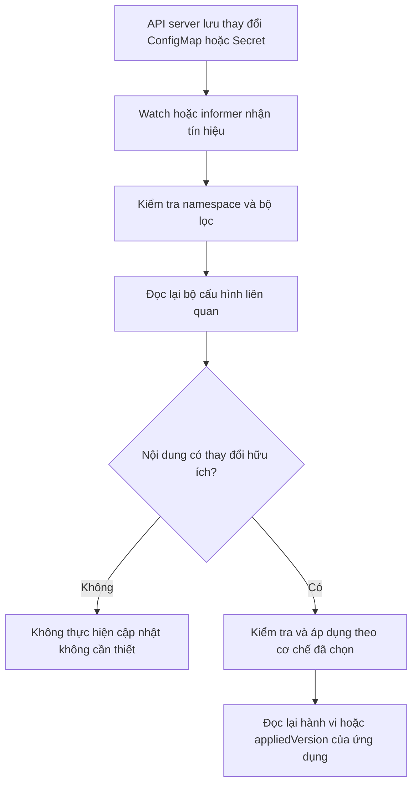

# Cơ chế theo dõi sự kiện và thăm dò định kỳ khi được hỗ trợ

## 1. Trước khi chọn cơ chế, xác định thành phần nào đang hỗ trợ nó

Một ConfigMap được sửa lúc 10:00:00, nhưng đến 10:00:20 ứng dụng mới dùng giá trị mới. Độ trễ đó có thể đến từ lịch thăm dò, truyền dữ liệu xuống volume, phân phối thông báo hoặc việc cập nhật bean. Muốn giải thích đúng, cần biết ai phát hiện thay đổi và ai áp dụng nó.

Trong module **SPRING_CLOUD_KUBERNETES**, bài thuộc chương **Cập nhật cấu hình**, tập trung vào hai cách phát hiện thay đổi:

- **Theo dõi sự kiện, event/watch:** đăng ký nhận thông báo khi nguồn thay đổi.
- **Thăm dò định kỳ, polling:** chủ động đọc lại nguồn theo lịch rồi so sánh trạng thái.

Cụm từ **“khi được hỗ trợ”** rất quan trọng. Không phải mọi starter, Kubernetes client, đường cung cấp cấu hình và phiên bản đều cung cấp cùng các chế độ hoặc dùng cùng tên thuộc tính.

Bài dùng Spring Cloud Kubernetes **3.3.x** làm mốc cho những thuộc tính cụ thể. Tài liệu của dòng này vẫn mô tả PropertySource Reload với event và polling, nhưng tính năng đó đã deprecated từ release 2020.0; Configuration Watcher là phương án khác được tài liệu chỉ dẫn. Không lấy ví dụ của cơ chế cũ để suy ra công tắc cấu hình của watcher. Xem [PropertySource Reload 3.3](https://docs.spring.io/spring-cloud-kubernetes/reference/3.3/property-source-config/propertysource-reload.html).

| Thành phần hoặc đường dữ liệu | Câu hỏi cần trả lời trước khi cấu hình |
| --- | --- |
| PropertySource Reload cũ bên trong ứng dụng | Phiên bản và client đang dùng còn tạo detector event/polling tương ứng không? |
| Configuration Watcher triển khai riêng | Watcher quan sát nguồn nào, gửi thông báo theo cách nào, ứng dụng nào nhận? |
| File ConfigMap/Secret được mount | Ai cập nhật file, ai đọc lại file và ai cập nhật đối tượng Java? |
| Biến môi trường của tiến trình | Có kế hoạch tạo tiến trình mới để nhận giá trị mới không? |
| Bộ theo dõi do đội phát triển tự viết | Ai chịu trách nhiệm retry, so sánh, validation và áp dụng cấu hình? |

Các ví dụ bên dưới là hướng dẫn cùng kết quả kỳ vọng, chưa phải báo cáo đã chạy trên cluster.

## 2. Theo dõi sự kiện: nhận tín hiệu rồi kiểm tra trạng thái

### 2.1. Một sự kiện chưa phải cấu hình đã được áp dụng

Ở mức Kubernetes API, watch cung cấp luồng thông báo thay đổi tài nguyên. Client thường cần thiết lập trạng thái ban đầu và duy trì việc theo dõi từ mốc resourceVersion thích hợp. Đây là thông báo thay đổi của đối tượng API, khác với tài nguyên Event thường xem bằng kubectl get events. Xem [Kubernetes API: Efficient detection of changes](https://kubernetes.io/docs/reference/using-api/api-concepts/#efficient-detection-of-changes).

Một đường xử lý có thể được thiết kế như sau:



Sơ đồ mô tả các trách nhiệm cần phân biệt, không khẳng định mọi implementation thực hiện cùng một thuật toán. Có thành phần chỉ phát thông báo; có thành phần vừa đọc lại vừa kích hoạt refresh.

Trong triển khai Fabric8 của PropertySource Reload 3.3.3, detector tạo informer theo namespace, có nhánh lọc label và chỉ xử lý update khi data của ConfigMap thay đổi. Vì thế một thay đổi metadata nhìn thấy trên watch không nhất thiết gây reload. Xem [Fabric8EventBasedConfigMapChangeDetector 3.3.3](https://github.com/spring-cloud/spring-cloud-kubernetes/blob/v3.3.3/spring-cloud-kubernetes-fabric8-config/src/main/java/org/springframework/cloud/kubernetes/fabric8/config/reload/Fabric8EventBasedConfigMapChangeDetector.java).

### 2.2. Ưu điểm và chi phí của watch

Watch phù hợp khi cần phản ứng tương đối nhanh và nguồn ít thay đổi so với số lần có thể phải đọc lại theo lịch. Hệ thống không phải chủ động hỏi “đã đổi chưa?” ở mọi chu kỳ chỉ để nhận lại cùng một dữ liệu.

Tuy vậy, watch vẫn có chi phí: kết nối, bộ nhớ cache, xử lý callback, thiết lập lại quan sát và phân phối thông báo tới các replica. Nếu mỗi Pod tự tạo bộ theo dõi cho nhiều namespace và loại tài nguyên, tổng số bộ theo dõi có thể lớn.

Một controller dùng chung có thể giảm việc mỗi ứng dụng tự quan sát nguồn, nhưng vẫn cần giải quyết khâu tìm instance và gửi thông báo. Đừng chỉ đếm số kết nối tới API server mà bỏ qua tải fan-out đến ứng dụng.

### 2.3. Mất kết nối là một trạng thái vận hành cần xử lý

Không thiết kế consumer với giả định mỗi lần sửa cấu hình sẽ được xử lý đúng một lần trong mọi tình huống. Khi stream kết thúc, reconnect, cache đồng bộ lại hoặc tiến trình khởi động lại, hệ thống cần phục hồi việc quan sát và đối chiếu trạng thái hiện tại.

Kubernetes có thể trả 410 Gone khi resourceVersion yêu cầu đã quá cũ; client phải xử lý bằng cách lấy trạng thái mới rồi thiết lập lại watch. Không tự tăng resourceVersion bằng phép cộng hoặc dùng nó làm số phiên bản nghiệp vụ. Xem [Kubernetes API: xử lý lịch sử watch không còn khả dụng](https://kubernetes.io/docs/reference/using-api/api-concepts/#efficient-detection-of-changes).

Đối với cấu hình, câu hỏi thường là “đã hội tụ về bộ giá trị được chấp nhận hiện tại chưa?”. Nếu nghiệp vụ cần lưu mọi lần chuyển trạng thái để kiểm toán, hãy có lịch sử phát hành hoặc hệ thống audit riêng. Một callback cấu hình không thay thế một hàng đợi sự kiện nghiệp vụ có hợp đồng lưu trữ.

## 3. Polling: đọc snapshot theo lịch và so sánh

### 3.1. Chu kỳ gồm nhiều việc hơn một lần sleep

Một bộ thăm dò có thể thực hiện:

```text
Đợi đến lượt đọc
    -> lấy bộ dữ liệu nguồn
    -> kiểm tra lần đọc có thành công và đủ dữ liệu không
    -> so sánh với mốc liên quan
    -> nếu cần thì kiểm tra và áp dụng cấu hình
    -> ghi nhận kết quả
    -> lên lịch lần tiếp theo
```

Polling không có nghĩa “cứ đến chu kỳ là restart”. Việc đọc, phát hiện khác biệt và lựa chọn hành động sau khác biệt là các bước riêng.

Trong mã nguồn 3.3.3, PollingConfigMapChangeDetector lên lịch một tác vụ, đọc lại qua PropertySourceLocator và chỉ gọi chiến lược cập nhật khi hàm kiểm tra báo thay đổi. Xem [PollingConfigMapChangeDetector 3.3.3](https://github.com/spring-cloud/spring-cloud-kubernetes/blob/v3.3.3/spring-cloud-kubernetes-commons/src/main/java/org/springframework/cloud/kubernetes/commons/config/reload/PollingConfigMapChangeDetector.java).

ConfigReloadUtil còn kiểm tra các PropertySource phù hợp đã tồn tại trong Environment. Không có nguồn thuộc loại cần theo dõi, hoặc cấu trúc nguồn không phù hợp, không đồng nghĩa detector sẽ tự tạo một đường nạp cấu hình hoàn chỉnh. Xem [ConfigReloadUtil 3.3.3](https://github.com/spring-cloud/spring-cloud-kubernetes/blob/v3.3.3/spring-cloud-kubernetes-commons/src/main/java/org/springframework/cloud/kubernetes/commons/config/reload/ConfigReloadUtil.java).

### 3.2. Độ trễ phát hiện và độ trễ áp dụng khác nhau

Gọi P là khoảng chờ giữa các lượt đọc trong mô hình đơn giản. Nếu thao tác đọc nhanh và lịch chạy đều, một thay đổi thường phải đợi từ gần 0 đến gần P trước khi được quan sát. Đây là mô hình ước lượng, không phải SLA cứng của Spring Cloud Kubernetes.

Ví dụ P = 15 giây:

```text
Lượt đọc:         00s                  15s                  30s
Nguồn:           v1 ---- v2 ---- v3 ----------------------- v3
Mẫu quan sát:     v1                   v3                   v3
```

V2 có thể tồn tại rồi bị thay bởi v3 giữa hai lượt đọc. Polling vẫn có thể hội tụ về v3 mà không từng quan sát v2. Watch cũng cần được đánh giá cùng khả năng phục hồi sau gián đoạn; không mặc định biến nó thành lịch sử bền vững của mọi phát hành.

Để ước lượng lúc ứng dụng thực sự đổi hành vi, cần cộng thêm các thành phần:

```text
Độ trễ áp dụng
≈ độ trễ nhìn thấy dữ liệu nguồn
+ thời gian chờ phát hiện
+ thời gian đọc và kiểm tra
+ thời gian phân phối thông báo nếu có
+ thời gian cập nhật consumer
```

Với volume mount, “nguồn có thể đọc” là nội dung đã xuất hiện trong file của Pod. Rút chu kỳ polling xuống 1 giây không loại bỏ độ trễ truyền dữ liệu xuống volume.

### 3.3. Ước lượng tải trước khi giảm chu kỳ

Nếu có N bộ thăm dò, mỗi chu kỳ thực sự phát q yêu cầu API, chu kỳ xấp xỉ P giây, tốc độ đọc nền có thể ước lượng:

```text
R ≈ N × q / P    yêu cầu mỗi giây
```

Ví dụ 30 ứng dụng, mỗi ứng dụng 3 replica, mỗi replica phát 2 yêu cầu ở mỗi chu kỳ 15 giây:

```text
N = 30 × 3 = 90
R ≈ 90 × 2 / 15 = 12 yêu cầu/giây
```

Đây là phép tính minh họa, chưa gồm retry, relist, đợt khởi động đồng thời hoặc các lệnh quản trị. Q phải được đo theo client và cache thực tế; không mặc định mỗi khóa cấu hình tương ứng một request.

Nếu tất cả tiến trình cùng thăm dò tại một thời điểm, tải đỉnh có thể lớn dù R trung bình nhỏ. Với cơ chế tự xây, cân nhắc lịch lệch nhau, jitter và backoff; với thư viện có sẵn, chỉ dùng các tùy chọn thật sự được phiên bản đó hỗ trợ.

## 4. Cấu hình event và polling trong cơ chế reload cũ còn được hỗ trợ

### 4.1. Phân biệt ba nhóm thuộc tính

Những tên dưới đây thuộc **PropertySource Reload**, không phải giao diện cấu hình chung của mọi watcher:

| Thuộc tính dưới spring.cloud.kubernetes.reload | Ý nghĩa | Mốc mặc định trong 3.3.3 |
| --- | --- | --- |
| enabled | Cho phép cơ chế reload hoạt động | false |
| mode | Cách phát hiện: event hoặc polling | event |
| strategy | Hành động: refresh, restart_context hoặc shutdown | refresh |
| period | Khoảng thời gian dùng cho polling | 15s |
| monitoring-config-maps | Theo dõi ConfigMap | true |
| monitoring-secrets | Theo dõi Secret | false |

Các kiểu và giá trị mặc định này có trong [ConfigReloadProperties 3.3.3](https://github.com/spring-cloud/spring-cloud-kubernetes/blob/v3.3.3/spring-cloud-kubernetes-commons/src/main/java/org/springframework/cloud/kubernetes/commons/config/reload/ConfigReloadProperties.java).

Có thể có mode = polling và strategy = refresh: định kỳ kiểm tra rồi refresh nếu có khác biệt. Mode = event không có nghĩa phải restart Pod; nó chỉ nói về cách phát hiện.

### 4.2. Ví dụ cấu hình theo sự kiện

Ví dụ sau giả định:

- Dự án JVM đã dùng bộ Spring Boot/Spring Cloud tương thích với Spring Cloud Kubernetes 3.3.x.
- Có starter Config của họ Fabric8, nguồn ConfigMap được nạp thành Kubernetes PropertySource.
- ServiceAccount có quyền đọc và theo dõi đúng namespace.
- Consumer đã được thiết kế để áp dụng cấu hình khi refresh.

Đây là phần cấu hình tích hợp, không phải một ứng dụng hoàn chỉnh chỉ cần chép YAML là chạy:

```yaml
spring:
  application:
    name: observer-demo
  config:
    import: "kubernetes:"
  cloud:
    kubernetes:
      config:
        name: signal-demo
        namespace: config-observe-lab
        include-profile-specific-sources: false
      reload:
        enabled: true
        mode: event
        strategy: refresh
        monitoring-config-maps: true
        monitoring-secrets: false
        namespaces:
          - config-observe-lab
        enable-reload-filtering: true
```

Nguồn cần vượt qua bộ lọc informer của ví dụ:

```yaml
apiVersion: v1
kind: ConfigMap
metadata:
  name: signal-demo
  namespace: config-observe-lab
  labels:
    spring.cloud.kubernetes.config.informer.enabled: "true"
data:
  demo.version: v1
  demo.message: alpha
```

Config Data import và bootstrap là hai đường nạp cần lựa chọn theo dự án; không bật cả hai như hai cách “bổ sung cho chắc”. Với ví dụ trên, nguồn được chọn bằng name và namespace một cách tường minh. Xem [Kubernetes PropertySource implementations](https://docs.spring.io/spring-cloud-kubernetes/reference/3.3/property-source-config.html).

Namespace theo dõi và namespace nạp dữ liệu cần được đối chiếu với nhau. Quan sát được một ConfigMap không có nghĩa ConfigMap đó đã được chọn làm PropertySource của ứng dụng.

### 4.3. Biến thể polling

Nếu hệ thống đang duy trì cơ chế reload cũ và phiên bản thực tế hỗ trợ detector polling, giữ phần khai báo nguồn cấu hình, thay phần reload bằng:

```yaml
spring:
  cloud:
    kubernetes:
      reload:
        enabled: true
        mode: polling
        strategy: refresh
        period: 15s
        monitoring-config-maps: true
        monitoring-secrets: false
```

Hai đoạn reload là lựa chọn thay thế cho nhau. Không tạo hai khóa spring ở cùng cấp trong một tài liệu YAML khi ghép ví dụ.

Khai báo đơn vị rõ ràng cho period. Chỉ giảm chu kỳ sau khi đo được độ trễ và tải. Với polling, phạm vi dữ liệu được đọc phải được xác định từ cấu hình nguồn và implementation đang dùng; không suy rằng danh sách namespaces dành cho event tự biến thành một lệnh polling mọi namespace.

Theo mã ConfigReloadProperties 3.3.3, namespaces và enable-reload-filtering là các tùy chọn liên quan đến event. Vì vậy, thay mode nhưng vẫn giữ nguyên kỳ vọng về bộ lọc là một lỗi thiết kế dễ gặp.

Các thuộc tính điều khiển reload nên nằm trong cấu hình khởi động được kiểm soát, không nằm trong chính ConfigMap/Secret đang được reload. Tài liệu cũng lưu ý việc xóa khóa hoặc xóa toàn bộ ConfigMap không tự khôi phục trạng thái ban đầu của bean ở mức refresh. Xem [Reload namespace and label filtering](https://docs.spring.io/spring-cloud-kubernetes/reference/3.3/property-source-config/namespace-label-filtering.html).

### 4.4. Xác nhận detector đã được tạo trước khi đo kết quả

Trong phiên bản mã nguồn đã tham chiếu, có thể tìm các thông báo như:

```text
Kubernetes event-based configMap change detector activated
Kubernetes polling configMap change detector activated
```

Đây là chuỗi log tham khảo từ implementation, không phải log đã thu được trong bài. Đối chiếu tên lớp và thông báo với đúng phiên bản đang chạy.

Một log “activated” chỉ xác nhận detector đã được tạo; nó không chứng minh nguồn được chọn đúng, lượt đọc tiếp theo thành công hoặc consumer đã dùng dữ liệu mới.

## 5. Configuration Watcher là một kiến trúc khác

Configuration Watcher là controller riêng, theo dõi nguồn rồi gửi thông báo refresh bằng HTTP hoặc Spring Cloud Bus. Trong dòng 3.3, các label chọn nguồn phát thông báo là spring.cloud.kubernetes.config hoặc spring.cloud.kubernetes.secret với giá trị "true"; HTTP dùng DiscoveryClient tìm instance đích. Xem [Configuration Watcher 3.3](https://docs.spring.io/spring-cloud-kubernetes/reference/3.3/spring-cloud-kubernetes-configuration-watcher.html).

Ba loại thiết lập dễ bị nhầm:

| Thiết lập | Trách nhiệm |
| --- | --- |
| reload.mode của cơ chế cũ | Chọn detector event/polling trong cơ chế đó |
| Label chọn nguồn của watcher | Xác định nguồn được phép phát thông báo |
| Refresh delay của watcher | Trì hoãn thông báo, hữu ích khi phải chờ file mount |

Refresh delay không phải chu kỳ polling. Đặt reload.mode = polling vào một ứng dụng không chứng minh controller watcher đã chuyển sang thăm dò.

Tương tự, một tùy chọn resync của informer, nếu client có hỗ trợ, không nên được diễn giải thành cùng hợp đồng với “đọc lại cấu hình qua API mỗi P giây”. Cần xem hành vi của implementation: có đọc mạng, dùng cache hay chỉ phát lại callback.

Không mặc định bật đồng thời watcher riêng và detector cũ trong mỗi ứng dụng. Khi có nhiều đường kích hoạt, phải biết cách tránh thao tác trùng và cách truy ra nguồn của mỗi lần cập nhật.

DiscoveryClient có vai trò tìm instance; Spring Cloud LoadBalancer có vai trò phân phối lời gọi. Việc thêm hai tính năng đó vào ứng dụng không tự tạo một bộ theo dõi ConfigMap hoặc Secret.

## 6. Quyền truy cập và nguồn dữ liệu quyết định khả năng quan sát

### 6.1. Polling không đồng nghĩa không cần RBAC

| Đường truy cập | Quyền hoặc điều kiện cần kiểm tra |
| --- | --- |
| Watch qua Kubernetes API | Danh tính client, namespace, quyền list/watch và các thao tác đọc mà client thực hiện |
| Polling qua Kubernetes API | Quyền get/list theo đường truy xuất thực tế |
| Polling file đã mount | Quyền đọc file; không cần cấp quyền API cho ứng dụng chỉ để nó đọc file |
| Watcher riêng | Quyền của ServiceAccount watcher, thêm nhu cầu discovery/phân phối của controller |
| Người chạy lệnh lab | Quyền của kubeconfig đang dùng, độc lập với ServiceAccount trong Pod |

Ví dụ Role cho **client đọc và watch ConfigMap** trong một namespace đã tồn tại:

```yaml
apiVersion: rbac.authorization.k8s.io/v1
kind: Role
metadata:
  name: config-observer
  namespace: config-observe-lab
rules:
  - apiGroups: [""]
    resources: ["configmaps"]
    verbs: ["get", "list", "watch"]
---
apiVersion: rbac.authorization.k8s.io/v1
kind: RoleBinding
metadata:
  name: config-observer
  namespace: config-observe-lab
subjects:
  - kind: ServiceAccount
    name: observer-app
    namespace: config-observe-lab
roleRef:
  apiGroup: rbac.authorization.k8s.io
  kind: Role
  name: config-observer
```

ServiceAccount observer-app phải được tạo và gán cho Pod tương ứng nếu dùng ví dụ này. Role không bao gồm Secret hoặc các tài nguyên discovery, nên không phải manifest quyền hoàn chỉnh cho Configuration Watcher.

Label filtering không thay thế ranh giới phân quyền: giới hạn tài nguyên mà client yêu cầu theo dõi khác với giới hạn mà API server cho phép danh tính đó đọc. Xem [Kubernetes RBAC](https://kubernetes.io/docs/reference/access-authn-authz/rbac/).

### 6.2. Theo dõi đúng nguồn mà ứng dụng có thể dùng

Kubernetes cập nhật ConfigMap volume thông thường theo cơ chế eventual consistency. Biến môi trường của container đang chạy không tự thay đổi, và mount qua subPath không nhận cập nhật ConfigMap tự động. Xem [ConfigMaps: cập nhật dữ liệu mount](https://kubernetes.io/docs/concepts/configuration/configmap/#mounted-configmaps-are-updated-automatically).

Vì vậy:

- Watch API có thể phát hiện tài nguyên đổi trước khi file của Pod đổi.
- Polling file chỉ thấy dữ liệu đã xuất hiện ở đường dẫn mà ứng dụng mở lại.
- Polling Environment không tự làm mới một PropertySource đã chụp dữ liệu cũ.
- Kiểm tra biến môi trường mỗi giây vẫn đọc giá trị của tiến trình hiện tại.

Không xử lý lỗi đường truyền hoặc thiếu quyền bằng cách giả định có một fallback tự động từ watch sang polling. Chỉ có thể dựa vào fallback nếu thành phần và phiên bản đang dùng thật sự cung cấp hợp đồng đó.

## 7. Thực hành quan sát cùng một nguồn bằng watch và polling

### 7.1. Mục tiêu và giới hạn của thí nghiệm

Thí nghiệm này dùng kubectl và PowerShell để quan sát **tài nguyên Kubernetes** theo hai cách. Nó không triển khai ứng dụng Spring, không chứng minh bean đã refresh và không mô phỏng toàn bộ logic informer của thư viện.

Nhờ tách phần quan sát, bạn có thể thấy đặc điểm độ trễ và việc bỏ qua trạng thái trung gian mà chưa cần một dự án Java. Khi nối với Spring, bổ sung kiểm chứng ở mục 8.

Điều kiện thực hành:

- Có cluster và kubeconfig được phép tạo namespace, ConfigMap và đọc/watch tài nguyên lab.
- Có kubectl và PowerShell.
- Dùng namespace riêng của bài, không dùng dữ liệu bí mật.

Tạo baseline trong một namespace mới dành cho thực hành:

```powershell
kubectl create namespace config-observe-lab
kubectl -n config-observe-lab create configmap signal-demo --from-literal=demo.version=v1 --from-literal=demo.message=alpha
kubectl -n config-observe-lab get configmap signal-demo -o yaml
```

Nếu tài nguyên đã tồn tại, đối chiếu mục đích sử dụng của namespace và nội dung trước khi tiếp tục; không xóa tài nguyên đang thuộc một bài thực hành khác để làm sạch baseline.

### 7.2. Cửa sổ A: theo dõi sự kiện thay đổi đối tượng

```powershell
kubectl -n config-observe-lab get configmap signal-demo --watch --output-watch-events -o json
```

Giữ cửa sổ này hoạt động. Quan sát các trường type, object.metadata.resourceVersion và object.data.

Trạng thái ban đầu có thể được trình bày như một đối tượng đã có sẵn khi bắt đầu theo dõi. Không coi mọi đối tượng hiển thị ban đầu là một lần phát hành mới sau khi bạn mở lệnh.

Lệnh này dùng danh tính trong kubeconfig của người chạy. Thành công ở đây không chứng minh ServiceAccount của ứng dụng cũng có quyền watch.

### 7.3. Cửa sổ B: thăm dò theo chu kỳ hữu hạn

Chạy đoạn sau trong một cửa sổ khác:

```powershell
$lastObserved = $null

1..6 | ForEach-Object {
    try {
        $raw = & kubectl -n config-observe-lab get configmap signal-demo -o json
        if ($LASTEXITCODE -ne 0) {
            throw 'Khong doc duoc ConfigMap'
        }

        $cm = ($raw -join [Environment]::NewLine) | ConvertFrom-Json -ErrorAction Stop
        $version = $cm.data.'demo.version'
        if ([string]::IsNullOrWhiteSpace($version)) {
            throw 'Thieu demo.version'
        }

        if ($null -eq $lastObserved) {
            $state = 'BASELINE'
        }
        elseif ($version -ceq $lastObserved) {
            $state = 'UNCHANGED'
        }
        else {
            $state = 'CHANGED'
        }

        Write-Output ('{0} version={1} rv={2} state={3}' -f
            (Get-Date).ToString('o'),
            $version,
            $cm.metadata.resourceVersion,
            $state)

        $lastObserved = $version
    }
    catch {
        Write-Warning ('Doc that bai; giu moc lastObserved. {0}' -f $_.Exception.Message)
    }

    Start-Sleep -Seconds 15
}
```

Đây là vòng lặp hữu hạn, đợi 15 giây sau mỗi lượt xử lý. Khoảng cách giữa hai lần bắt đầu đọc còn bao gồm thời gian thực hiện lệnh; không coi đây là đồng hồ lấy mẫu chính xác tuyệt đối.

Script so sánh demo.version để dễ đọc kết quả. Nó giả định bạn thay version mỗi khi thay nội dung; đây chưa phải thuật toán so sánh đầy đủ cho mọi trường cấu hình.

### 7.4. Cửa sổ C: tạo hai thay đổi gần nhau

Định nghĩa hàm cập nhật dữ liệu minh họa:

```powershell
function Set-LabConfig {
    param(
        [ValidateSet('v1', 'v2', 'v3')]
        [string]$Version,
        [string]$Message
    )

    $manifest = & kubectl -n config-observe-lab create configmap signal-demo --from-literal="demo.version=$Version" --from-literal="demo.message=$Message" --dry-run=client -o yaml
    if ($LASTEXITCODE -ne 0) {
        throw 'Khong tao duoc manifest'
    }

    $manifest | kubectl apply -f -
    if ($LASTEXITCODE -ne 0) {
        throw 'Khong cap nhat duoc ConfigMap'
    }
}

Set-LabConfig -Version v2 -Message beta
Set-LabConfig -Version v3 -Message gamma
```

Chạy hai cập nhật gần nhau sau khi cửa sổ B vừa ghi một mẫu. Tùy thời điểm và thời gian gọi API, cửa sổ B có thể chỉ thấy v1 rồi v3; nếu nó thấy cả v2, lần thử đó đã rơi vào lịch lấy mẫu khác. Đây là kết quả phụ thuộc thời gian, không phải điều kiện bắt buộc phải bỏ qua v2.

Khi lệnh watch hoạt động liên tục, bạn có thể đối chiếu các thông báo nhận được với các mẫu polling. Không dùng số dòng log của hai cửa sổ làm tiêu chí duy nhất; kiểm tra version và trạng thái cuối cùng.

### 7.5. Những quan sát cần ghi lại

| Thao tác | Câu trả lời cần thu được |
| --- | --- |
| Không đổi dữ liệu qua nhiều chu kỳ | Polling vẫn đọc nhưng có thể báo UNCHANGED |
| Chuyển v1 sang v2 và giữ đủ lâu | Khi nào watch thấy, khi nào polling thấy? |
| Chuyển nhanh v2 sang v3 | Có mẫu polling nào thấy v2 không? |
| Chỉ sửa annotation không đổi data | Có thông báo tài nguyên nhưng có thay đổi cấu hình cần áp dụng không? |
| Dừng cửa sổ watch, sửa cấu hình, mở lại | Bộ quan sát mới thấy trạng thái hiện tại nào? |
| Một lần đọc polling thất bại | Script có giữ mốc quan sát trước đó và báo lỗi không? |

Để tạo thay đổi metadata không đổi dữ liệu:

```powershell
kubectl -n config-observe-lab annotate configmap signal-demo lab-note=metadata-only --overwrite
```

Dừng và mở lại lệnh watch là thử nghiệm mất tiến trình quan sát, không phải kiểm chứng đầy đủ thuật toán reconnect của Spring Cloud Kubernetes hoặc Fabric8.

Ghi thời gian quan sát bằng cùng một máy giúp so sánh thí nghiệm đơn giản hơn. Khi đo xuyên nhiều node và Pod, cần tính cả sai lệch đồng hồ và định nghĩa rõ bạn đang đo thời điểm nào.

## 8. Nối kết quả phát hiện với ứng dụng Spring

### 8.1. Theo dõi được thay đổi vẫn chưa đủ

Để thí nghiệm với một ứng dụng Spring dùng cơ chế cập nhật đã chọn, cần kiểm tra thêm:

1. Nguồn signal-demo thực sự được nạp vào Environment, không chỉ được watch.
2. Khóa hiệu lực không bị một nguồn ưu tiên cao hơn che mất.
3. Consumer nhận cấu hình theo cơ chế hỗ trợ refresh hoặc được triển khai lại.
4. Giá trị hợp lệ và hành vi nghiệp vụ được xác nhận trên từng instance.

Spring Cloud Context có cơ chế rebind @ConfigurationProperties và tạo lại target @RefreshScope trong luồng refresh thích hợp. Tuy nhiên, record @ConfigurationProperties không được refresh trong dòng Commons 4.3; singleton đã chụp một chuỗi qua constructor cũng không tự nhận giá trị mới chỉ vì tài nguyên đổi. Xem [Spring Cloud Context 4.3](https://docs.spring.io/spring-cloud-commons/reference/4.3/spring-cloud-commons/application-context-services.html).

Với ví dụ event có enable-reload-filtering ở mục 4, ConfigMap của lab phải có label phù hợp trước khi thử tích hợp:

```powershell
kubectl -n config-observe-lab label configmap signal-demo spring.cloud.kubernetes.config.informer.enabled=true --overwrite
```

Label này phục vụ bộ lọc detector cũ được cấu hình trong ví dụ. Nếu thay bằng Configuration Watcher, phải dùng đúng điều kiện chọn nguồn của watcher, không suy rằng một label áp dụng cho mọi cơ chế.

### 8.2. Phân biệt mốc quan sát và mốc áp dụng

Một thiết kế giám sát có thể phân biệt:

| Mốc do ứng dụng thiết kế | Ý nghĩa |
| --- | --- |
| observedVersion | Đã đọc thấy phiên bản nào từ nguồn |
| lastObservationAt | Lần quan sát thành công gần nhất |
| appliedVersion | Phiên bản đang phục vụ nghiệp vụ |
| lastApplyStatus | Kết quả lần áp dụng gần nhất |
| lastApplyError | Loại lỗi được phép công bố, không chứa bí mật |

Đây là hợp đồng chẩn đoán đề xuất, không phải các thuộc tính actuator hoặc metric mặc định của Spring Cloud Kubernetes.

Ví dụ đã quan sát v3 nhưng validation thất bại: observedVersion có thể là v3, trong khi appliedVersion vẫn là v2 **nếu ứng dụng đã có cơ chế giữ trạng thái cũ hợp lệ**. Nếu chưa thiết kế cơ chế đó, phải kiểm tra trạng thái thực tế thay vì tự tuyên bố “giá trị tốt gần nhất” được bảo toàn.

Một quy trình do ứng dụng tự kiểm soát có thể tổ chức như sau:

```text
candidate = đọc nguồn hiện tại
ghi nhận kết quả quan sát

nếu candidate tương đương cấu hình đang hoạt động:
    kết thúc lượt xử lý

kiểm tra candidate
chuẩn bị consumer hoặc tài nguyên mới
công bố bộ cấu hình mới theo hợp đồng đồng thời của ứng dụng
chỉ sau khi thành công mới cập nhật mốc applied
```

Đây là thuật toán đề xuất, không mô tả một giao dịch tự động có sẵn của reload. Tránh lỗi cập nhật “đã xử lý v3” trước khi áp dụng thành công rồi bỏ qua v3 ở các lượt retry tiếp theo.

### 8.3. Nhiều replica cần bằng chứng riêng

Một watcher thấy v3 hoặc một Pod áp dụng v3 chưa chứng minh toàn bộ ứng dụng đã hội tụ. Replica khác có thể thiếu quyền, mất kết nối, dùng nguồn khác hoặc lỗi khi tạo lại bean.

Nếu đo qua một Service hoặc Spring Cloud LoadBalancer, hãy ghi lại Pod/instance phục vụ mỗi request. Một loạt phản hồi đúng từ cùng một instance không thay thế kiểm tra các replica còn lại.

Readiness và liveness của Pod cần được diễn giải đúng. Một tiến trình có thể còn khỏe để phục vụ cấu hình hiện tại trong khi đường theo dõi đang lỗi; cũng có hệ thống yêu cầu dừng nhận traffic nếu cấu hình quá cũ. Chính sách này phải được thiết kế riêng, không suy từ việc watch dùng event hay polling.

## 9. Chọn cơ chế theo yêu cầu và khả năng vận hành

| Điều kiện | Hướng cân nhắc | Điều cần chứng minh |
| --- | --- | --- |
| Cần phản ứng nhanh, client hỗ trợ watch ổn định | Event/watch hoặc watcher riêng | Khôi phục sau gián đoạn, chọn đúng nguồn, áp dụng đúng instance |
| Chấp nhận trễ và thành phần có polling được hỗ trợ | Polling với chu kỳ có tính toán | Tải nền, lịch thực tế, retry và khả năng hội tụ |
| Ứng dụng chỉ đọc file mount | Cơ chế đọc lại file được hỗ trợ hoặc rollout | File đã đổi trước khi nạp; consumer thực sự áp dụng |
| Cấu hình chỉ an toàn khi khởi động | Rollout có kiểm soát | Validation startup, readiness, phiên bản cấu hình gắn với release |
| Thư viện/phiên bản không có chế độ mong muốn | Chọn một cơ chế khác có hợp đồng rõ | Không dựa vào thuộc tính không được consumer nào đọc |

Watch không bảo đảm độ trễ bằng 0. Polling không tự trở nên đáng tin cậy chỉ vì ít thành phần hơn. Chất lượng phụ thuộc vào toàn bộ đường đọc, so sánh, kiểm tra, áp dụng và phục hồi.

Với Secret, cần đánh giá thêm vòng đời client và credential. Nhận sự kiện đổi Secret hoặc đọc được file mới không chứng minh connection pool, authorization header hay TLS context đã dùng vật liệu mới. Không đưa nội dung Secret vào log để đo thời gian hội tụ.

## 10. Chẩn đoán theo từng điểm của đường cập nhật

| Hiện tượng | Hướng kiểm tra |
| --- | --- |
| Không có log detector hoạt động | Starter, điều kiện auto-configuration, enabled, mode và phiên bản |
| Watch bị Forbidden | Danh tính thật, namespace và quyền list/watch/đọc tương ứng |
| Polling đọc thất bại | Quyền get/list, đường API hoặc file, kết nối và xử lý lỗi |
| Có sự kiện nhưng không refresh | Bộ lọc, data có đổi không, nguồn có thuộc PropertySource đang nạp không? |
| Period đã đổi nhưng nhịp không đổi | Có đúng detector đang dùng thuộc tính đó không; đã thay cấu hình khởi động chưa? |
| ConfigMap mới nhưng file cũ | Độ trễ projection, tên volume, subPath và Pod đang quan sát |
| Đọc được dữ liệu mới nhưng hành vi cũ | Override, binding, lifecycle của bean/client và lỗi áp dụng |
| Watcher gửi thông báo nhưng chỉ vài Pod đổi | Discovery, instance đích, quyền truy cập actuator và kết quả từng instance |
| Hệ thống đọc dồn dập dù ít thay đổi | Số replica, số nguồn, chu kỳ polling, retry và nhiều detector trùng nhiệm vụ |

Một thiết kế đủ rõ cần ghi được thành phần sở hữu việc quan sát, cơ chế và phiên bản hỗ trợ, nguồn được chọn, giới hạn quyền, độ trễ chấp nhận và cách xác nhận appliedVersion. Khi lỗi xảy ra, phải phân biệt được **không nhìn thấy thay đổi**, **nhìn thấy nhưng chưa áp dụng**, và **đã áp dụng ở một phần replica**.

Chỉ chọn tính năng Spring Cloud Kubernetes cho bước thực sự cần đến nó: đọc cấu hình, phát hiện thay đổi, tìm instance hoặc gửi thông báo. Quyết định event hay polling có ý nghĩa khi toàn bộ đường áp dụng và bằng chứng hoàn thành đã được xác định.
