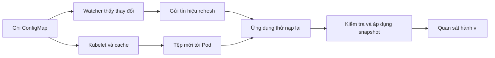

# Độ trễ cập nhật và tính nhất quán giữa nhiều Pod

## Mục tiêu và bối cảnh

Trong chương **Cập nhật cấu hình** của module **SPRING_CLOUD_KUBERNETES**, điều cần xác minh không chỉ là “ConfigMap đã sửa” mà còn là “những Pod nào đang phục vụ bằng cấu hình nào”. Với nhiều replica, tín hiệu cập nhật, dữ liệu đầu vào và đối tượng dùng cấu hình có thể thay đổi ở những thời điểm khác nhau.

Bài học giúp bạn:

- Tách độ trễ truyền dữ liệu, độ trễ áp dụng và thời gian toàn dịch vụ hội tụ.
- Giải thích vì sao Configuration Watcher hoặc endpoint refresh không tạo ra cập nhật đồng thời trên mọi Pod.
- Thiết kế phiên bản cấu hình, snapshot và cơ chế đối soát để tránh dùng lẫn hoặc áp dụng ngược phiên bản.
- Đo trạng thái thực tế trên từng Pod, bao gồm Pod mới và Pod đang kết thúc.
- Chọn mức nhất quán phù hợp với chính sách nghiệp vụ, bí mật truy cập và khả năng phục vụ của hệ thống.

Ví dụ xuyên suốt là `shipping-service` có ba Pod. Phiên bản chính sách `101` miễn phí vận chuyển từ `500000` VND; phiên bản `102` nâng ngưỡng lên `600000` VND. Một đơn `550000` VND sẽ nhận kết quả khác nhau tùy Pod đang dùng phiên bản nào. Sự khác biệt này phải được nhìn thấy và được xử lý theo hợp đồng nghiệp vụ.

## 1. Cập nhật nguồn không đồng nghĩa mọi Pod đã áp dụng

Cần phân biệt bốn lớp trạng thái:

| Lớp | Câu hỏi cần trả lời | Bằng chứng phù hợp |
| --- | --- | --- |
| Nguồn cấu hình | Đối tượng mong muốn đã được ghi chưa? | Tên nguồn, phiên bản nghiệp vụ và phản hồi API |
| Đầu vào của Pod | Pod này đã nhìn thấy dữ liệu mới chưa? | Phiên bản trong tệp hoặc dữ liệu client vừa đọc |
| Đối tượng đang phục vụ | Bean hoặc client thực sự dùng phiên bản nào? | Snapshot của đối tượng được gọi trong luồng nghiệp vụ |
| Toàn dịch vụ | Tập instance cần thiết đã chuyển chưa? | Quan sát từng Pod và phép kiểm tra chức năng |

Kubernetes API có thể đã nhận phiên bản `102` trong khi cả ba Pod còn dùng `101`. Một Pod có thể đã thấy tệp mới nhưng singleton vẫn giữ giá trị cũ. Endpoint kiểm tra đọc trực tiếp tệp mới không chứng minh connection pool hoặc đối tượng tính giá đã đổi.

**Hội tụ** trong bài này nghĩa là, sau khi nguồn ổn định và đường truyền cũng như cơ chế áp dụng hoạt động, các instance thuộc phạm vi cuối cùng cùng sử dụng phiên bản mong muốn. Đó là một điều kiện cần thiết kế và quan sát, không phải lời hứa rằng chỉ cần chờ một số giây cố định thì mọi ứng dụng đều tự đồng bộ.

Nếu ứng dụng chỉ đọc lúc khởi động, hoặc một lần refresh đã đọc dữ liệu cũ rồi không có lần kiểm tra tiếp, trạng thái chạy có thể không hội tụ dù volume về sau đã cập nhật đúng.

## 2. Các đường truyền cấu hình có đặc tính độ trễ khác nhau

| Đường cấp cấu hình | Điều xảy ra khi nguồn thay đổi | Hệ quả đối với việc hội tụ |
| --- | --- | --- |
| Biến môi trường từ ConfigMap/Secret | Biến môi trường trong tiến trình đang chạy không tự đổi | Cần tạo lại Pod hoặc tiến trình theo thiết kế; chờ không phải giải pháp |
| Volume thông thường | Tệp có thể được cập nhật sau độ trễ lan truyền | Ứng dụng còn phải đọc và áp dụng lại |
| Mount bằng `subPath` | Không nhận cập nhật tự động từ nguồn mount | Không dùng mô hình chờ cập nhật tệp như volume thông thường |
| Client đọc Kubernetes API | Client lấy dữ liệu theo cơ chế đọc lại hoặc theo dõi của nó | Cần xét cache, kết nối, quyền và thời điểm áp dụng |
| Nguồn theo tên phiên bản và Pod mới | Pod được tạo với tham chiếu đã chọn | Vẫn có giai đoạn Pod cũ và mới cùng phục vụ khi rolling deployment |

Với ConfigMap mount vào volume, Kubernetes mô tả độ trễ có thể gồm chu kỳ đồng bộ của kubelet và độ trễ truyền qua cache. Kiểu cache phụ thuộc cấu hình kubelet; không nên áp một con số như “luôn đúng một phút” cho mọi cụm. Xem [Kubernetes ConfigMaps](https://kubernetes.io/docs/concepts/configuration/configmap/).

Secret mount vào volume có những lưu ý tương tự về cập nhật, cache và `subPath`. Ngoài độ trễ cấp dữ liệu, còn phải xét thời điểm client chuyển thông tin xác thực và thời điểm hệ thống đích thu hồi giá trị cũ. Xem [Kubernetes Secrets](https://kubernetes.io/docs/concepts/configuration/secret/).

Spring Boot không tự biến mọi thay đổi tệp thành thay đổi hành vi. Khi dùng Spring Cloud Context, chỉ những nguồn và bean được cơ chế tương ứng hỗ trợ mới được xử lý; một bean mới còn có thể chỉ được khởi tạo khi dùng sau refresh. Tham khảo [Spring Cloud Context: Refresh Scope](https://docs.spring.io/spring-cloud-commons/reference/spring-cloud-commons/application-context-services.html#refresh-scope).

## 3. Phân rã độ trễ bằng các mốc quan sát được

Đặt các mốc cho một đợt phát hành phiên bản `v`:

- `t0`: bộ điều phối nhận phản hồi ghi nguồn thành công.
- `tInput(i)`: Pod `i` có thể đọc được dữ liệu của phiên bản `v`.
- `tTrigger(i)`: Pod `i` nhận một tín hiệu yêu cầu nạp lại.
- `tApply(i)`: đối tượng đang phục vụ trong Pod `i` chuyển sang phiên bản `v`.
- `tVerify(i)`: bộ quan sát xác minh được hành vi hoặc trạng thái áp dụng của Pod `i`.

Độ trễ của Pod và của cả đợt, với tập Pod mục tiêu `P` đã xác định, có thể ghi:

```text
inputLag(i)       = tInput(i) - t0
applyLag(i)       = tApply(i) - t0
verifiedLag(i)    = tVerify(i) - t0
convergenceLag   = max(verifiedLag(i)), với i thuộc P
mixedWindow     = max(tApply(i)) - min(tApply(i)), với i thuộc P
```

Các biểu thức chỉ có ý nghĩa khi xác định rõ mốc, tập Pod và cách đo. Nếu còn Pod chưa xác minh được, không được bỏ Pod đó khỏi mẫu rồi công bố toàn dịch vụ đã hội tụ. Đợt đang chờ hoặc đã timeout cần được ghi nhận riêng.

`mixedWindow` mô tả khoảng cách giữa các lần chuyển phiên bản trong tập Pod, không khẳng định request cũ đã kết thúc. Một request bắt đầu trước khi Pod chuyển vẫn có thể hoàn thành sau đó với snapshot cũ.

### Không cộng nhầm các đường truyền chạy song song

Khi ứng dụng đọc volume nhưng Watcher theo dõi API, có hai nhánh riêng:



Nhánh gửi tín hiệu có thể nhanh hơn nhánh cập nhật tệp. Vì vậy, không thể luôn tính tổng đơn giản “thời gian Watcher cộng thời gian kubelet cộng thời gian refresh”: một số công đoạn chạy song song và thứ tự gặp nhau mới quyết định kết quả.

Nếu refresh đến trước dữ liệu mới và không có lần thử lại, thời điểm áp dụng có thể không tồn tại trong đợt đó. Một công thức độ trễ hữu hạn không thể che giấu tình huống này.

### Đo thời gian mà không nhầm lệch đồng hồ

Timestamp UTC ở các node có thể có độ lệch. Khi cần so sánh liên Pod, phải xét đồng bộ đồng hồ và sai số. Trong một tiến trình, đo khoảng thời gian bằng đồng hồ đơn điệu phù hợp hơn việc trừ hai thời điểm có thể bị điều chỉnh.

Một bộ quan sát trung tâm có thể dùng đồng hồ của nó để đo từ lúc ghi thành công đến lúc lần đầu đọc thấy phiên bản áp dụng ở từng Pod. Kết quả này là độ trễ quan sát: còn chứa chu kỳ polling, độ trễ request và thời điểm lấy mẫu, không phải thời điểm chuyển chính xác bên trong Pod.

## 4. Ví dụ tín hiệu refresh đến quá sớm

Các số dưới đây là tình huống giả định để phân tích, không phải kết quả đo hay mặc định của Kubernetes:

| Pod | Tệp `102` xuất hiện | Refresh đầu tiên | Kết quả lần đầu | Lần kiểm tra lại đọc đúng dữ liệu | Áp dụng `102` |
| --- | --- | --- | --- | --- | --- |
| A | Giây 8 | Giây 12 | Đọc được `102` | Không cần cho lần chuyển này | Giây 13 |
| B | Giây 25 | Giây 12 | Vẫn đọc `101` | Giây 29 | Giây 30 |
| C | Giây 63 | Giây 12 | Vẫn đọc `101` | Giây 68 | Giây 69 |

Từ giây 13 đến giây 69, các Pod lần lượt chuyển phiên bản. Với tập ba Pod này, khoảng lệch thời điểm áp dụng là `69 - 13 = 56` giây. Sau giây 69 vẫn phải xét request đang chạy và thời điểm xác minh.

Nếu không có hai lần kiểm tra lại ở B và C, tệp trên cả ba Pod cuối cùng có thể là `102` nhưng B và C vẫn phục vụ bằng `101`. Refresh trả HTTP thành công lúc giây 12 không chứng minh nó đã đọc phiên bản mới.

Với đơn `550000` VND, A đã áp dụng `102` sẽ không miễn phí vận chuyển, trong khi B đang dùng `101` sẽ miễn phí. Đây là tác động nghiệp vụ của việc nhiều phiên bản cùng tồn tại, không chỉ là một chênh lệch timestamp.

### Ý nghĩa và giới hạn của `refreshDelay`

Configuration Watcher có tham số chờ trước khi phát sự kiện; ví dụ cấu hình cho container **Watcher**:

```yaml
env:
  - name: SPRING_CLOUD_KUBERNETES_CONFIGURATION_WATCHER_REFRESHDELAY
    value: "10000"
```

Ví dụ đặt khoảng chờ `10000` mili giây. Giá trị này có thể giảm nguy cơ refresh trước khi volume đổi, nhưng không phải hàng rào bảo đảm mọi Pod đã có tệp mới. Cần đo trên cụm thực tế và kiểm tra cơ chế của phiên bản Watcher đang dùng. Xem [Spring Cloud Kubernetes Configuration Watcher](https://docs.spring.io/spring-cloud-kubernetes/reference/spring-cloud-kubernetes-configuration-watcher.html).

Không đặt tham số trên vào ứng dụng rồi giả định nó điều khiển kubelet. Không tăng khoảng chờ vô hạn để thay cho việc phát hiện Pod không nhận được dữ liệu hoặc không áp dụng được dữ liệu.

## 5. Định danh phiên bản và phạm vi nhất quán

### 5.1. Phân biệt phiên bản Kubernetes và phiên bản nghiệp vụ

Hãy dùng một mã có ý nghĩa với ứng dụng trong payload, ví dụ:

```json
{
  "epoch": 102,
  "version": "shipping-2026-11-b",
  "freeShippingThresholdVnd": 600000
}
```

Trong ví dụ này, `epoch` là số thứ tự do quy trình phát hành của nhóm cấp cho **một luồng chính sách**. `version` là nhãn dễ đọc và truy vết. Một epoch chỉ được gắn với một nội dung chính sách; nếu nhiều pipeline cùng cấp số, phải có cơ chế phân bổ hoặc một chủ sở hữu rõ ràng.

`metadata.resourceVersion` dùng cho cơ chế phiên bản và đồng thời của Kubernetes. Client phải coi nó là giá trị opaque, không tự chuyển thành số để so sánh phiên bản nghiệp vụ hoặc sắp xếp các đối tượng khác nhau. Xem [Kubernetes ObjectMeta](https://kubernetes.io/docs/reference/kubernetes-api/definitions/object-meta-v1-meta/).

Pod nên có định danh UID trong dữ liệu quan sát, vì Pod cùng vai trò hoặc cùng tên workload có thể đã được thay bằng tiến trình mới. Một báo cáo cũ từ Pod đã kết thúc không thay thế xác nhận của Pod mới.

### 5.2. Các mức nhất quán khác nhau

| Phạm vi | Điều cần bảo đảm | Cách thiết kế phù hợp |
| --- | --- | --- |
| Một lần đọc | Không nhận nhóm thuộc tính chắp vá | Đọc và kiểm tra trọn một payload |
| Một JVM | Chỉ công bố snapshot hợp lệ; không bị tác vụ cũ ghi đè | Đổi tham chiếu snapshot có kiểm soát phiên bản |
| Một request | Dùng cùng chính sách từ đầu đến cuối | Lấy snapshot một lần và truyền theo luồng |
| Một quy trình nhiều request | Báo giá và thanh toán dùng điều kiện đã thỏa thuận | Lưu phiên bản hoặc dữ liệu quyết định cùng nghiệp vụ |
| Nhiều Pod | Phát hiện và xử lý instance còn cũ | Đối soát phiên bản trên tập instance thực tế |
| Nhiều dịch vụ | Hành vi tương thích trong giai đoạn chuyển đổi | Giao thức phiên bản, điểm quyết định chung hoặc điều phối chuyên biệt |

Một phép cập nhật thành công của một ConfigMap không cung cấp giao dịch cho hai ConfigMap, một Secret và các client trong nhiều Pod. Các trường cần thay đổi cùng nhau nên được gom thành một đơn vị cấu hình hợp lý; nếu buộc phải nằm ở nhiều nguồn, cần thêm hợp đồng tương thích và cách phát hiện tổ hợp chưa sẵn sàng.

## 6. Tạo snapshot nhất quán trong một Pod

Để minh họa nguyên tắc, phần này dùng một tệp JSON không mật làm payload chính sách. Đây là **lõi thiết kế tùy biến của ứng dụng**, không phải tính năng được tự bật bởi Spring Cloud Kubernetes. JSON trong ví dụ không được mặc định hiểu là định dạng import Config Data của Spring Boot.

Ứng dụng cần một adapter để đọc tệp hoặc nguồn đã chọn, parse trọn payload, dựng đối tượng, rồi đưa vào kho snapshot. Adapter có thể được gọi sau tín hiệu cập nhật và bởi một vòng kiểm tra định kỳ. Nếu dùng `/actuator/refresh` cho các PropertySource thông thường, phải thiết kế cầu nối tương ứng; không mặc nhiên cho rằng endpoint này sẽ gọi lớp tùy biến bên dưới.

### 6.1. Đối tượng chính sách bất biến

Mẫu Java 17 trở lên:

```java
public record ShippingPolicy(
        long epoch,
        String version,
        long freeShippingThresholdVnd) {

    public ShippingPolicy {
        if (epoch < 1) {
            throw new IllegalArgumentException("epoch phải dương");
        }
        if (version == null || version.isBlank()) {
            throw new IllegalArgumentException("Thiếu version chính sách");
        }
        if (freeShippingThresholdVnd < 0
                || freeShippingThresholdVnd > 1_000_000_000L) {
            throw new IllegalArgumentException("Ngưỡng VND ngoài miền cho phép");
        }
    }
}
```

Giới hạn một tỷ VND là quy tắc ví dụ của bài học, không phải giới hạn của Kubernetes. Dùng số nguyên theo đơn vị VND để tránh nhầm đơn vị và biểu diễn số thực trong tình huống này.

### 6.2. Không cho tác vụ cũ ghi đè phiên bản mới

```java
import java.time.Instant;
import java.util.Objects;
import java.util.concurrent.atomic.AtomicReference;

public final class PolicyStore {
    public enum ApplyResult {
        APPLIED, ALREADY_APPLIED, STALE
    }

    public record ActivePolicy(ShippingPolicy policy, Instant appliedAt) {
    }

    private final AtomicReference<ActivePolicy> active;

    public PolicyStore(ShippingPolicy initial) {
        active = new AtomicReference<>(new ActivePolicy(
                Objects.requireNonNull(initial), Instant.now()));
    }

    public ActivePolicy snapshot() {
        return active.get();
    }

    public ApplyResult tryApply(ShippingPolicy candidate) {
        Objects.requireNonNull(candidate);
        while (true) {
            ActivePolicy current = active.get();
            long currentEpoch = current.policy().epoch();

            if (candidate.epoch() < currentEpoch) {
                return ApplyResult.STALE;
            }
            if (candidate.epoch() == currentEpoch) {
                if (!candidate.equals(current.policy())) {
                    throw new IllegalStateException(
                            "Cùng epoch nhưng khác nội dung chính sách");
                }
                return ApplyResult.ALREADY_APPLIED;
            }

            ActivePolicy next = new ActivePolicy(candidate, Instant.now());
            if (active.compareAndSet(current, next)) {
                return ApplyResult.APPLIED;
            }
        }
    }
}
```

Ứng dụng Spring có thể đăng ký `PolicyStore` làm singleton và inject nó vào phần tính giá. Constructor nhận snapshot đầu tiên đã được đọc và kiểm tra hợp lệ; nếu chưa có chính sách bắt buộc, ứng dụng chưa nên nhận nghiệp vụ cần chính sách đó.

Đổi tham chiếu bằng `compareAndSet` giúp một tác vụ đang xử lý `102` không ghi đè `103` đã được tác vụ khác công bố trước đó. `ALREADY_APPLIED` làm cho việc nhận lại cùng một nội dung trở nên an toàn; cùng epoch mà khác nội dung được xem là xung đột cần điều tra. API nguyên tử của Java được mô tả tại [AtomicReference](https://docs.oracle.com/en/java/javase/21/docs/api/java.base/java/util/concurrent/atomic/AtomicReference.html).

Đây chỉ là tính nhất quán trong một tiến trình. Khi Pod khởi động lại, bộ nhớ này mất đi; muốn ngăn Pod mới khởi động với cấu hình cũ phải có kiểm tra phiên bản tối thiểu hoặc tham chiếu nguồn theo phiên bản ở bước nhận lưu lượng. `AtomicReference` không điều phối các JVM và không cung cấp lưu trữ bền vững.

### 6.3. Lấy snapshot một lần cho một quyết định

```java
public final class ShippingCalculator {
    private final PolicyStore store;

    public ShippingCalculator(PolicyStore store) {
        this.store = store;
    }

    public QuoteResult quote(long orderTotalVnd) {
        if (orderTotalVnd < 0) {
            throw new IllegalArgumentException("Tổng đơn hàng không hợp lệ");
        }
        ShippingPolicy policy = store.snapshot().policy();
        boolean freeShipping = orderTotalVnd >= policy.freeShippingThresholdVnd();
        return new QuoteResult(freeShipping, policy.epoch(), policy.version());
    }

    public record QuoteResult(
            boolean freeShipping,
            long policyEpoch,
            String policyVersion) {
    }
}
```

Phiên bản trong phản hồi được lấy từ chính snapshot đã tính kết quả. Không tính bằng một snapshot rồi đọc `version` từ `Environment` hoặc từ một snapshot khác để gắn vào kết quả.

Đối với nghiệp vụ nhiều bước, lưu snapshot hoặc những dữ liệu cần thiết cùng báo giá/đơn hàng, có thời hạn và quy tắc xác minh phù hợp. Chỉ lưu mã phiên bản là chưa đủ nếu hệ thống không còn khả năng tìm và áp dụng nội dung của phiên bản đó.

## 7. Đối soát trạng thái để vượt qua sự kiện sớm hoặc bị gián đoạn

Tín hiệu cập nhật nên được hiểu là “hãy kiểm tra lại nguồn”. Sau đó ứng dụng phải xác minh nội dung đọc được và trạng thái đã áp dụng. Không nên coi một lần nhận sự kiện là bằng chứng công việc đã hoàn tất.

Một vòng đối soát có thể thực hiện:

```text
1. Xác định mục tiêu của đợt phát hành đang được theo dõi.
2. Đọc trọn payload từ nguồn hoặc tệp bằng một lần nạp mới.
3. Parse, kiểm tra cấu trúc, đơn vị và ràng buộc nghiệp vụ.
4. Đối chiếu epoch và nội dung với mục tiêu đã biết.
5. Nếu đầu vào còn cũ: ghi WAITING_INPUT, hẹn kiểm tra lại.
6. Nếu đầu vào sai: ghi REJECTED, giữ snapshot hợp lệ đang dùng.
7. Nếu hợp lệ: thử công bố snapshot; xử lý lặp hoặc phiên bản cũ.
8. Kiểm tra đối tượng đang phục vụ và ghi phiên bản áp dụng.
9. Tiếp tục đối soát định kỳ để phát hiện thay đổi hoặc instance mới.
```

Đây là mô hình tùy biến, không phải mô tả rằng Watcher mặc định đã thực hiện đủ chín bước. Khi không có nguồn biết mục tiêu phát hành, ứng dụng chỉ có thể báo phiên bản nó đã thấy và đã dùng; nó không thể tự biết có phiên bản mới hơn mà nó chưa nhận được.

Trong một đợt mục tiêu ổn định, nếu mong muốn `102` mà tệp vẫn là `101`, trạng thái đúng là còn chờ đầu vào. Nếu nguồn đã chuyển sang `103`, bộ điều phối cần ghi nhận đợt `102` đã bị thay thế hoặc quyết định rõ cách xử lý; không ghi thành công cho `102` chỉ vì giá trị hiện tại “có vẻ mới hơn”. Với các đợt phát hành chồng lấn, phải điều phối mục tiêu và xử lý thông báo muộn theo từng mã đợt.

### Retry, đối soát định kỳ và tải hệ thống

- Retry có backoff và jitter giúp tránh mọi Pod cùng lặp request vào một thời điểm.
- Có deadline và cảnh báo khi quá thời gian mục tiêu; hết deadline không có nghĩa dữ liệu tự quay về bản cũ.
- Đối soát định kỳ giúp sửa tình huống tín hiệu đến sớm hoặc bị gián đoạn, với điều kiện nguồn vẫn truy cập được.
- Gộp nhiều tín hiệu gần nhau có thể giảm tải nếu chỉ cần trạng thái mới nhất.
- Một thao tác nhận lại cùng phiên bản phải có tính idempotent, tránh tạo lặp client, tác vụ hoặc tác dụng nghiệp vụ.

Chu kỳ polling ngắn giảm thời gian phát hiện nhưng tăng tải đọc, parse và có thể tăng tải Kubernetes API. Hãy tách polling tệp cục bộ khỏi polling API; hai cách có chi phí và yêu cầu quyền khác nhau.

Nếu ứng dụng tự dùng watch API, phải xử lý ngắt kết nối và tình huống resource version không còn được lưu. Kubernetes mô tả việc client có thể phải list lại khi nhận `410 Gone`. Không dùng một kết nối watch như kho sự kiện nghiệp vụ bền vững. Xem [Kubernetes API Concepts](https://kubernetes.io/docs/reference/using-api/api-concepts/).

Nếu mỗi phiên bản trung gian đều bắt buộc phải được xử lý, một ConfigMap chứa trạng thái hiện tại và việc đọc lại sau sự kiện không đủ làm nhật ký công việc. Khi đó cần một cơ chế lưu và xác nhận xử lý thích hợp, thay vì tăng tần suất refresh.

## 8. Quan sát `desired`, `observed` và `applied` riêng biệt

Một hợp đồng endpoint quản trị có thể trả trạng thái không mật như sau:

```json
{
  "podName": "shipping-service-example",
  "podUid": "uid-of-this-pod",
  "targetEpoch": 102,
  "observedEpoch": 102,
  "appliedEpoch": 101,
  "applyState": "REJECTED",
  "lastFailureCode": "INVALID_POLICY"
}
```

Đây là mẫu dữ liệu ứng dụng tự cung cấp, không phải endpoint mặc định của Spring Boot. `targetEpoch` chỉ được điền nếu có nguồn mục tiêu đáng tin cậy; nếu chưa biết, trả trạng thái chưa biết thay vì sao chép `observedEpoch` sang trường này.

Ý nghĩa của ba con số:

- `targetEpoch`: phiên bản đợt phát hành yêu cầu sử dụng.
- `observedEpoch`: phiên bản ứng dụng vừa đọc được; có thể chưa qua kiểm tra.
- `appliedEpoch`: phiên bản của snapshot đang phục vụ sau khi áp dụng thành công.

Khi báo `APPLIED`, phiên bản và thời điểm công bố nên được lấy từ cùng một snapshot như `ActivePolicy` trong ví dụ. Khi báo lỗi, chỉ ghi mã lỗi phù hợp và thông tin chẩn đoán đã kiểm soát. Không trả nội dung Secret, password, token hay toàn bộ `Environment` trong endpoint này.

### Chỉ số cần đo

| Chỉ số hoặc trạng thái | Mục đích | Điểm cần tránh |
| --- | --- | --- |
| Thời gian từ ghi nguồn đến quan sát áp dụng | Đo độ trễ của đợt phát hành | Không gọi thời gian quan sát là thời điểm chuyển nội bộ chính xác |
| Số Pod chưa xác minh được mục tiêu | Phát hiện chưa hội tụ | Không loại Pod lỗi hoặc mất liên lạc khỏi mẫu để làm đẹp kết quả |
| Số lần áp dụng theo kết quả | Phân biệt thành công, từ chối, lặp và lỗi | Không gắn raw config hoặc secret làm nhãn |
| Thời gian từ lần đối soát thành công gần nhất | Phát hiện vòng cập nhật đã ngừng | Mốc thành công không có nghĩa đã có bản mới nếu mục tiêu chưa biết |
| Tỷ lệ lỗi và hành vi nghiệp vụ | Phát hiện cấu hình đúng định dạng nhưng sai tác động | Không chỉ dựa vào trạng thái `Running` hoặc HTTP refresh thành công |

Histogram độ trễ chỉ ghi những lần hoàn thành sẽ không thể hiện hết những đợt bị treo. Cần theo dõi cả timeout, số đợt đang chờ và các lỗi từ chối. Với nhiều đợt thực tế, có thể đánh giá p95/p99 cùng tỷ lệ thành công; ba Pod trong một tình huống minh họa không phải bộ số liệu đủ để hứa một SLO thống kê.

Tránh nhãn metric sinh vô hạn theo từng mã phát hành. Mã chi tiết có thể phù hợp hơn trong log hoặc báo cáo đợt; metric dùng tập nhãn đã kiểm soát.

## 9. Xác định tập Pod phải hội tụ

Tập Pod không cố định nếu có autoscaling, restart, rollout hoặc Pod bị lỗi. Việc chỉ kiểm tra ba tên Pod đã chụp lúc bắt đầu có thể bỏ sót Pod thứ tư mới được tạo với cấu hình cũ.

Một đợt cập nhật cần định nghĩa:

1. Những instance nào thuộc workload và phạm vi nghiệp vụ đang thay đổi.
2. Những instance nào đang nhận lưu lượng hoặc có thể được đưa vào nhận lưu lượng.
3. Cách thêm Pod mới và loại Pod đã kết thúc khỏi danh sách theo dõi.
4. Cách xử lý Pod đang kết thúc nhưng còn request hoặc tác vụ đang chạy.
5. Điều kiện báo hội tụ, điều kiện timeout và tình huống thay đổi mục tiêu giữa chừng.

Đối chiếu UID thay vì chỉ tên. Một Pod biến mất cần được ghi nhận là kết thúc hoặc bị thay thế; nếu vẫn thuộc đường phục vụ mà không quan sát được thì đó là trạng thái chưa biết, không phải đã thành công.

### Readiness không tự biết phiên bản mong muốn toàn cục

Có thể thiết kế Pod chỉ sẵn sàng sau khi nạp được một chính sách hợp lệ. Có thể bổ sung yêu cầu epoch tối thiểu hoặc phiên bản cụ thể của đợt, nhưng Pod phải nhận được yêu cầu đó từ một nguồn đáng tin cậy. Nếu nó chỉ đọc tệp local `101`, nó không thể tự suy ra trên control plane đã có `102`.

Nếu mọi Pod đều bị gỡ readiness vì chưa tới mục tiêu, hệ thống có thể mất khả năng phục vụ. Cần quyết định rõ cho từng nghiệp vụ: tiếp tục dùng bản hợp lệ cũ trong khoảng cho phép, hạn chế riêng thao tác cần bản mới, hay dừng nhận lưu lượng để bảo vệ tính đúng đắn. Không dùng một quy tắc mặc định cho mọi loại cấu hình.

Kiểm tra riêng khả năng hội tụ và khả năng phục vụ. Chẳng hạn “hai trên ba Pod đã đúng” có thể giữ được công suất, nhưng không có nghĩa các yêu cầu không còn gặp Pod thứ ba. Một ngưỡng đa số không thay thế việc kiểm soát đường nhận lưu lượng.

## 10. Chọn chiến lược theo yêu cầu nghiệp vụ

| Yêu cầu | Thiết kế có thể cân nhắc | Giới hạn phải chấp nhận hoặc xử lý |
| --- | --- | --- |
| Nội dung hiển thị có thể khác tạm thời | Cập nhật cuối cùng hội tụ, có đo độ trễ và retry | Một khoảng nhiều phiên bản cùng tồn tại |
| Một request cần cùng một chính sách | Snapshot bất biến ở đầu request | Request khác có thể lấy phiên bản khác |
| Báo giá phải giữ điều kiện đến lúc chốt đơn | Lưu phiên bản và dữ liệu quyết định của báo giá | Cần khả năng xác minh, thời hạn và giữ nội dung phiên bản |
| Muốn giảm số trường hợp trộn cấu hình cũ/mới | Nguồn theo phiên bản và Pod template trỏ đúng nguồn | Rolling deployment vẫn có Pod cũ/mới cùng phục vụ |
| Muốn kiểm chứng nhóm mới trước khi nhận lưu lượng | Blue/green hoặc nhóm thử nghiệm với nguồn tách biệt | Chuyển route và kết nối tồn tại không tạo giao dịch đồng thời toàn cục |
| Cần thay đổi tại một thời điểm kinh doanh | Chuẩn bị trước, kiểm tra đã sẵn sàng, có quy tắc kích hoạt | Đồng hồ, Pod chậm và request đang chạy cần được xử lý |
| Mọi giao dịch cần tuân theo một quyết định nhất quán nghiêm ngặt | Điểm quyết định chung hoặc giao thức nhất quán phù hợp nghiệp vụ | Có chi phí phối hợp, độ trễ và đánh đổi khi mất kết nối |

### Nguồn theo phiên bản giúp tái hiện, không tự xóa độ trễ

Một ConfigMap như `shipping-policy-102` có nội dung giữ nguyên, được tham chiếu từ Pod template, giúp biết Pod mới cần dùng nội dung nào. Chỉ sửa ConfigMap có tên cố định không tự kích hoạt rollout; thay đổi Pod template mới kích hoạt cơ chế đó. Xem [Kubernetes Deployments](https://kubernetes.io/docs/concepts/workloads/controllers/deployment/).

Ngay cả khi các Pod mới đều có cấu hình đúng ngay từ lúc khởi động, Pod cũ vẫn có thể phục vụ trong thời gian thay thế. Cần giữ tính tương thích của request và quy trình nhiều bước trong khoảng này.

### `activateAt` không phải đồng hồ toàn cục hoàn hảo

Gắn thời điểm kích hoạt tương lai giúp chuẩn bị trước và giảm việc vừa truyền vừa kích hoạt. Tuy nhiên, phải chứng minh payload đã sẵn sàng ở các instance cần thiết, xem xét sai số đồng hồ và có quy tắc với Pod chưa chuẩn bị xong. Một field `activateAt` không tự tạo ra consensus hay chấm dứt request đang chạy với chính sách cũ.

### DiscoveryClient và LoadBalancer không tự đồng bộ chính sách

DiscoveryClient giúp tìm instance; Spring Cloud LoadBalancer giúp chọn đích gọi. Chúng không mặc định so sánh `appliedEpoch` rồi chỉ chọn Pod có phiên bản phù hợp.

Nếu muốn định tuyến theo phiên bản, cần metadata được cập nhật đúng, bộ lọc và quy tắc xử lý khi không có instance tương thích. Metadata cũng có độ trễ, nên vẫn phải kiểm tra tại nơi ra quyết định nghiệp vụ. Sticky session có thể giảm việc người dùng đổi Pod, nhưng không bảo đảm Pod đó giữ nguyên cấu hình trong nhiều request.

## 11. Thực hành đo độ trễ và phát hiện chưa hội tụ

### 11.1. Chuẩn bị môi trường thực hành

Giả định có namespace `training-consistency` và ứng dụng `shipping-service` ba replica. Ứng dụng cần được hiện thực với adapter đọc chính sách, kho snapshot, vòng đối soát và hai đường kiểm tra theo hợp đồng dưới đây:

- `/internal/config-status`: trả UID Pod, phiên bản đã thấy, phiên bản áp dụng và trạng thái cập nhật không mật.
- `/quotes/preview?totalVnd=550000`: trả kết quả tính phí cùng epoch đã dùng; đây là phép xem trước không tạo giao dịch.

Tên endpoint là mẫu để tích hợp vào ứng dụng của người học, không phải endpoint có sẵn khi thêm starter. Với ứng dụng dùng refresh chuẩn của Spring Cloud, có thể thay cách nạp nhưng vẫn phải cung cấp được dấu hiệu của đối tượng thực sự phục vụ.

Chỉ dùng cấu hình không mật và môi trường lab được cấp quyền. Trong lần đo cơ bản, giữ số replica ổn định để dễ giải thích; sau đó mới bổ sung tình huống thay Pod và autoscaling.

### 11.2. Cấp một payload có epoch

Nội dung minh họa cho `shipping-policy-current.yaml`:

```yaml
apiVersion: v1
kind: ConfigMap
metadata:
  name: shipping-policy-current
  namespace: training-consistency
data:
  policy.json: |
    {
      "epoch": 101,
      "version": "shipping-2026-11-a",
      "freeShippingThresholdVnd": 500000
    }
```

Mount thư mục bằng volume thông thường, ví dụ phần trích từ Pod template:

```yaml
spec:
  template:
    spec:
      containers:
        - name: shipping-service
          volumeMounts:
            - name: policy
              mountPath: /etc/shipping-policy
              readOnly: true
      volumes:
        - name: policy
          configMap:
            name: shipping-policy-current
            items:
              - key: policy.json
                path: policy.json
```

Phần trích không phải Deployment đầy đủ để áp dụng độc lập. Adapter của ứng dụng đọc `/etc/shipping-policy/policy.json`. Đường cấp tệp này không đòi hỏi chính ứng dụng được cấp quyền đọc API ConfigMap; thành phần dùng API và Watcher, nếu có, cần RBAC riêng cho nhiệm vụ của chúng.

Nếu dùng Configuration Watcher cho lab, phải cấu hình đúng nguồn được theo dõi, ứng dụng đích và khả năng gọi endpoint. Không chỉ thêm nhãn vào một ConfigMap có tên khác ứng dụng rồi suy ra Watcher chắc chắn tìm đúng mọi instance. Vòng tùy biến của ví dụ cũng không được tự gọi bởi Watcher khi chưa có tích hợp tương ứng.

### 11.3. Thu thập danh sách instance và đo đúng đích

```powershell
kubectl -n training-consistency get pods -l app=shipping-service -o 'custom-columns=NAME:.metadata.name,UID:.metadata.uid,NODE:.spec.nodeName,PHASE:.status.phase,DELETING:.metadata.deletionTimestamp'
kubectl -n training-consistency get deployment shipping-service
```

Chọn từng Pod cụ thể để kiểm tra. Trong terminal thứ nhất, thay tên minh họa bằng tên vừa quan sát và giữ lệnh chạy:

```powershell
$selectedPod = 'TEN_POD_DA_CHON'
kubectl -n training-consistency port-forward pod/$selectedPod 18081:8080
```

Trong terminal thứ hai:

```powershell
Invoke-RestMethod -Method Get -Uri 'http://127.0.0.1:18081/internal/config-status'
Invoke-RestMethod -Method Get -Uri 'http://127.0.0.1:18081/quotes/preview?totalVnd=550000'
```

Dừng port-forward trước khi dùng cùng cổng để kiểm tra Pod khác. Một hệ thống đo tự động có thể thăm dò các Pod song song qua đường quản trị được kiểm soát và gắn kết quả với UID. Các lần kiểm tra tuần tự bằng tay có thêm độ trễ quan sát; phải ghi rõ giới hạn này.

Không gửi nhiều request qua một Service rồi mặc định đã kiểm tra đủ replica. Kết quả cần nêu rõ Pod nào trả lời và phiên bản nào được dùng để tính toán.

### 11.4. Cập nhật và lập bảng thời gian

1. Xác nhận cả ba Pod đang áp dụng `101` và đơn `550000` VND được miễn phí vận chuyển.
2. Sửa payload thành epoch `102`, nhãn `shipping-2026-11-b`, ngưỡng `600000` VND.
3. Ghi thời điểm nhận phản hồi thành công của lần áp dụng:

```powershell
kubectl -n training-consistency apply -f ./shipping-policy-current.yaml
```

4. Theo dõi tệp đầu vào, trạng thái áp dụng và phép xem trước trên từng UID Pod. Nếu image có tiện ích `cat`, chỉ đọc tệp chính sách không mật đã xác định; không mở rộng sang tệp Secret.
5. Đợi đủ bằng chứng hội tụ hoặc kết thúc ở deadline lab do người thực hành chọn, ví dụ `90s`. Đây là giới hạn bài đo, không phải cam kết độ trễ của nền tảng.

Bảng ghi nhận:

| UID Pod | Thấy tệp `102` lúc nào? | Áp dụng `102` lúc nào? | Lần đầu quan sát được `102` | Kết quả với `550000` VND | Trạng thái cuối |
| --- | --- | --- | --- | --- | --- |
| A | Ghi mốc đo | Ghi mốc ứng dụng nếu có | Ghi mốc bộ quan sát | Không miễn phí theo `102` | Hội tụ/chờ/lỗi |
| B | Ghi mốc đo | Ghi mốc ứng dụng nếu có | Ghi mốc bộ quan sát | Không miễn phí theo `102` | Hội tụ/chờ/lỗi |
| C | Ghi mốc đo | Ghi mốc ứng dụng nếu có | Ghi mốc bộ quan sát | Không miễn phí theo `102` | Hội tụ/chờ/lỗi |

Không điền thời điểm không đo được bằng suy đoán. Nếu chỉ có lần quan sát đầu tiên, ghi đó là `tVerify`, không gán thành `tApply`.

### 11.5. Tạo tình huống lệch có kiểm soát

Thực hiện từng tình huống riêng trong lab và ghi rõ cách mô phỏng:

- Đặt chu kỳ đối soát của một instance dài hơn để thấy phần độ trễ do ứng dụng, không gọi đó là độ trễ kubelet.
- Yêu cầu nạp lại sớm trong khi đầu vào chưa đổi để kiểm tra trạng thái còn chờ và lần đối soát sau đó.
- Cho một adapter đọc thử dữ liệu không hợp lệ ở phiên bản mới; kiểm tra snapshot cũ vẫn được giữ và có cảnh báo.
- Gửi hai ứng viên hợp lệ theo thứ tự xử lý chồng lấn; kiểm tra ứng viên cũ không ghi đè epoch mới hơn trong cùng tiến trình.
- Tạo thêm Pod sau khi đã bắt đầu theo dõi và xác minh nó được thêm vào tập cần kiểm tra.

Không chủ động làm lỗi node hoặc thay cấu hình kubelet dùng chung chỉ để tạo độ trễ cho bài tập. Một mô phỏng bằng adapter ứng dụng cần được ghi đúng là mô phỏng, không được công bố như số đo của một cụm Kubernetes thực tế.

## 12. Khôi phục và xử lý phiên bản không hội tụ

### Một Pod còn cũ

Xác định lớp đang chậm: không nhận đầu vào, không nạp lại, bị nguồn khác ghi đè, kiểm tra thất bại hay đối tượng dùng cấu hình chưa đổi. Khi cần thay Pod, phải bảo đảm nguồn hoặc tham chiếu khởi động đã đúng; thay Pod mà vẫn trỏ đầu vào sai sẽ lặp lại lỗi.

### Nội dung mới không hợp lệ

Giữ snapshot hợp lệ gần nhất nếu yêu cầu nghiệp vụ cho phép, ghi trạng thái chưa đạt mục tiêu và cảnh báo. Không đổi `appliedEpoch` chỉ để làm báo cáo bằng `targetEpoch`. Nếu không có bản hợp lệ để phục vụ, chưa nhận những nghiệp vụ cần bản đó.

### Quay lại hành vi trước nhưng vẫn giữ thứ tự phiên bản

`PolicyStore` từ chối epoch cũ hơn, nên rollback không phải gửi lại `101` sau khi đã áp dụng `102`. Một cách phù hợp với hợp đồng này là phát hành epoch `103` mang ngưỡng của chính sách cũ, với nhãn mới mô tả đợt khôi phục.

```json
{
  "epoch": 103,
  "version": "shipping-rollback-2026-11-c",
  "freeShippingThresholdVnd": 500000
}
```

Bản phát hành khôi phục vẫn phải được đo hội tụ như mọi bản khác. Tác vụ muộn mang `102` sẽ không ghi đè `103` trong tiến trình đã áp dụng nó. Nếu muốn rollback bằng tham chiếu nguồn theo phiên bản, cũng cần quy định rõ quan hệ giữa mã bản phát hành và epoch ứng dụng để không mâu thuẫn với kiểm tra thứ tự.

### Bí mật truy cập và khoảng chuyển tiếp

Không kết luận xoay vòng bí mật hoàn tất chỉ vì tệp trên mọi Pod đã đổi. Phải kiểm tra client đang dùng thông tin mới, request/tác vụ cũ đã xử lý phù hợp và hệ thống đích chấp nhận thông tin đó.

Nếu nơi cấp hỗ trợ chồng lấn, giữ giá trị cũ trong một khoảng chuyển tiếp được kiểm soát rồi thu hồi sau khi đủ bằng chứng. Nếu không hỗ trợ chồng lấn, phải thiết kế phương án khác hoặc chấp nhận khoảng gián đoạn đã được xác định. Dữ liệu quan sát chỉ chứa mã phiên bản và trạng thái, không chứa giá trị bí mật hay hash dùng để dò đối chiếu bí mật.

## 13. Điều kiện hoàn tất một đợt cập nhật

Một đợt cập nhật cần có đủ bằng chứng sau:

- Nguồn và mục tiêu phát hành đã được xác định rõ, không bị thay thế ngoài dự kiến.
- Phiên bản áp dụng được đo từ đối tượng đang phục vụ, không chỉ từ API hoặc tệp.
- Tập Pod đã được đối chiếu theo UID và xét các thay đổi thành viên trong thời gian theo dõi.
- Những instance chưa quan sát được, bị từ chối hoặc timeout được báo riêng.
- Hành vi nghiệp vụ và giới hạn của request đang chạy đã được kiểm tra.
- Có cách phục hồi phù hợp với phiên bản, snapshot và thông tin xác thực còn hiệu lực.

Với hệ thống chấp nhận độ trễ hội tụ, mục tiêu là có giới hạn vận hành đo được, phát hiện sai lệch và phục hồi được. Với nghiệp vụ yêu cầu nhất quán mạnh hơn, phải đưa phiên bản và điểm quyết định vào thiết kế nghiệp vụ; tăng tốc Watcher hoặc giảm chu kỳ polling không tự tạo ra bảo đảm đó.
